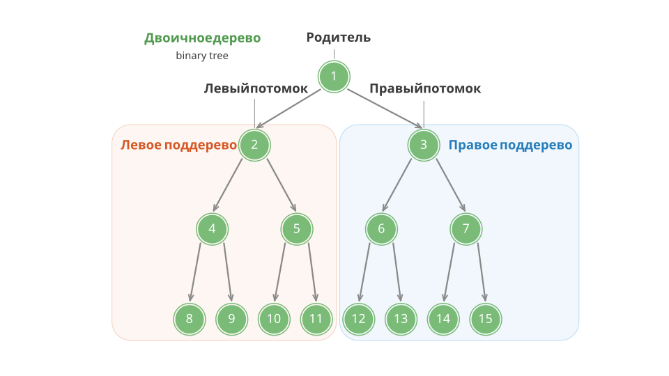
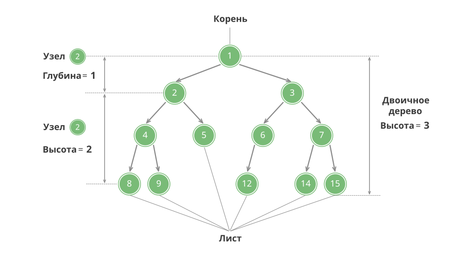
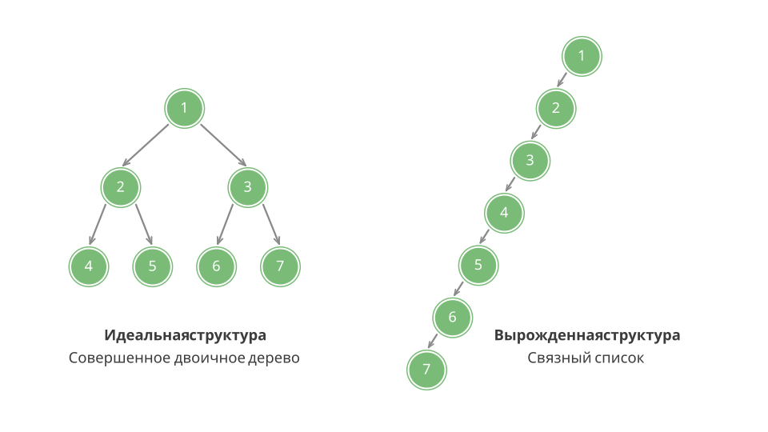

# 7.1 &nbsp; Двоичное дерево

<u>Двоичное дерево (binary tree)</u> — нелинейная структура данных, которая описывает отношения между предками и потомками и воплощает идею разделения задачи на две части по принципу «разделяй и властвуй». Как и в связном списке, его основной элемент — узел. В узле хранятся значение и ссылки на левого и правого потомков.

=== "Python"

    ```python title=""
    class TreeNode:
        """Класс узла двоичного дерева"""
        def __init__(self, val: int):
            self.val: int = val                # Значение узла
            self.left: TreeNode | None = None  # Ссылка на левого потомка
            self.right: TreeNode | None = None # Ссылка на правого потомка
    ```

=== "C++"

    ```cpp title=""
    /* Структура узла двоичного дерева */
    struct TreeNode {
        int val;          // Значение узла
        TreeNode *left;   // Указатель на левого потомка
        TreeNode *right;  // Указатель на правого потомка
        TreeNode(int x) : val(x), left(nullptr), right(nullptr) {}
    };
    ```

=== "Java"

    ```java title=""
    /* Класс узла двоичного дерева */
    class TreeNode {
        int val;         // Значение узла
        TreeNode left;   // Ссылка на левого потомка
        TreeNode right;  // Ссылка на правого потомка
        TreeNode(int x) { val = x; }
    }
    ```

=== "C#"

    ```csharp title=""
    /* Класс узла двоичного дерева */
    class TreeNode(int? x) {
        public int? val = x;    // Значение узла
        public TreeNode? left;  // Ссылка на левого потомка
        public TreeNode? right; // Ссылка на правого потомка
    }
    ```

=== "Go"

    ```go title=""
    /* Структура узла двоичного дерева */
    type TreeNode struct {
        Val   int
        Left  *TreeNode
        Right *TreeNode
    }
    /* Конструктор */
    func NewTreeNode(v int) *TreeNode {
        return &TreeNode{
            Left:  nil, // Указатель на левого потомка
            Right: nil, // Указатель на правого потомка
            Val:   v,   // Значение узла
        }
    }
    ```

=== "Swift"

    ```swift title=""
    /* Класс узла двоичного дерева */
    class TreeNode {
        var val: Int // Значение узла
        var left: TreeNode? // Ссылка на левого потомка
        var right: TreeNode? // Ссылка на правого потомка

        init(x: Int) {
            val = x
        }
    }
    ```

=== "JS"

    ```javascript title=""
    /* Класс узла двоичного дерева */
    class TreeNode {
        val; // Значение узла
        left; // Указатель на левого потомка
        right; // Указатель на правого потомка
        constructor(val, left, right) {
            this.val = val === undefined ? 0 : val;
            this.left = left === undefined ? null : left;
            this.right = right === undefined ? null : right;
        }
    }
    ```

=== "TS"

    ```typescript title=""
    /* Класс узла двоичного дерева */
    class TreeNode {
        val: number;
        left: TreeNode | null;
        right: TreeNode | null;

        constructor(val?: number, left?: TreeNode | null, right?: TreeNode | null) {
            this.val = val === undefined ? 0 : val; // Значение узла
            this.left = left === undefined ? null : left; // Ссылка на левого потомка
            this.right = right === undefined ? null : right; // Ссылка на правого потомка
        }
    }
    ```

=== "Dart"

    ```dart title=""
    /* Класс узла двоичного дерева */
    class TreeNode {
      int val;         // Значение узла
      TreeNode? left;  // Ссылка на левого потомка
      TreeNode? right; // Ссылка на правого потомка
      TreeNode(this.val, [this.left, this.right]);
    }
    ```

=== "Rust"

    ```rust title=""
    use std::rc::Rc;
    use std::cell::RefCell;

    /* Структура узла двоичного дерева */
    struct TreeNode {
        val: i32,                               // Значение узла
        left: Option<Rc<RefCell<TreeNode>>>,    // Ссылка на левого потомка
        right: Option<Rc<RefCell<TreeNode>>>,   // Ссылка на правого потомка
    }

    impl TreeNode {
        /* Конструктор */
        fn new(val: i32) -> Rc<RefCell<Self>> {
            Rc::new(RefCell::new(Self {
                val,
                left: None,
                right: None
            }))
        }
    }
    ```

=== "C"

    ```c title=""
    /* Структура узла двоичного дерева */
    typedef struct TreeNode {
        int val;                // Значение узла
        struct TreeNode *left;  // Указатель на левого потомка
        struct TreeNode *right; // Указатель на правого потомка
    } TreeNode;

    /* Конструктор */
    TreeNode *newTreeNode(int val) {
        TreeNode *node;

        node = (TreeNode *)malloc(sizeof(TreeNode));
        node->val = val;
        node->left = NULL;
        node->right = NULL;
        return node;
    }
    ```

=== "Kotlin"

    ```kotlin title=""
    /* Класс узла двоичного дерева */
    class TreeNode(val _val: Int) {  // Значение узла
        var left: TreeNode? = null   // Ссылка на левого потомка
        var right: TreeNode? = null  // Ссылка на правого потомка
    }
    ```

=== "Ruby"

    ```ruby title=""
    ### Класс узла двоичного дерева ###
    class TreeNode
      attr_accessor :val    # Значение узла
      attr_accessor :left   # Ссылка на левого потомка
      attr_accessor :right  # Ссылка на правого потомка

      def initialize(val)
        @val = val
      end
    end
    ```

В каждом узле есть две ссылки (указателя) — на <u>левого потомка (left-child node)</u> и на <u>правого потомка (right-child node)</u>. Сам узел называется их <u>родителем (parent node)</u>. Дерево, образованное левым потомком выбранного узла и всеми его потомками, называется <u>левым поддеревом (left subtree)</u> этого узла. Аналогично определяется <u>правое поддерево (right subtree)</u>.

**В двоичном дереве у каждого узла, кроме листьев, есть потомки и непустые поддеревья**. На рисунке 7-1 у узла 2 как родителя левый потомок — узел 4, а правый — узел 5. Левое поддерево образуют узел 4 и все узлы под ним, правое — узел 5 и все узлы под ним.

{ class="animation-figure" }

<p align="center"> Рисунок 7-1 &nbsp; Родитель, потомки и поддеревья </p>

## 7.1.1 &nbsp; Основные понятия двоичного дерева

На рисунке показаны основные понятия, связанные с двоичным деревом.

- <u>Корень (root node)</u> — узел на верхнем уровне двоичного дерева, у которого нет родителя.
- <u>Лист (leaf node)</u> — узел без потомков. Оба его указателя имеют значение `None`.
- <u>Ребро (edge)</u> — линия, соединяющая два узла. В структуре данных ей соответствует ссылка (указатель) на узел.
- <u>Уровень (level)</u> узла отсчитывается сверху вниз. Корень находится на уровне 1.
- <u>Степень (degree)</u> узла — число его непосредственных потомков. В двоичном дереве возможны значения 0, 1 и 2.
- <u>Высота (height)</u> двоичного дерева — число рёбер от корня до самого удалённого листа.
- <u>Глубина (depth)</u> узла — число рёбер на пути от корня до этого узла.
- <u>Высота (height)</u> узла — число рёбер между ним и самым удалённым листом его поддерева.

{ class="animation-figure" }

<p align="center"> Рисунок 7-2 &nbsp; Основные понятия двоичного дерева </p>

!!! tip

    Обычно высоту и глубину измеряют числом рёбер на пути. В некоторых задачах и учебниках вместо этого считают узлы пути. При таком определении значения высоты и глубины увеличиваются на 1.

## 7.1.2 &nbsp; Основные операции с двоичным деревом

### 1. &nbsp; Инициализация двоичного дерева

Как и в связном списке, сначала создаём узлы, затем связываем их ссылками (указателями).

=== "Python"

    ```python title="binary_tree.py"
    # Инициализация двоичного дерева
    # Инициализация узлов
    n1 = TreeNode(val=1)
    n2 = TreeNode(val=2)
    n3 = TreeNode(val=3)
    n4 = TreeNode(val=4)
    n5 = TreeNode(val=5)
    # Связать узлы ссылками (указателями)
    n1.left = n2
    n1.right = n3
    n2.left = n4
    n2.right = n5
    ```

=== "C++"

    ```cpp title="binary_tree.cpp"
    /* Инициализация двоичного дерева */
    // Инициализация узлов
    TreeNode *n1 = new TreeNode(1);
    TreeNode *n2 = new TreeNode(2);
    TreeNode *n3 = new TreeNode(3);
    TreeNode *n4 = new TreeNode(4);
    TreeNode *n5 = new TreeNode(5);
    // Связать узлы ссылками (указателями)
    n1->left = n2;
    n1->right = n3;
    n2->left = n4;
    n2->right = n5;
    ```

=== "Java"

    ```java title="binary_tree.java"
    /* Инициализация двоичного дерева */
    // Инициализация узлов
    TreeNode n1 = new TreeNode(1);
    TreeNode n2 = new TreeNode(2);
    TreeNode n3 = new TreeNode(3);
    TreeNode n4 = new TreeNode(4);
    TreeNode n5 = new TreeNode(5);
    // Связать узлы ссылками (указателями)
    n1.left = n2;
    n1.right = n3;
    n2.left = n4;
    n2.right = n5;
    ```

=== "C#"

    ```csharp title="binary_tree.cs"
    /* Инициализация двоичного дерева */
    // Инициализация узлов
    TreeNode n1 = new(1);
    TreeNode n2 = new(2);
    TreeNode n3 = new(3);
    TreeNode n4 = new(4);
    TreeNode n5 = new(5);
    // Связать узлы ссылками (указателями)
    n1.left = n2;
    n1.right = n3;
    n2.left = n4;
    n2.right = n5;
    ```

=== "Go"

    ```go title="binary_tree.go"
    /* Инициализация двоичного дерева */
    // Инициализация узлов
    n1 := NewTreeNode(1)
    n2 := NewTreeNode(2)
    n3 := NewTreeNode(3)
    n4 := NewTreeNode(4)
    n5 := NewTreeNode(5)
    // Связать узлы ссылками (указателями)
    n1.Left = n2
    n1.Right = n3
    n2.Left = n4
    n2.Right = n5
    ```

=== "Swift"

    ```swift title="binary_tree.swift"
    /* Инициализация двоичного дерева */
    // Инициализация узлов
    let n1 = TreeNode(x: 1)
    let n2 = TreeNode(x: 2)
    let n3 = TreeNode(x: 3)
    let n4 = TreeNode(x: 4)
    let n5 = TreeNode(x: 5)
    // Связать узлы ссылками (указателями)
    n1.left = n2
    n1.right = n3
    n2.left = n4
    n2.right = n5
    ```

=== "JS"

    ```javascript title="binary_tree.js"
    /* Инициализация двоичного дерева */
    // Инициализация узлов
    let n1 = new TreeNode(1),
        n2 = new TreeNode(2),
        n3 = new TreeNode(3),
        n4 = new TreeNode(4),
        n5 = new TreeNode(5);
    // Связать узлы ссылками (указателями)
    n1.left = n2;
    n1.right = n3;
    n2.left = n4;
    n2.right = n5;
    ```

=== "TS"

    ```typescript title="binary_tree.ts"
    /* Инициализация двоичного дерева */
    // Инициализация узлов
    let n1 = new TreeNode(1),
        n2 = new TreeNode(2),
        n3 = new TreeNode(3),
        n4 = new TreeNode(4),
        n5 = new TreeNode(5);
    // Связать узлы ссылками (указателями)
    n1.left = n2;
    n1.right = n3;
    n2.left = n4;
    n2.right = n5;
    ```

=== "Dart"

    ```dart title="binary_tree.dart"
    /* Инициализация двоичного дерева */
    // Инициализация узлов
    TreeNode n1 = TreeNode(1);
    TreeNode n2 = TreeNode(2);
    TreeNode n3 = TreeNode(3);
    TreeNode n4 = TreeNode(4);
    TreeNode n5 = TreeNode(5);
    // Связать узлы ссылками (указателями)
    n1.left = n2;
    n1.right = n3;
    n2.left = n4;
    n2.right = n5;
    ```

=== "Rust"

    ```rust title="binary_tree.rs"
    /* Инициализация двоичного дерева */
    // Инициализация узлов
    let n1 = TreeNode::new(1);
    let n2 = TreeNode::new(2);
    let n3 = TreeNode::new(3);
    let n4 = TreeNode::new(4);
    let n5 = TreeNode::new(5);
    // Связать узлы ссылками (указателями)
    n1.borrow_mut().left = Some(Rc::clone(&n2));
    n1.borrow_mut().right = Some(Rc::clone(&n3));
    n2.borrow_mut().left = Some(Rc::clone(&n4));
    n2.borrow_mut().right = Some(Rc::clone(&n5));
    ```

=== "C"

    ```c title="binary_tree.c"
    /* Инициализация двоичного дерева */
    // Инициализация узлов
    TreeNode *n1 = newTreeNode(1);
    TreeNode *n2 = newTreeNode(2);
    TreeNode *n3 = newTreeNode(3);
    TreeNode *n4 = newTreeNode(4);
    TreeNode *n5 = newTreeNode(5);
    // Связать узлы ссылками (указателями)
    n1->left = n2;
    n1->right = n3;
    n2->left = n4;
    n2->right = n5;
    ```

=== "Kotlin"

    ```kotlin title="binary_tree.kt"
    /* Инициализация двоичного дерева */
    // Инициализация узлов
    val n1 = TreeNode(1)
    val n2 = TreeNode(2)
    val n3 = TreeNode(3)
    val n4 = TreeNode(4)
    val n5 = TreeNode(5)
    // Связать узлы ссылками (указателями)
    n1.left = n2
    n1.right = n3
    n2.left = n4
    n2.right = n5
    ```

=== "Ruby"

    ```ruby title="binary_tree.rb"
    # Инициализация двоичного дерева
    # Инициализация узлов
    n1 = TreeNode.new(1)
    n2 = TreeNode.new(2)
    n3 = TreeNode.new(3)
    n4 = TreeNode.new(4)
    n5 = TreeNode.new(5)
    # Связать узлы ссылками (указателями)
    n1.left = n2
    n1.right = n3
    n2.left = n4
    n2.right = n5
    ```

??? pythontutor "Визуализация выполнения"

    <div style="height: 549px; width: 100%;"><iframe class="pythontutor-iframe" title="Визуализация выполнения" src="https://pythontutor.com/iframe-embed.html#code=class%20TreeNode%3A%0A%20%20%20%20%22%22%22%D0%9A%D0%BB%D0%B0%D1%81%D1%81%20%D1%83%D0%B7%D0%BB%D0%B0%20%D0%B4%D0%B2%D0%BE%D0%B8%D1%87%D0%BD%D0%BE%D0%B3%D0%BE%20%D0%B4%D0%B5%D1%80%D0%B5%D0%B2%D0%B0%22%22%22%0A%20%20%20%20def%20__init__%28self,%20val%3A%20int%29%3A%0A%20%20%20%20%20%20%20%20self.val%3A%20int%20%3D%20val%20%20%20%20%20%20%20%20%20%20%20%20%20%20%20%20%23%20%D0%97%D0%BD%D0%B0%D1%87%D0%B5%D0%BD%D0%B8%D0%B5%20%D1%83%D0%B7%D0%BB%D0%B0%0A%20%20%20%20%20%20%20%20self.left%3A%20TreeNode%20%7C%20None%20%3D%20None%20%20%23%20%D0%A1%D1%81%D1%8B%D0%BB%D0%BA%D0%B0%20%D0%BD%D0%B0%20%D0%BB%D0%B5%D0%B2%D0%BE%D0%B3%D0%BE%20%D0%BF%D0%BE%D1%82%D0%BE%D0%BC%D0%BA%D0%B0%0A%20%20%20%20%20%20%20%20self.right%3A%20TreeNode%20%7C%20None%20%3D%20None%20%23%20%D0%A1%D1%81%D1%8B%D0%BB%D0%BA%D0%B0%20%D0%BD%D0%B0%20%D0%BF%D1%80%D0%B0%D0%B2%D0%BE%D0%B3%D0%BE%20%D0%BF%D0%BE%D1%82%D0%BE%D0%BC%D0%BA%D0%B0%0A%0A%22%22%22Driver%20Code%22%22%22%0Aif%20__name__%20%3D%3D%20%22__main__%22%3A%0A%20%20%20%20%23%20%D0%A1%D0%BE%D0%B7%D0%B4%D0%B0%D1%91%D0%BC%20%D0%B4%D0%B2%D0%BE%D0%B8%D1%87%D0%BD%D0%BE%D0%B5%20%D0%B4%D0%B5%D1%80%D0%B5%D0%B2%D0%BE%0A%20%20%20%20%23%20%D0%A1%D0%BE%D0%B7%D0%B4%D0%B0%D1%91%D0%BC%20%D1%83%D0%B7%D0%BB%D1%8B%0A%20%20%20%20n1%20%3D%20TreeNode%28val%3D1%29%0A%20%20%20%20n2%20%3D%20TreeNode%28val%3D2%29%0A%20%20%20%20n3%20%3D%20TreeNode%28val%3D3%29%0A%20%20%20%20n4%20%3D%20TreeNode%28val%3D4%29%0A%20%20%20%20n5%20%3D%20TreeNode%28val%3D5%29%0A%20%20%20%20%23%20%D0%A1%D0%B2%D1%8F%D0%B7%D1%8B%D0%B2%D0%B0%D0%B5%D0%BC%20%D1%83%D0%B7%D0%BB%D1%8B%20%D1%81%D1%81%D1%8B%D0%BB%D0%BA%D0%B0%D0%BC%D0%B8%20%28%D1%83%D0%BA%D0%B0%D0%B7%D0%B0%D1%82%D0%B5%D0%BB%D1%8F%D0%BC%D0%B8%29%0A%20%20%20%20n1.left%20%3D%20n2%0A%20%20%20%20n1.right%20%3D%20n3%0A%20%20%20%20n2.left%20%3D%20n4%0A%20%20%20%20n2.right%20%3D%20n5&codeDivHeight=472&codeDivWidth=350&cumulative=false&curInstr=3&heapPrimitives=nevernest&origin=opt-frontend.js&py=311&rawInputLstJSON=%5B%5D&textReferences=false"> </iframe></div>
    <div style="margin-top: 5px;"><a href="https://pythontutor.com/iframe-embed.html#code=class%20TreeNode%3A%0A%20%20%20%20%22%22%22%D0%9A%D0%BB%D0%B0%D1%81%D1%81%20%D1%83%D0%B7%D0%BB%D0%B0%20%D0%B4%D0%B2%D0%BE%D0%B8%D1%87%D0%BD%D0%BE%D0%B3%D0%BE%20%D0%B4%D0%B5%D1%80%D0%B5%D0%B2%D0%B0%22%22%22%0A%20%20%20%20def%20__init__%28self,%20val%3A%20int%29%3A%0A%20%20%20%20%20%20%20%20self.val%3A%20int%20%3D%20val%20%20%20%20%20%20%20%20%20%20%20%20%20%20%20%20%23%20%D0%97%D0%BD%D0%B0%D1%87%D0%B5%D0%BD%D0%B8%D0%B5%20%D1%83%D0%B7%D0%BB%D0%B0%0A%20%20%20%20%20%20%20%20self.left%3A%20TreeNode%20%7C%20None%20%3D%20None%20%20%23%20%D0%A1%D1%81%D1%8B%D0%BB%D0%BA%D0%B0%20%D0%BD%D0%B0%20%D0%BB%D0%B5%D0%B2%D0%BE%D0%B3%D0%BE%20%D0%BF%D0%BE%D1%82%D0%BE%D0%BC%D0%BA%D0%B0%0A%20%20%20%20%20%20%20%20self.right%3A%20TreeNode%20%7C%20None%20%3D%20None%20%23%20%D0%A1%D1%81%D1%8B%D0%BB%D0%BA%D0%B0%20%D0%BD%D0%B0%20%D0%BF%D1%80%D0%B0%D0%B2%D0%BE%D0%B3%D0%BE%20%D0%BF%D0%BE%D1%82%D0%BE%D0%BC%D0%BA%D0%B0%0A%0A%22%22%22Driver%20Code%22%22%22%0Aif%20__name__%20%3D%3D%20%22__main__%22%3A%0A%20%20%20%20%23%20%D0%A1%D0%BE%D0%B7%D0%B4%D0%B0%D1%91%D0%BC%20%D0%B4%D0%B2%D0%BE%D0%B8%D1%87%D0%BD%D0%BE%D0%B5%20%D0%B4%D0%B5%D1%80%D0%B5%D0%B2%D0%BE%0A%20%20%20%20%23%20%D0%A1%D0%BE%D0%B7%D0%B4%D0%B0%D1%91%D0%BC%20%D1%83%D0%B7%D0%BB%D1%8B%0A%20%20%20%20n1%20%3D%20TreeNode%28val%3D1%29%0A%20%20%20%20n2%20%3D%20TreeNode%28val%3D2%29%0A%20%20%20%20n3%20%3D%20TreeNode%28val%3D3%29%0A%20%20%20%20n4%20%3D%20TreeNode%28val%3D4%29%0A%20%20%20%20n5%20%3D%20TreeNode%28val%3D5%29%0A%20%20%20%20%23%20%D0%A1%D0%B2%D1%8F%D0%B7%D1%8B%D0%B2%D0%B0%D0%B5%D0%BC%20%D1%83%D0%B7%D0%BB%D1%8B%20%D1%81%D1%81%D1%8B%D0%BB%D0%BA%D0%B0%D0%BC%D0%B8%20%28%D1%83%D0%BA%D0%B0%D0%B7%D0%B0%D1%82%D0%B5%D0%BB%D1%8F%D0%BC%D0%B8%29%0A%20%20%20%20n1.left%20%3D%20n2%0A%20%20%20%20n1.right%20%3D%20n3%0A%20%20%20%20n2.left%20%3D%20n4%0A%20%20%20%20n2.right%20%3D%20n5&codeDivHeight=800&codeDivWidth=600&cumulative=false&curInstr=3&heapPrimitives=nevernest&origin=opt-frontend.js&py=311&rawInputLstJSON=%5B%5D&textReferences=false" target="_blank" rel="noopener noreferrer">Во весь экран ></a></div>

### 2. &nbsp; Вставка и удаление узлов

Как и в связном списке, для вставки и удаления узлов двоичного дерева достаточно изменить указатели. Пример показан на рисунке.

{ class="animation-figure" }

<p align="center"> Рисунок 7-3 &nbsp; Вставка и удаление узла в двоичном дереве </p>

=== "Python"

    ```python title="binary_tree.py"
    # Вставка и удаление узлов
    P = TreeNode(0)
    # Вставить узел P между n1 и n2
    n1.left = P
    P.left = n2
    # Удалить узел P
    n1.left = n2
    ```

=== "C++"

    ```cpp title="binary_tree.cpp"
    /* Вставка и удаление узлов */
    TreeNode *P = new TreeNode(0);
    // Вставить узел P между n1 и n2
    n1->left = P;
    P->left = n2;
    // Удалить узел P
    n1->left = n2;
    delete P; // Освободить память
    ```

=== "Java"

    ```java title="binary_tree.java"
    /* Вставка и удаление узлов */
    TreeNode P = new TreeNode(0);
    // Вставить узел P между n1 и n2
    n1.left = P;
    P.left = n2;
    // Удалить узел P
    n1.left = n2;
    ```

=== "C#"

    ```csharp title="binary_tree.cs"
    /* Вставка и удаление узлов */
    TreeNode P = new(0);
    // Вставить узел P между n1 и n2
    n1.left = P;
    P.left = n2;
    // Удалить узел P
    n1.left = n2;
    ```

=== "Go"

    ```go title="binary_tree.go"
    /* Вставка и удаление узлов */
    // Вставить узел P между n1 и n2
    p := NewTreeNode(0)
    n1.Left = p
    p.Left = n2
    // Удалить узел P
    n1.Left = n2
    ```

=== "Swift"

    ```swift title="binary_tree.swift"
    /* Вставка и удаление узлов */
    let P = TreeNode(x: 0)
    // Вставить узел P между n1 и n2
    n1.left = P
    P.left = n2
    // Удалить узел P
    n1.left = n2
    ```

=== "JS"

    ```javascript title="binary_tree.js"
    /* Вставка и удаление узлов */
    const P = new TreeNode(0);
    // Вставить узел P между n1 и n2
    n1.left = P;
    P.left = n2;
    // Удалить узел P
    n1.left = n2;
    ```

=== "TS"

    ```typescript title="binary_tree.ts"
    /* Вставка и удаление узлов */
    const P = new TreeNode(0);
    // Вставить узел P между n1 и n2
    n1.left = P;
    P.left = n2;
    // Удалить узел P
    n1.left = n2;
    ```

=== "Dart"

    ```dart title="binary_tree.dart"
    /* Вставка и удаление узлов */
    TreeNode p = TreeNode(0);
    // Вставить узел P между n1 и n2
    n1.left = p;
    p.left = n2;
    // Удалить узел P
    n1.left = n2;
    ```

=== "Rust"

    ```rust title="binary_tree.rs"
    /* Вставка и удаление узлов */
    let p = TreeNode::new(0);
    // Вставить узел P между n1 и n2
    p.borrow_mut().left = Some(Rc::clone(&n2));
    n1.borrow_mut().left = Some(Rc::clone(&p));
    // Удалить узел P
    drop(p);
    n1.borrow_mut().left = Some(Rc::clone(&n2));
    ```

=== "C"

    ```c title="binary_tree.c"
    /* Вставка и удаление узлов */
    TreeNode *P = newTreeNode(0);
    // Вставить узел P между n1 и n2
    n1->left = P;
    P->left = n2;
    // Удалить узел P
    n1->left = n2;
    // Освободить память
    free(P);
    ```

=== "Kotlin"

    ```kotlin title="binary_tree.kt"
    /* Вставка и удаление узлов */
    val P = TreeNode(0)
    // Вставить узел P между n1 и n2
    n1.left = P
    P.left = n2
    // Удалить узел P
    n1.left = n2
    ```

=== "Ruby"

    ```ruby title="binary_tree.rb"
    # Вставка и удаление узлов
    _p = TreeNode.new(0)
    # Вставить узел _p между n1 и n2
    n1.left = _p
    _p.left = n2
    # Удаление узла
    n1.left = n2
    ```

??? pythontutor "Визуализация выполнения"

    <div style="height: 549px; width: 100%;"><iframe class="pythontutor-iframe" title="Визуализация выполнения" src="https://pythontutor.com/iframe-embed.html#code=class%20TreeNode%3A%0A%20%20%20%20%22%22%22%D0%9A%D0%BB%D0%B0%D1%81%D1%81%20%D1%83%D0%B7%D0%BB%D0%B0%20%D0%B4%D0%B2%D0%BE%D0%B8%D1%87%D0%BD%D0%BE%D0%B3%D0%BE%20%D0%B4%D0%B5%D1%80%D0%B5%D0%B2%D0%B0%22%22%22%0A%20%20%20%20def%20__init__%28self,%20val%3A%20int%29%3A%0A%20%20%20%20%20%20%20%20self.val%3A%20int%20%3D%20val%20%20%20%20%20%20%20%20%20%20%20%20%20%20%20%20%23%20%D0%97%D0%BD%D0%B0%D1%87%D0%B5%D0%BD%D0%B8%D0%B5%20%D1%83%D0%B7%D0%BB%D0%B0%0A%20%20%20%20%20%20%20%20self.left%3A%20TreeNode%20%7C%20None%20%3D%20None%20%20%23%20%D0%A1%D1%81%D1%8B%D0%BB%D0%BA%D0%B0%20%D0%BD%D0%B0%20%D0%BB%D0%B5%D0%B2%D0%BE%D0%B3%D0%BE%20%D0%BF%D0%BE%D1%82%D0%BE%D0%BC%D0%BA%D0%B0%0A%20%20%20%20%20%20%20%20self.right%3A%20TreeNode%20%7C%20None%20%3D%20None%20%23%20%D0%A1%D1%81%D1%8B%D0%BB%D0%BA%D0%B0%20%D0%BD%D0%B0%20%D0%BF%D1%80%D0%B0%D0%B2%D0%BE%D0%B3%D0%BE%20%D0%BF%D0%BE%D1%82%D0%BE%D0%BC%D0%BA%D0%B0%0A%0A%22%22%22Driver%20Code%22%22%22%0Aif%20__name__%20%3D%3D%20%22__main__%22%3A%0A%20%20%20%20%23%20%D0%A1%D0%BE%D0%B7%D0%B4%D0%B0%D1%91%D0%BC%20%D0%B4%D0%B2%D0%BE%D0%B8%D1%87%D0%BD%D0%BE%D0%B5%20%D0%B4%D0%B5%D1%80%D0%B5%D0%B2%D0%BE%0A%20%20%20%20%23%20%D0%A1%D0%BE%D0%B7%D0%B4%D0%B0%D1%91%D0%BC%20%D1%83%D0%B7%D0%BB%D1%8B%0A%20%20%20%20n1%20%3D%20TreeNode%28val%3D1%29%0A%20%20%20%20n2%20%3D%20TreeNode%28val%3D2%29%0A%20%20%20%20n3%20%3D%20TreeNode%28val%3D3%29%0A%20%20%20%20n4%20%3D%20TreeNode%28val%3D4%29%0A%20%20%20%20n5%20%3D%20TreeNode%28val%3D5%29%0A%20%20%20%20%23%20%D0%A1%D0%B2%D1%8F%D0%B7%D1%8B%D0%B2%D0%B0%D0%B5%D0%BC%20%D1%83%D0%B7%D0%BB%D1%8B%20%D1%81%D1%81%D1%8B%D0%BB%D0%BA%D0%B0%D0%BC%D0%B8%20%28%D1%83%D0%BA%D0%B0%D0%B7%D0%B0%D1%82%D0%B5%D0%BB%D1%8F%D0%BC%D0%B8%29%0A%20%20%20%20n1.left%20%3D%20n2%0A%20%20%20%20n1.right%20%3D%20n3%0A%20%20%20%20n2.left%20%3D%20n4%0A%20%20%20%20n2.right%20%3D%20n5%0A%0A%20%20%20%20%23%20%D0%92%D1%81%D1%82%D0%B0%D0%B2%D0%BA%D0%B0%20%D0%B8%20%D1%83%D0%B4%D0%B0%D0%BB%D0%B5%D0%BD%D0%B8%D0%B5%20%D1%83%D0%B7%D0%BB%D0%B0%0A%20%20%20%20P%20%3D%20TreeNode%280%29%0A%20%20%20%20%23%20%D0%92%D1%81%D1%82%D0%B0%D0%B2%D0%BB%D1%8F%D0%B5%D0%BC%20%D1%83%D0%B7%D0%B5%D0%BB%20P%20%D0%BC%D0%B5%D0%B6%D0%B4%D1%83%20n1%20%D0%B8%20n2%0A%20%20%20%20n1.left%20%3D%20P%0A%20%20%20%20P.left%20%3D%20n2%0A%20%20%20%20%23%20%D0%A3%D0%B4%D0%B0%D0%BB%D1%8F%D0%B5%D0%BC%20%D1%83%D0%B7%D0%B5%D0%BB%20P%0A%20%20%20%20n1.left%20%3D%20n2&codeDivHeight=472&codeDivWidth=350&cumulative=false&curInstr=37&heapPrimitives=nevernest&origin=opt-frontend.js&py=311&rawInputLstJSON=%5B%5D&textReferences=false"> </iframe></div>
    <div style="margin-top: 5px;"><a href="https://pythontutor.com/iframe-embed.html#code=class%20TreeNode%3A%0A%20%20%20%20%22%22%22%D0%9A%D0%BB%D0%B0%D1%81%D1%81%20%D1%83%D0%B7%D0%BB%D0%B0%20%D0%B4%D0%B2%D0%BE%D0%B8%D1%87%D0%BD%D0%BE%D0%B3%D0%BE%20%D0%B4%D0%B5%D1%80%D0%B5%D0%B2%D0%B0%22%22%22%0A%20%20%20%20def%20__init__%28self,%20val%3A%20int%29%3A%0A%20%20%20%20%20%20%20%20self.val%3A%20int%20%3D%20val%20%20%20%20%20%20%20%20%20%20%20%20%20%20%20%20%23%20%D0%97%D0%BD%D0%B0%D1%87%D0%B5%D0%BD%D0%B8%D0%B5%20%D1%83%D0%B7%D0%BB%D0%B0%0A%20%20%20%20%20%20%20%20self.left%3A%20TreeNode%20%7C%20None%20%3D%20None%20%20%23%20%D0%A1%D1%81%D1%8B%D0%BB%D0%BA%D0%B0%20%D0%BD%D0%B0%20%D0%BB%D0%B5%D0%B2%D0%BE%D0%B3%D0%BE%20%D0%BF%D0%BE%D1%82%D0%BE%D0%BC%D0%BA%D0%B0%0A%20%20%20%20%20%20%20%20self.right%3A%20TreeNode%20%7C%20None%20%3D%20None%20%23%20%D0%A1%D1%81%D1%8B%D0%BB%D0%BA%D0%B0%20%D0%BD%D0%B0%20%D0%BF%D1%80%D0%B0%D0%B2%D0%BE%D0%B3%D0%BE%20%D0%BF%D0%BE%D1%82%D0%BE%D0%BC%D0%BA%D0%B0%0A%0A%22%22%22Driver%20Code%22%22%22%0Aif%20__name__%20%3D%3D%20%22__main__%22%3A%0A%20%20%20%20%23%20%D0%A1%D0%BE%D0%B7%D0%B4%D0%B0%D1%91%D0%BC%20%D0%B4%D0%B2%D0%BE%D0%B8%D1%87%D0%BD%D0%BE%D0%B5%20%D0%B4%D0%B5%D1%80%D0%B5%D0%B2%D0%BE%0A%20%20%20%20%23%20%D0%A1%D0%BE%D0%B7%D0%B4%D0%B0%D1%91%D0%BC%20%D1%83%D0%B7%D0%BB%D1%8B%0A%20%20%20%20n1%20%3D%20TreeNode%28val%3D1%29%0A%20%20%20%20n2%20%3D%20TreeNode%28val%3D2%29%0A%20%20%20%20n3%20%3D%20TreeNode%28val%3D3%29%0A%20%20%20%20n4%20%3D%20TreeNode%28val%3D4%29%0A%20%20%20%20n5%20%3D%20TreeNode%28val%3D5%29%0A%20%20%20%20%23%20%D0%A1%D0%B2%D1%8F%D0%B7%D1%8B%D0%B2%D0%B0%D0%B5%D0%BC%20%D1%83%D0%B7%D0%BB%D1%8B%20%D1%81%D1%81%D1%8B%D0%BB%D0%BA%D0%B0%D0%BC%D0%B8%20%28%D1%83%D0%BA%D0%B0%D0%B7%D0%B0%D1%82%D0%B5%D0%BB%D1%8F%D0%BC%D0%B8%29%0A%20%20%20%20n1.left%20%3D%20n2%0A%20%20%20%20n1.right%20%3D%20n3%0A%20%20%20%20n2.left%20%3D%20n4%0A%20%20%20%20n2.right%20%3D%20n5%0A%0A%20%20%20%20%23%20%D0%92%D1%81%D1%82%D0%B0%D0%B2%D0%BA%D0%B0%20%D0%B8%20%D1%83%D0%B4%D0%B0%D0%BB%D0%B5%D0%BD%D0%B8%D0%B5%20%D1%83%D0%B7%D0%BB%D0%B0%0A%20%20%20%20P%20%3D%20TreeNode%280%29%0A%20%20%20%20%23%20%D0%92%D1%81%D1%82%D0%B0%D0%B2%D0%BB%D1%8F%D0%B5%D0%BC%20%D1%83%D0%B7%D0%B5%D0%BB%20P%20%D0%BC%D0%B5%D0%B6%D0%B4%D1%83%20n1%20%D0%B8%20n2%0A%20%20%20%20n1.left%20%3D%20P%0A%20%20%20%20P.left%20%3D%20n2%0A%20%20%20%20%23%20%D0%A3%D0%B4%D0%B0%D0%BB%D1%8F%D0%B5%D0%BC%20%D1%83%D0%B7%D0%B5%D0%BB%20P%0A%20%20%20%20n1.left%20%3D%20n2&codeDivHeight=800&codeDivWidth=600&cumulative=false&curInstr=37&heapPrimitives=nevernest&origin=opt-frontend.js&py=311&rawInputLstJSON=%5B%5D&textReferences=false" target="_blank" rel="noopener noreferrer">Во весь экран ></a></div>

!!! tip

    Вставка может изменить исходную логическую структуру дерева, а при удалении узла обычно удаляются и все его поддеревья. Поэтому на практике вставка и удаление в двоичном дереве обычно представляют собой несколько согласованных действий, которые вместе дают нужный результат.

## 7.1.3 &nbsp; Основные виды двоичных деревьев

### 1. &nbsp; Совершенное двоичное дерево

В <u>совершенном двоичном дереве (perfect binary tree)</u> все уровни заполнены целиком, как на рисунке 7-4. Степень листьев равна $0$, степень всех остальных узлов — $2$. При высоте $h$ общее число узлов равно $2^{h+1} - 1$. Такая экспоненциальная зависимость напоминает деление клеток в природе.

!!! tip

    В китайской литературе совершенное двоичное дерево часто называют <u>«полностью заполненным двоичным деревом»</u>.

{ class="animation-figure" }

<p align="center"> Рисунок 7-4 &nbsp; Совершенное двоичное дерево </p>

### 2. &nbsp; Полное двоичное дерево

В <u>полном двоичном дереве (complete binary tree)</u>, показанном ниже, только последний уровень может быть заполнен частично. Узлы этого уровня должны занимать последовательные позиции слева направо. Заметьте, что любое совершенное двоичное дерево также является полным.

{ class="animation-figure" }

<p align="center"> Рисунок 7-5 &nbsp; Полное двоичное дерево </p>

### 3. &nbsp; Строгое двоичное дерево

В <u>строгом двоичном дереве (full binary tree)</u> каждый узел, кроме листьев, имеет двух потомков, как показано на рисунке.

{ class="animation-figure" }

<p align="center"> Рисунок 7-6 &nbsp; Строгое двоичное дерево </p>

### 4. &nbsp; Сбалансированное двоичное дерево

В <u>сбалансированном двоичном дереве (balanced binary tree)</u> для любого узла модуль разности высот левого и правого поддеревьев не превышает 1, как показано на рисунке.

{ class="animation-figure" }

<p align="center"> Рисунок 7-7 &nbsp; Сбалансированное двоичное дерево </p>

## 7.1.4 &nbsp; Вырождение двоичного дерева

На рисунке показаны идеальная и вырожденная формы двоичного дерева. Если каждый уровень заполнен целиком, дерево совершенно. Если все узлы отклонены в одну сторону, дерево вырождается в связный список.

- Совершенное двоичное дерево — идеальный случай, в котором полностью проявляются преимущества принципа «разделяй и властвуй».
- Связный список — другая крайность. Все операции становятся линейными, и их временная сложность возрастает до $O(n)$.

{ class="animation-figure" }

<p align="center"> Рисунок 7-8 &nbsp; Лучшая и худшая формы двоичного дерева </p>

Как видно из таблицы, в лучшем и худшем случаях число листьев, общее число узлов, высота дерева и другие характеристики достигают максимальных или минимальных значений.

<p align="center"> Таблица 7-1 &nbsp; Лучшая и худшая формы двоичного дерева </p>

<div class="center-table" markdown>

|                             | Совершенное двоичное дерево         | Связный список    |
| --------------------------- | ------------------ | ------- |
| Число узлов на уровне $i$         | $2^{i-1}$          | $1$     |
| Число листьев в дереве высоты $h$ | $2^h$              | $1$     |
| Общее число узлов в дереве высоты $h$   | $2^{h+1} - 1$      | $h + 1$ |
| Высота дерева из $n$ узлов   | $\log_2 (n+1) - 1$ | $n - 1$ |

</div>
