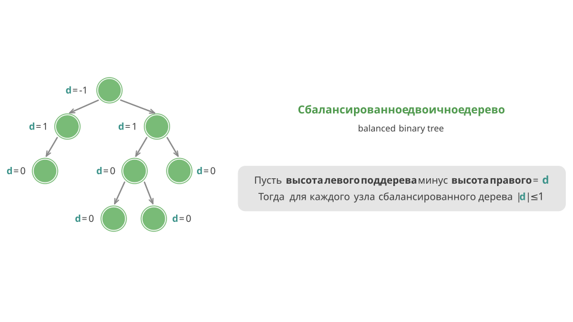

# Двоичное дерево

<u>Двоичное дерево (binary tree)</u> - это нелинейная структура данных, представляющая отношения между «предками» и «потомками» и отражающая логику «разделяй и властвуй». Подобно связному списку, базовой единицей двоичного дерева является узел. Каждый узел содержит значение, ссылку на левого дочернего узла и ссылку на правого дочернего узла.

```snippet
tree_node_class
```

Каждый узел имеет две ссылки (указателя), которые соответственно указывают на <u>левого дочернего узла (left-child node)</u> и <u>правого дочернего узла (right-child node)</u>. Данный узел называется <u>родительским узлом (parent node)</u> для этих двух дочерних узлов. Если задан некоторый узел двоичного дерева, то дерево, образованное его левым дочерним узлом и всеми узлами ниже него, называется <u>левым поддеревом (left subtree)</u> этого узла. Аналогично определяется <u>правое поддерево (right subtree)</u>.

**Узлы, не имеющие дочерних узлов, называют листьями, а все остальные узлы содержат дочерние узлы и непустые поддеревья**. Как показано на рисунке ниже, если рассматривать «узел 2» как родительский, то его левым и правым дочерними узлами будут «узел 4» и «узел 5». Левое поддерево - это «узел 4 и дерево ниже него», а правое поддерево - это «узел 5 и дерево ниже него».


## Распространенные термины двоичного дерева

Распространенные термины двоичного дерева показаны на рисунке ниже.

- <u>Корневой узел (root node)</u>: узел, расположенный на верхнем уровне двоичного дерева и не имеющий родительского узла.
- <u>Листовой узел (leaf node)</u>: узел без дочерних узлов. Оба его указателя направлены на `None` .
- <u>Ребро (edge)</u>: отрезок, соединяющий два узла, то есть ссылка (указатель) между узлами.
- <u>Уровень (level)</u> узла: увеличивается сверху вниз. Уровень корневого узла равен 1 .
- <u>Степень (degree)</u> узла: число дочерних узлов данного узла. В двоичном дереве возможны степени 0, 1, 2 .
- <u>Высота (height)</u> двоичного дерева: число ребер от корневого узла до самого удаленного листового узла.
- <u>Глубина (depth)</u> узла: число ребер от корневого узла до данного узла.
- <u>Высота (height)</u> узла: число ребер от самого удаленного листового узла до данного узла.


!!! tip

    Обычно под «высотой» и «глубиной» понимают «число пройденных ребер», но в некоторых задачах или учебниках их могут определять как «число пройденных узлов». В таком случае и высоту, и глубину нужно увеличить на 1 .

## Базовые операции двоичного дерева

### Инициализация двоичного дерева

Как и в связном списке, сначала инициализируются узлы, а затем между ними строятся ссылки (указатели).

```snippet
init_binary_tree
```

??? pythontutor "Визуализация выполнения"

    @tutor init_binary_tree_tutor

### Вставка и удаление узлов

Как и в связном списке, вставка и удаление узлов в двоичном дереве могут выполняться через изменение указателей. На рисунке ниже приведен пример.


```snippet
insert_remove_node
```

??? pythontutor "Визуализация выполнения"

    @tutor insert_remove_node_tutor

!!! tip

    Стоит помнить, что вставка узла может изменить исходную логическую структуру двоичного дерева, а удаление узла обычно означает удаление этого узла вместе со всеми его поддеревьями. Поэтому в двоичном дереве операции вставки и удаления обычно являются частью более крупного набора операций, который и реализует осмысленное действие.

## Распространенные типы двоичных деревьев

### Идеальное двоичное дерево

Как показано на рисунке ниже, <u>идеальное двоичное дерево (perfect binary tree)</u> полностью заполнено на всех уровнях. В идеальном двоичном дереве степень листовых узлов равна $0$ , а у всех остальных узлов степень равна $2$. Если высота дерева равна $h$ , то общее число узлов равно $2^{h+1} - 1$ , что образует стандартную экспоненциальную зависимость и отражает часто встречающееся в природе явление клеточного деления.

!!! tip

    В китайскоязычном сообществе идеальное двоичное дерево часто называют <u>полностью заполненным двоичным деревом</u>.


### Полное двоичное дерево

Как показано на рисунке ниже, <u>полное двоичное дерево (complete binary tree)</u> допускает неполное заполнение только на самом нижнем уровне, причем узлы этого уровня должны непрерывно заполняться слева направо. Стоит отметить, что идеальное двоичное дерево тоже является полным двоичным деревом.


### Строгое двоичное дерево

Как показано на рисунке ниже, <u>строгое двоичное дерево (full binary tree)</u> имеет у всех нелистовых узлов ровно двух дочерних узлов.


### Сбалансированное двоичное дерево

Как показано на рисунке ниже, в <u>сбалансированном двоичном дереве (balanced binary tree)</u> для любого узла абсолютное значение разности высот левого и правого поддеревьев не превышает 1 .



## Вырождение двоичного дерева

На рисунке ниже показаны идеальная структура двоичного дерева и вырожденная структура. Когда каждый уровень двоичного дерева полностью заполнен узлами, мы получаем «идеальное двоичное дерево». Когда же все узлы смещаются к одной стороне, двоичное дерево вырождается в «связный список».

- Идеальное двоичное дерево соответствует лучшему случаю и позволяет в полной мере раскрыть преимущества подхода «разделяй и властвуй».
- Связный список представляет противоположную крайность: все операции становятся линейными, а временная сложность деградирует до $O(n)$ .


Как показано в таблице ниже, в лучшем и худшем случаях число листовых узлов, общее число узлов, высота и другие характеристики двоичного дерева достигают максимума или минимума.

<p align="center"> Таблица <id> &nbsp; Лучший и худший случаи структуры двоичного дерева </p>

|                             | Идеальное двоичное дерево | Связный список |
| --------------------------- | ------------------------- | -------------- |
| Число узлов на уровне $i$   | $2^{i-1}$                 | $1$            |
| Число листьев у дерева высоты $h$ | $2^h$              | $1$            |
| Общее число узлов у дерева высоты $h$ | $2^{h+1} - 1$ | $h + 1$        |
| Высота дерева с $n$ узлами  | $\log_2 (n+1) - 1$        | $n - 1$        |
