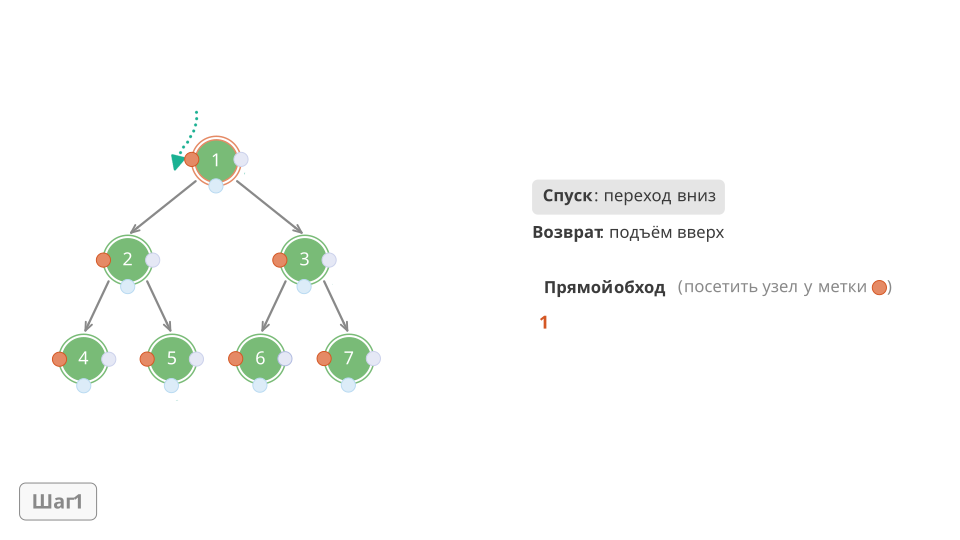
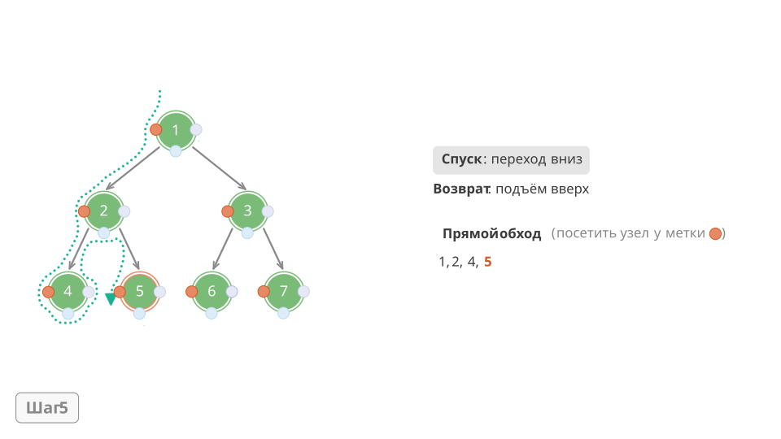
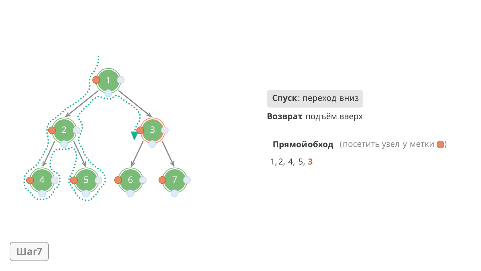
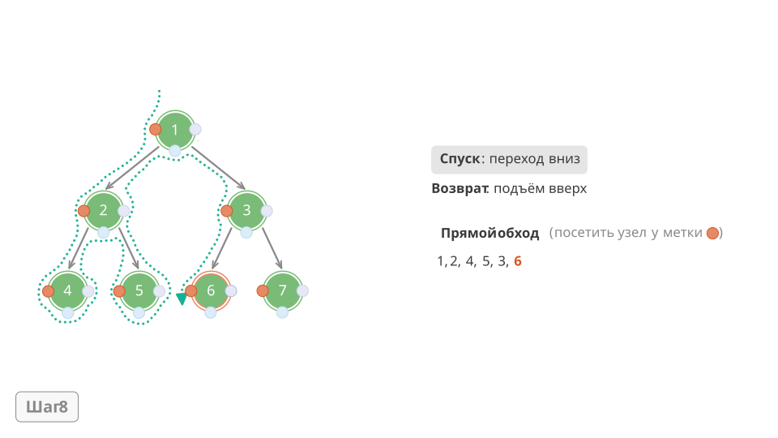
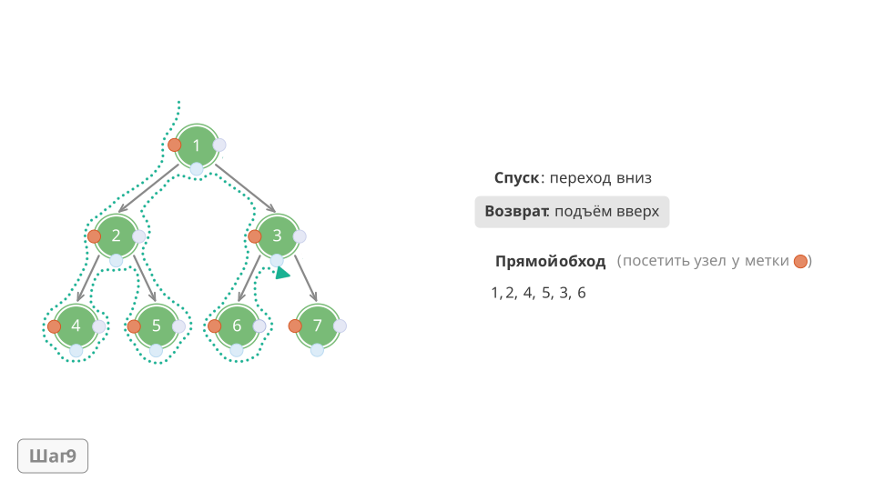
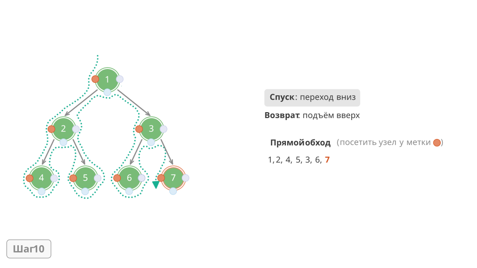
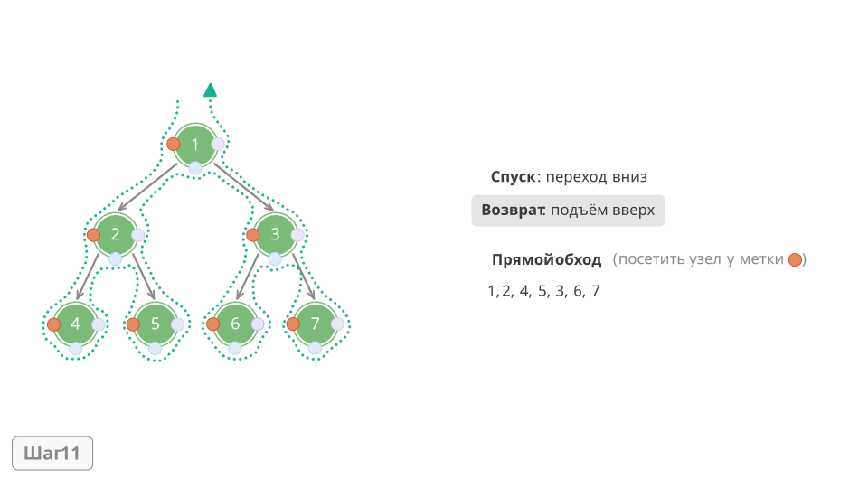

# 7.2 &nbsp; Обход двоичного дерева

По своему устройству дерево — связная структура данных, поэтому обход переходит по указателям от узла к узлу. Но дерево нелинейно: обойти его сложнее, чем связный список. Для этого используют алгоритмы поиска.

К распространённым способам обхода двоичного дерева относятся обход по уровням, прямой, симметричный и обратный обходы.

## 7.2.1 &nbsp; Обход по уровням

При <u>обходе по уровням (level-order traversal)</u> дерево проходят сверху вниз уровень за уровнем, а внутри уровня узлы посещают слева направо, как на рисунке 7-9.

Обход по уровням — это <u>обход в ширину (breadth-first traversal)</u>, который также называют <u>поиском в ширину (breadth-first search, BFS)</u>. Он распространяется от корня наружу последовательными волнами, по одному уровню за раз.

{ class="animation-figure" }

<p align="center"> Рисунок 7-9 &nbsp; Обход двоичного дерева по уровням </p>

### 1. &nbsp; Реализация

Для обхода в ширину обычно используют очередь. Она работает по правилу «первым пришёл — первым вышел», которое естественно соответствует поуровневому продвижению обхода. Приведём реализацию:

=== "Python"

    ```python title="binary_tree_bfs.py"
    def level_order(root: TreeNode | None) -> list[int]:
        """Обход по уровням"""
        # Создать очередь и добавить корень
        queue: deque[TreeNode] = deque()
        queue.append(root)
        # Создать список для последовательности обхода
        res = []
        while queue:
            node: TreeNode = queue.popleft()  # Извлечь узел из очереди
            res.append(node.val)  # Сохранить значение узла
            if node.left is not None:
                queue.append(node.left)  # Добавить левого потомка в очередь
            if node.right is not None:
                queue.append(node.right)  # Добавить правого потомка в очередь
        return res
    ```

=== "C++"

    ```cpp title="binary_tree_bfs.cpp"
    /* Обход по уровням */
    vector<int> levelOrder(TreeNode *root) {
        // Создать очередь и добавить корень
        queue<TreeNode *> queue;
        queue.push(root);
        // Создать список для последовательности обхода
        vector<int> vec;
        while (!queue.empty()) {
            TreeNode *node = queue.front();
            queue.pop();              // Извлечь узел из очереди
            vec.push_back(node->val); // Сохранить значение узла
            if (node->left != nullptr)
                queue.push(node->left); // Добавить левого потомка в очередь
            if (node->right != nullptr)
                queue.push(node->right); // Добавить правого потомка в очередь
        }
        return vec;
    }
    ```

=== "Java"

    ```java title="binary_tree_bfs.java"
    /* Обход по уровням */
    List<Integer> levelOrder(TreeNode root) {
        // Создать очередь и добавить корень
        Queue<TreeNode> queue = new LinkedList<>();
        queue.add(root);
        // Создать список для последовательности обхода
        List<Integer> list = new ArrayList<>();
        while (!queue.isEmpty()) {
            TreeNode node = queue.poll(); // Извлечь узел из очереди
            list.add(node.val);           // Сохранить значение узла
            if (node.left != null)
                queue.offer(node.left);   // Добавить левого потомка в очередь
            if (node.right != null)
                queue.offer(node.right);  // Добавить правого потомка в очередь
        }
        return list;
    }
    ```

=== "C#"

    ```csharp title="binary_tree_bfs.cs"
    /* Обход по уровням */
    List<int> LevelOrder(TreeNode root) {
        // Создать очередь и добавить корень
        Queue<TreeNode> queue = new();
        queue.Enqueue(root);
        // Создать список для последовательности обхода
        List<int> list = [];
        while (queue.Count != 0) {
            TreeNode node = queue.Dequeue(); // Извлечь узел из очереди
            list.Add(node.val!.Value);       // Сохранить значение узла
            if (node.left != null)
                queue.Enqueue(node.left);    // Добавить левого потомка в очередь
            if (node.right != null)
                queue.Enqueue(node.right);   // Добавить правого потомка в очередь
        }
        return list;
    }
    ```

=== "Go"

    ```go title="binary_tree_bfs.go"
    /* Обход по уровням */
    func levelOrder(root *TreeNode) []any {
        // Создать очередь и добавить корень
        queue := list.New()
        queue.PushBack(root)
        // Создать срез для последовательности обхода
        nums := make([]any, 0)
        for queue.Len() > 0 {
            // Извлечь узел из очереди
            node := queue.Remove(queue.Front()).(*TreeNode)
            // Сохранить значение узла
            nums = append(nums, node.Val)
            if node.Left != nil {
                // Добавить левого потомка в очередь
                queue.PushBack(node.Left)
            }
            if node.Right != nil {
                // Добавить правого потомка в очередь
                queue.PushBack(node.Right)
            }
        }
        return nums
    }
    ```

=== "Swift"

    ```swift title="binary_tree_bfs.swift"
    /* Обход по уровням */
    func levelOrder(root: TreeNode) -> [Int] {
        // Создать очередь и добавить корень
        var queue: [TreeNode] = [root]
        // Создать список для последовательности обхода
        var list: [Int] = []
        while !queue.isEmpty {
            let node = queue.removeFirst() // Извлечь узел из очереди
            list.append(node.val) // Сохранить значение узла
            if let left = node.left {
                queue.append(left) // Добавить левого потомка в очередь
            }
            if let right = node.right {
                queue.append(right) // Добавить правого потомка в очередь
            }
        }
        return list
    }
    ```

=== "JS"

    ```javascript title="binary_tree_bfs.js"
    /* Обход по уровням */
    function levelOrder(root) {
        // Создать очередь и добавить корень
        const queue = [root];
        // Создать список для последовательности обхода
        const list = [];
        while (queue.length) {
            let node = queue.shift(); // Извлечь узел из очереди
            list.push(node.val); // Сохранить значение узла
            if (node.left) queue.push(node.left); // Добавить левого потомка в очередь
            if (node.right) queue.push(node.right); // Добавить правого потомка в очередь
        }
        return list;
    }
    ```

=== "TS"

    ```typescript title="binary_tree_bfs.ts"
    /* Обход по уровням */
    function levelOrder(root: TreeNode | null): number[] {
        // Создать очередь и добавить корень
        const queue = [root];
        // Создать список для последовательности обхода
        const list: number[] = [];
        while (queue.length) {
            let node = queue.shift() as TreeNode; // Извлечь узел из очереди
            list.push(node.val); // Сохранить значение узла
            if (node.left) {
                queue.push(node.left); // Добавить левого потомка в очередь
            }
            if (node.right) {
                queue.push(node.right); // Добавить правого потомка в очередь
            }
        }
        return list;
    }
    ```

=== "Dart"

    ```dart title="binary_tree_bfs.dart"
    /* Обход по уровням */
    List<int> levelOrder(TreeNode? root) {
      // Создать очередь и добавить корень
      Queue<TreeNode?> queue = Queue();
      queue.add(root);
      // Создать список для последовательности обхода
      List<int> res = [];
      while (queue.isNotEmpty) {
        TreeNode? node = queue.removeFirst(); // Извлечь узел из очереди
        res.add(node!.val); // Сохранить значение узла
        if (node.left != null) queue.add(node.left); // Добавить левого потомка в очередь
        if (node.right != null) queue.add(node.right); // Добавить правого потомка в очередь
      }
      return res;
    }
    ```

=== "Rust"

    ```rust title="binary_tree_bfs.rs"
    /* Обход по уровням */
    fn level_order(root: &Rc<RefCell<TreeNode>>) -> Vec<i32> {
        // Создать очередь и добавить корень
        let mut que = VecDeque::new();
        que.push_back(root.clone());
        // Создать список для последовательности обхода
        let mut vec = Vec::new();

        while let Some(node) = que.pop_front() {
            // Извлечь узел из очереди
            vec.push(node.borrow().val); // Сохранить значение узла
            if let Some(left) = node.borrow().left.as_ref() {
                que.push_back(left.clone()); // Добавить левого потомка в очередь
            }
            if let Some(right) = node.borrow().right.as_ref() {
                que.push_back(right.clone()); // Добавить правого потомка в очередь
            };
        }
        vec
    }
    ```

=== "C"

    ```c title="binary_tree_bfs.c"
    /* Обход по уровням */
    int *levelOrder(TreeNode *root, int *size) {
        /* Вспомогательная очередь */
        int front, rear;
        int index, *arr;
        TreeNode *node;
        TreeNode **queue;

        /* Вспомогательная очередь */
        queue = (TreeNode **)malloc(sizeof(TreeNode *) * MAX_SIZE);
        // Указатель очереди
        front = 0, rear = 0;
        // Добавить корень
        queue[rear++] = root;
        // Создать список для последовательности обхода
        /* Вспомогательный массив */
        arr = (int *)malloc(sizeof(int) * MAX_SIZE);
        // Указатель массива
        index = 0;
        while (front < rear) {
            // Извлечь узел из очереди
            node = queue[front++];
            // Сохранить значение узла
            arr[index++] = node->val;
            if (node->left != NULL) {
                // Добавить левого потомка в очередь
                queue[rear++] = node->left;
            }
            if (node->right != NULL) {
                // Добавить правого потомка в очередь
                queue[rear++] = node->right;
            }
        }
        // Обновить длину массива
        *size = index;
        arr = realloc(arr, sizeof(int) * (*size));

        // Освободить память вспомогательного массива
        free(queue);
        return arr;
    }
    ```

=== "Kotlin"

    ```kotlin title="binary_tree_bfs.kt"
    /* Обход по уровням */
    fun levelOrder(root: TreeNode?): MutableList<Int> {
        // Создать очередь и добавить корень
        val queue = LinkedList<TreeNode?>()
        queue.add(root)
        // Создать список для последовательности обхода
        val list = mutableListOf<Int>()
        while (queue.isNotEmpty()) {
            val node = queue.poll()      // Извлечь узел из очереди
            list.add(node?._val!!)       // Сохранить значение узла
            if (node.left != null)
                queue.offer(node.left)   // Добавить левого потомка в очередь
            if (node.right != null)
                queue.offer(node.right)  // Добавить правого потомка в очередь
        }
        return list
    }
    ```

=== "Ruby"

    ```ruby title="binary_tree_bfs.rb"
    ### Обход по уровням ###
    def level_order(root)
      # Создать очередь и добавить корень
      queue = [root]
      # Создать список для последовательности обхода
      res = []
      while !queue.empty?
        node = queue.shift # Извлечь узел из очереди
        res << node.val # Сохранить значение узла
        queue << node.left unless node.left.nil? # Добавить левого потомка в очередь
        queue << node.right unless node.right.nil? # Добавить правого потомка в очередь
      end
      res
    end
    ```

??? pythontutor "Визуализация выполнения"

    <div style="height: 549px; width: 100%;"><iframe class="pythontutor-iframe" title="Визуализация выполнения" src="https://pythontutor.com/iframe-embed.html#code=from%20collections%20import%20deque%0A%0Aclass%20TreeNode%3A%0A%20%20%20%20%22%22%22%D0%9A%D0%BB%D0%B0%D1%81%D1%81%20%D1%83%D0%B7%D0%BB%D0%B0%20%D0%B4%D0%B2%D0%BE%D0%B8%D1%87%D0%BD%D0%BE%D0%B3%D0%BE%20%D0%B4%D0%B5%D1%80%D0%B5%D0%B2%D0%B0%22%22%22%0A%20%20%20%20def%20__init__%28self,%20val%3A%20int%29%3A%0A%20%20%20%20%20%20%20%20self.val%3A%20int%20%3D%20val%20%20%20%20%20%20%20%20%20%20%20%20%20%20%20%20%23%20%D0%97%D0%BD%D0%B0%D1%87%D0%B5%D0%BD%D0%B8%D0%B5%0A%20%20%20%20%20%20%20%20self.left%3A%20TreeNode%20%7C%20None%20%3D%20None%20%20%23%20%D0%A1%D1%81%D1%8B%D0%BB%D0%BA%D0%B0%20%D0%B2%D0%BB%D0%B5%D0%B2%D0%BE%0A%20%20%20%20%20%20%20%20self.right%3A%20TreeNode%20%7C%20None%20%3D%20None%20%23%20%D0%A1%D1%81%D1%8B%D0%BB%D0%BA%D0%B0%20%D0%B2%D0%BF%D1%80%D0%B0%D0%B2%D0%BE%0A%0Adef%20list_to_tree_dfs%28arr%3A%20list%5Bint%5D,%20i%3A%20int%29%20-%3E%20TreeNode%20%7C%20None%3A%0A%20%20%20%20%22%22%22%D0%98%D0%B7%20%D1%81%D0%BF%D0%B8%D1%81%D0%BA%D0%B0%20%D0%B2%20%D0%B4%D0%B2%D0%BE%D0%B8%D1%87%D0%BD%D0%BE%D0%B5%20%D0%B4%D0%B5%D1%80%D0%B5%D0%B2%D0%BE%3A%20%D1%80%D0%B5%D0%BA%D1%83%D1%80%D1%81%D0%B8%D1%8F%22%22%22%0A%20%20%20%20%23%20%D0%98%D0%BD%D0%B4%D0%B5%D0%BA%D1%81%20%D0%B2%D0%BD%D0%B5%20%D0%BC%D0%B0%D1%81%D1%81%D0%B8%D0%B2%D0%B0%20%D0%B8%D0%BB%D0%B8%20%D1%8D%D0%BB%D0%B5%D0%BC%D0%B5%D0%BD%D1%82%20None%3A%20%D0%B2%D0%B5%D1%80%D0%BD%D1%83%D1%82%D1%8C%20None%0A%20%20%20%20if%20i%20%3C%200%20or%20i%20%3E%3D%20len%28arr%29%20or%20arr%5Bi%5D%20is%20None%3A%0A%20%20%20%20%20%20%20%20return%20None%0A%20%20%20%20%23%20%D0%A1%D0%BE%D0%B7%D0%B4%D0%B0%D1%82%D1%8C%20%D1%83%D0%B7%D0%B5%D0%BB%0A%20%20%20%20root%20%3D%20TreeNode%28arr%5Bi%5D%29%0A%20%20%20%20%23%20%D0%A0%D0%B5%D0%BA%D1%83%D1%80%D1%81%D0%B8%D0%B2%D0%BD%D0%BE%20%D0%BF%D0%BE%D1%81%D1%82%D1%80%D0%BE%D0%B8%D1%82%D1%8C%20%D0%BE%D0%B1%D0%B0%20%D0%BF%D0%BE%D0%B4%D0%B4%D0%B5%D1%80%D0%B5%D0%B2%D0%B0%0A%20%20%20%20root.left%20%3D%20list_to_tree_dfs%28arr,%202%20%2A%20i%20%2B%201%29%0A%20%20%20%20root.right%20%3D%20list_to_tree_dfs%28arr,%202%20%2A%20i%20%2B%202%29%0A%20%20%20%20return%20root%0A%0Adef%20list_to_tree%28arr%3A%20list%5Bint%5D%29%20-%3E%20TreeNode%20%7C%20None%3A%0A%20%20%20%20%22%22%22%D0%98%D0%B7%20%D1%81%D0%BF%D0%B8%D1%81%D0%BA%D0%B0%20%D0%B2%20%D0%B4%D0%B2%D0%BE%D0%B8%D1%87%D0%BD%D0%BE%D0%B5%20%D0%B4%D0%B5%D1%80%D0%B5%D0%B2%D0%BE%22%22%22%0A%20%20%20%20return%20list_to_tree_dfs%28arr,%200%29%0A%0A%0Adef%20level_order%28root%3A%20TreeNode%20%7C%20None%29%20-%3E%20list%5Bint%5D%3A%0A%20%20%20%20%22%22%22%D0%9E%D0%B1%D1%85%D0%BE%D0%B4%20%D0%BF%D0%BE%20%D1%83%D1%80%D0%BE%D0%B2%D0%BD%D1%8F%D0%BC%22%22%22%0A%20%20%20%20%23%20%D0%A1%D0%BE%D0%B7%D0%B4%D0%B0%D1%82%D1%8C%20%D0%BE%D1%87%D0%B5%D1%80%D0%B5%D0%B4%D1%8C%20%D1%81%20%D0%BA%D0%BE%D1%80%D0%BD%D0%B5%D0%BC%0A%20%20%20%20queue%3A%20deque%5BTreeNode%5D%20%3D%20deque%28%29%0A%20%20%20%20queue.append%28root%29%0A%20%20%20%20%23%20%D0%A1%D0%BF%D0%B8%D1%81%D0%BE%D0%BA%20%D0%B4%D0%BB%D1%8F%20%D0%BF%D0%BE%D1%80%D1%8F%D0%B4%D0%BA%D0%B0%20%D0%BE%D0%B1%D1%85%D0%BE%D0%B4%D0%B0%0A%20%20%20%20res%20%3D%20%5B%5D%0A%20%20%20%20while%20queue%3A%0A%20%20%20%20%20%20%20%20node%3A%20TreeNode%20%3D%20queue.popleft%28%29%20%20%23%20%D0%98%D0%B7%D0%B2%D0%BB%D0%B5%D1%87%D1%8C%20%D0%B8%D0%B7%20%D0%BE%D1%87%D0%B5%D1%80%D0%B5%D0%B4%D0%B8%0A%20%20%20%20%20%20%20%20res.append%28node.val%29%20%20%23%20%D0%97%D0%B0%D0%BF%D0%B8%D1%81%D0%B0%D1%82%D1%8C%20%D0%B7%D0%BD%D0%B0%D1%87%D0%B5%D0%BD%D0%B8%D0%B5%0A%20%20%20%20%20%20%20%20if%20node.left%20is%20not%20None%3A%0A%20%20%20%20%20%20%20%20%20%20%20%20queue.append%28node.left%29%20%20%23%20%D0%9B%D0%B5%D0%B2%D0%BE%D0%B3%D0%BE%20%D0%BF%D0%BE%D1%82%D0%BE%D0%BC%D0%BA%D0%B0%20%D0%B2%20%D0%BE%D1%87%D0%B5%D1%80%D0%B5%D0%B4%D1%8C%0A%20%20%20%20%20%20%20%20if%20node.right%20is%20not%20None%3A%0A%20%20%20%20%20%20%20%20%20%20%20%20queue.append%28node.right%29%20%20%23%20%D0%9F%D1%80%D0%B0%D0%B2%D0%BE%D0%B3%D0%BE%20%D0%BF%D0%BE%D1%82%D0%BE%D0%BC%D0%BA%D0%B0%20%D0%B2%20%D0%BE%D1%87%D0%B5%D1%80%D0%B5%D0%B4%D1%8C%0A%20%20%20%20return%20res%0A%0A%22%22%22Driver%20Code%22%22%22%0Aif%20__name__%20%3D%3D%20%22__main__%22%3A%0A%20%20%20%20%23%20%D0%A1%D0%BE%D0%B7%D0%B4%D0%B0%D1%82%D1%8C%20%D0%B4%D0%B2%D0%BE%D0%B8%D1%87%D0%BD%D0%BE%D0%B5%20%D0%B4%D0%B5%D1%80%D0%B5%D0%B2%D0%BE%0A%20%20%20%20%23%20%D0%A4%D1%83%D0%BD%D0%BA%D1%86%D0%B8%D1%8F%20%D1%81%D1%82%D1%80%D0%BE%D0%B8%D1%82%20%D0%B4%D0%B5%D1%80%D0%B5%D0%B2%D0%BE%20%D0%BF%D1%80%D1%8F%D0%BC%D0%BE%20%D0%B8%D0%B7%20%D0%BC%D0%B0%D1%81%D1%81%D0%B8%D0%B2%D0%B0%0A%20%20%20%20root%20%3D%20list_to_tree%28arr%3D%5B1,%202,%203,%204,%205,%206,%207%5D%29%0A%0A%20%20%20%20%23%20%D0%9E%D0%B1%D1%85%D0%BE%D0%B4%20%D0%BF%D0%BE%20%D1%83%D1%80%D0%BE%D0%B2%D0%BD%D1%8F%D0%BC%0A%20%20%20%20res%20%3D%20level_order%28root%29%0A%20%20%20%20print%28%22%5Cn%D0%9E%D0%B1%D1%85%D0%BE%D0%B4%20%D0%BF%D0%BE%20%D1%83%D1%80%D0%BE%D0%B2%D0%BD%D1%8F%D0%BC%20%3D%20%22,%20res%29&codeDivHeight=472&codeDivWidth=350&cumulative=false&curInstr=127&heapPrimitives=nevernest&origin=opt-frontend.js&py=311&rawInputLstJSON=%5B%5D&textReferences=false"> </iframe></div>
    <div style="margin-top: 5px;"><a href="https://pythontutor.com/iframe-embed.html#code=from%20collections%20import%20deque%0A%0Aclass%20TreeNode%3A%0A%20%20%20%20%22%22%22%D0%9A%D0%BB%D0%B0%D1%81%D1%81%20%D1%83%D0%B7%D0%BB%D0%B0%20%D0%B4%D0%B2%D0%BE%D0%B8%D1%87%D0%BD%D0%BE%D0%B3%D0%BE%20%D0%B4%D0%B5%D1%80%D0%B5%D0%B2%D0%B0%22%22%22%0A%20%20%20%20def%20__init__%28self,%20val%3A%20int%29%3A%0A%20%20%20%20%20%20%20%20self.val%3A%20int%20%3D%20val%20%20%20%20%20%20%20%20%20%20%20%20%20%20%20%20%23%20%D0%97%D0%BD%D0%B0%D1%87%D0%B5%D0%BD%D0%B8%D0%B5%0A%20%20%20%20%20%20%20%20self.left%3A%20TreeNode%20%7C%20None%20%3D%20None%20%20%23%20%D0%A1%D1%81%D1%8B%D0%BB%D0%BA%D0%B0%20%D0%B2%D0%BB%D0%B5%D0%B2%D0%BE%0A%20%20%20%20%20%20%20%20self.right%3A%20TreeNode%20%7C%20None%20%3D%20None%20%23%20%D0%A1%D1%81%D1%8B%D0%BB%D0%BA%D0%B0%20%D0%B2%D0%BF%D1%80%D0%B0%D0%B2%D0%BE%0A%0Adef%20list_to_tree_dfs%28arr%3A%20list%5Bint%5D,%20i%3A%20int%29%20-%3E%20TreeNode%20%7C%20None%3A%0A%20%20%20%20%22%22%22%D0%98%D0%B7%20%D1%81%D0%BF%D0%B8%D1%81%D0%BA%D0%B0%20%D0%B2%20%D0%B4%D0%B2%D0%BE%D0%B8%D1%87%D0%BD%D0%BE%D0%B5%20%D0%B4%D0%B5%D1%80%D0%B5%D0%B2%D0%BE%3A%20%D1%80%D0%B5%D0%BA%D1%83%D1%80%D1%81%D0%B8%D1%8F%22%22%22%0A%20%20%20%20%23%20%D0%98%D0%BD%D0%B4%D0%B5%D0%BA%D1%81%20%D0%B2%D0%BD%D0%B5%20%D0%BC%D0%B0%D1%81%D1%81%D0%B8%D0%B2%D0%B0%20%D0%B8%D0%BB%D0%B8%20%D1%8D%D0%BB%D0%B5%D0%BC%D0%B5%D0%BD%D1%82%20None%3A%20%D0%B2%D0%B5%D1%80%D0%BD%D1%83%D1%82%D1%8C%20None%0A%20%20%20%20if%20i%20%3C%200%20or%20i%20%3E%3D%20len%28arr%29%20or%20arr%5Bi%5D%20is%20None%3A%0A%20%20%20%20%20%20%20%20return%20None%0A%20%20%20%20%23%20%D0%A1%D0%BE%D0%B7%D0%B4%D0%B0%D1%82%D1%8C%20%D1%83%D0%B7%D0%B5%D0%BB%0A%20%20%20%20root%20%3D%20TreeNode%28arr%5Bi%5D%29%0A%20%20%20%20%23%20%D0%A0%D0%B5%D0%BA%D1%83%D1%80%D1%81%D0%B8%D0%B2%D0%BD%D0%BE%20%D0%BF%D0%BE%D1%81%D1%82%D1%80%D0%BE%D0%B8%D1%82%D1%8C%20%D0%BE%D0%B1%D0%B0%20%D0%BF%D0%BE%D0%B4%D0%B4%D0%B5%D1%80%D0%B5%D0%B2%D0%B0%0A%20%20%20%20root.left%20%3D%20list_to_tree_dfs%28arr,%202%20%2A%20i%20%2B%201%29%0A%20%20%20%20root.right%20%3D%20list_to_tree_dfs%28arr,%202%20%2A%20i%20%2B%202%29%0A%20%20%20%20return%20root%0A%0Adef%20list_to_tree%28arr%3A%20list%5Bint%5D%29%20-%3E%20TreeNode%20%7C%20None%3A%0A%20%20%20%20%22%22%22%D0%98%D0%B7%20%D1%81%D0%BF%D0%B8%D1%81%D0%BA%D0%B0%20%D0%B2%20%D0%B4%D0%B2%D0%BE%D0%B8%D1%87%D0%BD%D0%BE%D0%B5%20%D0%B4%D0%B5%D1%80%D0%B5%D0%B2%D0%BE%22%22%22%0A%20%20%20%20return%20list_to_tree_dfs%28arr,%200%29%0A%0A%0Adef%20level_order%28root%3A%20TreeNode%20%7C%20None%29%20-%3E%20list%5Bint%5D%3A%0A%20%20%20%20%22%22%22%D0%9E%D0%B1%D1%85%D0%BE%D0%B4%20%D0%BF%D0%BE%20%D1%83%D1%80%D0%BE%D0%B2%D0%BD%D1%8F%D0%BC%22%22%22%0A%20%20%20%20%23%20%D0%A1%D0%BE%D0%B7%D0%B4%D0%B0%D1%82%D1%8C%20%D0%BE%D1%87%D0%B5%D1%80%D0%B5%D0%B4%D1%8C%20%D1%81%20%D0%BA%D0%BE%D1%80%D0%BD%D0%B5%D0%BC%0A%20%20%20%20queue%3A%20deque%5BTreeNode%5D%20%3D%20deque%28%29%0A%20%20%20%20queue.append%28root%29%0A%20%20%20%20%23%20%D0%A1%D0%BF%D0%B8%D1%81%D0%BE%D0%BA%20%D0%B4%D0%BB%D1%8F%20%D0%BF%D0%BE%D1%80%D1%8F%D0%B4%D0%BA%D0%B0%20%D0%BE%D0%B1%D1%85%D0%BE%D0%B4%D0%B0%0A%20%20%20%20res%20%3D%20%5B%5D%0A%20%20%20%20while%20queue%3A%0A%20%20%20%20%20%20%20%20node%3A%20TreeNode%20%3D%20queue.popleft%28%29%20%20%23%20%D0%98%D0%B7%D0%B2%D0%BB%D0%B5%D1%87%D1%8C%20%D0%B8%D0%B7%20%D0%BE%D1%87%D0%B5%D1%80%D0%B5%D0%B4%D0%B8%0A%20%20%20%20%20%20%20%20res.append%28node.val%29%20%20%23%20%D0%97%D0%B0%D0%BF%D0%B8%D1%81%D0%B0%D1%82%D1%8C%20%D0%B7%D0%BD%D0%B0%D1%87%D0%B5%D0%BD%D0%B8%D0%B5%0A%20%20%20%20%20%20%20%20if%20node.left%20is%20not%20None%3A%0A%20%20%20%20%20%20%20%20%20%20%20%20queue.append%28node.left%29%20%20%23%20%D0%9B%D0%B5%D0%B2%D0%BE%D0%B3%D0%BE%20%D0%BF%D0%BE%D1%82%D0%BE%D0%BC%D0%BA%D0%B0%20%D0%B2%20%D0%BE%D1%87%D0%B5%D1%80%D0%B5%D0%B4%D1%8C%0A%20%20%20%20%20%20%20%20if%20node.right%20is%20not%20None%3A%0A%20%20%20%20%20%20%20%20%20%20%20%20queue.append%28node.right%29%20%20%23%20%D0%9F%D1%80%D0%B0%D0%B2%D0%BE%D0%B3%D0%BE%20%D0%BF%D0%BE%D1%82%D0%BE%D0%BC%D0%BA%D0%B0%20%D0%B2%20%D0%BE%D1%87%D0%B5%D1%80%D0%B5%D0%B4%D1%8C%0A%20%20%20%20return%20res%0A%0A%22%22%22Driver%20Code%22%22%22%0Aif%20__name__%20%3D%3D%20%22__main__%22%3A%0A%20%20%20%20%23%20%D0%A1%D0%BE%D0%B7%D0%B4%D0%B0%D1%82%D1%8C%20%D0%B4%D0%B2%D0%BE%D0%B8%D1%87%D0%BD%D0%BE%D0%B5%20%D0%B4%D0%B5%D1%80%D0%B5%D0%B2%D0%BE%0A%20%20%20%20%23%20%D0%A4%D1%83%D0%BD%D0%BA%D1%86%D0%B8%D1%8F%20%D1%81%D1%82%D1%80%D0%BE%D0%B8%D1%82%20%D0%B4%D0%B5%D1%80%D0%B5%D0%B2%D0%BE%20%D0%BF%D1%80%D1%8F%D0%BC%D0%BE%20%D0%B8%D0%B7%20%D0%BC%D0%B0%D1%81%D1%81%D0%B8%D0%B2%D0%B0%0A%20%20%20%20root%20%3D%20list_to_tree%28arr%3D%5B1,%202,%203,%204,%205,%206,%207%5D%29%0A%0A%20%20%20%20%23%20%D0%9E%D0%B1%D1%85%D0%BE%D0%B4%20%D0%BF%D0%BE%20%D1%83%D1%80%D0%BE%D0%B2%D0%BD%D1%8F%D0%BC%0A%20%20%20%20res%20%3D%20level_order%28root%29%0A%20%20%20%20print%28%22%5Cn%D0%9E%D0%B1%D1%85%D0%BE%D0%B4%20%D0%BF%D0%BE%20%D1%83%D1%80%D0%BE%D0%B2%D0%BD%D1%8F%D0%BC%20%3D%20%22,%20res%29&codeDivHeight=800&codeDivWidth=600&cumulative=false&curInstr=127&heapPrimitives=nevernest&origin=opt-frontend.js&py=311&rawInputLstJSON=%5B%5D&textReferences=false" target="_blank" rel="noopener noreferrer">Во весь экран ></a></div>

### 2. &nbsp; Анализ сложности

- **Временная сложность — $O(n)$**. Каждый узел посещается один раз. Если $n$ — число узлов, обход занимает $O(n)$ времени.
- **Пространственная сложность — $O(n)$**. В худшем случае, когда дерево совершенное, перед обработкой последнего уровня в очереди одновременно находятся до $(n + 1) / 2$ узлов. Для этого нужно $O(n)$ памяти.

## 7.2.2 &nbsp; Прямой, симметричный и обратный обходы

Прямой, симметричный и обратный обходы относятся к <u>обходу в глубину (depth-first traversal)</u>, также называемому <u>поиском в глубину (depth-first search, DFS)</u>. При таком обходе сначала идут по ветви до конца, а затем возвращаются и продолжают путь.

На рисунке показан принцип обхода двоичного дерева в глубину. **Представьте, что вы обходите всё дерево по внешнему контуру**. Возле каждого узла вы проходите три позиции, соответствующие прямому, симметричному и обратному обходам.

{ class="animation-figure" }

<p align="center"> Рисунок 7-10 &nbsp; Прямой, симметричный и обратный обходы двоичного дерева поиска </p>

### 1. &nbsp; Реализация

Поиск в глубину обычно реализуют с помощью рекурсии:

=== "Python"

    ```python title="binary_tree_dfs.py"
    def pre_order(root: TreeNode | None):
        """Прямой обход"""
        if root is None:
            return
        # Порядок посещения: корень -> левое поддерево -> правое поддерево
        res.append(root.val)
        pre_order(root=root.left)
        pre_order(root=root.right)

    def in_order(root: TreeNode | None):
        """Симметричный обход"""
        if root is None:
            return
        # Порядок посещения: левое поддерево -> корень -> правое поддерево
        in_order(root=root.left)
        res.append(root.val)
        in_order(root=root.right)

    def post_order(root: TreeNode | None):
        """Обратный обход"""
        if root is None:
            return
        # Порядок посещения: левое поддерево -> правое поддерево -> корень
        post_order(root=root.left)
        post_order(root=root.right)
        res.append(root.val)
    ```

=== "C++"

    ```cpp title="binary_tree_dfs.cpp"
    /* Прямой обход */
    void preOrder(TreeNode *root) {
        if (root == nullptr)
            return;
        // Порядок посещения: корень -> левое поддерево -> правое поддерево
        vec.push_back(root->val);
        preOrder(root->left);
        preOrder(root->right);
    }

    /* Симметричный обход */
    void inOrder(TreeNode *root) {
        if (root == nullptr)
            return;
        // Порядок посещения: левое поддерево -> корень -> правое поддерево
        inOrder(root->left);
        vec.push_back(root->val);
        inOrder(root->right);
    }

    /* Обратный обход */
    void postOrder(TreeNode *root) {
        if (root == nullptr)
            return;
        // Порядок посещения: левое поддерево -> правое поддерево -> корень
        postOrder(root->left);
        postOrder(root->right);
        vec.push_back(root->val);
    }
    ```

=== "Java"

    ```java title="binary_tree_dfs.java"
    /* Прямой обход */
    void preOrder(TreeNode root) {
        if (root == null)
            return;
        // Порядок посещения: корень -> левое поддерево -> правое поддерево
        list.add(root.val);
        preOrder(root.left);
        preOrder(root.right);
    }

    /* Симметричный обход */
    void inOrder(TreeNode root) {
        if (root == null)
            return;
        // Порядок посещения: левое поддерево -> корень -> правое поддерево
        inOrder(root.left);
        list.add(root.val);
        inOrder(root.right);
    }

    /* Обратный обход */
    void postOrder(TreeNode root) {
        if (root == null)
            return;
        // Порядок посещения: левое поддерево -> правое поддерево -> корень
        postOrder(root.left);
        postOrder(root.right);
        list.add(root.val);
    }
    ```

=== "C#"

    ```csharp title="binary_tree_dfs.cs"
    /* Прямой обход */
    void PreOrder(TreeNode? root) {
        if (root == null) return;
        // Порядок посещения: корень -> левое поддерево -> правое поддерево
        list.Add(root.val!.Value);
        PreOrder(root.left);
        PreOrder(root.right);
    }

    /* Симметричный обход */
    void InOrder(TreeNode? root) {
        if (root == null) return;
        // Порядок посещения: левое поддерево -> корень -> правое поддерево
        InOrder(root.left);
        list.Add(root.val!.Value);
        InOrder(root.right);
    }

    /* Обратный обход */
    void PostOrder(TreeNode? root) {
        if (root == null) return;
        // Порядок посещения: левое поддерево -> правое поддерево -> корень
        PostOrder(root.left);
        PostOrder(root.right);
        list.Add(root.val!.Value);
    }
    ```

=== "Go"

    ```go title="binary_tree_dfs.go"
    /* Прямой обход */
    func preOrder(node *TreeNode) {
        if node == nil {
            return
        }
        // Порядок посещения: корень -> левое поддерево -> правое поддерево
        nums = append(nums, node.Val)
        preOrder(node.Left)
        preOrder(node.Right)
    }

    /* Симметричный обход */
    func inOrder(node *TreeNode) {
        if node == nil {
            return
        }
        // Порядок посещения: левое поддерево -> корень -> правое поддерево
        inOrder(node.Left)
        nums = append(nums, node.Val)
        inOrder(node.Right)
    }

    /* Обратный обход */
    func postOrder(node *TreeNode) {
        if node == nil {
            return
        }
        // Порядок посещения: левое поддерево -> правое поддерево -> корень
        postOrder(node.Left)
        postOrder(node.Right)
        nums = append(nums, node.Val)
    }
    ```

=== "Swift"

    ```swift title="binary_tree_dfs.swift"
    /* Прямой обход */
    func preOrder(root: TreeNode?) {
        guard let root = root else {
            return
        }
        // Порядок посещения: корень -> левое поддерево -> правое поддерево
        list.append(root.val)
        preOrder(root: root.left)
        preOrder(root: root.right)
    }

    /* Симметричный обход */
    func inOrder(root: TreeNode?) {
        guard let root = root else {
            return
        }
        // Порядок посещения: левое поддерево -> корень -> правое поддерево
        inOrder(root: root.left)
        list.append(root.val)
        inOrder(root: root.right)
    }

    /* Обратный обход */
    func postOrder(root: TreeNode?) {
        guard let root = root else {
            return
        }
        // Порядок посещения: левое поддерево -> правое поддерево -> корень
        postOrder(root: root.left)
        postOrder(root: root.right)
        list.append(root.val)
    }
    ```

=== "JS"

    ```javascript title="binary_tree_dfs.js"
    /* Прямой обход */
    function preOrder(root) {
        if (root === null) return;
        // Порядок посещения: корень -> левое поддерево -> правое поддерево
        list.push(root.val);
        preOrder(root.left);
        preOrder(root.right);
    }

    /* Симметричный обход */
    function inOrder(root) {
        if (root === null) return;
        // Порядок посещения: левое поддерево -> корень -> правое поддерево
        inOrder(root.left);
        list.push(root.val);
        inOrder(root.right);
    }

    /* Обратный обход */
    function postOrder(root) {
        if (root === null) return;
        // Порядок посещения: левое поддерево -> правое поддерево -> корень
        postOrder(root.left);
        postOrder(root.right);
        list.push(root.val);
    }
    ```

=== "TS"

    ```typescript title="binary_tree_dfs.ts"
    /* Прямой обход */
    function preOrder(root: TreeNode | null): void {
        if (root === null) {
            return;
        }
        // Порядок посещения: корень -> левое поддерево -> правое поддерево
        list.push(root.val);
        preOrder(root.left);
        preOrder(root.right);
    }

    /* Симметричный обход */
    function inOrder(root: TreeNode | null): void {
        if (root === null) {
            return;
        }
        // Порядок посещения: левое поддерево -> корень -> правое поддерево
        inOrder(root.left);
        list.push(root.val);
        inOrder(root.right);
    }

    /* Обратный обход */
    function postOrder(root: TreeNode | null): void {
        if (root === null) {
            return;
        }
        // Порядок посещения: левое поддерево -> правое поддерево -> корень
        postOrder(root.left);
        postOrder(root.right);
        list.push(root.val);
    }
    ```

=== "Dart"

    ```dart title="binary_tree_dfs.dart"
    /* Прямой обход */
    void preOrder(TreeNode? node) {
      if (node == null) return;
      // Порядок посещения: корень -> левое поддерево -> правое поддерево
      list.add(node.val);
      preOrder(node.left);
      preOrder(node.right);
    }

    /* Симметричный обход */
    void inOrder(TreeNode? node) {
      if (node == null) return;
      // Порядок посещения: левое поддерево -> корень -> правое поддерево
      inOrder(node.left);
      list.add(node.val);
      inOrder(node.right);
    }

    /* Обратный обход */
    void postOrder(TreeNode? node) {
      if (node == null) return;
      // Порядок посещения: левое поддерево -> правое поддерево -> корень
      postOrder(node.left);
      postOrder(node.right);
      list.add(node.val);
    }
    ```

=== "Rust"

    ```rust title="binary_tree_dfs.rs"
    /* Прямой обход */
    fn pre_order(root: Option<&Rc<RefCell<TreeNode>>>) -> Vec<i32> {
        let mut result = vec![];

        fn dfs(root: Option<&Rc<RefCell<TreeNode>>>, res: &mut Vec<i32>) {
            if let Some(node) = root {
                // Порядок посещения: корень -> левое поддерево -> правое поддерево
                let node = node.borrow();
                res.push(node.val);
                dfs(node.left.as_ref(), res);
                dfs(node.right.as_ref(), res);
            }
        }
        dfs(root, &mut result);

        result
    }

    /* Симметричный обход */
    fn in_order(root: Option<&Rc<RefCell<TreeNode>>>) -> Vec<i32> {
        let mut result = vec![];

        fn dfs(root: Option<&Rc<RefCell<TreeNode>>>, res: &mut Vec<i32>) {
            if let Some(node) = root {
                // Порядок посещения: левое поддерево -> корень -> правое поддерево
                let node = node.borrow();
                dfs(node.left.as_ref(), res);
                res.push(node.val);
                dfs(node.right.as_ref(), res);
            }
        }
        dfs(root, &mut result);

        result
    }

    /* Обратный обход */
    fn post_order(root: Option<&Rc<RefCell<TreeNode>>>) -> Vec<i32> {
        let mut result = vec![];

        fn dfs(root: Option<&Rc<RefCell<TreeNode>>>, res: &mut Vec<i32>) {
            if let Some(node) = root {
                // Порядок посещения: левое поддерево -> правое поддерево -> корень
                let node = node.borrow();
                dfs(node.left.as_ref(), res);
                dfs(node.right.as_ref(), res);
                res.push(node.val);
            }
        }

        dfs(root, &mut result);

        result
    }
    ```

=== "C"

    ```c title="binary_tree_dfs.c"
    /* Прямой обход */
    void preOrder(TreeNode *root, int *size) {
        if (root == NULL)
            return;
        // Порядок посещения: корень -> левое поддерево -> правое поддерево
        arr[(*size)++] = root->val;
        preOrder(root->left, size);
        preOrder(root->right, size);
    }

    /* Симметричный обход */
    void inOrder(TreeNode *root, int *size) {
        if (root == NULL)
            return;
        // Порядок посещения: левое поддерево -> корень -> правое поддерево
        inOrder(root->left, size);
        arr[(*size)++] = root->val;
        inOrder(root->right, size);
    }

    /* Обратный обход */
    void postOrder(TreeNode *root, int *size) {
        if (root == NULL)
            return;
        // Порядок посещения: левое поддерево -> правое поддерево -> корень
        postOrder(root->left, size);
        postOrder(root->right, size);
        arr[(*size)++] = root->val;
    }
    ```

=== "Kotlin"

    ```kotlin title="binary_tree_dfs.kt"
    /* Прямой обход */
    fun preOrder(root: TreeNode?) {
        if (root == null) return
        // Порядок посещения: корень -> левое поддерево -> правое поддерево
        list.add(root._val)
        preOrder(root.left)
        preOrder(root.right)
    }

    /* Симметричный обход */
    fun inOrder(root: TreeNode?) {
        if (root == null) return
        // Порядок посещения: левое поддерево -> корень -> правое поддерево
        inOrder(root.left)
        list.add(root._val)
        inOrder(root.right)
    }

    /* Обратный обход */
    fun postOrder(root: TreeNode?) {
        if (root == null) return
        // Порядок посещения: левое поддерево -> правое поддерево -> корень
        postOrder(root.left)
        postOrder(root.right)
        list.add(root._val)
    }
    ```

=== "Ruby"

    ```ruby title="binary_tree_dfs.rb"
    ### Прямой обход ###
    def pre_order(root)
      return if root.nil?

      # Порядок посещения: корень -> левое поддерево -> правое поддерево
      $res << root.val
      pre_order(root.left)
      pre_order(root.right)
    end

    ### Симметричный обход ###
    def in_order(root)
      return if root.nil?

      # Порядок посещения: левое поддерево -> корень -> правое поддерево
      in_order(root.left)
      $res << root.val
      in_order(root.right)
    end

    ### Обратный обход ###
    def post_order(root)
      return if root.nil?

      # Порядок посещения: левое поддерево -> правое поддерево -> корень
      post_order(root.left)
      post_order(root.right)
      $res << root.val
    end
    ```

??? pythontutor "Визуализация выполнения"

    <div style="height: 549px; width: 100%;"><iframe class="pythontutor-iframe" title="Визуализация выполнения" src="https://pythontutor.com/iframe-embed.html#code=class%20TreeNode%3A%0A%20%20%22%22%22%D0%9A%D0%BB%D0%B0%D1%81%D1%81%20%D1%83%D0%B7%D0%BB%D0%B0%20%D0%B4%D0%B2%D0%BE%D0%B8%D1%87%D0%BD%D0%BE%D0%B3%D0%BE%20%D0%B4%D0%B5%D1%80%D0%B5%D0%B2%D0%B0%22%22%22%0A%20%20def%20__init__%28self,%20val%3A%20int%29%3A%0A%20%20%20%20self.val%3A%20int%20%3D%20val%20%20%20%20%20%20%20%20%20%20%20%20%20%20%20%20%23%20%D0%97%D0%BD%D0%B0%D1%87%D0%B5%D0%BD%D0%B8%D0%B5%0A%20%20%20%20self.left%3A%20TreeNode%20%7C%20None%20%3D%20None%20%20%23%20%D0%A1%D1%81%D1%8B%D0%BB%D0%BA%D0%B0%20%D0%B2%D0%BB%D0%B5%D0%B2%D0%BE%0A%20%20%20%20self.right%3A%20TreeNode%20%7C%20None%20%3D%20None%20%23%20%D0%A1%D1%81%D1%8B%D0%BB%D0%BA%D0%B0%20%D0%B2%D0%BF%D1%80%D0%B0%D0%B2%D0%BE%0A%0Adef%20list_to_tree_dfs%28arr%3A%20list%5Bint%5D,%20i%3A%20int%29%20-%3E%20TreeNode%20%7C%20None%3A%0A%20%20%22%22%22%D0%98%D0%B7%20%D1%81%D0%BF%D0%B8%D1%81%D0%BA%D0%B0%20%D0%B2%20%D0%B4%D0%B2%D0%BE%D0%B8%D1%87%D0%BD%D0%BE%D0%B5%20%D0%B4%D0%B5%D1%80%D0%B5%D0%B2%D0%BE%3A%20%D1%80%D0%B5%D0%BA%D1%83%D1%80%D1%81%D0%B8%D1%8F%22%22%22%0A%20%20%23%20%D0%98%D0%BD%D0%B4%D0%B5%D0%BA%D1%81%20%D0%B2%D0%BD%D0%B5%20%D0%BC%D0%B0%D1%81%D1%81%D0%B8%D0%B2%D0%B0%20%D0%B8%D0%BB%D0%B8%20%D1%8D%D0%BB%D0%B5%D0%BC%D0%B5%D0%BD%D1%82%20None%3A%20%D0%B2%D0%B5%D1%80%D0%BD%D1%83%D1%82%D1%8C%20None%0A%20%20if%20i%20%3C%200%20or%20i%20%3E%3D%20len%28arr%29%20or%20arr%5Bi%5D%20is%20None%3A%0A%20%20%20%20return%20None%0A%20%20%23%20%D0%A1%D0%BE%D0%B7%D0%B4%D0%B0%D1%82%D1%8C%20%D1%83%D0%B7%D0%B5%D0%BB%0A%20%20root%20%3D%20TreeNode%28arr%5Bi%5D%29%0A%20%20%23%20%D0%A0%D0%B5%D0%BA%D1%83%D1%80%D1%81%D0%B8%D0%B2%D0%BD%D0%BE%20%D0%BF%D0%BE%D1%81%D1%82%D1%80%D0%BE%D0%B8%D1%82%D1%8C%20%D0%BE%D0%B1%D0%B0%20%D0%BF%D0%BE%D0%B4%D0%B4%D0%B5%D1%80%D0%B5%D0%B2%D0%B0%0A%20%20root.left%20%3D%20list_to_tree_dfs%28arr,%202%20%2A%20i%20%2B%201%29%0A%20%20root.right%20%3D%20list_to_tree_dfs%28arr,%202%20%2A%20i%20%2B%202%29%0A%20%20return%20root%0A%0Adef%20list_to_tree%28arr%3A%20list%5Bint%5D%29%20-%3E%20TreeNode%20%7C%20None%3A%0A%20%20%22%22%22%D0%98%D0%B7%20%D1%81%D0%BF%D0%B8%D1%81%D0%BA%D0%B0%20%D0%B2%20%D0%B4%D0%B2%D0%BE%D0%B8%D1%87%D0%BD%D0%BE%D0%B5%20%D0%B4%D0%B5%D1%80%D0%B5%D0%B2%D0%BE%22%22%22%0A%20%20return%20list_to_tree_dfs%28arr,%200%29%0A%0A%0Adef%20pre_order%28root%3A%20TreeNode%20%7C%20None%29%3A%0A%20%20%22%22%22%D0%9F%D1%80%D1%8F%D0%BC%D0%BE%D0%B9%20%D0%BE%D0%B1%D1%85%D0%BE%D0%B4%22%22%22%0A%20%20if%20root%20is%20None%3A%0A%20%20%20%20return%0A%20%20%23%20%D0%9A%D0%BE%D1%80%D0%B5%D0%BD%D1%8C%20%E2%86%92%20%D0%BB%D0%B5%D0%B2%D0%BE%D0%B5%20%D0%BF%D0%BE%D0%B4%D0%B4%D0%B5%D1%80%D0%B5%D0%B2%D0%BE%20%E2%86%92%20%D0%BF%D1%80%D0%B0%D0%B2%D0%BE%D0%B5%0A%20%20res.append%28root.val%29%0A%20%20pre_order%28root%3Droot.left%29%0A%20%20pre_order%28root%3Droot.right%29%0A%0Adef%20in_order%28root%3A%20TreeNode%20%7C%20None%29%3A%0A%20%20%22%22%22%D0%A1%D0%B8%D0%BC%D0%BC%D0%B5%D1%82%D1%80%D0%B8%D1%87%D0%BD%D1%8B%D0%B9%20%D0%BE%D0%B1%D1%85%D0%BE%D0%B4%22%22%22%0A%20%20if%20root%20is%20None%3A%0A%20%20%20%20return%0A%20%20%23%20%D0%9B%D0%B5%D0%B2%D0%BE%D0%B5%20%D0%BF%D0%BE%D0%B4%D0%B4%D0%B5%D1%80%D0%B5%D0%B2%D0%BE%20%E2%86%92%20%D0%BA%D0%BE%D1%80%D0%B5%D0%BD%D1%8C%20%E2%86%92%20%D0%BF%D1%80%D0%B0%D0%B2%D0%BE%D0%B5%0A%20%20in_order%28root%3Droot.left%29%0A%20%20res.append%28root.val%29%0A%20%20in_order%28root%3Droot.right%29%0A%0Adef%20post_order%28root%3A%20TreeNode%20%7C%20None%29%3A%0A%20%20%22%22%22%D0%9E%D0%B1%D1%80%D0%B0%D1%82%D0%BD%D1%8B%D0%B9%20%D0%BE%D0%B1%D1%85%D0%BE%D0%B4%22%22%22%0A%20%20if%20root%20is%20None%3A%0A%20%20%20%20return%0A%20%20%23%20%D0%9B%D0%B5%D0%B2%D0%BE%D0%B5%20%D0%BF%D0%BE%D0%B4%D0%B4%D0%B5%D1%80%D0%B5%D0%B2%D0%BE%20%E2%86%92%20%D0%BF%D1%80%D0%B0%D0%B2%D0%BE%D0%B5%20%E2%86%92%20%D0%BA%D0%BE%D1%80%D0%B5%D0%BD%D1%8C%0A%20%20post_order%28root%3Droot.left%29%0A%20%20post_order%28root%3Droot.right%29%0A%20%20res.append%28root.val%29%0A%0A%22%22%22Driver%20Code%22%22%22%0Aif%20__name__%20%3D%3D%20%22__main__%22%3A%0A%20%20%23%20%D0%A1%D0%BE%D0%B7%D0%B4%D0%B0%D1%82%D1%8C%20%D0%B4%D0%B2%D0%BE%D0%B8%D1%87%D0%BD%D0%BE%D0%B5%20%D0%B4%D0%B5%D1%80%D0%B5%D0%B2%D0%BE%0A%20%20%23%20%D0%A4%D1%83%D0%BD%D0%BA%D1%86%D0%B8%D1%8F%20%D1%81%D1%82%D1%80%D0%BE%D0%B8%D1%82%20%D0%B4%D0%B5%D1%80%D0%B5%D0%B2%D0%BE%20%D0%BF%D1%80%D1%8F%D0%BC%D0%BE%20%D0%B8%D0%B7%20%D0%BC%D0%B0%D1%81%D1%81%D0%B8%D0%B2%D0%B0%0A%20%20root%20%3D%20list_to_tree%28arr%3D%5B1,%202,%203,%204,%205,%206,%207%5D%29%0A%0A%20%20%23%20%D0%9F%D1%80%D1%8F%D0%BC%D0%BE%D0%B9%20%D0%BE%D0%B1%D1%85%D0%BE%D0%B4%0A%20%20res%20%3D%20%5B%5D%0A%20%20pre_order%28root%29%0A%20%20print%28%22%5Cn%D0%9F%D1%80%D1%8F%D0%BC%D0%BE%D0%B9%20%D0%BE%D0%B1%D1%85%D0%BE%D0%B4%20%3D%20%22,%20res%29%0A%0A%20%20%23%20%D0%A1%D0%B8%D0%BC%D0%BC%D0%B5%D1%82%D1%80%D0%B8%D1%87%D0%BD%D1%8B%D0%B9%20%D0%BE%D0%B1%D1%85%D0%BE%D0%B4%0A%20%20res.clear%28%29%0A%20%20in_order%28root%29%0A%20%20print%28%22%5Cn%D0%A1%D0%B8%D0%BC%D0%BC%D0%B5%D1%82%D1%80%D0%B8%D1%87%D0%BD%D1%8B%D0%B9%20%D0%BE%D0%B1%D1%85%D0%BE%D0%B4%20%3D%20%22,%20res%29%0A%0A%20%20%23%20%D0%9E%D0%B1%D1%80%D0%B0%D1%82%D0%BD%D1%8B%D0%B9%20%D0%BE%D0%B1%D1%85%D0%BE%D0%B4%0A%20%20res.clear%28%29%0A%20%20post_order%28root%29%0A%20%20print%28%22%5Cn%D0%9E%D0%B1%D1%80%D0%B0%D1%82%D0%BD%D1%8B%D0%B9%20%D0%BE%D0%B1%D1%85%D0%BE%D0%B4%20%3D%20%22,%20res%29&codeDivHeight=472&codeDivWidth=350&cumulative=false&curInstr=129&heapPrimitives=nevernest&origin=opt-frontend.js&py=311&rawInputLstJSON=%5B%5D&textReferences=false"> </iframe></div>
    <div style="margin-top: 5px;"><a href="https://pythontutor.com/iframe-embed.html#code=class%20TreeNode%3A%0A%20%20%22%22%22%D0%9A%D0%BB%D0%B0%D1%81%D1%81%20%D1%83%D0%B7%D0%BB%D0%B0%20%D0%B4%D0%B2%D0%BE%D0%B8%D1%87%D0%BD%D0%BE%D0%B3%D0%BE%20%D0%B4%D0%B5%D1%80%D0%B5%D0%B2%D0%B0%22%22%22%0A%20%20def%20__init__%28self,%20val%3A%20int%29%3A%0A%20%20%20%20self.val%3A%20int%20%3D%20val%20%20%20%20%20%20%20%20%20%20%20%20%20%20%20%20%23%20%D0%97%D0%BD%D0%B0%D1%87%D0%B5%D0%BD%D0%B8%D0%B5%0A%20%20%20%20self.left%3A%20TreeNode%20%7C%20None%20%3D%20None%20%20%23%20%D0%A1%D1%81%D1%8B%D0%BB%D0%BA%D0%B0%20%D0%B2%D0%BB%D0%B5%D0%B2%D0%BE%0A%20%20%20%20self.right%3A%20TreeNode%20%7C%20None%20%3D%20None%20%23%20%D0%A1%D1%81%D1%8B%D0%BB%D0%BA%D0%B0%20%D0%B2%D0%BF%D1%80%D0%B0%D0%B2%D0%BE%0A%0Adef%20list_to_tree_dfs%28arr%3A%20list%5Bint%5D,%20i%3A%20int%29%20-%3E%20TreeNode%20%7C%20None%3A%0A%20%20%22%22%22%D0%98%D0%B7%20%D1%81%D0%BF%D0%B8%D1%81%D0%BA%D0%B0%20%D0%B2%20%D0%B4%D0%B2%D0%BE%D0%B8%D1%87%D0%BD%D0%BE%D0%B5%20%D0%B4%D0%B5%D1%80%D0%B5%D0%B2%D0%BE%3A%20%D1%80%D0%B5%D0%BA%D1%83%D1%80%D1%81%D0%B8%D1%8F%22%22%22%0A%20%20%23%20%D0%98%D0%BD%D0%B4%D0%B5%D0%BA%D1%81%20%D0%B2%D0%BD%D0%B5%20%D0%BC%D0%B0%D1%81%D1%81%D0%B8%D0%B2%D0%B0%20%D0%B8%D0%BB%D0%B8%20%D1%8D%D0%BB%D0%B5%D0%BC%D0%B5%D0%BD%D1%82%20None%3A%20%D0%B2%D0%B5%D1%80%D0%BD%D1%83%D1%82%D1%8C%20None%0A%20%20if%20i%20%3C%200%20or%20i%20%3E%3D%20len%28arr%29%20or%20arr%5Bi%5D%20is%20None%3A%0A%20%20%20%20return%20None%0A%20%20%23%20%D0%A1%D0%BE%D0%B7%D0%B4%D0%B0%D1%82%D1%8C%20%D1%83%D0%B7%D0%B5%D0%BB%0A%20%20root%20%3D%20TreeNode%28arr%5Bi%5D%29%0A%20%20%23%20%D0%A0%D0%B5%D0%BA%D1%83%D1%80%D1%81%D0%B8%D0%B2%D0%BD%D0%BE%20%D0%BF%D0%BE%D1%81%D1%82%D1%80%D0%BE%D0%B8%D1%82%D1%8C%20%D0%BE%D0%B1%D0%B0%20%D0%BF%D0%BE%D0%B4%D0%B4%D0%B5%D1%80%D0%B5%D0%B2%D0%B0%0A%20%20root.left%20%3D%20list_to_tree_dfs%28arr,%202%20%2A%20i%20%2B%201%29%0A%20%20root.right%20%3D%20list_to_tree_dfs%28arr,%202%20%2A%20i%20%2B%202%29%0A%20%20return%20root%0A%0Adef%20list_to_tree%28arr%3A%20list%5Bint%5D%29%20-%3E%20TreeNode%20%7C%20None%3A%0A%20%20%22%22%22%D0%98%D0%B7%20%D1%81%D0%BF%D0%B8%D1%81%D0%BA%D0%B0%20%D0%B2%20%D0%B4%D0%B2%D0%BE%D0%B8%D1%87%D0%BD%D0%BE%D0%B5%20%D0%B4%D0%B5%D1%80%D0%B5%D0%B2%D0%BE%22%22%22%0A%20%20return%20list_to_tree_dfs%28arr,%200%29%0A%0A%0Adef%20pre_order%28root%3A%20TreeNode%20%7C%20None%29%3A%0A%20%20%22%22%22%D0%9F%D1%80%D1%8F%D0%BC%D0%BE%D0%B9%20%D0%BE%D0%B1%D1%85%D0%BE%D0%B4%22%22%22%0A%20%20if%20root%20is%20None%3A%0A%20%20%20%20return%0A%20%20%23%20%D0%9A%D0%BE%D1%80%D0%B5%D0%BD%D1%8C%20%E2%86%92%20%D0%BB%D0%B5%D0%B2%D0%BE%D0%B5%20%D0%BF%D0%BE%D0%B4%D0%B4%D0%B5%D1%80%D0%B5%D0%B2%D0%BE%20%E2%86%92%20%D0%BF%D1%80%D0%B0%D0%B2%D0%BE%D0%B5%0A%20%20res.append%28root.val%29%0A%20%20pre_order%28root%3Droot.left%29%0A%20%20pre_order%28root%3Droot.right%29%0A%0Adef%20in_order%28root%3A%20TreeNode%20%7C%20None%29%3A%0A%20%20%22%22%22%D0%A1%D0%B8%D0%BC%D0%BC%D0%B5%D1%82%D1%80%D0%B8%D1%87%D0%BD%D1%8B%D0%B9%20%D0%BE%D0%B1%D1%85%D0%BE%D0%B4%22%22%22%0A%20%20if%20root%20is%20None%3A%0A%20%20%20%20return%0A%20%20%23%20%D0%9B%D0%B5%D0%B2%D0%BE%D0%B5%20%D0%BF%D0%BE%D0%B4%D0%B4%D0%B5%D1%80%D0%B5%D0%B2%D0%BE%20%E2%86%92%20%D0%BA%D0%BE%D1%80%D0%B5%D0%BD%D1%8C%20%E2%86%92%20%D0%BF%D1%80%D0%B0%D0%B2%D0%BE%D0%B5%0A%20%20in_order%28root%3Droot.left%29%0A%20%20res.append%28root.val%29%0A%20%20in_order%28root%3Droot.right%29%0A%0Adef%20post_order%28root%3A%20TreeNode%20%7C%20None%29%3A%0A%20%20%22%22%22%D0%9E%D0%B1%D1%80%D0%B0%D1%82%D0%BD%D1%8B%D0%B9%20%D0%BE%D0%B1%D1%85%D0%BE%D0%B4%22%22%22%0A%20%20if%20root%20is%20None%3A%0A%20%20%20%20return%0A%20%20%23%20%D0%9B%D0%B5%D0%B2%D0%BE%D0%B5%20%D0%BF%D0%BE%D0%B4%D0%B4%D0%B5%D1%80%D0%B5%D0%B2%D0%BE%20%E2%86%92%20%D0%BF%D1%80%D0%B0%D0%B2%D0%BE%D0%B5%20%E2%86%92%20%D0%BA%D0%BE%D1%80%D0%B5%D0%BD%D1%8C%0A%20%20post_order%28root%3Droot.left%29%0A%20%20post_order%28root%3Droot.right%29%0A%20%20res.append%28root.val%29%0A%0A%22%22%22Driver%20Code%22%22%22%0Aif%20__name__%20%3D%3D%20%22__main__%22%3A%0A%20%20%23%20%D0%A1%D0%BE%D0%B7%D0%B4%D0%B0%D1%82%D1%8C%20%D0%B4%D0%B2%D0%BE%D0%B8%D1%87%D0%BD%D0%BE%D0%B5%20%D0%B4%D0%B5%D1%80%D0%B5%D0%B2%D0%BE%0A%20%20%23%20%D0%A4%D1%83%D0%BD%D0%BA%D1%86%D0%B8%D1%8F%20%D1%81%D1%82%D1%80%D0%BE%D0%B8%D1%82%20%D0%B4%D0%B5%D1%80%D0%B5%D0%B2%D0%BE%20%D0%BF%D1%80%D1%8F%D0%BC%D0%BE%20%D0%B8%D0%B7%20%D0%BC%D0%B0%D1%81%D1%81%D0%B8%D0%B2%D0%B0%0A%20%20root%20%3D%20list_to_tree%28arr%3D%5B1,%202,%203,%204,%205,%206,%207%5D%29%0A%0A%20%20%23%20%D0%9F%D1%80%D1%8F%D0%BC%D0%BE%D0%B9%20%D0%BE%D0%B1%D1%85%D0%BE%D0%B4%0A%20%20res%20%3D%20%5B%5D%0A%20%20pre_order%28root%29%0A%20%20print%28%22%5Cn%D0%9F%D1%80%D1%8F%D0%BC%D0%BE%D0%B9%20%D0%BE%D0%B1%D1%85%D0%BE%D0%B4%20%3D%20%22,%20res%29%0A%0A%20%20%23%20%D0%A1%D0%B8%D0%BC%D0%BC%D0%B5%D1%82%D1%80%D0%B8%D1%87%D0%BD%D1%8B%D0%B9%20%D0%BE%D0%B1%D1%85%D0%BE%D0%B4%0A%20%20res.clear%28%29%0A%20%20in_order%28root%29%0A%20%20print%28%22%5Cn%D0%A1%D0%B8%D0%BC%D0%BC%D0%B5%D1%82%D1%80%D0%B8%D1%87%D0%BD%D1%8B%D0%B9%20%D0%BE%D0%B1%D1%85%D0%BE%D0%B4%20%3D%20%22,%20res%29%0A%0A%20%20%23%20%D0%9E%D0%B1%D1%80%D0%B0%D1%82%D0%BD%D1%8B%D0%B9%20%D0%BE%D0%B1%D1%85%D0%BE%D0%B4%0A%20%20res.clear%28%29%0A%20%20post_order%28root%29%0A%20%20print%28%22%5Cn%D0%9E%D0%B1%D1%80%D0%B0%D1%82%D0%BD%D1%8B%D0%B9%20%D0%BE%D0%B1%D1%85%D0%BE%D0%B4%20%3D%20%22,%20res%29&codeDivHeight=800&codeDivWidth=600&cumulative=false&curInstr=129&heapPrimitives=nevernest&origin=opt-frontend.js&py=311&rawInputLstJSON=%5B%5D&textReferences=false" target="_blank" rel="noopener noreferrer">Во весь экран ></a></div>

!!! tip

    Поиск в глубину можно реализовать и итеративно. При желании попробуйте разобраться в этом самостоятельно.

На рисунке показана рекурсия при прямом обходе двоичного дерева. В ней можно выделить два противоположных направления: спуск и возврат.

1. При спуске начинается новый вызов метода, и программа переходит к следующему узлу.
2. При возврате функция передаёт управление обратно: обработка текущего узла закончена.

=== "<1>"
    { class="animation-figure" }

=== "<2>"
    { class="animation-figure" }

=== "<3>"
    { class="animation-figure" }

=== "<4>"
    { class="animation-figure" }

=== "<5>"
    { class="animation-figure" }

=== "<6>"
    { class="animation-figure" }

=== "<7>"
    { class="animation-figure" }

=== "<8>"
    { class="animation-figure" }

=== "<9>"
    { class="animation-figure" }

=== "<10>"
    { class="animation-figure" }

=== "<11>"
    { class="animation-figure" }

<p align="center"> Рисунок 7-11 &nbsp; Рекурсия при прямом обходе </p>

### 2. &nbsp; Анализ сложности

- **Временная сложность — $O(n)$**. Каждый узел посещается один раз, поэтому обход занимает $O(n)$ времени.
- **Пространственная сложность — $O(n)$**. В худшем случае дерево вырождается в связный список, глубина рекурсии достигает $n$, и кадры стека вызовов занимают $O(n)$ памяти.
