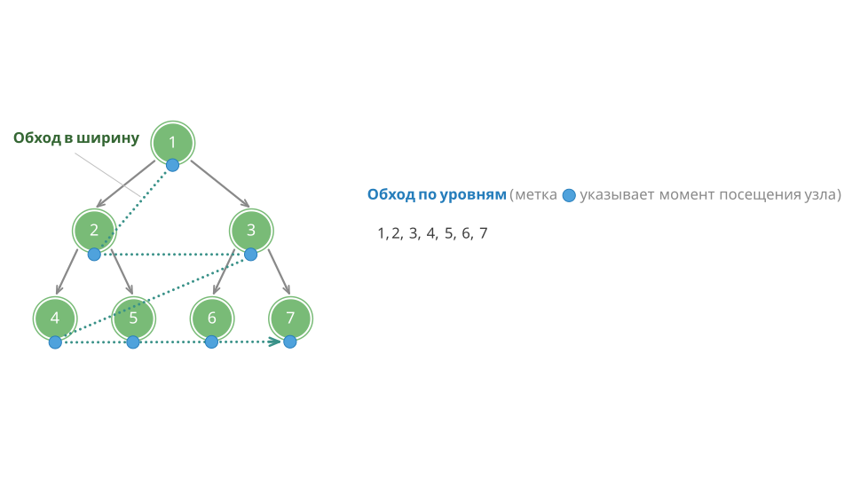
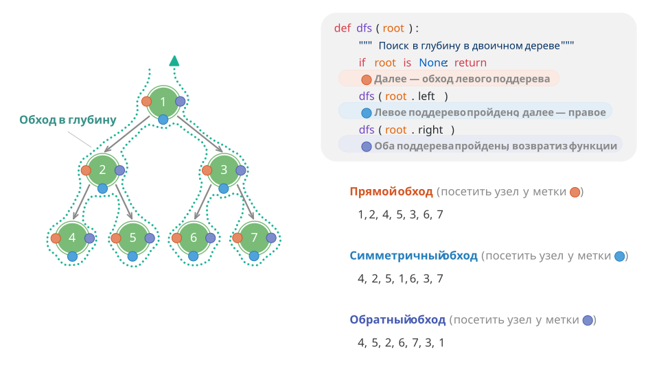
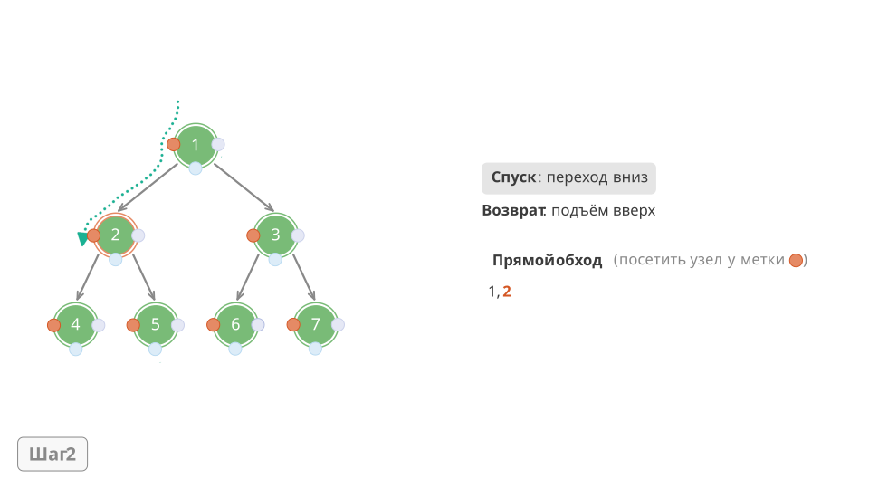
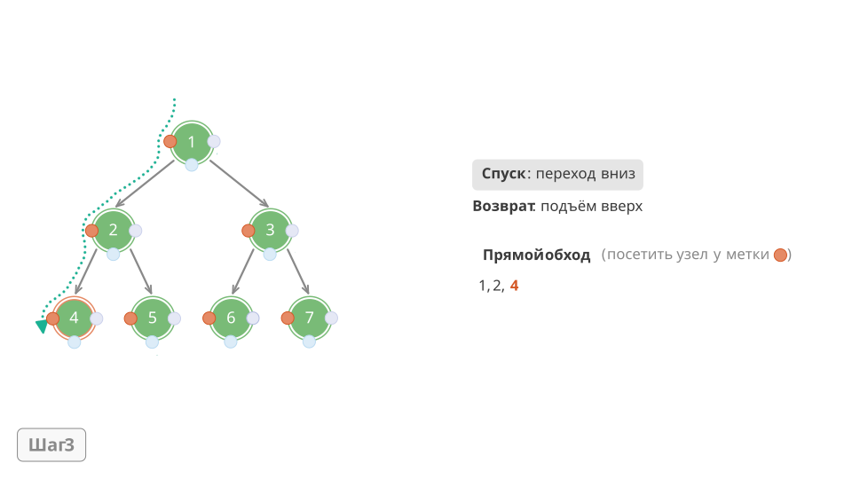
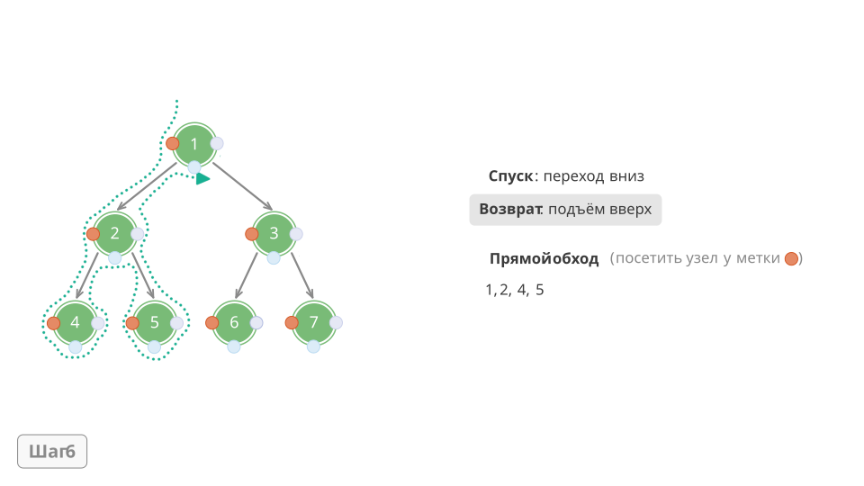

# Обход двоичного дерева

По своему устройству дерево — связная структура данных, поэтому обход переходит по указателям от узла к узлу. Но дерево нелинейно: обойти его сложнее, чем связный список. Для этого используют алгоритмы поиска.

К распространённым способам обхода двоичного дерева относятся обход по уровням, прямой, симметричный и обратный обходы.

## Обход по уровням

При <u>обходе по уровням (level-order traversal)</u> дерево проходят сверху вниз уровень за уровнем, а внутри уровня узлы посещают слева направо, как на рисунке ниже.

Обход по уровням — это <u>обход в ширину (breadth-first traversal)</u>, который также называют <u>поиском в ширину (breadth-first search, BFS)</u>. Он распространяется от корня наружу последовательными волнами, по одному уровню за раз.



### Реализация

Для обхода в ширину обычно используют очередь. Она работает по правилу «первым пришёл — первым вышел», которое естественно соответствует поуровневому продвижению обхода. Приведём реализацию:

```src
[file]{binary_tree_bfs}-[class]{}-[func]{level_order}
```

### Анализ сложности

- **Временная сложность — $O(n)$**. Каждый узел посещается один раз. Если $n$ — число узлов, обход занимает $O(n)$ времени.
- **Пространственная сложность — $O(n)$**. В худшем случае, когда дерево совершенное, перед обработкой последнего уровня в очереди одновременно находятся до $(n + 1) / 2$ узлов. Для этого нужно $O(n)$ памяти.

## Прямой, симметричный и обратный обходы

Прямой, симметричный и обратный обходы относятся к <u>обходу в глубину (depth-first traversal)</u>, также называемому <u>поиском в глубину (depth-first search, DFS)</u>. При таком обходе сначала идут по ветви до конца, а затем возвращаются и продолжают путь.

На рисунке показан принцип обхода двоичного дерева в глубину. **Представьте, что вы обходите всё дерево по внешнему контуру**. Возле каждого узла вы проходите три позиции, соответствующие прямому, симметричному и обратному обходам.



### Реализация

Поиск в глубину обычно реализуют с помощью рекурсии:

```src
[file]{binary_tree_dfs}-[class]{}-[func]{post_order}
```

!!! tip

    Поиск в глубину можно реализовать и итеративно. При желании попробуйте разобраться в этом самостоятельно.

На рисунке показана рекурсия при прямом обходе двоичного дерева. В ней можно выделить два противоположных направления: спуск и возврат.

1. При спуске начинается новый вызов метода, и программа переходит к следующему узлу.
2. При возврате функция передаёт управление обратно: обработка текущего узла закончена.

=== "<1>"
    

=== "<2>"
    

=== "<3>"
    

=== "<4>"
    

=== "<5>"
    

=== "<6>"
    

=== "<7>"
    

=== "<8>"
    

=== "<9>"
    

=== "<10>"
    

=== "<11>"
    

### Анализ сложности

- **Временная сложность — $O(n)$**. Каждый узел посещается один раз, поэтому обход занимает $O(n)$ времени.
- **Пространственная сложность — $O(n)$**. В худшем случае дерево вырождается в связный список, глубина рекурсии достигает $n$, и кадры стека вызовов занимают $O(n)$ памяти.
