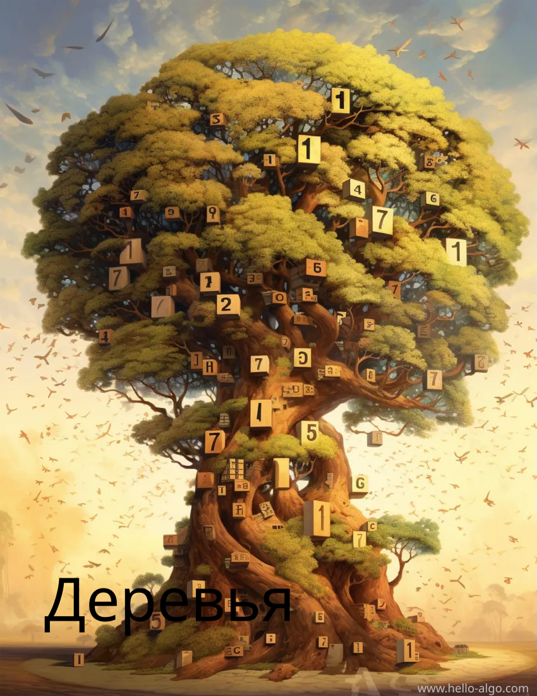

# Глава 7. &nbsp; Деревья

{ class="cover-image" }

!!! abstract

    Могучее дерево тянется к небу. Его корни глубоки, ветви раскидисты, а крона полна жизни.
    
    В его ветвях легко увидеть, как принцип «разделяй и властвуй» помогает организовать данные.

## Содержание главы

- [7.1 &nbsp; Двоичное дерево](binary_tree.md)
- [7.2 &nbsp; Обход двоичного дерева](binary_tree_traversal.md)
- [7.3 &nbsp; Представление двоичного дерева в виде массива](array_representation_of_tree.md)
- [7.4 &nbsp; Двоичное дерево поиска](binary_search_tree.md)
- [7.5 &nbsp; АВЛ-дерево *](avl_tree.md)
- [7.6 &nbsp; Итоги](summary.md)
- [7.7 &nbsp; Упражнения](exercises.md)
