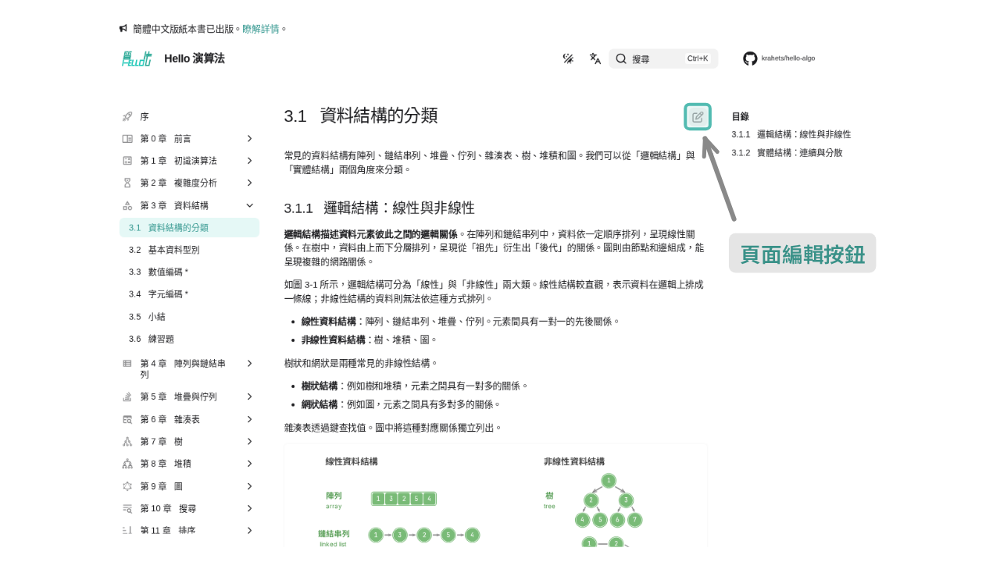

# 16.2 &nbsp; 一起參與創作

筆者能力有限，書中難免有疏漏或錯誤，敬請見諒。如果您發現筆誤、連結失效、內容缺漏、語意含糊、解說不清或文章結構不當，請協助修正，讓讀者有更好的學習資源。

為感謝所有[貢獻者](https://github.com/krahets/hello-algo/graphs/contributors)對開源社群的無私付出，本書的程式碼儲存庫、網頁版與 PDF 版都會在首頁列出他們的 GitHub ID。

!!! success "開源的魅力"

    紙本書從一次印刷到下一次印刷，往往相隔很久，更新內容相當不便。
    
    這本書採用開源方式，更新內容只需幾天，甚至幾個小時。

### 1. &nbsp; 小幅修改內容

如圖 16-3 所示，每一頁的右上角都有編輯圖示。您可以依照下列步驟修改文字或程式碼。

1. 點選編輯圖示。如果畫面提示您需要先建立這個儲存庫的副本（fork），請同意。
2. 修改 Markdown 原始檔，確認內容正確，並盡量維持一致的排版格式。
3. 在頁面底部填寫修改說明，再點選「Propose file change」。進入下一頁後，點選「Create pull request」即可提出合併請求。

{ class="animation-figure" }

 圖 16-3 &nbsp; 頁面右上角的編輯按鈕 

圖片無法直接修改。請新增 [Issue](https://github.com/krahets/hello-algo/issues) 或留言說明問題，我們會儘快重繪並替換圖片。

### 2. &nbsp; 撰寫新內容

如果您有興趣參與這個開源專案，例如將程式碼改寫成其他程式語言，或擴充文章內容，請依照下列流程提出合併請求（pull request）。

1. 登入 GitHub，使用 Fork 功能將本書的[程式碼儲存庫](https://github.com/krahets/hello-algo)複製到您的帳號下。
2. 開啟您建立的儲存庫副本頁面，使用 `git clone` 指令將儲存庫複製到本機。
3. 在本機撰寫內容，並執行完整測試，確認程式碼正確。
4. 在本機提交（commit）變更，再推送（push）到遠端儲存庫。
5. 重新整理儲存庫頁面，點選「Create pull request」即可提出合併請求。
