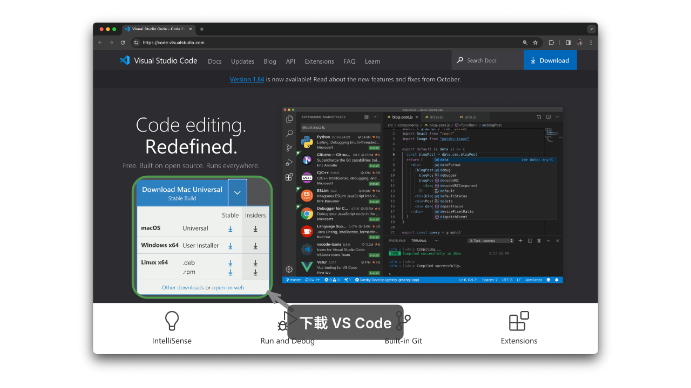
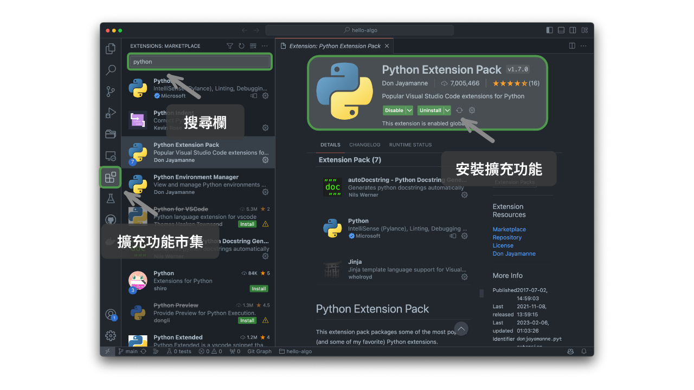

# 16.1 &nbsp; 安裝程式開發環境

## 16.1.1 &nbsp; 安裝 IDE

建議使用輕量、開源的 VS Code 作為本機的整合開發環境（IDE）。請前往 [VS Code 官網](https://code.visualstudio.com/)，依照您的作業系統下載並安裝對應版本。

{ class="animation-figure" }

 圖 16-1 &nbsp; 從官網下載 VS Code 

VS Code 有豐富的擴充套件，可執行大多數程式語言寫成的程式，也能為這些程式除錯。以 Python 為例，安裝「Python Extension Pack」擴充套件組後，就能為 Python 程式除錯。安裝步驟如圖 16-2 所示。

{ class="animation-figure" }

 圖 16-2 &nbsp; 安裝 VS Code 擴充套件組 

## 16.1.2 &nbsp; 安裝各語言的開發環境

### 1. &nbsp; Python 環境

1. 下載並安裝 [Miniconda3](https://docs.conda.io/en/latest/miniconda.html)。Python 版本須為 3.10 或更新版本。
2. 在 VS Code 的擴充套件市集中搜尋 `python`，並安裝 Python Extension Pack。
3. （選用）在命令列輸入 `pip install black`，安裝程式碼格式化工具。

### 2. &nbsp; C/C++ 環境

1. Windows 需要安裝 [MinGW](https://sourceforge.net/projects/mingw-w64/files/)（[設定教學](https://blog.csdn.net/qq_33698226/article/details/129031241)）。macOS 內建 Clang，無須另外安裝。
2. 在 VS Code 的擴充套件市集中搜尋 `c++`，並安裝 C/C++ Extension Pack。
3. （選用）開啟 Settings 頁面，搜尋程式碼格式化選項 `Clang_format_fallback Style`，將它設為 `{ BasedOnStyle: Microsoft, BreakBeforeBraces: Attach }`。

### 3. &nbsp; Java 環境

1. 下載並安裝 [OpenJDK](https://jdk.java.net/18/)，版本須高於 JDK 9。
2. 在 VS Code 的擴充套件市集中搜尋 `java`，並安裝 Extension Pack for Java。

### 4. &nbsp; C# 環境

1. 下載並安裝 [.NET 8.0](https://dotnet.microsoft.com/en-us/download)。
2. 在 VS Code 的擴充套件市集中搜尋 `C# Dev Kit`，並安裝 C# Dev Kit（[設定教學](https://code.visualstudio.com/docs/csharp/get-started)）。
3. 也可以使用 Visual Studio（[安裝教學](https://learn.microsoft.com/zh-tw/visualstudio/install/install-visual-studio?view=vs-2022)）。

### 5. &nbsp; Go 環境

1. 下載並安裝 [Go](https://go.dev/dl/)。
2. 在 VS Code 的擴充套件市集中搜尋 `go`，並安裝 Go。
3. 按下快速鍵 `Ctrl + Shift + P` 開啟命令選擇區，輸入 go，選取 `Go: Install/Update Tools`，再勾選所有工具並安裝。

### 6. &nbsp; Swift 環境

1. 下載並安裝 [Swift](https://www.swift.org/download/)。
2. 在 VS Code 的擴充套件市集中搜尋 `swift`，並安裝 [Swift for Visual Studio Code](https://marketplace.visualstudio.com/items?itemName=sswg.swift-lang)。

### 7. &nbsp; JavaScript 環境

1. 下載並安裝 [Node.js](https://nodejs.org/en/)。
2. （選用）在 VS Code 的擴充套件市集中搜尋 `Prettier`，並安裝這個程式碼格式化工具。

### 8. &nbsp; TypeScript 環境

1. 依照 JavaScript 環境的安裝步驟操作。
2. 安裝 [TypeScript Execute (tsx)](https://github.com/privatenumber/tsx?tab=readme-ov-file#global-installation)。
3. 在 VS Code 的擴充套件市集中搜尋 `typescript`，並安裝 [Pretty TypeScript Errors](https://marketplace.visualstudio.com/items?itemName=yoavbls.pretty-ts-errors)。

### 9. &nbsp; Dart 環境

1. 下載並安裝 [Dart](https://dart.dev/get-dart)。
2. 在 VS Code 的擴充套件市集中搜尋 `dart`，並安裝 [Dart](https://marketplace.visualstudio.com/items?itemName=Dart-Code.dart-code)。

### 10. &nbsp; Rust 環境

1. 下載並安裝 [Rust](https://www.rust-lang.org/tools/install)。
2. 在 VS Code 的擴充套件市集中搜尋 `rust`，並安裝 [rust-analyzer](https://marketplace.visualstudio.com/items?itemName=rust-lang.rust-analyzer)。
