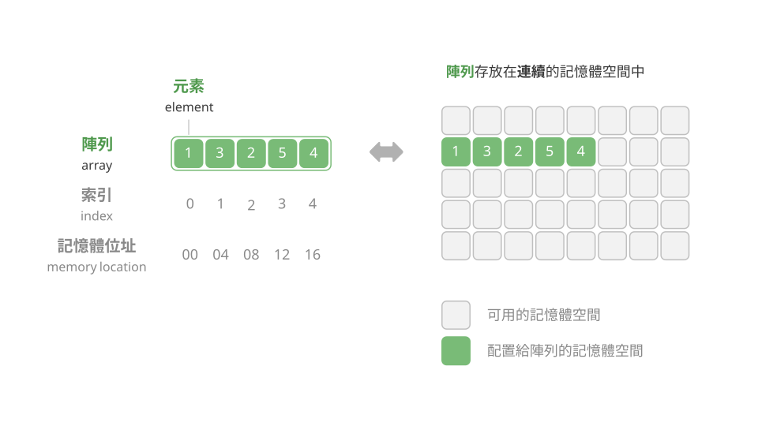
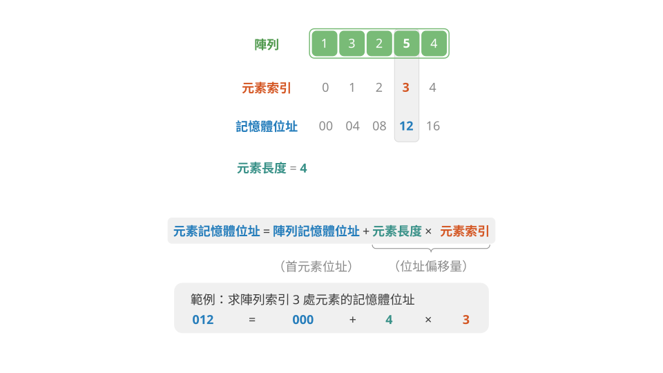
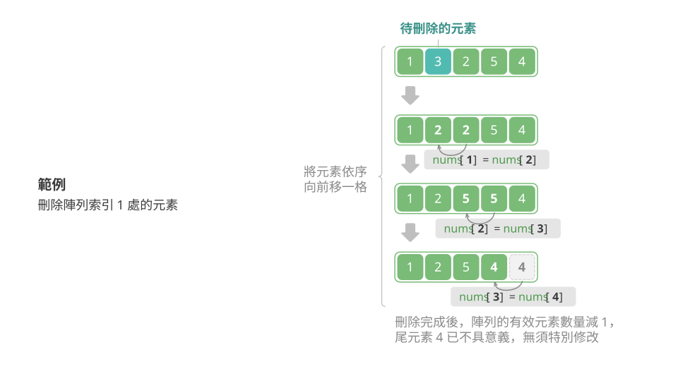

# 陣列

<u>陣列（array）</u>是一種線性資料結構，會將型別相同的元素存放在連續的記憶體空間中。元素在陣列中的位置稱為該元素的<u>索引（index）</u>。下圖呈現陣列的主要概念與儲存方式。



## 陣列的常見操作

### 初始化陣列

我們可以依需要選擇兩種方式初始化陣列：不指定初始值，或給定初始值。若未指定初始值，多數程式語言會將陣列元素初始化為 $0$：

```snippet
init_array
```

??? pythontutor "執行視覺化示範"

    @tutor init_array_tutor

### 存取元素

陣列元素連續存放在記憶體中，因此很容易算出各元素的記憶體位址。只要知道陣列的起始位址（也就是第一個元素的記憶體位址）和目標元素的索引，就能用下圖的公式算出該元素的記憶體位址，直接存取它。



從上圖可以看出，陣列中第一個元素的索引是 $0$。這乍看有些不合直覺，因為我們通常習慣從 $1$ 開始數。但從位址公式來看，**索引本質上代表記憶體位址的偏移量**。第一個元素的位址偏移量為 $0$，因此索引為 $0$ 很合理。

存取陣列元素非常有效率。對陣列中的任一元素，我們都能在 $O(1)$ 時間內隨機存取。

```src
[file]{array}-[class]{}-[func]{random_access}
```

### 插入元素

陣列元素在記憶體中緊鄰彼此，中間沒有空間可以存放其他資料。如下圖所示，若要在陣列中間插入元素，需要先將插入位置起的所有元素往後移一格，再將新元素寫入該索引處。


要留意的是，陣列的長度固定，因此插入一個元素，一定會使尾端原有的元素「遺失」。我們會在〈列表〉一節討論如何解決這個問題。

```src
[file]{array}-[class]{}-[func]{insert}
```

### 刪除元素

同理，如下圖所示，若要刪除索引 $i$ 處的元素，就必須將索引 $i$ 之後的所有元素往前移一格。



刪除完成後，原本留在尾端的元素已經沒有意義，因此無須特別修改它。

```src
[file]{array}-[class]{}-[func]{remove}
```

整體來說，陣列的插入與刪除操作有以下缺點。

- **時間複雜度高**：在陣列中插入和刪除元素的平均時間複雜度都是 $O(n)$，其中 $n$ 為陣列長度。
- **元素遺失**：陣列的長度固定，因此插入新元素後，被移出陣列範圍的元素會遺失。
- **浪費記憶體**：可以將陣列初始化得長一些，只使用前面一部分。如此一來，插入資料時，尾端遺失的元素都沒有意義，但也會浪費一部分記憶體。

### 走訪陣列

在多數程式語言中，我們既可以依索引走訪陣列，也可以直接走訪陣列中的每個元素：

```src
[file]{array}-[class]{}-[func]{traverse}
```

### 尋找元素

在陣列中尋找指定元素時，需要走訪陣列，逐一檢查元素值是否相符。一旦找到，函式就回傳對應的索引。

陣列是線性資料結構，因此上述搜尋方式稱為「線性搜尋」。

```src
[file]{array}-[class]{}-[func]{find}
```

### 擴充陣列容量

在複雜的系統環境中，程式難以保證緊接在陣列後面的記憶體空間可供使用，因此無法直接安全地擴充容量。所以在多數程式語言中，**陣列的長度固定不變**。

若要擴充容量，就得建立一個更大的陣列，再將原陣列的元素依序複製過去。這項操作需要 $O(n)$ 的時間，陣列很大時相當耗時。程式碼如下：

```src
[file]{array}-[class]{}-[func]{extend}
```

## 陣列的優點與限制

陣列的元素型別相同，且在記憶體中連續存放。系統可以利用這些事先已知的特性，提高資料結構的操作效率。

- **空間效率高**：陣列為資料配置連續的記憶體區塊，不必為結構本身付出額外的空間成本。
- **支援隨機存取**：在 $O(1)$ 時間內就能存取陣列中的任一元素。
- **快取區域性**：存取陣列元素時，電腦也會把附近的其他資料載入快取，讓後續操作能藉由快取加快執行速度。

使用連續空間儲存資料有利有弊，以下是它的限制。

- **插入與刪除效率低**：陣列中的元素越多，插入或刪除時可能需要移動的元素就越多。
- **長度固定**：陣列在初始化後長度就固定了。若要擴充容量，必須將所有資料複製到新陣列，成本很高。
- **浪費空間**：若配置給陣列的空間超過實際需求，多餘的空間就浪費了。

## 陣列的常見應用

陣列是一種基礎且常見的資料結構，各種演算法都經常用到它，也可以用它實作更複雜的資料結構。

- **隨機存取**：若要隨機抽取樣本，可以用陣列存放資料，產生一串隨機索引，再依索引抽樣。
- **排序與搜尋**：陣列是排序與搜尋演算法最常用的資料結構。快速排序、合併排序、二分搜尋等演算法主要都在陣列上操作。
- **查找表**：若要快速找到某個元素或查出其對應關係，可以將陣列當作查找表。例如，要建立字元與 ASCII 碼之間的對應關係，可以將字元的 ASCII 碼值當成索引，再將對應的元素放入陣列中的該位置。
- **機器學習**：類神經網路大量使用向量、矩陣、張量之間的線性代數運算，這些資料都以陣列來表示。陣列是設計類神經網路程式時最常用的資料結構。
- **實作資料結構**：陣列可以用來實作堆疊、佇列、雜湊表、堆積、圖等資料結構。例如，圖的鄰接矩陣其實就是一個二維陣列。
