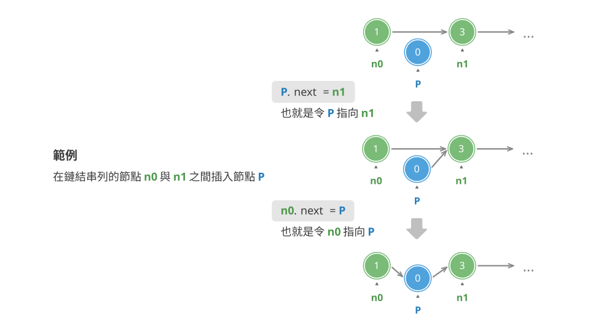
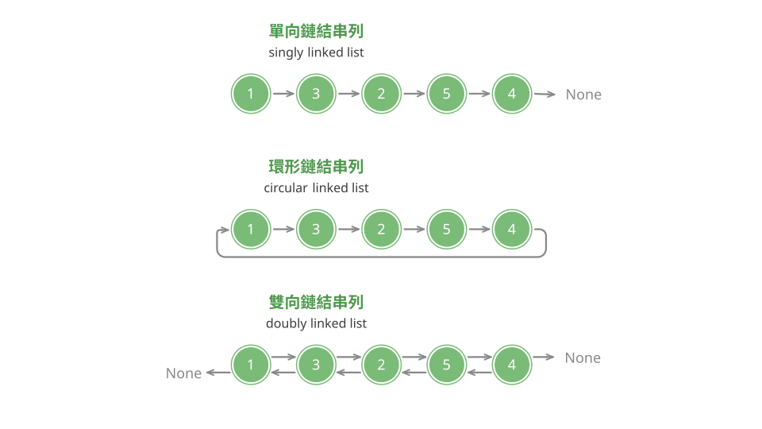

# 鏈結串列

記憶體是所有程式共用的資源。在複雜的系統環境中，可用空間可能散落在記憶體各處。我們知道，存放陣列必須使用連續的記憶體。若陣列很大，記憶體就不一定有足夠大的連續空間。這時，鏈結串列的彈性便能派上用場。

<u>鏈結串列（linked list）</u>是一種線性資料結構，每個元素都是一個節點物件，節點之間透過「參照」相連。參照記錄下一個節點的記憶體位址，讓我們可以從目前的節點存取下一個節點。

這種設計讓各節點能分散存放在記憶體各處，彼此的位址不必連續。


從上圖可見，鏈結串列由一個個<u>節點（node）</u>物件組成。每個節點都包含兩項資料：節點的「值」，以及指向下一個節點的「參照」。

- 鏈結串列的第一個節點稱為「頭節點」，最後一個節點稱為「尾節點」。
- 尾節點指向「空值」，在 Java、C++ 和 Python 中分別寫作 `null`、`nullptr` 和 `None`。
- 在 C、C++、Go 和 Rust 等支援指標的語言中，上述「參照」應改稱為「指標」。

如下方的程式碼所示，鏈結串列的節點 `ListNode` 除了值，還要多存一個參照（指標）。因此，資料量相同時，**鏈結串列比陣列占用更多記憶體空間**。

```snippet
list_node_class
```

## 鏈結串列的常見操作

### 初始化鏈結串列

建立鏈結串列分成兩個步驟：先初始化各個節點物件，再建立節點之間的參照。完成後，就能從頭節點出發，沿著參照 `next` 依序存取所有節點。

```snippet
init_linked_list
```

??? pythontutor "執行並觀看動畫"

    @tutor init_linked_list_tutor

整個陣列是一個變數，例如陣列 `nums` 包含 `nums[0]` 和 `nums[1]` 等元素。鏈結串列則由多個獨立的節點物件組成。**我們通常用頭節點來指稱整條鏈結串列**，例如上述程式碼中的串列可記為鏈結串列 `n0`。

### 插入節點

在鏈結串列中插入節點很簡單。如下圖所示，若要在相鄰的節點 `n0` 和 `n1` 之間插入新節點 `P`，**只需修改兩個節點的參照（指標）**，時間複雜度為 $O(1)$。

相較之下，在陣列中插入元素的時間複雜度為 $O(n)$，資料量大時效率較低。



```src
[file]{linked_list}-[class]{}-[func]{insert}
```

### 刪除節點

如下圖所示，從鏈結串列中刪除節點也很方便，**只需修改一個節點的參照（指標）**。

請留意，雖然刪除後節點 `P` 仍指向 `n1`，但走訪這條串列已經無法到達 `P`，這表示 `P` 已不再屬於這條串列。


```src
[file]{linked_list}-[class]{}-[func]{remove}
```

### 存取節點

**在鏈結串列中存取節點的效率較低**。上一節提過，我們可以在 $O(1)$ 時間內存取陣列中的任一元素。在鏈結串列中，程式必須從頭節點出發，逐一往後走訪，直到找到目標節點。也就是說，存取第 $i$ 個節點需要執行 $i - 1$ 次迴圈，時間複雜度為 $O(n)$。

```src
[file]{linked_list}-[class]{}-[func]{access}
```

### 尋找節點

走訪鏈結串列，尋找值為 `target` 的節點。找到後，函式就回傳該節點在串列中的索引。這個過程也屬於線性搜尋，程式碼如下：

```src
[file]{linked_list}-[class]{}-[func]{find}
```

## 陣列與鏈結串列的比較

下表整理了陣列與鏈結串列的特性，並比較各項操作的效率。兩者的儲存方式截然不同，因此在特性與操作效率上各有優劣。

<p align="center"> 表 <id> &nbsp; 陣列與鏈結串列的效率比較 </p>

|          | 陣列                           | 鏈結串列           |
| -------- | ------------------------------ | -------------- |
| 儲存方式 | 連續的記憶體空間                   | 分散的記憶體空間   |
| 擴充容量 | 長度固定                     | 可彈性擴充     |
| 記憶體使用效率 | 每個元素占用的記憶體較少，但可能浪費空間 | 每個元素占用的記憶體較多 |
| 存取元素 | $O(1)$                         | $O(n)$         |
| 加入元素 | $O(n)$                         | $O(1)$         |
| 刪除元素 | $O(n)$                         | $O(1)$         |

## 常見的鏈結串列類型

如下圖所示，常見的鏈結串列可分為三種。

- **單向鏈結串列**：就是前面介紹的普通鏈結串列。每個節點包含兩項資料：節點值和指向下一個節點的參照。第一個節點稱為頭節點，最後一個節點稱為尾節點，尾節點指向空值 `None`。
- **環狀鏈結串列**：讓單向鏈結串列的尾節點指向頭節點，使首尾相接，就得到了環狀鏈結串列。在環狀鏈結串列中，任一節點都可視為頭節點。
- **雙向鏈結串列**：與單向鏈結串列相比，雙向鏈結串列記錄了兩個方向的參照。每個節點都有指向後繼節點（下一個節點）和前驅節點（上一個節點）的參照（指標）。雙向鏈結串列比單向鏈結串列更有彈性，可以往兩個方向走訪，但也需要更多記憶體空間。

```snippet
doubly_list_node_class
```



## 鏈結串列的常見應用

單向鏈結串列常用來實作堆疊、佇列、雜湊表和圖等資料結構。

- **堆疊與佇列**：若插入和刪除都在串列的同一端進行，元素就會先進後出，這是堆疊的特性。若從一端插入、從另一端刪除，元素就會先進先出，這是佇列的特性。
- **雜湊表**：鏈結法是處理雜湊碰撞的主要方式之一。這種方法會將發生碰撞的元素都放入同一條鏈結串列。
- **圖**：相鄰串列是表示圖的常見方式。圖中的每個頂點都對應一條鏈結串列，串列中的各元素代表與該頂點相連的其他頂點。

需要快速找到前一個和後一個元素時，常會用到雙向鏈結串列。

- **進階資料結構**：例如，在紅黑樹和 B 樹中，我們需要存取節點的父節點。可以在節點中儲存指向父節點的參照，做法與雙向鏈結串列類似。
- **瀏覽器歷程記錄**：使用者按下網頁瀏覽器的「上一頁」或「下一頁」時，瀏覽器需要知道先前瀏覽的網頁中，哪一頁在前、哪一頁在後。雙向鏈結串列讓這項操作很簡單。
- **LRU 演算法**：採用最近最少使用（LRU）的快取淘汰演算法時，我們需要快速找出最久沒有使用的資料，也需要快速加入和刪除節點，因此很適合使用雙向鏈結串列。

環狀鏈結串列常用在需要週期性操作的場合，例如作業系統的資源排程。

- **循環排程演算法**：作業系統常用循環排程來分配 CPU 時間，讓一組行程輪流執行。每個行程都分配到一個時間片，用完時 CPU 就切換到下一個行程。這種循環操作可以用環狀鏈結串列實作。
- **資料緩衝區**：有些資料緩衝區也會用環狀鏈結串列來實作。例如，音訊或視訊播放器可以將資料流分成多個緩衝區塊，放入環狀鏈結串列，讓播放順暢銜接。
