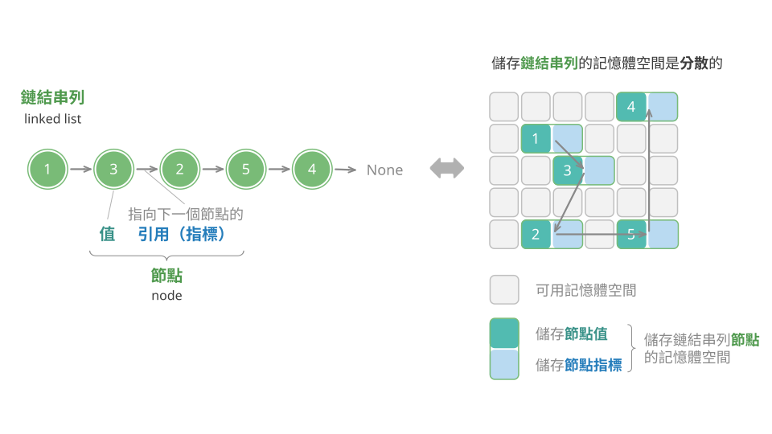
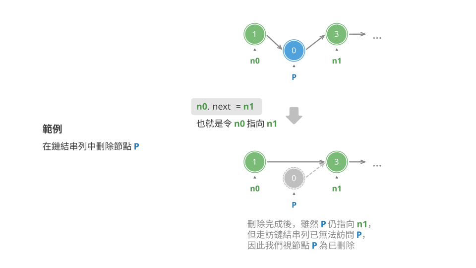

# 4.2 &nbsp; 鏈結串列

記憶體是所有程式共用的資源。在複雜的系統環境中，可用空間可能散落在記憶體各處。我們知道，存放陣列必須使用連續的記憶體。若陣列很大，記憶體就不一定有足夠大的連續空間。這時，鏈結串列的彈性便能派上用場。

<u>鏈結串列（linked list）</u>是一種線性資料結構，每個元素都是一個節點物件，節點之間透過「參照」相連。參照記錄下一個節點的記憶體位址，讓我們可以從目前的節點存取下一個節點。

這種設計讓各節點能分散存放在記憶體各處，彼此的位址不必連續。

{ class="animation-figure" }

<p align="center"> 圖 4-5 &nbsp; 鏈結串列的定義與儲存方式 </p>

從圖 4-5 可見，鏈結串列由一個個<u>節點（node）</u>物件組成。每個節點都包含兩項資料：節點的「值」，以及指向下一個節點的「參照」。

- 鏈結串列的第一個節點稱為「頭節點」，最後一個節點稱為「尾節點」。
- 尾節點指向「空值」，在 Java、C++ 和 Python 中分別寫作 `null`、`nullptr` 和 `None`。
- 在 C、C++、Go 和 Rust 等支援指標的語言中，上述「參照」應改稱為「指標」。

如下方的程式碼所示，鏈結串列的節點 `ListNode` 除了值，還要多存一個參照（指標）。因此，資料量相同時，**鏈結串列比陣列占用更多記憶體空間**。

=== "Python"

    ```python title=""
    class ListNode:
        """鏈結串列節點類別"""

        def __init__(self, val: int):
            self.val: int = val  # 節點值
            self.next: ListNode | None = None  # 指向下一個節點的參照
    ```

=== "C++"

    ```cpp title=""
    /* 鏈結串列節點 */
    struct ListNode {
        int val;        // 節點值
        ListNode *next; // 指向後繼節點的指標
        ListNode(int x) : val(x), next(nullptr) {
        }
    };
    ```

=== "Java"

    ```java title=""
    /* 鏈結串列節點 */
    public class ListNode {
        public int val;       // 節點值
        public ListNode next; // 指向下一個節點的參照

        public ListNode(int x) {
            val = x;
        }
    }
    ```

=== "C#"

    ```csharp title=""
    /* 鏈結串列節點 */
    public class ListNode(int x) {
        public int val = x;    // 節點值
        public ListNode? next; // 指向下一個節點的參照
    }
    ```

=== "Go"

    ```go title=""
    // ListNode 鏈結串列節點
    type ListNode struct {
        Val  int       // 節點值
        Next *ListNode // 指向後繼節點的指標
    }

    // NewListNode 鏈結串列節點建構函式
    func NewListNode(v int) *ListNode {
        return &ListNode{
            Val:  v,
            Next: nil,
        }
    }
    ```

=== "Swift"

    ```swift title=""
    /* 鏈結串列節點類別 */
    class ListNode {
        var val: Int // 節點值
        var next: ListNode? // 指向下一個節點的參照

        init(x: Int) { // 建構函式
            val = x
        }
    }
    ```

=== "JS"

    ```javascript title=""
    /* 鏈結串列節點 */
    class ListNode {
        val; // 節點值
        next; // 指向下一個節點的參照（指標）
        constructor(val, next) {
            this.val = val === undefined ? 0 : val;
            this.next = next === undefined ? null : next;
        }
    }
    ```

=== "TS"

    ```typescript title=""
    /* 鏈結串列節點 */
    class ListNode {
        val: number; // 節點值
        next: ListNode | null; // 指向下一個節點的參照
        constructor(val?: number, next?: ListNode | null) {
            this.val = val === undefined ? 0 : val;
            this.next = next === undefined ? null : next;
        }
    }
    ```

=== "Dart"

    ```dart title=""
    /* 鏈結串列節點 */
    class ListNode {
      int val; // 節點值
      ListNode? next; // 指向下一個節點的參照

      ListNode(this.val, [this.next]); // 建構函式
    }
    ```

=== "Rust"

    ```rust title=""
    use std::cell::RefCell;
    use std::rc::Rc;

    /* 鏈結串列節點 */
    #[derive(Debug)]
    pub struct ListNode<T> {
        pub val: T, // 節點值
        pub next: Option<Rc<RefCell<ListNode<T>>>>, // 指向後繼節點的指標
    }

    impl<T> ListNode<T> {
        pub fn new(val: T) -> Rc<RefCell<ListNode<T>>> {
            Rc::new(RefCell::new(ListNode { val, next: None }))
        }
    }
    ```

=== "C"

    ```c title=""
    /* 鏈結串列節點結構體 */
    typedef struct ListNode {
        int val;               // 節點值
        struct ListNode *next; // 指向下一個節點的指標
    } ListNode;

    /* 建構函式，用來初始化新節點 */
    ListNode *newListNode(int val) {
        ListNode *node;
        node = (ListNode *)malloc(sizeof(ListNode));
        node->val = val;
        node->next = NULL;
        return node;
    }
    ```

=== "Kotlin"

    ```kotlin title=""
    /* 鏈結串列節點 */
    class ListNode(var _val: Int) {
        var next: ListNode? = null // 指向下一個節點的參照
    }
    ```

=== "Ruby"

    ```ruby title=""
    ### 鏈結串列節點類別 ###
    class ListNode
      attr_accessor :val  # 節點值
      attr_accessor :next # 指向下一個節點的參照

      def initialize(val=0, next_node=nil)
        @val = val
        @next = next_node
      end
    end
    ```

## 4.2.1 &nbsp; 鏈結串列的常見操作

### 1. &nbsp; 初始化鏈結串列

建立鏈結串列分成兩個步驟：先初始化各個節點物件，再建立節點之間的參照。完成後，就能從頭節點出發，沿著參照 `next` 依序存取所有節點。

=== "Python"

    ```python title="linked_list.py"
    # 初始化鏈結串列 1 -> 3 -> 2 -> 5 -> 4
    # 初始化各個節點
    n0 = ListNode(1)
    n1 = ListNode(3)
    n2 = ListNode(2)
    n3 = ListNode(5)
    n4 = ListNode(4)
    # 建立節點之間的參照
    n0.next = n1
    n1.next = n2
    n2.next = n3
    n3.next = n4
    ```

=== "C++"

    ```cpp title="linked_list.cpp"
    /* 初始化鏈結串列 1 -> 3 -> 2 -> 5 -> 4 */
    // 初始化各個節點
    ListNode *n0 = new ListNode(1);
    ListNode *n1 = new ListNode(3);
    ListNode *n2 = new ListNode(2);
    ListNode *n3 = new ListNode(5);
    ListNode *n4 = new ListNode(4);
    // 建立節點之間的參照
    n0->next = n1;
    n1->next = n2;
    n2->next = n3;
    n3->next = n4;
    ```

=== "Java"

    ```java title="linked_list.java"
    /* 初始化鏈結串列 1 -> 3 -> 2 -> 5 -> 4 */
    // 初始化各個節點
    ListNode n0 = new ListNode(1);
    ListNode n1 = new ListNode(3);
    ListNode n2 = new ListNode(2);
    ListNode n3 = new ListNode(5);
    ListNode n4 = new ListNode(4);
    // 建立節點之間的參照
    n0.next = n1;
    n1.next = n2;
    n2.next = n3;
    n3.next = n4;
    ```

=== "C#"

    ```csharp title="linked_list.cs"
    // 初始化鏈結串列 1 -> 3 -> 2 -> 5 -> 4
    // 初始化各個節點
    ListNode n0 = new(1);
    ListNode n1 = new(3);
    ListNode n2 = new(2);
    ListNode n3 = new(5);
    ListNode n4 = new(4);
    // 建立節點之間的參照
    n0.next = n1;
    n1.next = n2;
    n2.next = n3;
    n3.next = n4;
    ```

=== "Go"

    ```go title="linked_list.go"
    /* 初始化鏈結串列 1 -> 3 -> 2 -> 5 -> 4 */
    // 初始化各個節點
    n0 := NewListNode(1)
    n1 := NewListNode(3)
    n2 := NewListNode(2)
    n3 := NewListNode(5)
    n4 := NewListNode(4)

    // 建立節點之間的參照
    n0.Next = n1
    n1.Next = n2
    n2.Next = n3
    n3.Next = n4
    ```

=== "Swift"

    ```swift title="linked_list.swift"
    /* 初始化鏈結串列 1 -> 3 -> 2 -> 5 -> 4 */
    // 初始化各個節點
    let n0 = ListNode(x: 1)
    let n1 = ListNode(x: 3)
    let n2 = ListNode(x: 2)
    let n3 = ListNode(x: 5)
    let n4 = ListNode(x: 4)
    // 建立節點之間的參照
    n0.next = n1
    n1.next = n2
    n2.next = n3
    n3.next = n4
    ```

=== "JS"

    ```javascript title="linked_list.js"
    /* 初始化鏈結串列 1 -> 3 -> 2 -> 5 -> 4 */
    // 初始化各個節點
    const n0 = new ListNode(1);
    const n1 = new ListNode(3);
    const n2 = new ListNode(2);
    const n3 = new ListNode(5);
    const n4 = new ListNode(4);
    // 建立節點之間的參照
    n0.next = n1;
    n1.next = n2;
    n2.next = n3;
    n3.next = n4;
    ```

=== "TS"

    ```typescript title="linked_list.ts"
    /* 初始化鏈結串列 1 -> 3 -> 2 -> 5 -> 4 */
    // 初始化各個節點
    const n0 = new ListNode(1);
    const n1 = new ListNode(3);
    const n2 = new ListNode(2);
    const n3 = new ListNode(5);
    const n4 = new ListNode(4);
    // 建立節點之間的參照
    n0.next = n1;
    n1.next = n2;
    n2.next = n3;
    n3.next = n4;
    ```

=== "Dart"

    ```dart title="linked_list.dart"
    // 初始化鏈結串列 1 -> 3 -> 2 -> 5 -> 4
    // 初始化各個節點
    ListNode n0 = ListNode(1);
    ListNode n1 = ListNode(3);
    ListNode n2 = ListNode(2);
    ListNode n3 = ListNode(5);
    ListNode n4 = ListNode(4);
    // 建立節點之間的參照
    n0.next = n1;
    n1.next = n2;
    n2.next = n3;
    n3.next = n4;
    ```

=== "Rust"

    ```rust title="linked_list.rs"
    /* 初始化鏈結串列 1 -> 3 -> 2 -> 5 -> 4 */
    // 初始化各個節點
    let n0 = ListNode::new(1);
    let n1 = ListNode::new(3);
    let n2 = ListNode::new(2);
    let n3 = ListNode::new(5);
    let n4 = ListNode::new(4);

    // 建立節點之間的參照
    n0.borrow_mut().next = Some(n1.clone());
    n1.borrow_mut().next = Some(n2.clone());
    n2.borrow_mut().next = Some(n3.clone());
    n3.borrow_mut().next = Some(n4.clone());
    ```

=== "C"

    ```c title="linked_list.c"
    /* 初始化鏈結串列 1 -> 3 -> 2 -> 5 -> 4 */
    // 初始化各個節點
    ListNode *n0 = newListNode(1);
    ListNode *n1 = newListNode(3);
    ListNode *n2 = newListNode(2);
    ListNode *n3 = newListNode(5);
    ListNode *n4 = newListNode(4);
    // 建立節點之間的參照
    n0->next = n1;
    n1->next = n2;
    n2->next = n3;
    n3->next = n4;
    ```

=== "Kotlin"

    ```kotlin title="linked_list.kt"
    /* 初始化鏈結串列 1 -> 3 -> 2 -> 5 -> 4 */
    // 初始化各個節點
    val n0 = ListNode(1)
    val n1 = ListNode(3)
    val n2 = ListNode(2)
    val n3 = ListNode(5)
    val n4 = ListNode(4)

    // 建立節點之間的參照
    n0.next = n1
    n1.next = n2
    n2.next = n3
    n3.next = n4
    ```

=== "Ruby"

    ```ruby title="linked_list.rb"
    # 初始化鏈結串列 1 -> 3 -> 2 -> 5 -> 4
    # 初始化各個節點
    n0 = ListNode.new(1)
    n1 = ListNode.new(3)
    n2 = ListNode.new(2)
    n3 = ListNode.new(5)
    n4 = ListNode.new(4)
    # 建立節點之間的參照
    n0.next = n1
    n1.next = n2
    n2.next = n3
    n3.next = n4
    ```

??? pythontutor "執行視覺化示範"

    <div style="height: 549px; width: 100%;"><iframe class="pythontutor-iframe" title="執行視覺化示範" src="https://pythontutor.com/iframe-embed.html#code=class%20ListNode%3A%0A%20%20%20%20%22%22%22%E9%8F%88%E7%B5%90%E4%B8%B2%E5%88%97%E7%9A%84%E7%AF%80%E9%BB%9E%E9%A1%9E%E5%88%A5%22%22%22%0A%20%20%20%20def%20__init__%28self,%20val%3A%20int%29%3A%0A%20%20%20%20%20%20%20%20self.val%3A%20int%20%3D%20val%20%20%23%20%E7%AF%80%E9%BB%9E%E5%80%BC%0A%20%20%20%20%20%20%20%20self.next%3A%20ListNode%20%7C%20None%20%3D%20None%20%20%23%20%E6%8C%87%E5%90%91%E4%B8%8B%E4%B8%80%E5%80%8B%E7%AF%80%E9%BB%9E%E7%9A%84%E5%8F%83%E7%85%A7%0A%0A%22%22%22Driver%20Code%22%22%22%0Aif%20__name__%20%3D%3D%20%22__main__%22%3A%0A%20%20%20%20%23%20%E5%88%9D%E5%A7%8B%E5%8C%96%E9%8F%88%E7%B5%90%E4%B8%B2%E5%88%97%201%20-%3E%203%20-%3E%202%20-%3E%205%20-%3E%204%0A%20%20%20%20%23%20%E5%88%9D%E5%A7%8B%E5%8C%96%E5%90%84%E5%80%8B%E7%AF%80%E9%BB%9E%0A%20%20%20%20n0%20%3D%20ListNode%281%29%0A%20%20%20%20n1%20%3D%20ListNode%283%29%0A%20%20%20%20n2%20%3D%20ListNode%282%29%0A%20%20%20%20n3%20%3D%20ListNode%285%29%0A%20%20%20%20n4%20%3D%20ListNode%284%29%0A%20%20%20%20%23%20%E5%BB%BA%E7%AB%8B%E7%AF%80%E9%BB%9E%E4%B9%8B%E9%96%93%E7%9A%84%E5%8F%83%E7%85%A7%0A%20%20%20%20n0.next%20%3D%20n1%0A%20%20%20%20n1.next%20%3D%20n2%0A%20%20%20%20n2.next%20%3D%20n3%0A%20%20%20%20n3.next%20%3D%20n4&codeDivHeight=472&codeDivWidth=350&cumulative=false&curInstr=3&heapPrimitives=nevernest&origin=opt-frontend.js&py=311&rawInputLstJSON=%5B%5D&textReferences=false"> </iframe></div>
    <div style="margin-top: 5px;"><a href="https://pythontutor.com/iframe-embed.html#code=class%20ListNode%3A%0A%20%20%20%20%22%22%22%E9%8F%88%E7%B5%90%E4%B8%B2%E5%88%97%E7%9A%84%E7%AF%80%E9%BB%9E%E9%A1%9E%E5%88%A5%22%22%22%0A%20%20%20%20def%20__init__%28self,%20val%3A%20int%29%3A%0A%20%20%20%20%20%20%20%20self.val%3A%20int%20%3D%20val%20%20%23%20%E7%AF%80%E9%BB%9E%E5%80%BC%0A%20%20%20%20%20%20%20%20self.next%3A%20ListNode%20%7C%20None%20%3D%20None%20%20%23%20%E6%8C%87%E5%90%91%E4%B8%8B%E4%B8%80%E5%80%8B%E7%AF%80%E9%BB%9E%E7%9A%84%E5%8F%83%E7%85%A7%0A%0A%22%22%22Driver%20Code%22%22%22%0Aif%20__name__%20%3D%3D%20%22__main__%22%3A%0A%20%20%20%20%23%20%E5%88%9D%E5%A7%8B%E5%8C%96%E9%8F%88%E7%B5%90%E4%B8%B2%E5%88%97%201%20-%3E%203%20-%3E%202%20-%3E%205%20-%3E%204%0A%20%20%20%20%23%20%E5%88%9D%E5%A7%8B%E5%8C%96%E5%90%84%E5%80%8B%E7%AF%80%E9%BB%9E%0A%20%20%20%20n0%20%3D%20ListNode%281%29%0A%20%20%20%20n1%20%3D%20ListNode%283%29%0A%20%20%20%20n2%20%3D%20ListNode%282%29%0A%20%20%20%20n3%20%3D%20ListNode%285%29%0A%20%20%20%20n4%20%3D%20ListNode%284%29%0A%20%20%20%20%23%20%E5%BB%BA%E7%AB%8B%E7%AF%80%E9%BB%9E%E4%B9%8B%E9%96%93%E7%9A%84%E5%8F%83%E7%85%A7%0A%20%20%20%20n0.next%20%3D%20n1%0A%20%20%20%20n1.next%20%3D%20n2%0A%20%20%20%20n2.next%20%3D%20n3%0A%20%20%20%20n3.next%20%3D%20n4&codeDivHeight=800&codeDivWidth=600&cumulative=false&curInstr=3&heapPrimitives=nevernest&origin=opt-frontend.js&py=311&rawInputLstJSON=%5B%5D&textReferences=false" target="_blank" rel="noopener noreferrer">全螢幕觀看 ></a></div>

整個陣列是一個變數，例如陣列 `nums` 包含 `nums[0]` 和 `nums[1]` 等元素。鏈結串列則由多個獨立的節點物件組成。**我們通常用頭節點來指稱整條鏈結串列**，例如上述程式碼中的串列可記為鏈結串列 `n0`。

### 2. &nbsp; 插入節點

在鏈結串列中插入節點很簡單。如圖 4-6 所示，若要在相鄰的節點 `n0` 和 `n1` 之間插入新節點 `P`，**只需修改兩個節點的參照（指標）**，時間複雜度為 $O(1)$。

相較之下，在陣列中插入元素的時間複雜度為 $O(n)$，資料量大時效率較低。

{ class="animation-figure" }

<p align="center"> 圖 4-6 &nbsp; 在鏈結串列中插入節點的範例 </p>

=== "Python"

    ```python title="linked_list.py"
    def insert(n0: ListNode, P: ListNode):
        """在鏈結串列的節點 n0 之後插入節點 P"""
        n1 = n0.next
        P.next = n1
        n0.next = P
    ```

=== "C++"

    ```cpp title="linked_list.cpp"
    /* 在鏈結串列的節點 n0 之後插入節點 P */
    void insert(ListNode *n0, ListNode *P) {
        ListNode *n1 = n0->next;
        P->next = n1;
        n0->next = P;
    }
    ```

=== "Java"

    ```java title="linked_list.java"
    /* 在鏈結串列的節點 n0 之後插入節點 P */
    void insert(ListNode n0, ListNode P) {
        ListNode n1 = n0.next;
        P.next = n1;
        n0.next = P;
    }
    ```

=== "C#"

    ```csharp title="linked_list.cs"
    /* 在鏈結串列的節點 n0 之後插入節點 P */
    void Insert(ListNode n0, ListNode P) {
        ListNode? n1 = n0.next;
        P.next = n1;
        n0.next = P;
    }
    ```

=== "Go"

    ```go title="linked_list.go"
    /* 在鏈結串列的節點 n0 之後插入節點 P */
    func insertNode(n0 *ListNode, P *ListNode) {
        n1 := n0.Next
        P.Next = n1
        n0.Next = P
    }
    ```

=== "Swift"

    ```swift title="linked_list.swift"
    /* 在鏈結串列的節點 n0 之後插入節點 P */
    func insert(n0: ListNode, P: ListNode) {
        let n1 = n0.next
        P.next = n1
        n0.next = P
    }
    ```

=== "JS"

    ```javascript title="linked_list.js"
    /* 在鏈結串列的節點 n0 之後插入節點 P */
    function insert(n0, P) {
        const n1 = n0.next;
        P.next = n1;
        n0.next = P;
    }
    ```

=== "TS"

    ```typescript title="linked_list.ts"
    /* 在鏈結串列的節點 n0 之後插入節點 P */
    function insert(n0: ListNode, P: ListNode): void {
        const n1 = n0.next;
        P.next = n1;
        n0.next = P;
    }
    ```

=== "Dart"

    ```dart title="linked_list.dart"
    /* 在鏈結串列的節點 n0 之後插入節點 P */
    void insert(ListNode n0, ListNode P) {
      ListNode? n1 = n0.next;
      P.next = n1;
      n0.next = P;
    }
    ```

=== "Rust"

    ```rust title="linked_list.rs"
    /* 在鏈結串列的節點 n0 之後插入節點 P */
    #[allow(non_snake_case)]
    pub fn insert<T>(n0: &Rc<RefCell<ListNode<T>>>, P: Rc<RefCell<ListNode<T>>>) {
        let n1 = n0.borrow_mut().next.take();
        P.borrow_mut().next = n1;
        n0.borrow_mut().next = Some(P);
    }
    ```

=== "C"

    ```c title="linked_list.c"
    /* 在鏈結串列的節點 n0 之後插入節點 P */
    void insert(ListNode *n0, ListNode *P) {
        ListNode *n1 = n0->next;
        P->next = n1;
        n0->next = P;
    }
    ```

=== "Kotlin"

    ```kotlin title="linked_list.kt"
    /* 在鏈結串列的節點 n0 之後插入節點 P */
    fun insert(n0: ListNode?, p: ListNode?) {
        val n1 = n0?.next
        p?.next = n1
        n0?.next = p
    }
    ```

=== "Ruby"

    ```ruby title="linked_list.rb"
    ### 在鏈結串列的節點 n0 之後插入節點 _p ###
    # Ruby 的 `p` 是內建函式，`P` 是常數，因此可以改用 `_p`
    def insert(n0, _p)
      n1 = n0.next
      _p.next = n1
      n0.next = _p
    end
    ```

??? pythontutor "執行視覺化示範"

    <div style="height: 549px; width: 100%;"><iframe class="pythontutor-iframe" title="執行視覺化示範" src="https://pythontutor.com/iframe-embed.html#code=class%20ListNode%3A%0A%20%20%20%20%22%22%22%E9%8F%88%E7%B5%90%E4%B8%B2%E5%88%97%E7%AF%80%E9%BB%9E%E9%A1%9E%E5%88%A5%22%22%22%0A%20%20%20%20def%20__init__%28self,%20val%3A%20int%29%3A%0A%20%20%20%20%20%20%20%20self.val%3A%20int%20%3D%20val%20%20%23%20%E7%AF%80%E9%BB%9E%E5%80%BC%0A%20%20%20%20%20%20%20%20self.next%3A%20ListNode%20%7C%20None%20%3D%20None%20%20%23%20%E6%8C%87%E5%90%91%E5%BE%8C%E7%B9%BC%E7%AF%80%E9%BB%9E%E7%9A%84%E5%8F%83%E7%85%A7%0A%0Adef%20insert%28n0%3A%20ListNode,%20P%3A%20ListNode%29%3A%0A%20%20%20%20%22%22%22%E5%9C%A8%E9%8F%88%E7%B5%90%E4%B8%B2%E5%88%97%E7%9A%84%E7%AF%80%E9%BB%9E%20n0%20%E4%B9%8B%E5%BE%8C%E6%8F%92%E5%85%A5%E7%AF%80%E9%BB%9E%20P%22%22%22%0A%20%20%20%20n1%20%3D%20n0.next%0A%20%20%20%20P.next%20%3D%20n1%0A%20%20%20%20n0.next%20%3D%20P%0A%0A%22%22%22Driver%20Code%22%22%22%0Aif%20__name__%20%3D%3D%20%22__main__%22%3A%0A%20%20%20%20%23%20%E5%88%9D%E5%A7%8B%E5%8C%96%E9%8F%88%E7%B5%90%E4%B8%B2%E5%88%97%0A%20%20%20%20%23%20%E5%88%9D%E5%A7%8B%E5%8C%96%E5%90%84%E5%80%8B%E7%AF%80%E9%BB%9E%0A%20%20%20%20n0%20%3D%20ListNode%281%29%0A%20%20%20%20n1%20%3D%20ListNode%283%29%0A%20%20%20%20n2%20%3D%20ListNode%282%29%0A%20%20%20%20n3%20%3D%20ListNode%285%29%0A%20%20%20%20n4%20%3D%20ListNode%284%29%0A%20%20%20%20%23%20%E5%BB%BA%E7%AB%8B%E7%AF%80%E9%BB%9E%E4%B9%8B%E9%96%93%E7%9A%84%E5%8F%83%E7%85%A7%0A%20%20%20%20n0.next%20%3D%20n1%0A%20%20%20%20n1.next%20%3D%20n2%0A%20%20%20%20n2.next%20%3D%20n3%0A%20%20%20%20n3.next%20%3D%20n4%0A%0A%20%20%20%20%23%20%E6%8F%92%E5%85%A5%E7%AF%80%E9%BB%9E%0A%20%20%20%20p%20%3D%20ListNode%280%29%0A%20%20%20%20insert%28n0,%20p%29&codeDivHeight=472&codeDivWidth=350&cumulative=false&curInstr=39&heapPrimitives=nevernest&origin=opt-frontend.js&py=311&rawInputLstJSON=%5B%5D&textReferences=false"> </iframe></div>
    <div style="margin-top: 5px;"><a href="https://pythontutor.com/iframe-embed.html#code=class%20ListNode%3A%0A%20%20%20%20%22%22%22%E9%8F%88%E7%B5%90%E4%B8%B2%E5%88%97%E7%AF%80%E9%BB%9E%E9%A1%9E%E5%88%A5%22%22%22%0A%20%20%20%20def%20__init__%28self,%20val%3A%20int%29%3A%0A%20%20%20%20%20%20%20%20self.val%3A%20int%20%3D%20val%20%20%23%20%E7%AF%80%E9%BB%9E%E5%80%BC%0A%20%20%20%20%20%20%20%20self.next%3A%20ListNode%20%7C%20None%20%3D%20None%20%20%23%20%E6%8C%87%E5%90%91%E5%BE%8C%E7%B9%BC%E7%AF%80%E9%BB%9E%E7%9A%84%E5%8F%83%E7%85%A7%0A%0Adef%20insert%28n0%3A%20ListNode,%20P%3A%20ListNode%29%3A%0A%20%20%20%20%22%22%22%E5%9C%A8%E9%8F%88%E7%B5%90%E4%B8%B2%E5%88%97%E7%9A%84%E7%AF%80%E9%BB%9E%20n0%20%E4%B9%8B%E5%BE%8C%E6%8F%92%E5%85%A5%E7%AF%80%E9%BB%9E%20P%22%22%22%0A%20%20%20%20n1%20%3D%20n0.next%0A%20%20%20%20P.next%20%3D%20n1%0A%20%20%20%20n0.next%20%3D%20P%0A%0A%22%22%22Driver%20Code%22%22%22%0Aif%20__name__%20%3D%3D%20%22__main__%22%3A%0A%20%20%20%20%23%20%E5%88%9D%E5%A7%8B%E5%8C%96%E9%8F%88%E7%B5%90%E4%B8%B2%E5%88%97%0A%20%20%20%20%23%20%E5%88%9D%E5%A7%8B%E5%8C%96%E5%90%84%E5%80%8B%E7%AF%80%E9%BB%9E%0A%20%20%20%20n0%20%3D%20ListNode%281%29%0A%20%20%20%20n1%20%3D%20ListNode%283%29%0A%20%20%20%20n2%20%3D%20ListNode%282%29%0A%20%20%20%20n3%20%3D%20ListNode%285%29%0A%20%20%20%20n4%20%3D%20ListNode%284%29%0A%20%20%20%20%23%20%E5%BB%BA%E7%AB%8B%E7%AF%80%E9%BB%9E%E4%B9%8B%E9%96%93%E7%9A%84%E5%8F%83%E7%85%A7%0A%20%20%20%20n0.next%20%3D%20n1%0A%20%20%20%20n1.next%20%3D%20n2%0A%20%20%20%20n2.next%20%3D%20n3%0A%20%20%20%20n3.next%20%3D%20n4%0A%0A%20%20%20%20%23%20%E6%8F%92%E5%85%A5%E7%AF%80%E9%BB%9E%0A%20%20%20%20p%20%3D%20ListNode%280%29%0A%20%20%20%20insert%28n0,%20p%29&codeDivHeight=800&codeDivWidth=600&cumulative=false&curInstr=39&heapPrimitives=nevernest&origin=opt-frontend.js&py=311&rawInputLstJSON=%5B%5D&textReferences=false" target="_blank" rel="noopener noreferrer">全螢幕觀看 ></a></div>

### 3. &nbsp; 刪除節點

如圖 4-7 所示，從鏈結串列中刪除節點也很方便，**只需修改一個節點的參照（指標）**。

請留意，雖然刪除後節點 `P` 仍指向 `n1`，但走訪這條串列已經無法到達 `P`，這表示 `P` 已不再屬於這條串列。

{ class="animation-figure" }

<p align="center"> 圖 4-7 &nbsp; 刪除鏈結串列的節點 </p>

=== "Python"

    ```python title="linked_list.py"
    def remove(n0: ListNode):
        """刪除鏈結串列中緊接在節點 n0 之後的節點"""
        if not n0.next:
            return
        # n0 -> P -> n1
        P = n0.next
        n1 = P.next
        n0.next = n1
    ```

=== "C++"

    ```cpp title="linked_list.cpp"
    /* 刪除鏈結串列中緊接在節點 n0 之後的節點 */
    void remove(ListNode *n0) {
        if (n0->next == nullptr)
            return;
        // n0 -> P -> n1
        ListNode *P = n0->next;
        ListNode *n1 = P->next;
        n0->next = n1;
        // 釋放記憶體
        delete P;
    }
    ```

=== "Java"

    ```java title="linked_list.java"
    /* 刪除鏈結串列中緊接在節點 n0 之後的節點 */
    void remove(ListNode n0) {
        if (n0.next == null)
            return;
        // n0 -> P -> n1
        ListNode P = n0.next;
        ListNode n1 = P.next;
        n0.next = n1;
    }
    ```

=== "C#"

    ```csharp title="linked_list.cs"
    /* 刪除鏈結串列中緊接在節點 n0 之後的節點 */
    void Remove(ListNode n0) {
        if (n0.next == null)
            return;
        // n0 -> P -> n1
        ListNode P = n0.next;
        ListNode? n1 = P.next;
        n0.next = n1;
    }
    ```

=== "Go"

    ```go title="linked_list.go"
    /* 刪除鏈結串列中緊接在節點 n0 之後的節點 */
    func removeItem(n0 *ListNode) {
        if n0.Next == nil {
            return
        }
        // n0 -> P -> n1
        P := n0.Next
        n1 := P.Next
        n0.Next = n1
    }
    ```

=== "Swift"

    ```swift title="linked_list.swift"
    /* 刪除鏈結串列中緊接在節點 n0 之後的節點 */
    func remove(n0: ListNode) {
        if n0.next == nil {
            return
        }
        // n0 -> P -> n1
        let P = n0.next
        let n1 = P?.next
        n0.next = n1
    }
    ```

=== "JS"

    ```javascript title="linked_list.js"
    /* 刪除鏈結串列中緊接在節點 n0 之後的節點 */
    function remove(n0) {
        if (!n0.next) return;
        // n0 -> P -> n1
        const P = n0.next;
        const n1 = P.next;
        n0.next = n1;
    }
    ```

=== "TS"

    ```typescript title="linked_list.ts"
    /* 刪除鏈結串列中緊接在節點 n0 之後的節點 */
    function remove(n0: ListNode): void {
        if (!n0.next) {
            return;
        }
        // n0 -> P -> n1
        const P = n0.next;
        const n1 = P.next;
        n0.next = n1;
    }
    ```

=== "Dart"

    ```dart title="linked_list.dart"
    /* 刪除鏈結串列中緊接在節點 n0 之後的節點 */
    void remove(ListNode n0) {
      if (n0.next == null) return;
      // n0 -> P -> n1
      ListNode P = n0.next!;
      ListNode? n1 = P.next;
      n0.next = n1;
    }
    ```

=== "Rust"

    ```rust title="linked_list.rs"
    /* 刪除鏈結串列中緊接在節點 n0 之後的節點 */
    #[allow(non_snake_case)]
    pub fn remove<T>(n0: &Rc<RefCell<ListNode<T>>>) {
        // n0 -> P -> n1
        let P = n0.borrow_mut().next.take();
        if let Some(node) = P {
            let n1 = node.borrow_mut().next.take();
            n0.borrow_mut().next = n1;
        }
    }
    ```

=== "C"

    ```c title="linked_list.c"
    /* 刪除鏈結串列中緊接在節點 n0 之後的節點 */
    // 注意：stdio.h 已使用 remove 這個名稱
    void removeItem(ListNode *n0) {
        if (!n0->next)
            return;
        // n0 -> P -> n1
        ListNode *P = n0->next;
        ListNode *n1 = P->next;
        n0->next = n1;
        // 釋放記憶體
        free(P);
    }
    ```

=== "Kotlin"

    ```kotlin title="linked_list.kt"
    /* 刪除鏈結串列中緊接在節點 n0 之後的節點 */
    fun remove(n0: ListNode?) {
        if (n0?.next == null)
            return
        // n0 -> P -> n1
        val p = n0.next
        val n1 = p?.next
        n0.next = n1
    }
    ```

=== "Ruby"

    ```ruby title="linked_list.rb"
    ### 刪除鏈結串列中緊接在節點 n0 之後的節點 ###
    def remove(n0)
      return if n0.next.nil?

      # n0 -> remove_node -> n1
      remove_node = n0.next
      n1 = remove_node.next
      n0.next = n1
    end
    ```

??? pythontutor "執行視覺化示範"

    <div style="height: 549px; width: 100%;"><iframe class="pythontutor-iframe" title="執行視覺化示範" src="https://pythontutor.com/iframe-embed.html#code=class%20ListNode%3A%0A%20%20%20%20%22%22%22%E9%8F%88%E7%B5%90%E4%B8%B2%E5%88%97%E7%AF%80%E9%BB%9E%E9%A1%9E%E5%88%A5%22%22%22%0A%20%20%20%20def%20__init__%28self,%20val%3A%20int%29%3A%0A%20%20%20%20%20%20%20%20self.val%3A%20int%20%3D%20val%20%20%23%20%E7%AF%80%E9%BB%9E%E5%80%BC%0A%20%20%20%20%20%20%20%20self.next%3A%20ListNode%20%7C%20None%20%3D%20None%20%20%23%20%E6%8C%87%E5%90%91%E5%BE%8C%E7%B9%BC%E7%AF%80%E9%BB%9E%E7%9A%84%E5%8F%83%E7%85%A7%0A%0Adef%20remove%28n0%3A%20ListNode%29%3A%0A%20%20%20%20%22%22%22%E5%88%AA%E9%99%A4%E9%8F%88%E7%B5%90%E4%B8%B2%E5%88%97%E4%B8%AD%E7%B7%8A%E6%8E%A5%E5%9C%A8%E7%AF%80%E9%BB%9E%20n0%20%E4%B9%8B%E5%BE%8C%E7%9A%84%E7%AF%80%E9%BB%9E%22%22%22%0A%20%20%20%20if%20not%20n0.next%3A%0A%20%20%20%20%20%20%20%20return%0A%20%20%20%20%23%20n0%20-%3E%20P%20-%3E%20n1%0A%20%20%20%20P%20%3D%20n0.next%0A%20%20%20%20n1%20%3D%20P.next%0A%20%20%20%20n0.next%20%3D%20n1%0A%0A%22%22%22Driver%20Code%22%22%22%0Aif%20__name__%20%3D%3D%20%22__main__%22%3A%0A%20%20%20%20%23%20%E5%88%9D%E5%A7%8B%E5%8C%96%E9%8F%88%E7%B5%90%E4%B8%B2%E5%88%97%0A%20%20%20%20%23%20%E5%88%9D%E5%A7%8B%E5%8C%96%E5%90%84%E5%80%8B%E7%AF%80%E9%BB%9E%0A%20%20%20%20n0%20%3D%20ListNode%281%29%0A%20%20%20%20n1%20%3D%20ListNode%283%29%0A%20%20%20%20n2%20%3D%20ListNode%282%29%0A%20%20%20%20n3%20%3D%20ListNode%285%29%0A%20%20%20%20n4%20%3D%20ListNode%284%29%0A%20%20%20%20%23%20%E5%BB%BA%E7%AB%8B%E7%AF%80%E9%BB%9E%E4%B9%8B%E9%96%93%E7%9A%84%E5%8F%83%E7%85%A7%0A%20%20%20%20n0.next%20%3D%20n1%0A%20%20%20%20n1.next%20%3D%20n2%0A%20%20%20%20n2.next%20%3D%20n3%0A%20%20%20%20n3.next%20%3D%20n4%0A%0A%20%20%20%20%23%20%E5%88%AA%E9%99%A4%E7%AF%80%E9%BB%9E%0A%20%20%20%20remove%28n0%29&codeDivHeight=472&codeDivWidth=350&cumulative=false&curInstr=34&heapPrimitives=nevernest&origin=opt-frontend.js&py=311&rawInputLstJSON=%5B%5D&textReferences=false"> </iframe></div>
    <div style="margin-top: 5px;"><a href="https://pythontutor.com/iframe-embed.html#code=class%20ListNode%3A%0A%20%20%20%20%22%22%22%E9%8F%88%E7%B5%90%E4%B8%B2%E5%88%97%E7%AF%80%E9%BB%9E%E9%A1%9E%E5%88%A5%22%22%22%0A%20%20%20%20def%20__init__%28self,%20val%3A%20int%29%3A%0A%20%20%20%20%20%20%20%20self.val%3A%20int%20%3D%20val%20%20%23%20%E7%AF%80%E9%BB%9E%E5%80%BC%0A%20%20%20%20%20%20%20%20self.next%3A%20ListNode%20%7C%20None%20%3D%20None%20%20%23%20%E6%8C%87%E5%90%91%E5%BE%8C%E7%B9%BC%E7%AF%80%E9%BB%9E%E7%9A%84%E5%8F%83%E7%85%A7%0A%0Adef%20remove%28n0%3A%20ListNode%29%3A%0A%20%20%20%20%22%22%22%E5%88%AA%E9%99%A4%E9%8F%88%E7%B5%90%E4%B8%B2%E5%88%97%E4%B8%AD%E7%B7%8A%E6%8E%A5%E5%9C%A8%E7%AF%80%E9%BB%9E%20n0%20%E4%B9%8B%E5%BE%8C%E7%9A%84%E7%AF%80%E9%BB%9E%22%22%22%0A%20%20%20%20if%20not%20n0.next%3A%0A%20%20%20%20%20%20%20%20return%0A%20%20%20%20%23%20n0%20-%3E%20P%20-%3E%20n1%0A%20%20%20%20P%20%3D%20n0.next%0A%20%20%20%20n1%20%3D%20P.next%0A%20%20%20%20n0.next%20%3D%20n1%0A%0A%22%22%22Driver%20Code%22%22%22%0Aif%20__name__%20%3D%3D%20%22__main__%22%3A%0A%20%20%20%20%23%20%E5%88%9D%E5%A7%8B%E5%8C%96%E9%8F%88%E7%B5%90%E4%B8%B2%E5%88%97%0A%20%20%20%20%23%20%E5%88%9D%E5%A7%8B%E5%8C%96%E5%90%84%E5%80%8B%E7%AF%80%E9%BB%9E%0A%20%20%20%20n0%20%3D%20ListNode%281%29%0A%20%20%20%20n1%20%3D%20ListNode%283%29%0A%20%20%20%20n2%20%3D%20ListNode%282%29%0A%20%20%20%20n3%20%3D%20ListNode%285%29%0A%20%20%20%20n4%20%3D%20ListNode%284%29%0A%20%20%20%20%23%20%E5%BB%BA%E7%AB%8B%E7%AF%80%E9%BB%9E%E4%B9%8B%E9%96%93%E7%9A%84%E5%8F%83%E7%85%A7%0A%20%20%20%20n0.next%20%3D%20n1%0A%20%20%20%20n1.next%20%3D%20n2%0A%20%20%20%20n2.next%20%3D%20n3%0A%20%20%20%20n3.next%20%3D%20n4%0A%0A%20%20%20%20%23%20%E5%88%AA%E9%99%A4%E7%AF%80%E9%BB%9E%0A%20%20%20%20remove%28n0%29&codeDivHeight=800&codeDivWidth=600&cumulative=false&curInstr=34&heapPrimitives=nevernest&origin=opt-frontend.js&py=311&rawInputLstJSON=%5B%5D&textReferences=false" target="_blank" rel="noopener noreferrer">全螢幕觀看 ></a></div>

### 4. &nbsp; 存取節點

**在鏈結串列中存取節點的效率較低**。上一節提過，我們可以在 $O(1)$ 時間內存取陣列中的任一元素。在鏈結串列中，程式必須從頭節點出發，逐一往後走訪，直到找到目標節點。也就是說，存取第 $i$ 個節點需要執行 $i - 1$ 次迴圈，時間複雜度為 $O(n)$。

=== "Python"

    ```python title="linked_list.py"
    def access(head: ListNode, index: int) -> ListNode | None:
        """存取鏈結串列中索引為 index 的節點"""
        for _ in range(index):
            if not head:
                return None
            head = head.next
        return head
    ```

=== "C++"

    ```cpp title="linked_list.cpp"
    /* 存取鏈結串列中索引為 index 的節點 */
    ListNode *access(ListNode *head, int index) {
        for (int i = 0; i < index; i++) {
            if (head == nullptr)
                return nullptr;
            head = head->next;
        }
        return head;
    }
    ```

=== "Java"

    ```java title="linked_list.java"
    /* 存取鏈結串列中索引為 index 的節點 */
    ListNode access(ListNode head, int index) {
        for (int i = 0; i < index; i++) {
            if (head == null)
                return null;
            head = head.next;
        }
        return head;
    }
    ```

=== "C#"

    ```csharp title="linked_list.cs"
    /* 存取鏈結串列中索引為 index 的節點 */
    ListNode? Access(ListNode? head, int index) {
        for (int i = 0; i < index; i++) {
            if (head == null)
                return null;
            head = head.next;
        }
        return head;
    }
    ```

=== "Go"

    ```go title="linked_list.go"
    /* 存取鏈結串列中索引為 index 的節點 */
    func access(head *ListNode, index int) *ListNode {
        for i := 0; i < index; i++ {
            if head == nil {
                return nil
            }
            head = head.Next
        }
        return head
    }
    ```

=== "Swift"

    ```swift title="linked_list.swift"
    /* 存取鏈結串列中索引為 index 的節點 */
    func access(head: ListNode, index: Int) -> ListNode? {
        var head: ListNode? = head
        for _ in 0 ..< index {
            if head == nil {
                return nil
            }
            head = head?.next
        }
        return head
    }
    ```

=== "JS"

    ```javascript title="linked_list.js"
    /* 存取鏈結串列中索引為 index 的節點 */
    function access(head, index) {
        for (let i = 0; i < index; i++) {
            if (!head) {
                return null;
            }
            head = head.next;
        }
        return head;
    }
    ```

=== "TS"

    ```typescript title="linked_list.ts"
    /* 存取鏈結串列中索引為 index 的節點 */
    function access(head: ListNode | null, index: number): ListNode | null {
        for (let i = 0; i < index; i++) {
            if (!head) {
                return null;
            }
            head = head.next;
        }
        return head;
    }
    ```

=== "Dart"

    ```dart title="linked_list.dart"
    /* 存取鏈結串列中索引為 index 的節點 */
    ListNode? access(ListNode? head, int index) {
      for (var i = 0; i < index; i++) {
        if (head == null) return null;
        head = head.next;
      }
      return head;
    }
    ```

=== "Rust"

    ```rust title="linked_list.rs"
    /* 存取鏈結串列中索引為 index 的節點 */
    pub fn access<T>(head: Rc<RefCell<ListNode<T>>>, index: i32) -> Option<Rc<RefCell<ListNode<T>>>> {
        fn dfs<T>(
            head: Option<&Rc<RefCell<ListNode<T>>>>,
            index: i32,
        ) -> Option<Rc<RefCell<ListNode<T>>>> {
            if index <= 0 {
                return head.cloned();
            }

            if let Some(node) = head {
                dfs(node.borrow().next.as_ref(), index - 1)
            } else {
                None
            }
        }

        dfs(Some(head).as_ref(), index)
    }
    ```

=== "C"

    ```c title="linked_list.c"
    /* 存取鏈結串列中索引為 index 的節點 */
    ListNode *access(ListNode *head, int index) {
        for (int i = 0; i < index; i++) {
            if (head == NULL)
                return NULL;
            head = head->next;
        }
        return head;
    }
    ```

=== "Kotlin"

    ```kotlin title="linked_list.kt"
    /* 存取鏈結串列中索引為 index 的節點 */
    fun access(head: ListNode?, index: Int): ListNode? {
        var h = head
        for (i in 0..<index) {
            if (h == null)
                return null
            h = h.next
        }
        return h
    }
    ```

=== "Ruby"

    ```ruby title="linked_list.rb"
    ### 存取鏈結串列中索引為 index 的節點 ###
    def access(head, index)
      for i in 0...index
        return nil if head.nil?
        head = head.next
      end

      head
    end
    ```

??? pythontutor "執行視覺化示範"

    <div style="height: 549px; width: 100%;"><iframe class="pythontutor-iframe" title="執行視覺化示範" src="https://pythontutor.com/iframe-embed.html#code=class%20ListNode%3A%0A%20%20%20%20%22%22%22%E9%8F%88%E7%B5%90%E4%B8%B2%E5%88%97%E7%AF%80%E9%BB%9E%E9%A1%9E%E5%88%A5%22%22%22%0A%20%20%20%20def%20__init__%28self,%20val%3A%20int%29%3A%0A%20%20%20%20%20%20%20%20self.val%3A%20int%20%3D%20val%20%20%23%20%E7%AF%80%E9%BB%9E%E5%80%BC%0A%20%20%20%20%20%20%20%20self.next%3A%20ListNode%20%7C%20None%20%3D%20None%20%20%23%20%E6%8C%87%E5%90%91%E5%BE%8C%E7%B9%BC%E7%AF%80%E9%BB%9E%E7%9A%84%E5%8F%83%E7%85%A7%0A%0Adef%20access%28head%3A%20ListNode,%20index%3A%20int%29%20-%3E%20ListNode%20%7C%20None%3A%0A%20%20%20%20%22%22%22%E5%AD%98%E5%8F%96%E9%8F%88%E7%B5%90%E4%B8%B2%E5%88%97%E4%B8%AD%E7%B4%A2%E5%BC%95%E7%82%BA%20index%20%E7%9A%84%E7%AF%80%E9%BB%9E%22%22%22%0A%20%20%20%20for%20_%20in%20range%28index%29%3A%0A%20%20%20%20%20%20%20%20if%20not%20head%3A%0A%20%20%20%20%20%20%20%20%20%20%20%20return%20None%0A%20%20%20%20%20%20%20%20head%20%3D%20head.next%0A%20%20%20%20return%20head%0A%0A%22%22%22Driver%20Code%22%22%22%0Aif%20__name__%20%3D%3D%20%22__main__%22%3A%0A%20%20%20%20%23%20%E5%88%9D%E5%A7%8B%E5%8C%96%E9%8F%88%E7%B5%90%E4%B8%B2%E5%88%97%0A%20%20%20%20%23%20%E5%88%9D%E5%A7%8B%E5%8C%96%E5%90%84%E5%80%8B%E7%AF%80%E9%BB%9E%0A%20%20%20%20n0%20%3D%20ListNode%281%29%0A%20%20%20%20n1%20%3D%20ListNode%283%29%0A%20%20%20%20n2%20%3D%20ListNode%282%29%0A%20%20%20%20n3%20%3D%20ListNode%285%29%0A%20%20%20%20n4%20%3D%20ListNode%284%29%0A%20%20%20%20%23%20%E5%BB%BA%E7%AB%8B%E7%AF%80%E9%BB%9E%E4%B9%8B%E9%96%93%E7%9A%84%E5%8F%83%E7%85%A7%0A%20%20%20%20n0.next%20%3D%20n1%0A%20%20%20%20n1.next%20%3D%20n2%0A%20%20%20%20n2.next%20%3D%20n3%0A%20%20%20%20n3.next%20%3D%20n4%0A%0A%20%20%20%20%23%20%E5%AD%98%E5%8F%96%E7%AF%80%E9%BB%9E%0A%20%20%20%20node%20%3D%20access%28n0,%203%29%0A%20%20%20%20print%28%22%E9%8F%88%E7%B5%90%E4%B8%B2%E5%88%97%E4%B8%AD%E7%B4%A2%E5%BC%95%203%20%E8%99%95%E7%9A%84%E7%AF%80%E9%BB%9E%E5%80%BC%20%3D%20%7B%7D%22.format%28node.val%29%29&codeDivHeight=472&codeDivWidth=350&cumulative=false&curInstr=34&heapPrimitives=nevernest&origin=opt-frontend.js&py=311&rawInputLstJSON=%5B%5D&textReferences=false"> </iframe></div>
    <div style="margin-top: 5px;"><a href="https://pythontutor.com/iframe-embed.html#code=class%20ListNode%3A%0A%20%20%20%20%22%22%22%E9%8F%88%E7%B5%90%E4%B8%B2%E5%88%97%E7%AF%80%E9%BB%9E%E9%A1%9E%E5%88%A5%22%22%22%0A%20%20%20%20def%20__init__%28self,%20val%3A%20int%29%3A%0A%20%20%20%20%20%20%20%20self.val%3A%20int%20%3D%20val%20%20%23%20%E7%AF%80%E9%BB%9E%E5%80%BC%0A%20%20%20%20%20%20%20%20self.next%3A%20ListNode%20%7C%20None%20%3D%20None%20%20%23%20%E6%8C%87%E5%90%91%E5%BE%8C%E7%B9%BC%E7%AF%80%E9%BB%9E%E7%9A%84%E5%8F%83%E7%85%A7%0A%0Adef%20access%28head%3A%20ListNode,%20index%3A%20int%29%20-%3E%20ListNode%20%7C%20None%3A%0A%20%20%20%20%22%22%22%E5%AD%98%E5%8F%96%E9%8F%88%E7%B5%90%E4%B8%B2%E5%88%97%E4%B8%AD%E7%B4%A2%E5%BC%95%E7%82%BA%20index%20%E7%9A%84%E7%AF%80%E9%BB%9E%22%22%22%0A%20%20%20%20for%20_%20in%20range%28index%29%3A%0A%20%20%20%20%20%20%20%20if%20not%20head%3A%0A%20%20%20%20%20%20%20%20%20%20%20%20return%20None%0A%20%20%20%20%20%20%20%20head%20%3D%20head.next%0A%20%20%20%20return%20head%0A%0A%22%22%22Driver%20Code%22%22%22%0Aif%20__name__%20%3D%3D%20%22__main__%22%3A%0A%20%20%20%20%23%20%E5%88%9D%E5%A7%8B%E5%8C%96%E9%8F%88%E7%B5%90%E4%B8%B2%E5%88%97%0A%20%20%20%20%23%20%E5%88%9D%E5%A7%8B%E5%8C%96%E5%90%84%E5%80%8B%E7%AF%80%E9%BB%9E%0A%20%20%20%20n0%20%3D%20ListNode%281%29%0A%20%20%20%20n1%20%3D%20ListNode%283%29%0A%20%20%20%20n2%20%3D%20ListNode%282%29%0A%20%20%20%20n3%20%3D%20ListNode%285%29%0A%20%20%20%20n4%20%3D%20ListNode%284%29%0A%20%20%20%20%23%20%E5%BB%BA%E7%AB%8B%E7%AF%80%E9%BB%9E%E4%B9%8B%E9%96%93%E7%9A%84%E5%8F%83%E7%85%A7%0A%20%20%20%20n0.next%20%3D%20n1%0A%20%20%20%20n1.next%20%3D%20n2%0A%20%20%20%20n2.next%20%3D%20n3%0A%20%20%20%20n3.next%20%3D%20n4%0A%0A%20%20%20%20%23%20%E5%AD%98%E5%8F%96%E7%AF%80%E9%BB%9E%0A%20%20%20%20node%20%3D%20access%28n0,%203%29%0A%20%20%20%20print%28%22%E9%8F%88%E7%B5%90%E4%B8%B2%E5%88%97%E4%B8%AD%E7%B4%A2%E5%BC%95%203%20%E8%99%95%E7%9A%84%E7%AF%80%E9%BB%9E%E5%80%BC%20%3D%20%7B%7D%22.format%28node.val%29%29&codeDivHeight=800&codeDivWidth=600&cumulative=false&curInstr=34&heapPrimitives=nevernest&origin=opt-frontend.js&py=311&rawInputLstJSON=%5B%5D&textReferences=false" target="_blank" rel="noopener noreferrer">全螢幕觀看 ></a></div>

### 5. &nbsp; 尋找節點

走訪鏈結串列，尋找值為 `target` 的節點。找到後，函式就回傳該節點在串列中的索引。這個過程也屬於線性搜尋，程式碼如下：

=== "Python"

    ```python title="linked_list.py"
    def find(head: ListNode, target: int) -> int:
        """在鏈結串列中尋找第一個值為 target 的節點"""
        index = 0
        while head:
            if head.val == target:
                return index
            head = head.next
            index += 1
        return -1
    ```

=== "C++"

    ```cpp title="linked_list.cpp"
    /* 在鏈結串列中尋找第一個值為 target 的節點 */
    int find(ListNode *head, int target) {
        int index = 0;
        while (head != nullptr) {
            if (head->val == target)
                return index;
            head = head->next;
            index++;
        }
        return -1;
    }
    ```

=== "Java"

    ```java title="linked_list.java"
    /* 在鏈結串列中尋找第一個值為 target 的節點 */
    int find(ListNode head, int target) {
        int index = 0;
        while (head != null) {
            if (head.val == target)
                return index;
            head = head.next;
            index++;
        }
        return -1;
    }
    ```

=== "C#"

    ```csharp title="linked_list.cs"
    /* 在鏈結串列中尋找第一個值為 target 的節點 */
    int Find(ListNode? head, int target) {
        int index = 0;
        while (head != null) {
            if (head.val == target)
                return index;
            head = head.next;
            index++;
        }
        return -1;
    }
    ```

=== "Go"

    ```go title="linked_list.go"
    /* 在鏈結串列中尋找第一個值為 target 的節點 */
    func findNode(head *ListNode, target int) int {
        index := 0
        for head != nil {
            if head.Val == target {
                return index
            }
            head = head.Next
            index++
        }
        return -1
    }
    ```

=== "Swift"

    ```swift title="linked_list.swift"
    /* 在鏈結串列中尋找第一個值為 target 的節點 */
    func find(head: ListNode, target: Int) -> Int {
        var head: ListNode? = head
        var index = 0
        while head != nil {
            if head?.val == target {
                return index
            }
            head = head?.next
            index += 1
        }
        return -1
    }
    ```

=== "JS"

    ```javascript title="linked_list.js"
    /* 在鏈結串列中尋找第一個值為 target 的節點 */
    function find(head, target) {
        let index = 0;
        while (head !== null) {
            if (head.val === target) {
                return index;
            }
            head = head.next;
            index += 1;
        }
        return -1;
    }
    ```

=== "TS"

    ```typescript title="linked_list.ts"
    /* 在鏈結串列中尋找第一個值為 target 的節點 */
    function find(head: ListNode | null, target: number): number {
        let index = 0;
        while (head !== null) {
            if (head.val === target) {
                return index;
            }
            head = head.next;
            index += 1;
        }
        return -1;
    }
    ```

=== "Dart"

    ```dart title="linked_list.dart"
    /* 在鏈結串列中尋找第一個值為 target 的節點 */
    int find(ListNode? head, int target) {
      int index = 0;
      while (head != null) {
        if (head.val == target) {
          return index;
        }
        head = head.next;
        index++;
      }
      return -1;
    }
    ```

=== "Rust"

    ```rust title="linked_list.rs"
    /* 在鏈結串列中尋找第一個值為 target 的節點 */
    pub fn find<T: PartialEq>(head: Rc<RefCell<ListNode<T>>>, target: T) -> i32 {
        fn find<T: PartialEq>(head: Option<&Rc<RefCell<ListNode<T>>>>, target: T, idx: i32) -> i32 {
            if let Some(node) = head {
                if node.borrow().val == target {
                    return idx;
                }
                return find(node.borrow().next.as_ref(), target, idx + 1);
            } else {
                -1
            }
        }

        find(Some(head).as_ref(), target, 0)
    }
    ```

=== "C"

    ```c title="linked_list.c"
    /* 在鏈結串列中尋找第一個值為 target 的節點 */
    int find(ListNode *head, int target) {
        int index = 0;
        while (head) {
            if (head->val == target)
                return index;
            head = head->next;
            index++;
        }
        return -1;
    }
    ```

=== "Kotlin"

    ```kotlin title="linked_list.kt"
    /* 在鏈結串列中尋找第一個值為 target 的節點 */
    fun find(head: ListNode?, target: Int): Int {
        var index = 0
        var h = head
        while (h != null) {
            if (h._val == target)
                return index
            h = h.next
            index++
        }
        return -1
    }
    ```

=== "Ruby"

    ```ruby title="linked_list.rb"
    ### 在鏈結串列中尋找第一個值為 target 的節點 ###
    def find(head, target)
      index = 0
      while head
        return index if head.val == target
        head = head.next
        index += 1
      end

      -1
    end
    ```

??? pythontutor "執行視覺化示範"

    <div style="height: 549px; width: 100%;"><iframe class="pythontutor-iframe" title="執行視覺化示範" src="https://pythontutor.com/iframe-embed.html#code=class%20ListNode%3A%0A%20%20%20%20%22%22%22%E9%8F%88%E7%B5%90%E4%B8%B2%E5%88%97%E7%AF%80%E9%BB%9E%E9%A1%9E%E5%88%A5%22%22%22%0A%20%20%20%20def%20__init__%28self,%20val%3A%20int%29%3A%0A%20%20%20%20%20%20%20%20self.val%3A%20int%20%3D%20val%20%20%23%20%E7%AF%80%E9%BB%9E%E5%80%BC%0A%20%20%20%20%20%20%20%20self.next%3A%20ListNode%20%7C%20None%20%3D%20None%20%20%23%20%E6%8C%87%E5%90%91%E5%BE%8C%E7%B9%BC%E7%AF%80%E9%BB%9E%E7%9A%84%E5%8F%83%E7%85%A7%0A%0Adef%20find%28head%3A%20ListNode,%20target%3A%20int%29%20-%3E%20int%3A%0A%20%20%20%20%22%22%22%E5%9C%A8%E9%8F%88%E7%B5%90%E4%B8%B2%E5%88%97%E4%B8%AD%E5%B0%8B%E6%89%BE%E7%AC%AC%E4%B8%80%E5%80%8B%E5%80%BC%E7%82%BA%20target%20%E7%9A%84%E7%AF%80%E9%BB%9E%22%22%22%0A%20%20%20%20index%20%3D%200%0A%20%20%20%20while%20head%3A%0A%20%20%20%20%20%20%20%20if%20head.val%20%3D%3D%20target%3A%0A%20%20%20%20%20%20%20%20%20%20%20%20return%20index%0A%20%20%20%20%20%20%20%20head%20%3D%20head.next%0A%20%20%20%20%20%20%20%20index%20%2B%3D%201%0A%20%20%20%20return%20-1%0A%0A%22%22%22Driver%20Code%22%22%22%0Aif%20__name__%20%3D%3D%20%22__main__%22%3A%0A%20%20%20%20%23%20%E5%88%9D%E5%A7%8B%E5%8C%96%E9%8F%88%E7%B5%90%E4%B8%B2%E5%88%97%0A%20%20%20%20%23%20%E5%88%9D%E5%A7%8B%E5%8C%96%E5%90%84%E5%80%8B%E7%AF%80%E9%BB%9E%0A%20%20%20%20n0%20%3D%20ListNode%281%29%0A%20%20%20%20n1%20%3D%20ListNode%283%29%0A%20%20%20%20n2%20%3D%20ListNode%282%29%0A%20%20%20%20n3%20%3D%20ListNode%285%29%0A%20%20%20%20n4%20%3D%20ListNode%284%29%0A%20%20%20%20%23%20%E5%BB%BA%E7%AB%8B%E7%AF%80%E9%BB%9E%E4%B9%8B%E9%96%93%E7%9A%84%E5%8F%83%E7%85%A7%0A%20%20%20%20n0.next%20%3D%20n1%0A%20%20%20%20n1.next%20%3D%20n2%0A%20%20%20%20n2.next%20%3D%20n3%0A%20%20%20%20n3.next%20%3D%20n4%0A%0A%20%20%20%20%23%20%E5%B0%8B%E6%89%BE%E7%AF%80%E9%BB%9E%0A%20%20%20%20index%20%3D%20find%28n0,%202%29%0A%20%20%20%20print%28%22%E9%8F%88%E7%B5%90%E4%B8%B2%E5%88%97%E4%B8%AD%E5%80%BC%E7%82%BA%202%20%E7%9A%84%E7%AF%80%E9%BB%9E%E7%B4%A2%E5%BC%95%20%3D%20%7B%7D%22.format%28index%29%29&codeDivHeight=472&codeDivWidth=350&cumulative=false&curInstr=34&heapPrimitives=nevernest&origin=opt-frontend.js&py=311&rawInputLstJSON=%5B%5D&textReferences=false"> </iframe></div>
    <div style="margin-top: 5px;"><a href="https://pythontutor.com/iframe-embed.html#code=class%20ListNode%3A%0A%20%20%20%20%22%22%22%E9%8F%88%E7%B5%90%E4%B8%B2%E5%88%97%E7%AF%80%E9%BB%9E%E9%A1%9E%E5%88%A5%22%22%22%0A%20%20%20%20def%20__init__%28self,%20val%3A%20int%29%3A%0A%20%20%20%20%20%20%20%20self.val%3A%20int%20%3D%20val%20%20%23%20%E7%AF%80%E9%BB%9E%E5%80%BC%0A%20%20%20%20%20%20%20%20self.next%3A%20ListNode%20%7C%20None%20%3D%20None%20%20%23%20%E6%8C%87%E5%90%91%E5%BE%8C%E7%B9%BC%E7%AF%80%E9%BB%9E%E7%9A%84%E5%8F%83%E7%85%A7%0A%0Adef%20find%28head%3A%20ListNode,%20target%3A%20int%29%20-%3E%20int%3A%0A%20%20%20%20%22%22%22%E5%9C%A8%E9%8F%88%E7%B5%90%E4%B8%B2%E5%88%97%E4%B8%AD%E5%B0%8B%E6%89%BE%E7%AC%AC%E4%B8%80%E5%80%8B%E5%80%BC%E7%82%BA%20target%20%E7%9A%84%E7%AF%80%E9%BB%9E%22%22%22%0A%20%20%20%20index%20%3D%200%0A%20%20%20%20while%20head%3A%0A%20%20%20%20%20%20%20%20if%20head.val%20%3D%3D%20target%3A%0A%20%20%20%20%20%20%20%20%20%20%20%20return%20index%0A%20%20%20%20%20%20%20%20head%20%3D%20head.next%0A%20%20%20%20%20%20%20%20index%20%2B%3D%201%0A%20%20%20%20return%20-1%0A%0A%22%22%22Driver%20Code%22%22%22%0Aif%20__name__%20%3D%3D%20%22__main__%22%3A%0A%20%20%20%20%23%20%E5%88%9D%E5%A7%8B%E5%8C%96%E9%8F%88%E7%B5%90%E4%B8%B2%E5%88%97%0A%20%20%20%20%23%20%E5%88%9D%E5%A7%8B%E5%8C%96%E5%90%84%E5%80%8B%E7%AF%80%E9%BB%9E%0A%20%20%20%20n0%20%3D%20ListNode%281%29%0A%20%20%20%20n1%20%3D%20ListNode%283%29%0A%20%20%20%20n2%20%3D%20ListNode%282%29%0A%20%20%20%20n3%20%3D%20ListNode%285%29%0A%20%20%20%20n4%20%3D%20ListNode%284%29%0A%20%20%20%20%23%20%E5%BB%BA%E7%AB%8B%E7%AF%80%E9%BB%9E%E4%B9%8B%E9%96%93%E7%9A%84%E5%8F%83%E7%85%A7%0A%20%20%20%20n0.next%20%3D%20n1%0A%20%20%20%20n1.next%20%3D%20n2%0A%20%20%20%20n2.next%20%3D%20n3%0A%20%20%20%20n3.next%20%3D%20n4%0A%0A%20%20%20%20%23%20%E5%B0%8B%E6%89%BE%E7%AF%80%E9%BB%9E%0A%20%20%20%20index%20%3D%20find%28n0,%202%29%0A%20%20%20%20print%28%22%E9%8F%88%E7%B5%90%E4%B8%B2%E5%88%97%E4%B8%AD%E5%80%BC%E7%82%BA%202%20%E7%9A%84%E7%AF%80%E9%BB%9E%E7%B4%A2%E5%BC%95%20%3D%20%7B%7D%22.format%28index%29%29&codeDivHeight=800&codeDivWidth=600&cumulative=false&curInstr=34&heapPrimitives=nevernest&origin=opt-frontend.js&py=311&rawInputLstJSON=%5B%5D&textReferences=false" target="_blank" rel="noopener noreferrer">全螢幕觀看 ></a></div>

## 4.2.2 &nbsp; 陣列與鏈結串列的比較

表 4-1 整理了陣列與鏈結串列的特性，並比較各項操作的效率。兩者的儲存方式截然不同，因此在特性與操作效率上各有優劣。

<p align="center"> 表 4-1 &nbsp; 陣列與鏈結串列的效率比較 </p>

<div class="center-table" markdown>

|          | 陣列                           | 鏈結串列           |
| -------- | ------------------------------ | -------------- |
| 儲存方式 | 連續的記憶體空間                   | 分散的記憶體空間   |
| 擴充容量 | 長度固定                     | 可彈性擴充     |
| 記憶體使用效率 | 每個元素占用的記憶體較少，但可能浪費空間 | 每個元素占用的記憶體較多 |
| 存取元素 | $O(1)$                         | $O(n)$         |
| 加入元素 | $O(n)$                         | $O(1)$         |
| 刪除元素 | $O(n)$                         | $O(1)$         |

</div>

## 4.2.3 &nbsp; 常見的鏈結串列類型

如圖 4-8 所示，常見的鏈結串列可分為三種。

- **單向鏈結串列**：就是前面介紹的普通鏈結串列。每個節點包含兩項資料：節點值和指向下一個節點的參照。第一個節點稱為頭節點，最後一個節點稱為尾節點，尾節點指向空值 `None`。
- **環狀鏈結串列**：讓單向鏈結串列的尾節點指向頭節點，使首尾相接，就得到了環狀鏈結串列。在環狀鏈結串列中，任一節點都可視為頭節點。
- **雙向鏈結串列**：與單向鏈結串列相比，雙向鏈結串列記錄了兩個方向的參照。每個節點都有指向後繼節點（下一個節點）和前驅節點（上一個節點）的參照（指標）。雙向鏈結串列比單向鏈結串列更有彈性，可以往兩個方向走訪，但也需要更多記憶體空間。

=== "Python"

    ```python title=""
    class ListNode:
        """雙向鏈結串列節點"""

        def __init__(self, val: int):
            """建構方法"""
            self.val: int = val  # 節點值
            self.next: ListNode | None = None  # 指向後繼節點的參照
            self.prev: ListNode | None = None  # 指向前驅節點的參照
    ```

=== "C++"

    ```cpp title=""
    /* 雙向鏈結串列節點 */
    struct DoublyListNode {
        int val;              // 節點值
        DoublyListNode *next; // 指向後繼節點的指標
        DoublyListNode *prev; // 指向前驅節點的指標
        DoublyListNode(int val) : val(val), prev(nullptr), next(nullptr) {
        }
    };
    ```

=== "Java"

    ```java title=""
    /* 雙向鏈結串列節點 */
    class ListNode {
        int val;       // 節點值
        ListNode next; // 指向後繼節點的參照
        ListNode prev; // 指向前驅節點的參照

        ListNode(int val) {
            this.val = val;
            prev = next = null;
        }
    }
    ```

=== "C#"

    ```csharp title=""
    /* 雙向鏈結串列節點 */
    public class ListNode(int val) {
        public int val = val;         // 節點值
        public ListNode? next = null; // 指向後繼節點的參照
        public ListNode? prev = null; // 指向前驅節點的參照
    }
    ```

=== "Go"

    ```go title=""
    /* 雙向鏈結串列節點結構體 */
    type DoublyListNode struct {
        Val  int             // 節點值
        Next *DoublyListNode // 指向後繼節點的指標
        Prev *DoublyListNode // 指向前驅節點的指標
    }

    // NewDoublyListNode 初始化
    func NewDoublyListNode(val int) *DoublyListNode {
        return &DoublyListNode{
            Val:  val,
            Next: nil,
            Prev: nil,
        }
    }
    ```

=== "Swift"

    ```swift title=""
    /* 雙向鏈結串列節點 */
    class ListNode {
        var val: Int // 節點值
        var next: ListNode? // 指向後繼節點的參照
        weak var prev: ListNode? // 指向前驅節點的參照

        init(val: Int) {
            self.val = val
        }
    }
    ```

=== "JS"

    ```javascript title=""
    /* 雙向鏈結串列節點 */
    class ListNode {
        prev; // 指向前驅節點的參照（指標）
        next; // 指向後繼節點的參照（指標）
        val; // 節點值

        constructor(val) {
            this.val = val;
            this.next = null;
            this.prev = null;
        }
    }
    ```

=== "TS"

    ```typescript title=""
    /* 雙向鏈結串列節點 */
    class ListNode {
        prev: ListNode | null; // 指向前驅節點的參照（指標）
        next: ListNode | null; // 指向後繼節點的參照（指標）
        val: number; // 節點值

        constructor(val: number) {
            this.val = val;
            this.next = null;
            this.prev = null;
        }
    }
    ```

=== "Dart"

    ```dart title=""
    /* 雙向鏈結串列節點 */
    class ListNode {
      int val; // 節點值
      ListNode? next; // 指向後繼節點的參照
      ListNode? prev; // 指向前驅節點的參照

      ListNode(this.val, {this.next, this.prev});
    }
    ```

=== "Rust"

    ```rust title=""
    use std::cell::RefCell;
    use std::rc::Rc;

    /* 雙向鏈結串列節點 */
    pub struct ListNode<T> {
        pub val: T,                                 // 節點值
        pub next: Option<Rc<RefCell<ListNode<T>>>>, // 指向後繼節點的指標
        pub prev: Option<Rc<RefCell<ListNode<T>>>>, // 指向前驅節點的指標
    }

    impl<T> ListNode<T> {
        pub fn new(val: T) -> Rc<RefCell<ListNode<T>>> {
            Rc::new(RefCell::new(ListNode {
                val,
                next: None,
                prev: None,
            }))
        }
    }
    ```

=== "C"

    ```c title=""
    /* 雙向鏈結串列節點 */
    typedef struct DoublyListNode {
        int val;                     // 節點值
        struct DoublyListNode *next; // 指向後繼節點的指標
        struct DoublyListNode *prev; // 指向前驅節點的指標
    } DoublyListNode;

    /* 建構函式 */
    DoublyListNode *newDoublyListNode(int num) {
        DoublyListNode *new = (DoublyListNode *)malloc(sizeof(DoublyListNode));
        new->val = num;
        new->next = NULL;
        new->prev = NULL;
        return new;
    }
    ```

=== "Kotlin"

    ```kotlin title=""
    /* 雙向鏈結串列節點 */
    class ListNode(
        var _val: Int // 節點值
    ) {
        var next: ListNode? = null // 指向後繼節點的參照
        var prev: ListNode? = null // 指向前驅節點的參照
    }
    ```

=== "Ruby"

    ```ruby title=""
    ### 雙向鏈結串列節點 ###
    class ListNode
      attr_accessor :val  # 節點值
      attr_accessor :next # 指向後繼節點的參照
      attr_accessor :prev # 指向前驅節點的參照

      ### 建構方法 ###
      def initialize(val)
        @val = val
      end
    end
    ```

{ class="animation-figure" }

<p align="center"> 圖 4-8 &nbsp; 常見的鏈結串列類型 </p>

## 4.2.4 &nbsp; 鏈結串列的常見應用

單向鏈結串列常用來實作堆疊、佇列、雜湊表和圖等資料結構。

- **堆疊與佇列**：若插入和刪除都在串列的同一端進行，元素就會先進後出，這是堆疊的特性。若從一端插入、從另一端刪除，元素就會先進先出，這是佇列的特性。
- **雜湊表**：鏈結法是處理雜湊碰撞的主要方式之一。這種方法會將發生碰撞的元素都放入同一條鏈結串列。
- **圖**：鄰接串列是表示圖的常見方式。圖中的每個頂點都對應一條鏈結串列，串列中的各元素代表與該頂點相連的其他頂點。

需要快速找到前一個和後一個元素時，常會用到雙向鏈結串列。

- **進階資料結構**：例如，在紅黑樹和 B 樹中，我們需要存取節點的父節點。可以在節點中儲存指向父節點的參照，做法與雙向鏈結串列類似。
- **瀏覽器歷程記錄**：使用者按下網頁瀏覽器的「上一頁」或「下一頁」時，瀏覽器需要知道先前瀏覽的網頁中，哪一頁在前、哪一頁在後。雙向鏈結串列讓這項操作很簡單。
- **LRU 演算法**：採用最近最少使用（LRU）的快取淘汰演算法時，我們需要快速找出最久沒有使用的資料，也需要快速加入和刪除節點，因此很適合使用雙向鏈結串列。

環狀鏈結串列常用在需要週期性操作的場合，例如作業系統的資源排程。

- **循環排程演算法**：作業系統常用循環排程來分配 CPU 時間，讓一組行程輪流執行。每個行程都分配到一個時間片，用完時 CPU 就切換到下一個行程。這種循環操作可以用環狀鏈結串列實作。
- **資料緩衝區**：有些資料緩衝區也會用環狀鏈結串列來實作。例如，音訊或視訊播放器可以將資料流分成多個緩衝區塊，放入環狀鏈結串列，讓播放順暢銜接。
