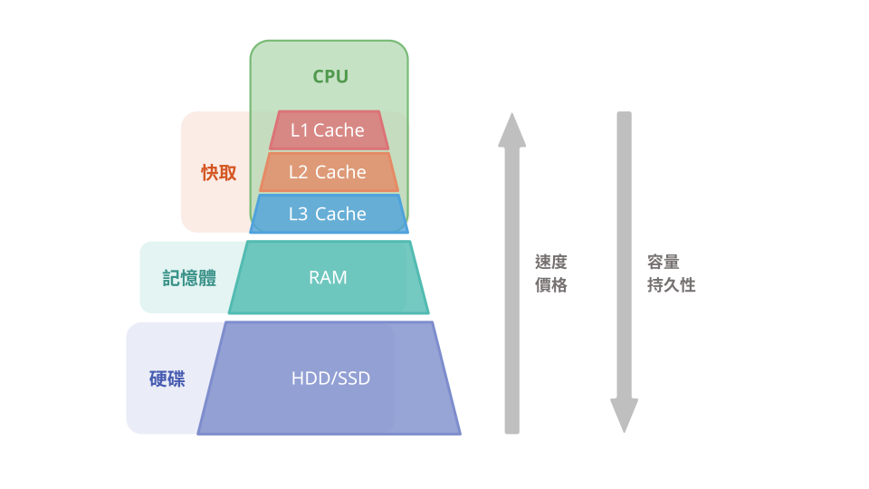
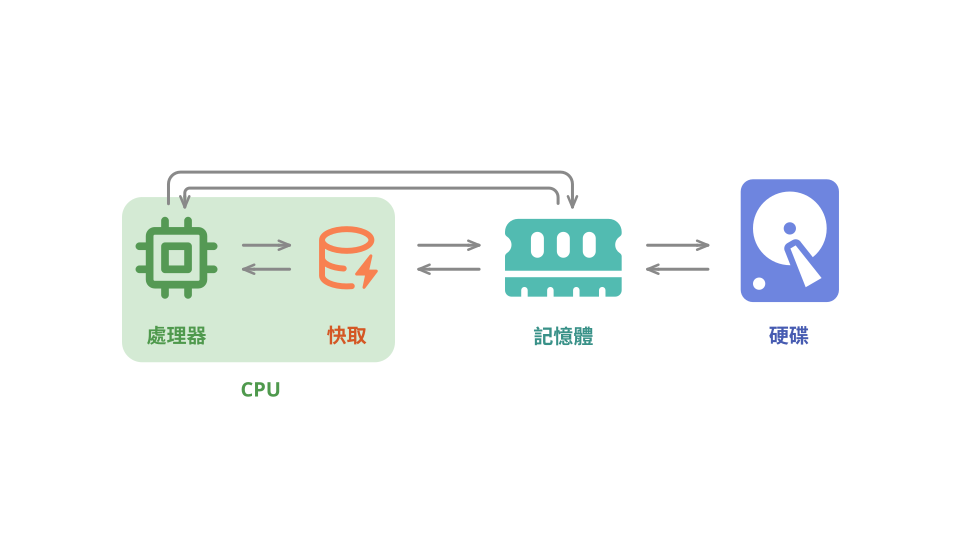

# 4.4 &nbsp; 記憶體與快取 *

在本章的前兩節，我們探討了陣列和鏈結串列這兩種基礎而重要的資料結構。它們分別代表「連續儲存」和「分散儲存」兩種實體結構。

事實上，**實體結構在很大程度上決定了程式使用記憶體與快取的效率**，進而影響演算法程式的整體效能。

## 4.4.1 &nbsp; 電腦的儲存裝置

電腦有三種儲存裝置：<u>硬碟（hard disk）</u>、<u>記憶體（random-access memory, RAM）</u>和<u>快取（cache memory）</u>。表 4-2 列出它們在電腦系統中的用途與效能特性。

 表 4-2 &nbsp; 電腦的儲存裝置 

|                | 硬碟                                     | 記憶體                                   | 快取                                              |
| -------------- | ---------------------------------------- | -------------------------------------- | ------------------------------------------------- |
| 用途           | 長期儲存資料，包括作業系統、程式、檔案等 | 暫時儲存目前執行的程式及正在處理的資料 | 儲存常用的資料與指令，減少 CPU 存取記憶體的次數 |
| 揮發性         | 斷電後仍可保留資料                       | 斷電後資料會消失                       | 斷電後資料會消失                                  |
| 容量           | 較大，TB 級                            | 較小，GB 級                          | 非常小，MB 級                                   |
| 速度           | 較慢，每秒數百至數千 MB                    | 較快，每秒數十 GB                        | 非常快，每秒數十至數百 GB                           |
| 價格（人民幣） | 較便宜，每 GB 數角至數元（1 角等於 0.1 元）                  | 較貴，每 GB 數十至數百元                | 非常貴，與 CPU 合併計價                           |

電腦的儲存系統可以想像成圖 4-9 的金字塔。越靠近塔頂的儲存裝置，速度越快、容量越小、成本也越高。這樣的分層設計是電腦科學家與工程師仔細權衡後的結果。

- **記憶體很難取代硬碟**。首先，記憶體在斷電後會失去資料，不適合長期儲存。其次，記憶體的成本是硬碟的數十倍，因此很難在消費市場中普遍用它來取代硬碟。
- **快取很難兼具大容量和高速度**。從 L1 到 L2 再到 L3，快取容量逐級增加，實體尺寸越來越大，離 CPU 核心也越來越遠。因此資料傳輸時間增加，存取元素的延遲也越高。以目前的技術而言，多層快取結構最能兼顧容量、速度與成本。

{ class="animation-figure" }

 圖 4-9 &nbsp; 電腦的儲存系統 

!!! tip

    電腦的儲存階層設計巧妙地兼顧了速度、容量和成本。其實，各種工業領域都會遇到這樣的取捨，需要在不同優勢與限制之間找到最佳平衡點。

整體而言，**硬碟用來長期儲存大量資料，記憶體暫存程式執行期間正在處理的資料，快取則儲存常用的資料與指令**，以提升程式執行效率。三者分工合作，讓電腦系統有效率地運作。

如圖 4-10 所示，程式執行時，資料會從硬碟讀入記憶體，供 CPU 運算使用。快取可視為 CPU 的一部分，**能依存取情形從記憶體載入資料**，讓 CPU 快速讀取，減少對較慢的記憶體的依賴，大幅提升程式的執行效率。

{ class="animation-figure" }

 圖 4-10 &nbsp; 資料如何在硬碟、記憶體與快取之間流動 

## 4.4.2 &nbsp; 資料結構的記憶體使用效率

在記憶體空間的運用上，陣列與鏈結串列各有優點與限制。

一方面，**記憶體有限，同一塊記憶體也無法由多個程式共用**，因此我們希望資料結構盡可能有效地利用空間。陣列的元素緊密排列，不必像鏈結串列那樣另占空間存放節點間的參照（指標），空間效率較高。不過，陣列必須一次配置足夠大的連續記憶體，可能造成浪費，而且擴充容量時還需付出額外的時間與空間成本。鏈結串列則以節點為單位動態配置和回收記憶體，使用上更有彈性。

另一方面，程式執行期間，**反覆配置及釋放記憶體，會使可用記憶體越來越零碎**，降低空間使用效率。陣列採用連續的儲存方式，較不容易造成記憶體碎片。鏈結串列的元素則分散存放，頻繁插入與刪除時更容易產生碎片。

## 4.4.3 &nbsp; 資料結構的快取使用效率

快取的容量遠小於記憶體，速度卻快得多，對程式的執行速度至關重要。快取的容量有限，只能容納一小部分常用資料。若 CPU 要存取的資料不在快取中，就稱為<u>快取未命中（cache miss）</u>，此時 CPU 必須從較慢的記憶體載入所需資料。

**快取未命中的次數越少，CPU 讀寫資料的效率就越高**，程式的效能也越好。CPU 能從快取中取得所需資料的比例，稱為<u>快取命中率（cache hit rate）</u>，常用來衡量快取的效率。

為了盡可能提高效率，快取載入資料時會運用以下機制。

- **快取列**：快取以一整列為單位儲存及載入資料，比一次傳輸一個位元組更有效率。
- **預取機制**：處理器會嘗試預測資料的存取模式，例如依序存取，或每次跳過固定的距離，再按照預測的模式將資料載入快取，提高命中率。
- **空間區域性**：存取某筆資料後，近期內也可能會存取它附近的資料。因此，快取載入資料時也會一併載入附近的資料，以提高命中率。
- **時間區域性**：剛存取過的資料很可能在不久後再次用到。快取利用這項特性，保留最近存取過的資料來提高命中率。

事實上，**陣列與鏈結串列使用快取的效率不同**，差異主要表現在以下幾個方面。

- **占用空間**：鏈結串列的每個元素比陣列元素占用更多空間，因此快取能容納的有效資料較少。
- **快取列**：鏈結串列的資料分散在記憶體各處，而快取每次會載入一整列，因此載入的資料中，用不到的比例較高。
- **預取機制**：相較於鏈結串列，陣列的存取模式較容易預測，系統較能猜到接下來會用到哪些資料。
- **空間區域性**：陣列集中存放在一段記憶體中，因此剛載入的資料周圍，很可能就有接下來要存取的資料。

整體而言，**陣列的快取命中率較高，因此操作效率通常優於鏈結串列**。這也是在解演算法問題時，以陣列實作的資料結構往往更受青睞的原因。

要留意的是，**快取效率高，並不表示陣列在任何情況下都優於鏈結串列**。實際應用時，應依具體需求選擇資料結構。例如，陣列與鏈結串列都可以實作「堆疊」（下一章會詳細介紹），但適用的情境不同。

- 解演算法題目時，我們通常傾向選擇以陣列實作的堆疊，因為它的操作效率較高，也支援隨機存取，代價僅是必須事先為陣列配置一定的記憶體空間。
- 若資料量非常大、變動頻繁，且很難估計堆疊需要多大，則以鏈結串列實作更合適。鏈結串列能將大量資料分散存放在記憶體各處，也省下了陣列擴充容量的額外成本。
