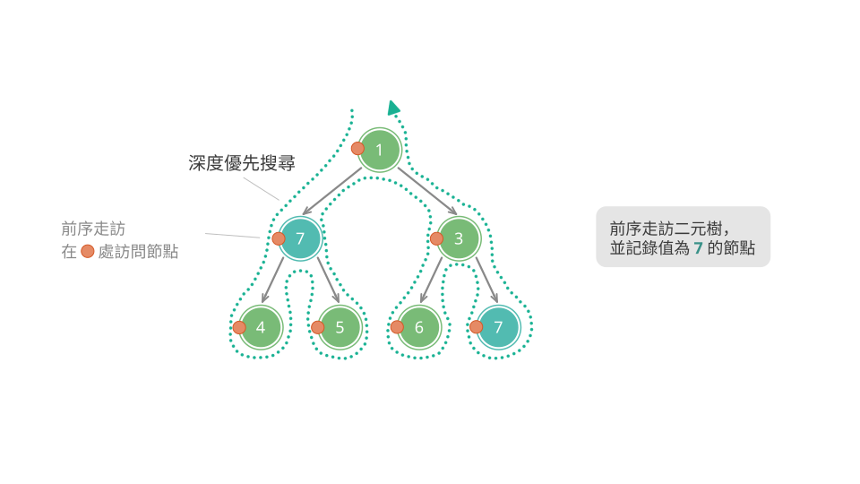
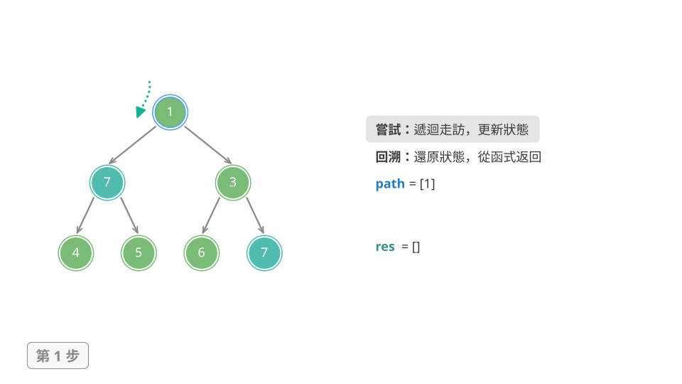
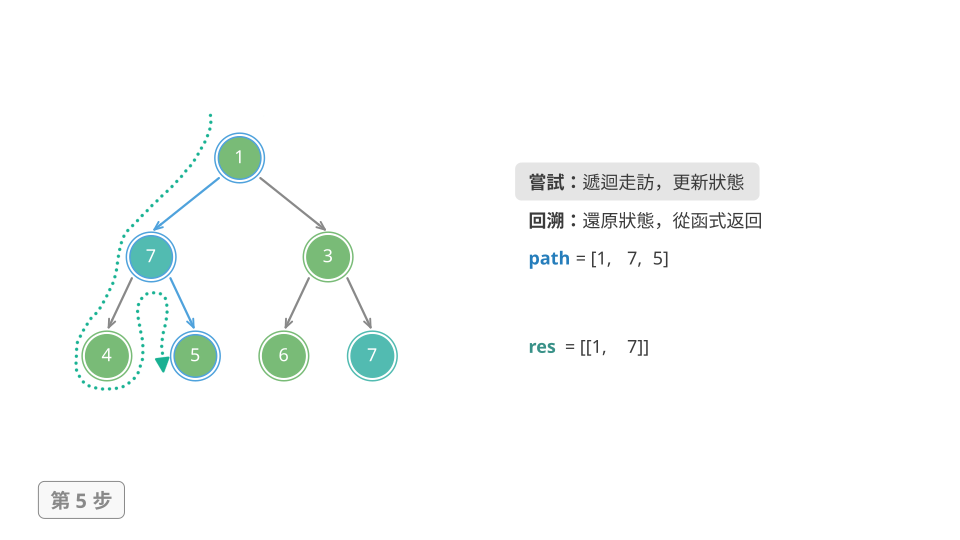
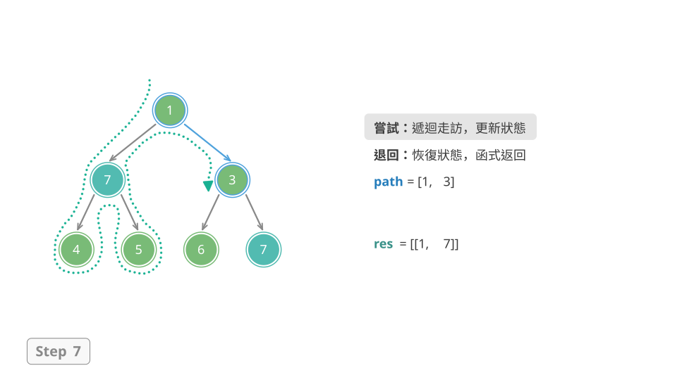
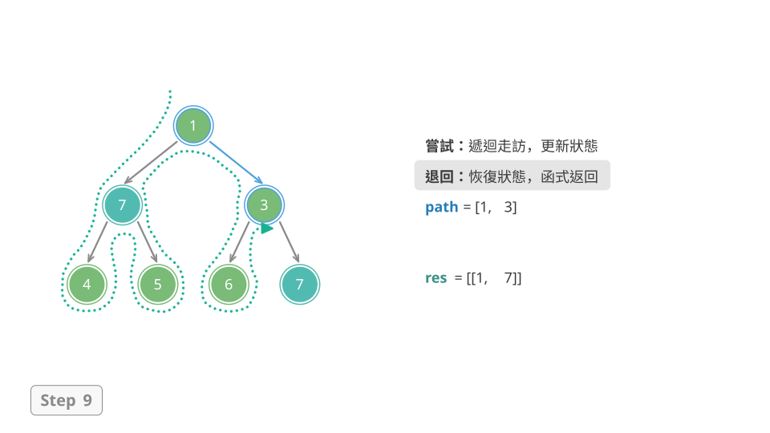

# 13.1 &nbsp; 回溯演算法

<u>回溯演算法（backtracking algorithm）</u>以窮舉法求解。它從初始狀態出發，逐一搜尋所有可能的選擇，遇到符合條件的解就記錄下來，直到找到解，或試完所有選擇仍找不到解為止。

回溯演算法通常以「深度優先搜尋」走訪解空間。在「二元樹」一章中，我們提過前序、中序和後序走訪都屬於深度優先搜尋。接下來，我們從前序走訪出發，透過一道回溯問題，逐步了解回溯演算法的運作方式。

!!! question "例題一"

    給定一棵二元樹，搜尋並記錄所有值為 $7$ 的節點，請回傳這些節點組成的串列。

我們可以以前序走訪這棵樹，檢查目前節點的值是否為 $7$。如果是，就將該節點的值加入結果串列 `res`。圖 13-1 與程式碼說明了這個過程：

=== "Python"

    ```python title="preorder_traversal_i_compact.py"
    def pre_order(root: TreeNode):
        """前序走訪：例題一"""
        if root is None:
            return
        if root.val == 7:
            # 記錄此解
            res.append(root)
        pre_order(root.left)
        pre_order(root.right)
    ```

=== "C++"

    ```cpp title="preorder_traversal_i_compact.cpp"
    /* 前序走訪：例題一 */
    void preOrder(TreeNode *root) {
        if (root == nullptr) {
            return;
        }
        if (root->val == 7) {
            // 記錄此解
            res.push_back(root);
        }
        preOrder(root->left);
        preOrder(root->right);
    }
    ```

=== "Java"

    ```java title="preorder_traversal_i_compact.java"
    /* 前序走訪：例題一 */
    void preOrder(TreeNode root) {
        if (root == null) {
            return;
        }
        if (root.val == 7) {
            // 記錄此解
            res.add(root);
        }
        preOrder(root.left);
        preOrder(root.right);
    }
    ```

=== "C#"

    ```csharp title="preorder_traversal_i_compact.cs"
    /* 前序走訪：例題一 */
    void PreOrder(TreeNode? root) {
        if (root == null) {
            return;
        }
        if (root.val == 7) {
            // 記錄此解
            res.Add(root);
        }
        PreOrder(root.left);
        PreOrder(root.right);
    }
    ```

=== "Go"

    ```go title="preorder_traversal_i_compact.go"
    /* 前序走訪：例題一 */
    func preOrderI(root *TreeNode, res *[]*TreeNode) {
        if root == nil {
            return
        }
        if (root.Val).(int) == 7 {
            // 記錄此解
            *res = append(*res, root)
        }
        preOrderI(root.Left, res)
        preOrderI(root.Right, res)
    }
    ```

=== "Swift"

    ```swift title="preorder_traversal_i_compact.swift"
    /* 前序走訪：例題一 */
    func preOrder(root: TreeNode?) {
        guard let root = root else {
            return
        }
        if root.val == 7 {
            // 記錄此解
            res.append(root)
        }
        preOrder(root: root.left)
        preOrder(root: root.right)
    }
    ```

=== "JS"

    ```javascript title="preorder_traversal_i_compact.js"
    /* 前序走訪：例題一 */
    function preOrder(root, res) {
        if (root === null) {
            return;
        }
        if (root.val === 7) {
            // 記錄此解
            res.push(root);
        }
        preOrder(root.left, res);
        preOrder(root.right, res);
    }
    ```

=== "TS"

    ```typescript title="preorder_traversal_i_compact.ts"
    /* 前序走訪：例題一 */
    function preOrder(root: TreeNode | null, res: TreeNode[]): void {
        if (root === null) {
            return;
        }
        if (root.val === 7) {
            // 記錄此解
            res.push(root);
        }
        preOrder(root.left, res);
        preOrder(root.right, res);
    }
    ```

=== "Dart"

    ```dart title="preorder_traversal_i_compact.dart"
    /* 前序走訪：例題一 */
    void preOrder(TreeNode? root, List<TreeNode> res) {
      if (root == null) {
        return;
      }
      if (root.val == 7) {
        // 記錄此解
        res.add(root);
      }
      preOrder(root.left, res);
      preOrder(root.right, res);
    }
    ```

=== "Rust"

    ```rust title="preorder_traversal_i_compact.rs"
    /* 前序走訪：例題一 */
    fn pre_order(res: &mut Vec<Rc<RefCell<TreeNode>>>, root: Option<&Rc<RefCell<TreeNode>>>) {
        if root.is_none() {
            return;
        }
        if let Some(node) = root {
            if node.borrow().val == 7 {
                // 記錄此解
                res.push(node.clone());
            }
            pre_order(res, node.borrow().left.as_ref());
            pre_order(res, node.borrow().right.as_ref());
        }
    }
    ```

=== "C"

    ```c title="preorder_traversal_i_compact.c"
    /* 前序走訪：例題一 */
    void preOrder(TreeNode *root) {
        if (root == NULL) {
            return;
        }
        if (root->val == 7) {
            // 記錄此解
            res[resSize++] = root;
        }
        preOrder(root->left);
        preOrder(root->right);
    }
    ```

=== "Kotlin"

    ```kotlin title="preorder_traversal_i_compact.kt"
    /* 前序走訪：例題一 */
    fun preOrder(root: TreeNode?) {
        if (root == null) {
            return
        }
        if (root._val == 7) {
            // 記錄此解
            res!!.add(root)
        }
        preOrder(root.left)
        preOrder(root.right)
    }
    ```

=== "Ruby"

    ```ruby title="preorder_traversal_i_compact.rb"
    ### 前序走訪：例題一 ###
    def pre_order(root)
      return unless root

      # 記錄此解
      $res << root if root.val == 7

      pre_order(root.left)
      pre_order(root.right)
    end
    ```

??? pythontutor "執行視覺化示範"

    <div style="height: 549px; width: 100%;"><iframe class="pythontutor-iframe" title="執行視覺化示範" src="https://pythontutor.com/iframe-embed.html#code=class%20TreeNode%3A%0A%20%20%20%20%22%22%22%E4%BA%8C%E5%85%83%E6%A8%B9%E7%AF%80%E9%BB%9E%E9%A1%9E%E5%88%A5%22%22%22%0A%0A%20%20%20%20def%20__init__%28self,%20val%3A%20int%20%3D%200%29%3A%0A%20%20%20%20%20%20%20%20self.val%3A%20int%20%3D%20val%20%20%23%20%E7%AF%80%E9%BB%9E%E5%80%BC%0A%20%20%20%20%20%20%20%20self.left%3A%20TreeNode%20%7C%20None%20%3D%20None%20%20%23%20%E5%B7%A6%E5%AD%90%E7%AF%80%E9%BB%9E%E5%8F%83%E7%85%A7%0A%20%20%20%20%20%20%20%20self.right%3A%20TreeNode%20%7C%20None%20%3D%20None%20%20%23%20%E5%8F%B3%E5%AD%90%E7%AF%80%E9%BB%9E%E5%8F%83%E7%85%A7%0A%0Adef%20list_to_tree_dfs%28arr%3A%20list%5Bint%5D,%20i%3A%20int%29%20-%3E%20TreeNode%20%7C%20None%3A%0A%20%20%20%20%22%22%22%E5%B0%87%E4%B8%B2%E5%88%97%E5%8F%8D%E5%BA%8F%E5%88%97%E5%8C%96%E7%82%BA%E4%BA%8C%E5%85%83%E6%A8%B9%EF%BC%9A%E9%81%9E%E8%BF%B4%E6%B3%95%22%22%22%0A%20%20%20%20%23%20%E8%8B%A5%E7%B4%A2%E5%BC%95%E8%B6%85%E5%87%BA%E9%99%A3%E5%88%97%E7%AF%84%E5%9C%8D%EF%BC%8C%E6%88%96%E5%B0%8D%E6%87%89%E5%85%83%E7%B4%A0%E7%82%BA%20None%EF%BC%8C%E5%9B%9E%E5%82%B3%20None%0A%20%20%20%20if%20i%20%3C%200%20or%20i%20%3E%3D%20len%28arr%29%20or%20arr%5Bi%5D%20is%20None%3A%0A%20%20%20%20%20%20%20%20return%20None%0A%20%20%20%20%23%20%E5%BB%BA%E6%A7%8B%E7%9B%AE%E5%89%8D%E7%9A%84%E7%AF%80%E9%BB%9E%0A%20%20%20%20root%20%3D%20TreeNode%28arr%5Bi%5D%29%0A%20%20%20%20%23%20%E9%81%9E%E8%BF%B4%E5%BB%BA%E6%A7%8B%E5%B7%A6%E5%8F%B3%E5%AD%90%E6%A8%B9%0A%20%20%20%20root.left%20%3D%20list_to_tree_dfs%28arr,%202%20%2A%20i%20%2B%201%29%0A%20%20%20%20root.right%20%3D%20list_to_tree_dfs%28arr,%202%20%2A%20i%20%2B%202%29%0A%20%20%20%20return%20root%0A%0Adef%20list_to_tree%28arr%3A%20list%5Bint%5D%29%20-%3E%20TreeNode%20%7C%20None%3A%0A%20%20%20%20%22%22%22%E5%B0%87%E4%B8%B2%E5%88%97%E5%8F%8D%E5%BA%8F%E5%88%97%E5%8C%96%E7%82%BA%E4%BA%8C%E5%85%83%E6%A8%B9%22%22%22%0A%20%20%20%20return%20list_to_tree_dfs%28arr,%200%29%0A%0A%0Adef%20pre_order%28root%3A%20TreeNode%29%3A%0A%20%20%20%20%22%22%22%E5%89%8D%E5%BA%8F%E8%B5%B0%E8%A8%AA%EF%BC%9A%E4%BE%8B%E9%A1%8C%E4%B8%80%22%22%22%0A%20%20%20%20if%20root%20is%20None%3A%0A%20%20%20%20%20%20%20%20return%0A%20%20%20%20if%20root.val%20%3D%3D%207%3A%0A%20%20%20%20%20%20%20%20%23%20%E8%A8%98%E9%8C%84%E6%AD%A4%E8%A7%A3%0A%20%20%20%20%20%20%20%20res.append%28root%29%0A%20%20%20%20pre_order%28root.left%29%0A%20%20%20%20pre_order%28root.right%29%0A%0A%0A%22%22%22Driver%20Code%22%22%22%0Aif%20__name__%20%3D%3D%20%22__main__%22%3A%0A%20%20%20%20root%20%3D%20list_to_tree%28%5B1,%207,%203,%204,%205,%206,%207%5D%29%0A%0A%20%20%20%20%23%20%E5%89%8D%E5%BA%8F%E8%B5%B0%E8%A8%AA%0A%20%20%20%20res%20%3D%20list%5BTreeNode%5D%28%29%0A%20%20%20%20pre_order%28root%29%0A%0A%20%20%20%20print%28%22%5Cn%E8%BC%B8%E5%87%BA%E6%89%80%E6%9C%89%E5%80%BC%E7%82%BA%207%20%E7%9A%84%E7%AF%80%E9%BB%9E%22%29%0A%20%20%20%20print%28%5Bnode.val%20for%20node%20in%20res%5D%29&codeDivHeight=472&codeDivWidth=350&cumulative=false&curInstr=126&heapPrimitives=nevernest&origin=opt-frontend.js&py=311&rawInputLstJSON=%5B%5D&textReferences=false"> </iframe></div>
    <div style="margin-top: 5px;"><a href="https://pythontutor.com/iframe-embed.html#code=class%20TreeNode%3A%0A%20%20%20%20%22%22%22%E4%BA%8C%E5%85%83%E6%A8%B9%E7%AF%80%E9%BB%9E%E9%A1%9E%E5%88%A5%22%22%22%0A%0A%20%20%20%20def%20__init__%28self,%20val%3A%20int%20%3D%200%29%3A%0A%20%20%20%20%20%20%20%20self.val%3A%20int%20%3D%20val%20%20%23%20%E7%AF%80%E9%BB%9E%E5%80%BC%0A%20%20%20%20%20%20%20%20self.left%3A%20TreeNode%20%7C%20None%20%3D%20None%20%20%23%20%E5%B7%A6%E5%AD%90%E7%AF%80%E9%BB%9E%E5%8F%83%E7%85%A7%0A%20%20%20%20%20%20%20%20self.right%3A%20TreeNode%20%7C%20None%20%3D%20None%20%20%23%20%E5%8F%B3%E5%AD%90%E7%AF%80%E9%BB%9E%E5%8F%83%E7%85%A7%0A%0Adef%20list_to_tree_dfs%28arr%3A%20list%5Bint%5D,%20i%3A%20int%29%20-%3E%20TreeNode%20%7C%20None%3A%0A%20%20%20%20%22%22%22%E5%B0%87%E4%B8%B2%E5%88%97%E5%8F%8D%E5%BA%8F%E5%88%97%E5%8C%96%E7%82%BA%E4%BA%8C%E5%85%83%E6%A8%B9%EF%BC%9A%E9%81%9E%E8%BF%B4%E6%B3%95%22%22%22%0A%20%20%20%20%23%20%E8%8B%A5%E7%B4%A2%E5%BC%95%E8%B6%85%E5%87%BA%E9%99%A3%E5%88%97%E7%AF%84%E5%9C%8D%EF%BC%8C%E6%88%96%E5%B0%8D%E6%87%89%E5%85%83%E7%B4%A0%E7%82%BA%20None%EF%BC%8C%E5%9B%9E%E5%82%B3%20None%0A%20%20%20%20if%20i%20%3C%200%20or%20i%20%3E%3D%20len%28arr%29%20or%20arr%5Bi%5D%20is%20None%3A%0A%20%20%20%20%20%20%20%20return%20None%0A%20%20%20%20%23%20%E5%BB%BA%E6%A7%8B%E7%9B%AE%E5%89%8D%E7%9A%84%E7%AF%80%E9%BB%9E%0A%20%20%20%20root%20%3D%20TreeNode%28arr%5Bi%5D%29%0A%20%20%20%20%23%20%E9%81%9E%E8%BF%B4%E5%BB%BA%E6%A7%8B%E5%B7%A6%E5%8F%B3%E5%AD%90%E6%A8%B9%0A%20%20%20%20root.left%20%3D%20list_to_tree_dfs%28arr,%202%20%2A%20i%20%2B%201%29%0A%20%20%20%20root.right%20%3D%20list_to_tree_dfs%28arr,%202%20%2A%20i%20%2B%202%29%0A%20%20%20%20return%20root%0A%0Adef%20list_to_tree%28arr%3A%20list%5Bint%5D%29%20-%3E%20TreeNode%20%7C%20None%3A%0A%20%20%20%20%22%22%22%E5%B0%87%E4%B8%B2%E5%88%97%E5%8F%8D%E5%BA%8F%E5%88%97%E5%8C%96%E7%82%BA%E4%BA%8C%E5%85%83%E6%A8%B9%22%22%22%0A%20%20%20%20return%20list_to_tree_dfs%28arr,%200%29%0A%0A%0Adef%20pre_order%28root%3A%20TreeNode%29%3A%0A%20%20%20%20%22%22%22%E5%89%8D%E5%BA%8F%E8%B5%B0%E8%A8%AA%EF%BC%9A%E4%BE%8B%E9%A1%8C%E4%B8%80%22%22%22%0A%20%20%20%20if%20root%20is%20None%3A%0A%20%20%20%20%20%20%20%20return%0A%20%20%20%20if%20root.val%20%3D%3D%207%3A%0A%20%20%20%20%20%20%20%20%23%20%E8%A8%98%E9%8C%84%E6%AD%A4%E8%A7%A3%0A%20%20%20%20%20%20%20%20res.append%28root%29%0A%20%20%20%20pre_order%28root.left%29%0A%20%20%20%20pre_order%28root.right%29%0A%0A%0A%22%22%22Driver%20Code%22%22%22%0Aif%20__name__%20%3D%3D%20%22__main__%22%3A%0A%20%20%20%20root%20%3D%20list_to_tree%28%5B1,%207,%203,%204,%205,%206,%207%5D%29%0A%0A%20%20%20%20%23%20%E5%89%8D%E5%BA%8F%E8%B5%B0%E8%A8%AA%0A%20%20%20%20res%20%3D%20list%5BTreeNode%5D%28%29%0A%20%20%20%20pre_order%28root%29%0A%0A%20%20%20%20print%28%22%5Cn%E8%BC%B8%E5%87%BA%E6%89%80%E6%9C%89%E5%80%BC%E7%82%BA%207%20%E7%9A%84%E7%AF%80%E9%BB%9E%22%29%0A%20%20%20%20print%28%5Bnode.val%20for%20node%20in%20res%5D%29&codeDivHeight=800&codeDivWidth=600&cumulative=false&curInstr=126&heapPrimitives=nevernest&origin=opt-frontend.js&py=311&rawInputLstJSON=%5B%5D&textReferences=false" target="_blank" rel="noopener noreferrer">全螢幕觀看 ></a></div>

{ class="animation-figure" }

<p align="center"> 圖 13-1 &nbsp; 在前序走訪中搜尋節點 </p>

## 13.1.1 &nbsp; 嘗試與回溯

**回溯演算法得名於它搜尋解空間時所採用的「嘗試」與「回溯」策略**。搜尋過程中，若目前狀態無法再往前走，或無法得到符合條件的解，演算法便會撤銷上一步的選擇，回到先前的狀態，再嘗試其他可能的選擇。

在例題一中，每次走訪一個節點都代表一次「嘗試」。越過葉節點或返回父節點時執行的 `return` 則代表「回溯」。

值得注意的是，**回溯除了從函式返回，還可能包含其他操作**。我們將例題一稍作延伸，就能看出其中的差別。

!!! question "例題二"

    在二元樹中搜尋所有值為 $7$ 的節點，**請回傳從根節點到這些節點的路徑**。

沿用例題一的程式碼，再用一個串列 `path` 記錄目前走過的節點所形成的路徑。走訪到值為 $7$ 的節點時，複製 `path`，將副本加入結果串列 `res`。走訪完成後，`res` 中便保存了所有解。程式碼如下：

=== "Python"

    ```python title="preorder_traversal_ii_compact.py"
    def pre_order(root: TreeNode):
        """前序走訪：例題二"""
        if root is None:
            return
        # 嘗試
        path.append(root)
        if root.val == 7:
            # 記錄此解
            res.append(list(path))
        pre_order(root.left)
        pre_order(root.right)
        # 回溯
        path.pop()
    ```

=== "C++"

    ```cpp title="preorder_traversal_ii_compact.cpp"
    /* 前序走訪：例題二 */
    void preOrder(TreeNode *root) {
        if (root == nullptr) {
            return;
        }
        // 嘗試
        path.push_back(root);
        if (root->val == 7) {
            // 記錄此解
            res.push_back(path);
        }
        preOrder(root->left);
        preOrder(root->right);
        // 回溯
        path.pop_back();
    }
    ```

=== "Java"

    ```java title="preorder_traversal_ii_compact.java"
    /* 前序走訪：例題二 */
    void preOrder(TreeNode root) {
        if (root == null) {
            return;
        }
        // 嘗試
        path.add(root);
        if (root.val == 7) {
            // 記錄此解
            res.add(new ArrayList<>(path));
        }
        preOrder(root.left);
        preOrder(root.right);
        // 回溯
        path.remove(path.size() - 1);
    }
    ```

=== "C#"

    ```csharp title="preorder_traversal_ii_compact.cs"
    /* 前序走訪：例題二 */
    void PreOrder(TreeNode? root) {
        if (root == null) {
            return;
        }
        // 嘗試
        path.Add(root);
        if (root.val == 7) {
            // 記錄此解
            res.Add(new List<TreeNode>(path));
        }
        PreOrder(root.left);
        PreOrder(root.right);
        // 回溯
        path.RemoveAt(path.Count - 1);
    }
    ```

=== "Go"

    ```go title="preorder_traversal_ii_compact.go"
    /* 前序走訪：例題二 */
    func preOrderII(root *TreeNode, res *[][]*TreeNode, path *[]*TreeNode) {
        if root == nil {
            return
        }
        // 嘗試
        *path = append(*path, root)
        if root.Val.(int) == 7 {
            // 記錄此解
            *res = append(*res, append([]*TreeNode{}, *path...))
        }
        preOrderII(root.Left, res, path)
        preOrderII(root.Right, res, path)
        // 回溯
        *path = (*path)[:len(*path)-1]
    }
    ```

=== "Swift"

    ```swift title="preorder_traversal_ii_compact.swift"
    /* 前序走訪：例題二 */
    func preOrder(root: TreeNode?) {
        guard let root = root else {
            return
        }
        // 嘗試
        path.append(root)
        if root.val == 7 {
            // 記錄此解
            res.append(path)
        }
        preOrder(root: root.left)
        preOrder(root: root.right)
        // 回溯
        path.removeLast()
    }
    ```

=== "JS"

    ```javascript title="preorder_traversal_ii_compact.js"
    /* 前序走訪：例題二 */
    function preOrder(root, path, res) {
        if (root === null) {
            return;
        }
        // 嘗試
        path.push(root);
        if (root.val === 7) {
            // 記錄此解
            res.push([...path]);
        }
        preOrder(root.left, path, res);
        preOrder(root.right, path, res);
        // 回溯
        path.pop();
    }
    ```

=== "TS"

    ```typescript title="preorder_traversal_ii_compact.ts"
    /* 前序走訪：例題二 */
    function preOrder(
        root: TreeNode | null,
        path: TreeNode[],
        res: TreeNode[][]
    ): void {
        if (root === null) {
            return;
        }
        // 嘗試
        path.push(root);
        if (root.val === 7) {
            // 記錄此解
            res.push([...path]);
        }
        preOrder(root.left, path, res);
        preOrder(root.right, path, res);
        // 回溯
        path.pop();
    }
    ```

=== "Dart"

    ```dart title="preorder_traversal_ii_compact.dart"
    /* 前序走訪：例題二 */
    void preOrder(
      TreeNode? root,
      List<TreeNode> path,
      List<List<TreeNode>> res,
    ) {
      if (root == null) {
        return;
      }

      // 嘗試
      path.add(root);
      if (root.val == 7) {
        // 記錄此解
        res.add(List.from(path));
      }
      preOrder(root.left, path, res);
      preOrder(root.right, path, res);
      // 回溯
      path.removeLast();
    }
    ```

=== "Rust"

    ```rust title="preorder_traversal_ii_compact.rs"
    /* 前序走訪：例題二 */
    fn pre_order(
        res: &mut Vec<Vec<Rc<RefCell<TreeNode>>>>,
        path: &mut Vec<Rc<RefCell<TreeNode>>>,
        root: Option<&Rc<RefCell<TreeNode>>>,
    ) {
        if root.is_none() {
            return;
        }
        if let Some(node) = root {
            // 嘗試
            path.push(node.clone());
            if node.borrow().val == 7 {
                // 記錄此解
                res.push(path.clone());
            }
            pre_order(res, path, node.borrow().left.as_ref());
            pre_order(res, path, node.borrow().right.as_ref());
            // 回溯
            path.pop();
        }
    }
    ```

=== "C"

    ```c title="preorder_traversal_ii_compact.c"
    /* 前序走訪：例題二 */
    void preOrder(TreeNode *root) {
        if (root == NULL) {
            return;
        }
        // 嘗試
        path[pathSize++] = root;
        if (root->val == 7) {
            // 記錄此解
            for (int i = 0; i < pathSize; ++i) {
                res[resSize][i] = path[i];
            }
            resSize++;
        }
        preOrder(root->left);
        preOrder(root->right);
        // 回溯
        pathSize--;
    }
    ```

=== "Kotlin"

    ```kotlin title="preorder_traversal_ii_compact.kt"
    /* 前序走訪：例題二 */
    fun preOrder(root: TreeNode?) {
        if (root == null) {
            return
        }
        // 嘗試
        path!!.add(root)
        if (root._val == 7) {
            // 記錄此解
            res!!.add(path!!.toMutableList())
        }
        preOrder(root.left)
        preOrder(root.right)
        // 回溯
        path!!.removeAt(path!!.size - 1)
    }
    ```

=== "Ruby"

    ```ruby title="preorder_traversal_ii_compact.rb"
    ### 前序走訪：例題二 ###
    def pre_order(root)
      return unless root

      # 嘗試
      $path << root

      # 記錄此解
      $res << $path.dup if root.val == 7

      pre_order(root.left)
      pre_order(root.right)

      # 回溯
      $path.pop
    end
    ```

??? pythontutor "執行視覺化示範"

    <div style="height: 549px; width: 100%;"><iframe class="pythontutor-iframe" title="執行視覺化示範" src="https://pythontutor.com/iframe-embed.html#code=class%20TreeNode%3A%0A%20%20%20%20%22%22%22%E4%BA%8C%E5%85%83%E6%A8%B9%E7%AF%80%E9%BB%9E%E9%A1%9E%E5%88%A5%22%22%22%0A%0A%20%20%20%20def%20__init__%28self,%20val%3A%20int%20%3D%200%29%3A%0A%20%20%20%20%20%20%20%20self.val%3A%20int%20%3D%20val%20%20%23%20%E7%AF%80%E9%BB%9E%E5%80%BC%0A%20%20%20%20%20%20%20%20self.left%3A%20TreeNode%20%7C%20None%20%3D%20None%20%20%23%20%E5%B7%A6%E5%AD%90%E7%AF%80%E9%BB%9E%E5%8F%83%E7%85%A7%0A%20%20%20%20%20%20%20%20self.right%3A%20TreeNode%20%7C%20None%20%3D%20None%20%20%23%20%E5%8F%B3%E5%AD%90%E7%AF%80%E9%BB%9E%E5%8F%83%E7%85%A7%0A%0Adef%20list_to_tree_dfs%28arr%3A%20list%5Bint%5D,%20i%3A%20int%29%20-%3E%20TreeNode%20%7C%20None%3A%0A%20%20%20%20%22%22%22%E5%B0%87%E4%B8%B2%E5%88%97%E5%8F%8D%E5%BA%8F%E5%88%97%E5%8C%96%E7%82%BA%E4%BA%8C%E5%85%83%E6%A8%B9%EF%BC%9A%E9%81%9E%E8%BF%B4%E6%B3%95%22%22%22%0A%20%20%20%20%23%20%E8%8B%A5%E7%B4%A2%E5%BC%95%E8%B6%85%E5%87%BA%E9%99%A3%E5%88%97%E7%AF%84%E5%9C%8D%EF%BC%8C%E6%88%96%E5%B0%8D%E6%87%89%E5%85%83%E7%B4%A0%E7%82%BA%20None%EF%BC%8C%E5%9B%9E%E5%82%B3%20None%0A%20%20%20%20if%20i%20%3C%200%20or%20i%20%3E%3D%20len%28arr%29%20or%20arr%5Bi%5D%20is%20None%3A%0A%20%20%20%20%20%20%20%20return%20None%0A%20%20%20%20%23%20%E5%BB%BA%E6%A7%8B%E7%9B%AE%E5%89%8D%E7%9A%84%E7%AF%80%E9%BB%9E%0A%20%20%20%20root%20%3D%20TreeNode%28arr%5Bi%5D%29%0A%20%20%20%20%23%20%E9%81%9E%E8%BF%B4%E5%BB%BA%E6%A7%8B%E5%B7%A6%E5%8F%B3%E5%AD%90%E6%A8%B9%0A%20%20%20%20root.left%20%3D%20list_to_tree_dfs%28arr,%202%20%2A%20i%20%2B%201%29%0A%20%20%20%20root.right%20%3D%20list_to_tree_dfs%28arr,%202%20%2A%20i%20%2B%202%29%0A%20%20%20%20return%20root%0A%0Adef%20list_to_tree%28arr%3A%20list%5Bint%5D%29%20-%3E%20TreeNode%20%7C%20None%3A%0A%20%20%20%20%22%22%22%E5%B0%87%E4%B8%B2%E5%88%97%E5%8F%8D%E5%BA%8F%E5%88%97%E5%8C%96%E7%82%BA%E4%BA%8C%E5%85%83%E6%A8%B9%22%22%22%0A%20%20%20%20return%20list_to_tree_dfs%28arr,%200%29%0A%0A%0Adef%20pre_order%28root%3A%20TreeNode%29%3A%0A%20%20%20%20%22%22%22%E5%89%8D%E5%BA%8F%E8%B5%B0%E8%A8%AA%EF%BC%9A%E4%BE%8B%E9%A1%8C%E4%BA%8C%22%22%22%0A%20%20%20%20if%20root%20is%20None%3A%0A%20%20%20%20%20%20%20%20return%0A%20%20%20%20%23%20%E5%98%97%E8%A9%A6%0A%20%20%20%20path.append%28root%29%0A%20%20%20%20if%20root.val%20%3D%3D%207%3A%0A%20%20%20%20%20%20%20%20%23%20%E8%A8%98%E9%8C%84%E6%AD%A4%E8%A7%A3%0A%20%20%20%20%20%20%20%20res.append%28list%28path%29%29%0A%20%20%20%20pre_order%28root.left%29%0A%20%20%20%20pre_order%28root.right%29%0A%20%20%20%20%23%20%E5%9B%9E%E6%BA%AF%0A%20%20%20%20path.pop%28%29%0A%0A%0A%22%22%22Driver%20Code%22%22%22%0Aif%20__name__%20%3D%3D%20%22__main__%22%3A%0A%20%20%20%20root%20%3D%20list_to_tree%28%5B1,%207,%203,%204,%205,%206,%207%5D%29%0A%0A%20%20%20%20%23%20%E5%89%8D%E5%BA%8F%E8%B5%B0%E8%A8%AA%0A%20%20%20%20path%20%3D%20list%5BTreeNode%5D%28%29%0A%20%20%20%20res%20%3D%20list%5Blist%5BTreeNode%5D%5D%28%29%0A%20%20%20%20pre_order%28root%29%0A%0A%20%20%20%20print%28%22%5Cn%E8%BC%B8%E5%87%BA%E5%BE%9E%E6%A0%B9%E7%AF%80%E9%BB%9E%E5%88%B0%E5%80%BC%E7%82%BA%207%20%E7%9A%84%E7%AF%80%E9%BB%9E%E7%9A%84%E6%89%80%E6%9C%89%E8%B7%AF%E5%BE%91%22%29%0A%20%20%20%20for%20path%20in%20res%3A%0A%20%20%20%20%20%20%20%20print%28%5Bnode.val%20for%20node%20in%20path%5D%29&codeDivHeight=472&codeDivWidth=350&cumulative=false&curInstr=126&heapPrimitives=nevernest&origin=opt-frontend.js&py=311&rawInputLstJSON=%5B%5D&textReferences=false"> </iframe></div>
    <div style="margin-top: 5px;"><a href="https://pythontutor.com/iframe-embed.html#code=class%20TreeNode%3A%0A%20%20%20%20%22%22%22%E4%BA%8C%E5%85%83%E6%A8%B9%E7%AF%80%E9%BB%9E%E9%A1%9E%E5%88%A5%22%22%22%0A%0A%20%20%20%20def%20__init__%28self,%20val%3A%20int%20%3D%200%29%3A%0A%20%20%20%20%20%20%20%20self.val%3A%20int%20%3D%20val%20%20%23%20%E7%AF%80%E9%BB%9E%E5%80%BC%0A%20%20%20%20%20%20%20%20self.left%3A%20TreeNode%20%7C%20None%20%3D%20None%20%20%23%20%E5%B7%A6%E5%AD%90%E7%AF%80%E9%BB%9E%E5%8F%83%E7%85%A7%0A%20%20%20%20%20%20%20%20self.right%3A%20TreeNode%20%7C%20None%20%3D%20None%20%20%23%20%E5%8F%B3%E5%AD%90%E7%AF%80%E9%BB%9E%E5%8F%83%E7%85%A7%0A%0Adef%20list_to_tree_dfs%28arr%3A%20list%5Bint%5D,%20i%3A%20int%29%20-%3E%20TreeNode%20%7C%20None%3A%0A%20%20%20%20%22%22%22%E5%B0%87%E4%B8%B2%E5%88%97%E5%8F%8D%E5%BA%8F%E5%88%97%E5%8C%96%E7%82%BA%E4%BA%8C%E5%85%83%E6%A8%B9%EF%BC%9A%E9%81%9E%E8%BF%B4%E6%B3%95%22%22%22%0A%20%20%20%20%23%20%E8%8B%A5%E7%B4%A2%E5%BC%95%E8%B6%85%E5%87%BA%E9%99%A3%E5%88%97%E7%AF%84%E5%9C%8D%EF%BC%8C%E6%88%96%E5%B0%8D%E6%87%89%E5%85%83%E7%B4%A0%E7%82%BA%20None%EF%BC%8C%E5%9B%9E%E5%82%B3%20None%0A%20%20%20%20if%20i%20%3C%200%20or%20i%20%3E%3D%20len%28arr%29%20or%20arr%5Bi%5D%20is%20None%3A%0A%20%20%20%20%20%20%20%20return%20None%0A%20%20%20%20%23%20%E5%BB%BA%E6%A7%8B%E7%9B%AE%E5%89%8D%E7%9A%84%E7%AF%80%E9%BB%9E%0A%20%20%20%20root%20%3D%20TreeNode%28arr%5Bi%5D%29%0A%20%20%20%20%23%20%E9%81%9E%E8%BF%B4%E5%BB%BA%E6%A7%8B%E5%B7%A6%E5%8F%B3%E5%AD%90%E6%A8%B9%0A%20%20%20%20root.left%20%3D%20list_to_tree_dfs%28arr,%202%20%2A%20i%20%2B%201%29%0A%20%20%20%20root.right%20%3D%20list_to_tree_dfs%28arr,%202%20%2A%20i%20%2B%202%29%0A%20%20%20%20return%20root%0A%0Adef%20list_to_tree%28arr%3A%20list%5Bint%5D%29%20-%3E%20TreeNode%20%7C%20None%3A%0A%20%20%20%20%22%22%22%E5%B0%87%E4%B8%B2%E5%88%97%E5%8F%8D%E5%BA%8F%E5%88%97%E5%8C%96%E7%82%BA%E4%BA%8C%E5%85%83%E6%A8%B9%22%22%22%0A%20%20%20%20return%20list_to_tree_dfs%28arr,%200%29%0A%0A%0Adef%20pre_order%28root%3A%20TreeNode%29%3A%0A%20%20%20%20%22%22%22%E5%89%8D%E5%BA%8F%E8%B5%B0%E8%A8%AA%EF%BC%9A%E4%BE%8B%E9%A1%8C%E4%BA%8C%22%22%22%0A%20%20%20%20if%20root%20is%20None%3A%0A%20%20%20%20%20%20%20%20return%0A%20%20%20%20%23%20%E5%98%97%E8%A9%A6%0A%20%20%20%20path.append%28root%29%0A%20%20%20%20if%20root.val%20%3D%3D%207%3A%0A%20%20%20%20%20%20%20%20%23%20%E8%A8%98%E9%8C%84%E6%AD%A4%E8%A7%A3%0A%20%20%20%20%20%20%20%20res.append%28list%28path%29%29%0A%20%20%20%20pre_order%28root.left%29%0A%20%20%20%20pre_order%28root.right%29%0A%20%20%20%20%23%20%E5%9B%9E%E6%BA%AF%0A%20%20%20%20path.pop%28%29%0A%0A%0A%22%22%22Driver%20Code%22%22%22%0Aif%20__name__%20%3D%3D%20%22__main__%22%3A%0A%20%20%20%20root%20%3D%20list_to_tree%28%5B1,%207,%203,%204,%205,%206,%207%5D%29%0A%0A%20%20%20%20%23%20%E5%89%8D%E5%BA%8F%E8%B5%B0%E8%A8%AA%0A%20%20%20%20path%20%3D%20list%5BTreeNode%5D%28%29%0A%20%20%20%20res%20%3D%20list%5Blist%5BTreeNode%5D%5D%28%29%0A%20%20%20%20pre_order%28root%29%0A%0A%20%20%20%20print%28%22%5Cn%E8%BC%B8%E5%87%BA%E5%BE%9E%E6%A0%B9%E7%AF%80%E9%BB%9E%E5%88%B0%E5%80%BC%E7%82%BA%207%20%E7%9A%84%E7%AF%80%E9%BB%9E%E7%9A%84%E6%89%80%E6%9C%89%E8%B7%AF%E5%BE%91%22%29%0A%20%20%20%20for%20path%20in%20res%3A%0A%20%20%20%20%20%20%20%20print%28%5Bnode.val%20for%20node%20in%20path%5D%29&codeDivHeight=800&codeDivWidth=600&cumulative=false&curInstr=126&heapPrimitives=nevernest&origin=opt-frontend.js&py=311&rawInputLstJSON=%5B%5D&textReferences=false" target="_blank" rel="noopener noreferrer">全螢幕觀看 ></a></div>

每次「嘗試」時，我們將目前節點加入 `path` 以記錄路徑。「回溯」之前，則須將該節點從 `path` 末端移除，**還原這次嘗試之前的狀態**。

觀察圖 13-2 ，**我們可以將嘗試與回溯理解為「前進」與「撤銷」**，兩者的操作方向相反。

=== "<1>"
    { class="animation-figure" }

=== "<2>"
    { class="animation-figure" }

=== "<3>"
    { class="animation-figure" }

=== "<4>"
    { class="animation-figure" }

=== "<5>"
    { class="animation-figure" }

=== "<6>"
    { class="animation-figure" }

=== "<7>"
    { class="animation-figure" }

=== "<8>"
    { class="animation-figure" }

=== "<9>"
    { class="animation-figure" }

=== "<10>"
    { class="animation-figure" }

=== "<11>"
    { class="animation-figure" }

<p align="center"> 圖 13-2 &nbsp; 嘗試與回溯 </p>

## 13.1.2 &nbsp; 剪枝

較複雜的回溯問題通常有一項或多項限制條件，**這些條件通常可以用來「剪枝」**。

!!! question "例題三"

    在二元樹中搜尋所有值為 $7$ 的節點，並回傳從根節點到這些節點的路徑，**且路徑中不得包含值為 $3$ 的節點**。

為了滿足上述限制，**我們需要加入剪枝操作**：搜尋時若遇到值為 $3$ 的節點，就提前返回，不再繼續往下搜尋。程式碼如下：

=== "Python"

    ```python title="preorder_traversal_iii_compact.py"
    def pre_order(root: TreeNode):
        """前序走訪：例題三"""
        # 剪枝
        if root is None or root.val == 3:
            return
        # 嘗試
        path.append(root)
        if root.val == 7:
            # 記錄此解
            res.append(list(path))
        pre_order(root.left)
        pre_order(root.right)
        # 回溯
        path.pop()
    ```

=== "C++"

    ```cpp title="preorder_traversal_iii_compact.cpp"
    /* 前序走訪：例題三 */
    void preOrder(TreeNode *root) {
        // 剪枝
        if (root == nullptr || root->val == 3) {
            return;
        }
        // 嘗試
        path.push_back(root);
        if (root->val == 7) {
            // 記錄此解
            res.push_back(path);
        }
        preOrder(root->left);
        preOrder(root->right);
        // 回溯
        path.pop_back();
    }
    ```

=== "Java"

    ```java title="preorder_traversal_iii_compact.java"
    /* 前序走訪：例題三 */
    void preOrder(TreeNode root) {
        // 剪枝
        if (root == null || root.val == 3) {
            return;
        }
        // 嘗試
        path.add(root);
        if (root.val == 7) {
            // 記錄此解
            res.add(new ArrayList<>(path));
        }
        preOrder(root.left);
        preOrder(root.right);
        // 回溯
        path.remove(path.size() - 1);
    }
    ```

=== "C#"

    ```csharp title="preorder_traversal_iii_compact.cs"
    /* 前序走訪：例題三 */
    void PreOrder(TreeNode? root) {
        // 剪枝
        if (root == null || root.val == 3) {
            return;
        }
        // 嘗試
        path.Add(root);
        if (root.val == 7) {
            // 記錄此解
            res.Add(new List<TreeNode>(path));
        }
        PreOrder(root.left);
        PreOrder(root.right);
        // 回溯
        path.RemoveAt(path.Count - 1);
    }
    ```

=== "Go"

    ```go title="preorder_traversal_iii_compact.go"
    /* 前序走訪：例題三 */
    func preOrderIII(root *TreeNode, res *[][]*TreeNode, path *[]*TreeNode) {
        // 剪枝
        if root == nil || root.Val == 3 {
            return
        }
        // 嘗試
        *path = append(*path, root)
        if root.Val.(int) == 7 {
            // 記錄此解
            *res = append(*res, append([]*TreeNode{}, *path...))
        }
        preOrderIII(root.Left, res, path)
        preOrderIII(root.Right, res, path)
        // 回溯
        *path = (*path)[:len(*path)-1]
    }
    ```

=== "Swift"

    ```swift title="preorder_traversal_iii_compact.swift"
    /* 前序走訪：例題三 */
    func preOrder(root: TreeNode?) {
        // 剪枝
        guard let root = root, root.val != 3 else {
            return
        }
        // 嘗試
        path.append(root)
        if root.val == 7 {
            // 記錄此解
            res.append(path)
        }
        preOrder(root: root.left)
        preOrder(root: root.right)
        // 回溯
        path.removeLast()
    }
    ```

=== "JS"

    ```javascript title="preorder_traversal_iii_compact.js"
    /* 前序走訪：例題三 */
    function preOrder(root, path, res) {
        // 剪枝
        if (root === null || root.val === 3) {
            return;
        }
        // 嘗試
        path.push(root);
        if (root.val === 7) {
            // 記錄此解
            res.push([...path]);
        }
        preOrder(root.left, path, res);
        preOrder(root.right, path, res);
        // 回溯
        path.pop();
    }
    ```

=== "TS"

    ```typescript title="preorder_traversal_iii_compact.ts"
    /* 前序走訪：例題三 */
    function preOrder(
        root: TreeNode | null,
        path: TreeNode[],
        res: TreeNode[][]
    ): void {
        // 剪枝
        if (root === null || root.val === 3) {
            return;
        }
        // 嘗試
        path.push(root);
        if (root.val === 7) {
            // 記錄此解
            res.push([...path]);
        }
        preOrder(root.left, path, res);
        preOrder(root.right, path, res);
        // 回溯
        path.pop();
    }
    ```

=== "Dart"

    ```dart title="preorder_traversal_iii_compact.dart"
    /* 前序走訪：例題三 */
    void preOrder(
      TreeNode? root,
      List<TreeNode> path,
      List<List<TreeNode>> res,
    ) {
      if (root == null || root.val == 3) {
        return;
      }

      // 嘗試
      path.add(root);
      if (root.val == 7) {
        // 記錄此解
        res.add(List.from(path));
      }
      preOrder(root.left, path, res);
      preOrder(root.right, path, res);
      // 回溯
      path.removeLast();
    }
    ```

=== "Rust"

    ```rust title="preorder_traversal_iii_compact.rs"
    /* 前序走訪：例題三 */
    fn pre_order(
        res: &mut Vec<Vec<Rc<RefCell<TreeNode>>>>,
        path: &mut Vec<Rc<RefCell<TreeNode>>>,
        root: Option<&Rc<RefCell<TreeNode>>>,
    ) {
        // 剪枝
        if root.is_none() || root.as_ref().unwrap().borrow().val == 3 {
            return;
        }
        if let Some(node) = root {
            // 嘗試
            path.push(node.clone());
            if node.borrow().val == 7 {
                // 記錄此解
                res.push(path.clone());
            }
            pre_order(res, path, node.borrow().left.as_ref());
            pre_order(res, path, node.borrow().right.as_ref());
            // 回溯
            path.pop();
        }
    }
    ```

=== "C"

    ```c title="preorder_traversal_iii_compact.c"
    /* 前序走訪：例題三 */
    void preOrder(TreeNode *root) {
        // 剪枝
        if (root == NULL || root->val == 3) {
            return;
        }
        // 嘗試
        path[pathSize++] = root;
        if (root->val == 7) {
            // 記錄此解
            for (int i = 0; i < pathSize; i++) {
                res[resSize][i] = path[i];
            }
            resSize++;
        }
        preOrder(root->left);
        preOrder(root->right);
        // 回溯
        pathSize--;
    }
    ```

=== "Kotlin"

    ```kotlin title="preorder_traversal_iii_compact.kt"
    /* 前序走訪：例題三 */
    fun preOrder(root: TreeNode?) {
        // 剪枝
        if (root == null || root._val == 3) {
            return
        }
        // 嘗試
        path!!.add(root)
        if (root._val == 7) {
            // 記錄此解
            res!!.add(path!!.toMutableList())
        }
        preOrder(root.left)
        preOrder(root.right)
        // 回溯
        path!!.removeAt(path!!.size - 1)
    }
    ```

=== "Ruby"

    ```ruby title="preorder_traversal_iii_compact.rb"
    ### 前序走訪：例題三 ###
    def pre_order(root)
      # 剪枝
      return if !root || root.val == 3

      # 嘗試
      $path.append(root)

      # 記錄此解
      $res << $path.dup if root.val == 7

      pre_order(root.left)
      pre_order(root.right)

      # 回溯
      $path.pop
    end
    ```

??? pythontutor "執行視覺化示範"

    <div style="height: 549px; width: 100%;"><iframe class="pythontutor-iframe" title="執行視覺化示範" src="https://pythontutor.com/iframe-embed.html#code=class%20TreeNode%3A%0A%20%20%20%20%22%22%22%E4%BA%8C%E5%85%83%E6%A8%B9%E7%AF%80%E9%BB%9E%E9%A1%9E%E5%88%A5%22%22%22%0A%0A%20%20%20%20def%20__init__%28self,%20val%3A%20int%20%3D%200%29%3A%0A%20%20%20%20%20%20%20%20self.val%3A%20int%20%3D%20val%20%20%23%20%E7%AF%80%E9%BB%9E%E5%80%BC%0A%20%20%20%20%20%20%20%20self.left%3A%20TreeNode%20%7C%20None%20%3D%20None%20%20%23%20%E5%B7%A6%E5%AD%90%E7%AF%80%E9%BB%9E%E5%8F%83%E7%85%A7%0A%20%20%20%20%20%20%20%20self.right%3A%20TreeNode%20%7C%20None%20%3D%20None%20%20%23%20%E5%8F%B3%E5%AD%90%E7%AF%80%E9%BB%9E%E5%8F%83%E7%85%A7%0A%0Adef%20list_to_tree_dfs%28arr%3A%20list%5Bint%5D,%20i%3A%20int%29%20-%3E%20TreeNode%20%7C%20None%3A%0A%20%20%20%20%22%22%22%E5%B0%87%E4%B8%B2%E5%88%97%E5%8F%8D%E5%BA%8F%E5%88%97%E5%8C%96%E7%82%BA%E4%BA%8C%E5%85%83%E6%A8%B9%EF%BC%9A%E9%81%9E%E8%BF%B4%E6%B3%95%22%22%22%0A%20%20%20%20%23%20%E8%8B%A5%E7%B4%A2%E5%BC%95%E8%B6%85%E5%87%BA%E9%99%A3%E5%88%97%E7%AF%84%E5%9C%8D%EF%BC%8C%E6%88%96%E5%B0%8D%E6%87%89%E5%85%83%E7%B4%A0%E7%82%BA%20None%EF%BC%8C%E5%9B%9E%E5%82%B3%20None%0A%20%20%20%20if%20i%20%3C%200%20or%20i%20%3E%3D%20len%28arr%29%20or%20arr%5Bi%5D%20is%20None%3A%0A%20%20%20%20%20%20%20%20return%20None%0A%20%20%20%20%23%20%E5%BB%BA%E6%A7%8B%E7%9B%AE%E5%89%8D%E7%9A%84%E7%AF%80%E9%BB%9E%0A%20%20%20%20root%20%3D%20TreeNode%28arr%5Bi%5D%29%0A%20%20%20%20%23%20%E9%81%9E%E8%BF%B4%E5%BB%BA%E6%A7%8B%E5%B7%A6%E5%8F%B3%E5%AD%90%E6%A8%B9%0A%20%20%20%20root.left%20%3D%20list_to_tree_dfs%28arr,%202%20%2A%20i%20%2B%201%29%0A%20%20%20%20root.right%20%3D%20list_to_tree_dfs%28arr,%202%20%2A%20i%20%2B%202%29%0A%20%20%20%20return%20root%0A%0Adef%20list_to_tree%28arr%3A%20list%5Bint%5D%29%20-%3E%20TreeNode%20%7C%20None%3A%0A%20%20%20%20%22%22%22%E5%B0%87%E4%B8%B2%E5%88%97%E5%8F%8D%E5%BA%8F%E5%88%97%E5%8C%96%E7%82%BA%E4%BA%8C%E5%85%83%E6%A8%B9%22%22%22%0A%20%20%20%20return%20list_to_tree_dfs%28arr,%200%29%0A%0A%0Adef%20pre_order%28root%3A%20TreeNode%29%3A%0A%20%20%20%20%22%22%22%E5%89%8D%E5%BA%8F%E8%B5%B0%E8%A8%AA%EF%BC%9A%E4%BE%8B%E9%A1%8C%E4%B8%89%22%22%22%0A%20%20%20%20%23%20%E5%89%AA%E6%9E%9D%0A%20%20%20%20if%20root%20is%20None%20or%20root.val%20%3D%3D%203%3A%0A%20%20%20%20%20%20%20%20return%0A%20%20%20%20%23%20%E5%98%97%E8%A9%A6%0A%20%20%20%20path.append%28root%29%0A%20%20%20%20if%20root.val%20%3D%3D%207%3A%0A%20%20%20%20%20%20%20%20%23%20%E8%A8%98%E9%8C%84%E6%AD%A4%E8%A7%A3%0A%20%20%20%20%20%20%20%20res.append%28list%28path%29%29%0A%20%20%20%20pre_order%28root.left%29%0A%20%20%20%20pre_order%28root.right%29%0A%20%20%20%20%23%20%E5%9B%9E%E6%BA%AF%0A%20%20%20%20path.pop%28%29%0A%0A%0A%22%22%22Driver%20Code%22%22%22%0Aif%20__name__%20%3D%3D%20%22__main__%22%3A%0A%20%20%20%20root%20%3D%20list_to_tree%28%5B1,%207,%203,%204,%205,%206,%207%5D%29%0A%0A%20%20%20%20%23%20%E5%89%8D%E5%BA%8F%E8%B5%B0%E8%A8%AA%0A%20%20%20%20path%20%3D%20list%5BTreeNode%5D%28%29%0A%20%20%20%20res%20%3D%20list%5Blist%5BTreeNode%5D%5D%28%29%0A%20%20%20%20pre_order%28root%29%0A%0A%20%20%20%20print%28%22%5Cn%E8%BC%B8%E5%87%BA%E5%BE%9E%E6%A0%B9%E7%AF%80%E9%BB%9E%E5%88%B0%E5%80%BC%E7%82%BA%207%20%E7%9A%84%E7%AF%80%E9%BB%9E%E7%9A%84%E6%89%80%E6%9C%89%E8%B7%AF%E5%BE%91%EF%BC%8C%E4%B8%94%E8%B7%AF%E5%BE%91%E4%B8%AD%E4%B8%8D%E5%90%AB%E5%80%BC%E7%82%BA%203%20%E7%9A%84%E7%AF%80%E9%BB%9E%22%29%0A%20%20%20%20for%20path%20in%20res%3A%0A%20%20%20%20%20%20%20%20print%28%5Bnode.val%20for%20node%20in%20path%5D%29&codeDivHeight=472&codeDivWidth=350&cumulative=false&curInstr=126&heapPrimitives=nevernest&origin=opt-frontend.js&py=311&rawInputLstJSON=%5B%5D&textReferences=false"> </iframe></div>
    <div style="margin-top: 5px;"><a href="https://pythontutor.com/iframe-embed.html#code=class%20TreeNode%3A%0A%20%20%20%20%22%22%22%E4%BA%8C%E5%85%83%E6%A8%B9%E7%AF%80%E9%BB%9E%E9%A1%9E%E5%88%A5%22%22%22%0A%0A%20%20%20%20def%20__init__%28self,%20val%3A%20int%20%3D%200%29%3A%0A%20%20%20%20%20%20%20%20self.val%3A%20int%20%3D%20val%20%20%23%20%E7%AF%80%E9%BB%9E%E5%80%BC%0A%20%20%20%20%20%20%20%20self.left%3A%20TreeNode%20%7C%20None%20%3D%20None%20%20%23%20%E5%B7%A6%E5%AD%90%E7%AF%80%E9%BB%9E%E5%8F%83%E7%85%A7%0A%20%20%20%20%20%20%20%20self.right%3A%20TreeNode%20%7C%20None%20%3D%20None%20%20%23%20%E5%8F%B3%E5%AD%90%E7%AF%80%E9%BB%9E%E5%8F%83%E7%85%A7%0A%0Adef%20list_to_tree_dfs%28arr%3A%20list%5Bint%5D,%20i%3A%20int%29%20-%3E%20TreeNode%20%7C%20None%3A%0A%20%20%20%20%22%22%22%E5%B0%87%E4%B8%B2%E5%88%97%E5%8F%8D%E5%BA%8F%E5%88%97%E5%8C%96%E7%82%BA%E4%BA%8C%E5%85%83%E6%A8%B9%EF%BC%9A%E9%81%9E%E8%BF%B4%E6%B3%95%22%22%22%0A%20%20%20%20%23%20%E8%8B%A5%E7%B4%A2%E5%BC%95%E8%B6%85%E5%87%BA%E9%99%A3%E5%88%97%E7%AF%84%E5%9C%8D%EF%BC%8C%E6%88%96%E5%B0%8D%E6%87%89%E5%85%83%E7%B4%A0%E7%82%BA%20None%EF%BC%8C%E5%9B%9E%E5%82%B3%20None%0A%20%20%20%20if%20i%20%3C%200%20or%20i%20%3E%3D%20len%28arr%29%20or%20arr%5Bi%5D%20is%20None%3A%0A%20%20%20%20%20%20%20%20return%20None%0A%20%20%20%20%23%20%E5%BB%BA%E6%A7%8B%E7%9B%AE%E5%89%8D%E7%9A%84%E7%AF%80%E9%BB%9E%0A%20%20%20%20root%20%3D%20TreeNode%28arr%5Bi%5D%29%0A%20%20%20%20%23%20%E9%81%9E%E8%BF%B4%E5%BB%BA%E6%A7%8B%E5%B7%A6%E5%8F%B3%E5%AD%90%E6%A8%B9%0A%20%20%20%20root.left%20%3D%20list_to_tree_dfs%28arr,%202%20%2A%20i%20%2B%201%29%0A%20%20%20%20root.right%20%3D%20list_to_tree_dfs%28arr,%202%20%2A%20i%20%2B%202%29%0A%20%20%20%20return%20root%0A%0Adef%20list_to_tree%28arr%3A%20list%5Bint%5D%29%20-%3E%20TreeNode%20%7C%20None%3A%0A%20%20%20%20%22%22%22%E5%B0%87%E4%B8%B2%E5%88%97%E5%8F%8D%E5%BA%8F%E5%88%97%E5%8C%96%E7%82%BA%E4%BA%8C%E5%85%83%E6%A8%B9%22%22%22%0A%20%20%20%20return%20list_to_tree_dfs%28arr,%200%29%0A%0A%0Adef%20pre_order%28root%3A%20TreeNode%29%3A%0A%20%20%20%20%22%22%22%E5%89%8D%E5%BA%8F%E8%B5%B0%E8%A8%AA%EF%BC%9A%E4%BE%8B%E9%A1%8C%E4%B8%89%22%22%22%0A%20%20%20%20%23%20%E5%89%AA%E6%9E%9D%0A%20%20%20%20if%20root%20is%20None%20or%20root.val%20%3D%3D%203%3A%0A%20%20%20%20%20%20%20%20return%0A%20%20%20%20%23%20%E5%98%97%E8%A9%A6%0A%20%20%20%20path.append%28root%29%0A%20%20%20%20if%20root.val%20%3D%3D%207%3A%0A%20%20%20%20%20%20%20%20%23%20%E8%A8%98%E9%8C%84%E6%AD%A4%E8%A7%A3%0A%20%20%20%20%20%20%20%20res.append%28list%28path%29%29%0A%20%20%20%20pre_order%28root.left%29%0A%20%20%20%20pre_order%28root.right%29%0A%20%20%20%20%23%20%E5%9B%9E%E6%BA%AF%0A%20%20%20%20path.pop%28%29%0A%0A%0A%22%22%22Driver%20Code%22%22%22%0Aif%20__name__%20%3D%3D%20%22__main__%22%3A%0A%20%20%20%20root%20%3D%20list_to_tree%28%5B1,%207,%203,%204,%205,%206,%207%5D%29%0A%0A%20%20%20%20%23%20%E5%89%8D%E5%BA%8F%E8%B5%B0%E8%A8%AA%0A%20%20%20%20path%20%3D%20list%5BTreeNode%5D%28%29%0A%20%20%20%20res%20%3D%20list%5Blist%5BTreeNode%5D%5D%28%29%0A%20%20%20%20pre_order%28root%29%0A%0A%20%20%20%20print%28%22%5Cn%E8%BC%B8%E5%87%BA%E5%BE%9E%E6%A0%B9%E7%AF%80%E9%BB%9E%E5%88%B0%E5%80%BC%E7%82%BA%207%20%E7%9A%84%E7%AF%80%E9%BB%9E%E7%9A%84%E6%89%80%E6%9C%89%E8%B7%AF%E5%BE%91%EF%BC%8C%E4%B8%94%E8%B7%AF%E5%BE%91%E4%B8%AD%E4%B8%8D%E5%90%AB%E5%80%BC%E7%82%BA%203%20%E7%9A%84%E7%AF%80%E9%BB%9E%22%29%0A%20%20%20%20for%20path%20in%20res%3A%0A%20%20%20%20%20%20%20%20print%28%5Bnode.val%20for%20node%20in%20path%5D%29&codeDivHeight=800&codeDivWidth=600&cumulative=false&curInstr=126&heapPrimitives=nevernest&origin=opt-frontend.js&py=311&rawInputLstJSON=%5B%5D&textReferences=false" target="_blank" rel="noopener noreferrer">全螢幕觀看 ></a></div>

「剪枝」這個名稱很貼切。如圖 13-3 所示，搜尋時，**我們會「剪去」不符合限制條件的搜尋分支**，省下許多無謂的嘗試，提高搜尋效率。

{ class="animation-figure" }

<p align="center"> 圖 13-3 &nbsp; 依據限制條件剪枝 </p>

## 13.1.3 &nbsp; 框架程式碼

接下來，我們將「嘗試、回溯、剪枝」整理成一個框架，讓同一套程式碼能應用在更多問題上。

在以下的框架程式碼中，`state` 表示問題目前的狀態，`choices` 表示在這個狀態下可以做的選擇：

=== "Python"

    ```python title=""
    def backtrack(state: State, choices: list[Choice], res: list[State]):
        """回溯演算法框架"""
        # 判斷是否為解
        if is_solution(state):
            # 記錄此解
            record_solution(state, res)
            # 結束這條路徑的搜尋
            return
        # 逐一檢查所有選項
        for choice in choices:
            # 剪枝：判斷選擇是否合法
            if is_valid(state, choice):
                # 嘗試：做出選擇並更新狀態
                make_choice(state, choice)
                backtrack(state, choices, res)
                # 回溯：撤銷選擇，還原先前的狀態
                undo_choice(state, choice)
    ```

=== "C++"

    ```cpp title=""
    /* 回溯演算法框架 */
    void backtrack(State *state, vector<Choice *> &choices, vector<State *> &res) {
        // 判斷是否為解
        if (isSolution(state)) {
            // 記錄此解
            recordSolution(state, res);
            // 結束這條路徑的搜尋
            return;
        }
        // 逐一檢查所有選項
        for (Choice *choice : choices) {
            // 剪枝：判斷選擇是否合法
            if (isValid(state, choice)) {
                // 嘗試：做出選擇並更新狀態
                makeChoice(state, choice);
                backtrack(state, choices, res);
                // 回溯：撤銷選擇，還原先前的狀態
                undoChoice(state, choice);
            }
        }
    }
    ```

=== "Java"

    ```java title=""
    /* 回溯演算法框架 */
    void backtrack(State state, List<Choice> choices, List<State> res) {
        // 判斷是否為解
        if (isSolution(state)) {
            // 記錄此解
            recordSolution(state, res);
            // 結束這條路徑的搜尋
            return;
        }
        // 逐一檢查所有選項
        for (Choice choice : choices) {
            // 剪枝：判斷選擇是否合法
            if (isValid(state, choice)) {
                // 嘗試：做出選擇並更新狀態
                makeChoice(state, choice);
                backtrack(state, choices, res);
                // 回溯：撤銷選擇，還原先前的狀態
                undoChoice(state, choice);
            }
        }
    }
    ```

=== "C#"

    ```csharp title=""
    /* 回溯演算法框架 */
    void Backtrack(State state, List<Choice> choices, List<State> res) {
        // 判斷是否為解
        if (IsSolution(state)) {
            // 記錄此解
            RecordSolution(state, res);
            // 結束這條路徑的搜尋
            return;
        }
        // 逐一檢查所有選項
        foreach (Choice choice in choices) {
            // 剪枝：判斷選擇是否合法
            if (IsValid(state, choice)) {
                // 嘗試：做出選擇並更新狀態
                MakeChoice(state, choice);
                Backtrack(state, choices, res);
                // 回溯：撤銷選擇，還原先前的狀態
                UndoChoice(state, choice);
            }
        }
    }
    ```

=== "Go"

    ```go title=""
    /* 回溯演算法框架 */
    func backtrack(state *State, choices []Choice, res *[]State) {
        // 判斷是否為解
        if isSolution(state) {
            // 記錄此解
            recordSolution(state, res)
            // 結束這條路徑的搜尋
            return
        }
        // 逐一檢查所有選項
        for _, choice := range choices {
            // 剪枝：判斷選擇是否合法
            if isValid(state, choice) {
                // 嘗試：做出選擇並更新狀態
                makeChoice(state, choice)
                backtrack(state, choices, res)
                // 回溯：撤銷選擇，還原先前的狀態
                undoChoice(state, choice)
            }
        }
    }
    ```

=== "Swift"

    ```swift title=""
    /* 回溯演算法框架 */
    func backtrack(state: inout State, choices: [Choice], res: inout [State]) {
        // 判斷是否為解
        if isSolution(state: state) {
            // 記錄此解
            recordSolution(state: state, res: &res)
            // 結束這條路徑的搜尋
            return
        }
        // 逐一檢查所有選項
        for choice in choices {
            // 剪枝：判斷選擇是否合法
            if isValid(state: state, choice: choice) {
                // 嘗試：做出選擇並更新狀態
                makeChoice(state: &state, choice: choice)
                backtrack(state: &state, choices: choices, res: &res)
                // 回溯：撤銷選擇，還原先前的狀態
                undoChoice(state: &state, choice: choice)
            }
        }
    }
    ```

=== "JS"

    ```javascript title=""
    /* 回溯演算法框架 */
    function backtrack(state, choices, res) {
        // 判斷是否為解
        if (isSolution(state)) {
            // 記錄此解
            recordSolution(state, res);
            // 結束這條路徑的搜尋
            return;
        }
        // 逐一檢查所有選項
        for (let choice of choices) {
            // 剪枝：判斷選擇是否合法
            if (isValid(state, choice)) {
                // 嘗試：做出選擇並更新狀態
                makeChoice(state, choice);
                backtrack(state, choices, res);
                // 回溯：撤銷選擇，還原先前的狀態
                undoChoice(state, choice);
            }
        }
    }
    ```

=== "TS"

    ```typescript title=""
    /* 回溯演算法框架 */
    function backtrack(state: State, choices: Choice[], res: State[]): void {
        // 判斷是否為解
        if (isSolution(state)) {
            // 記錄此解
            recordSolution(state, res);
            // 結束這條路徑的搜尋
            return;
        }
        // 逐一檢查所有選項
        for (let choice of choices) {
            // 剪枝：判斷選擇是否合法
            if (isValid(state, choice)) {
                // 嘗試：做出選擇並更新狀態
                makeChoice(state, choice);
                backtrack(state, choices, res);
                // 回溯：撤銷選擇，還原先前的狀態
                undoChoice(state, choice);
            }
        }
    }
    ```

=== "Dart"

    ```dart title=""
    /* 回溯演算法框架 */
    void backtrack(State state, List<Choice> choices, List<State> res) {
      // 判斷是否為解
      if (isSolution(state)) {
        // 記錄此解
        recordSolution(state, res);
        // 結束這條路徑的搜尋
        return;
      }
      // 逐一檢查所有選項
      for (Choice choice in choices) {
        // 剪枝：判斷選擇是否合法
        if (isValid(state, choice)) {
          // 嘗試：做出選擇並更新狀態
          makeChoice(state, choice);
          backtrack(state, choices, res);
          // 回溯：撤銷選擇，還原先前的狀態
          undoChoice(state, choice);
        }
      }
    }
    ```

=== "Rust"

    ```rust title=""
    /* 回溯演算法框架 */
    fn backtrack(state: &mut State, choices: &Vec<Choice>, res: &mut Vec<State>) {
        // 判斷是否為解
        if is_solution(state) {
            // 記錄此解
            record_solution(state, res);
            // 結束這條路徑的搜尋
            return;
        }
        // 逐一檢查所有選項
        for choice in choices {
            // 剪枝：判斷選擇是否合法
            if is_valid(state, choice) {
                // 嘗試：做出選擇並更新狀態
                make_choice(state, choice);
                backtrack(state, choices, res);
                // 回溯：撤銷選擇，還原先前的狀態
                undo_choice(state, choice);
            }
        }
    }
    ```

=== "C"

    ```c title=""
    /* 回溯演算法框架 */
    void backtrack(State *state, Choice *choices, int numChoices, State *res, int numRes) {
        // 判斷是否為解
        if (isSolution(state)) {
            // 記錄此解
            recordSolution(state, res, numRes);
            // 結束這條路徑的搜尋
            return;
        }
        // 逐一檢查所有選項
        for (int i = 0; i < numChoices; i++) {
            // 剪枝：判斷選擇是否合法
            if (isValid(state, &choices[i])) {
                // 嘗試：做出選擇並更新狀態
                makeChoice(state, &choices[i]);
                backtrack(state, choices, numChoices, res, numRes);
                // 回溯：撤銷選擇，還原先前的狀態
                undoChoice(state, &choices[i]);
            }
        }
    }
    ```

=== "Kotlin"

    ```kotlin title=""
    /* 回溯演算法框架 */
    fun backtrack(state: State?, choices: List<Choice?>, res: List<State?>?) {
        // 判斷是否為解
        if (isSolution(state)) {
            // 記錄此解
            recordSolution(state, res)
            // 結束這條路徑的搜尋
            return
        }
        // 逐一檢查所有選項
        for (choice in choices) {
            // 剪枝：判斷選擇是否合法
            if (isValid(state, choice)) {
                // 嘗試：做出選擇並更新狀態
                makeChoice(state, choice)
                backtrack(state, choices, res)
                // 回溯：撤銷選擇，還原先前的狀態
                undoChoice(state, choice)
            }
        }
    }
    ```

=== "Ruby"

    ```ruby title=""
    ### 回溯演算法框架 ###
    def backtrack(state, choices, res)
        # 判斷是否為解
        if is_solution?(state)
            # 記錄此解
            record_solution(state, res)
            return
        end

        # 逐一檢查所有選項
        for choice in choices
            # 剪枝：判斷選擇是否合法
            if is_valid?(state, choice)
                # 嘗試：做出選擇並更新狀態
                make_choice(state, choice)
                backtrack(state, choices, res)
                # 回溯：撤銷選擇，還原先前的狀態
                undo_choice(state, choice)
            end
        end
    end
    ```

接著，我們用這個框架來解例題三。狀態 `state` 是走訪節點的路徑，選項 `choices` 是目前節點的左右子節點，結果 `res` 則是用來存放各條路徑的串列：

=== "Python"

    ```python title="preorder_traversal_iii_template.py"
    def is_solution(state: list[TreeNode]) -> bool:
        """判斷目前的狀態是否為解"""
        return state and state[-1].val == 7

    def record_solution(state: list[TreeNode], res: list[list[TreeNode]]):
        """記錄此解"""
        res.append(list(state))

    def is_valid(state: list[TreeNode], choice: TreeNode) -> bool:
        """判斷這個選擇在目前的狀態下是否合法"""
        return choice is not None and choice.val != 3

    def make_choice(state: list[TreeNode], choice: TreeNode):
        """更新狀態"""
        state.append(choice)

    def undo_choice(state: list[TreeNode], choice: TreeNode):
        """還原狀態"""
        state.pop()

    def backtrack(
        state: list[TreeNode], choices: list[TreeNode], res: list[list[TreeNode]]
    ):
        """回溯演算法：例題三"""
        # 檢查目前的狀態是否為解
        if is_solution(state):
            # 記錄此解
            record_solution(state, res)
        # 逐一檢查所有選項
        for choice in choices:
            # 剪枝：檢查選擇是否合法
            if is_valid(state, choice):
                # 嘗試：做出選擇並更新狀態
                make_choice(state, choice)
                # 進入下一輪選擇
                backtrack(state, [choice.left, choice.right], res)
                # 回溯：撤銷選擇，還原先前的狀態
                undo_choice(state, choice)
    ```

=== "C++"

    ```cpp title="preorder_traversal_iii_template.cpp"
    /* 判斷目前的狀態是否為解 */
    bool isSolution(vector<TreeNode *> &state) {
        return !state.empty() && state.back()->val == 7;
    }

    /* 記錄此解 */
    void recordSolution(vector<TreeNode *> &state, vector<vector<TreeNode *>> &res) {
        res.push_back(state);
    }

    /* 判斷這個選擇在目前的狀態下是否合法 */
    bool isValid(vector<TreeNode *> &state, TreeNode *choice) {
        return choice != nullptr && choice->val != 3;
    }

    /* 更新狀態 */
    void makeChoice(vector<TreeNode *> &state, TreeNode *choice) {
        state.push_back(choice);
    }

    /* 還原狀態 */
    void undoChoice(vector<TreeNode *> &state, TreeNode *choice) {
        state.pop_back();
    }

    /* 回溯演算法：例題三 */
    void backtrack(vector<TreeNode *> &state, vector<TreeNode *> &choices, vector<vector<TreeNode *>> &res) {
        // 檢查目前的狀態是否為解
        if (isSolution(state)) {
            // 記錄此解
            recordSolution(state, res);
        }
        // 逐一檢查所有選項
        for (TreeNode *choice : choices) {
            // 剪枝：檢查選擇是否合法
            if (isValid(state, choice)) {
                // 嘗試：做出選擇並更新狀態
                makeChoice(state, choice);
                // 進入下一輪選擇
                vector<TreeNode *> nextChoices{choice->left, choice->right};
                backtrack(state, nextChoices, res);
                // 回溯：撤銷選擇，還原先前的狀態
                undoChoice(state, choice);
            }
        }
    }
    ```

=== "Java"

    ```java title="preorder_traversal_iii_template.java"
    /* 判斷目前的狀態是否為解 */
    boolean isSolution(List<TreeNode> state) {
        return !state.isEmpty() && state.get(state.size() - 1).val == 7;
    }

    /* 記錄此解 */
    void recordSolution(List<TreeNode> state, List<List<TreeNode>> res) {
        res.add(new ArrayList<>(state));
    }

    /* 判斷這個選擇在目前的狀態下是否合法 */
    boolean isValid(List<TreeNode> state, TreeNode choice) {
        return choice != null && choice.val != 3;
    }

    /* 更新狀態 */
    void makeChoice(List<TreeNode> state, TreeNode choice) {
        state.add(choice);
    }

    /* 還原狀態 */
    void undoChoice(List<TreeNode> state, TreeNode choice) {
        state.remove(state.size() - 1);
    }

    /* 回溯演算法：例題三 */
    void backtrack(List<TreeNode> state, List<TreeNode> choices, List<List<TreeNode>> res) {
        // 檢查目前的狀態是否為解
        if (isSolution(state)) {
            // 記錄此解
            recordSolution(state, res);
        }
        // 逐一檢查所有選項
        for (TreeNode choice : choices) {
            // 剪枝：檢查選擇是否合法
            if (isValid(state, choice)) {
                // 嘗試：做出選擇並更新狀態
                makeChoice(state, choice);
                // 進入下一輪選擇
                backtrack(state, Arrays.asList(choice.left, choice.right), res);
                // 回溯：撤銷選擇，還原先前的狀態
                undoChoice(state, choice);
            }
        }
    }
    ```

=== "C#"

    ```csharp title="preorder_traversal_iii_template.cs"
    /* 判斷目前的狀態是否為解 */
    bool IsSolution(List<TreeNode> state) {
        return state.Count != 0 && state[^1].val == 7;
    }

    /* 記錄此解 */
    void RecordSolution(List<TreeNode> state, List<List<TreeNode>> res) {
        res.Add(new List<TreeNode>(state));
    }

    /* 判斷這個選擇在目前的狀態下是否合法 */
    bool IsValid(List<TreeNode> state, TreeNode choice) {
        return choice != null && choice.val != 3;
    }

    /* 更新狀態 */
    void MakeChoice(List<TreeNode> state, TreeNode choice) {
        state.Add(choice);
    }

    /* 還原狀態 */
    void UndoChoice(List<TreeNode> state, TreeNode choice) {
        state.RemoveAt(state.Count - 1);
    }

    /* 回溯演算法：例題三 */
    void Backtrack(List<TreeNode> state, List<TreeNode> choices, List<List<TreeNode>> res) {
        // 檢查目前的狀態是否為解
        if (IsSolution(state)) {
            // 記錄此解
            RecordSolution(state, res);
        }
        // 逐一檢查所有選項
        foreach (TreeNode choice in choices) {
            // 剪枝：檢查選擇是否合法
            if (IsValid(state, choice)) {
                // 嘗試：做出選擇並更新狀態
                MakeChoice(state, choice);
                // 進入下一輪選擇
                Backtrack(state, [choice.left!, choice.right!], res);
                // 回溯：撤銷選擇，還原先前的狀態
                UndoChoice(state, choice);
            }
        }
    }
    ```

=== "Go"

    ```go title="preorder_traversal_iii_template.go"
    /* 判斷目前的狀態是否為解 */
    func isSolution(state *[]*TreeNode) bool {
        return len(*state) != 0 && (*state)[len(*state)-1].Val == 7
    }

    /* 記錄此解 */
    func recordSolution(state *[]*TreeNode, res *[][]*TreeNode) {
        *res = append(*res, append([]*TreeNode{}, *state...))
    }

    /* 判斷這個選擇在目前的狀態下是否合法 */
    func isValid(state *[]*TreeNode, choice *TreeNode) bool {
        return choice != nil && choice.Val != 3
    }

    /* 更新狀態 */
    func makeChoice(state *[]*TreeNode, choice *TreeNode) {
        *state = append(*state, choice)
    }

    /* 還原狀態 */
    func undoChoice(state *[]*TreeNode, choice *TreeNode) {
        *state = (*state)[:len(*state)-1]
    }

    /* 回溯演算法：例題三 */
    func backtrackIII(state *[]*TreeNode, choices *[]*TreeNode, res *[][]*TreeNode) {
        // 檢查目前的狀態是否為解
        if isSolution(state) {
            // 記錄此解
            recordSolution(state, res)
        }
        // 逐一檢查所有選項
        for _, choice := range *choices {
            // 剪枝：檢查選擇是否合法
            if isValid(state, choice) {
                // 嘗試：做出選擇並更新狀態
                makeChoice(state, choice)
                // 進入下一輪選擇
                temp := make([]*TreeNode, 0)
                temp = append(temp, choice.Left, choice.Right)
                backtrackIII(state, &temp, res)
                // 回溯：撤銷選擇，還原先前的狀態
                undoChoice(state, choice)
            }
        }
    }
    ```

=== "Swift"

    ```swift title="preorder_traversal_iii_template.swift"
    /* 判斷目前的狀態是否為解 */
    func isSolution(state: [TreeNode]) -> Bool {
        !state.isEmpty && state.last!.val == 7
    }

    /* 記錄此解 */
    func recordSolution(state: [TreeNode], res: inout [[TreeNode]]) {
        res.append(state)
    }

    /* 判斷這個選擇在目前的狀態下是否合法 */
    func isValid(state: [TreeNode], choice: TreeNode?) -> Bool {
        choice != nil && choice!.val != 3
    }

    /* 更新狀態 */
    func makeChoice(state: inout [TreeNode], choice: TreeNode) {
        state.append(choice)
    }

    /* 還原狀態 */
    func undoChoice(state: inout [TreeNode], choice: TreeNode) {
        state.removeLast()
    }

    /* 回溯演算法：例題三 */
    func backtrack(state: inout [TreeNode], choices: [TreeNode], res: inout [[TreeNode]]) {
        // 檢查目前的狀態是否為解
        if isSolution(state: state) {
            recordSolution(state: state, res: &res)
        }
        // 逐一檢查所有選項
        for choice in choices {
            // 剪枝：檢查選擇是否合法
            if isValid(state: state, choice: choice) {
                // 嘗試：做出選擇並更新狀態
                makeChoice(state: &state, choice: choice)
                // 進入下一輪選擇
                backtrack(state: &state, choices: [choice.left, choice.right].compactMap { $0 }, res: &res)
                // 回溯：撤銷選擇，還原先前的狀態
                undoChoice(state: &state, choice: choice)
            }
        }
    }
    ```

=== "JS"

    ```javascript title="preorder_traversal_iii_template.js"
    /* 判斷目前的狀態是否為解 */
    function isSolution(state) {
        return state && state[state.length - 1]?.val === 7;
    }

    /* 記錄此解 */
    function recordSolution(state, res) {
        res.push([...state]);
    }

    /* 判斷這個選擇在目前的狀態下是否合法 */
    function isValid(state, choice) {
        return choice !== null && choice.val !== 3;
    }

    /* 更新狀態 */
    function makeChoice(state, choice) {
        state.push(choice);
    }

    /* 還原狀態 */
    function undoChoice(state) {
        state.pop();
    }

    /* 回溯演算法：例題三 */
    function backtrack(state, choices, res) {
        // 檢查目前的狀態是否為解
        if (isSolution(state)) {
            // 記錄此解
            recordSolution(state, res);
        }
        // 逐一檢查所有選項
        for (const choice of choices) {
            // 剪枝：檢查選擇是否合法
            if (isValid(state, choice)) {
                // 嘗試：做出選擇並更新狀態
                makeChoice(state, choice);
                // 進入下一輪選擇
                backtrack(state, [choice.left, choice.right], res);
                // 回溯：撤銷選擇，還原先前的狀態
                undoChoice(state);
            }
        }
    }
    ```

=== "TS"

    ```typescript title="preorder_traversal_iii_template.ts"
    /* 判斷目前的狀態是否為解 */
    function isSolution(state: TreeNode[]): boolean {
        return state && state[state.length - 1]?.val === 7;
    }

    /* 記錄此解 */
    function recordSolution(state: TreeNode[], res: TreeNode[][]): void {
        res.push([...state]);
    }

    /* 判斷這個選擇在目前的狀態下是否合法 */
    function isValid(state: TreeNode[], choice: TreeNode): boolean {
        return choice !== null && choice.val !== 3;
    }

    /* 更新狀態 */
    function makeChoice(state: TreeNode[], choice: TreeNode): void {
        state.push(choice);
    }

    /* 還原狀態 */
    function undoChoice(state: TreeNode[]): void {
        state.pop();
    }

    /* 回溯演算法：例題三 */
    function backtrack(
        state: TreeNode[],
        choices: TreeNode[],
        res: TreeNode[][]
    ): void {
        // 檢查目前的狀態是否為解
        if (isSolution(state)) {
            // 記錄此解
            recordSolution(state, res);
        }
        // 逐一檢查所有選項
        for (const choice of choices) {
            // 剪枝：檢查選擇是否合法
            if (isValid(state, choice)) {
                // 嘗試：做出選擇並更新狀態
                makeChoice(state, choice);
                // 進入下一輪選擇
                backtrack(state, [choice.left, choice.right], res);
                // 回溯：撤銷選擇，還原先前的狀態
                undoChoice(state);
            }
        }
    }
    ```

=== "Dart"

    ```dart title="preorder_traversal_iii_template.dart"
    /* 判斷目前的狀態是否為解 */
    bool isSolution(List<TreeNode> state) {
      return state.isNotEmpty && state.last.val == 7;
    }

    /* 記錄此解 */
    void recordSolution(List<TreeNode> state, List<List<TreeNode>> res) {
      res.add(List.from(state));
    }

    /* 判斷這個選擇在目前的狀態下是否合法 */
    bool isValid(List<TreeNode> state, TreeNode? choice) {
      return choice != null && choice.val != 3;
    }

    /* 更新狀態 */
    void makeChoice(List<TreeNode> state, TreeNode? choice) {
      state.add(choice!);
    }

    /* 還原狀態 */
    void undoChoice(List<TreeNode> state, TreeNode? choice) {
      state.removeLast();
    }

    /* 回溯演算法：例題三 */
    void backtrack(
      List<TreeNode> state,
      List<TreeNode?> choices,
      List<List<TreeNode>> res,
    ) {
      // 檢查目前的狀態是否為解
      if (isSolution(state)) {
        // 記錄此解
        recordSolution(state, res);
      }
      // 逐一檢查所有選項
      for (TreeNode? choice in choices) {
        // 剪枝：檢查選擇是否合法
        if (isValid(state, choice)) {
          // 嘗試：做出選擇並更新狀態
          makeChoice(state, choice);
          // 進入下一輪選擇
          backtrack(state, [choice!.left, choice.right], res);
          // 回溯：撤銷選擇，還原先前的狀態
          undoChoice(state, choice);
        }
      }
    }
    ```

=== "Rust"

    ```rust title="preorder_traversal_iii_template.rs"
    /* 判斷目前的狀態是否為解 */
    fn is_solution(state: &mut Vec<Rc<RefCell<TreeNode>>>) -> bool {
        return !state.is_empty() && state.last().unwrap().borrow().val == 7;
    }

    /* 記錄此解 */
    fn record_solution(
        state: &mut Vec<Rc<RefCell<TreeNode>>>,
        res: &mut Vec<Vec<Rc<RefCell<TreeNode>>>>,
    ) {
        res.push(state.clone());
    }

    /* 判斷這個選擇在目前的狀態下是否合法 */
    fn is_valid(_: &mut Vec<Rc<RefCell<TreeNode>>>, choice: Option<&Rc<RefCell<TreeNode>>>) -> bool {
        return choice.is_some() && choice.unwrap().borrow().val != 3;
    }

    /* 更新狀態 */
    fn make_choice(state: &mut Vec<Rc<RefCell<TreeNode>>>, choice: Rc<RefCell<TreeNode>>) {
        state.push(choice);
    }

    /* 還原狀態 */
    fn undo_choice(state: &mut Vec<Rc<RefCell<TreeNode>>>, _: Rc<RefCell<TreeNode>>) {
        state.pop();
    }

    /* 回溯演算法：例題三 */
    fn backtrack(
        state: &mut Vec<Rc<RefCell<TreeNode>>>,
        choices: &Vec<Option<&Rc<RefCell<TreeNode>>>>,
        res: &mut Vec<Vec<Rc<RefCell<TreeNode>>>>,
    ) {
        // 檢查目前的狀態是否為解
        if is_solution(state) {
            // 記錄此解
            record_solution(state, res);
        }
        // 逐一檢查所有選項
        for &choice in choices.iter() {
            // 剪枝：檢查選擇是否合法
            if is_valid(state, choice) {
                // 嘗試：做出選擇並更新狀態
                make_choice(state, choice.unwrap().clone());
                // 進入下一輪選擇
                backtrack(
                    state,
                    &vec![
                        choice.unwrap().borrow().left.as_ref(),
                        choice.unwrap().borrow().right.as_ref(),
                    ],
                    res,
                );
                // 回溯：撤銷選擇，還原先前的狀態
                undo_choice(state, choice.unwrap().clone());
            }
        }
    }
    ```

=== "C"

    ```c title="preorder_traversal_iii_template.c"
    /* 判斷目前的狀態是否為解 */
    bool isSolution(void) {
        return pathSize > 0 && path[pathSize - 1]->val == 7;
    }

    /* 記錄此解 */
    void recordSolution(void) {
        for (int i = 0; i < pathSize; i++) {
            res[resSize][i] = path[i];
        }
        resSize++;
    }

    /* 判斷這個選擇在目前的狀態下是否合法 */
    bool isValid(TreeNode *choice) {
        return choice != NULL && choice->val != 3;
    }

    /* 更新狀態 */
    void makeChoice(TreeNode *choice) {
        path[pathSize++] = choice;
    }

    /* 還原狀態 */
    void undoChoice(void) {
        pathSize--;
    }

    /* 回溯演算法：例題三 */
    void backtrack(TreeNode *choices[2]) {
        // 檢查目前的狀態是否為解
        if (isSolution()) {
            // 記錄此解
            recordSolution();
        }
        // 逐一檢查所有選項
        for (int i = 0; i < 2; i++) {
            TreeNode *choice = choices[i];
            // 剪枝：檢查選擇是否合法
            if (isValid(choice)) {
                // 嘗試：做出選擇並更新狀態
                makeChoice(choice);
                // 進入下一輪選擇
                TreeNode *nextChoices[2] = {choice->left, choice->right};
                backtrack(nextChoices);
                // 回溯：撤銷選擇，還原先前的狀態
                undoChoice();
            }
        }
    }
    ```

=== "Kotlin"

    ```kotlin title="preorder_traversal_iii_template.kt"
    /* 判斷目前的狀態是否為解 */
    fun isSolution(state: MutableList<TreeNode?>): Boolean {
        return state.isNotEmpty() && state[state.size - 1]?._val == 7
    }

    /* 記錄此解 */
    fun recordSolution(state: MutableList<TreeNode?>?, res: MutableList<MutableList<TreeNode?>?>) {
        res.add(state!!.toMutableList())
    }

    /* 判斷這個選擇在目前的狀態下是否合法 */
    fun isValid(state: MutableList<TreeNode?>?, choice: TreeNode?): Boolean {
        return choice != null && choice._val != 3
    }

    /* 更新狀態 */
    fun makeChoice(state: MutableList<TreeNode?>, choice: TreeNode?) {
        state.add(choice)
    }

    /* 還原狀態 */
    fun undoChoice(state: MutableList<TreeNode?>, choice: TreeNode?) {
        state.removeLast()
    }

    /* 回溯演算法：例題三 */
    fun backtrack(
        state: MutableList<TreeNode?>,
        choices: MutableList<TreeNode?>,
        res: MutableList<MutableList<TreeNode?>?>
    ) {
        // 檢查目前的狀態是否為解
        if (isSolution(state)) {
            // 記錄此解
            recordSolution(state, res)
        }
        // 逐一檢查所有選項
        for (choice in choices) {
            // 剪枝：檢查選擇是否合法
            if (isValid(state, choice)) {
                // 嘗試：做出選擇並更新狀態
                makeChoice(state, choice)
                // 進入下一輪選擇
                backtrack(state, mutableListOf(choice!!.left, choice.right), res)
                // 回溯：撤銷選擇，還原先前的狀態
                undoChoice(state, choice)
            }
        }
    }
    ```

=== "Ruby"

    ```ruby title="preorder_traversal_iii_template.rb"
    ### 判斷目前的狀態是否為解 ###
    def is_solution?(state)
      !state.empty? && state.last.val == 7
    end

    ### 記錄此解 ###
    def record_solution(state, res)
      res << state.dup
    end

    ### 判斷這個選擇在目前的狀態下是否合法 ###
    def is_valid?(state, choice)
      choice && choice.val != 3
    end

    ### 更新狀態 ###
    def make_choice(state, choice)
      state << choice
    end

    ### 還原狀態 ###
    def undo_choice(state, choice)
      state.pop
    end

    ### 回溯演算法：例題三 ###
    def backtrack(state, choices, res)
      # 檢查目前的狀態是否為解
      record_solution(state, res) if is_solution?(state)

      # 逐一檢查所有選項
      for choice in choices
        # 剪枝：檢查選擇是否合法
        if is_valid?(state, choice)
          # 嘗試：做出選擇並更新狀態
          make_choice(state, choice)
          # 進入下一輪選擇
          backtrack(state, [choice.left, choice.right], res)
          # 回溯：撤銷選擇，還原先前的狀態
          undo_choice(state, choice)
        end
      end
    end
    ```

??? pythontutor "執行視覺化示範"

    <div style="height: 549px; width: 100%;"><iframe class="pythontutor-iframe" title="執行視覺化示範" src="https://pythontutor.com/iframe-embed.html#code=class%20TreeNode%3A%0A%20%20%20%20%22%22%22%E4%BA%8C%E5%85%83%E6%A8%B9%E7%AF%80%E9%BB%9E%E9%A1%9E%E5%88%A5%22%22%22%0A%0A%20%20%20%20def%20__init__%28self,%20val%3A%20int%20%3D%200%29%3A%0A%20%20%20%20%20%20%20%20self.val%3A%20int%20%3D%20val%20%20%23%20%E7%AF%80%E9%BB%9E%E5%80%BC%0A%20%20%20%20%20%20%20%20self.left%3A%20TreeNode%20%7C%20None%20%3D%20None%20%20%23%20%E5%B7%A6%E5%AD%90%E7%AF%80%E9%BB%9E%E5%8F%83%E7%85%A7%0A%20%20%20%20%20%20%20%20self.right%3A%20TreeNode%20%7C%20None%20%3D%20None%20%20%23%20%E5%8F%B3%E5%AD%90%E7%AF%80%E9%BB%9E%E5%8F%83%E7%85%A7%0A%0Adef%20list_to_tree_dfs%28arr%3A%20list%5Bint%5D,%20i%3A%20int%29%20-%3E%20TreeNode%20%7C%20None%3A%0A%20%20%20%20%22%22%22%E5%B0%87%E4%B8%B2%E5%88%97%E5%8F%8D%E5%BA%8F%E5%88%97%E5%8C%96%E7%82%BA%E4%BA%8C%E5%85%83%E6%A8%B9%EF%BC%9A%E9%81%9E%E8%BF%B4%E6%B3%95%22%22%22%0A%20%20%20%20%23%20%E8%8B%A5%E7%B4%A2%E5%BC%95%E8%B6%85%E5%87%BA%E9%99%A3%E5%88%97%E7%AF%84%E5%9C%8D%EF%BC%8C%E6%88%96%E5%B0%8D%E6%87%89%E5%85%83%E7%B4%A0%E7%82%BA%20None%EF%BC%8C%E5%9B%9E%E5%82%B3%20None%0A%20%20%20%20if%20i%20%3C%200%20or%20i%20%3E%3D%20len%28arr%29%20or%20arr%5Bi%5D%20is%20None%3A%0A%20%20%20%20%20%20%20%20return%20None%0A%20%20%20%20%23%20%E5%BB%BA%E6%A7%8B%E7%9B%AE%E5%89%8D%E7%9A%84%E7%AF%80%E9%BB%9E%0A%20%20%20%20root%20%3D%20TreeNode%28arr%5Bi%5D%29%0A%20%20%20%20%23%20%E9%81%9E%E8%BF%B4%E5%BB%BA%E6%A7%8B%E5%B7%A6%E5%8F%B3%E5%AD%90%E6%A8%B9%0A%20%20%20%20root.left%20%3D%20list_to_tree_dfs%28arr,%202%20%2A%20i%20%2B%201%29%0A%20%20%20%20root.right%20%3D%20list_to_tree_dfs%28arr,%202%20%2A%20i%20%2B%202%29%0A%20%20%20%20return%20root%0A%0Adef%20list_to_tree%28arr%3A%20list%5Bint%5D%29%20-%3E%20TreeNode%20%7C%20None%3A%0A%20%20%20%20%22%22%22%E5%B0%87%E4%B8%B2%E5%88%97%E5%8F%8D%E5%BA%8F%E5%88%97%E5%8C%96%E7%82%BA%E4%BA%8C%E5%85%83%E6%A8%B9%22%22%22%0A%20%20%20%20return%20list_to_tree_dfs%28arr,%200%29%0A%0A%0Adef%20is_solution%28state%3A%20list%5BTreeNode%5D%29%20-%3E%20bool%3A%0A%20%20%20%20%22%22%22%E5%88%A4%E6%96%B7%E7%9B%AE%E5%89%8D%E7%9A%84%E7%8B%80%E6%85%8B%E6%98%AF%E5%90%A6%E7%82%BA%E8%A7%A3%22%22%22%0A%20%20%20%20return%20state%20and%20state%5B-1%5D.val%20%3D%3D%207%0A%0Adef%20record_solution%28state%3A%20list%5BTreeNode%5D,%20res%3A%20list%5Blist%5BTreeNode%5D%5D%29%3A%0A%20%20%20%20%22%22%22%E8%A8%98%E9%8C%84%E6%AD%A4%E8%A7%A3%22%22%22%0A%20%20%20%20res.append%28list%28state%29%29%0A%0Adef%20is_valid%28state%3A%20list%5BTreeNode%5D,%20choice%3A%20TreeNode%29%20-%3E%20bool%3A%0A%20%20%20%20%22%22%22%E5%88%A4%E6%96%B7%E9%80%99%E5%80%8B%E9%81%B8%E6%93%87%E5%9C%A8%E7%9B%AE%E5%89%8D%E7%9A%84%E7%8B%80%E6%85%8B%E4%B8%8B%E6%98%AF%E5%90%A6%E5%90%88%E6%B3%95%22%22%22%0A%20%20%20%20return%20choice%20is%20not%20None%20and%20choice.val%20%21%3D%203%0A%0Adef%20make_choice%28state%3A%20list%5BTreeNode%5D,%20choice%3A%20TreeNode%29%3A%0A%20%20%20%20%22%22%22%E6%9B%B4%E6%96%B0%E7%8B%80%E6%85%8B%22%22%22%0A%20%20%20%20state.append%28choice%29%0A%0Adef%20undo_choice%28state%3A%20list%5BTreeNode%5D,%20choice%3A%20TreeNode%29%3A%0A%20%20%20%20%22%22%22%E9%82%84%E5%8E%9F%E7%8B%80%E6%85%8B%22%22%22%0A%20%20%20%20state.pop%28%29%0A%0Adef%20backtrack%28%0A%20%20%20%20state%3A%20list%5BTreeNode%5D,%20choices%3A%20list%5BTreeNode%5D,%20res%3A%20list%5Blist%5BTreeNode%5D%5D%0A%29%3A%0A%20%20%20%20%22%22%22%E5%9B%9E%E6%BA%AF%E6%BC%94%E7%AE%97%E6%B3%95%EF%BC%9A%E4%BE%8B%E9%A1%8C%E4%B8%89%22%22%22%0A%20%20%20%20%23%20%E6%AA%A2%E6%9F%A5%E7%9B%AE%E5%89%8D%E7%9A%84%E7%8B%80%E6%85%8B%E6%98%AF%E5%90%A6%E7%82%BA%E8%A7%A3%0A%20%20%20%20if%20is_solution%28state%29%3A%0A%20%20%20%20%20%20%20%20%23%20%E8%A8%98%E9%8C%84%E6%AD%A4%E8%A7%A3%0A%20%20%20%20%20%20%20%20record_solution%28state,%20res%29%0A%20%20%20%20%23%20%E9%80%90%E4%B8%80%E6%AA%A2%E6%9F%A5%E6%89%80%E6%9C%89%E9%81%B8%E9%A0%85%0A%20%20%20%20for%20choice%20in%20choices%3A%0A%20%20%20%20%20%20%20%20%23%20%E5%89%AA%E6%9E%9D%EF%BC%9A%E6%AA%A2%E6%9F%A5%E9%81%B8%E6%93%87%E6%98%AF%E5%90%A6%E5%90%88%E6%B3%95%0A%20%20%20%20%20%20%20%20if%20is_valid%28state,%20choice%29%3A%0A%20%20%20%20%20%20%20%20%20%20%20%20%23%20%E5%98%97%E8%A9%A6%EF%BC%9A%E5%81%9A%E5%87%BA%E9%81%B8%E6%93%87%E4%B8%A6%E6%9B%B4%E6%96%B0%E7%8B%80%E6%85%8B%0A%20%20%20%20%20%20%20%20%20%20%20%20make_choice%28state,%20choice%29%0A%20%20%20%20%20%20%20%20%20%20%20%20%23%20%E9%80%B2%E5%85%A5%E4%B8%8B%E4%B8%80%E8%BC%AA%E9%81%B8%E6%93%87%0A%20%20%20%20%20%20%20%20%20%20%20%20backtrack%28state,%20%5Bchoice.left,%20choice.right%5D,%20res%29%0A%20%20%20%20%20%20%20%20%20%20%20%20%23%20%E5%9B%9E%E6%BA%AF%EF%BC%9A%E6%92%A4%E9%8A%B7%E9%81%B8%E6%93%87%EF%BC%8C%E9%82%84%E5%8E%9F%E5%85%88%E5%89%8D%E7%9A%84%E7%8B%80%E6%85%8B%0A%20%20%20%20%20%20%20%20%20%20%20%20undo_choice%28state,%20choice%29%0A%0A%22%22%22Driver%20Code%22%22%22%0Aif%20__name__%20%3D%3D%20%22__main__%22%3A%0A%20%20%20%20root%20%3D%20list_to_tree%28%5B1,%207,%203,%204,%205,%206,%207%5D%29%0A%0A%20%20%20%20%23%20%E5%9B%9E%E6%BA%AF%E6%BC%94%E7%AE%97%E6%B3%95%0A%20%20%20%20res%20%3D%20%5B%5D%0A%20%20%20%20backtrack%28state%3D%5B%5D,%20choices%3D%5Broot%5D,%20res%3Dres%29%0A%20%20%20%20print%28%22%5Cn%E8%BC%B8%E5%87%BA%E6%89%80%E6%9C%89%E8%B7%AF%E5%BE%91%22%29%0A%20%20%20%20for%20path%20in%20res%3A%0A%20%20%20%20%20%20%20%20print%28%5Bnode.val%20for%20node%20in%20path%5D%29&codeDivHeight=472&codeDivWidth=350&cumulative=false&curInstr=138&heapPrimitives=nevernest&origin=opt-frontend.js&py=311&rawInputLstJSON=%5B%5D&textReferences=false"> </iframe></div>
    <div style="margin-top: 5px;"><a href="https://pythontutor.com/iframe-embed.html#code=class%20TreeNode%3A%0A%20%20%20%20%22%22%22%E4%BA%8C%E5%85%83%E6%A8%B9%E7%AF%80%E9%BB%9E%E9%A1%9E%E5%88%A5%22%22%22%0A%0A%20%20%20%20def%20__init__%28self,%20val%3A%20int%20%3D%200%29%3A%0A%20%20%20%20%20%20%20%20self.val%3A%20int%20%3D%20val%20%20%23%20%E7%AF%80%E9%BB%9E%E5%80%BC%0A%20%20%20%20%20%20%20%20self.left%3A%20TreeNode%20%7C%20None%20%3D%20None%20%20%23%20%E5%B7%A6%E5%AD%90%E7%AF%80%E9%BB%9E%E5%8F%83%E7%85%A7%0A%20%20%20%20%20%20%20%20self.right%3A%20TreeNode%20%7C%20None%20%3D%20None%20%20%23%20%E5%8F%B3%E5%AD%90%E7%AF%80%E9%BB%9E%E5%8F%83%E7%85%A7%0A%0Adef%20list_to_tree_dfs%28arr%3A%20list%5Bint%5D,%20i%3A%20int%29%20-%3E%20TreeNode%20%7C%20None%3A%0A%20%20%20%20%22%22%22%E5%B0%87%E4%B8%B2%E5%88%97%E5%8F%8D%E5%BA%8F%E5%88%97%E5%8C%96%E7%82%BA%E4%BA%8C%E5%85%83%E6%A8%B9%EF%BC%9A%E9%81%9E%E8%BF%B4%E6%B3%95%22%22%22%0A%20%20%20%20%23%20%E8%8B%A5%E7%B4%A2%E5%BC%95%E8%B6%85%E5%87%BA%E9%99%A3%E5%88%97%E7%AF%84%E5%9C%8D%EF%BC%8C%E6%88%96%E5%B0%8D%E6%87%89%E5%85%83%E7%B4%A0%E7%82%BA%20None%EF%BC%8C%E5%9B%9E%E5%82%B3%20None%0A%20%20%20%20if%20i%20%3C%200%20or%20i%20%3E%3D%20len%28arr%29%20or%20arr%5Bi%5D%20is%20None%3A%0A%20%20%20%20%20%20%20%20return%20None%0A%20%20%20%20%23%20%E5%BB%BA%E6%A7%8B%E7%9B%AE%E5%89%8D%E7%9A%84%E7%AF%80%E9%BB%9E%0A%20%20%20%20root%20%3D%20TreeNode%28arr%5Bi%5D%29%0A%20%20%20%20%23%20%E9%81%9E%E8%BF%B4%E5%BB%BA%E6%A7%8B%E5%B7%A6%E5%8F%B3%E5%AD%90%E6%A8%B9%0A%20%20%20%20root.left%20%3D%20list_to_tree_dfs%28arr,%202%20%2A%20i%20%2B%201%29%0A%20%20%20%20root.right%20%3D%20list_to_tree_dfs%28arr,%202%20%2A%20i%20%2B%202%29%0A%20%20%20%20return%20root%0A%0Adef%20list_to_tree%28arr%3A%20list%5Bint%5D%29%20-%3E%20TreeNode%20%7C%20None%3A%0A%20%20%20%20%22%22%22%E5%B0%87%E4%B8%B2%E5%88%97%E5%8F%8D%E5%BA%8F%E5%88%97%E5%8C%96%E7%82%BA%E4%BA%8C%E5%85%83%E6%A8%B9%22%22%22%0A%20%20%20%20return%20list_to_tree_dfs%28arr,%200%29%0A%0A%0Adef%20is_solution%28state%3A%20list%5BTreeNode%5D%29%20-%3E%20bool%3A%0A%20%20%20%20%22%22%22%E5%88%A4%E6%96%B7%E7%9B%AE%E5%89%8D%E7%9A%84%E7%8B%80%E6%85%8B%E6%98%AF%E5%90%A6%E7%82%BA%E8%A7%A3%22%22%22%0A%20%20%20%20return%20state%20and%20state%5B-1%5D.val%20%3D%3D%207%0A%0Adef%20record_solution%28state%3A%20list%5BTreeNode%5D,%20res%3A%20list%5Blist%5BTreeNode%5D%5D%29%3A%0A%20%20%20%20%22%22%22%E8%A8%98%E9%8C%84%E6%AD%A4%E8%A7%A3%22%22%22%0A%20%20%20%20res.append%28list%28state%29%29%0A%0Adef%20is_valid%28state%3A%20list%5BTreeNode%5D,%20choice%3A%20TreeNode%29%20-%3E%20bool%3A%0A%20%20%20%20%22%22%22%E5%88%A4%E6%96%B7%E9%80%99%E5%80%8B%E9%81%B8%E6%93%87%E5%9C%A8%E7%9B%AE%E5%89%8D%E7%9A%84%E7%8B%80%E6%85%8B%E4%B8%8B%E6%98%AF%E5%90%A6%E5%90%88%E6%B3%95%22%22%22%0A%20%20%20%20return%20choice%20is%20not%20None%20and%20choice.val%20%21%3D%203%0A%0Adef%20make_choice%28state%3A%20list%5BTreeNode%5D,%20choice%3A%20TreeNode%29%3A%0A%20%20%20%20%22%22%22%E6%9B%B4%E6%96%B0%E7%8B%80%E6%85%8B%22%22%22%0A%20%20%20%20state.append%28choice%29%0A%0Adef%20undo_choice%28state%3A%20list%5BTreeNode%5D,%20choice%3A%20TreeNode%29%3A%0A%20%20%20%20%22%22%22%E9%82%84%E5%8E%9F%E7%8B%80%E6%85%8B%22%22%22%0A%20%20%20%20state.pop%28%29%0A%0Adef%20backtrack%28%0A%20%20%20%20state%3A%20list%5BTreeNode%5D,%20choices%3A%20list%5BTreeNode%5D,%20res%3A%20list%5Blist%5BTreeNode%5D%5D%0A%29%3A%0A%20%20%20%20%22%22%22%E5%9B%9E%E6%BA%AF%E6%BC%94%E7%AE%97%E6%B3%95%EF%BC%9A%E4%BE%8B%E9%A1%8C%E4%B8%89%22%22%22%0A%20%20%20%20%23%20%E6%AA%A2%E6%9F%A5%E7%9B%AE%E5%89%8D%E7%9A%84%E7%8B%80%E6%85%8B%E6%98%AF%E5%90%A6%E7%82%BA%E8%A7%A3%0A%20%20%20%20if%20is_solution%28state%29%3A%0A%20%20%20%20%20%20%20%20%23%20%E8%A8%98%E9%8C%84%E6%AD%A4%E8%A7%A3%0A%20%20%20%20%20%20%20%20record_solution%28state,%20res%29%0A%20%20%20%20%23%20%E9%80%90%E4%B8%80%E6%AA%A2%E6%9F%A5%E6%89%80%E6%9C%89%E9%81%B8%E9%A0%85%0A%20%20%20%20for%20choice%20in%20choices%3A%0A%20%20%20%20%20%20%20%20%23%20%E5%89%AA%E6%9E%9D%EF%BC%9A%E6%AA%A2%E6%9F%A5%E9%81%B8%E6%93%87%E6%98%AF%E5%90%A6%E5%90%88%E6%B3%95%0A%20%20%20%20%20%20%20%20if%20is_valid%28state,%20choice%29%3A%0A%20%20%20%20%20%20%20%20%20%20%20%20%23%20%E5%98%97%E8%A9%A6%EF%BC%9A%E5%81%9A%E5%87%BA%E9%81%B8%E6%93%87%E4%B8%A6%E6%9B%B4%E6%96%B0%E7%8B%80%E6%85%8B%0A%20%20%20%20%20%20%20%20%20%20%20%20make_choice%28state,%20choice%29%0A%20%20%20%20%20%20%20%20%20%20%20%20%23%20%E9%80%B2%E5%85%A5%E4%B8%8B%E4%B8%80%E8%BC%AA%E9%81%B8%E6%93%87%0A%20%20%20%20%20%20%20%20%20%20%20%20backtrack%28state,%20%5Bchoice.left,%20choice.right%5D,%20res%29%0A%20%20%20%20%20%20%20%20%20%20%20%20%23%20%E5%9B%9E%E6%BA%AF%EF%BC%9A%E6%92%A4%E9%8A%B7%E9%81%B8%E6%93%87%EF%BC%8C%E9%82%84%E5%8E%9F%E5%85%88%E5%89%8D%E7%9A%84%E7%8B%80%E6%85%8B%0A%20%20%20%20%20%20%20%20%20%20%20%20undo_choice%28state,%20choice%29%0A%0A%22%22%22Driver%20Code%22%22%22%0Aif%20__name__%20%3D%3D%20%22__main__%22%3A%0A%20%20%20%20root%20%3D%20list_to_tree%28%5B1,%207,%203,%204,%205,%206,%207%5D%29%0A%0A%20%20%20%20%23%20%E5%9B%9E%E6%BA%AF%E6%BC%94%E7%AE%97%E6%B3%95%0A%20%20%20%20res%20%3D%20%5B%5D%0A%20%20%20%20backtrack%28state%3D%5B%5D,%20choices%3D%5Broot%5D,%20res%3Dres%29%0A%20%20%20%20print%28%22%5Cn%E8%BC%B8%E5%87%BA%E6%89%80%E6%9C%89%E8%B7%AF%E5%BE%91%22%29%0A%20%20%20%20for%20path%20in%20res%3A%0A%20%20%20%20%20%20%20%20print%28%5Bnode.val%20for%20node%20in%20path%5D%29&codeDivHeight=800&codeDivWidth=600&cumulative=false&curInstr=138&heapPrimitives=nevernest&origin=opt-frontend.js&py=311&rawInputLstJSON=%5B%5D&textReferences=false" target="_blank" rel="noopener noreferrer">全螢幕觀看 ></a></div>

依照題意，找到值為 $7$ 的節點之後仍應繼續搜尋，**因此要刪除記錄解之後的 `return` 敘述**。圖 13-4 比較保留與刪除 `return` 時的搜尋過程。

{ class="animation-figure" }

<p align="center"> 圖 13-4 &nbsp; 保留與刪除 return 時的搜尋過程比較 </p>

和直接以前序走訪實作相比，套用回溯框架的程式碼較為冗長，但適用範圍更廣。事實上，**許多回溯問題都能用這個框架求解**。我們只需針對個別問題定義 `state` 和 `choices`，再實作框架中的各個方法即可。

## 13.1.4 &nbsp; 常用術語

為了更清楚地分析演算法問題，表 13-1 整理了回溯演算法的常用術語，並以例題三說明其含義。

<p align="center"> 表 13-1 &nbsp; 回溯演算法的常用術語 </p>

<div class="center-table" markdown>

| 名詞                   | 定義                                                                       | 例題三                                                               |
| ---------------------- | -------------------------------------------------------------------------- | -------------------------------------------------------------------- |
| 解（solution）         | 符合問題特定條件的答案，可能有一個或多個                               | 從根節點到節點 $7$ 且符合限制條件的所有路徑                            |
| 限制條件（constraint） | 用來界定哪些解可行的條件，通常可用於剪枝                         | 路徑中不得包含節點 $3$                                                 |
| 狀態（state）          | 問題在某一時刻的情況，其中包含已做的選擇                           | 目前走過的節點所形成的路徑，即節點串列 `path`                             |
| 嘗試（attempt）        | 依據可用的選項探索解空間，包括做出選擇、更新狀態與檢查是否為解 | 遞迴走訪左（右）子節點，將節點加入 `path`，並判斷其值是否為 $7$ |
| 回溯（backtracking）   | 遇到不符合限制條件的狀態時，撤銷先前的選擇，回到上一個狀態       | 越過葉節點、走訪完節點，或遇到值為 $3$ 的節點時，結束這次搜尋，從函式返回  |
| 剪枝（pruning）        | 依據問題的特性與限制條件，略過無謂的搜尋路徑，藉此提高搜尋效率     | 遇到值為 $3$ 的節點時，停止往下搜尋                              |

</div>

!!! tip

    問題、解和狀態等概念也適用於其他演算法，在分治、回溯、動態規劃和貪婪演算法中都會用到。

## 13.1.5 &nbsp; 優點與限制

回溯演算法本質上是深度優先搜尋演算法。它逐一嘗試可能的方案，直到找到符合條件的解。這個方法的優點是能找出所有可能的解，配合適當的剪枝還能達到很高的效率。

然而，面對規模龐大或複雜的問題，**回溯演算法的執行效率可能低得難以接受**。

- **時間**：回溯演算法通常須走訪狀態空間中的所有可能情況，時間複雜度可能高達指數級或階乘級。
- **空間**：遞迴呼叫時須保存目前的狀態，例如路徑、剪枝用的輔助變數等。遞迴很深時，可能需要相當大的空間。

即便如此，**對於某些搜尋問題與限制滿足問題，回溯演算法仍是最佳解法**。這類問題無法預測哪些選擇會產生有效解，因此必須逐一走訪所有可能的選擇。這時，**如何提高效率就成了關鍵**。常見的方法有以下兩種。

- **剪枝**：略過確定不會產生解的路徑，節省時間與空間。
- **啟發式搜尋**：搜尋時採用策略或估計值，優先探索最可能產生有效解的路徑。

## 13.1.6 &nbsp; 回溯法的典型例題

回溯演算法可以求解許多搜尋問題、限制滿足問題與組合最佳化問題。

**搜尋問題**：目標是找出符合特定條件的解。

- 全排列問題：給定一個集合，找出所有可能的排列。
- 子集和問題：給定一個集合與一個目標總和，找出集合中元素總和等於目標值的所有子集。
- 河內塔問題：給定三根柱子和一組大小不同的圓盤，將全部圓盤從一根柱子移到另一根。每次只能移動一個圓盤，且不可將大圓盤放在小圓盤上。

**限制滿足問題**：目標是找出符合所有限制條件的解。

- $n$ 皇后問題：在 $n \times n$ 的棋盤上放置 $n$ 個皇后，使它們無法互相攻擊。
- 數獨：在 $9 \times 9$ 的方格中填入 $1$ 到 $9$ 的數字，使每一列、每一欄和每個 $3 \times 3$ 小方格內的數字都不重複。
- 圖著色問題：給定一個無向圖，用最少的顏色為每個頂點著色，使相鄰頂點的顏色各不相同。

**組合最佳化問題**：目標是在組合空間中，找出符合特定條件的最佳解。

- 0-1 背包問題：給定一組物品和一個背包，每件物品各有其價值與重量。在背包容量的限制下，選取物品使總價值最大。
- 旅行推銷員問題：在圖中從一個頂點出發，恰好走訪其他各點一次後回到起點，求最短路徑。
- 最大團問題：給定一個無向圖，找出最大的完全子圖，也就是子圖內任兩個頂點之間都有邊相連。

對許多組合最佳化問題而言，回溯法並非最佳解法。

- 0-1 背包問題通常用動態規劃求解，時間效率較高。
- 旅行推銷員問題是著名的 NP-Hard 問題，常見解法包括基因演算法和蟻群演算法。
- 最大團問題是圖論中的經典問題，可以使用貪婪演算法等啟發式演算法求解。
