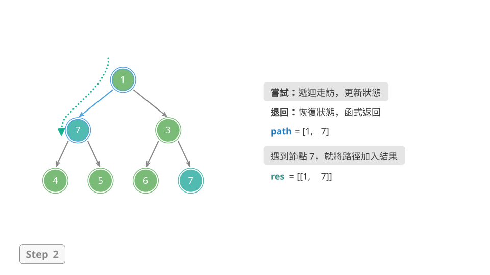
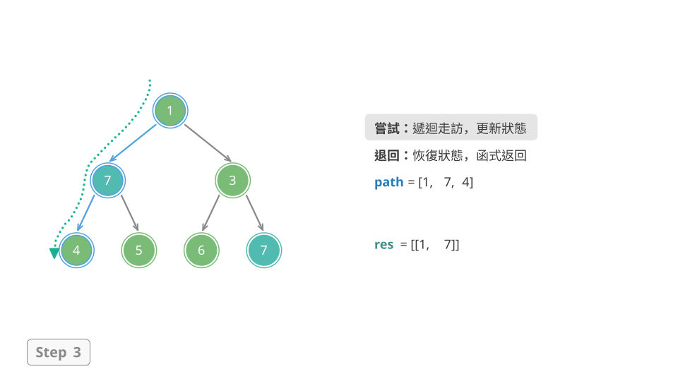
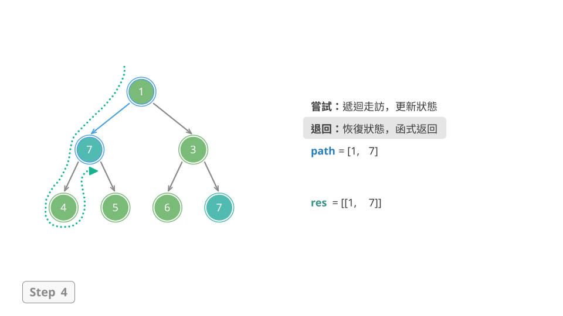
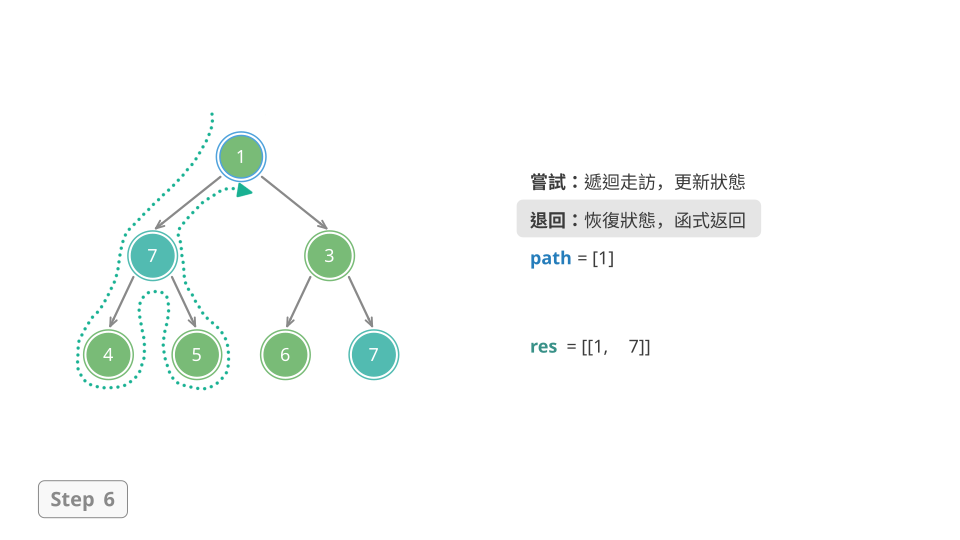
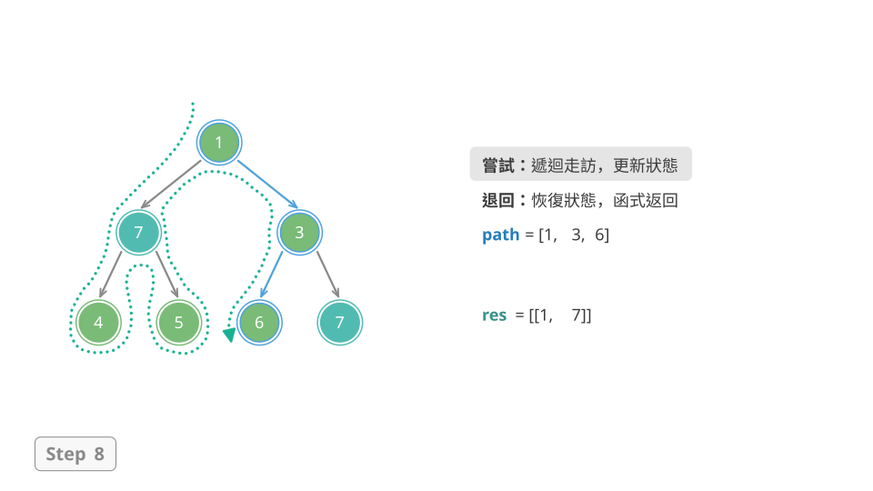
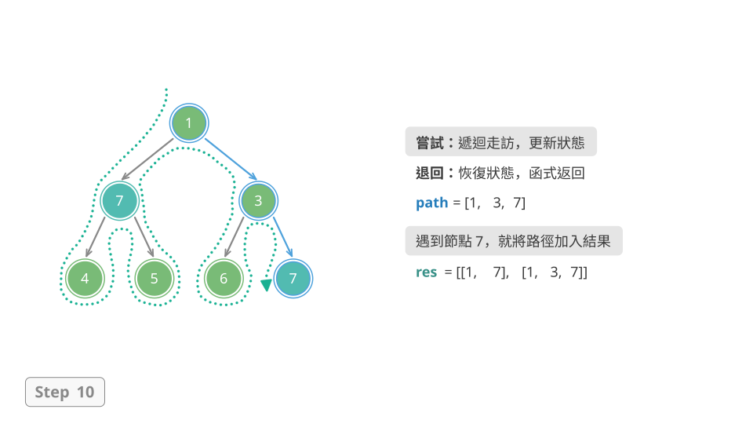
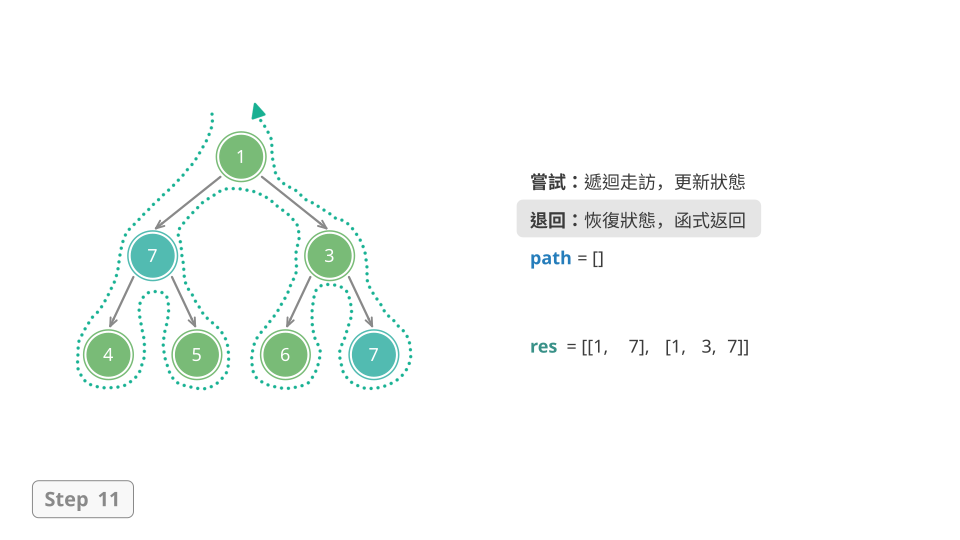
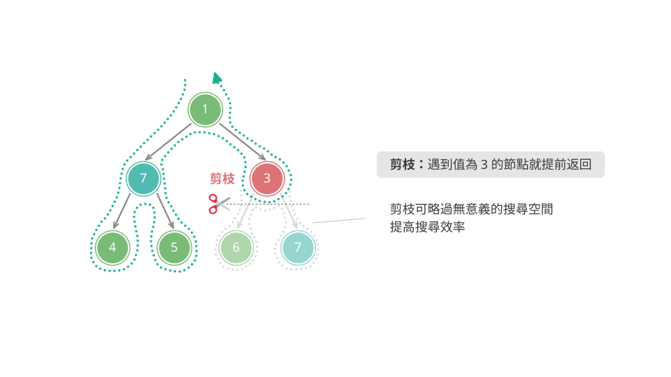
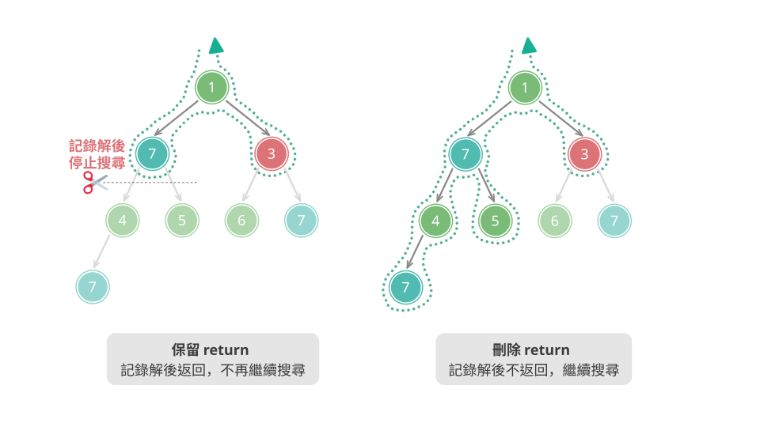

# 回溯演算法

<u>回溯演算法（backtracking algorithm）</u>以窮舉法求解。它從初始狀態出發，逐一搜尋所有可能的選擇，遇到符合條件的解就記錄下來，直到找到解，或試完所有選擇仍找不到解為止。

回溯演算法通常以「深度優先搜尋」走訪解空間。在「二元樹」一章中，我們提過前序、中序和後序走訪都屬於深度優先搜尋。接下來，我們從前序走訪出發，透過一道回溯問題，逐步了解回溯演算法的運作方式。

!!! question "例題一"

    給定一棵二元樹，搜尋並記錄所有值為 $7$ 的節點，請回傳這些節點組成的串列。

我們可以以前序走訪這棵樹，檢查目前節點的值是否為 $7$。如果是，就將該節點的值加入結果串列 `res`。下圖與程式碼說明了這個過程：

```src
[file]{preorder_traversal_i_compact}-[class]{}-[func]{pre_order}
```


## 嘗試與回溯

**回溯演算法得名於它搜尋解空間時所採用的「嘗試」與「回溯」策略**。搜尋過程中，若目前狀態無法再往前走，或無法得到符合條件的解，演算法便會撤銷上一步的選擇，回到先前的狀態，再嘗試其他可能的選擇。

在例題一中，每次走訪一個節點都代表一次「嘗試」。越過葉節點或返回父節點時執行的 `return` 則代表「回溯」。

值得注意的是，**回溯除了從函式返回，還可能包含其他操作**。我們將例題一稍作延伸，就能看出其中的差別。

!!! question "例題二"

    在二元樹中搜尋所有值為 $7$ 的節點，**請回傳從根節點到這些節點的路徑**。

沿用例題一的程式碼，再用一個串列 `path` 記錄目前走過的節點所形成的路徑。走訪到值為 $7$ 的節點時，複製 `path`，將副本加入結果串列 `res`。走訪完成後，`res` 中便保存了所有解。程式碼如下：

```src
[file]{preorder_traversal_ii_compact}-[class]{}-[func]{pre_order}
```

每次「嘗試」時，我們將目前節點加入 `path` 以記錄路徑。「回溯」之前，則須將該節點從 `path` 末端移除，**還原這次嘗試之前的狀態**。

觀察下圖，**我們可以將嘗試與回溯理解為「前進」與「撤銷」**，兩者的操作方向相反。

=== "<1>"
    

=== "<2>"
    

=== "<3>"
    

=== "<4>"
    

=== "<5>"
    

=== "<6>"
    

=== "<7>"
    

=== "<8>"
    

=== "<9>"
    

=== "<10>"
    

=== "<11>"
    

## 剪枝

較複雜的回溯問題通常有一項或多項限制條件，**這些條件通常可以用來「剪枝」**。

!!! question "例題三"

    在二元樹中搜尋所有值為 $7$ 的節點，並回傳從根節點到這些節點的路徑，**且路徑中不得包含值為 $3$ 的節點**。

為了滿足上述限制，**我們需要加入剪枝操作**：搜尋時若遇到值為 $3$ 的節點，就提前返回，不再繼續往下搜尋。程式碼如下：

```src
[file]{preorder_traversal_iii_compact}-[class]{}-[func]{pre_order}
```

「剪枝」這個名稱很貼切。如下圖所示，搜尋時，**我們會「剪去」不符合限制條件的搜尋分支**，省下許多無謂的嘗試，提高搜尋效率。



## 框架程式碼

接下來，我們將「嘗試、回溯、剪枝」整理成一個框架，讓同一套程式碼能應用在更多問題上。

在以下的框架程式碼中，`state` 表示問題目前的狀態，`choices` 表示在這個狀態下可以做的選擇：

```snippet
backtrack_framework
```

接著，我們用這個框架來解例題三。狀態 `state` 是走訪節點的路徑，選項 `choices` 是目前節點的左右子節點，結果 `res` 則是用來存放各條路徑的串列：

```src
[file]{preorder_traversal_iii_template}-[class]{}-[func]{backtrack}
```

依照題意，找到值為 $7$ 的節點之後仍應繼續搜尋，**因此要刪除記錄解之後的 `return` 敘述**。下圖比較保留與刪除 `return` 時的搜尋過程。



和直接以前序走訪實作相比，套用回溯框架的程式碼較為冗長，但適用範圍更廣。事實上，**許多回溯問題都能用這個框架求解**。我們只需針對個別問題定義 `state` 和 `choices`，再實作框架中的各個方法即可。

## 常用術語

為了更清楚地分析演算法問題，下表整理了回溯演算法的常用術語，並以例題三說明其含義。

<p align="center"> 表 <id> &nbsp; 回溯演算法的常用術語 </p>

| 名詞                   | 定義                                                                       | 例題三                                                               |
| ---------------------- | -------------------------------------------------------------------------- | -------------------------------------------------------------------- |
| 解（solution）         | 符合問題特定條件的答案，可能有一個或多個                               | 從根節點到節點 $7$ 且符合限制條件的所有路徑                            |
| 限制條件（constraint） | 用來界定哪些解可行的條件，通常可用於剪枝                         | 路徑中不得包含節點 $3$                                                 |
| 狀態（state）          | 問題在某一時刻的情況，其中包含已做的選擇                           | 目前走過的節點所形成的路徑，即節點串列 `path`                             |
| 嘗試（attempt）        | 依據可用的選項探索解空間，包括做出選擇、更新狀態與檢查是否為解 | 遞迴走訪左（右）子節點，將節點加入 `path`，並判斷其值是否為 $7$ |
| 回溯（backtracking）   | 遇到不符合限制條件的狀態時，撤銷先前的選擇，回到上一個狀態       | 越過葉節點、走訪完節點，或遇到值為 $3$ 的節點時，結束這次搜尋，從函式返回  |
| 剪枝（pruning）        | 依據問題的特性與限制條件，略過無謂的搜尋路徑，藉此提高搜尋效率     | 遇到值為 $3$ 的節點時，停止往下搜尋                              |

!!! tip

    問題、解和狀態等概念也適用於其他演算法，在分治、回溯、動態規劃和貪婪演算法中都會用到。

## 優點與限制

回溯演算法本質上是深度優先搜尋演算法。它逐一嘗試可能的方案，直到找到符合條件的解。這個方法的優點是能找出所有可能的解，配合適當的剪枝還能達到很高的效率。

然而，面對規模龐大或複雜的問題，**回溯演算法的執行效率可能低得難以接受**。

- **時間**：回溯演算法通常須走訪狀態空間中的所有可能情況，時間複雜度可能高達指數級或階乘級。
- **空間**：遞迴呼叫時須保存目前的狀態，例如路徑、剪枝用的輔助變數等。遞迴很深時，可能需要相當大的空間。

即便如此，**對於某些搜尋問題與限制滿足問題，回溯演算法仍是最佳解法**。這類問題無法預測哪些選擇會產生有效解，因此必須逐一走訪所有可能的選擇。這時，**如何提高效率就成了關鍵**。常見的方法有以下兩種。

- **剪枝**：略過確定不會產生解的路徑，節省時間與空間。
- **啟發式搜尋**：搜尋時採用策略或估計值，優先探索最可能產生有效解的路徑。

## 回溯法的典型例題

回溯演算法可以求解許多搜尋問題、限制滿足問題與組合最佳化問題。

**搜尋問題**：目標是找出符合特定條件的解。

- 全排列問題：給定一個集合，找出所有可能的排列。
- 子集和問題：給定一個集合與一個目標總和，找出集合中元素總和等於目標值的所有子集。
- 河內塔問題：給定三根柱子和一組大小不同的圓盤，將全部圓盤從一根柱子移到另一根。每次只能移動一個圓盤，且不可將大圓盤放在小圓盤上。

**限制滿足問題**：目標是找出符合所有限制條件的解。

- $n$ 皇后問題：在 $n \times n$ 的棋盤上放置 $n$ 個皇后，使它們無法互相攻擊。
- 數獨：在 $9 \times 9$ 的方格中填入 $1$ 到 $9$ 的數字，使每一列、每一欄和每個 $3 \times 3$ 小方格內的數字都不重複。
- 圖著色問題：給定一個無向圖，用最少的顏色為每個頂點著色，使相鄰頂點的顏色各不相同。

**組合最佳化問題**：目標是在組合空間中，找出符合特定條件的最佳解。

- 0-1 背包問題：給定一組物品和一個背包，每件物品各有其價值與重量。在背包容量的限制下，選取物品使總價值最大。
- 旅行推銷員問題：在圖中從一個頂點出發，恰好走訪其他各點一次後回到起點，求最短路徑。
- 最大團問題：給定一個無向圖，找出最大的完全子圖，也就是子圖內任兩個頂點之間都有邊相連。

對許多組合最佳化問題而言，回溯法並非最佳解法。

- 0-1 背包問題通常用動態規劃求解，時間效率較高。
- 旅行推銷員問題是著名的 NP-Hard 問題，常見解法包括基因演算法和蟻群演算法。
- 最大團問題是圖論中的經典問題，可以使用貪婪演算法等啟發式演算法求解。
