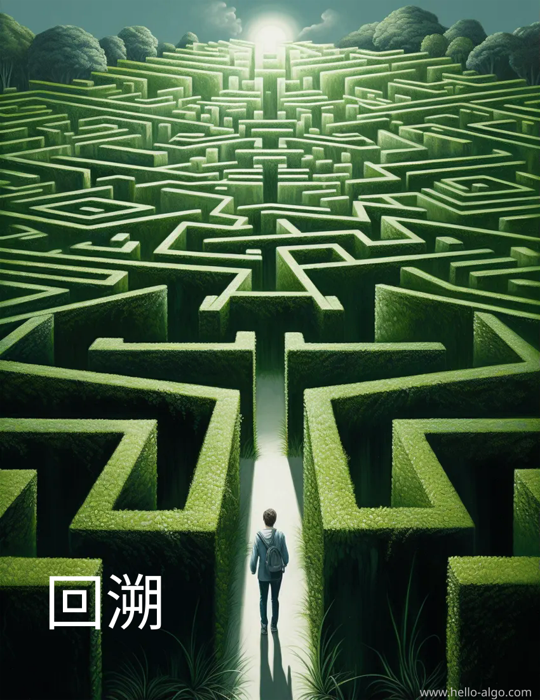

# 第 13 章 &nbsp; 回溯法

{ class="cover-image" }

!!! abstract

    我們就像在迷宮中探路的人，前進途中難免遇到阻礙。
    
    回溯讓我們得以退回岔路，重新嘗試，直到找到通往光明的出口。

## 本章內容

- [13.1 &nbsp; 回溯演算法](backtracking_algorithm.md)
- [13.2 &nbsp; 全排列問題](permutations_problem.md)
- [13.3 &nbsp; 子集和問題](subset_sum_problem.md)
- [13.4 &nbsp; N 皇后問題](n_queens_problem.md)
- [13.5 &nbsp; 小結](summary.md)
- [13.6 &nbsp; 練習](exercises.md)
