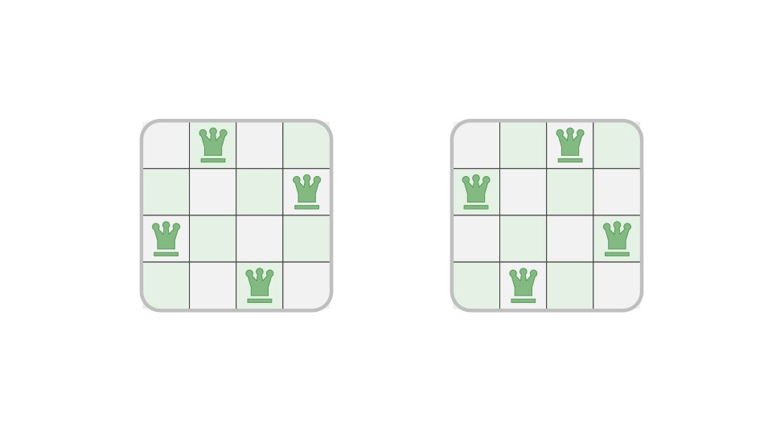
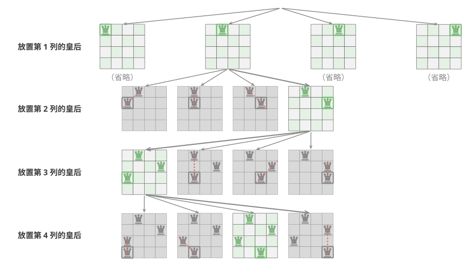

# n 皇后問題

!!! question

    依照西洋棋規則，皇后可以攻擊與它同列、同欄或位於同一條對角線上的棋子。給定 $n$ 個皇后和一個 $n \times n$ 的棋盤，找出所有皇后都無法互相攻擊的擺法。

如下圖所示，當 $n = 4$ 時，共有兩個解。從回溯演算法的角度來看，$n \times n$ 的棋盤共有 $n^2$ 格，這些格子構成所有選項 `choices`。隨著皇后逐一放上棋盤，盤面也會改變，每一刻的盤面就是當時的狀態 `state`。



下圖呈現本題的三項限制：**任兩個皇后都不可同列、同欄或位於同一條對角線上**。對角線又分為主對角線 `\` 和副對角線 `/`。


### 逐列放置的策略

皇后個數與棋盤列數都是 $n$，因此可推得：**棋盤的每一列都必須剛好放一個皇后**。

因此，我們可以逐列放置皇后。從第一列開始，每一列放一個，直到最後一列放完為止。

下圖呈現 4 皇后問題中逐列放置皇后的過程。限於篇幅，第一列只展開其中一個搜尋分支，違反欄或對角線限制的擺法則已剪去。



實際上，**逐列放置本身就有剪枝的效果**，因為它避開了同一列出現多個皇后的所有搜尋分支。

### 依欄與對角線剪枝

為了符合欄的限制，可以用長度為 $n$ 的布林陣列 `cols`，記錄每一欄是否已有皇后。每次放置前，利用 `cols` 剪去已有皇后的欄，並在回溯搜尋過程中隨時更新 `cols` 的狀態。

!!! tip

    矩陣的起點位於左上角。列索引由上往下遞增，欄索引則由左往右遞增。

該如何處理對角線的限制呢？設棋盤上某格的列、欄索引為 $(row, col)$。任選一條主對角線觀察，會發現這條線上每一格的列索引減去欄索引都相同，**也就是同一條主對角線上每一格的 $row - col$ 都是定值**。

換句話說，若兩格滿足 $row_1 - col_1 = row_2 - col_2$，就一定位於同一條主對角線上。利用這項規律，我們可以用下圖的陣列 `diags1` 記錄每條主對角線上是否已有皇后。

同理，**同一條副對角線上每一格的 $row + col$ 都是定值**。因此，也能用陣列 `diags2` 處理副對角線的限制。


### 程式實作

在 $n$ 階方陣中，$row - col$ 的範圍為 $[-n + 1, n - 1]$，$row + col$ 的範圍為 $[0, 2n - 2]$。因此，主對角線與副對角線各有 $2n - 1$ 條，陣列 `diags1` 與 `diags2` 的長度也都是 $2n - 1$。

```src
[file]{n_queens}-[class]{}-[func]{n_queens}
```

逐列放置皇后，共放 $n$ 次。考慮欄的限制，從第一列到最後一列依序有 $n$、$n-1$、$\dots$、$2$、$1$ 種選擇，耗時 $O(n!)$。記錄解時，須複製矩陣 `state` 並將副本加入 `res`，複製一次耗時 $O(n^2)$。因此，**整體時間複雜度為 $O(n! \cdot n^2)$**。實際上，依對角線限制剪枝還能大幅縮小搜尋空間，因此實際搜尋效率通常比上述估計更好。

陣列 `state` 使用 $O(n^2)$ 空間，陣列 `cols`、`diags1` 與 `diags2` 各使用 $O(n)$ 空間。最大遞迴深度為 $n$，呼叫堆疊使用 $O(n)$ 空間。因此，**空間複雜度為 $O(n^2)$**。
