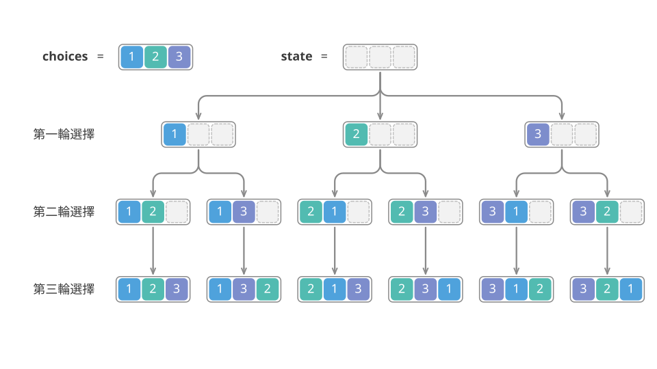
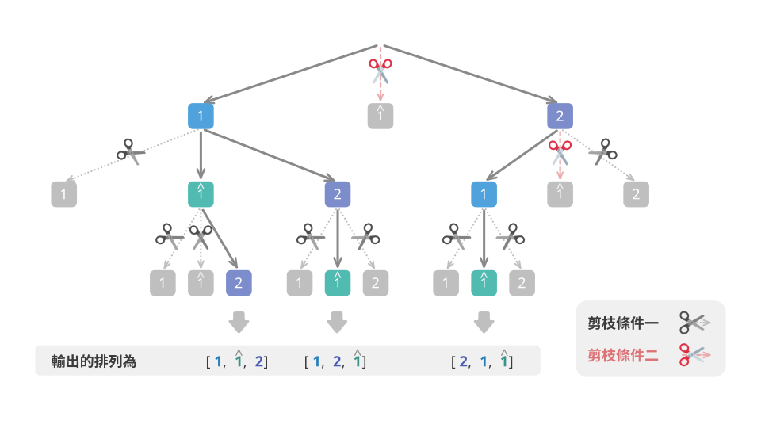

# 全排列問題

全排列問題是回溯演算法的典型應用。給定一組元素，例如陣列或字串，目標是找出這些元素所有可能的排列。

下表列出幾個輸入陣列，以及各陣列對應的所有排列。

<p align="center"> 表 <id> &nbsp; 全排列範例 </p>

| 輸入陣列    | 所有排列                                                           |
| :---------- | :----------------------------------------------------------------- |
| $[1]$       | $[1]$                                                              |
| $[1, 2]$    | $[1, 2], [2, 1]$                                                   |
| $[1, 2, 3]$ | $[1, 2, 3], [1, 3, 2], [2, 1, 3], [2, 3, 1], [3, 1, 2], [3, 2, 1]$ |

## 元素皆相異的情況

!!! question

    給定一個沒有重複元素的整數陣列，回傳所有可能的排列。

從回溯演算法的角度來看，**每個排列都是一連串選擇的結果**。假設輸入陣列為 $[1, 2, 3]$，先選 $1$，再選 $3$，最後選 $2$，就得到排列 $[1, 3, 2]$。回溯時會撤銷一次選擇，再繼續嘗試其他選項。

在回溯程式碼中，候選集合 `choices` 包含輸入陣列的所有元素，狀態 `state` 則由目前已選取的元素構成。每個元素只能選取一次，**因此 `state` 中的元素應該都相異**。

如下圖所示，我們可以將搜尋過程展開成一棵遞迴樹，每個節點代表當下的狀態 `state`。從根節點出發，經過三輪選擇就會到達葉節點，每個葉節點對應一個排列。



### 剪去重複選取的分支

為了確保每個元素只選一次，我們引入布林陣列 `selected`，其中 `selected[i]` 表示 `choices[i]` 是否已被選取，再據此進行以下剪枝。

- 選取 `choices[i]` 後，將 `selected[i]` 設為 $\text{True}$，表示該元素已被選取。
- 走訪選項串列 `choices` 時，略過所有已選取的節點，也就是剪枝。

如下圖所示，假設第一輪選 1、第二輪選 3、第三輪選 2，則第二輪應剪去元素 1 的分支，第三輪應剪去元素 1 和元素 3 的分支。


從上圖可見，這種剪枝方式能將搜尋空間從 $O(n^n)$ 縮小到 $O(n!)$。

### 程式實作

釐清上述資訊後，就可以把各項操作填入先前的框架程式碼。為了縮短程式碼，這裡將框架中各函式的操作直接寫在 `backtrack()` 函式內：

```src
[file]{permutations_i}-[class]{}-[func]{permutations_i}
```

## 含有相等元素的情況

!!! question

    給定一個整數陣列，**其中可能含有重複元素**，請回傳所有不重複的排列。

假設輸入陣列為 $[1, 1, 2]$。為了區分兩個相等的元素 $1$，我們將第二個 $1$ 記為 $\hat{1}$。

如下圖所示，前述方法產生的排列有一半是重複的。


如何去除重複排列呢？最直接的做法是用雜湊集合移除結果中重複的排列，但這樣仍多做了工：**產生重複排列的搜尋分支其實可以提前辨識並剪去**，進一步提升演算法效率。

### 剪去相等元素的分支

觀察下圖，第一輪選 $1$ 和選 $\hat{1}$ 的效果相同，兩個選擇下產生的排列會完全重複，因此應剪去 $\hat{1}$ 的分支。

同理，若第一輪選了 $2$，第二輪選 $1$ 和選 $\hat{1}$ 也會產生重複分支，因此應剪去第二輪選 $\hat{1}$ 的分支。

換句話說，**同一輪選擇中，即使有多個元素的值相等，這個值也只需選一次**。


### 程式實作

沿用上一題的程式碼，在每一輪選擇開始時建立一個雜湊集合 `duplicated`，記錄本輪已嘗試的元素，遇到重複值就剪枝：

```src
[file]{permutations_ii}-[class]{}-[func]{permutations_ii}
```

假設所有元素皆相異，則 $n$ 個元素共有 $n!$ 種排列（階乘）。每次記錄結果都要複製長度為 $n$ 的串列，耗時 $O(n)$。**因此，時間複雜度為 $O(n!n)$**。

最大遞迴深度為 $n$，呼叫堆疊使用 $O(n)$ 空間。`selected` 使用 $O(n)$ 空間。同一時間最多有 $n$ 個 `duplicated`，共使用 $O(n^2)$ 空間。**因此，空間複雜度為 $O(n^2)$**。

### 比較兩種剪枝方式

`selected` 和 `duplicated` 都用於剪枝，但兩者的目的不同。

- **剪去重複選取的分支**：整個搜尋過程只使用一個 `selected`。它記錄目前狀態包含哪些元素，以免同一個元素重複出現在 `state` 中。
- **剪去相等元素的分支**：每一輪選擇（每次呼叫 `backtrack` 函式）都有自己的 `duplicated`。它記錄本輪走訪（`for` 迴圈）已選過哪些元素，確保相等的元素在同一輪只選一次。

下圖呈現這兩項剪枝條件各自的作用範圍。樹中的每個節點代表一次選擇，沿著根節點到葉節點的路徑串起這些選擇，就構成一個排列。


