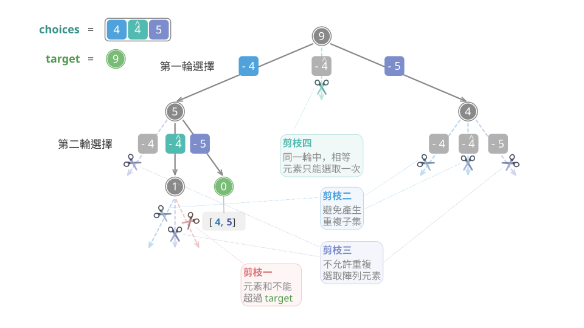

# 子集和問題

## 元素沒有重複的情況

!!! question

    給定正整數陣列 `nums` 與正整數目標值 `target`，請找出元素總和等於 `target` 的所有組合。陣列元素皆相異，每個元素都可選取多次。請用串列回傳這些組合，且串列中不得包含重複組合。

例如，輸入集合 $\{3, 4, 5\}$ 與目標整數 $9$，可得到解 $\{3, 3, 3\}, \{4, 5\}$。請注意以下兩點。

- 輸入集合中的每個元素都可以重複選取，次數不限。
- 子集不區分元素順序，例如 $\{4, 5\}$ 和 $\{5, 4\}$ 是同一個子集。

### 從全排列的解法出發

和全排列問題類似，我們可以將每個子集視為一連串選擇的結果，每做一次選擇就更新元素總和。當總和等於 `target` 時，就將這個子集記入結果串列。

與全排列問題不同，**本題允許集合中的元素重複選取，次數不限**，因此不需要用布林串列 `selected` 記錄元素是否已選取。稍微修改全排列的程式碼，就能得到初步解法：

```src
[file]{subset_sum_i_naive}-[class]{}-[func]{subset_sum_i_naive}
```

將陣列 $[3, 4, 5]$ 和目標值 $9$ 輸入上述程式，輸出結果為 $[3, 3, 3], [4, 5], [5, 4]$。**雖然找出了總和為 $9$ 的所有子集，卻包含重複的子集 $[4, 5]$ 和 $[5, 4]$**。

這是因為搜尋過程會區分選取順序，而子集不區分順序。如下圖所示，先選 $4$ 再選 $5$，以及先選 $5$ 再選 $4$，屬於不同的分支，卻對應同一個子集。


為了移除重複子集，**最直接的做法是從結果串列中刪除重複項目**。但這種方法效率很低，原因有兩個。

- 當陣列元素很多時，尤其是 `target` 較大時，搜尋過程會產生大量重複子集。
- 比較子集（陣列）是否相同相當耗時，因為要先將陣列排序，再逐一比較對應的元素。

### 剪去重複子集的分支

**我們可以在搜尋過程中透過剪枝避免重複**。觀察下圖，以不同順序選取陣列元素會產生重複子集，例如以下情況。

1. 若第一輪選 $3$、第二輪選 $4$，就會產生所有包含這兩個元素的子集，記為 $[3, 4, \dots]$。
2. 之後，若第一輪選 $4$，**第二輪就應略過 $3$**，因為這個選擇產生的子集 $[4, 3, \dots]$ 和第 `1.` 步產生的子集完全重複。

搜尋時，每一層都由左到右逐一嘗試各個選項，因此越靠右，剪去的分支就越多。

1. 前兩輪依序選 $3$ 和 $5$，產生子集 $[3, 5, \dots]$。
2. 前兩輪依序選 $4$ 和 $5$，產生子集 $[4, 5, \dots]$。
3. 若第一輪選 $5$，**第二輪就應略過 $3$ 和 $4$**，因為子集 $[5, 3, \dots]$ 和 $[5, 4, \dots]$ 分別與第 `1.` 步和第 `2.` 步所述的子集完全重複。


綜合以上，給定輸入陣列 $[x_1, x_2, \dots, x_n]$，若搜尋過程中的選擇序列為 $[x_{i_1}, x_{i_2}, \dots, x_{i_m}]$，就必須滿足 $i_1 \leq i_2 \leq \dots \leq i_m$。**不符合這個條件的選擇序列都會造成重複，應予剪枝**。

### 程式實作

為了實作這項剪枝，我們初始化變數 `start`，用來記錄走訪起點。**選取 $x_{i}$ 之後，下一輪就從索引 $i$ 開始走訪**。這樣便能讓選擇序列滿足 $i_1 \leq i_2 \leq \dots \leq i_m$，確保每個子集只出現一次。

此外，我們還對程式碼做了兩項改進。

- 開始搜尋前，先將陣列 `nums` 排序。逐一走訪選項時，**只要子集總和超過 `target`，就直接結束迴圈**，因為後面的元素更大，加上去之後的總和必定也超過 `target`。
- 省去記錄元素總和的變數 `total`，**改為從 `target` 中逐次扣除所選的值，以追蹤總和**。當 `target` 等於 $0$ 時，就記錄此解。

```src
[file]{subset_sum_i}-[class]{}-[func]{subset_sum_i}
```

下圖呈現將陣列 $[3, 4, 5]$ 與目標值 $9$ 輸入上述程式後的完整回溯過程。


## 含有重複元素的情況

!!! question

    給定正整數陣列 `nums` 與正整數目標值 `target`，請找出元素總和等於 `target` 的所有組合。**陣列中可能含有重複元素，每個元素只能選取一次**。請用串列回傳這些組合，且串列中不得包含重複組合。

和上一題相比，**本題的輸入陣列可能含有重複元素**，這會帶來新的問題。例如，給定陣列 $[4, \hat{4}, 5]$ 與目標值 $9$，現有程式碼的輸出為 $[4, 5], [\hat{4}, 5]$，其中有重複子集。

**這些重複子集來自同一輪中多次選取相等的元素**。下圖第一輪有三個選項，其中有兩個值都是 $4$，因此會產生兩個重複的搜尋分支，輸出重複子集。同理，第二輪的兩個 $4$ 也會產生重複子集。


### 剪去相等元素的分支

要解決這個問題，**每一輪只能選取相等元素中的一個**。實作時可以利用排序的性質：陣列已排序，相等元素必定相鄰。因此，若本輪目前的元素與本輪先前考慮的左鄰元素相等，就表示這個值已經選過，可以直接略過。

此外，**本題規定陣列中的每個元素只能選取一次**。同樣可以用變數 `start` 滿足這項限制：選取 $x_{i}$ 後，下一輪從索引 $i + 1$ 開始往後走訪。這樣既可避免重複子集，也不會重複選取同一個元素。

### 程式實作

```src
[file]{subset_sum_ii}-[class]{}-[func]{subset_sum_ii}
```

下圖呈現以陣列 $[4, 4, 5]$ 和目標值 $9$ 搜尋時的回溯過程，共包含四種剪枝。請對照圖示和程式註解，看看搜尋如何進行，以及每種剪枝如何發揮作用。


