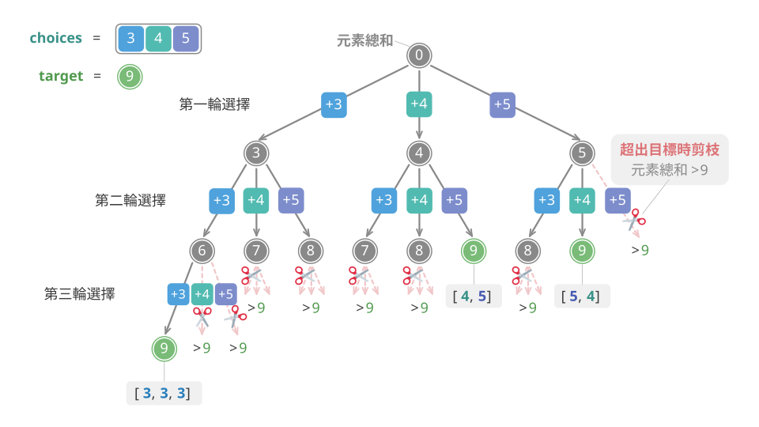
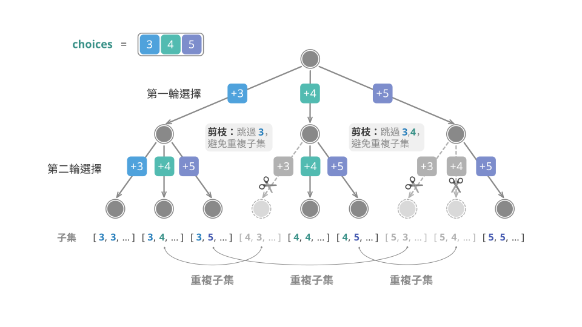
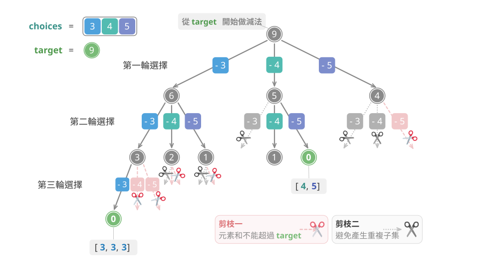
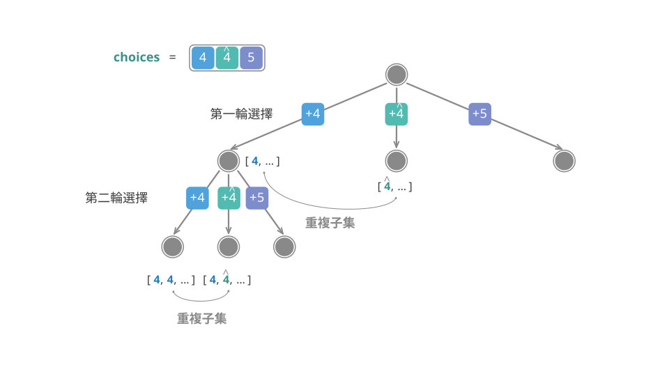

# 13.3 &nbsp; 子集和問題

## 13.3.1 &nbsp; 元素沒有重複的情況

!!! question

    給定正整數陣列 `nums` 與正整數目標值 `target`，請找出元素總和等於 `target` 的所有組合。陣列元素皆相異，每個元素都可選取多次。請用串列回傳這些組合，且串列中不得包含重複組合。

例如，輸入集合 $\{3, 4, 5\}$ 與目標整數 $9$，可得到解 $\{3, 3, 3\}, \{4, 5\}$。請注意以下兩點。

- 輸入集合中的每個元素都可以重複選取，次數不限。
- 子集不區分元素順序，例如 $\{4, 5\}$ 和 $\{5, 4\}$ 是同一個子集。

### 1. &nbsp; 從全排列的解法出發

和全排列問題類似，我們可以將每個子集視為一連串選擇的結果，每做一次選擇就更新元素總和。當總和等於 `target` 時，就將這個子集記入結果串列。

與全排列問題不同，**本題允許集合中的元素重複選取，次數不限**，因此不需要用布林串列 `selected` 記錄元素是否已選取。稍微修改全排列的程式碼，就能得到初步解法：

=== "Python"

    ```python title="subset_sum_i_naive.py"
    def backtrack(
        state: list[int],
        target: int,
        total: int,
        choices: list[int],
        res: list[list[int]],
    ):
        """回溯演算法：子集和 I"""
        # 子集總和達到目標時，記錄此解
        if total == target:
            res.append(list(state))
            return
        # 逐一檢查所有選項
        for i in range(len(choices)):
            # 剪枝：若加入該元素後總和超過 target，略過這個選擇
            if total + choices[i] > target:
                continue
            # 嘗試：做出選擇，更新元素總和 total
            state.append(choices[i])
            # 進入下一輪選擇
            backtrack(state, target, total + choices[i], choices, res)
            # 回溯：撤銷選擇，還原先前的狀態
            state.pop()

    def subset_sum_i_naive(nums: list[int], target: int) -> list[list[int]]:
        """求解子集和 I（含重複子集）"""
        state = []  # 狀態（子集）
        total = 0  # 子集總和
        res = []  # 結果串列（子集串列）
        backtrack(state, target, total, nums, res)
        return res
    ```

=== "C++"

    ```cpp title="subset_sum_i_naive.cpp"
    /* 回溯演算法：子集和 I */
    void backtrack(vector<int> &state, int target, int total, vector<int> &choices, vector<vector<int>> &res) {
        // 子集總和達到目標時，記錄此解
        if (total == target) {
            res.push_back(state);
            return;
        }
        // 逐一檢查所有選項
        for (size_t i = 0; i < choices.size(); i++) {
            // 剪枝：若加入該元素後總和超過 target，略過這個選擇
            if (total + choices[i] > target) {
                continue;
            }
            // 嘗試：做出選擇，更新元素總和 total
            state.push_back(choices[i]);
            // 進入下一輪選擇
            backtrack(state, target, total + choices[i], choices, res);
            // 回溯：撤銷選擇，還原先前的狀態
            state.pop_back();
        }
    }

    /* 求解子集和 I（含重複子集） */
    vector<vector<int>> subsetSumINaive(vector<int> &nums, int target) {
        vector<int> state;       // 狀態（子集）
        int total = 0;           // 子集總和
        vector<vector<int>> res; // 結果串列（子集串列）
        backtrack(state, target, total, nums, res);
        return res;
    }
    ```

=== "Java"

    ```java title="subset_sum_i_naive.java"
    /* 回溯演算法：子集和 I */
    void backtrack(List<Integer> state, int target, int total, int[] choices, List<List<Integer>> res) {
        // 子集總和達到目標時，記錄此解
        if (total == target) {
            res.add(new ArrayList<>(state));
            return;
        }
        // 逐一檢查所有選項
        for (int i = 0; i < choices.length; i++) {
            // 剪枝：若加入該元素後總和超過 target，略過這個選擇
            if (total + choices[i] > target) {
                continue;
            }
            // 嘗試：做出選擇，更新元素總和 total
            state.add(choices[i]);
            // 進入下一輪選擇
            backtrack(state, target, total + choices[i], choices, res);
            // 回溯：撤銷選擇，還原先前的狀態
            state.remove(state.size() - 1);
        }
    }

    /* 求解子集和 I（含重複子集） */
    List<List<Integer>> subsetSumINaive(int[] nums, int target) {
        List<Integer> state = new ArrayList<>(); // 狀態（子集）
        int total = 0; // 子集總和
        List<List<Integer>> res = new ArrayList<>(); // 結果串列（子集串列）
        backtrack(state, target, total, nums, res);
        return res;
    }
    ```

=== "C#"

    ```csharp title="subset_sum_i_naive.cs"
    /* 回溯演算法：子集和 I */
    void Backtrack(List<int> state, int target, int total, int[] choices, List<List<int>> res) {
        // 子集總和達到目標時，記錄此解
        if (total == target) {
            res.Add(new List<int>(state));
            return;
        }
        // 逐一檢查所有選項
        for (int i = 0; i < choices.Length; i++) {
            // 剪枝：若加入該元素後總和超過 target，略過這個選擇
            if (total + choices[i] > target) {
                continue;
            }
            // 嘗試：做出選擇，更新元素總和 total
            state.Add(choices[i]);
            // 進入下一輪選擇
            Backtrack(state, target, total + choices[i], choices, res);
            // 回溯：撤銷選擇，還原先前的狀態
            state.RemoveAt(state.Count - 1);
        }
    }

    /* 求解子集和 I（含重複子集） */
    List<List<int>> SubsetSumINaive(int[] nums, int target) {
        List<int> state = []; // 狀態（子集）
        int total = 0; // 子集總和
        List<List<int>> res = []; // 結果串列（子集串列）
        Backtrack(state, target, total, nums, res);
        return res;
    }
    ```

=== "Go"

    ```go title="subset_sum_i_naive.go"
    /* 回溯演算法：子集和 I */
    func backtrackSubsetSumINaive(total, target int, state, choices *[]int, res *[][]int) {
        // 子集總和達到目標時，記錄此解
        if target == total {
            newState := append([]int{}, *state...)
            *res = append(*res, newState)
            return
        }
        // 逐一檢查所有選項
        for i := 0; i < len(*choices); i++ {
            // 剪枝：若加入該元素後總和超過 target，略過這個選擇
            if total+(*choices)[i] > target {
                continue
            }
            // 嘗試：做出選擇，更新元素總和 total
            *state = append(*state, (*choices)[i])
            // 進入下一輪選擇
            backtrackSubsetSumINaive(total+(*choices)[i], target, state, choices, res)
            // 回溯：撤銷選擇，還原先前的狀態
            *state = (*state)[:len(*state)-1]
        }
    }

    /* 求解子集和 I（含重複子集） */
    func subsetSumINaive(nums []int, target int) [][]int {
        state := make([]int, 0) // 狀態（子集）
        total := 0              // 子集總和
        res := make([][]int, 0) // 結果串列（子集串列）
        backtrackSubsetSumINaive(total, target, &state, &nums, &res)
        return res
    }
    ```

=== "Swift"

    ```swift title="subset_sum_i_naive.swift"
    /* 回溯演算法：子集和 I */
    func backtrack(state: inout [Int], target: Int, total: Int, choices: [Int], res: inout [[Int]]) {
        // 子集總和達到目標時，記錄此解
        if total == target {
            res.append(state)
            return
        }
        // 逐一檢查所有選項
        for i in choices.indices {
            // 剪枝：若加入該元素後總和超過 target，略過這個選擇
            if total + choices[i] > target {
                continue
            }
            // 嘗試：做出選擇，更新元素總和 total
            state.append(choices[i])
            // 進入下一輪選擇
            backtrack(state: &state, target: target, total: total + choices[i], choices: choices, res: &res)
            // 回溯：撤銷選擇，還原先前的狀態
            state.removeLast()
        }
    }

    /* 求解子集和 I（含重複子集） */
    func subsetSumINaive(nums: [Int], target: Int) -> [[Int]] {
        var state: [Int] = [] // 狀態（子集）
        let total = 0 // 子集總和
        var res: [[Int]] = [] // 結果串列（子集串列）
        backtrack(state: &state, target: target, total: total, choices: nums, res: &res)
        return res
    }
    ```

=== "JS"

    ```javascript title="subset_sum_i_naive.js"
    /* 回溯演算法：子集和 I */
    function backtrack(state, target, total, choices, res) {
        // 子集總和達到目標時，記錄此解
        if (total === target) {
            res.push([...state]);
            return;
        }
        // 逐一檢查所有選項
        for (let i = 0; i < choices.length; i++) {
            // 剪枝：若加入該元素後總和超過 target，略過這個選擇
            if (total + choices[i] > target) {
                continue;
            }
            // 嘗試：做出選擇，更新元素總和 total
            state.push(choices[i]);
            // 進入下一輪選擇
            backtrack(state, target, total + choices[i], choices, res);
            // 回溯：撤銷選擇，還原先前的狀態
            state.pop();
        }
    }

    /* 求解子集和 I（含重複子集） */
    function subsetSumINaive(nums, target) {
        const state = []; // 狀態（子集）
        const total = 0; // 子集總和
        const res = []; // 結果串列（子集串列）
        backtrack(state, target, total, nums, res);
        return res;
    }
    ```

=== "TS"

    ```typescript title="subset_sum_i_naive.ts"
    /* 回溯演算法：子集和 I */
    function backtrack(
        state: number[],
        target: number,
        total: number,
        choices: number[],
        res: number[][]
    ): void {
        // 子集總和達到目標時，記錄此解
        if (total === target) {
            res.push([...state]);
            return;
        }
        // 逐一檢查所有選項
        for (let i = 0; i < choices.length; i++) {
            // 剪枝：若加入該元素後總和超過 target，略過這個選擇
            if (total + choices[i] > target) {
                continue;
            }
            // 嘗試：做出選擇，更新元素總和 total
            state.push(choices[i]);
            // 進入下一輪選擇
            backtrack(state, target, total + choices[i], choices, res);
            // 回溯：撤銷選擇，還原先前的狀態
            state.pop();
        }
    }

    /* 求解子集和 I（含重複子集） */
    function subsetSumINaive(nums: number[], target: number): number[][] {
        const state = []; // 狀態（子集）
        const total = 0; // 子集總和
        const res = []; // 結果串列（子集串列）
        backtrack(state, target, total, nums, res);
        return res;
    }
    ```

=== "Dart"

    ```dart title="subset_sum_i_naive.dart"
    /* 回溯演算法：子集和 I */
    void backtrack(
      List<int> state,
      int target,
      int total,
      List<int> choices,
      List<List<int>> res,
    ) {
      // 子集總和達到目標時，記錄此解
      if (total == target) {
        res.add(List.from(state));
        return;
      }
      // 逐一檢查所有選項
      for (int i = 0; i < choices.length; i++) {
        // 剪枝：若加入該元素後總和超過 target，略過這個選擇
        if (total + choices[i] > target) {
          continue;
        }
        // 嘗試：做出選擇，更新元素總和 total
        state.add(choices[i]);
        // 進入下一輪選擇
        backtrack(state, target, total + choices[i], choices, res);
        // 回溯：撤銷選擇，還原先前的狀態
        state.removeLast();
      }
    }

    /* 求解子集和 I（含重複子集） */
    List<List<int>> subsetSumINaive(List<int> nums, int target) {
      List<int> state = []; // 狀態（子集）
      int total = 0; // 元素總和
      List<List<int>> res = []; // 結果串列（子集串列）
      backtrack(state, target, total, nums, res);
      return res;
    }
    ```

=== "Rust"

    ```rust title="subset_sum_i_naive.rs"
    /* 回溯演算法：子集和 I */
    fn backtrack(
        state: &mut Vec<i32>,
        target: i32,
        total: i32,
        choices: &[i32],
        res: &mut Vec<Vec<i32>>,
    ) {
        // 子集總和達到目標時，記錄此解
        if total == target {
            res.push(state.clone());
            return;
        }
        // 逐一檢查所有選項
        for i in 0..choices.len() {
            // 剪枝：若加入該元素後總和超過 target，略過這個選擇
            if total + choices[i] > target {
                continue;
            }
            // 嘗試：做出選擇，更新元素總和 total
            state.push(choices[i]);
            // 進入下一輪選擇
            backtrack(state, target, total + choices[i], choices, res);
            // 回溯：撤銷選擇，還原先前的狀態
            state.pop();
        }
    }

    /* 求解子集和 I（含重複子集） */
    fn subset_sum_i_naive(nums: &[i32], target: i32) -> Vec<Vec<i32>> {
        let mut state = Vec::new(); // 狀態（子集）
        let total = 0; // 子集總和
        let mut res = Vec::new(); // 結果串列（子集串列）
        backtrack(&mut state, target, total, nums, &mut res);
        res
    }
    ```

=== "C"

    ```c title="subset_sum_i_naive.c"
    /* 回溯演算法：子集和 I */
    void backtrack(int target, int total, int *choices, int choicesSize) {
        // 子集總和達到目標時，記錄此解
        if (total == target) {
            for (int i = 0; i < stateSize; i++) {
                res[resSize][i] = state[i];
            }
            resColSizes[resSize++] = stateSize;
            return;
        }
        // 逐一檢查所有選項
        for (int i = 0; i < choicesSize; i++) {
            // 剪枝：若加入該元素後總和超過 target，略過這個選擇
            if (total + choices[i] > target) {
                continue;
            }
            // 嘗試：做出選擇，更新元素總和 total
            state[stateSize++] = choices[i];
            // 進入下一輪選擇
            backtrack(target, total + choices[i], choices, choicesSize);
            // 回溯：撤銷選擇，還原先前的狀態
            stateSize--;
        }
    }

    /* 求解子集和 I（含重複子集） */
    void subsetSumINaive(int *nums, int numsSize, int target) {
        resSize = 0; // 將解的個數初始化為 0
        backtrack(target, 0, nums, numsSize);
    }
    ```

=== "Kotlin"

    ```kotlin title="subset_sum_i_naive.kt"
    /* 回溯演算法：子集和 I */
    fun backtrack(
        state: MutableList<Int>,
        target: Int,
        total: Int,
        choices: IntArray,
        res: MutableList<MutableList<Int>?>
    ) {
        // 子集總和達到目標時，記錄此解
        if (total == target) {
            res.add(state.toMutableList())
            return
        }
        // 逐一檢查所有選項
        for (i in choices.indices) {
            // 剪枝：若加入該元素後總和超過 target，略過這個選擇
            if (total + choices[i] > target) {
                continue
            }
            // 嘗試：做出選擇，更新元素總和 total
            state.add(choices[i])
            // 進入下一輪選擇
            backtrack(state, target, total + choices[i], choices, res)
            // 回溯：撤銷選擇，還原先前的狀態
            state.removeAt(state.size - 1)
        }
    }

    /* 求解子集和 I（含重複子集） */
    fun subsetSumINaive(nums: IntArray, target: Int): MutableList<MutableList<Int>?> {
        val state = mutableListOf<Int>() // 狀態（子集）
        val total = 0 // 子集總和
        val res = mutableListOf<MutableList<Int>?>() // 結果串列（子集串列）
        backtrack(state, target, total, nums, res)
        return res
    }
    ```

=== "Ruby"

    ```ruby title="subset_sum_i_naive.rb"
    ### 回溯演算法：子集和 I ###
    def backtrack(state, target, total, choices, res)
      # 子集總和達到目標時，記錄此解
      if total == target
        res << state.dup
        return
      end

      # 逐一檢查所有選項
      for i in 0...choices.length
        # 剪枝：若加入該元素後總和超過 target，略過這個選擇
        next if total + choices[i] > target
        # 嘗試：做出選擇，更新元素總和 total
        state << choices[i]
        # 進入下一輪選擇
        backtrack(state, target, total + choices[i], choices, res)
        # 回溯：撤銷選擇，還原先前的狀態
        state.pop
      end
    end

    ### 求解子集和 I（含重複子集）###
    def subset_sum_i_naive(nums, target)
      state = [] # 狀態（子集）
      total = 0 # 子集總和
      res = [] # 結果串列（子集串列）
      backtrack(state, target, total, nums, res)
      res
    end
    ```

??? pythontutor "執行視覺化示範"

    <div style="height: 549px; width: 100%;"><iframe class="pythontutor-iframe" title="執行視覺化示範" src="https://pythontutor.com/iframe-embed.html#code=def%20backtrack%28%0A%20%20%20%20state%3A%20list%5Bint%5D,%0A%20%20%20%20target%3A%20int,%0A%20%20%20%20total%3A%20int,%0A%20%20%20%20choices%3A%20list%5Bint%5D,%0A%20%20%20%20res%3A%20list%5Blist%5Bint%5D%5D,%0A%29%3A%0A%20%20%20%20%22%22%22%E5%9B%9E%E6%BA%AF%E6%BC%94%E7%AE%97%E6%B3%95%EF%BC%9A%E5%AD%90%E9%9B%86%E5%92%8C%20I%22%22%22%0A%20%20%20%20%23%20%E5%AD%90%E9%9B%86%E7%B8%BD%E5%92%8C%E9%81%94%E5%88%B0%E7%9B%AE%E6%A8%99%E6%99%82%EF%BC%8C%E8%A8%98%E9%8C%84%E6%AD%A4%E8%A7%A3%0A%20%20%20%20if%20total%20%3D%3D%20target%3A%0A%20%20%20%20%20%20%20%20res.append%28list%28state%29%29%0A%20%20%20%20%20%20%20%20return%0A%20%20%20%20%23%20%E9%80%90%E4%B8%80%E6%AA%A2%E6%9F%A5%E6%89%80%E6%9C%89%E9%81%B8%E9%A0%85%0A%20%20%20%20for%20i%20in%20range%28len%28choices%29%29%3A%0A%20%20%20%20%20%20%20%20%23%20%E5%89%AA%E6%9E%9D%EF%BC%9A%E8%8B%A5%E5%8A%A0%E5%85%A5%E8%A9%B2%E5%85%83%E7%B4%A0%E5%BE%8C%E7%B8%BD%E5%92%8C%E8%B6%85%E9%81%8E%20target%EF%BC%8C%E7%95%A5%E9%81%8E%E9%80%99%E5%80%8B%E9%81%B8%E6%93%87%0A%20%20%20%20%20%20%20%20if%20total%20%2B%20choices%5Bi%5D%20%3E%20target%3A%0A%20%20%20%20%20%20%20%20%20%20%20%20continue%0A%20%20%20%20%20%20%20%20%23%20%E5%98%97%E8%A9%A6%EF%BC%9A%E5%81%9A%E5%87%BA%E9%81%B8%E6%93%87%EF%BC%8C%E6%9B%B4%E6%96%B0%E5%85%83%E7%B4%A0%E7%B8%BD%E5%92%8C%20total%0A%20%20%20%20%20%20%20%20state.append%28choices%5Bi%5D%29%0A%20%20%20%20%20%20%20%20%23%20%E9%80%B2%E5%85%A5%E4%B8%8B%E4%B8%80%E8%BC%AA%E9%81%B8%E6%93%87%0A%20%20%20%20%20%20%20%20backtrack%28state,%20target,%20total%20%2B%20choices%5Bi%5D,%20choices,%20res%29%0A%20%20%20%20%20%20%20%20%23%20%E5%9B%9E%E6%BA%AF%EF%BC%9A%E6%92%A4%E9%8A%B7%E9%81%B8%E6%93%87%EF%BC%8C%E9%82%84%E5%8E%9F%E5%85%88%E5%89%8D%E7%9A%84%E7%8B%80%E6%85%8B%0A%20%20%20%20%20%20%20%20state.pop%28%29%0A%0A%0Adef%20subset_sum_i_naive%28nums%3A%20list%5Bint%5D,%20target%3A%20int%29%20-%3E%20list%5Blist%5Bint%5D%5D%3A%0A%20%20%20%20%22%22%22%E6%B1%82%E8%A7%A3%E5%AD%90%E9%9B%86%E5%92%8C%20I%EF%BC%88%E5%90%AB%E9%87%8D%E8%A4%87%E5%AD%90%E9%9B%86%EF%BC%89%22%22%22%0A%20%20%20%20state%20%3D%20%5B%5D%20%20%23%20%E7%8B%80%E6%85%8B%EF%BC%88%E5%AD%90%E9%9B%86%EF%BC%89%0A%20%20%20%20total%20%3D%200%20%20%23%20%E5%AD%90%E9%9B%86%E7%B8%BD%E5%92%8C%0A%20%20%20%20res%20%3D%20%5B%5D%20%20%23%20%E7%B5%90%E6%9E%9C%E4%B8%B2%E5%88%97%EF%BC%88%E5%AD%90%E9%9B%86%E4%B8%B2%E5%88%97%EF%BC%89%0A%20%20%20%20backtrack%28state,%20target,%20total,%20nums,%20res%29%0A%20%20%20%20return%20res%0A%0A%0A%22%22%22Driver%20Code%22%22%22%0Aif%20__name__%20%3D%3D%20%22__main__%22%3A%0A%20%20%20%20nums%20%3D%20%5B3,%204,%205%5D%0A%20%20%20%20target%20%3D%209%0A%20%20%20%20res%20%3D%20subset_sum_i_naive%28nums,%20target%29%0A%0A%20%20%20%20print%28f%22%E8%BC%B8%E5%85%A5%E9%99%A3%E5%88%97%20nums%20%3D%20%7Bnums%7D,%20target%20%3D%20%7Btarget%7D%22%29%0A%20%20%20%20print%28f%22%E7%B8%BD%E5%92%8C%E7%AD%89%E6%96%BC%20%7Btarget%7D%20%E7%9A%84%E6%89%80%E6%9C%89%E5%AD%90%E9%9B%86%20res%20%3D%20%7Bres%7D%22%29%0A%20%20%20%20print%28f%22%E8%AB%8B%E6%B3%A8%E6%84%8F%EF%BC%8C%E9%80%99%E5%80%8B%E6%96%B9%E6%B3%95%E8%BC%B8%E5%87%BA%E7%9A%84%E7%B5%90%E6%9E%9C%E5%90%AB%E6%9C%89%E9%87%8D%E8%A4%87%E9%9B%86%E5%90%88%22%29&codeDivHeight=472&codeDivWidth=350&cumulative=false&curInstr=16&heapPrimitives=nevernest&origin=opt-frontend.js&py=311&rawInputLstJSON=%5B%5D&textReferences=false"> </iframe></div>
    <div style="margin-top: 5px;"><a href="https://pythontutor.com/iframe-embed.html#code=def%20backtrack%28%0A%20%20%20%20state%3A%20list%5Bint%5D,%0A%20%20%20%20target%3A%20int,%0A%20%20%20%20total%3A%20int,%0A%20%20%20%20choices%3A%20list%5Bint%5D,%0A%20%20%20%20res%3A%20list%5Blist%5Bint%5D%5D,%0A%29%3A%0A%20%20%20%20%22%22%22%E5%9B%9E%E6%BA%AF%E6%BC%94%E7%AE%97%E6%B3%95%EF%BC%9A%E5%AD%90%E9%9B%86%E5%92%8C%20I%22%22%22%0A%20%20%20%20%23%20%E5%AD%90%E9%9B%86%E7%B8%BD%E5%92%8C%E9%81%94%E5%88%B0%E7%9B%AE%E6%A8%99%E6%99%82%EF%BC%8C%E8%A8%98%E9%8C%84%E6%AD%A4%E8%A7%A3%0A%20%20%20%20if%20total%20%3D%3D%20target%3A%0A%20%20%20%20%20%20%20%20res.append%28list%28state%29%29%0A%20%20%20%20%20%20%20%20return%0A%20%20%20%20%23%20%E9%80%90%E4%B8%80%E6%AA%A2%E6%9F%A5%E6%89%80%E6%9C%89%E9%81%B8%E9%A0%85%0A%20%20%20%20for%20i%20in%20range%28len%28choices%29%29%3A%0A%20%20%20%20%20%20%20%20%23%20%E5%89%AA%E6%9E%9D%EF%BC%9A%E8%8B%A5%E5%8A%A0%E5%85%A5%E8%A9%B2%E5%85%83%E7%B4%A0%E5%BE%8C%E7%B8%BD%E5%92%8C%E8%B6%85%E9%81%8E%20target%EF%BC%8C%E7%95%A5%E9%81%8E%E9%80%99%E5%80%8B%E9%81%B8%E6%93%87%0A%20%20%20%20%20%20%20%20if%20total%20%2B%20choices%5Bi%5D%20%3E%20target%3A%0A%20%20%20%20%20%20%20%20%20%20%20%20continue%0A%20%20%20%20%20%20%20%20%23%20%E5%98%97%E8%A9%A6%EF%BC%9A%E5%81%9A%E5%87%BA%E9%81%B8%E6%93%87%EF%BC%8C%E6%9B%B4%E6%96%B0%E5%85%83%E7%B4%A0%E7%B8%BD%E5%92%8C%20total%0A%20%20%20%20%20%20%20%20state.append%28choices%5Bi%5D%29%0A%20%20%20%20%20%20%20%20%23%20%E9%80%B2%E5%85%A5%E4%B8%8B%E4%B8%80%E8%BC%AA%E9%81%B8%E6%93%87%0A%20%20%20%20%20%20%20%20backtrack%28state,%20target,%20total%20%2B%20choices%5Bi%5D,%20choices,%20res%29%0A%20%20%20%20%20%20%20%20%23%20%E5%9B%9E%E6%BA%AF%EF%BC%9A%E6%92%A4%E9%8A%B7%E9%81%B8%E6%93%87%EF%BC%8C%E9%82%84%E5%8E%9F%E5%85%88%E5%89%8D%E7%9A%84%E7%8B%80%E6%85%8B%0A%20%20%20%20%20%20%20%20state.pop%28%29%0A%0A%0Adef%20subset_sum_i_naive%28nums%3A%20list%5Bint%5D,%20target%3A%20int%29%20-%3E%20list%5Blist%5Bint%5D%5D%3A%0A%20%20%20%20%22%22%22%E6%B1%82%E8%A7%A3%E5%AD%90%E9%9B%86%E5%92%8C%20I%EF%BC%88%E5%90%AB%E9%87%8D%E8%A4%87%E5%AD%90%E9%9B%86%EF%BC%89%22%22%22%0A%20%20%20%20state%20%3D%20%5B%5D%20%20%23%20%E7%8B%80%E6%85%8B%EF%BC%88%E5%AD%90%E9%9B%86%EF%BC%89%0A%20%20%20%20total%20%3D%200%20%20%23%20%E5%AD%90%E9%9B%86%E7%B8%BD%E5%92%8C%0A%20%20%20%20res%20%3D%20%5B%5D%20%20%23%20%E7%B5%90%E6%9E%9C%E4%B8%B2%E5%88%97%EF%BC%88%E5%AD%90%E9%9B%86%E4%B8%B2%E5%88%97%EF%BC%89%0A%20%20%20%20backtrack%28state,%20target,%20total,%20nums,%20res%29%0A%20%20%20%20return%20res%0A%0A%0A%22%22%22Driver%20Code%22%22%22%0Aif%20__name__%20%3D%3D%20%22__main__%22%3A%0A%20%20%20%20nums%20%3D%20%5B3,%204,%205%5D%0A%20%20%20%20target%20%3D%209%0A%20%20%20%20res%20%3D%20subset_sum_i_naive%28nums,%20target%29%0A%0A%20%20%20%20print%28f%22%E8%BC%B8%E5%85%A5%E9%99%A3%E5%88%97%20nums%20%3D%20%7Bnums%7D,%20target%20%3D%20%7Btarget%7D%22%29%0A%20%20%20%20print%28f%22%E7%B8%BD%E5%92%8C%E7%AD%89%E6%96%BC%20%7Btarget%7D%20%E7%9A%84%E6%89%80%E6%9C%89%E5%AD%90%E9%9B%86%20res%20%3D%20%7Bres%7D%22%29%0A%20%20%20%20print%28f%22%E8%AB%8B%E6%B3%A8%E6%84%8F%EF%BC%8C%E9%80%99%E5%80%8B%E6%96%B9%E6%B3%95%E8%BC%B8%E5%87%BA%E7%9A%84%E7%B5%90%E6%9E%9C%E5%90%AB%E6%9C%89%E9%87%8D%E8%A4%87%E9%9B%86%E5%90%88%22%29&codeDivHeight=800&codeDivWidth=600&cumulative=false&curInstr=16&heapPrimitives=nevernest&origin=opt-frontend.js&py=311&rawInputLstJSON=%5B%5D&textReferences=false" target="_blank" rel="noopener noreferrer">全螢幕觀看 ></a></div>

將陣列 $[3, 4, 5]$ 和目標值 $9$ 輸入上述程式，輸出結果為 $[3, 3, 3], [4, 5], [5, 4]$。**雖然找出了總和為 $9$ 的所有子集，卻包含重複的子集 $[4, 5]$ 和 $[5, 4]$**。

這是因為搜尋過程會區分選取順序，而子集不區分順序。如圖 13-10 所示，先選 $4$ 再選 $5$，以及先選 $5$ 再選 $4$，屬於不同的分支，卻對應同一個子集。

{ class="animation-figure" }

<p align="center"> 圖 13-10 &nbsp; 搜尋子集並剪去超出目標的分支 </p>

為了移除重複子集，**最直接的做法是從結果串列中刪除重複項目**。但這種方法效率很低，原因有兩個。

- 當陣列元素很多時，尤其是 `target` 較大時，搜尋過程會產生大量重複子集。
- 比較子集（陣列）是否相同相當耗時，因為要先將陣列排序，再逐一比較對應的元素。

### 2. &nbsp; 剪去重複子集的分支

**我們可以在搜尋過程中透過剪枝避免重複**。觀察圖 13-11 ，以不同順序選取陣列元素會產生重複子集，例如以下情況。

1. 若第一輪選 $3$、第二輪選 $4$，就會產生所有包含這兩個元素的子集，記為 $[3, 4, \dots]$。
2. 之後，若第一輪選 $4$，**第二輪就應略過 $3$**，因為這個選擇產生的子集 $[4, 3, \dots]$ 和第 `1.` 步產生的子集完全重複。

搜尋時，每一層都由左到右逐一嘗試各個選項，因此越靠右，剪去的分支就越多。

1. 前兩輪依序選 $3$ 和 $5$，產生子集 $[3, 5, \dots]$。
2. 前兩輪依序選 $4$ 和 $5$，產生子集 $[4, 5, \dots]$。
3. 若第一輪選 $5$，**第二輪就應略過 $3$ 和 $4$**，因為子集 $[5, 3, \dots]$ 和 $[5, 4, \dots]$ 分別與第 `1.` 步和第 `2.` 步所述的子集完全重複。

{ class="animation-figure" }

<p align="center"> 圖 13-11 &nbsp; 選取順序不同而產生的重複子集 </p>

綜合以上，給定輸入陣列 $[x_1, x_2, \dots, x_n]$，若搜尋過程中的選擇序列為 $[x_{i_1}, x_{i_2}, \dots, x_{i_m}]$，就必須滿足 $i_1 \leq i_2 \leq \dots \leq i_m$。**不符合這個條件的選擇序列都會造成重複，應予剪枝**。

### 3. &nbsp; 程式實作

為了實作這項剪枝，我們初始化變數 `start`，用來記錄走訪起點。**選取 $x_{i}$ 之後，下一輪就從索引 $i$ 開始走訪**。這樣便能讓選擇序列滿足 $i_1 \leq i_2 \leq \dots \leq i_m$，確保每個子集只出現一次。

此外，我們還對程式碼做了兩項改進。

- 開始搜尋前，先將陣列 `nums` 排序。逐一走訪選項時，**只要子集總和超過 `target`，就直接結束迴圈**，因為後面的元素更大，加上去之後的總和必定也超過 `target`。
- 省去記錄元素總和的變數 `total`，**改為從 `target` 中逐次扣除所選的值，以追蹤總和**。當 `target` 等於 $0$ 時，就記錄此解。

=== "Python"

    ```python title="subset_sum_i.py"
    def backtrack(
        state: list[int], target: int, choices: list[int], start: int, res: list[list[int]]
    ):
        """回溯演算法：子集和 I"""
        # 子集總和達到目標時，記錄此解
        if target == 0:
            res.append(list(state))
            return
        # 逐一檢查所有選項
        # 剪枝二：從 start 開始走訪，避免產生重複子集
        for i in range(start, len(choices)):
            # 剪枝一：若候選值超過剩餘目標值 target，結束迴圈
            # 陣列已排序，後面的元素更大，也一定超過剩餘目標值 target
            if target - choices[i] < 0:
                break
            # 嘗試：做出選擇，更新 target 和 start
            state.append(choices[i])
            # 進入下一輪選擇
            backtrack(state, target - choices[i], choices, i, res)
            # 回溯：撤銷選擇，還原先前的狀態
            state.pop()

    def subset_sum_i(nums: list[int], target: int) -> list[list[int]]:
        """求解子集和 I"""
        state = []  # 狀態（子集）
        nums.sort()  # 將 nums 排序
        start = 0  # 走訪的起點
        res = []  # 結果串列（子集串列）
        backtrack(state, target, nums, start, res)
        return res
    ```

=== "C++"

    ```cpp title="subset_sum_i.cpp"
    /* 回溯演算法：子集和 I */
    void backtrack(vector<int> &state, int target, vector<int> &choices, int start, vector<vector<int>> &res) {
        // 子集總和達到目標時，記錄此解
        if (target == 0) {
            res.push_back(state);
            return;
        }
        // 逐一檢查所有選項
        // 剪枝二：從 start 開始走訪，避免產生重複子集
        for (int i = start; i < choices.size(); i++) {
            // 剪枝一：若候選值超過剩餘目標值 target，結束迴圈
            // 陣列已排序，後面的元素更大，也一定超過剩餘目標值 target
            if (target - choices[i] < 0) {
                break;
            }
            // 嘗試：做出選擇，更新 target 和 start
            state.push_back(choices[i]);
            // 進入下一輪選擇
            backtrack(state, target - choices[i], choices, i, res);
            // 回溯：撤銷選擇，還原先前的狀態
            state.pop_back();
        }
    }

    /* 求解子集和 I */
    vector<vector<int>> subsetSumI(vector<int> &nums, int target) {
        vector<int> state;              // 狀態（子集）
        sort(nums.begin(), nums.end()); // 將 nums 排序
        int start = 0;                  // 走訪的起點
        vector<vector<int>> res;        // 結果串列（子集串列）
        backtrack(state, target, nums, start, res);
        return res;
    }
    ```

=== "Java"

    ```java title="subset_sum_i.java"
    /* 回溯演算法：子集和 I */
    void backtrack(List<Integer> state, int target, int[] choices, int start, List<List<Integer>> res) {
        // 子集總和達到目標時，記錄此解
        if (target == 0) {
            res.add(new ArrayList<>(state));
            return;
        }
        // 逐一檢查所有選項
        // 剪枝二：從 start 開始走訪，避免產生重複子集
        for (int i = start; i < choices.length; i++) {
            // 剪枝一：若候選值超過剩餘目標值 target，結束迴圈
            // 陣列已排序，後面的元素更大，也一定超過剩餘目標值 target
            if (target - choices[i] < 0) {
                break;
            }
            // 嘗試：做出選擇，更新 target 和 start
            state.add(choices[i]);
            // 進入下一輪選擇
            backtrack(state, target - choices[i], choices, i, res);
            // 回溯：撤銷選擇，還原先前的狀態
            state.remove(state.size() - 1);
        }
    }

    /* 求解子集和 I */
    List<List<Integer>> subsetSumI(int[] nums, int target) {
        List<Integer> state = new ArrayList<>(); // 狀態（子集）
        Arrays.sort(nums); // 將 nums 排序
        int start = 0; // 走訪的起點
        List<List<Integer>> res = new ArrayList<>(); // 結果串列（子集串列）
        backtrack(state, target, nums, start, res);
        return res;
    }
    ```

=== "C#"

    ```csharp title="subset_sum_i.cs"
    /* 回溯演算法：子集和 I */
    void Backtrack(List<int> state, int target, int[] choices, int start, List<List<int>> res) {
        // 子集總和達到目標時，記錄此解
        if (target == 0) {
            res.Add(new List<int>(state));
            return;
        }
        // 逐一檢查所有選項
        // 剪枝二：從 start 開始走訪，避免產生重複子集
        for (int i = start; i < choices.Length; i++) {
            // 剪枝一：若候選值超過剩餘目標值 target，結束迴圈
            // 陣列已排序，後面的元素更大，也一定超過剩餘目標值 target
            if (target - choices[i] < 0) {
                break;
            }
            // 嘗試：做出選擇，更新 target 和 start
            state.Add(choices[i]);
            // 進入下一輪選擇
            Backtrack(state, target - choices[i], choices, i, res);
            // 回溯：撤銷選擇，還原先前的狀態
            state.RemoveAt(state.Count - 1);
        }
    }

    /* 求解子集和 I */
    List<List<int>> SubsetSumI(int[] nums, int target) {
        List<int> state = []; // 狀態（子集）
        Array.Sort(nums); // 將 nums 排序
        int start = 0; // 走訪的起點
        List<List<int>> res = []; // 結果串列（子集串列）
        Backtrack(state, target, nums, start, res);
        return res;
    }
    ```

=== "Go"

    ```go title="subset_sum_i.go"
    /* 回溯演算法：子集和 I */
    func backtrackSubsetSumI(start, target int, state, choices *[]int, res *[][]int) {
        // 子集總和達到目標時，記錄此解
        if target == 0 {
            newState := append([]int{}, *state...)
            *res = append(*res, newState)
            return
        }
        // 逐一檢查所有選項
        // 剪枝二：從 start 開始走訪，避免產生重複子集
        for i := start; i < len(*choices); i++ {
            // 剪枝一：若候選值超過剩餘目標值 target，結束迴圈
            // 陣列已排序，後面的元素更大，也一定超過剩餘目標值 target
            if target-(*choices)[i] < 0 {
                break
            }
            // 嘗試：做出選擇，更新 target 和 start
            *state = append(*state, (*choices)[i])
            // 進入下一輪選擇
            backtrackSubsetSumI(i, target-(*choices)[i], state, choices, res)
            // 回溯：撤銷選擇，還原先前的狀態
            *state = (*state)[:len(*state)-1]
        }
    }

    /* 求解子集和 I */
    func subsetSumI(nums []int, target int) [][]int {
        state := make([]int, 0) // 狀態（子集）
        sort.Ints(nums)         // 將 nums 排序
        start := 0              // 走訪的起點
        res := make([][]int, 0) // 結果串列（子集串列）
        backtrackSubsetSumI(start, target, &state, &nums, &res)
        return res
    }
    ```

=== "Swift"

    ```swift title="subset_sum_i.swift"
    /* 回溯演算法：子集和 I */
    func backtrack(state: inout [Int], target: Int, choices: [Int], start: Int, res: inout [[Int]]) {
        // 子集總和達到目標時，記錄此解
        if target == 0 {
            res.append(state)
            return
        }
        // 逐一檢查所有選項
        // 剪枝二：從 start 開始走訪，避免產生重複子集
        for i in choices.indices.dropFirst(start) {
            // 剪枝一：若候選值超過剩餘目標值 target，結束迴圈
            // 陣列已排序，後面的元素更大，也一定超過剩餘目標值 target
            if target - choices[i] < 0 {
                break
            }
            // 嘗試：做出選擇，更新 target 和 start
            state.append(choices[i])
            // 進入下一輪選擇
            backtrack(state: &state, target: target - choices[i], choices: choices, start: i, res: &res)
            // 回溯：撤銷選擇，還原先前的狀態
            state.removeLast()
        }
    }

    /* 求解子集和 I */
    func subsetSumI(nums: [Int], target: Int) -> [[Int]] {
        var state: [Int] = [] // 狀態（子集）
        let nums = nums.sorted() // 將 nums 排序
        let start = 0 // 走訪的起點
        var res: [[Int]] = [] // 結果串列（子集串列）
        backtrack(state: &state, target: target, choices: nums, start: start, res: &res)
        return res
    }
    ```

=== "JS"

    ```javascript title="subset_sum_i.js"
    /* 回溯演算法：子集和 I */
    function backtrack(state, target, choices, start, res) {
        // 子集總和達到目標時，記錄此解
        if (target === 0) {
            res.push([...state]);
            return;
        }
        // 逐一檢查所有選項
        // 剪枝二：從 start 開始走訪，避免產生重複子集
        for (let i = start; i < choices.length; i++) {
            // 剪枝一：若候選值超過剩餘目標值 target，結束迴圈
            // 陣列已排序，後面的元素更大，也一定超過剩餘目標值 target
            if (target - choices[i] < 0) {
                break;
            }
            // 嘗試：做出選擇，更新 target 和 start
            state.push(choices[i]);
            // 進入下一輪選擇
            backtrack(state, target - choices[i], choices, i, res);
            // 回溯：撤銷選擇，還原先前的狀態
            state.pop();
        }
    }

    /* 求解子集和 I */
    function subsetSumI(nums, target) {
        const state = []; // 狀態（子集）
        nums.sort((a, b) => a - b); // 將 nums 排序
        const start = 0; // 走訪的起點
        const res = []; // 結果串列（子集串列）
        backtrack(state, target, nums, start, res);
        return res;
    }
    ```

=== "TS"

    ```typescript title="subset_sum_i.ts"
    /* 回溯演算法：子集和 I */
    function backtrack(
        state: number[],
        target: number,
        choices: number[],
        start: number,
        res: number[][]
    ): void {
        // 子集總和達到目標時，記錄此解
        if (target === 0) {
            res.push([...state]);
            return;
        }
        // 逐一檢查所有選項
        // 剪枝二：從 start 開始走訪，避免產生重複子集
        for (let i = start; i < choices.length; i++) {
            // 剪枝一：若候選值超過剩餘目標值 target，結束迴圈
            // 陣列已排序，後面的元素更大，也一定超過剩餘目標值 target
            if (target - choices[i] < 0) {
                break;
            }
            // 嘗試：做出選擇，更新 target 和 start
            state.push(choices[i]);
            // 進入下一輪選擇
            backtrack(state, target - choices[i], choices, i, res);
            // 回溯：撤銷選擇，還原先前的狀態
            state.pop();
        }
    }

    /* 求解子集和 I */
    function subsetSumI(nums: number[], target: number): number[][] {
        const state = []; // 狀態（子集）
        nums.sort((a, b) => a - b); // 將 nums 排序
        const start = 0; // 走訪的起點
        const res = []; // 結果串列（子集串列）
        backtrack(state, target, nums, start, res);
        return res;
    }
    ```

=== "Dart"

    ```dart title="subset_sum_i.dart"
    /* 回溯演算法：子集和 I */
    void backtrack(
      List<int> state,
      int target,
      List<int> choices,
      int start,
      List<List<int>> res,
    ) {
      // 子集總和達到目標時，記錄此解
      if (target == 0) {
        res.add(List.from(state));
        return;
      }
      // 逐一檢查所有選項
      // 剪枝二：從 start 開始走訪，避免產生重複子集
      for (int i = start; i < choices.length; i++) {
        // 剪枝一：若候選值超過剩餘目標值 target，結束迴圈
        // 陣列已排序，後面的元素更大，也一定超過剩餘目標值 target
        if (target - choices[i] < 0) {
          break;
        }
        // 嘗試：做出選擇，更新 target 和 start
        state.add(choices[i]);
        // 進入下一輪選擇
        backtrack(state, target - choices[i], choices, i, res);
        // 回溯：撤銷選擇，還原先前的狀態
        state.removeLast();
      }
    }

    /* 求解子集和 I */
    List<List<int>> subsetSumI(List<int> nums, int target) {
      List<int> state = []; // 狀態（子集）
      nums.sort(); // 將 nums 排序
      int start = 0; // 走訪的起點
      List<List<int>> res = []; // 結果串列（子集串列）
      backtrack(state, target, nums, start, res);
      return res;
    }
    ```

=== "Rust"

    ```rust title="subset_sum_i.rs"
    /* 回溯演算法：子集和 I */
    fn backtrack(
        state: &mut Vec<i32>,
        target: i32,
        choices: &[i32],
        start: usize,
        res: &mut Vec<Vec<i32>>,
    ) {
        // 子集總和達到目標時，記錄此解
        if target == 0 {
            res.push(state.clone());
            return;
        }
        // 逐一檢查所有選項
        // 剪枝二：從 start 開始走訪，避免產生重複子集
        for i in start..choices.len() {
            // 剪枝一：若候選值超過剩餘目標值 target，結束迴圈
            // 陣列已排序，後面的元素更大，也一定超過剩餘目標值 target
            if target - choices[i] < 0 {
                break;
            }
            // 嘗試：做出選擇，更新 target 和 start
            state.push(choices[i]);
            // 進入下一輪選擇
            backtrack(state, target - choices[i], choices, i, res);
            // 回溯：撤銷選擇，還原先前的狀態
            state.pop();
        }
    }

    /* 求解子集和 I */
    fn subset_sum_i(nums: &mut [i32], target: i32) -> Vec<Vec<i32>> {
        let mut state = Vec::new(); // 狀態（子集）
        nums.sort(); // 將 nums 排序
        let start = 0; // 走訪的起點
        let mut res = Vec::new(); // 結果串列（子集串列）
        backtrack(&mut state, target, nums, start, &mut res);
        res
    }
    ```

=== "C"

    ```c title="subset_sum_i.c"
    /* 回溯演算法：子集和 I */
    void backtrack(int target, int *choices, int choicesSize, int start) {
        // 子集總和達到目標時，記錄此解
        if (target == 0) {
            for (int i = 0; i < stateSize; ++i) {
                res[resSize][i] = state[i];
            }
            resColSizes[resSize++] = stateSize;
            return;
        }
        // 逐一檢查所有選項
        // 剪枝二：從 start 開始走訪，避免產生重複子集
        for (int i = start; i < choicesSize; i++) {
            // 剪枝一：若候選值超過剩餘目標值 target，結束迴圈
            // 陣列已排序，後面的元素更大，也一定超過剩餘目標值 target
            if (target - choices[i] < 0) {
                break;
            }
            // 嘗試：做出選擇，更新 target 和 start
            state[stateSize] = choices[i];
            stateSize++;
            // 進入下一輪選擇
            backtrack(target - choices[i], choices, choicesSize, i);
            // 回溯：撤銷選擇，還原先前的狀態
            stateSize--;
        }
    }

    /* 求解子集和 I */
    void subsetSumI(int *nums, int numsSize, int target) {
        qsort(nums, numsSize, sizeof(int), cmp); // 將 nums 排序
        int start = 0;                           // 走訪的起點
        backtrack(target, nums, numsSize, start);
    }
    ```

=== "Kotlin"

    ```kotlin title="subset_sum_i.kt"
    /* 回溯演算法：子集和 I */
    fun backtrack(
        state: MutableList<Int>,
        target: Int,
        choices: IntArray,
        start: Int,
        res: MutableList<MutableList<Int>?>
    ) {
        // 子集總和達到目標時，記錄此解
        if (target == 0) {
            res.add(state.toMutableList())
            return
        }
        // 逐一檢查所有選項
        // 剪枝二：從 start 開始走訪，避免產生重複子集
        for (i in start..<choices.size) {
            // 剪枝一：若候選值超過剩餘目標值 target，結束迴圈
            // 陣列已排序，後面的元素更大，也一定超過剩餘目標值 target
            if (target - choices[i] < 0) {
                break
            }
            // 嘗試：做出選擇，更新 target 和 start
            state.add(choices[i])
            // 進入下一輪選擇
            backtrack(state, target - choices[i], choices, i, res)
            // 回溯：撤銷選擇，還原先前的狀態
            state.removeAt(state.size - 1)
        }
    }

    /* 求解子集和 I */
    fun subsetSumI(nums: IntArray, target: Int): MutableList<MutableList<Int>?> {
        val state = mutableListOf<Int>() // 狀態（子集）
        nums.sort() // 將 nums 排序
        val start = 0 // 走訪的起點
        val res = mutableListOf<MutableList<Int>?>() // 結果串列（子集串列）
        backtrack(state, target, nums, start, res)
        return res
    }
    ```

=== "Ruby"

    ```ruby title="subset_sum_i.rb"
    ### 回溯演算法：子集和 I ###
    def backtrack(state, target, choices, start, res)
      # 子集總和達到目標時，記錄此解
      if target.zero?
        res << state.dup
        return
      end
      # 逐一檢查所有選項
      # 剪枝二：從 start 開始走訪，避免產生重複子集
      for i in start...choices.length
        # 剪枝一：若候選值超過剩餘目標值 target，結束迴圈
        # 陣列已排序，後面的元素更大，也一定超過剩餘目標值 target
        break if target - choices[i] < 0
        # 嘗試：做出選擇，更新 target 和 start
        state << choices[i]
        # 進入下一輪選擇
        backtrack(state, target - choices[i], choices, i, res)
        # 回溯：撤銷選擇，還原先前的狀態
        state.pop
      end
    end

    ### 求解子集和 I ###
    def subset_sum_i(nums, target)
      state = [] # 狀態（子集）
      nums.sort! # 將 nums 排序
      start = 0 # 走訪的起點
      res = [] # 結果串列（子集串列）
      backtrack(state, target, nums, start, res)
      res
    end
    ```

??? pythontutor "執行視覺化示範"

    <div style="height: 549px; width: 100%;"><iframe class="pythontutor-iframe" title="執行視覺化示範" src="https://pythontutor.com/iframe-embed.html#code=def%20backtrack%28%0A%20%20%20%20state%3A%20list%5Bint%5D,%20target%3A%20int,%20choices%3A%20list%5Bint%5D,%20start%3A%20int,%20res%3A%20list%5Blist%5Bint%5D%5D%0A%29%3A%0A%20%20%20%20%22%22%22%E5%9B%9E%E6%BA%AF%E6%BC%94%E7%AE%97%E6%B3%95%EF%BC%9A%E5%AD%90%E9%9B%86%E5%92%8C%20I%22%22%22%0A%20%20%20%20%23%20%E5%AD%90%E9%9B%86%E7%B8%BD%E5%92%8C%E9%81%94%E5%88%B0%E7%9B%AE%E6%A8%99%E6%99%82%EF%BC%8C%E8%A8%98%E9%8C%84%E6%AD%A4%E8%A7%A3%0A%20%20%20%20if%20target%20%3D%3D%200%3A%0A%20%20%20%20%20%20%20%20res.append%28list%28state%29%29%0A%20%20%20%20%20%20%20%20return%0A%20%20%20%20%23%20%E9%80%90%E4%B8%80%E6%AA%A2%E6%9F%A5%E6%89%80%E6%9C%89%E9%81%B8%E9%A0%85%0A%20%20%20%20%23%20%E5%89%AA%E6%9E%9D%E4%BA%8C%EF%BC%9A%E5%BE%9E%20start%20%E9%96%8B%E5%A7%8B%E8%B5%B0%E8%A8%AA%EF%BC%8C%E9%81%BF%E5%85%8D%E7%94%A2%E7%94%9F%E9%87%8D%E8%A4%87%E5%AD%90%E9%9B%86%0A%20%20%20%20for%20i%20in%20range%28start,%20len%28choices%29%29%3A%0A%20%20%20%20%20%20%20%20%23%20%E5%89%AA%E6%9E%9D%E4%B8%80%EF%BC%9A%E8%8B%A5%E5%80%99%E9%81%B8%E5%80%BC%E8%B6%85%E9%81%8E%E5%89%A9%E9%A4%98%E7%9B%AE%E6%A8%99%E5%80%BC%20target%EF%BC%8C%E7%B5%90%E6%9D%9F%E8%BF%B4%E5%9C%88%0A%20%20%20%20%20%20%20%20%23%20%E9%99%A3%E5%88%97%E5%B7%B2%E6%8E%92%E5%BA%8F%EF%BC%8C%E5%BE%8C%E9%9D%A2%E7%9A%84%E5%85%83%E7%B4%A0%E6%9B%B4%E5%A4%A7%EF%BC%8C%E4%B9%9F%E4%B8%80%E5%AE%9A%E8%B6%85%E9%81%8E%E5%89%A9%E9%A4%98%E7%9B%AE%E6%A8%99%E5%80%BC%20target%0A%20%20%20%20%20%20%20%20if%20target%20-%20choices%5Bi%5D%20%3C%200%3A%0A%20%20%20%20%20%20%20%20%20%20%20%20break%0A%20%20%20%20%20%20%20%20%23%20%E5%98%97%E8%A9%A6%EF%BC%9A%E5%81%9A%E5%87%BA%E9%81%B8%E6%93%87%EF%BC%8C%E6%9B%B4%E6%96%B0%20target%20%E5%92%8C%20start%0A%20%20%20%20%20%20%20%20state.append%28choices%5Bi%5D%29%0A%20%20%20%20%20%20%20%20%23%20%E9%80%B2%E5%85%A5%E4%B8%8B%E4%B8%80%E8%BC%AA%E9%81%B8%E6%93%87%0A%20%20%20%20%20%20%20%20backtrack%28state,%20target%20-%20choices%5Bi%5D,%20choices,%20i,%20res%29%0A%20%20%20%20%20%20%20%20%23%20%E5%9B%9E%E6%BA%AF%EF%BC%9A%E6%92%A4%E9%8A%B7%E9%81%B8%E6%93%87%EF%BC%8C%E9%82%84%E5%8E%9F%E5%85%88%E5%89%8D%E7%9A%84%E7%8B%80%E6%85%8B%0A%20%20%20%20%20%20%20%20state.pop%28%29%0A%0A%0Adef%20subset_sum_i%28nums%3A%20list%5Bint%5D,%20target%3A%20int%29%20-%3E%20list%5Blist%5Bint%5D%5D%3A%0A%20%20%20%20%22%22%22%E6%B1%82%E8%A7%A3%E5%AD%90%E9%9B%86%E5%92%8C%20I%22%22%22%0A%20%20%20%20state%20%3D%20%5B%5D%20%20%23%20%E7%8B%80%E6%85%8B%EF%BC%88%E5%AD%90%E9%9B%86%EF%BC%89%0A%20%20%20%20nums.sort%28%29%20%20%23%20%E5%B0%87%20nums%20%E6%8E%92%E5%BA%8F%0A%20%20%20%20start%20%3D%200%20%20%23%20%E8%B5%B0%E8%A8%AA%E7%9A%84%E8%B5%B7%E9%BB%9E%0A%20%20%20%20res%20%3D%20%5B%5D%20%20%23%20%E7%B5%90%E6%9E%9C%E4%B8%B2%E5%88%97%EF%BC%88%E5%AD%90%E9%9B%86%E4%B8%B2%E5%88%97%EF%BC%89%0A%20%20%20%20backtrack%28state,%20target,%20nums,%20start,%20res%29%0A%20%20%20%20return%20res%0A%0A%0A%22%22%22Driver%20Code%22%22%22%0Aif%20__name__%20%3D%3D%20%22__main__%22%3A%0A%20%20%20%20nums%20%3D%20%5B3,%204,%205%5D%0A%20%20%20%20target%20%3D%209%0A%20%20%20%20res%20%3D%20subset_sum_i%28nums,%20target%29%0A%0A%20%20%20%20print%28f%22%E8%BC%B8%E5%85%A5%E9%99%A3%E5%88%97%20nums%20%3D%20%7Bnums%7D,%20target%20%3D%20%7Btarget%7D%22%29%0A%20%20%20%20print%28f%22%E7%B8%BD%E5%92%8C%E7%AD%89%E6%96%BC%20%7Btarget%7D%20%E7%9A%84%E6%89%80%E6%9C%89%E5%AD%90%E9%9B%86%20res%20%3D%20%7Bres%7D%22%29&codeDivHeight=472&codeDivWidth=350&cumulative=false&curInstr=16&heapPrimitives=nevernest&origin=opt-frontend.js&py=311&rawInputLstJSON=%5B%5D&textReferences=false"> </iframe></div>
    <div style="margin-top: 5px;"><a href="https://pythontutor.com/iframe-embed.html#code=def%20backtrack%28%0A%20%20%20%20state%3A%20list%5Bint%5D,%20target%3A%20int,%20choices%3A%20list%5Bint%5D,%20start%3A%20int,%20res%3A%20list%5Blist%5Bint%5D%5D%0A%29%3A%0A%20%20%20%20%22%22%22%E5%9B%9E%E6%BA%AF%E6%BC%94%E7%AE%97%E6%B3%95%EF%BC%9A%E5%AD%90%E9%9B%86%E5%92%8C%20I%22%22%22%0A%20%20%20%20%23%20%E5%AD%90%E9%9B%86%E7%B8%BD%E5%92%8C%E9%81%94%E5%88%B0%E7%9B%AE%E6%A8%99%E6%99%82%EF%BC%8C%E8%A8%98%E9%8C%84%E6%AD%A4%E8%A7%A3%0A%20%20%20%20if%20target%20%3D%3D%200%3A%0A%20%20%20%20%20%20%20%20res.append%28list%28state%29%29%0A%20%20%20%20%20%20%20%20return%0A%20%20%20%20%23%20%E9%80%90%E4%B8%80%E6%AA%A2%E6%9F%A5%E6%89%80%E6%9C%89%E9%81%B8%E9%A0%85%0A%20%20%20%20%23%20%E5%89%AA%E6%9E%9D%E4%BA%8C%EF%BC%9A%E5%BE%9E%20start%20%E9%96%8B%E5%A7%8B%E8%B5%B0%E8%A8%AA%EF%BC%8C%E9%81%BF%E5%85%8D%E7%94%A2%E7%94%9F%E9%87%8D%E8%A4%87%E5%AD%90%E9%9B%86%0A%20%20%20%20for%20i%20in%20range%28start,%20len%28choices%29%29%3A%0A%20%20%20%20%20%20%20%20%23%20%E5%89%AA%E6%9E%9D%E4%B8%80%EF%BC%9A%E8%8B%A5%E5%80%99%E9%81%B8%E5%80%BC%E8%B6%85%E9%81%8E%E5%89%A9%E9%A4%98%E7%9B%AE%E6%A8%99%E5%80%BC%20target%EF%BC%8C%E7%B5%90%E6%9D%9F%E8%BF%B4%E5%9C%88%0A%20%20%20%20%20%20%20%20%23%20%E9%99%A3%E5%88%97%E5%B7%B2%E6%8E%92%E5%BA%8F%EF%BC%8C%E5%BE%8C%E9%9D%A2%E7%9A%84%E5%85%83%E7%B4%A0%E6%9B%B4%E5%A4%A7%EF%BC%8C%E4%B9%9F%E4%B8%80%E5%AE%9A%E8%B6%85%E9%81%8E%E5%89%A9%E9%A4%98%E7%9B%AE%E6%A8%99%E5%80%BC%20target%0A%20%20%20%20%20%20%20%20if%20target%20-%20choices%5Bi%5D%20%3C%200%3A%0A%20%20%20%20%20%20%20%20%20%20%20%20break%0A%20%20%20%20%20%20%20%20%23%20%E5%98%97%E8%A9%A6%EF%BC%9A%E5%81%9A%E5%87%BA%E9%81%B8%E6%93%87%EF%BC%8C%E6%9B%B4%E6%96%B0%20target%20%E5%92%8C%20start%0A%20%20%20%20%20%20%20%20state.append%28choices%5Bi%5D%29%0A%20%20%20%20%20%20%20%20%23%20%E9%80%B2%E5%85%A5%E4%B8%8B%E4%B8%80%E8%BC%AA%E9%81%B8%E6%93%87%0A%20%20%20%20%20%20%20%20backtrack%28state,%20target%20-%20choices%5Bi%5D,%20choices,%20i,%20res%29%0A%20%20%20%20%20%20%20%20%23%20%E5%9B%9E%E6%BA%AF%EF%BC%9A%E6%92%A4%E9%8A%B7%E9%81%B8%E6%93%87%EF%BC%8C%E9%82%84%E5%8E%9F%E5%85%88%E5%89%8D%E7%9A%84%E7%8B%80%E6%85%8B%0A%20%20%20%20%20%20%20%20state.pop%28%29%0A%0A%0Adef%20subset_sum_i%28nums%3A%20list%5Bint%5D,%20target%3A%20int%29%20-%3E%20list%5Blist%5Bint%5D%5D%3A%0A%20%20%20%20%22%22%22%E6%B1%82%E8%A7%A3%E5%AD%90%E9%9B%86%E5%92%8C%20I%22%22%22%0A%20%20%20%20state%20%3D%20%5B%5D%20%20%23%20%E7%8B%80%E6%85%8B%EF%BC%88%E5%AD%90%E9%9B%86%EF%BC%89%0A%20%20%20%20nums.sort%28%29%20%20%23%20%E5%B0%87%20nums%20%E6%8E%92%E5%BA%8F%0A%20%20%20%20start%20%3D%200%20%20%23%20%E8%B5%B0%E8%A8%AA%E7%9A%84%E8%B5%B7%E9%BB%9E%0A%20%20%20%20res%20%3D%20%5B%5D%20%20%23%20%E7%B5%90%E6%9E%9C%E4%B8%B2%E5%88%97%EF%BC%88%E5%AD%90%E9%9B%86%E4%B8%B2%E5%88%97%EF%BC%89%0A%20%20%20%20backtrack%28state,%20target,%20nums,%20start,%20res%29%0A%20%20%20%20return%20res%0A%0A%0A%22%22%22Driver%20Code%22%22%22%0Aif%20__name__%20%3D%3D%20%22__main__%22%3A%0A%20%20%20%20nums%20%3D%20%5B3,%204,%205%5D%0A%20%20%20%20target%20%3D%209%0A%20%20%20%20res%20%3D%20subset_sum_i%28nums,%20target%29%0A%0A%20%20%20%20print%28f%22%E8%BC%B8%E5%85%A5%E9%99%A3%E5%88%97%20nums%20%3D%20%7Bnums%7D,%20target%20%3D%20%7Btarget%7D%22%29%0A%20%20%20%20print%28f%22%E7%B8%BD%E5%92%8C%E7%AD%89%E6%96%BC%20%7Btarget%7D%20%E7%9A%84%E6%89%80%E6%9C%89%E5%AD%90%E9%9B%86%20res%20%3D%20%7Bres%7D%22%29&codeDivHeight=800&codeDivWidth=600&cumulative=false&curInstr=16&heapPrimitives=nevernest&origin=opt-frontend.js&py=311&rawInputLstJSON=%5B%5D&textReferences=false" target="_blank" rel="noopener noreferrer">全螢幕觀看 ></a></div>

圖 13-12 呈現將陣列 $[3, 4, 5]$ 與目標值 $9$ 輸入上述程式後的完整回溯過程。

{ class="animation-figure" }

<p align="center"> 圖 13-12 &nbsp; 子集和 I 的回溯過程 </p>

## 13.3.2 &nbsp; 含有重複元素的情況

!!! question

    給定正整數陣列 `nums` 與正整數目標值 `target`，請找出元素總和等於 `target` 的所有組合。**陣列中可能含有重複元素，每個元素只能選取一次**。請用串列回傳這些組合，且串列中不得包含重複組合。

和上一題相比，**本題的輸入陣列可能含有重複元素**，這會帶來新的問題。例如，給定陣列 $[4, \hat{4}, 5]$ 與目標值 $9$，現有程式碼的輸出為 $[4, 5], [\hat{4}, 5]$，其中有重複子集。

**這些重複子集來自同一輪中多次選取相等的元素**。圖 13-13 第一輪有三個選項，其中有兩個值都是 $4$，因此會產生兩個重複的搜尋分支，輸出重複子集。同理，第二輪的兩個 $4$ 也會產生重複子集。

{ class="animation-figure" }

<p align="center"> 圖 13-13 &nbsp; 相等元素產生的重複子集 </p>

### 1. &nbsp; 剪去相等元素的分支

要解決這個問題，**每一輪只能選取相等元素中的一個**。實作時可以利用排序的性質：陣列已排序，相等元素必定相鄰。因此，若本輪目前的元素與本輪先前考慮的左鄰元素相等，就表示這個值已經選過，可以直接略過。

此外，**本題規定陣列中的每個元素只能選取一次**。同樣可以用變數 `start` 滿足這項限制：選取 $x_{i}$ 後，下一輪從索引 $i + 1$ 開始往後走訪。這樣既可避免重複子集，也不會重複選取同一個元素。

### 2. &nbsp; 程式實作

=== "Python"

    ```python title="subset_sum_ii.py"
    def backtrack(
        state: list[int], target: int, choices: list[int], start: int, res: list[list[int]]
    ):
        """回溯演算法：子集和 II"""
        # 子集總和達到目標時，記錄此解
        if target == 0:
            res.append(list(state))
            return
        # 逐一檢查所有選項
        # 剪枝二：從 start 開始走訪，避免產生重複子集
        # 剪枝三：從 start 開始走訪，避免重複選取同一個元素
        for i in range(start, len(choices)):
            # 剪枝一：若候選值超過剩餘目標值 target，結束迴圈
            # 陣列已排序，後面的元素更大，也一定超過剩餘目標值 target
            if target - choices[i] < 0:
                break
            # 剪枝四：若本輪已嘗試過左鄰的相等元素，就略過這個重複分支
            if i > start and choices[i] == choices[i - 1]:
                continue
            # 嘗試：做出選擇，更新 target 和 start
            state.append(choices[i])
            # 進入下一輪選擇
            backtrack(state, target - choices[i], choices, i + 1, res)
            # 回溯：撤銷選擇，還原先前的狀態
            state.pop()

    def subset_sum_ii(nums: list[int], target: int) -> list[list[int]]:
        """求解子集和 II"""
        state = []  # 狀態（子集）
        nums.sort()  # 將 nums 排序
        start = 0  # 走訪的起點
        res = []  # 結果串列（子集串列）
        backtrack(state, target, nums, start, res)
        return res
    ```

=== "C++"

    ```cpp title="subset_sum_ii.cpp"
    /* 回溯演算法：子集和 II */
    void backtrack(vector<int> &state, int target, vector<int> &choices, int start, vector<vector<int>> &res) {
        // 子集總和達到目標時，記錄此解
        if (target == 0) {
            res.push_back(state);
            return;
        }
        // 逐一檢查所有選項
        // 剪枝二：從 start 開始走訪，避免產生重複子集
        // 剪枝三：從 start 開始走訪，避免重複選取同一個元素
        for (int i = start; i < choices.size(); i++) {
            // 剪枝一：若候選值超過剩餘目標值 target，結束迴圈
            // 陣列已排序，後面的元素更大，也一定超過剩餘目標值 target
            if (target - choices[i] < 0) {
                break;
            }
            // 剪枝四：若本輪已嘗試過左鄰的相等元素，就略過這個重複分支
            if (i > start && choices[i] == choices[i - 1]) {
                continue;
            }
            // 嘗試：做出選擇，更新 target 和 start
            state.push_back(choices[i]);
            // 進入下一輪選擇
            backtrack(state, target - choices[i], choices, i + 1, res);
            // 回溯：撤銷選擇，還原先前的狀態
            state.pop_back();
        }
    }

    /* 求解子集和 II */
    vector<vector<int>> subsetSumII(vector<int> &nums, int target) {
        vector<int> state;              // 狀態（子集）
        sort(nums.begin(), nums.end()); // 將 nums 排序
        int start = 0;                  // 走訪的起點
        vector<vector<int>> res;        // 結果串列（子集串列）
        backtrack(state, target, nums, start, res);
        return res;
    }
    ```

=== "Java"

    ```java title="subset_sum_ii.java"
    /* 回溯演算法：子集和 II */
    void backtrack(List<Integer> state, int target, int[] choices, int start, List<List<Integer>> res) {
        // 子集總和達到目標時，記錄此解
        if (target == 0) {
            res.add(new ArrayList<>(state));
            return;
        }
        // 逐一檢查所有選項
        // 剪枝二：從 start 開始走訪，避免產生重複子集
        // 剪枝三：從 start 開始走訪，避免重複選取同一個元素
        for (int i = start; i < choices.length; i++) {
            // 剪枝一：若候選值超過剩餘目標值 target，結束迴圈
            // 陣列已排序，後面的元素更大，也一定超過剩餘目標值 target
            if (target - choices[i] < 0) {
                break;
            }
            // 剪枝四：若本輪已嘗試過左鄰的相等元素，就略過這個重複分支
            if (i > start && choices[i] == choices[i - 1]) {
                continue;
            }
            // 嘗試：做出選擇，更新 target 和 start
            state.add(choices[i]);
            // 進入下一輪選擇
            backtrack(state, target - choices[i], choices, i + 1, res);
            // 回溯：撤銷選擇，還原先前的狀態
            state.remove(state.size() - 1);
        }
    }

    /* 求解子集和 II */
    List<List<Integer>> subsetSumII(int[] nums, int target) {
        List<Integer> state = new ArrayList<>(); // 狀態（子集）
        Arrays.sort(nums); // 將 nums 排序
        int start = 0; // 走訪的起點
        List<List<Integer>> res = new ArrayList<>(); // 結果串列（子集串列）
        backtrack(state, target, nums, start, res);
        return res;
    }
    ```

=== "C#"

    ```csharp title="subset_sum_ii.cs"
    /* 回溯演算法：子集和 II */
    void Backtrack(List<int> state, int target, int[] choices, int start, List<List<int>> res) {
        // 子集總和達到目標時，記錄此解
        if (target == 0) {
            res.Add(new List<int>(state));
            return;
        }
        // 逐一檢查所有選項
        // 剪枝二：從 start 開始走訪，避免產生重複子集
        // 剪枝三：從 start 開始走訪，避免重複選取同一個元素
        for (int i = start; i < choices.Length; i++) {
            // 剪枝一：若候選值超過剩餘目標值 target，結束迴圈
            // 陣列已排序，後面的元素更大，也一定超過剩餘目標值 target
            if (target - choices[i] < 0) {
                break;
            }
            // 剪枝四：若本輪已嘗試過左鄰的相等元素，就略過這個重複分支
            if (i > start && choices[i] == choices[i - 1]) {
                continue;
            }
            // 嘗試：做出選擇，更新 target 和 start
            state.Add(choices[i]);
            // 進入下一輪選擇
            Backtrack(state, target - choices[i], choices, i + 1, res);
            // 回溯：撤銷選擇，還原先前的狀態
            state.RemoveAt(state.Count - 1);
        }
    }

    /* 求解子集和 II */
    List<List<int>> SubsetSumII(int[] nums, int target) {
        List<int> state = []; // 狀態（子集）
        Array.Sort(nums); // 將 nums 排序
        int start = 0; // 走訪的起點
        List<List<int>> res = []; // 結果串列（子集串列）
        Backtrack(state, target, nums, start, res);
        return res;
    }
    ```

=== "Go"

    ```go title="subset_sum_ii.go"
    /* 回溯演算法：子集和 II */
    func backtrackSubsetSumII(start, target int, state, choices *[]int, res *[][]int) {
        // 子集總和達到目標時，記錄此解
        if target == 0 {
            newState := append([]int{}, *state...)
            *res = append(*res, newState)
            return
        }
        // 逐一檢查所有選項
        // 剪枝二：從 start 開始走訪，避免產生重複子集
        // 剪枝三：從 start 開始走訪，避免重複選取同一個元素
        for i := start; i < len(*choices); i++ {
            // 剪枝一：若候選值超過剩餘目標值 target，結束迴圈
            // 陣列已排序，後面的元素更大，也一定超過剩餘目標值 target
            if target-(*choices)[i] < 0 {
                break
            }
            // 剪枝四：若本輪已嘗試過左鄰的相等元素，就略過這個重複分支
            if i > start && (*choices)[i] == (*choices)[i-1] {
                continue
            }
            // 嘗試：做出選擇，更新 target 和 start
            *state = append(*state, (*choices)[i])
            // 進入下一輪選擇
            backtrackSubsetSumII(i+1, target-(*choices)[i], state, choices, res)
            // 回溯：撤銷選擇，還原先前的狀態
            *state = (*state)[:len(*state)-1]
        }
    }

    /* 求解子集和 II */
    func subsetSumII(nums []int, target int) [][]int {
        state := make([]int, 0) // 狀態（子集）
        sort.Ints(nums)         // 將 nums 排序
        start := 0              // 走訪的起點
        res := make([][]int, 0) // 結果串列（子集串列）
        backtrackSubsetSumII(start, target, &state, &nums, &res)
        return res
    }
    ```

=== "Swift"

    ```swift title="subset_sum_ii.swift"
    /* 回溯演算法：子集和 II */
    func backtrack(state: inout [Int], target: Int, choices: [Int], start: Int, res: inout [[Int]]) {
        // 子集總和達到目標時，記錄此解
        if target == 0 {
            res.append(state)
            return
        }
        // 逐一檢查所有選項
        // 剪枝二：從 start 開始走訪，避免產生重複子集
        // 剪枝三：從 start 開始走訪，避免重複選取同一個元素
        for i in choices.indices.dropFirst(start) {
            // 剪枝一：若候選值超過剩餘目標值 target，結束迴圈
            // 陣列已排序，後面的元素更大，也一定超過剩餘目標值 target
            if target - choices[i] < 0 {
                break
            }
            // 剪枝四：若本輪已嘗試過左鄰的相等元素，就略過這個重複分支
            if i > start, choices[i] == choices[i - 1] {
                continue
            }
            // 嘗試：做出選擇，更新 target 和 start
            state.append(choices[i])
            // 進入下一輪選擇
            backtrack(state: &state, target: target - choices[i], choices: choices, start: i + 1, res: &res)
            // 回溯：撤銷選擇，還原先前的狀態
            state.removeLast()
        }
    }

    /* 求解子集和 II */
    func subsetSumII(nums: [Int], target: Int) -> [[Int]] {
        var state: [Int] = [] // 狀態（子集）
        let nums = nums.sorted() // 將 nums 排序
        let start = 0 // 走訪的起點
        var res: [[Int]] = [] // 結果串列（子集串列）
        backtrack(state: &state, target: target, choices: nums, start: start, res: &res)
        return res
    }
    ```

=== "JS"

    ```javascript title="subset_sum_ii.js"
    /* 回溯演算法：子集和 II */
    function backtrack(state, target, choices, start, res) {
        // 子集總和達到目標時，記錄此解
        if (target === 0) {
            res.push([...state]);
            return;
        }
        // 逐一檢查所有選項
        // 剪枝二：從 start 開始走訪，避免產生重複子集
        // 剪枝三：從 start 開始走訪，避免重複選取同一個元素
        for (let i = start; i < choices.length; i++) {
            // 剪枝一：若候選值超過剩餘目標值 target，結束迴圈
            // 陣列已排序，後面的元素更大，也一定超過剩餘目標值 target
            if (target - choices[i] < 0) {
                break;
            }
            // 剪枝四：若本輪已嘗試過左鄰的相等元素，就略過這個重複分支
            if (i > start && choices[i] === choices[i - 1]) {
                continue;
            }
            // 嘗試：做出選擇，更新 target 和 start
            state.push(choices[i]);
            // 進入下一輪選擇
            backtrack(state, target - choices[i], choices, i + 1, res);
            // 回溯：撤銷選擇，還原先前的狀態
            state.pop();
        }
    }

    /* 求解子集和 II */
    function subsetSumII(nums, target) {
        const state = []; // 狀態（子集）
        nums.sort((a, b) => a - b); // 將 nums 排序
        const start = 0; // 走訪的起點
        const res = []; // 結果串列（子集串列）
        backtrack(state, target, nums, start, res);
        return res;
    }
    ```

=== "TS"

    ```typescript title="subset_sum_ii.ts"
    /* 回溯演算法：子集和 II */
    function backtrack(
        state: number[],
        target: number,
        choices: number[],
        start: number,
        res: number[][]
    ): void {
        // 子集總和達到目標時，記錄此解
        if (target === 0) {
            res.push([...state]);
            return;
        }
        // 逐一檢查所有選項
        // 剪枝二：從 start 開始走訪，避免產生重複子集
        // 剪枝三：從 start 開始走訪，避免重複選取同一個元素
        for (let i = start; i < choices.length; i++) {
            // 剪枝一：若候選值超過剩餘目標值 target，結束迴圈
            // 陣列已排序，後面的元素更大，也一定超過剩餘目標值 target
            if (target - choices[i] < 0) {
                break;
            }
            // 剪枝四：若本輪已嘗試過左鄰的相等元素，就略過這個重複分支
            if (i > start && choices[i] === choices[i - 1]) {
                continue;
            }
            // 嘗試：做出選擇，更新 target 和 start
            state.push(choices[i]);
            // 進入下一輪選擇
            backtrack(state, target - choices[i], choices, i + 1, res);
            // 回溯：撤銷選擇，還原先前的狀態
            state.pop();
        }
    }

    /* 求解子集和 II */
    function subsetSumII(nums: number[], target: number): number[][] {
        const state = []; // 狀態（子集）
        nums.sort((a, b) => a - b); // 將 nums 排序
        const start = 0; // 走訪的起點
        const res = []; // 結果串列（子集串列）
        backtrack(state, target, nums, start, res);
        return res;
    }
    ```

=== "Dart"

    ```dart title="subset_sum_ii.dart"
    /* 回溯演算法：子集和 II */
    void backtrack(
      List<int> state,
      int target,
      List<int> choices,
      int start,
      List<List<int>> res,
    ) {
      // 子集總和達到目標時，記錄此解
      if (target == 0) {
        res.add(List.from(state));
        return;
      }
      // 逐一檢查所有選項
      // 剪枝二：從 start 開始走訪，避免產生重複子集
      // 剪枝三：從 start 開始走訪，避免重複選取同一個元素
      for (int i = start; i < choices.length; i++) {
        // 剪枝一：若候選值超過剩餘目標值 target，結束迴圈
        // 陣列已排序，後面的元素更大，也一定超過剩餘目標值 target
        if (target - choices[i] < 0) {
          break;
        }
        // 剪枝四：若本輪已嘗試過左鄰的相等元素，就略過這個重複分支
        if (i > start && choices[i] == choices[i - 1]) {
          continue;
        }
        // 嘗試：做出選擇，更新 target 和 start
        state.add(choices[i]);
        // 進入下一輪選擇
        backtrack(state, target - choices[i], choices, i + 1, res);
        // 回溯：撤銷選擇，還原先前的狀態
        state.removeLast();
      }
    }

    /* 求解子集和 II */
    List<List<int>> subsetSumII(List<int> nums, int target) {
      List<int> state = []; // 狀態（子集）
      nums.sort(); // 將 nums 排序
      int start = 0; // 走訪的起點
      List<List<int>> res = []; // 結果串列（子集串列）
      backtrack(state, target, nums, start, res);
      return res;
    }
    ```

=== "Rust"

    ```rust title="subset_sum_ii.rs"
    /* 回溯演算法：子集和 II */
    fn backtrack(
        state: &mut Vec<i32>,
        target: i32,
        choices: &[i32],
        start: usize,
        res: &mut Vec<Vec<i32>>,
    ) {
        // 子集總和達到目標時，記錄此解
        if target == 0 {
            res.push(state.clone());
            return;
        }
        // 逐一檢查所有選項
        // 剪枝二：從 start 開始走訪，避免產生重複子集
        // 剪枝三：從 start 開始走訪，避免重複選取同一個元素
        for i in start..choices.len() {
            // 剪枝一：若候選值超過剩餘目標值 target，結束迴圈
            // 陣列已排序，後面的元素更大，也一定超過剩餘目標值 target
            if target - choices[i] < 0 {
                break;
            }
            // 剪枝四：若本輪已嘗試過左鄰的相等元素，就略過這個重複分支
            if i > start && choices[i] == choices[i - 1] {
                continue;
            }
            // 嘗試：做出選擇，更新 target 和 start
            state.push(choices[i]);
            // 進入下一輪選擇
            backtrack(state, target - choices[i], choices, i + 1, res);
            // 回溯：撤銷選擇，還原先前的狀態
            state.pop();
        }
    }

    /* 求解子集和 II */
    fn subset_sum_ii(nums: &mut [i32], target: i32) -> Vec<Vec<i32>> {
        let mut state = Vec::new(); // 狀態（子集）
        nums.sort(); // 將 nums 排序
        let start = 0; // 走訪的起點
        let mut res = Vec::new(); // 結果串列（子集串列）
        backtrack(&mut state, target, nums, start, &mut res);
        res
    }
    ```

=== "C"

    ```c title="subset_sum_ii.c"
    /* 回溯演算法：子集和 II */
    void backtrack(int target, int *choices, int choicesSize, int start) {
        // 子集總和達到目標時，記錄此解
        if (target == 0) {
            for (int i = 0; i < stateSize; i++) {
                res[resSize][i] = state[i];
            }
            resColSizes[resSize++] = stateSize;
            return;
        }
        // 逐一檢查所有選項
        // 剪枝二：從 start 開始走訪，避免產生重複子集
        // 剪枝三：從 start 開始走訪，避免重複選取同一個元素
        for (int i = start; i < choicesSize; i++) {
            // 剪枝一：若候選值超過剩餘目標值 target，直接略過
            if (target - choices[i] < 0) {
                continue;
            }
            // 剪枝四：若本輪已嘗試過左鄰的相等元素，就略過這個重複分支
            if (i > start && choices[i] == choices[i - 1]) {
                continue;
            }
            // 嘗試：做出選擇，更新 target 和 start
            state[stateSize] = choices[i];
            stateSize++;
            // 進入下一輪選擇
            backtrack(target - choices[i], choices, choicesSize, i + 1);
            // 回溯：撤銷選擇，還原先前的狀態
            stateSize--;
        }
    }

    /* 求解子集和 II */
    void subsetSumII(int *nums, int numsSize, int target) {
        // 將 nums 排序
        qsort(nums, numsSize, sizeof(int), cmp);
        // 開始回溯搜尋
        backtrack(target, nums, numsSize, 0);
    }
    ```

=== "Kotlin"

    ```kotlin title="subset_sum_ii.kt"
    /* 回溯演算法：子集和 II */
    fun backtrack(
        state: MutableList<Int>,
        target: Int,
        choices: IntArray,
        start: Int,
        res: MutableList<MutableList<Int>?>
    ) {
        // 子集總和達到目標時，記錄此解
        if (target == 0) {
            res.add(state.toMutableList())
            return
        }
        // 逐一檢查所有選項
        // 剪枝二：從 start 開始走訪，避免產生重複子集
        // 剪枝三：從 start 開始走訪，避免重複選取同一個元素
        for (i in start..<choices.size) {
            // 剪枝一：若候選值超過剩餘目標值 target，結束迴圈
            // 陣列已排序，後面的元素更大，也一定超過剩餘目標值 target
            if (target - choices[i] < 0) {
                break
            }
            // 剪枝四：若本輪已嘗試過左鄰的相等元素，就略過這個重複分支
            if (i > start && choices[i] == choices[i - 1]) {
                continue
            }
            // 嘗試：做出選擇，更新 target 和 start
            state.add(choices[i])
            // 進入下一輪選擇
            backtrack(state, target - choices[i], choices, i + 1, res)
            // 回溯：撤銷選擇，還原先前的狀態
            state.removeAt(state.size - 1)
        }
    }

    /* 求解子集和 II */
    fun subsetSumII(nums: IntArray, target: Int): MutableList<MutableList<Int>?> {
        val state = mutableListOf<Int>() // 狀態（子集）
        nums.sort() // 將 nums 排序
        val start = 0 // 走訪的起點
        val res = mutableListOf<MutableList<Int>?>() // 結果串列（子集串列）
        backtrack(state, target, nums, start, res)
        return res
    }
    ```

=== "Ruby"

    ```ruby title="subset_sum_ii.rb"
    ### 回溯演算法：子集和 II ###
    def backtrack(state, target, choices, start, res)
      # 子集總和達到目標時，記錄此解
      if target.zero?
        res << state.dup
        return
      end

      # 逐一檢查所有選項
      # 剪枝二：從 start 開始走訪，避免產生重複子集
      # 剪枝三：從 start 開始走訪，避免重複選取同一個元素
      for i in start...choices.length
        # 剪枝一：若候選值超過剩餘目標值 target，結束迴圈
        # 陣列已排序，後面的元素更大，也一定超過剩餘目標值 target
        break if target - choices[i] < 0
        # 剪枝四：若本輪已嘗試過左鄰的相等元素，就略過這個重複分支
        next if i > start && choices[i] == choices[i - 1]
        # 嘗試：做出選擇，更新 target 和 start
        state << choices[i]
        # 進入下一輪選擇
        backtrack(state, target - choices[i], choices, i + 1, res)
        # 回溯：撤銷選擇，還原先前的狀態
        state.pop
      end
    end

    ### 求解子集和 II ###
    def subset_sum_ii(nums, target)
      state = [] # 狀態（子集）
      nums.sort! # 將 nums 排序
      start = 0 # 走訪的起點
      res = [] # 結果串列（子集串列）
      backtrack(state, target, nums, start, res)
      res
    end
    ```

??? pythontutor "執行視覺化示範"

    <div style="height: 549px; width: 100%;"><iframe class="pythontutor-iframe" title="執行視覺化示範" src="https://pythontutor.com/iframe-embed.html#code=def%20backtrack%28%0A%20%20%20%20state%3A%20list%5Bint%5D,%20target%3A%20int,%20choices%3A%20list%5Bint%5D,%20start%3A%20int,%20res%3A%20list%5Blist%5Bint%5D%5D%0A%29%3A%0A%20%20%20%20%22%22%22%E5%9B%9E%E6%BA%AF%E6%BC%94%E7%AE%97%E6%B3%95%EF%BC%9A%E5%AD%90%E9%9B%86%E5%92%8C%20II%22%22%22%0A%20%20%20%20%23%20%E5%AD%90%E9%9B%86%E7%B8%BD%E5%92%8C%E9%81%94%E5%88%B0%E7%9B%AE%E6%A8%99%E6%99%82%EF%BC%8C%E8%A8%98%E9%8C%84%E6%AD%A4%E8%A7%A3%0A%20%20%20%20if%20target%20%3D%3D%200%3A%0A%20%20%20%20%20%20%20%20res.append%28list%28state%29%29%0A%20%20%20%20%20%20%20%20return%0A%20%20%20%20%23%20%E9%80%90%E4%B8%80%E6%AA%A2%E6%9F%A5%E6%89%80%E6%9C%89%E9%81%B8%E9%A0%85%0A%20%20%20%20%23%20%E5%89%AA%E6%9E%9D%E4%BA%8C%EF%BC%9A%E5%BE%9E%20start%20%E9%96%8B%E5%A7%8B%E8%B5%B0%E8%A8%AA%EF%BC%8C%E9%81%BF%E5%85%8D%E7%94%A2%E7%94%9F%E9%87%8D%E8%A4%87%E5%AD%90%E9%9B%86%0A%20%20%20%20%23%20%E5%89%AA%E6%9E%9D%E4%B8%89%EF%BC%9A%E5%BE%9E%20start%20%E9%96%8B%E5%A7%8B%E8%B5%B0%E8%A8%AA%EF%BC%8C%E9%81%BF%E5%85%8D%E9%87%8D%E8%A4%87%E9%81%B8%E5%8F%96%E5%90%8C%E4%B8%80%E5%80%8B%E5%85%83%E7%B4%A0%0A%20%20%20%20for%20i%20in%20range%28start,%20len%28choices%29%29%3A%0A%20%20%20%20%20%20%20%20%23%20%E5%89%AA%E6%9E%9D%E4%B8%80%EF%BC%9A%E8%8B%A5%E5%80%99%E9%81%B8%E5%80%BC%E8%B6%85%E9%81%8E%E5%89%A9%E9%A4%98%E7%9B%AE%E6%A8%99%E5%80%BC%20target%EF%BC%8C%E7%B5%90%E6%9D%9F%E8%BF%B4%E5%9C%88%0A%20%20%20%20%20%20%20%20%23%20%E9%99%A3%E5%88%97%E5%B7%B2%E6%8E%92%E5%BA%8F%EF%BC%8C%E5%BE%8C%E9%9D%A2%E7%9A%84%E5%85%83%E7%B4%A0%E6%9B%B4%E5%A4%A7%EF%BC%8C%E4%B9%9F%E4%B8%80%E5%AE%9A%E8%B6%85%E9%81%8E%E5%89%A9%E9%A4%98%E7%9B%AE%E6%A8%99%E5%80%BC%20target%0A%20%20%20%20%20%20%20%20if%20target%20-%20choices%5Bi%5D%20%3C%200%3A%0A%20%20%20%20%20%20%20%20%20%20%20%20break%0A%20%20%20%20%20%20%20%20%23%20%E5%89%AA%E6%9E%9D%E5%9B%9B%EF%BC%9A%E8%8B%A5%E6%9C%AC%E8%BC%AA%E5%B7%B2%E5%98%97%E8%A9%A6%E9%81%8E%E5%B7%A6%E9%84%B0%E7%9A%84%E7%9B%B8%E7%AD%89%E5%85%83%E7%B4%A0%EF%BC%8C%E5%B0%B1%E7%95%A5%E9%81%8E%E9%80%99%E5%80%8B%E9%87%8D%E8%A4%87%E5%88%86%E6%94%AF%0A%20%20%20%20%20%20%20%20if%20i%20%3E%20start%20and%20choices%5Bi%5D%20%3D%3D%20choices%5Bi%20-%201%5D%3A%0A%20%20%20%20%20%20%20%20%20%20%20%20continue%0A%20%20%20%20%20%20%20%20%23%20%E5%98%97%E8%A9%A6%EF%BC%9A%E5%81%9A%E5%87%BA%E9%81%B8%E6%93%87%EF%BC%8C%E6%9B%B4%E6%96%B0%20target%20%E5%92%8C%20start%0A%20%20%20%20%20%20%20%20state.append%28choices%5Bi%5D%29%0A%20%20%20%20%20%20%20%20%23%20%E9%80%B2%E5%85%A5%E4%B8%8B%E4%B8%80%E8%BC%AA%E9%81%B8%E6%93%87%0A%20%20%20%20%20%20%20%20backtrack%28state,%20target%20-%20choices%5Bi%5D,%20choices,%20i%20%2B%201,%20res%29%0A%20%20%20%20%20%20%20%20%23%20%E5%9B%9E%E6%BA%AF%EF%BC%9A%E6%92%A4%E9%8A%B7%E9%81%B8%E6%93%87%EF%BC%8C%E9%82%84%E5%8E%9F%E5%85%88%E5%89%8D%E7%9A%84%E7%8B%80%E6%85%8B%0A%20%20%20%20%20%20%20%20state.pop%28%29%0A%0A%0Adef%20subset_sum_ii%28nums%3A%20list%5Bint%5D,%20target%3A%20int%29%20-%3E%20list%5Blist%5Bint%5D%5D%3A%0A%20%20%20%20%22%22%22%E6%B1%82%E8%A7%A3%E5%AD%90%E9%9B%86%E5%92%8C%20II%22%22%22%0A%20%20%20%20state%20%3D%20%5B%5D%20%20%23%20%E7%8B%80%E6%85%8B%EF%BC%88%E5%AD%90%E9%9B%86%EF%BC%89%0A%20%20%20%20nums.sort%28%29%20%20%23%20%E5%B0%87%20nums%20%E6%8E%92%E5%BA%8F%0A%20%20%20%20start%20%3D%200%20%20%23%20%E8%B5%B0%E8%A8%AA%E7%9A%84%E8%B5%B7%E9%BB%9E%0A%20%20%20%20res%20%3D%20%5B%5D%20%20%23%20%E7%B5%90%E6%9E%9C%E4%B8%B2%E5%88%97%EF%BC%88%E5%AD%90%E9%9B%86%E4%B8%B2%E5%88%97%EF%BC%89%0A%20%20%20%20backtrack%28state,%20target,%20nums,%20start,%20res%29%0A%20%20%20%20return%20res%0A%0A%0A%22%22%22Driver%20Code%22%22%22%0Aif%20__name__%20%3D%3D%20%22__main__%22%3A%0A%20%20%20%20nums%20%3D%20%5B4,%204,%205%5D%0A%20%20%20%20target%20%3D%209%0A%20%20%20%20res%20%3D%20subset_sum_ii%28nums,%20target%29%0A%0A%20%20%20%20print%28f%22%E8%BC%B8%E5%85%A5%E9%99%A3%E5%88%97%20nums%20%3D%20%7Bnums%7D,%20target%20%3D%20%7Btarget%7D%22%29%0A%20%20%20%20print%28f%22%E7%B8%BD%E5%92%8C%E7%AD%89%E6%96%BC%20%7Btarget%7D%20%E7%9A%84%E6%89%80%E6%9C%89%E5%AD%90%E9%9B%86%20res%20%3D%20%7Bres%7D%22%29&codeDivHeight=472&codeDivWidth=350&cumulative=false&curInstr=16&heapPrimitives=nevernest&origin=opt-frontend.js&py=311&rawInputLstJSON=%5B%5D&textReferences=false"> </iframe></div>
    <div style="margin-top: 5px;"><a href="https://pythontutor.com/iframe-embed.html#code=def%20backtrack%28%0A%20%20%20%20state%3A%20list%5Bint%5D,%20target%3A%20int,%20choices%3A%20list%5Bint%5D,%20start%3A%20int,%20res%3A%20list%5Blist%5Bint%5D%5D%0A%29%3A%0A%20%20%20%20%22%22%22%E5%9B%9E%E6%BA%AF%E6%BC%94%E7%AE%97%E6%B3%95%EF%BC%9A%E5%AD%90%E9%9B%86%E5%92%8C%20II%22%22%22%0A%20%20%20%20%23%20%E5%AD%90%E9%9B%86%E7%B8%BD%E5%92%8C%E9%81%94%E5%88%B0%E7%9B%AE%E6%A8%99%E6%99%82%EF%BC%8C%E8%A8%98%E9%8C%84%E6%AD%A4%E8%A7%A3%0A%20%20%20%20if%20target%20%3D%3D%200%3A%0A%20%20%20%20%20%20%20%20res.append%28list%28state%29%29%0A%20%20%20%20%20%20%20%20return%0A%20%20%20%20%23%20%E9%80%90%E4%B8%80%E6%AA%A2%E6%9F%A5%E6%89%80%E6%9C%89%E9%81%B8%E9%A0%85%0A%20%20%20%20%23%20%E5%89%AA%E6%9E%9D%E4%BA%8C%EF%BC%9A%E5%BE%9E%20start%20%E9%96%8B%E5%A7%8B%E8%B5%B0%E8%A8%AA%EF%BC%8C%E9%81%BF%E5%85%8D%E7%94%A2%E7%94%9F%E9%87%8D%E8%A4%87%E5%AD%90%E9%9B%86%0A%20%20%20%20%23%20%E5%89%AA%E6%9E%9D%E4%B8%89%EF%BC%9A%E5%BE%9E%20start%20%E9%96%8B%E5%A7%8B%E8%B5%B0%E8%A8%AA%EF%BC%8C%E9%81%BF%E5%85%8D%E9%87%8D%E8%A4%87%E9%81%B8%E5%8F%96%E5%90%8C%E4%B8%80%E5%80%8B%E5%85%83%E7%B4%A0%0A%20%20%20%20for%20i%20in%20range%28start,%20len%28choices%29%29%3A%0A%20%20%20%20%20%20%20%20%23%20%E5%89%AA%E6%9E%9D%E4%B8%80%EF%BC%9A%E8%8B%A5%E5%80%99%E9%81%B8%E5%80%BC%E8%B6%85%E9%81%8E%E5%89%A9%E9%A4%98%E7%9B%AE%E6%A8%99%E5%80%BC%20target%EF%BC%8C%E7%B5%90%E6%9D%9F%E8%BF%B4%E5%9C%88%0A%20%20%20%20%20%20%20%20%23%20%E9%99%A3%E5%88%97%E5%B7%B2%E6%8E%92%E5%BA%8F%EF%BC%8C%E5%BE%8C%E9%9D%A2%E7%9A%84%E5%85%83%E7%B4%A0%E6%9B%B4%E5%A4%A7%EF%BC%8C%E4%B9%9F%E4%B8%80%E5%AE%9A%E8%B6%85%E9%81%8E%E5%89%A9%E9%A4%98%E7%9B%AE%E6%A8%99%E5%80%BC%20target%0A%20%20%20%20%20%20%20%20if%20target%20-%20choices%5Bi%5D%20%3C%200%3A%0A%20%20%20%20%20%20%20%20%20%20%20%20break%0A%20%20%20%20%20%20%20%20%23%20%E5%89%AA%E6%9E%9D%E5%9B%9B%EF%BC%9A%E8%8B%A5%E6%9C%AC%E8%BC%AA%E5%B7%B2%E5%98%97%E8%A9%A6%E9%81%8E%E5%B7%A6%E9%84%B0%E7%9A%84%E7%9B%B8%E7%AD%89%E5%85%83%E7%B4%A0%EF%BC%8C%E5%B0%B1%E7%95%A5%E9%81%8E%E9%80%99%E5%80%8B%E9%87%8D%E8%A4%87%E5%88%86%E6%94%AF%0A%20%20%20%20%20%20%20%20if%20i%20%3E%20start%20and%20choices%5Bi%5D%20%3D%3D%20choices%5Bi%20-%201%5D%3A%0A%20%20%20%20%20%20%20%20%20%20%20%20continue%0A%20%20%20%20%20%20%20%20%23%20%E5%98%97%E8%A9%A6%EF%BC%9A%E5%81%9A%E5%87%BA%E9%81%B8%E6%93%87%EF%BC%8C%E6%9B%B4%E6%96%B0%20target%20%E5%92%8C%20start%0A%20%20%20%20%20%20%20%20state.append%28choices%5Bi%5D%29%0A%20%20%20%20%20%20%20%20%23%20%E9%80%B2%E5%85%A5%E4%B8%8B%E4%B8%80%E8%BC%AA%E9%81%B8%E6%93%87%0A%20%20%20%20%20%20%20%20backtrack%28state,%20target%20-%20choices%5Bi%5D,%20choices,%20i%20%2B%201,%20res%29%0A%20%20%20%20%20%20%20%20%23%20%E5%9B%9E%E6%BA%AF%EF%BC%9A%E6%92%A4%E9%8A%B7%E9%81%B8%E6%93%87%EF%BC%8C%E9%82%84%E5%8E%9F%E5%85%88%E5%89%8D%E7%9A%84%E7%8B%80%E6%85%8B%0A%20%20%20%20%20%20%20%20state.pop%28%29%0A%0A%0Adef%20subset_sum_ii%28nums%3A%20list%5Bint%5D,%20target%3A%20int%29%20-%3E%20list%5Blist%5Bint%5D%5D%3A%0A%20%20%20%20%22%22%22%E6%B1%82%E8%A7%A3%E5%AD%90%E9%9B%86%E5%92%8C%20II%22%22%22%0A%20%20%20%20state%20%3D%20%5B%5D%20%20%23%20%E7%8B%80%E6%85%8B%EF%BC%88%E5%AD%90%E9%9B%86%EF%BC%89%0A%20%20%20%20nums.sort%28%29%20%20%23%20%E5%B0%87%20nums%20%E6%8E%92%E5%BA%8F%0A%20%20%20%20start%20%3D%200%20%20%23%20%E8%B5%B0%E8%A8%AA%E7%9A%84%E8%B5%B7%E9%BB%9E%0A%20%20%20%20res%20%3D%20%5B%5D%20%20%23%20%E7%B5%90%E6%9E%9C%E4%B8%B2%E5%88%97%EF%BC%88%E5%AD%90%E9%9B%86%E4%B8%B2%E5%88%97%EF%BC%89%0A%20%20%20%20backtrack%28state,%20target,%20nums,%20start,%20res%29%0A%20%20%20%20return%20res%0A%0A%0A%22%22%22Driver%20Code%22%22%22%0Aif%20__name__%20%3D%3D%20%22__main__%22%3A%0A%20%20%20%20nums%20%3D%20%5B4,%204,%205%5D%0A%20%20%20%20target%20%3D%209%0A%20%20%20%20res%20%3D%20subset_sum_ii%28nums,%20target%29%0A%0A%20%20%20%20print%28f%22%E8%BC%B8%E5%85%A5%E9%99%A3%E5%88%97%20nums%20%3D%20%7Bnums%7D,%20target%20%3D%20%7Btarget%7D%22%29%0A%20%20%20%20print%28f%22%E7%B8%BD%E5%92%8C%E7%AD%89%E6%96%BC%20%7Btarget%7D%20%E7%9A%84%E6%89%80%E6%9C%89%E5%AD%90%E9%9B%86%20res%20%3D%20%7Bres%7D%22%29&codeDivHeight=800&codeDivWidth=600&cumulative=false&curInstr=16&heapPrimitives=nevernest&origin=opt-frontend.js&py=311&rawInputLstJSON=%5B%5D&textReferences=false" target="_blank" rel="noopener noreferrer">全螢幕觀看 ></a></div>

圖 13-14 呈現以陣列 $[4, 4, 5]$ 和目標值 $9$ 搜尋時的回溯過程，共包含四種剪枝。請對照圖示和程式註解，看看搜尋如何進行，以及每種剪枝如何發揮作用。

{ class="animation-figure" }

<p align="center"> 圖 13-14 &nbsp; 子集和 II 的回溯過程 </p>
