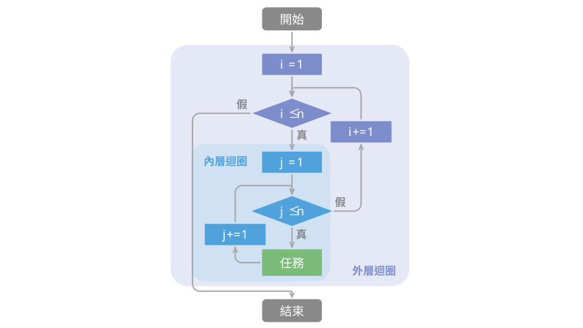
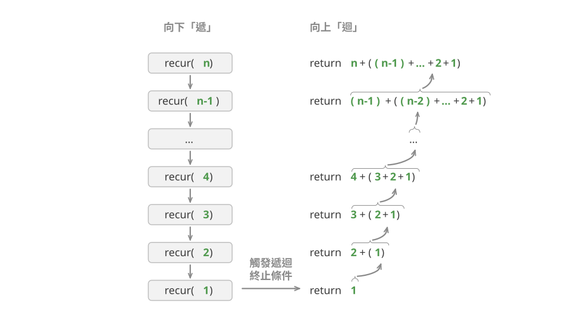
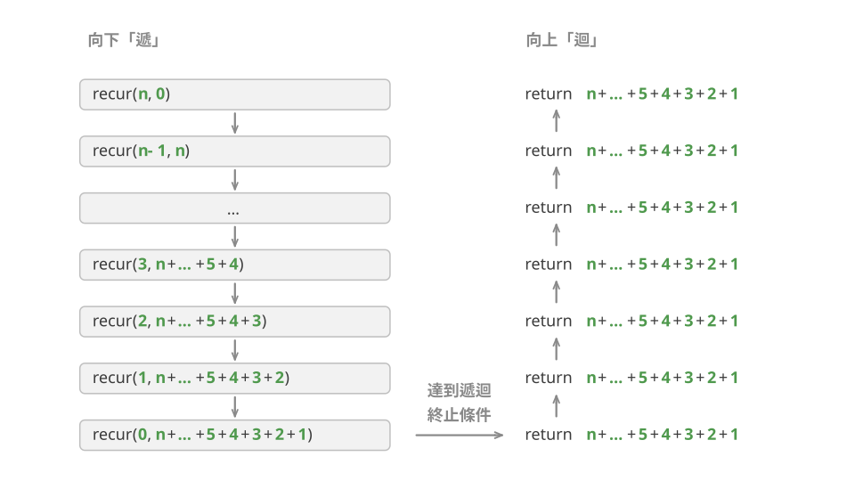
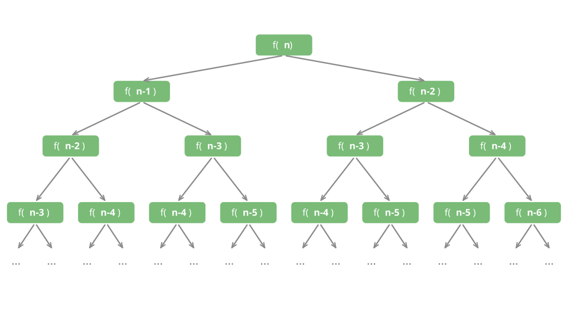

# 2.2 &nbsp; 迭代與遞迴

演算法經常需要重複執行某項任務，重複的方式也與複雜度分析密切相關。因此，在介紹時間複雜度與空間複雜度之前，我們先認識兩種能讓程式重複執行任務的基本控制結構：迭代與遞迴。

## 2.2.1 &nbsp; 迭代

<u>迭代（iteration）</u> 是一種重複執行任務的控制結構。在迭代過程中，只要條件成立，程式就會重複執行某段程式碼，直到條件不再成立。

### 1. &nbsp; for 迴圈

`for` 迴圈是最常見的迭代形式之一，**適合在事先知道迭代次數時使用**。

以下函式以 `for` 迴圈計算 $1 + 2 + \dots + n$，並將總和記錄在變數 `res` 中。請留意，Python 的 `range(a, b)` 採用「左閉右開」區間，依序走訪的值為 $a, a + 1, \dots, b-1$：

=== "Python"

    ```python title="iteration.py"
    def for_loop(n: int) -> int:
        """for 迴圈"""
        res = 0
        # 迴圈加總 1, 2, ..., n-1, n
        for i in range(1, n + 1):
            res += i
        return res
    ```

=== "C++"

    ```cpp title="iteration.cpp"
    /* for 迴圈 */
    int forLoop(int n) {
        int res = 0;
        // 迴圈加總 1, 2, ..., n-1, n
        for (int i = 1; i <= n; ++i) {
            res += i;
        }
        return res;
    }
    ```

=== "Java"

    ```java title="iteration.java"
    /* for 迴圈 */
    int forLoop(int n) {
        int res = 0;
        // 迴圈加總 1, 2, ..., n-1, n
        for (int i = 1; i <= n; i++) {
            res += i;
        }
        return res;
    }
    ```

=== "C#"

    ```csharp title="iteration.cs"
    /* for 迴圈 */
    int ForLoop(int n) {
        int res = 0;
        // 迴圈加總 1, 2, ..., n-1, n
        for (int i = 1; i <= n; i++) {
            res += i;
        }
        return res;
    }
    ```

=== "Go"

    ```go title="iteration.go"
    /* for 迴圈 */
    func forLoop(n int) int {
        res := 0
        // 迴圈加總 1, 2, ..., n-1, n
        for i := 1; i <= n; i++ {
            res += i
        }
        return res
    }
    ```

=== "Swift"

    ```swift title="iteration.swift"
    /* for 迴圈 */
    func forLoop(n: Int) -> Int {
        var res = 0
        // 迴圈加總 1, 2, ..., n-1, n
        for i in 1 ... n {
            res += i
        }
        return res
    }
    ```

=== "JS"

    ```javascript title="iteration.js"
    /* for 迴圈 */
    function forLoop(n) {
        let res = 0;
        // 迴圈加總 1, 2, ..., n-1, n
        for (let i = 1; i <= n; i++) {
            res += i;
        }
        return res;
    }
    ```

=== "TS"

    ```typescript title="iteration.ts"
    /* for 迴圈 */
    function forLoop(n: number): number {
        let res = 0;
        // 迴圈加總 1, 2, ..., n-1, n
        for (let i = 1; i <= n; i++) {
            res += i;
        }
        return res;
    }
    ```

=== "Dart"

    ```dart title="iteration.dart"
    /* for 迴圈 */
    int forLoop(int n) {
      int res = 0;
      // 迴圈加總 1, 2, ..., n-1, n
      for (int i = 1; i <= n; i++) {
        res += i;
      }
      return res;
    }
    ```

=== "Rust"

    ```rust title="iteration.rs"
    /* for 迴圈 */
    fn for_loop(n: i32) -> i32 {
        let mut res = 0;
        // 迴圈加總 1, 2, ..., n-1, n
        for i in 1..=n {
            res += i;
        }
        res
    }
    ```

=== "C"

    ```c title="iteration.c"
    /* for 迴圈 */
    int forLoop(int n) {
        int res = 0;
        // 迴圈加總 1, 2, ..., n-1, n
        for (int i = 1; i <= n; i++) {
            res += i;
        }
        return res;
    }
    ```

=== "Kotlin"

    ```kotlin title="iteration.kt"
    /* for 迴圈 */
    fun forLoop(n: Int): Int {
        var res = 0
        // 迴圈加總 1, 2, ..., n-1, n
        for (i in 1..n) {
            res += i
        }
        return res
    }
    ```

=== "Ruby"

    ```ruby title="iteration.rb"
    ### for 迴圈 ###
    def for_loop(n)
      res = 0

      # 迴圈加總 1, 2, ..., n-1, n
      for i in 1..n
        res += i
      end

      res
    end
    ```

??? pythontutor "執行視覺化示範"

    <div style="height: 423px; width: 100%;"><iframe class="pythontutor-iframe" title="執行視覺化示範" src="https://pythontutor.com/iframe-embed.html#code=def%20for_loop%28n%3A%20int%29%20-%3E%20int%3A%0A%20%20%20%20%22%22%22for%20%E8%BF%B4%E5%9C%88%22%22%22%0A%20%20%20%20res%20%3D%200%0A%20%20%20%20%23%20%E8%BF%B4%E5%9C%88%E5%8A%A0%E7%B8%BD%201,%202,%20...,%20n-1,%20n%0A%20%20%20%20for%20i%20in%20range%281,%20n%20%2B%201%29%3A%0A%20%20%20%20%20%20%20%20res%20%2B%3D%20i%0A%20%20%20%20return%20res%0A%0A%22%22%22Driver%20Code%22%22%22%0Aif%20__name__%20%3D%3D%20%22__main__%22%3A%0A%20%20%20%20n%20%3D%205%0A%20%20%20%20res%20%3D%20for_loop%28n%29%0A%20%20%20%20print%28f%22%5Cnfor%20%E8%BF%B4%E5%9C%88%E7%9A%84%E7%B8%BD%E5%92%8C%20res%20%3D%20%7Bres%7D%22%29&codeDivHeight=472&codeDivWidth=350&cumulative=false&curInstr=3&heapPrimitives=nevernest&origin=opt-frontend.js&py=311&rawInputLstJSON=%5B%5D&"> </iframe></div>
    <div style="margin-top: 5px;"><a href="https://pythontutor.com/iframe-embed.html#code=def%20for_loop%28n%3A%20int%29%20-%3E%20int%3A%0A%20%20%20%20%22%22%22for%20%E8%BF%B4%E5%9C%88%22%22%22%0A%20%20%20%20res%20%3D%200%0A%20%20%20%20%23%20%E8%BF%B4%E5%9C%88%E5%8A%A0%E7%B8%BD%201,%202,%20...,%20n-1,%20n%0A%20%20%20%20for%20i%20in%20range%281,%20n%20%2B%201%29%3A%0A%20%20%20%20%20%20%20%20res%20%2B%3D%20i%0A%20%20%20%20return%20res%0A%0A%22%22%22Driver%20Code%22%22%22%0Aif%20__name__%20%3D%3D%20%22__main__%22%3A%0A%20%20%20%20n%20%3D%205%0A%20%20%20%20res%20%3D%20for_loop%28n%29%0A%20%20%20%20print%28f%22%5Cnfor%20%E8%BF%B4%E5%9C%88%E7%9A%84%E7%B8%BD%E5%92%8C%20res%20%3D%20%7Bres%7D%22%29&codeDivHeight=800&codeDivWidth=600&cumulative=false&curInstr=3&heapPrimitives=nevernest&origin=opt-frontend.js&py=311&rawInputLstJSON=%5B%5D&" target="_blank" rel="noopener noreferrer">全螢幕觀看 ></a></div>

圖 2-1 是這個求和函式的流程圖。

{ class="animation-figure" }

<p align="center"> 圖 2-1 &nbsp; 求和函式的流程圖 </p>

這個求和函式的操作次數與輸入資料大小 $n$ 成正比，也就是呈「線性關係」。在這個例子中，**時間複雜度描述的正是這種線性關係**，下一節會詳細介紹。

### 2. &nbsp; while 迴圈

和 `for` 迴圈一樣，`while` 迴圈也可以實作迭代。`while` 迴圈每一輪都會先檢查條件，條件成立就繼續執行，否則結束迴圈。

以下用 `while` 迴圈計算 $1 + 2 + \dots + n$：

=== "Python"

    ```python title="iteration.py"
    def while_loop(n: int) -> int:
        """while 迴圈"""
        res = 0
        i = 1  # 初始化條件變數
        # 迴圈加總 1, 2, ..., n-1, n
        while i <= n:
            res += i
            i += 1  # 更新條件變數
        return res
    ```

=== "C++"

    ```cpp title="iteration.cpp"
    /* while 迴圈 */
    int whileLoop(int n) {
        int res = 0;
        int i = 1; // 初始化條件變數
        // 迴圈加總 1, 2, ..., n-1, n
        while (i <= n) {
            res += i;
            i++; // 更新條件變數
        }
        return res;
    }
    ```

=== "Java"

    ```java title="iteration.java"
    /* while 迴圈 */
    int whileLoop(int n) {
        int res = 0;
        int i = 1; // 初始化條件變數
        // 迴圈加總 1, 2, ..., n-1, n
        while (i <= n) {
            res += i;
            i++; // 更新條件變數
        }
        return res;
    }
    ```

=== "C#"

    ```csharp title="iteration.cs"
    /* while 迴圈 */
    int WhileLoop(int n) {
        int res = 0;
        int i = 1; // 初始化條件變數
        // 迴圈加總 1, 2, ..., n-1, n
        while (i <= n) {
            res += i;
            i += 1; // 更新條件變數
        }
        return res;
    }
    ```

=== "Go"

    ```go title="iteration.go"
    /* while 迴圈 */
    func whileLoop(n int) int {
        res := 0
        // 初始化條件變數
        i := 1
        // 迴圈加總 1, 2, ..., n-1, n
        for i <= n {
            res += i
            // 更新條件變數
            i++
        }
        return res
    }
    ```

=== "Swift"

    ```swift title="iteration.swift"
    /* while 迴圈 */
    func whileLoop(n: Int) -> Int {
        var res = 0
        var i = 1 // 初始化條件變數
        // 迴圈加總 1, 2, ..., n-1, n
        while i <= n {
            res += i
            i += 1 // 更新條件變數
        }
        return res
    }
    ```

=== "JS"

    ```javascript title="iteration.js"
    /* while 迴圈 */
    function whileLoop(n) {
        let res = 0;
        let i = 1; // 初始化條件變數
        // 迴圈加總 1, 2, ..., n-1, n
        while (i <= n) {
            res += i;
            i++; // 更新條件變數
        }
        return res;
    }
    ```

=== "TS"

    ```typescript title="iteration.ts"
    /* while 迴圈 */
    function whileLoop(n: number): number {
        let res = 0;
        let i = 1; // 初始化條件變數
        // 迴圈加總 1, 2, ..., n-1, n
        while (i <= n) {
            res += i;
            i++; // 更新條件變數
        }
        return res;
    }
    ```

=== "Dart"

    ```dart title="iteration.dart"
    /* while 迴圈 */
    int whileLoop(int n) {
      int res = 0;
      int i = 1; // 初始化條件變數
      // 迴圈加總 1, 2, ..., n-1, n
      while (i <= n) {
        res += i;
        i++; // 更新條件變數
      }
      return res;
    }
    ```

=== "Rust"

    ```rust title="iteration.rs"
    /* while 迴圈 */
    fn while_loop(n: i32) -> i32 {
        let mut res = 0;
        let mut i = 1; // 初始化條件變數

        // 迴圈加總 1, 2, ..., n-1, n
        while i <= n {
            res += i;
            i += 1; // 更新條件變數
        }
        res
    }
    ```

=== "C"

    ```c title="iteration.c"
    /* while 迴圈 */
    int whileLoop(int n) {
        int res = 0;
        int i = 1; // 初始化條件變數
        // 迴圈加總 1, 2, ..., n-1, n
        while (i <= n) {
            res += i;
            i++; // 更新條件變數
        }
        return res;
    }
    ```

=== "Kotlin"

    ```kotlin title="iteration.kt"
    /* while 迴圈 */
    fun whileLoop(n: Int): Int {
        var res = 0
        var i = 1 // 初始化條件變數
        // 迴圈加總 1, 2, ..., n-1, n
        while (i <= n) {
            res += i
            i++ // 更新條件變數
        }
        return res
    }
    ```

=== "Ruby"

    ```ruby title="iteration.rb"
    ### while 迴圈 ###
    def while_loop(n)
      res = 0
      i = 1 # 初始化條件變數

      # 迴圈加總 1, 2, ..., n-1, n
      while i <= n
        res += i
        i += 1 # 更新條件變數
      end

      res
    end
    ```

??? pythontutor "執行視覺化示範"

    <div style="height: 459px; width: 100%;"><iframe class="pythontutor-iframe" title="執行視覺化示範" src="https://pythontutor.com/iframe-embed.html#code=def%20while_loop%28n%3A%20int%29%20-%3E%20int%3A%0A%20%20%20%20%22%22%22while%20%E8%BF%B4%E5%9C%88%22%22%22%0A%20%20%20%20res%20%3D%200%0A%20%20%20%20i%20%3D%201%20%20%23%20%E5%88%9D%E5%A7%8B%E5%8C%96%E6%A2%9D%E4%BB%B6%E8%AE%8A%E6%95%B8%0A%20%20%20%20%23%20%E8%BF%B4%E5%9C%88%E5%8A%A0%E7%B8%BD%201,%202,%20...,%20n-1,%20n%0A%20%20%20%20while%20i%20%3C%3D%20n%3A%0A%20%20%20%20%20%20%20%20res%20%2B%3D%20i%0A%20%20%20%20%20%20%20%20i%20%2B%3D%201%20%20%23%20%E6%9B%B4%E6%96%B0%E6%A2%9D%E4%BB%B6%E8%AE%8A%E6%95%B8%0A%20%20%20%20return%20res%0A%0A%22%22%22Driver%20Code%22%22%22%0Aif%20__name__%20%3D%3D%20%22__main__%22%3A%0A%20%20%20%20n%20%3D%205%0A%20%20%20%20res%20%3D%20while_loop%28n%29%0A%20%20%20%20print%28f%22%5Cnwhile%20%E8%BF%B4%E5%9C%88%E7%9A%84%E7%B8%BD%E5%92%8C%20res%20%3D%20%7Bres%7D%22%29&codeDivHeight=472&codeDivWidth=350&cumulative=false&curInstr=3&heapPrimitives=nevernest&origin=opt-frontend.js&py=311&rawInputLstJSON=%5B%5D&textReferences=false"> </iframe></div>
    <div style="margin-top: 5px;"><a href="https://pythontutor.com/iframe-embed.html#code=def%20while_loop%28n%3A%20int%29%20-%3E%20int%3A%0A%20%20%20%20%22%22%22while%20%E8%BF%B4%E5%9C%88%22%22%22%0A%20%20%20%20res%20%3D%200%0A%20%20%20%20i%20%3D%201%20%20%23%20%E5%88%9D%E5%A7%8B%E5%8C%96%E6%A2%9D%E4%BB%B6%E8%AE%8A%E6%95%B8%0A%20%20%20%20%23%20%E8%BF%B4%E5%9C%88%E5%8A%A0%E7%B8%BD%201,%202,%20...,%20n-1,%20n%0A%20%20%20%20while%20i%20%3C%3D%20n%3A%0A%20%20%20%20%20%20%20%20res%20%2B%3D%20i%0A%20%20%20%20%20%20%20%20i%20%2B%3D%201%20%20%23%20%E6%9B%B4%E6%96%B0%E6%A2%9D%E4%BB%B6%E8%AE%8A%E6%95%B8%0A%20%20%20%20return%20res%0A%0A%22%22%22Driver%20Code%22%22%22%0Aif%20__name__%20%3D%3D%20%22__main__%22%3A%0A%20%20%20%20n%20%3D%205%0A%20%20%20%20res%20%3D%20while_loop%28n%29%0A%20%20%20%20print%28f%22%5Cnwhile%20%E8%BF%B4%E5%9C%88%E7%9A%84%E7%B8%BD%E5%92%8C%20res%20%3D%20%7Bres%7D%22%29&codeDivHeight=800&codeDivWidth=600&cumulative=false&curInstr=3&heapPrimitives=nevernest&origin=opt-frontend.js&py=311&rawInputLstJSON=%5B%5D&textReferences=false" target="_blank" rel="noopener noreferrer">全螢幕觀看 ></a></div>

**`while` 迴圈比 `for` 迴圈更有彈性**。使用 `while` 迴圈時，我們可以自行設計條件變數的初值及更新方式。

例如，在以下程式碼中，條件變數 $i$ 每一輪都會更新兩次，這種情況用 `for` 迴圈來寫就不太方便：

=== "Python"

    ```python title="iteration.py"
    def while_loop_ii(n: int) -> int:
        """while 迴圈（更新兩次）"""
        res = 0
        i = 1  # 初始化條件變數
        # 迴圈加總 1, 4, 10, ...
        while i <= n:
            res += i
            # 更新條件變數
            i += 1
            i *= 2
        return res
    ```

=== "C++"

    ```cpp title="iteration.cpp"
    /* while 迴圈（更新兩次） */
    int whileLoopII(int n) {
        int res = 0;
        int i = 1; // 初始化條件變數
        // 迴圈加總 1, 4, 10, ...
        while (i <= n) {
            res += i;
            // 更新條件變數
            i++;
            i *= 2;
        }
        return res;
    }
    ```

=== "Java"

    ```java title="iteration.java"
    /* while 迴圈（更新兩次） */
    int whileLoopII(int n) {
        int res = 0;
        int i = 1; // 初始化條件變數
        // 迴圈加總 1, 4, 10, ...
        while (i <= n) {
            res += i;
            // 更新條件變數
            i++;
            i *= 2;
        }
        return res;
    }
    ```

=== "C#"

    ```csharp title="iteration.cs"
    /* while 迴圈（更新兩次） */
    int WhileLoopII(int n) {
        int res = 0;
        int i = 1; // 初始化條件變數
        // 迴圈加總 1, 4, 10, ...
        while (i <= n) {
            res += i;
            // 更新條件變數
            i += 1; 
            i *= 2;
        }
        return res;
    }
    ```

=== "Go"

    ```go title="iteration.go"
    /* while 迴圈（更新兩次） */
    func whileLoopII(n int) int {
        res := 0
        // 初始化條件變數
        i := 1
        // 迴圈加總 1, 4, 10, ...
        for i <= n {
            res += i
            // 更新條件變數
            i++
            i *= 2
        }
        return res
    }
    ```

=== "Swift"

    ```swift title="iteration.swift"
    /* while 迴圈（更新兩次） */
    func whileLoopII(n: Int) -> Int {
        var res = 0
        var i = 1 // 初始化條件變數
        // 迴圈加總 1, 4, 10, ...
        while i <= n {
            res += i
            // 更新條件變數
            i += 1
            i *= 2
        }
        return res
    }
    ```

=== "JS"

    ```javascript title="iteration.js"
    /* while 迴圈（更新兩次） */
    function whileLoopII(n) {
        let res = 0;
        let i = 1; // 初始化條件變數
        // 迴圈加總 1, 4, 10, ...
        while (i <= n) {
            res += i;
            // 更新條件變數
            i++;
            i *= 2;
        }
        return res;
    }
    ```

=== "TS"

    ```typescript title="iteration.ts"
    /* while 迴圈（更新兩次） */
    function whileLoopII(n: number): number {
        let res = 0;
        let i = 1; // 初始化條件變數
        // 迴圈加總 1, 4, 10, ...
        while (i <= n) {
            res += i;
            // 更新條件變數
            i++;
            i *= 2;
        }
        return res;
    }
    ```

=== "Dart"

    ```dart title="iteration.dart"
    /* while 迴圈（更新兩次） */
    int whileLoopII(int n) {
      int res = 0;
      int i = 1; // 初始化條件變數
      // 迴圈加總 1, 4, 10, ...
      while (i <= n) {
        res += i;
        // 更新條件變數
        i++;
        i *= 2;
      }
      return res;
    }
    ```

=== "Rust"

    ```rust title="iteration.rs"
    /* while 迴圈（更新兩次） */
    fn while_loop_ii(n: i32) -> i32 {
        let mut res = 0;
        let mut i = 1; // 初始化條件變數

        // 迴圈加總 1, 4, 10, ...
        while i <= n {
            res += i;
            // 更新條件變數
            i += 1;
            i *= 2;
        }
        res
    }
    ```

=== "C"

    ```c title="iteration.c"
    /* while 迴圈（更新兩次） */
    int whileLoopII(int n) {
        int res = 0;
        int i = 1; // 初始化條件變數
        // 迴圈加總 1, 4, 10, ...
        while (i <= n) {
            res += i;
            // 更新條件變數
            i++;
            i *= 2;
        }
        return res;
    }
    ```

=== "Kotlin"

    ```kotlin title="iteration.kt"
    /* while 迴圈（更新兩次） */
    fun whileLoopII(n: Int): Int {
        var res = 0
        var i = 1 // 初始化條件變數
        // 迴圈加總 1, 4, 10, ...
        while (i <= n) {
            res += i
            // 更新條件變數
            i++
            i *= 2
        }
        return res
    }
    ```

=== "Ruby"

    ```ruby title="iteration.rb"
    ### while 迴圈（更新兩次）###
    def while_loop_ii(n)
      res = 0
      i = 1 # 初始化條件變數

      # 迴圈加總 1, 4, 10, ...
      while i <= n
        res += i
        # 更新條件變數
        i += 1
        i *= 2
      end

      res
    end
    ```

??? pythontutor "執行視覺化示範"

    <div style="height: 495px; width: 100%;"><iframe class="pythontutor-iframe" title="執行視覺化示範" src="https://pythontutor.com/iframe-embed.html#code=def%20while_loop_ii%28n%3A%20int%29%20-%3E%20int%3A%0A%20%20%20%20%22%22%22while%20%E8%BF%B4%E5%9C%88%EF%BC%88%E6%9B%B4%E6%96%B0%E5%85%A9%E6%AC%A1%EF%BC%89%22%22%22%0A%20%20%20%20res%20%3D%200%0A%20%20%20%20i%20%3D%201%20%20%23%20%E5%88%9D%E5%A7%8B%E5%8C%96%E6%A2%9D%E4%BB%B6%E8%AE%8A%E6%95%B8%0A%20%20%20%20%23%20%E8%BF%B4%E5%9C%88%E5%8A%A0%E7%B8%BD%201,%204,%2010,%20...%0A%20%20%20%20while%20i%20%3C%3D%20n%3A%0A%20%20%20%20%20%20%20%20res%20%2B%3D%20i%0A%20%20%20%20%20%20%20%20%23%20%E6%9B%B4%E6%96%B0%E6%A2%9D%E4%BB%B6%E8%AE%8A%E6%95%B8%0A%20%20%20%20%20%20%20%20i%20%2B%3D%201%0A%20%20%20%20%20%20%20%20i%20%2A%3D%202%0A%20%20%20%20return%20res%0A%0A%22%22%22Driver%20Code%22%22%22%0Aif%20__name__%20%3D%3D%20%22__main__%22%3A%0A%20%20%20%20n%20%3D%205%0A%20%20%20%20res%20%3D%20while_loop_ii%28n%29%0A%20%20%20%20print%28f%22%5Cnwhile%20%E8%BF%B4%E5%9C%88%EF%BC%88%E6%9B%B4%E6%96%B0%E5%85%A9%E6%AC%A1%EF%BC%89%E7%9A%84%E7%B8%BD%E5%92%8C%20res%20%3D%20%7Bres%7D%22%29&codeDivHeight=472&codeDivWidth=350&cumulative=false&curInstr=3&heapPrimitives=nevernest&origin=opt-frontend.js&py=311&rawInputLstJSON=%5B%5D&textReferences=false"> </iframe></div>
    <div style="margin-top: 5px;"><a href="https://pythontutor.com/iframe-embed.html#code=def%20while_loop_ii%28n%3A%20int%29%20-%3E%20int%3A%0A%20%20%20%20%22%22%22while%20%E8%BF%B4%E5%9C%88%EF%BC%88%E6%9B%B4%E6%96%B0%E5%85%A9%E6%AC%A1%EF%BC%89%22%22%22%0A%20%20%20%20res%20%3D%200%0A%20%20%20%20i%20%3D%201%20%20%23%20%E5%88%9D%E5%A7%8B%E5%8C%96%E6%A2%9D%E4%BB%B6%E8%AE%8A%E6%95%B8%0A%20%20%20%20%23%20%E8%BF%B4%E5%9C%88%E5%8A%A0%E7%B8%BD%201,%204,%2010,%20...%0A%20%20%20%20while%20i%20%3C%3D%20n%3A%0A%20%20%20%20%20%20%20%20res%20%2B%3D%20i%0A%20%20%20%20%20%20%20%20%23%20%E6%9B%B4%E6%96%B0%E6%A2%9D%E4%BB%B6%E8%AE%8A%E6%95%B8%0A%20%20%20%20%20%20%20%20i%20%2B%3D%201%0A%20%20%20%20%20%20%20%20i%20%2A%3D%202%0A%20%20%20%20return%20res%0A%0A%22%22%22Driver%20Code%22%22%22%0Aif%20__name__%20%3D%3D%20%22__main__%22%3A%0A%20%20%20%20n%20%3D%205%0A%20%20%20%20res%20%3D%20while_loop_ii%28n%29%0A%20%20%20%20print%28f%22%5Cnwhile%20%E8%BF%B4%E5%9C%88%EF%BC%88%E6%9B%B4%E6%96%B0%E5%85%A9%E6%AC%A1%EF%BC%89%E7%9A%84%E7%B8%BD%E5%92%8C%20res%20%3D%20%7Bres%7D%22%29&codeDivHeight=800&codeDivWidth=600&cumulative=false&curInstr=3&heapPrimitives=nevernest&origin=opt-frontend.js&py=311&rawInputLstJSON=%5B%5D&textReferences=false" target="_blank" rel="noopener noreferrer">全螢幕觀看 ></a></div>

整體而言，**`for` 迴圈的程式碼較精簡，`while` 迴圈則較有彈性**。兩者都能實作迭代，應根據問題的需求來選擇。

### 3. &nbsp; 巢狀迴圈

我們可以在一個迴圈裡再寫一個迴圈。以下以 `for` 迴圈為例：

=== "Python"

    ```python title="iteration.py"
    def nested_for_loop(n: int) -> str:
        """雙層 for 迴圈"""
        res = ""
        # 迴圈 i = 1, 2, ..., n-1, n
        for i in range(1, n + 1):
            # 迴圈 j = 1, 2, ..., n-1, n
            for j in range(1, n + 1):
                res += f"({i}, {j}), "
        return res
    ```

=== "C++"

    ```cpp title="iteration.cpp"
    /* 雙層 for 迴圈 */
    string nestedForLoop(int n) {
        ostringstream res;
        // 迴圈 i = 1, 2, ..., n-1, n
        for (int i = 1; i <= n; ++i) {
            // 迴圈 j = 1, 2, ..., n-1, n
            for (int j = 1; j <= n; ++j) {
                res << "(" << i << ", " << j << "), ";
            }
        }
        return res.str();
    }
    ```

=== "Java"

    ```java title="iteration.java"
    /* 雙層 for 迴圈 */
    String nestedForLoop(int n) {
        StringBuilder res = new StringBuilder();
        // 迴圈 i = 1, 2, ..., n-1, n
        for (int i = 1; i <= n; i++) {
            // 迴圈 j = 1, 2, ..., n-1, n
            for (int j = 1; j <= n; j++) {
                res.append("(" + i + ", " + j + "), ");
            }
        }
        return res.toString();
    }
    ```

=== "C#"

    ```csharp title="iteration.cs"
    /* 雙層 for 迴圈 */
    string NestedForLoop(int n) {
        StringBuilder res = new();
        // 迴圈 i = 1, 2, ..., n-1, n
        for (int i = 1; i <= n; i++) {
            // 迴圈 j = 1, 2, ..., n-1, n
            for (int j = 1; j <= n; j++) {
                res.Append($"({i}, {j}), ");
            }
        }
        return res.ToString();
    }
    ```

=== "Go"

    ```go title="iteration.go"
    /* 雙層 for 迴圈 */
    func nestedForLoop(n int) string {
        res := ""
        // 迴圈 i = 1, 2, ..., n-1, n
        for i := 1; i <= n; i++ {
            for j := 1; j <= n; j++ {
                // 迴圈 j = 1, 2, ..., n-1, n
                res += fmt.Sprintf("(%d, %d), ", i, j)
            }
        }
        return res
    }
    ```

=== "Swift"

    ```swift title="iteration.swift"
    /* 雙層 for 迴圈 */
    func nestedForLoop(n: Int) -> String {
        var res = ""
        // 迴圈 i = 1, 2, ..., n-1, n
        for i in 1 ... n {
            // 迴圈 j = 1, 2, ..., n-1, n
            for j in 1 ... n {
                res.append("(\(i), \(j)), ")
            }
        }
        return res
    }
    ```

=== "JS"

    ```javascript title="iteration.js"
    /* 雙層 for 迴圈 */
    function nestedForLoop(n) {
        let res = '';
        // 迴圈 i = 1, 2, ..., n-1, n
        for (let i = 1; i <= n; i++) {
            // 迴圈 j = 1, 2, ..., n-1, n
            for (let j = 1; j <= n; j++) {
                res += `(${i}, ${j}), `;
            }
        }
        return res;
    }
    ```

=== "TS"

    ```typescript title="iteration.ts"
    /* 雙層 for 迴圈 */
    function nestedForLoop(n: number): string {
        let res = '';
        // 迴圈 i = 1, 2, ..., n-1, n
        for (let i = 1; i <= n; i++) {
            // 迴圈 j = 1, 2, ..., n-1, n
            for (let j = 1; j <= n; j++) {
                res += `(${i}, ${j}), `;
            }
        }
        return res;
    }
    ```

=== "Dart"

    ```dart title="iteration.dart"
    /* 雙層 for 迴圈 */
    String nestedForLoop(int n) {
      String res = "";
      // 迴圈 i = 1, 2, ..., n-1, n
      for (int i = 1; i <= n; i++) {
        // 迴圈 j = 1, 2, ..., n-1, n
        for (int j = 1; j <= n; j++) {
          res += "($i, $j), ";
        }
      }
      return res;
    }
    ```

=== "Rust"

    ```rust title="iteration.rs"
    /* 雙層 for 迴圈 */
    fn nested_for_loop(n: i32) -> String {
        let mut res = vec![];
        // 迴圈 i = 1, 2, ..., n-1, n
        for i in 1..=n {
            // 迴圈 j = 1, 2, ..., n-1, n
            for j in 1..=n {
                res.push(format!("({}, {}), ", i, j));
            }
        }
        res.join("")
    }
    ```

=== "C"

    ```c title="iteration.c"
    /* 雙層 for 迴圈 */
    char *nestedForLoop(int n) {
        // 共有 n * n 個點，每個點的字串 "(i, j), " 最長為 6+10*2，最後還要預留一個空字元 \0 的空間
        int size = n * n * 26 + 1;
        char *res = malloc(size * sizeof(char));
        // 迴圈 i = 1, 2, ..., n-1, n
        for (int i = 1; i <= n; i++) {
            // 迴圈 j = 1, 2, ..., n-1, n
            for (int j = 1; j <= n; j++) {
                char tmp[26];
                snprintf(tmp, sizeof(tmp), "(%d, %d), ", i, j);
                strncat(res, tmp, size - strlen(res) - 1);
            }
        }
        return res;
    }
    ```

=== "Kotlin"

    ```kotlin title="iteration.kt"
    /* 雙層 for 迴圈 */
    fun nestedForLoop(n: Int): String {
        val res = StringBuilder()
        // 迴圈 i = 1, 2, ..., n-1, n
        for (i in 1..n) {
            // 迴圈 j = 1, 2, ..., n-1, n
            for (j in 1..n) {
                res.append(" ($i, $j), ")
            }
        }
        return res.toString()
    }
    ```

=== "Ruby"

    ```ruby title="iteration.rb"
    ### 雙層 for 迴圈 ###
    def nested_for_loop(n)
      res = ""

      # 迴圈 i = 1, 2, ..., n-1, n
      for i in 1..n
        # 迴圈 j = 1, 2, ..., n-1, n
        for j in 1..n
          res += "(#{i}, #{j}), "
        end
      end

      res
    end
    ```

??? pythontutor "執行視覺化示範"

    <div style="height: 459px; width: 100%;"><iframe class="pythontutor-iframe" title="執行視覺化示範" src="https://pythontutor.com/iframe-embed.html#code=def%20nested_for_loop%28n%3A%20int%29%20-%3E%20str%3A%0A%20%20%20%20%22%22%22%E9%9B%99%E5%B1%A4%20for%20%E8%BF%B4%E5%9C%88%22%22%22%0A%20%20%20%20res%20%3D%20%22%22%0A%20%20%20%20%23%20%E8%BF%B4%E5%9C%88%20i%20%3D%201,%202,%20...,%20n-1,%20n%0A%20%20%20%20for%20i%20in%20range%281,%20n%20%2B%201%29%3A%0A%20%20%20%20%20%20%20%20%23%20%E8%BF%B4%E5%9C%88%20j%20%3D%201,%202,%20...,%20n-1,%20n%0A%20%20%20%20%20%20%20%20for%20j%20in%20range%281,%20n%20%2B%201%29%3A%0A%20%20%20%20%20%20%20%20%20%20%20%20res%20%2B%3D%20f%22%28%7Bi%7D,%20%7Bj%7D%29,%20%22%0A%20%20%20%20return%20res%0A%0A%22%22%22Driver%20Code%22%22%22%0Aif%20__name__%20%3D%3D%20%22__main__%22%3A%0A%20%20%20%20n%20%3D%205%0A%20%20%20%20res%20%3D%20nested_for_loop%28n%29%0A%20%20%20%20print%28f%22%5Cn%E9%9B%99%E5%B1%A4%20for%20%E8%BF%B4%E5%9C%88%E8%B5%B0%E8%A8%AA%E7%9A%84%E7%B5%90%E6%9E%9C%20%7Bres%7D%22%29&codeDivHeight=472&codeDivWidth=350&cumulative=false&curInstr=3&heapPrimitives=nevernest&origin=opt-frontend.js&py=311&rawInputLstJSON=%5B%5D&textReferences=false"> </iframe></div>
    <div style="margin-top: 5px;"><a href="https://pythontutor.com/iframe-embed.html#code=def%20nested_for_loop%28n%3A%20int%29%20-%3E%20str%3A%0A%20%20%20%20%22%22%22%E9%9B%99%E5%B1%A4%20for%20%E8%BF%B4%E5%9C%88%22%22%22%0A%20%20%20%20res%20%3D%20%22%22%0A%20%20%20%20%23%20%E8%BF%B4%E5%9C%88%20i%20%3D%201,%202,%20...,%20n-1,%20n%0A%20%20%20%20for%20i%20in%20range%281,%20n%20%2B%201%29%3A%0A%20%20%20%20%20%20%20%20%23%20%E8%BF%B4%E5%9C%88%20j%20%3D%201,%202,%20...,%20n-1,%20n%0A%20%20%20%20%20%20%20%20for%20j%20in%20range%281,%20n%20%2B%201%29%3A%0A%20%20%20%20%20%20%20%20%20%20%20%20res%20%2B%3D%20f%22%28%7Bi%7D,%20%7Bj%7D%29,%20%22%0A%20%20%20%20return%20res%0A%0A%22%22%22Driver%20Code%22%22%22%0Aif%20__name__%20%3D%3D%20%22__main__%22%3A%0A%20%20%20%20n%20%3D%205%0A%20%20%20%20res%20%3D%20nested_for_loop%28n%29%0A%20%20%20%20print%28f%22%5Cn%E9%9B%99%E5%B1%A4%20for%20%E8%BF%B4%E5%9C%88%E8%B5%B0%E8%A8%AA%E7%9A%84%E7%B5%90%E6%9E%9C%20%7Bres%7D%22%29&codeDivHeight=800&codeDivWidth=600&cumulative=false&curInstr=3&heapPrimitives=nevernest&origin=opt-frontend.js&py=311&rawInputLstJSON=%5B%5D&textReferences=false" target="_blank" rel="noopener noreferrer">全螢幕觀看 ></a></div>

圖 2-2 是這個巢狀迴圈的流程圖。

{ class="animation-figure" }

<p align="center"> 圖 2-2 &nbsp; 巢狀迴圈的流程圖 </p>

在這種情況下，函式的操作次數與 $n^2$ 成正比，換句話說，演算法的執行時間與輸入資料大小 $n$ 呈「平方關係」。

我們可以繼續增加迴圈的層數。每多一層就像多了一個維度，時間複雜度會依序提高為「三次方關係」、「四次方關係」，以此類推。

## 2.2.2 &nbsp; 遞迴

 <u>遞迴（recursion）</u> 是透過函式呼叫自身來解決問題的演算法策略，主要分為兩個階段。

1. **遞**：程式逐層呼叫自身，通常傳入較小或較簡單的參數，直到滿足「終止條件」。
2. **迴**：滿足「終止條件」後，程式從最深一層的遞迴呼叫逐層回傳，彙整各層的結果。

從實作的角度來看，遞迴程式碼主要有三個要素。

1. **終止條件**：決定何時從「遞」轉為「迴」。
2. **遞迴呼叫**：對應「遞」，函式呼叫自身，通常傳入較小或較簡單的參數。
3. **回傳結果**：對應「迴」，將這一層遞迴的結果傳回上一層。

在以下程式碼中，只要呼叫函式 `recur(n)`，就能算出 $1 + 2 + \dots + n$：

=== "Python"

    ```python title="recursion.py"
    def recur(n: int) -> int:
        """遞迴"""
        # 終止條件
        if n == 1:
            return 1
        # 遞：遞迴呼叫
        res = recur(n - 1)
        # 迴：回傳結果
        return n + res
    ```

=== "C++"

    ```cpp title="recursion.cpp"
    /* 遞迴 */
    int recur(int n) {
        // 終止條件
        if (n == 1)
            return 1;
        // 遞：遞迴呼叫
        int res = recur(n - 1);
        // 迴：回傳結果
        return n + res;
    }
    ```

=== "Java"

    ```java title="recursion.java"
    /* 遞迴 */
    int recur(int n) {
        // 終止條件
        if (n == 1)
            return 1;
        // 遞：遞迴呼叫
        int res = recur(n - 1);
        // 迴：回傳結果
        return n + res;
    }
    ```

=== "C#"

    ```csharp title="recursion.cs"
    /* 遞迴 */
    int Recur(int n) {
        // 終止條件
        if (n == 1)
            return 1;
        // 遞：遞迴呼叫
        int res = Recur(n - 1);
        // 迴：回傳結果
        return n + res;
    }
    ```

=== "Go"

    ```go title="recursion.go"
    /* 遞迴 */
    func recur(n int) int {
        // 終止條件
        if n == 1 {
            return 1
        }
        // 遞：遞迴呼叫
        res := recur(n - 1)
        // 迴：回傳結果
        return n + res
    }
    ```

=== "Swift"

    ```swift title="recursion.swift"
    /* 遞迴 */
    func recur(n: Int) -> Int {
        // 終止條件
        if n == 1 {
            return 1
        }
        // 遞：遞迴呼叫
        let res = recur(n: n - 1)
        // 迴：回傳結果
        return n + res
    }
    ```

=== "JS"

    ```javascript title="recursion.js"
    /* 遞迴 */
    function recur(n) {
        // 終止條件
        if (n === 1) return 1;
        // 遞：遞迴呼叫
        const res = recur(n - 1);
        // 迴：回傳結果
        return n + res;
    }
    ```

=== "TS"

    ```typescript title="recursion.ts"
    /* 遞迴 */
    function recur(n: number): number {
        // 終止條件
        if (n === 1) return 1;
        // 遞：遞迴呼叫
        const res = recur(n - 1);
        // 迴：回傳結果
        return n + res;
    }
    ```

=== "Dart"

    ```dart title="recursion.dart"
    /* 遞迴 */
    int recur(int n) {
      // 終止條件
      if (n == 1) return 1;
      // 遞：遞迴呼叫
      int res = recur(n - 1);
      // 迴：回傳結果
      return n + res;
    }
    ```

=== "Rust"

    ```rust title="recursion.rs"
    /* 遞迴 */
    fn recur(n: i32) -> i32 {
        // 終止條件
        if n == 1 {
            return 1;
        }
        // 遞：遞迴呼叫
        let res = recur(n - 1);
        // 迴：回傳結果
        n + res
    }
    ```

=== "C"

    ```c title="recursion.c"
    /* 遞迴 */
    int recur(int n) {
        // 終止條件
        if (n == 1)
            return 1;
        // 遞：遞迴呼叫
        int res = recur(n - 1);
        // 迴：回傳結果
        return n + res;
    }
    ```

=== "Kotlin"

    ```kotlin title="recursion.kt"
    /* 遞迴 */
    fun recur(n: Int): Int {
        // 終止條件
        if (n == 1)
            return 1
        // 遞：遞迴呼叫
        val res = recur(n - 1)
        // 迴：回傳結果
        return n + res
    }
    ```

=== "Ruby"

    ```ruby title="recursion.rb"
    ### 遞迴 ###
    def recur(n)
      # 終止條件
      return 1 if n == 1
      # 遞：遞迴呼叫
      res = recur(n - 1)
      # 迴：回傳結果
      n + res
    end
    ```

??? pythontutor "執行視覺化示範"

    <div style="height: 459px; width: 100%;"><iframe class="pythontutor-iframe" title="執行視覺化示範" src="https://pythontutor.com/iframe-embed.html#code=def%20recur%28n%3A%20int%29%20-%3E%20int%3A%0A%20%20%20%20%22%22%22%E9%81%9E%E8%BF%B4%22%22%22%0A%20%20%20%20%23%20%E7%B5%82%E6%AD%A2%E6%A2%9D%E4%BB%B6%0A%20%20%20%20if%20n%20%3D%3D%201%3A%0A%20%20%20%20%20%20%20%20return%201%0A%20%20%20%20%23%20%E9%81%9E%EF%BC%9A%E9%81%9E%E8%BF%B4%E5%91%BC%E5%8F%AB%0A%20%20%20%20res%20%3D%20recur%28n%20-%201%29%0A%20%20%20%20%23%20%E8%BF%B4%EF%BC%9A%E5%9B%9E%E5%82%B3%E7%B5%90%E6%9E%9C%0A%20%20%20%20return%20n%20%2B%20res%0A%0A%22%22%22Driver%20Code%22%22%22%0Aif%20__name__%20%3D%3D%20%22__main__%22%3A%0A%20%20%20%20n%20%3D%205%0A%20%20%20%20res%20%3D%20recur%28n%29%0A%20%20%20%20print%28f%22%5Cn%E9%81%9E%E8%BF%B4%E5%87%BD%E5%BC%8F%E7%9A%84%E7%B8%BD%E5%92%8C%20res%20%3D%20%7Bres%7D%22%29&codeDivHeight=472&codeDivWidth=350&cumulative=false&curInstr=3&heapPrimitives=nevernest&origin=opt-frontend.js&py=311&rawInputLstJSON=%5B%5D&textReferences=false"> </iframe></div>
    <div style="margin-top: 5px;"><a href="https://pythontutor.com/iframe-embed.html#code=def%20recur%28n%3A%20int%29%20-%3E%20int%3A%0A%20%20%20%20%22%22%22%E9%81%9E%E8%BF%B4%22%22%22%0A%20%20%20%20%23%20%E7%B5%82%E6%AD%A2%E6%A2%9D%E4%BB%B6%0A%20%20%20%20if%20n%20%3D%3D%201%3A%0A%20%20%20%20%20%20%20%20return%201%0A%20%20%20%20%23%20%E9%81%9E%EF%BC%9A%E9%81%9E%E8%BF%B4%E5%91%BC%E5%8F%AB%0A%20%20%20%20res%20%3D%20recur%28n%20-%201%29%0A%20%20%20%20%23%20%E8%BF%B4%EF%BC%9A%E5%9B%9E%E5%82%B3%E7%B5%90%E6%9E%9C%0A%20%20%20%20return%20n%20%2B%20res%0A%0A%22%22%22Driver%20Code%22%22%22%0Aif%20__name__%20%3D%3D%20%22__main__%22%3A%0A%20%20%20%20n%20%3D%205%0A%20%20%20%20res%20%3D%20recur%28n%29%0A%20%20%20%20print%28f%22%5Cn%E9%81%9E%E8%BF%B4%E5%87%BD%E5%BC%8F%E7%9A%84%E7%B8%BD%E5%92%8C%20res%20%3D%20%7Bres%7D%22%29&codeDivHeight=800&codeDivWidth=600&cumulative=false&curInstr=3&heapPrimitives=nevernest&origin=opt-frontend.js&py=311&rawInputLstJSON=%5B%5D&textReferences=false" target="_blank" rel="noopener noreferrer">全螢幕觀看 ></a></div>

圖 2-3 顯示這個函式的遞迴過程。

{ class="animation-figure" }

<p align="center"> 圖 2-3 &nbsp; 求和函式的遞迴過程 </p>

迭代與遞迴雖然可以算出相同的結果，**思考與解決問題的方式卻截然不同**。

- **迭代**：以「由下而上」的方式解決問題。從最基本的步驟開始，反覆執行這些步驟或累加結果，直到完成任務。
- **遞迴**：以「由上而下」的方式解決問題。先把原問題拆成形式相同、規模較小的子問題，再把子問題繼續細分，直到遇到解答已知的基本情況為止。

以上述求和函式為例，設問題為 $f(n) = 1 + 2 + \dots + n$。

- **迭代**：用迴圈模擬求和過程，從 $1$ 走訪到 $n$，每一輪都累加當前的值，就能算出 $f(n)$。
- **遞迴**：將問題拆成子問題 $f(n) = n + f(n-1)$，以遞迴方式持續分解，直到基本情況 $f(1) = 1$ 為止。

### 1. &nbsp; 呼叫堆疊

遞迴函式每呼叫自身一次，系統就會為新的函式呼叫配置記憶體，儲存區域變數、呼叫位址等資訊。這會帶來兩個影響。

- 函式執行時所需的資料都存在稱為「堆疊框架」的記憶體空間中，直到函式回傳後才會釋放。因此，**遞迴通常比迭代占用更多記憶體**。
- 遞迴的函式呼叫也有額外成本，**因此遞迴的時間效率通常比迴圈低**。

如圖 2-4 所示，在觸發終止條件前，共有 $n$ 個遞迴呼叫尚未回傳，**遞迴深度為 $n$**。

{ class="animation-figure" }

<p align="center"> 圖 2-4 &nbsp; 遞迴呼叫的深度 </p>

實務上，程式語言允許的遞迴深度通常有限，遞迴過深可能導致堆疊溢位。

### 2. &nbsp; 尾端遞迴

特別的是，**如果遞迴呼叫是函式回傳前的最後一步**，編譯器或直譯器便有機會將函式最佳化，使其空間效率與迭代相當。這種寫法稱為<u>尾端遞迴（tail recursion）</u>。

- **一般遞迴**：呼叫結果傳回上一層後，上一層還有程式碼要執行，因此系統必須保留上一層呼叫的執行狀態。
- **尾端遞迴**：遞迴呼叫是回傳前的最後一個操作。結果傳回上一層後，上一層沒有其他操作要執行，因此系統無須保留上一層函式的執行狀態。

以計算 $1 + 2 + \dots + n$ 為例，我們可以把儲存結果的變數 `res` 作為函式參數，寫成尾端遞迴：

=== "Python"

    ```python title="recursion.py"
    def tail_recur(n, res):
        """尾端遞迴"""
        # 終止條件
        if n == 0:
            return res
        # 尾端遞迴呼叫
        return tail_recur(n - 1, res + n)
    ```

=== "C++"

    ```cpp title="recursion.cpp"
    /* 尾端遞迴 */
    int tailRecur(int n, int res) {
        // 終止條件
        if (n == 0)
            return res;
        // 尾端遞迴呼叫
        return tailRecur(n - 1, res + n);
    }
    ```

=== "Java"

    ```java title="recursion.java"
    /* 尾端遞迴 */
    int tailRecur(int n, int res) {
        // 終止條件
        if (n == 0)
            return res;
        // 尾端遞迴呼叫
        return tailRecur(n - 1, res + n);
    }
    ```

=== "C#"

    ```csharp title="recursion.cs"
    /* 尾端遞迴 */
    int TailRecur(int n, int res) {
        // 終止條件
        if (n == 0)
            return res;
        // 尾端遞迴呼叫
        return TailRecur(n - 1, res + n);
    }
    ```

=== "Go"

    ```go title="recursion.go"
    /* 尾端遞迴 */
    func tailRecur(n int, res int) int {
        // 終止條件
        if n == 0 {
            return res
        }
        // 尾端遞迴呼叫
        return tailRecur(n-1, res+n)
    }
    ```

=== "Swift"

    ```swift title="recursion.swift"
    /* 尾端遞迴 */
    func tailRecur(n: Int, res: Int) -> Int {
        // 終止條件
        if n == 0 {
            return res
        }
        // 尾端遞迴呼叫
        return tailRecur(n: n - 1, res: res + n)
    }
    ```

=== "JS"

    ```javascript title="recursion.js"
    /* 尾端遞迴 */
    function tailRecur(n, res) {
        // 終止條件
        if (n === 0) return res;
        // 尾端遞迴呼叫
        return tailRecur(n - 1, res + n);
    }
    ```

=== "TS"

    ```typescript title="recursion.ts"
    /* 尾端遞迴 */
    function tailRecur(n: number, res: number): number {
        // 終止條件
        if (n === 0) return res;
        // 尾端遞迴呼叫
        return tailRecur(n - 1, res + n);
    }
    ```

=== "Dart"

    ```dart title="recursion.dart"
    /* 尾端遞迴 */
    int tailRecur(int n, int res) {
      // 終止條件
      if (n == 0) return res;
      // 尾端遞迴呼叫
      return tailRecur(n - 1, res + n);
    }
    ```

=== "Rust"

    ```rust title="recursion.rs"
    /* 尾端遞迴 */
    fn tail_recur(n: i32, res: i32) -> i32 {
        // 終止條件
        if n == 0 {
            return res;
        }
        // 尾端遞迴呼叫
        tail_recur(n - 1, res + n)
    }
    ```

=== "C"

    ```c title="recursion.c"
    /* 尾端遞迴 */
    int tailRecur(int n, int res) {
        // 終止條件
        if (n == 0)
            return res;
        // 尾端遞迴呼叫
        return tailRecur(n - 1, res + n);
    }
    ```

=== "Kotlin"

    ```kotlin title="recursion.kt"
    /* 尾端遞迴 */
    tailrec fun tailRecur(n: Int, res: Int): Int {
        // 加上 tailrec 關鍵字，以啟用尾端遞迴最佳化
        // 終止條件
        if (n == 0)
            return res
        // 尾端遞迴呼叫
        return tailRecur(n - 1, res + n)
    }
    ```

=== "Ruby"

    ```ruby title="recursion.rb"
    ### 尾端遞迴 ###
    def tail_recur(n, res)
      # 終止條件
      return res if n == 0
      # 尾端遞迴呼叫
      tail_recur(n - 1, res + n)
    end
    ```

??? pythontutor "執行視覺化示範"

    <div style="height: 423px; width: 100%;"><iframe class="pythontutor-iframe" title="執行視覺化示範" src="https://pythontutor.com/iframe-embed.html#code=def%20tail_recur%28n,%20res%29%3A%0A%20%20%20%20%22%22%22%E5%B0%BE%E7%AB%AF%E9%81%9E%E8%BF%B4%22%22%22%0A%20%20%20%20%23%20%E7%B5%82%E6%AD%A2%E6%A2%9D%E4%BB%B6%0A%20%20%20%20if%20n%20%3D%3D%200%3A%0A%20%20%20%20%20%20%20%20return%20res%0A%20%20%20%20%23%20%E5%B0%BE%E7%AB%AF%E9%81%9E%E8%BF%B4%E5%91%BC%E5%8F%AB%0A%20%20%20%20return%20tail_recur%28n%20-%201,%20res%20%2B%20n%29%0A%0A%22%22%22Driver%20Code%22%22%22%0Aif%20__name__%20%3D%3D%20%22__main__%22%3A%0A%20%20%20%20n%20%3D%205%0A%20%20%20%20res%20%3D%20tail_recur%28n,%200%29%0A%20%20%20%20print%28f%22%5Cn%E5%B0%BE%E7%AB%AF%E9%81%9E%E8%BF%B4%E5%87%BD%E5%BC%8F%E7%B8%BD%E5%92%8C%20res%20%3D%20%7Bres%7D%22%29&codeDivHeight=472&codeDivWidth=350&cumulative=false&curInstr=3&heapPrimitives=nevernest&origin=opt-frontend.js&py=311&rawInputLstJSON=%5B%5D&textReferences=false"> </iframe></div>
    <div style="margin-top: 5px;"><a href="https://pythontutor.com/iframe-embed.html#code=def%20tail_recur%28n,%20res%29%3A%0A%20%20%20%20%22%22%22%E5%B0%BE%E7%AB%AF%E9%81%9E%E8%BF%B4%22%22%22%0A%20%20%20%20%23%20%E7%B5%82%E6%AD%A2%E6%A2%9D%E4%BB%B6%0A%20%20%20%20if%20n%20%3D%3D%200%3A%0A%20%20%20%20%20%20%20%20return%20res%0A%20%20%20%20%23%20%E5%B0%BE%E7%AB%AF%E9%81%9E%E8%BF%B4%E5%91%BC%E5%8F%AB%0A%20%20%20%20return%20tail_recur%28n%20-%201,%20res%20%2B%20n%29%0A%0A%22%22%22Driver%20Code%22%22%22%0Aif%20__name__%20%3D%3D%20%22__main__%22%3A%0A%20%20%20%20n%20%3D%205%0A%20%20%20%20res%20%3D%20tail_recur%28n,%200%29%0A%20%20%20%20print%28f%22%5Cn%E5%B0%BE%E7%AB%AF%E9%81%9E%E8%BF%B4%E5%87%BD%E5%BC%8F%E7%B8%BD%E5%92%8C%20res%20%3D%20%7Bres%7D%22%29&codeDivHeight=800&codeDivWidth=600&cumulative=false&curInstr=3&heapPrimitives=nevernest&origin=opt-frontend.js&py=311&rawInputLstJSON=%5B%5D&textReferences=false" target="_blank" rel="noopener noreferrer">全螢幕觀看 ></a></div>

尾端遞迴的執行過程如圖 2-5 所示。一般遞迴與尾端遞迴執行加法的時機不同。

- **一般遞迴**：加法在「迴」的過程中執行，每次回傳到上一層，都要再做一次加法。
- **尾端遞迴**：加法在「遞」的過程中執行，「迴」時只需逐層回傳結果。

{ class="animation-figure" }

<p align="center"> 圖 2-5 &nbsp; 尾端遞迴的過程 </p>

!!! tip

    請留意，許多編譯器或直譯器並不支援尾端遞迴最佳化。例如，Python 預設不支援這項最佳化，因此即使函式採用尾端遞迴，仍可能發生堆疊溢位。

### 3. &nbsp; 遞迴樹

在處理與「分治法」有關的演算法問題時，採用遞迴往往比迭代更容易掌握解題思路，程式碼也更容易閱讀。以費氏數列為例。

!!! question

    給定費氏數列 $0, 1, 1, 2, 3, 5, 8, 13, \dots$，求數列的第 $n$ 項。

設費氏數列的第 $n$ 項為 $f(n)$，可以得到以下兩個結論。

- 數列的前兩項為 $f(1) = 0$ 和 $f(2) = 1$。
- 此後每一項都是前兩項的和，也就是 $f(n) = f(n - 1) + f(n - 2)$。

依照遞迴關係式呼叫自身，並以前兩項作為終止條件，就能寫出遞迴程式碼。呼叫 `fib(n)` 即可得到費氏數列的第 $n$ 項：

=== "Python"

    ```python title="recursion.py"
    def fib(n: int) -> int:
        """費氏數列：遞迴"""
        # 終止條件 f(1) = 0, f(2) = 1
        if n == 1 or n == 2:
            return n - 1
        # 遞迴呼叫 f(n) = f(n-1) + f(n-2)
        res = fib(n - 1) + fib(n - 2)
        # 回傳結果 f(n)
        return res
    ```

=== "C++"

    ```cpp title="recursion.cpp"
    /* 費氏數列：遞迴 */
    int fib(int n) {
        // 終止條件 f(1) = 0, f(2) = 1
        if (n == 1 || n == 2)
            return n - 1;
        // 遞迴呼叫 f(n) = f(n-1) + f(n-2)
        int res = fib(n - 1) + fib(n - 2);
        // 回傳結果 f(n)
        return res;
    }
    ```

=== "Java"

    ```java title="recursion.java"
    /* 費氏數列：遞迴 */
    int fib(int n) {
        // 終止條件 f(1) = 0, f(2) = 1
        if (n == 1 || n == 2)
            return n - 1;
        // 遞迴呼叫 f(n) = f(n-1) + f(n-2)
        int res = fib(n - 1) + fib(n - 2);
        // 回傳結果 f(n)
        return res;
    }
    ```

=== "C#"

    ```csharp title="recursion.cs"
    /* 費氏數列：遞迴 */
    int Fib(int n) {
        // 終止條件 f(1) = 0, f(2) = 1
        if (n == 1 || n == 2)
            return n - 1;
        // 遞迴呼叫 f(n) = f(n-1) + f(n-2)
        int res = Fib(n - 1) + Fib(n - 2);
        // 回傳結果 f(n)
        return res;
    }
    ```

=== "Go"

    ```go title="recursion.go"
    /* 費氏數列：遞迴 */
    func fib(n int) int {
        // 終止條件 f(1) = 0, f(2) = 1
        if n == 1 || n == 2 {
            return n - 1
        }
        // 遞迴呼叫 f(n) = f(n-1) + f(n-2)
        res := fib(n-1) + fib(n-2)
        // 回傳結果 f(n)
        return res
    }
    ```

=== "Swift"

    ```swift title="recursion.swift"
    /* 費氏數列：遞迴 */
    func fib(n: Int) -> Int {
        // 終止條件 f(1) = 0, f(2) = 1
        if n == 1 || n == 2 {
            return n - 1
        }
        // 遞迴呼叫 f(n) = f(n-1) + f(n-2)
        let res = fib(n: n - 1) + fib(n: n - 2)
        // 回傳結果 f(n)
        return res
    }
    ```

=== "JS"

    ```javascript title="recursion.js"
    /* 費氏數列：遞迴 */
    function fib(n) {
        // 終止條件 f(1) = 0, f(2) = 1
        if (n === 1 || n === 2) return n - 1;
        // 遞迴呼叫 f(n) = f(n-1) + f(n-2)
        const res = fib(n - 1) + fib(n - 2);
        // 回傳結果 f(n)
        return res;
    }
    ```

=== "TS"

    ```typescript title="recursion.ts"
    /* 費氏數列：遞迴 */
    function fib(n: number): number {
        // 終止條件 f(1) = 0, f(2) = 1
        if (n === 1 || n === 2) return n - 1;
        // 遞迴呼叫 f(n) = f(n-1) + f(n-2)
        const res = fib(n - 1) + fib(n - 2);
        // 回傳結果 f(n)
        return res;
    }
    ```

=== "Dart"

    ```dart title="recursion.dart"
    /* 費氏數列：遞迴 */
    int fib(int n) {
      // 終止條件 f(1) = 0, f(2) = 1
      if (n == 1 || n == 2) return n - 1;
      // 遞迴呼叫 f(n) = f(n-1) + f(n-2)
      int res = fib(n - 1) + fib(n - 2);
      // 回傳結果 f(n)
      return res;
    }
    ```

=== "Rust"

    ```rust title="recursion.rs"
    /* 費氏數列：遞迴 */
    fn fib(n: i32) -> i32 {
        // 終止條件 f(1) = 0, f(2) = 1
        if n == 1 || n == 2 {
            return n - 1;
        }
        // 遞迴呼叫 f(n) = f(n-1) + f(n-2)
        let res = fib(n - 1) + fib(n - 2);
        // 回傳結果
        res
    }
    ```

=== "C"

    ```c title="recursion.c"
    /* 費氏數列：遞迴 */
    int fib(int n) {
        // 終止條件 f(1) = 0, f(2) = 1
        if (n == 1 || n == 2)
            return n - 1;
        // 遞迴呼叫 f(n) = f(n-1) + f(n-2)
        int res = fib(n - 1) + fib(n - 2);
        // 回傳結果 f(n)
        return res;
    }
    ```

=== "Kotlin"

    ```kotlin title="recursion.kt"
    /* 費氏數列：遞迴 */
    fun fib(n: Int): Int {
        // 終止條件 f(1) = 0, f(2) = 1
        if (n == 1 || n == 2)
            return n - 1
        // 遞迴呼叫 f(n) = f(n-1) + f(n-2)
        val res = fib(n - 1) + fib(n - 2)
        // 回傳結果 f(n)
        return res
    }
    ```

=== "Ruby"

    ```ruby title="recursion.rb"
    ### 費氏數列：遞迴 ###
    def fib(n)
      # 終止條件 f(1) = 0, f(2) = 1
      return n - 1 if n == 1 || n == 2
      # 遞迴呼叫 f(n) = f(n-1) + f(n-2)
      res = fib(n - 1) + fib(n - 2)
      # 回傳結果 f(n)
      res
    end
    ```

??? pythontutor "執行視覺化示範"

    <div style="height: 459px; width: 100%;"><iframe class="pythontutor-iframe" title="執行視覺化示範" src="https://pythontutor.com/iframe-embed.html#code=def%20fib%28n%3A%20int%29%20-%3E%20int%3A%0A%20%20%20%20%22%22%22%E8%B2%BB%E6%B0%8F%E6%95%B8%E5%88%97%EF%BC%9A%E9%81%9E%E8%BF%B4%22%22%22%0A%20%20%20%20%23%20%E7%B5%82%E6%AD%A2%E6%A2%9D%E4%BB%B6%20f%281%29%20%3D%200,%20f%282%29%20%3D%201%0A%20%20%20%20if%20n%20%3D%3D%201%20or%20n%20%3D%3D%202%3A%0A%20%20%20%20%20%20%20%20return%20n%20-%201%0A%20%20%20%20%23%20%E9%81%9E%E8%BF%B4%E5%91%BC%E5%8F%AB%20f%28n%29%20%3D%20f%28n-1%29%20%2B%20f%28n-2%29%0A%20%20%20%20res%20%3D%20fib%28n%20-%201%29%20%2B%20fib%28n%20-%202%29%0A%20%20%20%20%23%20%E5%9B%9E%E5%82%B3%E7%B5%90%E6%9E%9C%20f%28n%29%0A%20%20%20%20return%20res%0A%0A%22%22%22Driver%20Code%22%22%22%0Aif%20__name__%20%3D%3D%20%22__main__%22%3A%0A%20%20%20%20n%20%3D%205%0A%20%20%20%20res%20%3D%20fib%28n%29%0A%20%20%20%20print%28f%22%5Cn%E8%B2%BB%E6%B0%8F%E6%95%B8%E5%88%97%E7%9A%84%E7%AC%AC%20%7Bn%7D%20%E9%A0%85%E7%82%BA%20%7Bres%7D%22%29&codeDivHeight=472&codeDivWidth=350&cumulative=false&curInstr=3&heapPrimitives=nevernest&origin=opt-frontend.js&py=311&rawInputLstJSON=%5B%5D&textReferences=false"> </iframe></div>
    <div style="margin-top: 5px;"><a href="https://pythontutor.com/iframe-embed.html#code=def%20fib%28n%3A%20int%29%20-%3E%20int%3A%0A%20%20%20%20%22%22%22%E8%B2%BB%E6%B0%8F%E6%95%B8%E5%88%97%EF%BC%9A%E9%81%9E%E8%BF%B4%22%22%22%0A%20%20%20%20%23%20%E7%B5%82%E6%AD%A2%E6%A2%9D%E4%BB%B6%20f%281%29%20%3D%200,%20f%282%29%20%3D%201%0A%20%20%20%20if%20n%20%3D%3D%201%20or%20n%20%3D%3D%202%3A%0A%20%20%20%20%20%20%20%20return%20n%20-%201%0A%20%20%20%20%23%20%E9%81%9E%E8%BF%B4%E5%91%BC%E5%8F%AB%20f%28n%29%20%3D%20f%28n-1%29%20%2B%20f%28n-2%29%0A%20%20%20%20res%20%3D%20fib%28n%20-%201%29%20%2B%20fib%28n%20-%202%29%0A%20%20%20%20%23%20%E5%9B%9E%E5%82%B3%E7%B5%90%E6%9E%9C%20f%28n%29%0A%20%20%20%20return%20res%0A%0A%22%22%22Driver%20Code%22%22%22%0Aif%20__name__%20%3D%3D%20%22__main__%22%3A%0A%20%20%20%20n%20%3D%205%0A%20%20%20%20res%20%3D%20fib%28n%29%0A%20%20%20%20print%28f%22%5Cn%E8%B2%BB%E6%B0%8F%E6%95%B8%E5%88%97%E7%9A%84%E7%AC%AC%20%7Bn%7D%20%E9%A0%85%E7%82%BA%20%7Bres%7D%22%29&codeDivHeight=800&codeDivWidth=600&cumulative=false&curInstr=3&heapPrimitives=nevernest&origin=opt-frontend.js&py=311&rawInputLstJSON=%5B%5D&textReferences=false" target="_blank" rel="noopener noreferrer">全螢幕觀看 ></a></div>

在上面的函式中，我們呼叫自身兩次，**也就是從一次呼叫分出兩個分支**。如圖 2-6 所示，持續遞迴呼叫，就會形成一棵有 $n$ 層的<u>遞迴樹（recursion tree）</u>。

{ class="animation-figure" }

<p align="center"> 圖 2-6 &nbsp; 費氏數列的遞迴樹 </p>

遞迴的核心想法，是把問題拆成較小的子問題。這種分治策略十分重要。

- 從演算法來看，搜尋、排序、回溯、分治、動態規劃等許多重要策略，都直接或間接運用了這種思考方式。
- 從資料結構來看，鏈結串列、樹與圖都很適合用分治法分析，因此遞迴也特別適合用來處理這些結構的問題。

## 2.2.3 &nbsp; 比較迭代與遞迴

綜合以上說明，迭代與遞迴在實作方式、效能及適用情境上各有差異，如表 2-1 所示。

<p align="center"> 表 2-1 &nbsp; 迭代與遞迴的特性比較 </p>

<div class="center-table" markdown>

|          | 迭代                                   | 遞迴                                                         |
| -------- | -------------------------------------- | ------------------------------------------------------------ |
| 實作方式 | 迴圈結構                               | 函式呼叫自身                                                 |
| 時間效率 | 效率通常較高，沒有函式呼叫的額外成本           | 每次呼叫函式都有額外成本                                     |
| 記憶體用量 | 通常使用固定大小的記憶體空間             | 累積的函式呼叫可能占用大量堆疊框架空間                           |
| 適用問題 | 適合簡單的重複任務，程式碼直觀易讀 | 適合能拆成子問題的情境，例如樹、圖、分治或回溯，程式碼結構簡潔清楚 |

</div>

!!! tip

    如果覺得以下內容較難理解，可以讀完「堆疊」章節後再回來複習。

迭代與遞迴有什麼關聯呢？以上述遞迴函式為例，加法是在「迴」的階段執行，因此最先呼叫的函式反而最後才完成加法。**這個順序正好符合堆疊「先進後出」的原則**。

其實，從「呼叫堆疊」與「堆疊框架空間」這些遞迴術語，已經可以看出遞迴與堆疊的密切關係。

1. **遞**：呼叫函式時，系統會在呼叫堆疊上為它配置新的堆疊框架，用來儲存函式的區域變數、參數、返回位址等資料。
2. **迴**：函式執行完畢並回傳時，系統會從呼叫堆疊移除對應的堆疊框架，恢復上一個函式的執行環境。

因此，**我們可以自行建立堆疊來模擬呼叫堆疊的運作**，將遞迴改寫為迭代：

=== "Python"

    ```python title="recursion.py"
    def for_loop_recur(n: int) -> int:
        """以迭代模擬遞迴"""
        # 自行建立堆疊，模擬系統的呼叫堆疊
        stack = []
        res = 0
        # 遞：遞迴呼叫
        for i in range(n, 0, -1):
            # 以「推入堆疊」模擬「遞」
            stack.append(i)
        # 迴：回傳結果
        while stack:
            # 以「彈出堆疊」模擬「迴」
            res += stack.pop()
        # res = 1+2+3+...+n
        return res
    ```

=== "C++"

    ```cpp title="recursion.cpp"
    /* 以迭代模擬遞迴 */
    int forLoopRecur(int n) {
        // 自行建立堆疊，模擬系統的呼叫堆疊
        stack<int> stack;
        int res = 0;
        // 遞：遞迴呼叫
        for (int i = n; i > 0; i--) {
            // 以「推入堆疊」模擬「遞」
            stack.push(i);
        }
        // 迴：回傳結果
        while (!stack.empty()) {
            // 以「彈出堆疊」模擬「迴」
            res += stack.top();
            stack.pop();
        }
        // res = 1+2+3+...+n
        return res;
    }
    ```

=== "Java"

    ```java title="recursion.java"
    /* 以迭代模擬遞迴 */
    int forLoopRecur(int n) {
        // 自行建立堆疊，模擬系統的呼叫堆疊
        Stack<Integer> stack = new Stack<>();
        int res = 0;
        // 遞：遞迴呼叫
        for (int i = n; i > 0; i--) {
            // 以「推入堆疊」模擬「遞」
            stack.push(i);
        }
        // 迴：回傳結果
        while (!stack.isEmpty()) {
            // 以「彈出堆疊」模擬「迴」
            res += stack.pop();
        }
        // res = 1+2+3+...+n
        return res;
    }
    ```

=== "C#"

    ```csharp title="recursion.cs"
    /* 以迭代模擬遞迴 */
    int ForLoopRecur(int n) {
        // 自行建立堆疊，模擬系統的呼叫堆疊
        Stack<int> stack = new();
        int res = 0;
        // 遞：遞迴呼叫
        for (int i = n; i > 0; i--) {
            // 以「推入堆疊」模擬「遞」
            stack.Push(i);
        }
        // 迴：回傳結果
        while (stack.Count > 0) {
            // 以「彈出堆疊」模擬「迴」
            res += stack.Pop();
        }
        // res = 1+2+3+...+n
        return res;
    }
    ```

=== "Go"

    ```go title="recursion.go"
    /* 以迭代模擬遞迴 */
    func forLoopRecur(n int) int {
        // 自行建立堆疊，模擬系統的呼叫堆疊
        stack := list.New()
        res := 0
        // 遞：遞迴呼叫
        for i := n; i > 0; i-- {
            // 以「推入堆疊」模擬「遞」
            stack.PushBack(i)
        }
        // 迴：回傳結果
        for stack.Len() != 0 {
            // 以「彈出堆疊」模擬「迴」
            res += stack.Back().Value.(int)
            stack.Remove(stack.Back())
        }
        // res = 1+2+3+...+n
        return res
    }
    ```

=== "Swift"

    ```swift title="recursion.swift"
    /* 以迭代模擬遞迴 */
    func forLoopRecur(n: Int) -> Int {
        // 自行建立堆疊，模擬系統的呼叫堆疊
        var stack: [Int] = []
        var res = 0
        // 遞：遞迴呼叫
        for i in (1 ... n).reversed() {
            // 以「推入堆疊」模擬「遞」
            stack.append(i)
        }
        // 迴：回傳結果
        while !stack.isEmpty {
            // 以「彈出堆疊」模擬「迴」
            res += stack.removeLast()
        }
        // res = 1+2+3+...+n
        return res
    }
    ```

=== "JS"

    ```javascript title="recursion.js"
    /* 以迭代模擬遞迴 */
    function forLoopRecur(n) {
        // 自行建立堆疊，模擬系統的呼叫堆疊
        const stack = [];
        let res = 0;
        // 遞：遞迴呼叫
        for (let i = n; i > 0; i--) {
            // 以「推入堆疊」模擬「遞」
            stack.push(i);
        }
        // 迴：回傳結果
        while (stack.length) {
            // 以「彈出堆疊」模擬「迴」
            res += stack.pop();
        }
        // res = 1+2+3+...+n
        return res;
    }
    ```

=== "TS"

    ```typescript title="recursion.ts"
    /* 以迭代模擬遞迴 */
    function forLoopRecur(n: number): number {
        // 自行建立堆疊，模擬系統的呼叫堆疊 
        const stack: number[] = [];
        let res: number = 0;
        // 遞：遞迴呼叫
        for (let i = n; i > 0; i--) {
            // 以「推入堆疊」模擬「遞」
            stack.push(i);
        }
        // 迴：回傳結果
        while (stack.length) {
            // 以「彈出堆疊」模擬「迴」
            res += stack.pop();
        }
        // res = 1+2+3+...+n
        return res;
    }
    ```

=== "Dart"

    ```dart title="recursion.dart"
    /* 以迭代模擬遞迴 */
    int forLoopRecur(int n) {
      // 自行建立堆疊，模擬系統的呼叫堆疊
      List<int> stack = [];
      int res = 0;
      // 遞：遞迴呼叫
      for (int i = n; i > 0; i--) {
        // 以「推入堆疊」模擬「遞」
        stack.add(i);
      }
      // 迴：回傳結果
      while (!stack.isEmpty) {
        // 以「彈出堆疊」模擬「迴」
        res += stack.removeLast();
      }
      // res = 1+2+3+...+n
      return res;
    }
    ```

=== "Rust"

    ```rust title="recursion.rs"
    /* 以迭代模擬遞迴 */
    fn for_loop_recur(n: i32) -> i32 {
        // 自行建立堆疊，模擬系統的呼叫堆疊
        let mut stack = Vec::new();
        let mut res = 0;
        // 遞：遞迴呼叫
        for i in (1..=n).rev() {
            // 以「推入堆疊」模擬「遞」
            stack.push(i);
        }
        // 迴：回傳結果
        while !stack.is_empty() {
            // 以「彈出堆疊」模擬「迴」
            res += stack.pop().unwrap();
        }
        // res = 1+2+3+...+n
        res
    }
    ```

=== "C"

    ```c title="recursion.c"
    /* 以迭代模擬遞迴 */
    int forLoopRecur(int n) {
        int stack[1000]; // 用一個大陣列模擬堆疊
        int top = -1;    // 堆疊頂端的索引
        int res = 0;
        // 遞：遞迴呼叫
        for (int i = n; i > 0; i--) {
            // 以「推入堆疊」模擬「遞」
            stack[1 + top++] = i;
        }
        // 迴：回傳結果
        while (top >= 0) {
            // 以「彈出堆疊」模擬「迴」
            res += stack[top--];
        }
        // res = 1+2+3+...+n
        return res;
    }
    ```

=== "Kotlin"

    ```kotlin title="recursion.kt"
    /* 以迭代模擬遞迴 */
    fun forLoopRecur(n: Int): Int {
        // 自行建立堆疊，模擬系統的呼叫堆疊
        val stack = Stack<Int>()
        var res = 0
        // 遞：遞迴呼叫
        for (i in n downTo 0) {
            // 以「推入堆疊」模擬「遞」
            stack.push(i)
        }
        // 迴：回傳結果
        while (stack.isNotEmpty()) {
            // 以「彈出堆疊」模擬「迴」
            res += stack.pop()
        }
        // res = 1+2+3+...+n
        return res
    }
    ```

=== "Ruby"

    ```ruby title="recursion.rb"
    ### 以迭代模擬遞迴 ###
    def for_loop_recur(n)
      # 自行建立堆疊，模擬系統的呼叫堆疊
      stack = []
      res = 0

      # 遞：遞迴呼叫
      for i in n.downto(0)
        # 以「推入堆疊」模擬「遞」
        stack << i
      end
      # 迴：回傳結果
      while !stack.empty?
        res += stack.pop
      end

      # res = 1+2+3+...+n
      res
    end
    ```

??? pythontutor "執行視覺化示範"

    <div style="height: 549px; width: 100%;"><iframe class="pythontutor-iframe" title="執行視覺化示範" src="https://pythontutor.com/iframe-embed.html#code=def%20for_loop_recur%28n%3A%20int%29%20-%3E%20int%3A%0A%20%20%20%20%22%22%22%E4%BB%A5%E8%BF%AD%E4%BB%A3%E6%A8%A1%E6%93%AC%E9%81%9E%E8%BF%B4%22%22%22%0A%20%20%20%20%23%20%E8%87%AA%E8%A1%8C%E5%BB%BA%E7%AB%8B%E5%A0%86%E7%96%8A%EF%BC%8C%E6%A8%A1%E6%93%AC%E7%B3%BB%E7%B5%B1%E7%9A%84%E5%91%BC%E5%8F%AB%E5%A0%86%E7%96%8A%0A%20%20%20%20stack%20%3D%20%5B%5D%0A%20%20%20%20res%20%3D%200%0A%20%20%20%20%23%20%E9%81%9E%EF%BC%9A%E9%81%9E%E8%BF%B4%E5%91%BC%E5%8F%AB%0A%20%20%20%20for%20i%20in%20range%28n,%200,%20-1%29%3A%0A%20%20%20%20%20%20%20%20%23%20%E4%BB%A5%E3%80%8C%E6%8E%A8%E5%85%A5%E5%A0%86%E7%96%8A%E3%80%8D%E6%A8%A1%E6%93%AC%E3%80%8C%E9%81%9E%E3%80%8D%0A%20%20%20%20%20%20%20%20stack.append%28i%29%0A%20%20%20%20%23%20%E8%BF%B4%EF%BC%9A%E5%9B%9E%E5%82%B3%E7%B5%90%E6%9E%9C%0A%20%20%20%20while%20stack%3A%0A%20%20%20%20%20%20%20%20%23%20%E4%BB%A5%E3%80%8C%E5%BD%88%E5%87%BA%E5%A0%86%E7%96%8A%E3%80%8D%E6%A8%A1%E6%93%AC%E3%80%8C%E8%BF%B4%E3%80%8D%0A%20%20%20%20%20%20%20%20res%20%2B%3D%20stack.pop%28%29%0A%20%20%20%20%23%20res%20%3D%201%2B2%2B3%2B...%2Bn%0A%20%20%20%20return%20res%0A%0A%22%22%22Driver%20Code%22%22%22%0Aif%20__name__%20%3D%3D%20%22__main__%22%3A%0A%20%20%20%20n%20%3D%205%0A%20%20%20%20res%20%3D%20for_loop_recur%28n%29%0A%20%20%20%20print%28f%22%5Cn%E4%BB%A5%E8%BF%AD%E4%BB%A3%E6%A8%A1%E6%93%AC%E9%81%9E%E8%BF%B4%E7%9A%84%E7%B8%BD%E5%92%8C%20res%20%3D%20%7Bres%7D%22%29&codeDivHeight=472&codeDivWidth=350&cumulative=false&curInstr=3&heapPrimitives=nevernest&origin=opt-frontend.js&py=311&rawInputLstJSON=%5B%5D&textReferences=false"> </iframe></div>
    <div style="margin-top: 5px;"><a href="https://pythontutor.com/iframe-embed.html#code=def%20for_loop_recur%28n%3A%20int%29%20-%3E%20int%3A%0A%20%20%20%20%22%22%22%E4%BB%A5%E8%BF%AD%E4%BB%A3%E6%A8%A1%E6%93%AC%E9%81%9E%E8%BF%B4%22%22%22%0A%20%20%20%20%23%20%E8%87%AA%E8%A1%8C%E5%BB%BA%E7%AB%8B%E5%A0%86%E7%96%8A%EF%BC%8C%E6%A8%A1%E6%93%AC%E7%B3%BB%E7%B5%B1%E7%9A%84%E5%91%BC%E5%8F%AB%E5%A0%86%E7%96%8A%0A%20%20%20%20stack%20%3D%20%5B%5D%0A%20%20%20%20res%20%3D%200%0A%20%20%20%20%23%20%E9%81%9E%EF%BC%9A%E9%81%9E%E8%BF%B4%E5%91%BC%E5%8F%AB%0A%20%20%20%20for%20i%20in%20range%28n,%200,%20-1%29%3A%0A%20%20%20%20%20%20%20%20%23%20%E4%BB%A5%E3%80%8C%E6%8E%A8%E5%85%A5%E5%A0%86%E7%96%8A%E3%80%8D%E6%A8%A1%E6%93%AC%E3%80%8C%E9%81%9E%E3%80%8D%0A%20%20%20%20%20%20%20%20stack.append%28i%29%0A%20%20%20%20%23%20%E8%BF%B4%EF%BC%9A%E5%9B%9E%E5%82%B3%E7%B5%90%E6%9E%9C%0A%20%20%20%20while%20stack%3A%0A%20%20%20%20%20%20%20%20%23%20%E4%BB%A5%E3%80%8C%E5%BD%88%E5%87%BA%E5%A0%86%E7%96%8A%E3%80%8D%E6%A8%A1%E6%93%AC%E3%80%8C%E8%BF%B4%E3%80%8D%0A%20%20%20%20%20%20%20%20res%20%2B%3D%20stack.pop%28%29%0A%20%20%20%20%23%20res%20%3D%201%2B2%2B3%2B...%2Bn%0A%20%20%20%20return%20res%0A%0A%22%22%22Driver%20Code%22%22%22%0Aif%20__name__%20%3D%3D%20%22__main__%22%3A%0A%20%20%20%20n%20%3D%205%0A%20%20%20%20res%20%3D%20for_loop_recur%28n%29%0A%20%20%20%20print%28f%22%5Cn%E4%BB%A5%E8%BF%AD%E4%BB%A3%E6%A8%A1%E6%93%AC%E9%81%9E%E8%BF%B4%E7%9A%84%E7%B8%BD%E5%92%8C%20res%20%3D%20%7Bres%7D%22%29&codeDivHeight=800&codeDivWidth=600&cumulative=false&curInstr=3&heapPrimitives=nevernest&origin=opt-frontend.js&py=311&rawInputLstJSON=%5B%5D&textReferences=false" target="_blank" rel="noopener noreferrer">全螢幕觀看 ></a></div>

從上面的程式碼可以看出，將遞迴改寫為迭代後，程式碼變得較複雜。雖然迭代與遞迴在許多情況下都能互相轉換，但基於以下兩個理由，這樣做未必值得。

- 改寫後的程式碼可能更難理解，可讀性也較低。
- 對某些複雜問題來說，要模擬系統呼叫堆疊的運作可能非常困難。

整體而言，**該用迭代還是遞迴，取決於問題的性質**。實際撰寫程式時，應權衡兩者的優缺點，再依情境選擇合適的做法。
