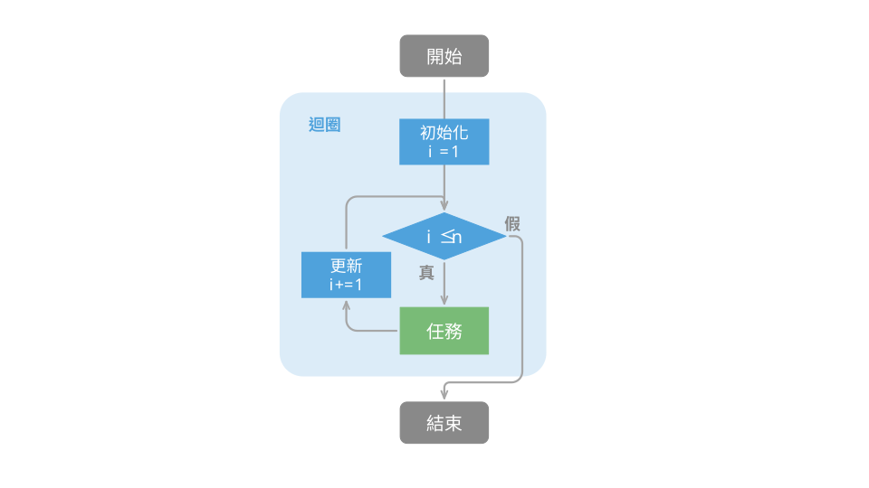
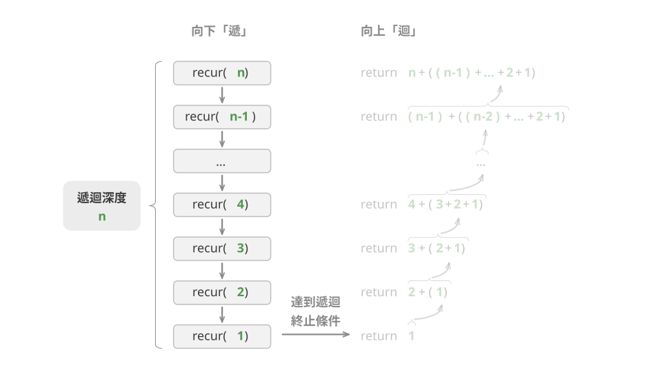

# 迭代與遞迴

演算法經常需要重複執行某項任務，重複的方式也與複雜度分析密切相關。因此，在介紹時間複雜度與空間複雜度之前，我們先認識兩種能讓程式重複執行任務的基本控制結構：迭代與遞迴。

## 迭代

<u>迭代（iteration）</u> 是一種重複執行任務的控制結構。在迭代過程中，只要條件成立，程式就會重複執行某段程式碼，直到條件不再成立。

### for 迴圈

`for` 迴圈是最常見的迭代形式之一，**適合在事先知道迭代次數時使用**。

以下函式以 `for` 迴圈計算 $1 + 2 + \dots + n$，並將總和記錄在變數 `res` 中。請留意，Python 的 `range(a, b)` 採用「左閉右開」區間，依序走訪的值為 $a, a + 1, \dots, b-1$：

```src
[file]{iteration}-[class]{}-[func]{for_loop}
```

下圖是這個求和函式的流程圖。



這個求和函式的操作次數與輸入資料大小 $n$ 成正比，也就是呈「線性關係」。在這個例子中，**時間複雜度描述的正是這種線性關係**，下一節會詳細介紹。

### while 迴圈

和 `for` 迴圈一樣，`while` 迴圈也可以實作迭代。`while` 迴圈每一輪都會先檢查條件，條件成立就繼續執行，否則結束迴圈。

以下用 `while` 迴圈計算 $1 + 2 + \dots + n$：

```src
[file]{iteration}-[class]{}-[func]{while_loop}
```

**`while` 迴圈比 `for` 迴圈更有彈性**。使用 `while` 迴圈時，我們可以自行設計條件變數的初值及更新方式。

例如，在以下程式碼中，條件變數 $i$ 每一輪都會更新兩次，這種情況用 `for` 迴圈來寫就不太方便：

```src
[file]{iteration}-[class]{}-[func]{while_loop_ii}
```

整體而言，**`for` 迴圈的程式碼較精簡，`while` 迴圈則較有彈性**。兩者都能實作迭代，應根據問題的需求來選擇。

### 巢狀迴圈

我們可以在一個迴圈裡再寫一個迴圈。以下以 `for` 迴圈為例：

```src
[file]{iteration}-[class]{}-[func]{nested_for_loop}
```

下圖是這個巢狀迴圈的流程圖。


在這種情況下，函式的操作次數與 $n^2$ 成正比，換句話說，演算法的執行時間與輸入資料大小 $n$ 呈「平方關係」。

我們可以繼續增加迴圈的層數。每多一層就像多了一個維度，時間複雜度會依序提高為「三次方關係」、「四次方關係」，以此類推。

## 遞迴

 <u>遞迴（recursion）</u> 是透過函式呼叫自身來解決問題的演算法策略，主要分為兩個階段。

1. **遞**：程式逐層呼叫自身，通常傳入較小或較簡單的參數，直到滿足「終止條件」。
2. **迴**：滿足「終止條件」後，程式從最深一層的遞迴呼叫逐層回傳，彙整各層的結果。

從實作的角度來看，遞迴程式碼主要有三個要素。

1. **終止條件**：決定何時從「遞」轉為「迴」。
2. **遞迴呼叫**：對應「遞」，函式呼叫自身，通常傳入較小或較簡單的參數。
3. **回傳結果**：對應「迴」，將這一層遞迴的結果傳回上一層。

在以下程式碼中，只要呼叫函式 `recur(n)`，就能算出 $1 + 2 + \dots + n$：

```src
[file]{recursion}-[class]{}-[func]{recur}
```

下圖顯示這個函式的遞迴過程。


迭代與遞迴雖然可以算出相同的結果，**思考與解決問題的方式卻截然不同**。

- **迭代**：以「由下而上」的方式解決問題。從最基本的步驟開始，反覆執行這些步驟或累加結果，直到完成任務。
- **遞迴**：以「由上而下」的方式解決問題。先把原問題拆成形式相同、規模較小的子問題，再把子問題繼續細分，直到遇到解答已知的基本情況為止。

以上述求和函式為例，設問題為 $f(n) = 1 + 2 + \dots + n$。

- **迭代**：用迴圈模擬求和過程，從 $1$ 走訪到 $n$，每一輪都累加當前的值，就能算出 $f(n)$。
- **遞迴**：將問題拆成子問題 $f(n) = n + f(n-1)$，以遞迴方式持續分解，直到基本情況 $f(1) = 1$ 為止。

### 呼叫堆疊

遞迴函式每呼叫自身一次，系統就會為新的函式呼叫配置記憶體，儲存區域變數、呼叫位址等資訊。這會帶來兩個影響。

- 函式執行時所需的資料都存在稱為「堆疊框架」的記憶體空間中，直到函式回傳後才會釋放。因此，**遞迴通常比迭代占用更多記憶體**。
- 遞迴的函式呼叫也有額外成本，**因此遞迴的時間效率通常比迴圈低**。

如下圖所示，在觸發終止條件前，共有 $n$ 個遞迴呼叫尚未回傳，**遞迴深度為 $n$**。



實務上，程式語言允許的遞迴深度通常有限，遞迴過深可能導致堆疊溢位。

### 尾端遞迴

特別的是，**如果遞迴呼叫是函式回傳前的最後一步**，編譯器或直譯器便有機會將函式最佳化，使其空間效率與迭代相當。這種寫法稱為<u>尾端遞迴（tail recursion）</u>。

- **一般遞迴**：呼叫結果傳回上一層後，上一層還有程式碼要執行，因此系統必須保留上一層呼叫的執行狀態。
- **尾端遞迴**：遞迴呼叫是回傳前的最後一個操作。結果傳回上一層後，上一層沒有其他操作要執行，因此系統無須保留上一層函式的執行狀態。

以計算 $1 + 2 + \dots + n$ 為例，我們可以把儲存結果的變數 `res` 作為函式參數，寫成尾端遞迴：

```src
[file]{recursion}-[class]{}-[func]{tail_recur}
```

尾端遞迴的執行過程如下圖所示。一般遞迴與尾端遞迴執行加法的時機不同。

- **一般遞迴**：加法在「迴」的過程中執行，每次回傳到上一層，都要再做一次加法。
- **尾端遞迴**：加法在「遞」的過程中執行，「迴」時只需逐層回傳結果。


!!! tip

    請留意，許多編譯器或直譯器並不支援尾端遞迴最佳化。例如，Python 預設不支援這項最佳化，因此即使函式採用尾端遞迴，仍可能發生堆疊溢位。

### 遞迴樹

在處理與「分治法」有關的演算法問題時，採用遞迴往往比迭代更容易掌握解題思路，程式碼也更容易閱讀。以費氏數列為例。

!!! question

    給定費氏數列 $0, 1, 1, 2, 3, 5, 8, 13, \dots$，求數列的第 $n$ 項。

設費氏數列的第 $n$ 項為 $f(n)$，可以得到以下兩個結論。

- 數列的前兩項為 $f(1) = 0$ 和 $f(2) = 1$。
- 此後每一項都是前兩項的和，也就是 $f(n) = f(n - 1) + f(n - 2)$。

依照遞迴關係式呼叫自身，並以前兩項作為終止條件，就能寫出遞迴程式碼。呼叫 `fib(n)` 即可得到費氏數列的第 $n$ 項：

```src
[file]{recursion}-[class]{}-[func]{fib}
```

在上面的函式中，我們呼叫自身兩次，**也就是從一次呼叫分出兩個分支**。如下圖所示，持續遞迴呼叫，就會形成一棵有 $n$ 層的<u>遞迴樹（recursion tree）</u>。


遞迴的核心想法，是把問題拆成較小的子問題。這種分治策略十分重要。

- 從演算法來看，搜尋、排序、回溯、分治、動態規劃等許多重要策略，都直接或間接運用了這種思考方式。
- 從資料結構來看，鏈結串列、樹與圖都很適合用分治法分析，因此遞迴也特別適合用來處理這些結構的問題。

## 比較迭代與遞迴

綜合以上說明，迭代與遞迴在實作方式、效能及適用情境上各有差異，如下表所示。

<p align="center"> 表 <id> &nbsp; 迭代與遞迴的特性比較 </p>

|          | 迭代                                   | 遞迴                                                         |
| -------- | -------------------------------------- | ------------------------------------------------------------ |
| 實作方式 | 迴圈結構                               | 函式呼叫自身                                                 |
| 時間效率 | 效率通常較高，沒有函式呼叫的額外成本           | 每次呼叫函式都有額外成本                                     |
| 記憶體用量 | 通常使用固定大小的記憶體空間             | 累積的函式呼叫可能占用大量堆疊框架空間                           |
| 適用問題 | 適合簡單的重複任務，程式碼直觀易讀 | 適合能拆成子問題的情境，例如樹、圖、分治或回溯，程式碼結構簡潔清楚 |

!!! tip

    如果覺得以下內容較難理解，可以讀完「堆疊」章節後再回來複習。

迭代與遞迴有什麼關聯呢？以上述遞迴函式為例，加法是在「迴」的階段執行，因此最先呼叫的函式反而最後才完成加法。**這個順序正好符合堆疊「先進後出」的原則**。

其實，從「呼叫堆疊」與「堆疊框架空間」這些遞迴術語，已經可以看出遞迴與堆疊的密切關係。

1. **遞**：呼叫函式時，系統會在呼叫堆疊上為它配置新的堆疊框架，用來儲存函式的區域變數、參數、返回位址等資料。
2. **迴**：函式執行完畢並回傳時，系統會從呼叫堆疊移除對應的堆疊框架，恢復上一個函式的執行環境。

因此，**我們可以自行建立堆疊來模擬呼叫堆疊的運作**，將遞迴改寫為迭代：

```src
[file]{recursion}-[class]{}-[func]{for_loop_recur}
```

從上面的程式碼可以看出，將遞迴改寫為迭代後，程式碼變得較複雜。雖然迭代與遞迴在許多情況下都能互相轉換，但基於以下兩個理由，這樣做未必值得。

- 改寫後的程式碼可能更難理解，可讀性也較低。
- 對某些複雜問題來說，要模擬系統呼叫堆疊的運作可能非常困難。

整體而言，**該用迭代還是遞迴，取決於問題的性質**。實際撰寫程式時，應權衡兩者的優缺點，再依情境選擇合適的做法。
