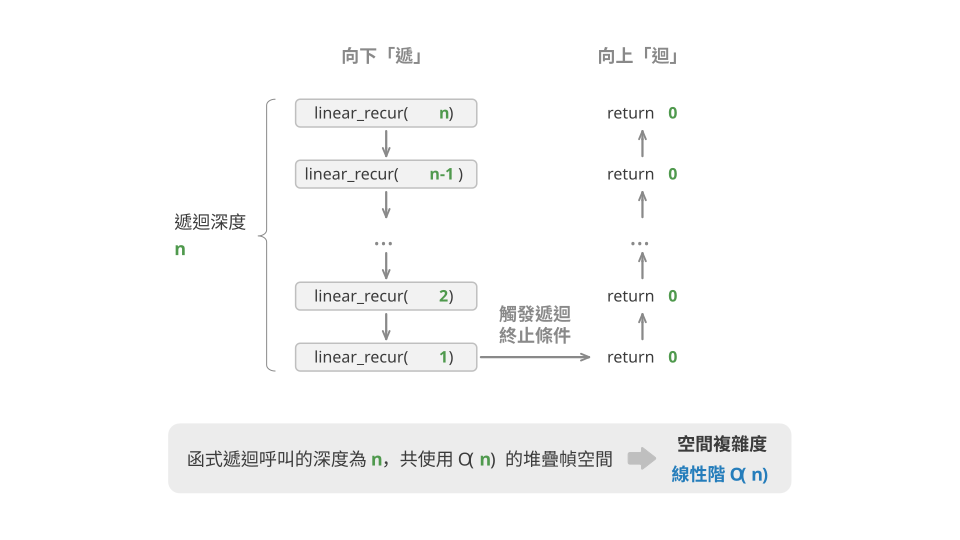
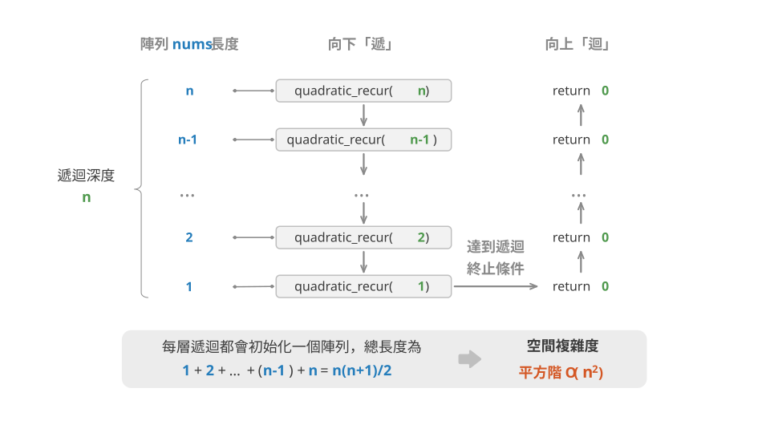
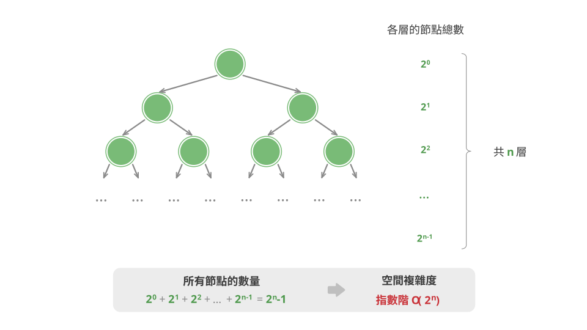

# 空間複雜度

<u>空間複雜度（space complexity）</u>用於衡量演算法佔用記憶體空間隨著資料量變大時的增長趨勢。這個概念與時間複雜度非常類似，只需將“執行時間”替換為“佔用記憶體空間”。

## 演算法相關空間

演算法在執行過程中使用的記憶體空間主要包括以下幾種。

- **輸入空間**：用於儲存演算法的輸入資料。
- **暫存空間**：用於儲存演算法在執行過程中的變數、物件、函式上下文等資料。
- **輸出空間**：用於儲存演算法的輸出資料。

一般情況下，空間複雜度的統計範圍是“暫存空間”加上“輸出空間”。

暫存空間可以進一步劃分為三個部分。

- **暫存資料**：用於儲存演算法執行過程中的各種常數、變數、物件等。
- **堆疊幀空間**：用於儲存呼叫函式的上下文資料。系統在每次呼叫函式時都會在堆疊頂部建立一個堆疊幀，函式返回後，堆疊幀空間會被釋放。
- **指令空間**：用於儲存編譯後的程式指令，在實際統計中通常忽略不計。

在分析一段程式的空間複雜度時，**我們通常統計暫存資料、堆疊幀空間和輸出資料三部分**，如下圖所示。


相關程式碼如下：

```snippet
space_categories
```

## 推算方法

空間複雜度的推算方法與時間複雜度大致相同，只需將統計物件從“操作數量”轉為“使用空間大小”。

而與時間複雜度不同的是，**我們通常只關注最差空間複雜度**。這是因為記憶體空間是一項硬性要求，我們必須確保在所有輸入資料下都有足夠的記憶體空間預留。

觀察以下程式碼，最差空間複雜度中的“最差”有兩層含義。

1. **以最差輸入資料為準**：當 $n < 10$ 時，空間複雜度為 $O(1)$ ；但當 $n > 10$ 時，初始化的陣列 `nums` 佔用 $O(n)$ 空間，因此最差空間複雜度為 $O(n)$ 。
2. **以演算法執行中的峰值記憶體為準**：例如，程式在執行最後一行之前，佔用 $O(1)$ 空間；當初始化陣列 `nums` 時，程式佔用 $O(n)$ 空間，因此最差空間複雜度為 $O(n)$ 。

```snippet
worst_case_space
```

**在遞迴函式中，需要注意統計堆疊幀空間**。觀察以下程式碼：

```snippet
loop_vs_recursion_space
```

函式 `loop()` 和 `recur()` 的時間複雜度都為 $O(n)$ ，但空間複雜度不同。

- 函式 `loop()` 在迴圈中呼叫了 $n$ 次 `function()` ，每輪中的 `function()` 都返回並釋放了堆疊幀空間，因此空間複雜度仍為 $O(1)$ 。
- 遞迴函式 `recur()` 在執行過程中會同時存在 $n$ 個未返回的 `recur()` ，從而佔用 $O(n)$ 的堆疊幀空間。

## 常見型別

設輸入資料大小為 $n$ ，下圖展示了常見的空間複雜度型別（從低到高排列）。

$$
\begin{aligned}
& O(1) < O(\log n) < O(n) < O(n^2) < O(2^n) \newline
& \text{常數階} < \text{對數階} < \text{線性階} < \text{平方階} < \text{指數階}
\end{aligned}
$$


### 常數階 $O(1)$

常數階常見於數量與輸入資料大小 $n$ 無關的常數、變數、物件。

需要注意的是，在迴圈中初始化變數或呼叫函式而佔用的記憶體，在進入下一迴圈後就會被釋放，因此不會累積佔用空間，空間複雜度仍為 $O(1)$ ：

```src
[file]{space_complexity}-[class]{}-[func]{constant}
```

### 線性階 $O(n)$

線性階常見於元素數量與 $n$ 成正比的陣列、鏈結串列、堆疊、佇列等：

```src
[file]{space_complexity}-[class]{}-[func]{linear}
```

如下圖所示，此函式的遞迴深度為 $n$ ，即同時存在 $n$ 個未返回的 `linear_recur()` 函式，使用 $O(n)$ 大小的堆疊幀空間：

```src
[file]{space_complexity}-[class]{}-[func]{linear_recur}
```



### 平方階 $O(n^2)$

平方階常見於矩陣和圖，元素數量與 $n$ 成平方關係：

```src
[file]{space_complexity}-[class]{}-[func]{quadratic}
```

如下圖所示，該函式的遞迴深度為 $n$ ，在每個遞迴函式中都初始化了一個陣列，長度分別為 $n$、$n-1$、$\dots$、$2$、$1$ ，平均長度為 $n / 2$ ，因此總體佔用 $O(n^2)$ 空間：

```src
[file]{space_complexity}-[class]{}-[func]{quadratic_recur}
```



### 指數階 $O(2^n)$

指數階常見於二元樹。觀察下圖，層數為 $n$ 的“滿二元樹”的節點數量為 $2^n - 1$ ，佔用 $O(2^n)$ 空間：

```src
[file]{space_complexity}-[class]{}-[func]{build_tree}
```



### 對數階 $O(\log n)$

對數階常見於分治演算法。例如合併排序，輸入長度為 $n$ 的陣列，每輪遞迴將陣列從中點處劃分為兩半，形成高度為 $\log n$ 的遞迴樹，使用 $O(\log n)$ 堆疊幀空間。

再例如將數字轉化為字串，輸入一個正整數 $n$ ，它的位數為 $\lfloor \log_{10} n \rfloor + 1$ ，即對應字串長度為 $\lfloor \log_{10} n \rfloor + 1$ ，因此空間複雜度為 $O(\log_{10} n + 1) = O(\log n)$ 。

## 權衡時間與空間

理想情況下，我們希望演算法的時間複雜度和空間複雜度都能達到最優。然而在實際情況中，同時最佳化時間複雜度和空間複雜度通常非常困難。

**降低時間複雜度通常需要以提升空間複雜度為代價，反之亦然**。我們將犧牲記憶體空間來提升演算法執行速度的思路稱為“以空間換時間”；反之，則稱為“以時間換空間”。

選擇哪種思路取決於我們更看重哪個方面。在大多數情況下，時間比空間更寶貴，因此“以空間換時間”通常是更常用的策略。當然，在資料量很大的情況下，控制空間複雜度也非常重要。
