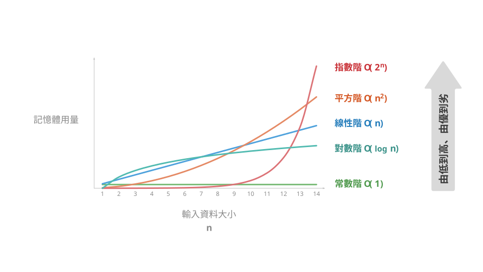

# 空間複雜度

<u>空間複雜度（space complexity）</u> 衡量的是當資料量增加時，演算法占用的記憶體空間如何成長。這個概念與時間複雜度十分相似，只要把「執行時間」換成「占用的記憶體空間」即可。

## 演算法用到的空間

演算法執行時用到的記憶體空間主要分為以下幾類。

- **輸入空間**：用來儲存演算法的輸入資料。
- **暫存空間**：用來儲存演算法執行時的變數、物件、函式的執行狀態等資料。
- **輸出空間**：用來儲存演算法的輸出資料。

一般而言，計算空間複雜度時，會將「暫存空間」與「輸出空間」相加。

暫存空間還可以細分為三個部分。

- **暫存資料**：用來保存演算法執行時的各種常數、變數、物件等。
- **堆疊框架空間**：用來保存函式呼叫的執行狀態。每次呼叫函式時，系統都會在堆疊頂端建立一個堆疊框架。函式回傳後，系統便會釋放該框架占用的空間。
- **指令空間**：用來儲存編譯後的程式指令，實際計算時通常忽略不計。

分析一段程式的空間複雜度時，**通常計入暫存資料、堆疊框架空間與輸出資料三部分**，如下圖所示。


相關程式碼如下：

```snippet
space_categories
```

## 推算方法

空間複雜度的推算方法與時間複雜度大致相同，只要把計算的對象從「操作次數」換成「占用的空間大小」。

和時間複雜度不同，**我們通常只關心最差空間複雜度**。這是因為記憶體容量是硬性限制，我們必須確保面對任何輸入資料，都預留了足夠的空間。

從以下程式碼可以看出，最差空間複雜度的「最差」有兩層意思。

1. **以最差情況的輸入為準**：當 $n < 10$ 時，空間複雜度為 $O(1)$；但當 $n > 10$ 時，初始化的陣列 `nums` 會占用 $O(n)$ 空間，因此最差空間複雜度為 $O(n)$。
2. **以執行期間的記憶體用量峰值為準**：例如，程式在執行最後一行前，占用 $O(1)$ 空間；初始化陣列 `nums` 時，占用空間升為 $O(n)$，因此最差空間複雜度為 $O(n)$。

```snippet
worst_case_space
```

**分析遞迴函式時，別忘了計入堆疊框架空間**。請看以下程式碼：

```snippet
loop_vs_recursion_space
```

函式 `loop()` 與 `recur()` 的時間複雜度都是 $O(n)$，空間複雜度卻不同。

- 函式 `loop()` 在迴圈中呼叫 `function()` 共 $n$ 次，每一輪的 `function()` 都會回傳並釋放堆疊框架空間，因此空間複雜度仍為 $O(1)$。
- 遞迴函式 `recur()` 在執行過程中，同時有 $n$ 個 `recur()` 呼叫尚未回傳，因此占用 $O(n)$ 的堆疊框架空間。

## 常見類型

設輸入資料大小為 $n$，下圖列出常見的空間複雜度，依成長速度由低到高排列。

$$
\begin{aligned}
& O(1) < O(\log n) < O(n) < O(n^2) < O(2^n) \newline
& \text{常數階} < \text{對數階} < \text{線性階} < \text{平方階} < \text{指數階}
\end{aligned}
$$



### 常數階 $O(1)$

若常數、變數與物件的數量都與輸入資料大小 $n$ 無關，占用的空間通常為常數階。

請留意，在以下迴圈中，初始化變數或呼叫函式所占用的記憶體，到了下一輪就會釋放。這些空間不會逐輪累積，空間複雜度仍為 $O(1)$：

```src
[file]{space_complexity}-[class]{}-[func]{constant}
```

### 線性階 $O(n)$

線性階常見於陣列、鏈結串列、堆疊、佇列等結構，其元素數量與 $n$ 成正比：

```src
[file]{space_complexity}-[class]{}-[func]{linear}
```

如下圖所示，這個函式的遞迴深度為 $n$，也就是同時有 $n$ 個 `linear_recur()` 呼叫尚未回傳，占用 $O(n)$ 的堆疊框架空間：

```src
[file]{space_complexity}-[class]{}-[func]{linear_recur}
```


### 平方階 $O(n^2)$

平方階常見於矩陣和圖。此時元素數量與 $n$ 的平方成正比：

```src
[file]{space_complexity}-[class]{}-[func]{quadratic}
```

如下圖所示，這個函式的遞迴深度為 $n$，每層遞迴都會初始化一個陣列，長度依序為 $n$、$n-1$、$\dots$、$2$、$1$，平均長度為 $n / 2$，因此總共占用 $O(n^2)$ 空間：

```src
[file]{space_complexity}-[class]{}-[func]{quadratic_recur}
```


### 指數階 $O(2^n)$

指數階常見於二元樹。如圖所示，一棵有 $n$ 層的「完美二元樹」共有 $2^n - 1$ 個節點，占用 $O(2^n)$ 空間：

```src
[file]{space_complexity}-[class]{}-[func]{build_tree}
```


### 對數階 $O(\log n)$

對數階常見於分治演算法。以合併排序為例，若輸入陣列長度為 $n$，每一層遞迴都會從中點將陣列一分為二，形成高度為 $\log n$ 的遞迴樹，占用 $O(\log n)$ 的堆疊框架空間。

再以數字轉字串為例，若輸入的正整數 $n$ 有 $\lfloor \log_{10} n \rfloor + 1$ 位數，對應的字串長度就是 $\lfloor \log_{10} n \rfloor + 1$，因此空間複雜度為 $O(\log_{10} n + 1) = O(\log n)$。

## 時間與空間的取捨

理想情況下，我們希望演算法的時間複雜度與空間複雜度都能達到最佳。然而在實務上，兩者往往很難同時最佳化。

**降低時間複雜度，往往必須付出提高空間複雜度的代價，反過來也一樣**。使用更多記憶體以加快演算法的執行速度，稱為「以空間換時間」；反過來則稱為「以時間換空間」。

該怎麼取捨，取決於我們更重視哪一項資源。多數情況下時間比空間更寶貴，因此較常採用「以空間換時間」的策略。當然，當資料量很大時，控制空間複雜度也很重要。
