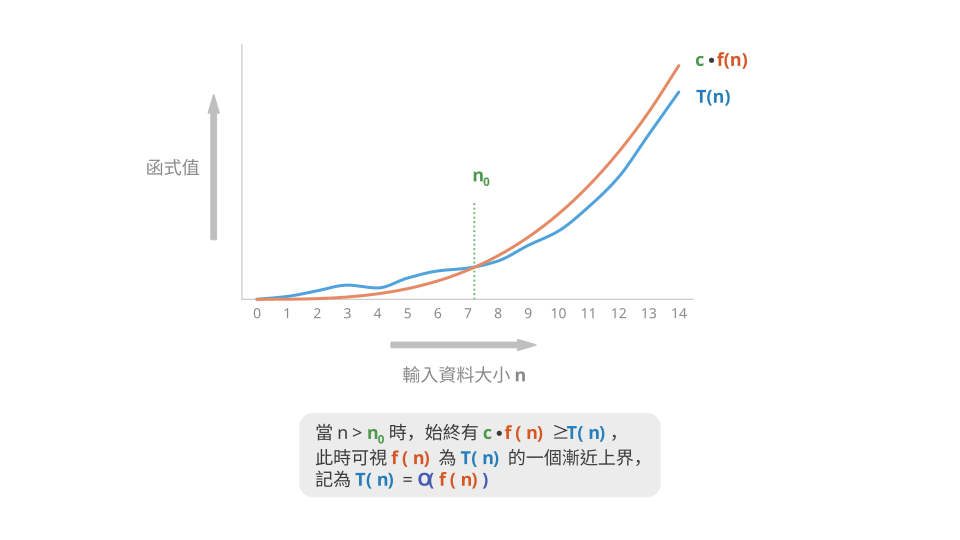
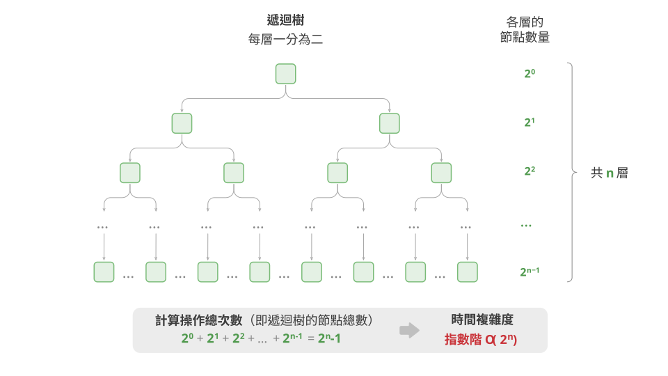
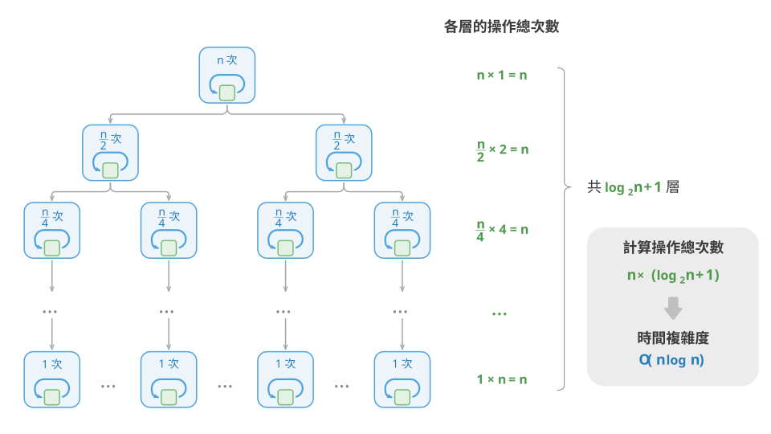

# 時間複雜度

執行時間能直觀且準確地反映演算法的效率。如果想精確估算一段程式碼的執行時間，該怎麼做呢？

1. **確定執行平台**，包括硬體配置、程式語言與系統環境等，這些因素都會影響程式碼的執行效率。
2. **評估各項操作所需的執行時間**，例如加法 `+` 需要 1 ns、乘法 `*` 需要 10 ns、列印 `print()` 需要 5 ns 等。
3. **計算程式碼中所有的操作次數**，將每個操作耗用的時間加總，就能得到執行時間。

例如，在以下程式碼中，輸入資料大小為 $n$：

```snippet
run_time_estimate
```

按照上述方法，可算出演算法的執行時間為 $(6n + 12)$ ns：

$$
1 + 1 + 10 + (1 + 5) \times n = 6n + 12
$$

但在實務上，**這樣計算演算法的執行時間既不合理，也不切實際**。首先，演算法需要在各種平台上執行，我們不希望估算的時間只適用於特定平台。其次，每種操作實際需要多少時間往往難以得知，也使估算格外困難。

## 分析執行時間的成長趨勢

時間複雜度分析關心的並非演算法實際執行多久，**而是資料量增加時，執行時間如何成長**。

「時間的成長趨勢」有些抽象，我們用例子來理解。假設輸入資料大小為 $n$，有三個演算法 `A`、`B` 與 `C`：

```snippet
growth_trend
```

下圖呈現這三個演算法的時間複雜度。

- 演算法 `A` 只進行 $1$ 次列印，執行時間不隨 $n$ 增加而成長。我們稱這個演算法的時間複雜度為「常數階」。
- 演算法 `B` 在迴圈中列印 $n$ 次，執行時間隨 $n$ 增加而線性成長，時間複雜度稱為「線性階」。
- 演算法 `C` 在迴圈中列印 $1000000$ 次。雖然耗時很久，執行時間卻與輸入資料大小 $n$ 無關，因此 `C` 與 `A` 的時間複雜度相同，都是「常數階」。


和直接計算演算法的執行時間相比，時間複雜度分析有什麼特色呢？

- **時間複雜度能有效評估演算法的效率**。例如，演算法 `B` 的執行時間線性成長，在 $n > 1$ 時比演算法 `A` 慢，在 $n > 1000000$ 時比演算法 `C` 慢。事實上，只要輸入資料大小 $n$ 夠大，常數階演算法就一定比線性階演算法快，這正是成長趨勢的意義。
- **時間複雜度的推算較簡便**。執行平台與操作類型都不影響演算法執行時間的成長趨勢。因此，在分析時間複雜度時，我們可以把每一項操作所需的時間都視為相同的「單位時間」。這樣一來，只要計算操作次數，就無須逐一計算各項操作的執行時間，估算也容易得多。
- **時間複雜度也有其限制**。例如，演算法 `A` 與 `C` 的時間複雜度相同，實際耗時卻相差很大。同樣地，雖然演算法 `B` 的時間複雜度高於 `C`，但輸入資料大小 $n$ 較小時，演算法 `B` 明顯優於演算法 `C`。在這些情況下，往往很難只憑時間複雜度判斷效率高低。即便如此，複雜度分析仍是評估演算法效率最有效、也最常用的方法。

## 函數的漸近上界

給定以下函式，其輸入大小為 $n$：

```snippet
asymptotic_upper_bound
```

設演算法的操作次數是輸入資料大小 $n$ 的函數，記為 $T(n)$。上述函式的操作次數為：

$$
T(n) = 3 + 2n
$$

$T(n)$ 是一次函數，表示執行時間呈線性成長，因此時間複雜度為線性階。

線性階的時間複雜度記為 $O(n)$。這種數學記法稱為<u>大 $O$ 記號（big-$O$ notation）</u>，表示函數 $T(n)$ 的<u>漸近上界（asymptotic upper bound）</u>。

分析時間複雜度，實質上就是求「操作次數 $T(n)$」的漸近上界。漸近上界有明確的數學定義。

!!! note "函數的漸近上界"

    若存在正實數 $c$ 與實數 $n_0$，使所有 $n > n_0$ 都滿足 $T(n) \leq c \cdot f(n)$，則 $f(n)$ 是 $T(n)$ 的一個漸近上界，記為 $T(n) = O(f(n))$。

如下圖所示，求漸近上界，就是尋找一個函數 $f(n)$，使 $n$ 趨近無窮大時，$T(n)$ 與 $f(n)$ 有相同的成長階數，只差一個常數係數 $c$。



## 推算方法

漸近上界的數學定義乍看有些難懂，不必急著完全掌握。我們可以先學會怎麼推算，再透過練習逐漸理解它的數學意義。

根據定義，確定 $f(n)$ 後，就能得到時間複雜度 $O(f(n))$。該如何確定漸近上界 $f(n)$ 呢？可分成兩個步驟：先計算操作次數，再判斷漸近上界。

### 第一步：計算操作次數

我們可以從上到下，逐行計算程式碼的操作次數。不過，上述 $c \cdot f(n)$ 中的常數係數 $c$ 可以任取大小，**因此可以忽略操作次數 $T(n)$ 中的各項係數與常數項**。根據這項原則，可以用以下技巧簡化計數。

1. **忽略 $T(n)$ 中的常數項**。這些項與 $n$ 無關，不影響時間複雜度。
2. **省略所有係數**。例如，執行 $2n$ 次或 $5n + 1$ 次迴圈，都可以簡記為 $n$ 次，因為 $n$ 前面的係數不影響時間複雜度。
3. **遇到巢狀迴圈時使用乘法**。總操作次數等於外層迴圈與內層迴圈的操作次數相乘。各層迴圈仍可分別套用第 `1.` 點與第 `2.` 點的技巧。

對於以下函式，我們可以用這些技巧計算操作次數：

```snippet
count_operations
```

下列公式列出簡化前後的計數結果，兩者推算出的時間複雜度都是 $O(n^2)$。

$$
\begin{aligned}
T(n) & = 2n(n + 1) + (5n + 1) + 2 & \text{完整計數 (-.-|||)} \newline
& = 2n^2 + 7n + 3 \newline
T(n) & = n^2 + n & \text{偷懶計數 (o.O)}
\end{aligned}
$$

### 第二步：判斷漸近上界

**時間複雜度由 $T(n)$ 中階數最高的項決定**。這是因為當 $n$ 趨近無窮大時，最高階項會主導成長趨勢，其他項的影響可以忽略。

下表列出幾個例子，刻意使用一些誇張的數字來強調「係數無法改變階數」。當 $n$ 趨近無窮大時，這些常數的影響就微不足道了。

<p align="center"> 表 <id> &nbsp; 不同操作次數對應的時間複雜度 </p>

| 操作次數 $T(n)$        | 時間複雜度 $O(f(n))$ |
| ---------------------- | -------------------- |
| $100000$               | $O(1)$               |
| $3n + 2$               | $O(n)$               |
| $2n^2 + 3n + 2$        | $O(n^2)$             |
| $n^3 + 10000n^2$       | $O(n^3)$             |
| $2^n + 10000n^{10000}$ | $O(2^n)$             |

## 常見類型

設輸入資料大小為 $n$，常見的時間複雜度如下圖所示，依成長速度由低到高排列。

$$
\begin{aligned}
& O(1) < O(\log n) < O(n) < O(n \log n) < O(n^2) < O(2^n) < O(n!) \newline
& \text{常數階} < \text{對數階} < \text{線性階} < \text{線性對數階} < \text{平方階} < \text{指數階} < \text{階乘階}
\end{aligned}
$$


### 常數階 $O(1)$

常數階的操作次數與輸入資料大小 $n$ 無關，不會隨 $n$ 改變。

以下函式的操作次數 `size` 雖然可能很大，但與輸入資料大小 $n$ 無關，因此時間複雜度仍為 $O(1)$：

```src
[file]{time_complexity}-[class]{}-[func]{constant}
```

### 線性階 $O(n)$

線性階的操作次數隨輸入資料大小 $n$ 線性成長。這種情況常出現在單層迴圈中：

```src
[file]{time_complexity}-[class]{}-[func]{linear}
```

走訪陣列或鏈結串列的時間複雜度都是 $O(n)$，其中 $n$ 是陣列或鏈結串列的長度：

```src
[file]{time_complexity}-[class]{}-[func]{array_traversal}
```

請留意，**輸入資料大小 $n$ 的定義取決於輸入資料的類型**。例如，第一個例子用變數 $n$ 表示輸入資料大小，第二個例子則以陣列長度 $n$ 表示資料大小。

### 平方階 $O(n^2)$

平方階的操作次數隨輸入資料大小 $n$ 的平方成長。這種情況常見於巢狀迴圈：外層與內層迴圈的時間複雜度各為 $O(n)$，整體的時間複雜度因此為 $O(n^2)$：

```src
[file]{time_complexity}-[class]{}-[func]{quadratic}
```

下圖比較常數階、線性階與平方階三種時間複雜度。


以氣泡排序為例，外層迴圈執行 $n - 1$ 次，內層迴圈依序執行 $n-1$、$n-2$、$\dots$、$2$、$1$ 次，平均為 $n / 2$ 次，因此時間複雜度為 $O((n - 1) n / 2) = O(n^2)$：

```src
[file]{time_complexity}-[class]{}-[func]{bubble_sort}
```

### 指數階 $O(2^n)$

生物學中的「細胞分裂」是指數成長的典型例子。最初有 $1$ 個細胞，分裂一輪後變成 $2$ 個，兩輪後變成 $4$ 個，以此類推，分裂 $n$ 輪後有 $2^n$ 個細胞。

下圖與以下程式碼模擬細胞分裂的過程，時間複雜度為 $O(2^n)$。請留意，輸入 $n$ 是分裂的輪數，回傳值 `count` 是累計的分裂次數。

```src
[file]{time_complexity}-[class]{}-[func]{exponential}
```



在實際的演算法中，指數階常出現在遞迴函式裡。例如，以下程式碼在遞迴過程中一分為二，分裂 $n$ 次後停止：

```src
[file]{time_complexity}-[class]{}-[func]{exp_recur}
```

指數階成長非常快，常見於窮舉法，例如暴力搜尋與回溯。當資料規模較大時，指數階的耗時令人難以接受，通常需要改用動態規劃或貪婪演算法等方法求解。

### 對數階 $O(\log n)$

和指數階的變化方向相反，對數階反映「每一輪都減半」的情況。設輸入資料大小為 $n$，每一輪減半，所需的迴圈次數就是 $\log_2 n$，也就是 $2^n$ 的反函數。

下圖與以下程式碼模擬每一輪減半的過程，時間複雜度為 $O(\log_2 n)$，簡記為 $O(\log n)$：

```src
[file]{time_complexity}-[class]{}-[func]{logarithmic}
```


和指數階一樣，對數階也常見於遞迴函式。以下程式碼形成一棵高度為 $\log_2 n$ 的遞迴樹：

```src
[file]{time_complexity}-[class]{}-[func]{log_recur}
```

對數階常見於採用分治策略的演算法，展現了「一分為多」與「化繁為簡」的想法。對數成長緩慢，是僅次於常數階的理想時間複雜度。

!!! tip "$O(\log n)$ 的底數是多少？"

    精確來說，「一分為 $m$」對應的時間複雜度是 $O(\log_m n)$。利用對數換底公式，可以得到底數不同、複雜度相同的表示方式：

    $$
    O(\log_m n) = O(\log_k n / \log_k m) = O(\log_k n)
    $$

    也就是說，更換底數 $m$ 不影響複雜度。因此，通常可以省略底數 $m$，將對數階直接記為 $O(\log n)$。

### 線性對數階 $O(n \log n)$

線性對數階常見於巢狀迴圈，其中兩層迴圈的時間複雜度分別為 $O(\log n)$ 與 $O(n)$。相關程式碼如下：

```src
[file]{time_complexity}-[class]{}-[func]{linear_log_recur}
```

下圖呈現線性對數階的由來。這棵二元樹每一層的操作總數都是 $n$，整棵樹共有 $\log_2 n + 1$ 層，因此時間複雜度為 $O(n \log n)$。



常見的排序演算法，其時間複雜度通常為 $O(n \log n)$，例如快速排序、合併排序與堆積排序。

### 階乘階 $O(n!)$

階乘階對應數學上列舉「所有排列」的問題。給定 $n$ 個互不重複的元素，要列出所有可能的排列，其總數為：

$$
n! = n \times (n - 1) \times (n - 2) \times \dots \times 2 \times 1
$$

階乘階的演算法通常以遞迴實作。如下圖與程式碼所示，第一層分出 $n$ 個分支，下一層各分出 $n - 1$ 個分支，依此類推，直到第 $n$ 層才停止分支：

```src
[file]{time_complexity}-[class]{}-[func]{factorial_recur}
```


請留意，當 $n \geq 4$ 時，$n! > 2^n$ 恆成立，因此階乘階的成長比指數階更快。當 $n$ 較大時，這樣的耗時同樣令人難以接受。

## 最差、最佳與平均時間複雜度

**演算法的時間效率往往會隨輸入資料的分布而改變**。假設輸入一個長度為 $n$ 的陣列 `nums`，`nums` 由 $1$ 到 $n$ 的數字組成，每個數字只出現一次，元素順序已隨機打亂。我們的任務是回傳元素 $1$ 的索引。由此可得到以下結論。

- 當 `nums = [?, ?, ..., 1]`，也就是最後一個元素為 $1$ 時，必須走訪整個陣列，**達到最差時間複雜度 $O(n)$**。
- 當 `nums = [1, ?, ?, ...]`，也就是第一個元素為 $1$ 時，無論陣列多長，都不需要繼續走訪，**達到最佳時間複雜度 $\Omega(1)$**。

「最差時間複雜度」對應函數的漸近上界，以大 $O$ 記號表示。相應地，「最佳時間複雜度」對應函數的漸近下界，以 $\Omega$ 記號表示：

```src
[file]{worst_best_time_complexity}-[class]{}-[func]{find_one}
```

實務上很少使用最佳時間複雜度，因為出現最佳情況的機率通常很低，用來判斷效率可能造成誤解。**最差時間複雜度更實用，因為它給出了保守的效能界限**，讓我們可以放心使用演算法。

從上例可以看出，最差與最佳時間複雜度都只出現在特定的資料分布下。這些情況可能很少出現，難以如實反映演算法的執行效率。相較之下，**平均時間複雜度能呈現演算法在隨機輸入下的執行效率**，以 $\Theta$ 記號表示。

有些演算法在隨機資料分布下的平均表現很容易推算。以上例來說，輸入陣列已隨機打亂，因此元素 $1$ 出現在各個索引的機率相同。平均迴圈次數是陣列長度的一半 $n / 2$，平均時間複雜度為 $\Theta(n / 2) = \Theta(n)$。

但對較複雜的演算法來說，要根據資料分布算出整體的期望值並不容易，因此平均時間複雜度往往很難計算。這時我們通常以最差時間複雜度作為評估效率的標準。

!!! question "為什麼很少看到 $\Theta$ 記號？"

    也許是因為 $O$ 記號念起來太順口，我們也常用它表示平均時間複雜度。嚴格來說，這種寫法並不規範。在本書或其他資料中，若看到「平均時間複雜度 $O(n)$」這類說法，請直接理解為 $\Theta(n)$。
