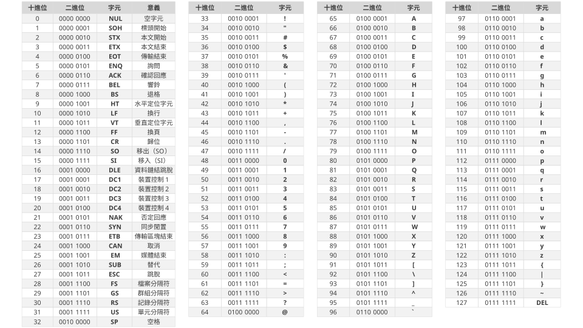
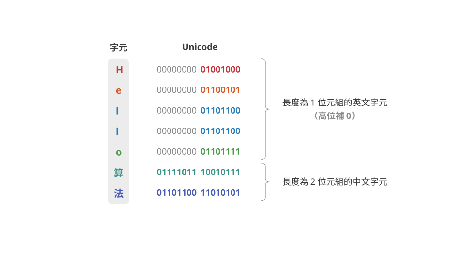
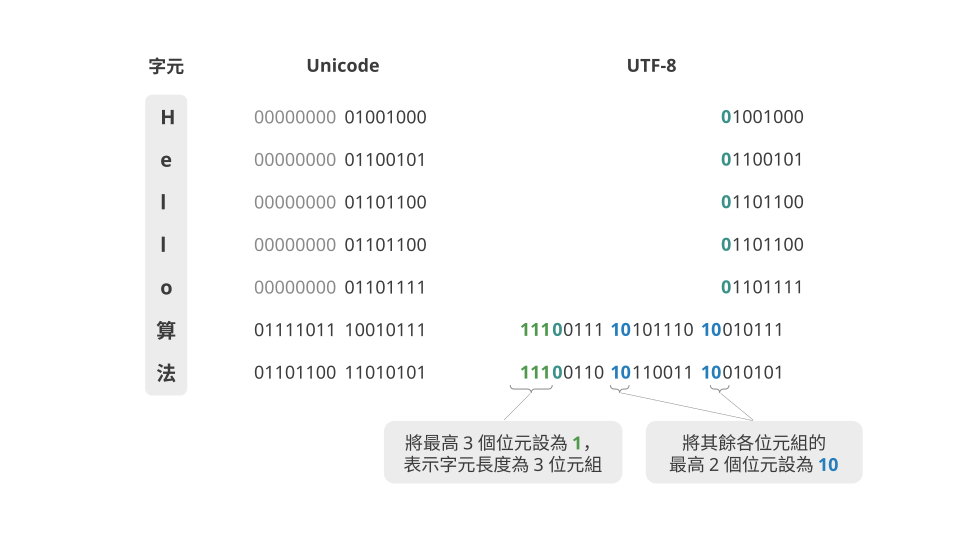

# 字元編碼 *

電腦以二進位數儲存所有資料，字元 `char` 也不例外。要表示字元，我們需要制定一套「字元集」，讓每個字元都一對一地對應到一個二進位數。有了字元集，電腦就能查表，將二進位數轉換為字元。

## ASCII 字元集

<u>ASCII 碼</u>是最早出現的字元集，全名為 American Standard Code for Information Interchange（美國資訊交換標準碼）。它用 7 個位元（一個位元組的低 7 位）表示一個字元，最多可表示 128 個不同字元。如下圖所示，ASCII 碼包含英文大小寫字母、數字 0 到 9、部分標點符號和控制字元（例如換行字元與定位字元）。

然而，**ASCII 碼只能表示英文**。隨著電腦在全球普及，能表示更多語言的 <u>EASCII</u> 字元集也隨之出現。它將 ASCII 的 7 位元擴充為 8 位元，可表示 256 個不同的字元。

世界各地陸續出現了適用於不同地區的 EASCII 字元集。這些字元集的前 128 個字元都採用 ASCII 碼，後 128 個字元則依各語言的需求分別定義。

## GBK 字元集

後來人們發現，**EASCII 能表示的字元數量仍無法滿足許多語言的需求**。例如，漢字近十萬個，光是日常使用的就有數千個。中國國家標準總局於 1980 年發布 <u>GB2312</u> 字元集，收錄了 6763 個漢字，已能滿足電腦處理漢字的基本需求。

不過，GB2312 無法處理部分罕用字和繁體字。<u>GBK</u> 字元集在 GB2312 的基礎上擴充，共收錄 21886 個漢字。在 GBK 的編碼方式中，ASCII 字元以一個位元組表示，漢字則以兩個位元組表示。

## Unicode 字元集

隨著電腦技術快速發展，各種字元集和編碼標準紛紛出現，也帶來不少問題。一方面，這些字元集通常只定義特定語言的字元，在多語環境中無法正常運作。另一方面，同一種語言也可能有好幾套字元集標準；若兩台電腦採用不同的編碼標準，交換資訊時就可能出現亂碼。

當時的研究人員想到：**如果制定一套夠完整的字元集，收錄世界各地的語言文字和符號，不就能解決跨語言環境和亂碼的問題了嗎**？在這個想法的推動下，涵蓋廣泛的 Unicode 字元集誕生了。

<u>Unicode</u> 又稱「統一碼」，理論上可容納一百多萬個字元。它希望將全世界的字元納入同一套字元集，讓人們能用通用的字元集處理與顯示各種文字，減少因編碼標準不同而出現的亂碼。自 1991 年發布以來，Unicode 持續收錄新的語言與字元。截至 2022 年 9 月，Unicode 已收錄 149186 個字元，涵蓋各種語言的文字、符號，甚至是表情符號。

作為通用字元集，Unicode 為每個字元分配唯一的「碼位」（字元編號），範圍從 U+0000 到 U+10FFFF，形成統一的編號空間。然而，**Unicode 字元集並未規定電腦要如何儲存這些碼位**。當同一段文字裡有長短不一的 Unicode 碼位時，系統該如何解析字元呢？例如，給定一段長度為 2 位元組的編碼，系統要怎麼判斷它代表一個 2 位元組的字元，還是兩個 1 位元組的字元？

對這個問題，**一種直觀的解法是讓每個字元的編碼長度都相同**。如下圖所示，「Hello」的每個字元占 1 位元組，「算法」的每個字元占 2 位元組。在高位補 0，就可以把「Hello 算法」的每個字元都編成 2 位元組。系統只要每次讀取 2 位元組、解析一個字元，就能還原這段文字。

然而，從 ASCII 碼可知，編碼一個英文字元只需要 1 位元組。若採用上述方式，英文文字占用的空間會是採用 ASCII 編碼時的兩倍，相當浪費記憶體。因此，我們需要更有效率的 Unicode 編碼方式。

## UTF-8 編碼

目前 UTF-8 已是全球使用最廣泛的 Unicode 編碼方式。**它採用可變長度編碼**，依字元而定，每個字元用 1 到 4 位元組表示。ASCII 字元只需 1 位元組，其他拉丁字母與希臘字母需要 2 位元組，常用中文字元需要 3 位元組，另有一些罕用字元需要 4 位元組。

UTF-8 的編碼規則不複雜，可分成以下兩種情況。

- 若字元的編碼長度為 1 位元組，將最高位元設為 $0$，其餘 7 位填入 Unicode 碼位。值得留意的是，Unicode 字元集的前 128 個碼位就是 ASCII 字元。換句話說，**UTF-8 編碼向下相容於 ASCII 碼**。因此，我們可以用 UTF-8 解析早期的 ASCII 文字。
- 若字元的編碼長度為 $n$ 位元組（其中 $n > 1$），就將第一個位元組最高的 $n$ 位都設為 $1$，從最高位算起的第 $n + 1$ 位設為 $0$。從第二個位元組開始，每個位元組的高 2 位都設為 $10$，其餘位元依序填入字元的 Unicode 碼位。

下圖顯示「Hello算法」的 UTF-8 編碼。觀察多位元組字元的開頭，最高的 $n$ 位都設為 $1$，因此系統只要數出開頭連續出現幾個 $1$，就能判斷這個字元的長度為 $n$ 個位元組。

為什麼其餘位元組的高 2 位都要設為 $10$ 呢？其實，這個 $10$ 可作為檢查標記。若系統從錯誤的位元組開始解析文字，位元組開頭的 $10$ 能幫助它迅速發現異常。

之所以能用 $10$ 作為檢查標記，是因為依照 UTF-8 編碼規則，字元的起始位元組不可能以 $10$ 開頭。這點可用反證法說明：假設某個字元的最高兩位是 $10$，那麼它的長度就是 $1$ 位元組，對應 ASCII 碼；然而 ASCII 碼的最高位應為 $0$，與假設矛盾。

除了 UTF-8，還有以下兩種常見的編碼方式。

- **UTF-16 編碼**：用 2 或 4 位元組表示一個字元。所有 ASCII 字元和常用的非英文字元都用 2 位元組表示，少數字元需要 4 位元組。對占 2 位元組的字元而言，其 UTF-16 編碼的值等於 Unicode 碼位。
- **UTF-32 編碼**：每個字元都使用 4 位元組。因此，UTF-32 比 UTF-8 和 UTF-16 占用更多空間，在 ASCII 字元比重高的文字中尤其明顯。

就儲存空間而言，用 UTF-8 表示英文字元很有效率，每個字元只需 1 位元組。對某些非英文字元（例如中文），UTF-16 可能更省空間：它只需 2 位元組，UTF-8 則可能需要 3 位元組。

就相容性而言，UTF-8 最具通用性，許多工具和函式庫都優先支援 UTF-8。

## 程式語言中的字元編碼

早期多數程式語言在程式執行期間，會以 UTF-16 或 UTF-32 這類等長編碼來表示字串。採用等長編碼，就可以把字串當成陣列處理，具備以下優點。

- **隨機存取**：採用 UTF-16 編碼的字串很容易進行隨機存取。UTF-8 的編碼長度可變，要找到第 $i$ 個字元，就得從字串開頭走訪到第 $i$ 個字元，需要 $O(n)$ 的時間。
- **字元計數**：與隨機存取類似，計算 UTF-16 字串的長度也是 $O(1)$ 的操作。要計算 UTF-8 字串的字元數，則需要走訪整個字串。
- **字串操作**：對 UTF-16 字串進行切割、串接、插入或刪除等操作較為容易。對 UTF-8 字串執行這些操作時，通常需要額外計算，以免產生無效的 UTF-8 編碼。

其實，程式語言要如何設計字元編碼，是個有趣且牽涉許多因素的問題。

- Java 的 `String` 型別採用 UTF-16 編碼，每個編碼單元占 2 位元組。這是因為 Java 設計之初，人們以為 16 位元足以表示所有可能的字元。後來證明這個判斷並不正確：Unicode 規範擴充後超出了 16 位元的範圍，因此現在 Java 中的一個字元可能要用一對 16 位元的值（稱為「代理對」）來表示。
- JavaScript 和 TypeScript 的字串採用 UTF-16，原因與 Java 類似。1995 年 Netscape 公司首次推出 JavaScript 時，Unicode 還在發展初期，16 位元就足以表示當時所有的 Unicode 字元。
- C# 採用 UTF-16，主要是因為 .NET 平台由 Microsoft 設計，而 Microsoft 的許多技術，包括 Windows 作業系統，都廣泛使用 UTF-16。

這些程式語言當初低估了字元數量，只得採用「代理對」，來表示碼位超出 16 位元範圍的 Unicode 字元。這種做法是不得已的折衷。一方面，在含有代理對的字串中，每個字元可能占 2 或 4 位元組，因而失去等長編碼的優勢。另一方面，處理代理對需要額外的程式碼，也讓程式設計與除錯變得更困難。

基於上述原因，部分程式語言採用了不同的編碼方式。

- Python 的 `str` 使用 Unicode，並採用彈性的字串表示方式。儲存每個字元所用的長度取決於字串中最大的 Unicode 碼位。若全部都是 ASCII 字元，每個字元占 1 位元組；若有字元超出 ASCII 範圍，但全部仍在基本多語平面（BMP）內，每個字元占 2 位元組；若有字元超出 BMP，每個字元就占 4 位元組。
- Go 的 `string` 型別在內部採用 UTF-8 編碼。Go 也提供 `rune` 型別，用來表示單一 Unicode 碼位。
- Rust 的 `str` 和 `String` 型別在內部採用 UTF-8 編碼。Rust 也提供 `char` 型別，用來表示單一 Unicode 碼位。

請留意，以上討論的是程式語言如何在內部儲存字串，**字串如何存入檔案或透過網路傳輸則是另一個問題**。儲存檔案或在網路上傳輸時，我們通常會將字串編碼為 UTF-8，以兼顧最佳的相容性與空間效率。
