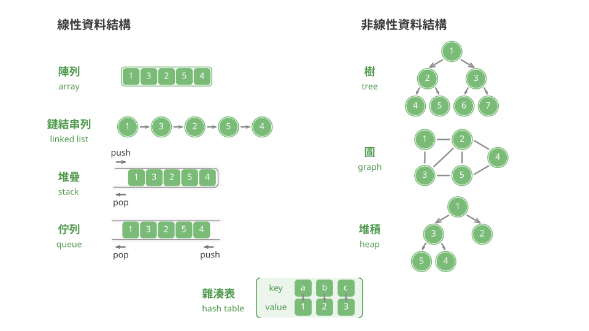
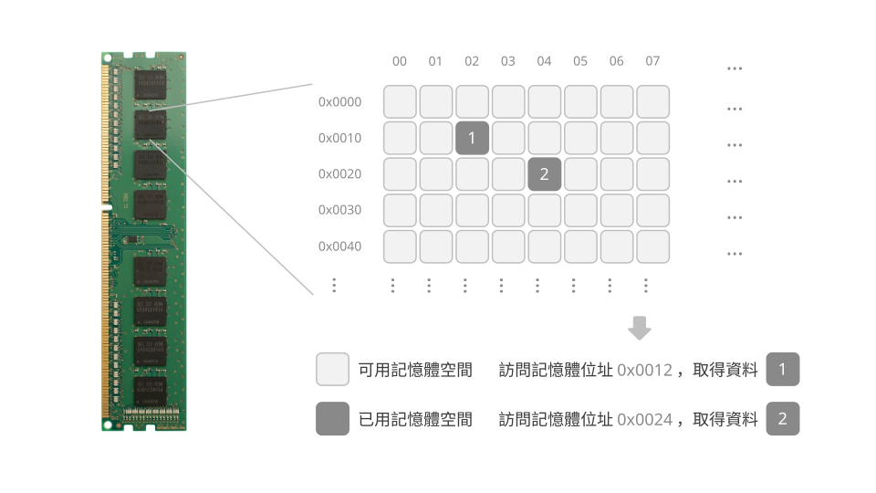
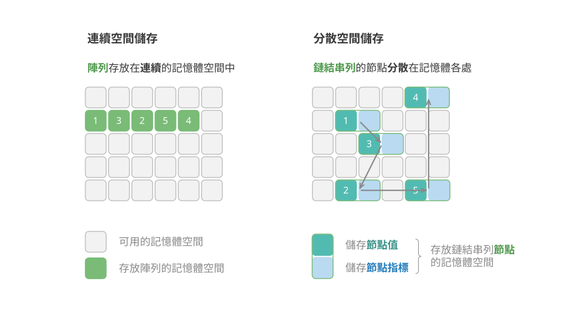

# 3.1 &nbsp; 資料結構的分類

常見的資料結構有陣列、鏈結串列、堆疊、佇列、雜湊表、樹、堆積和圖。我們可以從「邏輯結構」與「實體結構」兩個角度來分類。

## 3.1.1 &nbsp; 邏輯結構：線性與非線性

**邏輯結構描述資料元素彼此之間的邏輯關係**。在陣列和鏈結串列中，資料依一定順序排列，呈現線性關係。在樹中，資料由上而下分層排列，呈現從「祖先」衍生出「後代」的關係。圖則由節點和邊組成，能呈現複雜的網路關係。

如圖 3-1 所示，邏輯結構可分為「線性」與「非線性」兩大類。線性結構較直觀，表示資料在邏輯上排成一條線；非線性結構的資料則無法依這種方式排列。

- **線性資料結構**：陣列、鏈結串列、堆疊、佇列。元素間具有一對一的先後關係。
- **非線性資料結構**：樹、堆積、圖。

樹狀和網狀是兩種常見的非線性結構。

- **樹狀結構**：例如樹和堆積，元素之間具有一對多的關係。
- **網狀結構**：例如圖，元素之間具有多對多的關係。

雜湊表透過鍵查找值。圖中將這種對應關係獨立列出。

{ class="animation-figure" }

 圖 3-1 &nbsp; 線性資料結構與非線性資料結構 

## 3.1.2 &nbsp; 實體結構：連續與分散

**演算法程式執行時，正在處理的資料主要存放在記憶體中**。圖 3-2 是一條電腦記憶體模組，每個黑色方塊都包含一塊記憶體空間。可以把記憶體想像成一張巨大的 Excel 表格，每個儲存格都能容納一定大小的資料。

**系統藉由記憶體位址存取目標位置的資料**。如圖 3-2 所示，電腦依照特定規則為表格中的每一格編號，確保每個記憶體位置都有唯一的位址。程式就能透過這些位址存取記憶體中的資料。

{ class="animation-figure" }

 圖 3-2 &nbsp; 記憶體模組、記憶體空間與記憶體位址 

!!! tip

    將記憶體比作 Excel 表格只是一種簡化的類比。實際的運作方式更複雜，涉及位址空間、記憶體管理、快取機制、虛擬記憶體與實體記憶體等概念。

記憶體是所有程式共用的資源。一塊記憶體被某個程式占用後，通常無法同時供其他程式使用。**因此，設計資料結構與演算法時，記憶體資源是一項重要考量**。例如，演算法占用記憶體的峰值不應超過系統剩餘的可用記憶體。若沒有夠大的連續空間，選用的資料結構就必須能存放在分散的空間中。

如圖 3-3 所示，**實體結構反映資料在電腦記憶體中的儲存方式**，可分為連續空間儲存（陣列）和分散空間儲存（鏈結串列）。底層的實體結構決定了如何存取、更新、新增或刪除資料。這兩種結構在時間與空間效率上各有所長，彼此互補。

{ class="animation-figure" }

 圖 3-3 &nbsp; 連續空間儲存與分散空間儲存 

值得留意的是，**所有資料結構都以陣列、鏈結串列或兩者的組合來實作**。例如，堆疊與佇列都可以用陣列或鏈結串列實作，雜湊表的實作則可能同時用到兩者。

- **可用陣列實作**：堆疊、佇列、雜湊表、樹、堆積、圖、矩陣、張量（維度 $\geq 3$ 的陣列）等。
- **可用鏈結串列實作**：堆疊、佇列、雜湊表、樹、堆積、圖等。

鏈結串列在初始化後，執行程式時仍能調整長度，因此也稱為「動態資料結構」。陣列在初始化後長度固定，因此也稱為「靜態資料結構」。不過，重新配置記憶體就能改用不同長度的陣列，因此陣列也具備一定程度的「動態性」。

!!! tip

    若你覺得實體結構不容易理解，可以先閱讀下一章，再回來複習這一節。
