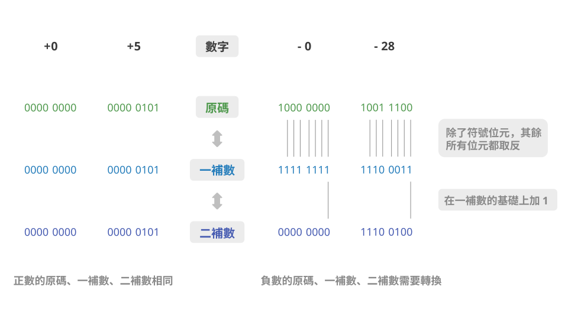
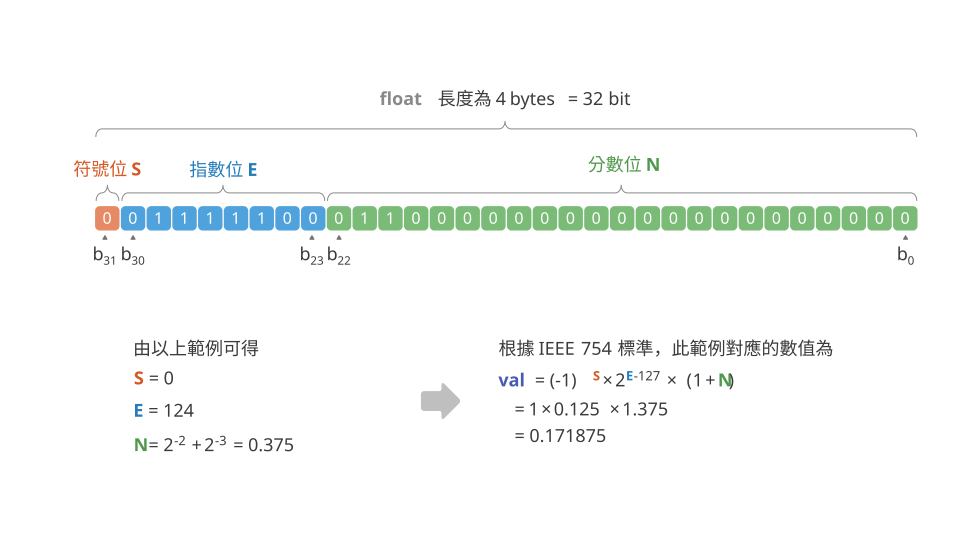

# 數值編碼 *

!!! tip

    本書標題附有 * 的章節為選讀內容。若時間有限，或覺得不易理解，可以先跳過，等讀完必讀章節後再回來研讀。

## 符號大小表示法、一補數與二補數

從上一節的表格可以發現，每種整數型別能表示的負數都比正數多一個，例如 `byte` 的取值範圍為 $[-128, 127]$。這似乎有些不合直覺；要了解原因，得先認識符號大小表示法、一補數與二補數。

首先，**電腦以「二補數」的形式儲存整數**。在探討原因之前，先來看看這三種表示法的定義。

- **符號大小表示法**：將二進位數的最高位元當作符號位元，其中 $0$ 表示正，$1$ 表示負，其餘位元表示數值的大小。
- **一補數**：正數的一補數與符號大小表示相同；負數則保留符號位元，將其餘位元全部反相。
- **二補數**：正數的二補數與符號大小表示相同；負數的二補數則是在其一補數上加 $1$。

下圖呈現符號大小表示法、一補數與二補數之間的轉換方式。

<u>符號大小表示法（sign-magnitude）</u>最直觀，但也有一些限制。首先，**負數的符號大小表示無法直接拿來運算**。例如，用符號大小表示法計算 $1 + (-2)$，會得到 $-3$，顯然不是正確答案。

$$
\begin{aligned}
& 1 + (-2) \newline
& \rightarrow 0000 \; 0001 + 1000 \; 0010 \newline
& = 1000 \; 0011 \newline
& \rightarrow -3
\end{aligned}
$$

為了解決這個問題，電腦引入了<u>一補數（1's complement）</u>。若先將符號大小表示轉成一補數，用一補數計算 $1 + (-2)$，最後再將結果轉回符號大小表示，就能得到正確的結果 $-1$。

$$
\begin{aligned}
& 1 + (-2) \newline
& \rightarrow 0000 \; 0001 \; \text{(符號大小)} + 1000 \; 0010 \; \text{(符號大小)} \newline
& = 0000 \; 0001 \; \text{(一補數)} + 1111  \; 1101 \; \text{(一補數)} \newline
& = 1111 \; 1110 \; \text{(一補數)} \newline
& = 1000 \; 0001 \; \text{(符號大小)} \newline
& \rightarrow -1
\end{aligned}
$$

另一方面，**零的符號大小表示有 $+0$ 和 $-0$ 兩種形式**。也就是說，零對應兩種不同的二進位編碼，可能產生歧義。例如，條件判斷若未區分正零與負零，就可能得到錯誤的判斷結果。但若要處理這項歧義，就需要額外的判斷操作，可能降低電腦的運算效率。

$$
\begin{aligned}
+0 & \rightarrow 0000 \; 0000 \newline
-0 & \rightarrow 1000 \; 0000
\end{aligned}
$$

一補數也和符號大小表示法一樣，有正零與負零的歧義，因此電腦進一步引入了<u>二補數（2's complement）</u>。我們先觀察負零從符號大小表示轉成一補數、再轉成二補數的過程：

$$
\begin{aligned}
-0 \rightarrow \; & 1000 \; 0000 \; \text{(符號大小)} \newline
= \; & 1111 \; 1111 \; \text{(一補數)} \newline
= 1 \; & 0000 \; 0000 \; \text{(二補數)} \newline
\end{aligned}
$$

在負零的一補數上加 $1$ 會產生進位，但 `byte` 型別的長度只有 8 位元，因此進到第 9 位的 $1$ 會被捨去。也就是說，**負零的二補數為 $0000 \; 0000$，與正零的二補數相同**。因此，二補數只有一種零的表示方式，解決了正零與負零的歧義。

最後還有一個疑問：`byte` 型別的範圍是 $[-128, 127]$，多出來的負數 $-128$ 是怎麼來的？觀察可知，區間 $[-127, +127]$ 中的每個整數都有對應的符號大小表示、一補數與二補數，而且符號大小表示和二補數可以相互轉換。

不過，**二補數 $1000 \; 0000$ 是個例外，它沒有對應的符號大小表示**。若套用轉換方法，會得到符號大小表示 $0000 \; 0000$。這顯然矛盾，因為此編碼表示 $0$，它的二補數應該等於本身。電腦規定用這個特殊的二補數 $1000 \; 0000$ 表示 $-128$。事實上，以二補數計算 $(-1) + (-127)$，結果就是 $-128$。

$$
\begin{aligned}
& (-127) + (-1) \newline
& \rightarrow 1111 \; 1111 \; \text{(符號大小)} + 1000 \; 0001 \; \text{(符號大小)} \newline
& = 1000 \; 0000 \; \text{(一補數)} + 1111  \; 1110 \; \text{(一補數)} \newline
& = 1000 \; 0001 \; \text{(二補數)} + 1111  \; 1111 \; \text{(二補數)} \newline
& = 1000 \; 0000 \; \text{(二補數)} \newline
& \rightarrow -128
\end{aligned}
$$

你可能注意到了，上述計算全都是加法。這透露了一個重要事實：**電腦內部的硬體電路設計主要以加法運算為基礎**。和乘法、除法、減法等其他運算相比，加法的硬體實作較簡單，也較容易平行處理，運算速度更快。

這並不表示電腦只能做加法。**結合加法和基本邏輯運算，電腦就能實現其他各種數學運算**。例如，減法 $a - b$ 可轉換成加法 $a + (-b)$；乘法與除法也可轉換成多次加法或減法。

現在可以總結電腦使用二補數的原因了：採用二補數，正數和負數的加法就能使用相同的電路與操作，無須為減法另外設計專用硬體，也不必特別處理正零與負零的歧義。這大幅簡化了硬體設計，提升了運算效率。

二補數的設計相當精巧，限於篇幅，這裡先介紹到此。有興趣的讀者可以進一步探索。

## 浮點數編碼

你可能已經發現，`int` 和 `float` 的長度相同，都占 4 位元組，為什麼 `float` 可表示的數值範圍卻遠大於 `int`？這似乎不合直覺：`float` 還要表示小數，照理說範圍應該更小才對。

這是**因為浮點數 `float` 的表示方式不同**。先將一個長度為 32 位元的二進位數記作：

$$
b_{31} b_{30} b_{29} \ldots b_2 b_1 b_0
$$

依據 IEEE 754 標準，32 位元的 `float` 由以下三部分組成。

- 符號欄位 $\mathrm{S}$：占 1 位元，對應 $b_{31}$。
- 指數欄位 $\mathrm{E}$：占 8 位元，對應 $b_{30} b_{29} \ldots b_{23}$。
- 小數欄位 $\mathrm{N}$：占 23 位元，對應 $b_{22} b_{21} \ldots b_0$。

二進位數 `float` 所表示的值可依下式計算：

$$
\text {val} = (-1)^{b_{31}} \times 2^{\left(b_{30} b_{29} \ldots b_{23}\right)_2-127} \times\left(1 . b_{22} b_{21} \ldots b_0\right)_2
$$

換算為十進位後，公式為：

$$
\text {val}=(-1)^{\mathrm{S}} \times 2^{\mathrm{E} -127} \times (1 + \mathrm{N})
$$

各項的取值範圍如下：

$$
\begin{aligned}
\mathrm{S} \in & \{ 0, 1\}, \quad \mathrm{E} \in \{ 1, 2, \dots, 254 \} \newline
(1 + \mathrm{N}) = & (1 + \sum_{i=1}^{23} b_{23-i} 2^{-i}) \subset [1, 2 - 2^{-23}]
\end{aligned}
$$

觀察上圖，以 $\mathrm{S} = 0$、$\mathrm{E} = 124$、$\mathrm{N} = 2^{-2} + 2^{-3} = 0.375$ 為例，可得：

$$
\text { val } = (-1)^0 \times 2^{124 - 127} \times (1 + 0.375) = 0.171875
$$

現在可以回答最初的問題了：**`float` 的表示方式含有指數欄位，因此可表示的範圍遠大於 `int`**。依照上述計算，`float` 能表示的最大正數為 $2^{254 - 127} \times (2 - 2^{-23}) \approx 3.4 \times 10^{38}$，改變符號位元就能得到最小負數。

**浮點數 `float` 擴大了可表示的數值範圍，代價是犧牲精度**。整數型別 `int` 用全部 32 個位元表示整數，數值均勻分布。浮點數 `float` 則因為有指數欄位，數值越大，相鄰兩個可表示數之間的差距通常就越大。

如下表所示，指數欄位在 $\mathrm{E} = 0$ 或 $\mathrm{E} = 255$ 時有特殊意義，**用來表示零、無窮大、$\mathrm{NaN}$ 等**。

 表 <id> &nbsp; 指數欄位的意義 

| 指數欄位 E           | 小數欄位 $\mathrm{N} = 0$ | 小數欄位 $\mathrm{N} \ne 0$ | 計算公式                                                               |
| ------------------ | ----------------------- | ------------------------- | ---------------------------------------------------------------------- |
| $0$                | $\pm 0$                 | 次正規數                  | $(-1)^{\mathrm{S}} \times 2^{-126} \times (0.\mathrm{N})$              |
| $1, 2, \dots, 254$ | 正規數                  | 正規數                    | $(-1)^{\mathrm{S}} \times 2^{(\mathrm{E} -127)} \times (1.\mathrm{N})$ |
| $255$              | $\pm \infty$            | $\mathrm{NaN}$            |                                                                        |

值得留意的是，次正規數大幅改善了浮點數表示接近零的數值時的精細程度。最小的正規正數為 $2^{-126}$，最小的次正規正數為 $2^{-126} \times 2^{-23}$。

雙精度的 `double` 與 `float` 採用類似的表示方式，這裡不再詳述。
