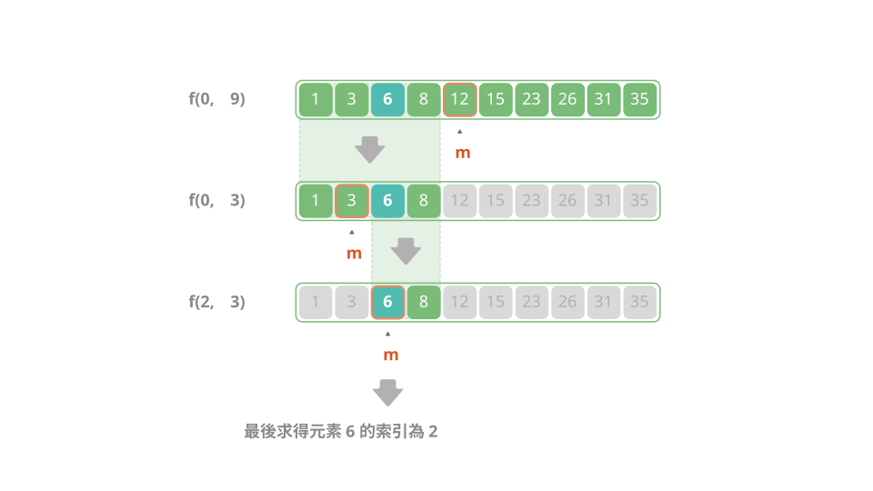

# 12.2 &nbsp; 分治搜尋策略

我們已經學過，搜尋演算法可分為兩大類。

- **暴力搜尋**：逐一走訪資料結構，時間複雜度為 $O(n)$。
- **適應性搜尋**：利用資料特有的組織方式或事先已知的資訊，時間複雜度可達 $O(\log n)$，甚至 $O(1)$。

實際上，**時間複雜度為 $O(\log n)$ 的搜尋演算法通常採用分治策略**，例如二分搜尋或在樹中搜尋。

- 二分搜尋每一步都將問題（在陣列中尋找目標元素）縮小為子問題（在一半的陣列中尋找目標元素），直到搜尋範圍為空或找到目標元素為止。
- 樹是分治思想的代表。在二元搜尋樹、AVL 樹、堆積等資料結構中，各種操作的時間複雜度皆為 $O(\log n)$。

二分搜尋的分治策略如下。

- **問題可以分解**：比較中點元素與目標元素，就能將原問題（在陣列中搜尋）遞迴分解為子問題（在一半的陣列中搜尋）。
- **子問題彼此獨立**：二分搜尋每一輪只處理一個子問題，不受其他子問題影響。
- **無須合併子問題的解**：二分搜尋只要找到特定元素，無須合併各個解。子問題一解決，原問題也就解決了。

分治能提高搜尋效率，原因在於暴力搜尋每一輪只能排除一個選項，**分治搜尋每一輪卻可以排除一半的選項**。

### 1. &nbsp; 用分治法實作二分搜尋

先前的章節用遞推（迭代）實作二分搜尋。現在，我們改用分治（遞迴）來實作。

!!! question

    給定長度為 $n$ 的已排序陣列 `nums`，其中所有元素皆相異，請找出元素 `target`。

從分治法的角度來看，可將搜尋區間 $[i, j]$ 所對應的子問題記為 $f(i, j)$。

從原問題 $f(0, n-1)$ 出發，依照以下步驟進行二分搜尋。

1. 算出搜尋區間 $[i, j]$ 的中點 $m$，據此排除一半的搜尋區間。
2. 遞迴求解規模減半的子問題，可能是 $f(i, m-1)$ 或 $f(m+1, j)$。
3. 重複第 `1.` 步和第 `2.` 步，直到找到 `target` 或區間為空時返回。

圖 12-4 呈現以二分搜尋在陣列中尋找元素 $6$ 的分治過程。

{ class="animation-figure" }

<p align="center"> 圖 12-4 &nbsp; 二分搜尋的分治過程 </p>

實作時，我們宣告遞迴函式 `dfs()` 來求解問題 $f(i, j)$：

=== "Python"

    ```python title="binary_search_recur.py"
    def dfs(nums: list[int], target: int, i: int, j: int) -> int:
        """二分搜尋：問題 f(i, j)"""
        # 若區間為空，表示沒有目標元素，回傳 -1
        if i > j:
            return -1
        # 計算中點索引 m
        m = (i + j) // 2
        if nums[m] < target:
            # 遞迴求解子問題 f(m+1, j)
            return dfs(nums, target, m + 1, j)
        elif nums[m] > target:
            # 遞迴求解子問題 f(i, m-1)
            return dfs(nums, target, i, m - 1)
        else:
            # 找到目標元素，回傳其索引
            return m

    def binary_search(nums: list[int], target: int) -> int:
        """二分搜尋"""
        n = len(nums)
        # 求解問題 f(0, n-1)
        return dfs(nums, target, 0, n - 1)
    ```

=== "C++"

    ```cpp title="binary_search_recur.cpp"
    /* 二分搜尋：問題 f(i, j) */
    int dfs(vector<int> &nums, int target, int i, int j) {
        // 若區間為空，表示沒有目標元素，回傳 -1
        if (i > j) {
            return -1;
        }
        // 計算中點索引 m
        int m = (i + j) / 2;
        if (nums[m] < target) {
            // 遞迴求解子問題 f(m+1, j)
            return dfs(nums, target, m + 1, j);
        } else if (nums[m] > target) {
            // 遞迴求解子問題 f(i, m-1)
            return dfs(nums, target, i, m - 1);
        } else {
            // 找到目標元素，回傳其索引
            return m;
        }
    }

    /* 二分搜尋 */
    int binarySearch(vector<int> &nums, int target) {
        int n = nums.size();
        // 求解問題 f(0, n-1)
        return dfs(nums, target, 0, n - 1);
    }
    ```

=== "Java"

    ```java title="binary_search_recur.java"
    /* 二分搜尋：問題 f(i, j) */
    int dfs(int[] nums, int target, int i, int j) {
        // 若區間為空，表示沒有目標元素，回傳 -1
        if (i > j) {
            return -1;
        }
        // 計算中點索引 m
        int m = (i + j) / 2;
        if (nums[m] < target) {
            // 遞迴求解子問題 f(m+1, j)
            return dfs(nums, target, m + 1, j);
        } else if (nums[m] > target) {
            // 遞迴求解子問題 f(i, m-1)
            return dfs(nums, target, i, m - 1);
        } else {
            // 找到目標元素，回傳其索引
            return m;
        }
    }

    /* 二分搜尋 */
    int binarySearch(int[] nums, int target) {
        int n = nums.length;
        // 求解問題 f(0, n-1)
        return dfs(nums, target, 0, n - 1);
    }
    ```

=== "C#"

    ```csharp title="binary_search_recur.cs"
    /* 二分搜尋：問題 f(i, j) */
    int DFS(int[] nums, int target, int i, int j) {
        // 若區間為空，表示沒有目標元素，回傳 -1
        if (i > j) {
            return -1;
        }
        // 計算中點索引 m
        int m = (i + j) / 2;
        if (nums[m] < target) {
            // 遞迴求解子問題 f(m+1, j)
            return DFS(nums, target, m + 1, j);
        } else if (nums[m] > target) {
            // 遞迴求解子問題 f(i, m-1)
            return DFS(nums, target, i, m - 1);
        } else {
            // 找到目標元素，回傳其索引
            return m;
        }
    }

    /* 二分搜尋 */
    int BinarySearch(int[] nums, int target) {
        int n = nums.Length;
        // 求解問題 f(0, n-1)
        return DFS(nums, target, 0, n - 1);
    }
    ```

=== "Go"

    ```go title="binary_search_recur.go"
    /* 二分搜尋：問題 f(i, j) */
    func dfs(nums []int, target, i, j int) int {
        // 若區間為空，表示沒有目標元素，回傳 -1
        if i > j {
            return -1
        }
        //    計算中點索引
        m := i + ((j - i) >> 1)
        //比較中點元素與目標元素的大小
        if nums[m] < target {
            // 若中點元素較小，遞迴搜尋右半部陣列
            // 遞迴求解子問題 f(m+1, j)
            return dfs(nums, target, m+1, j)
        } else if nums[m] > target {
            // 若中點元素較大，遞迴搜尋左半部陣列
            // 遞迴求解子問題 f(i, m-1)
            return dfs(nums, target, i, m-1)
        } else {
            // 找到目標元素，回傳其索引
            return m
        }
    }

    /* 二分搜尋 */
    func binarySearch(nums []int, target int) int {
        n := len(nums)
        return dfs(nums, target, 0, n-1)
    }
    ```

=== "Swift"

    ```swift title="binary_search_recur.swift"
    /* 二分搜尋：問題 f(i, j) */
    func dfs(nums: [Int], target: Int, i: Int, j: Int) -> Int {
        // 若區間為空，表示沒有目標元素，回傳 -1
        if i > j {
            return -1
        }
        // 計算中點索引 m
        let m = (i + j) / 2
        if nums[m] < target {
            // 遞迴求解子問題 f(m+1, j)
            return dfs(nums: nums, target: target, i: m + 1, j: j)
        } else if nums[m] > target {
            // 遞迴求解子問題 f(i, m-1)
            return dfs(nums: nums, target: target, i: i, j: m - 1)
        } else {
            // 找到目標元素，回傳其索引
            return m
        }
    }

    /* 二分搜尋 */
    func binarySearch(nums: [Int], target: Int) -> Int {
        // 求解問題 f(0, n-1)
        dfs(nums: nums, target: target, i: nums.startIndex, j: nums.endIndex - 1)
    }
    ```

=== "JS"

    ```javascript title="binary_search_recur.js"
    /* 二分搜尋：問題 f(i, j) */
    function dfs(nums, target, i, j) {
        // 若區間為空，表示沒有目標元素，回傳 -1
        if (i > j) {
            return -1;
        }
        // 計算中點索引 m
        const m = i + ((j - i) >> 1);
        if (nums[m] < target) {
            // 遞迴求解子問題 f(m+1, j)
            return dfs(nums, target, m + 1, j);
        } else if (nums[m] > target) {
            // 遞迴求解子問題 f(i, m-1)
            return dfs(nums, target, i, m - 1);
        } else {
            // 找到目標元素，回傳其索引
            return m;
        }
    }

    /* 二分搜尋 */
    function binarySearch(nums, target) {
        const n = nums.length;
        // 求解問題 f(0, n-1)
        return dfs(nums, target, 0, n - 1);
    }
    ```

=== "TS"

    ```typescript title="binary_search_recur.ts"
    /* 二分搜尋：問題 f(i, j) */
    function dfs(nums: number[], target: number, i: number, j: number): number {
        // 若區間為空，表示沒有目標元素，回傳 -1
        if (i > j) {
            return -1;
        }
        // 計算中點索引 m
        const m = i + ((j - i) >> 1);
        if (nums[m] < target) {
            // 遞迴求解子問題 f(m+1, j)
            return dfs(nums, target, m + 1, j);
        } else if (nums[m] > target) {
            // 遞迴求解子問題 f(i, m-1)
            return dfs(nums, target, i, m - 1);
        } else {
            // 找到目標元素，回傳其索引
            return m;
        }
    }

    /* 二分搜尋 */
    function binarySearch(nums: number[], target: number): number {
        const n = nums.length;
        // 求解問題 f(0, n-1)
        return dfs(nums, target, 0, n - 1);
    }
    ```

=== "Dart"

    ```dart title="binary_search_recur.dart"
    /* 二分搜尋：問題 f(i, j) */
    int dfs(List<int> nums, int target, int i, int j) {
      // 若區間為空，表示沒有目標元素，回傳 -1
      if (i > j) {
        return -1;
      }
      // 計算中點索引 m
      int m = (i + j) ~/ 2;
      if (nums[m] < target) {
        // 遞迴求解子問題 f(m+1, j)
        return dfs(nums, target, m + 1, j);
      } else if (nums[m] > target) {
        // 遞迴求解子問題 f(i, m-1)
        return dfs(nums, target, i, m - 1);
      } else {
        // 找到目標元素，回傳其索引
        return m;
      }
    }

    /* 二分搜尋 */
    int binarySearch(List<int> nums, int target) {
      int n = nums.length;
      // 求解問題 f(0, n-1)
      return dfs(nums, target, 0, n - 1);
    }
    ```

=== "Rust"

    ```rust title="binary_search_recur.rs"
    /* 二分搜尋：問題 f(i, j) */
    fn dfs(nums: &[i32], target: i32, i: i32, j: i32) -> i32 {
        // 若區間為空，表示沒有目標元素，回傳 -1
        if i > j {
            return -1;
        }
        let m: i32 = i + (j - i) / 2;
        if nums[m as usize] < target {
            // 遞迴求解子問題 f(m+1, j)
            return dfs(nums, target, m + 1, j);
        } else if nums[m as usize] > target {
            // 遞迴求解子問題 f(i, m-1)
            return dfs(nums, target, i, m - 1);
        } else {
            // 找到目標元素，回傳其索引
            return m;
        }
    }

    /* 二分搜尋 */
    fn binary_search(nums: &[i32], target: i32) -> i32 {
        let n = nums.len() as i32;
        // 求解問題 f(0, n-1)
        dfs(nums, target, 0, n - 1)
    }
    ```

=== "C"

    ```c title="binary_search_recur.c"
    /* 二分搜尋：問題 f(i, j) */
    int dfs(int nums[], int target, int i, int j) {
        // 若區間為空，表示沒有目標元素，回傳 -1
        if (i > j) {
            return -1;
        }
        // 計算中點索引 m
        int m = (i + j) / 2;
        if (nums[m] < target) {
            // 遞迴求解子問題 f(m+1, j)
            return dfs(nums, target, m + 1, j);
        } else if (nums[m] > target) {
            // 遞迴求解子問題 f(i, m-1)
            return dfs(nums, target, i, m - 1);
        } else {
            // 找到目標元素，回傳其索引
            return m;
        }
    }

    /* 二分搜尋 */
    int binarySearch(int nums[], int target, int numsSize) {
        int n = numsSize;
        // 求解問題 f(0, n-1)
        return dfs(nums, target, 0, n - 1);
    }
    ```

=== "Kotlin"

    ```kotlin title="binary_search_recur.kt"
    /* 二分搜尋：問題 f(i, j) */
    fun dfs(
        nums: IntArray,
        target: Int,
        i: Int,
        j: Int
    ): Int {
        // 若區間為空，表示沒有目標元素，回傳 -1
        if (i > j) {
            return -1
        }
        // 計算中點索引 m
        val m = (i + j) / 2
        return if (nums[m] < target) {
            // 遞迴求解子問題 f(m+1, j)
            dfs(nums, target, m + 1, j)
        } else if (nums[m] > target) {
            // 遞迴求解子問題 f(i, m-1)
            dfs(nums, target, i, m - 1)
        } else {
            // 找到目標元素，回傳其索引
            m
        }
    }

    /* 二分搜尋 */
    fun binarySearch(nums: IntArray, target: Int): Int {
        val n = nums.size
        // 求解問題 f(0, n-1)
        return dfs(nums, target, 0, n - 1)
    }
    ```

=== "Ruby"

    ```ruby title="binary_search_recur.rb"
    ### 二分搜尋：問題 f(i, j) ###
    def dfs(nums, target, i, j)
      # 若區間為空，表示沒有目標元素，回傳 -1
      return -1 if i > j
      
      # 計算中點索引 m
      m = (i + j) / 2

      if nums[m] < target
        # 遞迴求解子問題 f(m+1, j)
        return dfs(nums, target, m + 1, j)
      elsif nums[m] > target
        # 遞迴求解子問題 f(i, m-1)
        return dfs(nums, target, i, m - 1)
      else
        # 找到目標元素，回傳其索引
        return m
      end
    end

    ### 二分搜尋 ###
    def binary_search(nums, target)
      n = nums.length
      # 求解問題 f(0, n-1)
      dfs(nums, target, 0, n - 1)
    end
    ```

??? pythontutor "執行視覺化示範"

    <div style="height: 549px; width: 100%;"><iframe class="pythontutor-iframe" title="執行視覺化示範" src="https://pythontutor.com/iframe-embed.html#code=def%20dfs%28nums%3A%20list%5Bint%5D,%20target%3A%20int,%20i%3A%20int,%20j%3A%20int%29%20-%3E%20int%3A%0A%20%20%20%20%22%22%22%E4%BA%8C%E5%88%86%E6%90%9C%E5%B0%8B%EF%BC%9A%E5%95%8F%E9%A1%8C%20f%28i,%20j%29%22%22%22%0A%20%20%20%20%23%20%E8%8B%A5%E5%8D%80%E9%96%93%E7%82%BA%E7%A9%BA%EF%BC%8C%E8%A1%A8%E7%A4%BA%E6%B2%92%E6%9C%89%E7%9B%AE%E6%A8%99%E5%85%83%E7%B4%A0%EF%BC%8C%E5%9B%9E%E5%82%B3%20-1%0A%20%20%20%20if%20i%20%3E%20j%3A%0A%20%20%20%20%20%20%20%20return%20-1%0A%20%20%20%20%23%20%E8%A8%88%E7%AE%97%E4%B8%AD%E9%BB%9E%E7%B4%A2%E5%BC%95%20m%0A%20%20%20%20m%20%3D%20%28i%20%2B%20j%29%20//%202%0A%20%20%20%20if%20nums%5Bm%5D%20%3C%20target%3A%0A%20%20%20%20%20%20%20%20%23%20%E9%81%9E%E8%BF%B4%E6%B1%82%E8%A7%A3%E5%AD%90%E5%95%8F%E9%A1%8C%20f%28m%2B1,%20j%29%0A%20%20%20%20%20%20%20%20return%20dfs%28nums,%20target,%20m%20%2B%201,%20j%29%0A%20%20%20%20elif%20nums%5Bm%5D%20%3E%20target%3A%0A%20%20%20%20%20%20%20%20%23%20%E9%81%9E%E8%BF%B4%E6%B1%82%E8%A7%A3%E5%AD%90%E5%95%8F%E9%A1%8C%20f%28i,%20m-1%29%0A%20%20%20%20%20%20%20%20return%20dfs%28nums,%20target,%20i,%20m%20-%201%29%0A%20%20%20%20else%3A%0A%20%20%20%20%20%20%20%20%23%20%E6%89%BE%E5%88%B0%E7%9B%AE%E6%A8%99%E5%85%83%E7%B4%A0%EF%BC%8C%E5%9B%9E%E5%82%B3%E5%85%B6%E7%B4%A2%E5%BC%95%0A%20%20%20%20%20%20%20%20return%20m%0A%0Adef%20binary_search%28nums%3A%20list%5Bint%5D,%20target%3A%20int%29%20-%3E%20int%3A%0A%20%20%20%20%22%22%22%E4%BA%8C%E5%88%86%E6%90%9C%E5%B0%8B%22%22%22%0A%20%20%20%20n%20%3D%20len%28nums%29%0A%20%20%20%20%23%20%E6%B1%82%E8%A7%A3%E5%95%8F%E9%A1%8C%20f%280,%20n-1%29%0A%20%20%20%20return%20dfs%28nums,%20target,%200,%20n%20-%201%29%0A%0A%22%22%22Driver%20Code%22%22%22%0Aif%20__name__%20%3D%3D%20%22__main__%22%3A%0A%20%20%20%20target%20%3D%206%0A%20%20%20%20nums%20%3D%20%5B1,%203,%206,%208,%2012,%2015,%2023,%2026,%2031,%2035%5D%0A%0A%20%20%20%20%23%20%E4%BA%8C%E5%88%86%E6%90%9C%E5%B0%8B%EF%BC%88%E5%85%A9%E7%AB%AF%E7%9A%86%E5%90%AB%E7%9A%84%E9%96%89%E5%8D%80%E9%96%93%EF%BC%89%0A%20%20%20%20index%20%3D%20binary_search%28nums,%20target%29%0A%20%20%20%20print%28%22%E7%9B%AE%E6%A8%99%E5%85%83%E7%B4%A0%206%20%E7%9A%84%E7%B4%A2%E5%BC%95%20%3D%20%22,%20index%29&codeDivHeight=472&codeDivWidth=350&cumulative=false&curInstr=6&heapPrimitives=nevernest&origin=opt-frontend.js&py=311&rawInputLstJSON=%5B%5D&textReferences=false"> </iframe></div>
    <div style="margin-top: 5px;"><a href="https://pythontutor.com/iframe-embed.html#code=def%20dfs%28nums%3A%20list%5Bint%5D,%20target%3A%20int,%20i%3A%20int,%20j%3A%20int%29%20-%3E%20int%3A%0A%20%20%20%20%22%22%22%E4%BA%8C%E5%88%86%E6%90%9C%E5%B0%8B%EF%BC%9A%E5%95%8F%E9%A1%8C%20f%28i,%20j%29%22%22%22%0A%20%20%20%20%23%20%E8%8B%A5%E5%8D%80%E9%96%93%E7%82%BA%E7%A9%BA%EF%BC%8C%E8%A1%A8%E7%A4%BA%E6%B2%92%E6%9C%89%E7%9B%AE%E6%A8%99%E5%85%83%E7%B4%A0%EF%BC%8C%E5%9B%9E%E5%82%B3%20-1%0A%20%20%20%20if%20i%20%3E%20j%3A%0A%20%20%20%20%20%20%20%20return%20-1%0A%20%20%20%20%23%20%E8%A8%88%E7%AE%97%E4%B8%AD%E9%BB%9E%E7%B4%A2%E5%BC%95%20m%0A%20%20%20%20m%20%3D%20%28i%20%2B%20j%29%20//%202%0A%20%20%20%20if%20nums%5Bm%5D%20%3C%20target%3A%0A%20%20%20%20%20%20%20%20%23%20%E9%81%9E%E8%BF%B4%E6%B1%82%E8%A7%A3%E5%AD%90%E5%95%8F%E9%A1%8C%20f%28m%2B1,%20j%29%0A%20%20%20%20%20%20%20%20return%20dfs%28nums,%20target,%20m%20%2B%201,%20j%29%0A%20%20%20%20elif%20nums%5Bm%5D%20%3E%20target%3A%0A%20%20%20%20%20%20%20%20%23%20%E9%81%9E%E8%BF%B4%E6%B1%82%E8%A7%A3%E5%AD%90%E5%95%8F%E9%A1%8C%20f%28i,%20m-1%29%0A%20%20%20%20%20%20%20%20return%20dfs%28nums,%20target,%20i,%20m%20-%201%29%0A%20%20%20%20else%3A%0A%20%20%20%20%20%20%20%20%23%20%E6%89%BE%E5%88%B0%E7%9B%AE%E6%A8%99%E5%85%83%E7%B4%A0%EF%BC%8C%E5%9B%9E%E5%82%B3%E5%85%B6%E7%B4%A2%E5%BC%95%0A%20%20%20%20%20%20%20%20return%20m%0A%0Adef%20binary_search%28nums%3A%20list%5Bint%5D,%20target%3A%20int%29%20-%3E%20int%3A%0A%20%20%20%20%22%22%22%E4%BA%8C%E5%88%86%E6%90%9C%E5%B0%8B%22%22%22%0A%20%20%20%20n%20%3D%20len%28nums%29%0A%20%20%20%20%23%20%E6%B1%82%E8%A7%A3%E5%95%8F%E9%A1%8C%20f%280,%20n-1%29%0A%20%20%20%20return%20dfs%28nums,%20target,%200,%20n%20-%201%29%0A%0A%22%22%22Driver%20Code%22%22%22%0Aif%20__name__%20%3D%3D%20%22__main__%22%3A%0A%20%20%20%20target%20%3D%206%0A%20%20%20%20nums%20%3D%20%5B1,%203,%206,%208,%2012,%2015,%2023,%2026,%2031,%2035%5D%0A%0A%20%20%20%20%23%20%E4%BA%8C%E5%88%86%E6%90%9C%E5%B0%8B%EF%BC%88%E5%85%A9%E7%AB%AF%E7%9A%86%E5%90%AB%E7%9A%84%E9%96%89%E5%8D%80%E9%96%93%EF%BC%89%0A%20%20%20%20index%20%3D%20binary_search%28nums,%20target%29%0A%20%20%20%20print%28%22%E7%9B%AE%E6%A8%99%E5%85%83%E7%B4%A0%206%20%E7%9A%84%E7%B4%A2%E5%BC%95%20%3D%20%22,%20index%29&codeDivHeight=800&codeDivWidth=600&cumulative=false&curInstr=6&heapPrimitives=nevernest&origin=opt-frontend.js&py=311&rawInputLstJSON=%5B%5D&textReferences=false" target="_blank" rel="noopener noreferrer">全螢幕觀看 ></a></div>
