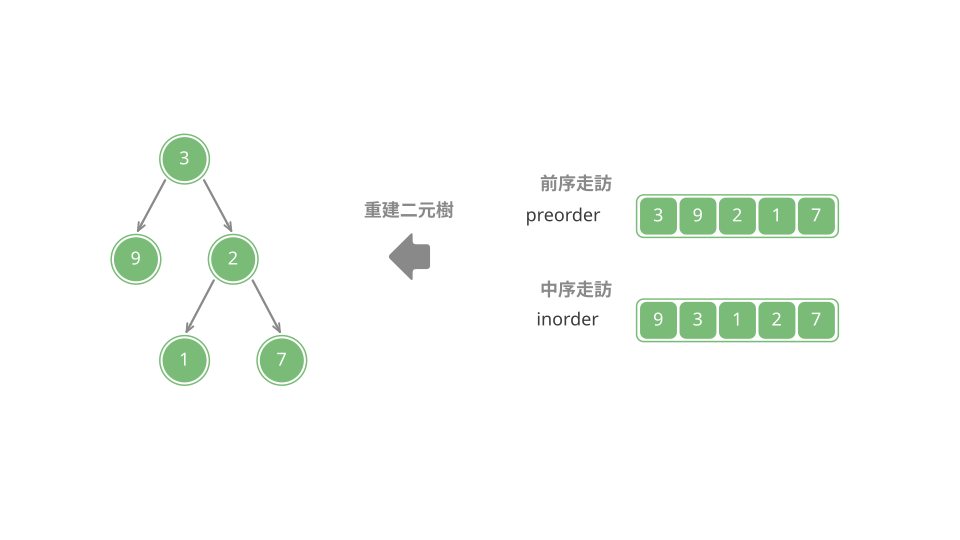
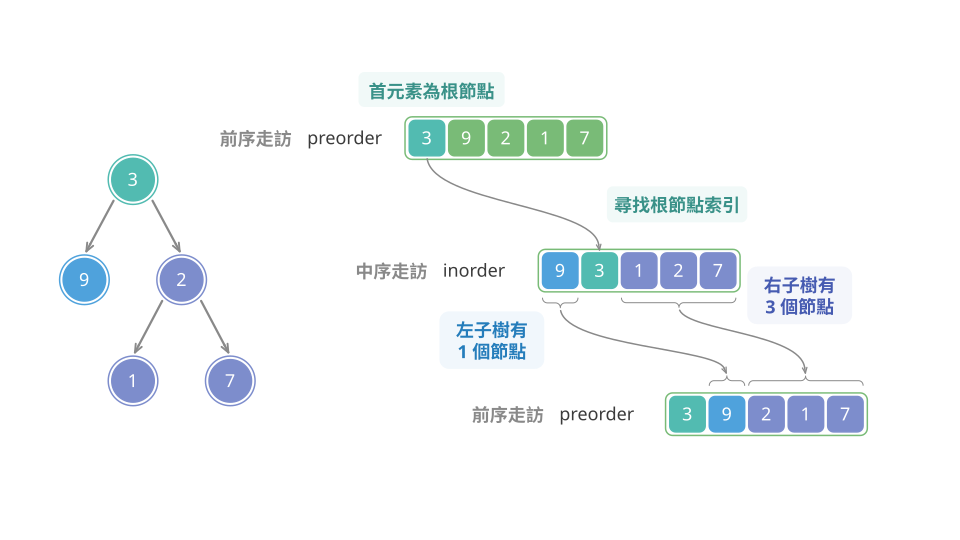
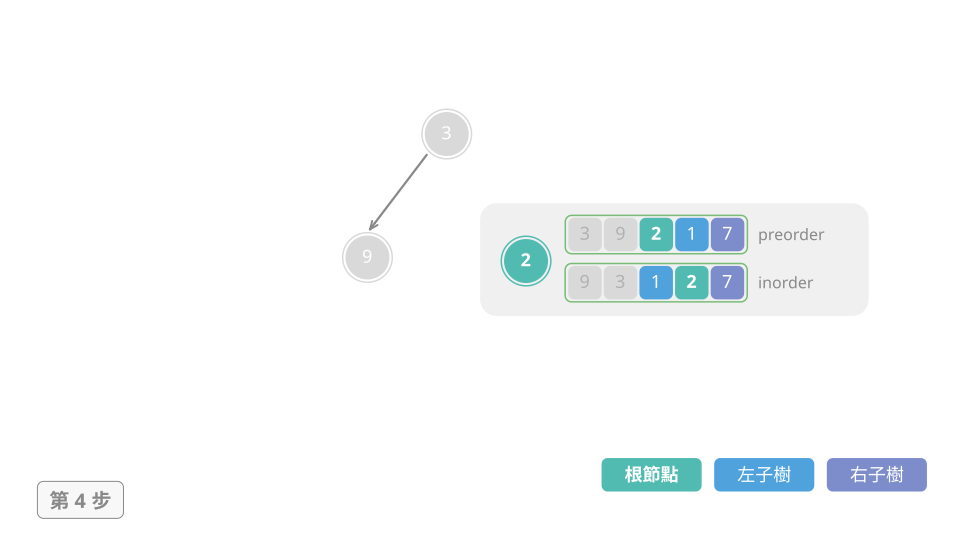
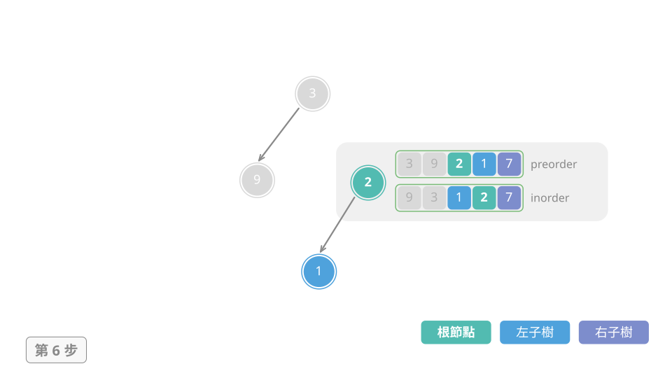
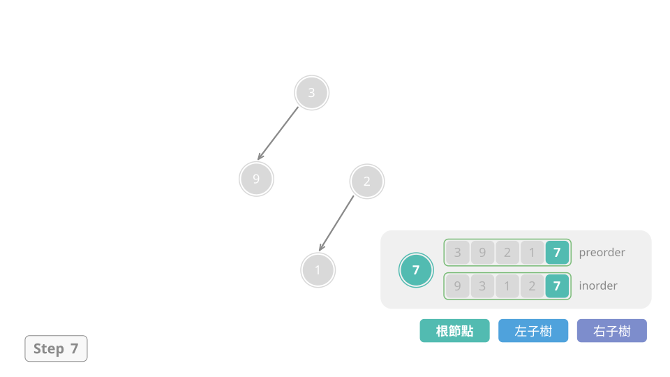
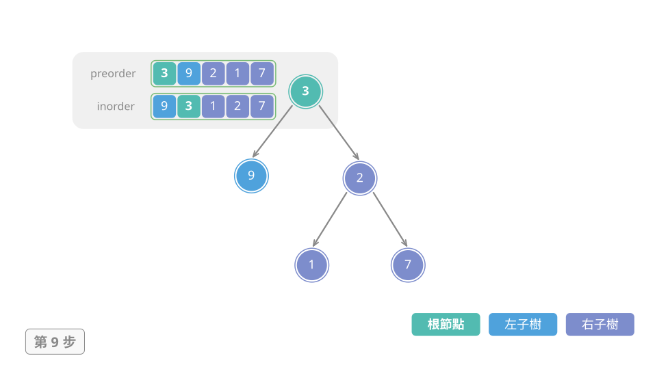
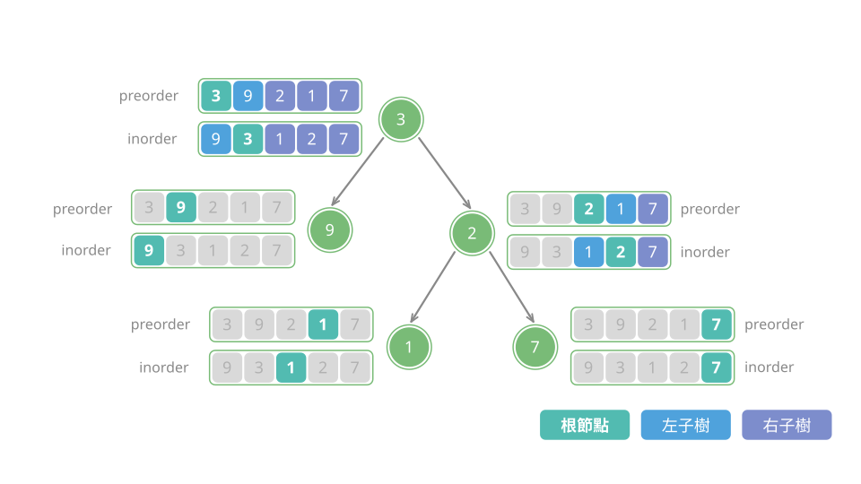

# 12.3 &nbsp; 建構二元樹問題

!!! question

    給定一棵二元樹的前序走訪序列 `preorder` 與中序走訪序列 `inorder`，請據此建構二元樹並回傳根節點。假設樹中所有節點值皆相異（如圖 12-5 所示）。

{ class="animation-figure" }

<p align="center"> 圖 12-5 &nbsp; 建構二元樹的範例資料 </p>

### 1. &nbsp; 判斷問題是否適用分治法

原問題是從 `preorder` 和 `inorder` 建構二元樹，這是典型的分治問題。

- **問題可以分解**：從分治法的角度來看，除了初始化根節點，只須解決「建構左子樹」和「建構右子樹」兩個子問題。對每棵子樹（子問題），都可以用相同的方法再分成更小的子樹（子問題），直到遇到最小的子問題（空子樹）為止。
- **子問題彼此獨立**：左子樹與右子樹沒有交集，可以各自處理。建構左子樹時，只須考慮中序與前序序列中對應左子樹的部分。右子樹也是如此。
- **子問題的解可以合併**：得到左子樹和右子樹（子問題的解）後，將兩者接到根節點上，就得到原問題的解。

### 2. &nbsp; 如何劃分子樹

根據上述分析，這道題可以用分治法求解，**但如何利用前序序列 `preorder` 和中序序列 `inorder` 分出左子樹與右子樹呢**？

依照走訪定義，`preorder` 與 `inorder` 都可以分成三個部分。

- 前序走訪：`[ 根節點 | 左子樹 | 右子樹 ]`，以圖 12-5 為例，得到 `[ 3 | 9 | 2 1 7 ]`。
- 中序走訪：`[ 左子樹 | 根節點 | 右子樹 ]`，以圖 12-5 為例，得到 `[ 9 | 3 | 1 2 7 ]`。

以上圖的資料為例，可以依照圖 12-6 的步驟劃分子樹。

1. 前序序列的第一個元素 3 就是根節點的值。
2. 找出根節點 3 在 `inorder` 中的索引，便可據此將 `inorder` 分成 `[ 9 | 3 | 1 2 7 ]`。
3. 根據 `inorder` 的劃分結果，可知左右子樹的節點數分別為 1 和 3，因此可將 `preorder` 分成 `[ 3 | 9 | 2 1 7 ]`。

{ class="animation-figure" }

<p align="center"> 圖 12-6 &nbsp; 在前序與中序序列中劃分子樹 </p>

### 3. &nbsp; 用變數表示子樹區間

根據上述劃分方式，**我們已得到根節點、左子樹與右子樹在 `preorder` 和 `inorder` 中的索引區間**。接下來可以用幾個指標變數來表示這些區間。

- 將目前子樹的根節點在 `preorder` 中的索引記為 $i$。
- 將目前子樹的根節點在 `inorder` 中的索引記為 $m$。
- 將目前子樹在 `inorder` 中的索引區間記為 $[l, r]$。

如表 12-1 所示，利用這些變數，就能表示根節點在 `preorder` 中的索引，以及子樹在 `inorder` 中的索引區間。

<p align="center"> 表 12-1 &nbsp; 根節點與子樹在前序、中序序列中的索引 </p>

<div class="center-table" markdown>

|        | 根節點在 `preorder` 中的索引 | 子樹在 `inorder` 中的索引區間 |
| ------ | ---------------------------- | ----------------------------- |
| 目前的樹 | $i$                          | $[l, r]$                      |
| 左子樹 | $i + 1$                      | $[l, m-1]$                    |
| 右子樹 | $i + 1 + (m - l)$            | $[m+1, r]$                    |

</div>

計算右子樹根節點的索引時，式中的 $(m-l)$ 代表左子樹的節點數。可對照圖 12-7 來理解。

{ class="animation-figure" }

<p align="center"> 圖 12-7 &nbsp; 以索引區間表示根節點與左右子樹 </p>

### 4. &nbsp; 程式實作

為了更快查出 $m$，我們用雜湊表 `hmap` 記錄陣列 `inorder` 中各元素對應的索引：

=== "Python"

    ```python title="build_tree.py"
    def dfs(
        preorder: list[int],
        inorder_map: dict[int, int],
        i: int,
        l: int,
        r: int,
    ) -> TreeNode | None:
        """建構二元樹：分治法"""
        # 子樹區間為空時終止
        if r - l < 0:
            return None
        # 初始化根節點
        root = TreeNode(preorder[i])
        # 查出 m，據此劃分左右子樹
        m = inorder_map[preorder[i]]
        # 子問題：建構左子樹
        root.left = dfs(preorder, inorder_map, i + 1, l, m - 1)
        # 子問題：建構右子樹
        root.right = dfs(preorder, inorder_map, i + 1 + m - l, m + 1, r)
        # 回傳根節點
        return root

    def build_tree(preorder: list[int], inorder: list[int]) -> TreeNode | None:
        """建構二元樹"""
        # 初始化雜湊表，記錄 inorder 中各元素對應的索引
        inorder_map = {val: i for i, val in enumerate(inorder)}
        root = dfs(preorder, inorder_map, 0, 0, len(inorder) - 1)
        return root
    ```

=== "C++"

    ```cpp title="build_tree.cpp"
    /* 建構二元樹：分治法 */
    TreeNode *dfs(vector<int> &preorder, unordered_map<int, int> &inorderMap, int i, int l, int r) {
        // 子樹區間為空時終止
        if (r - l < 0)
            return NULL;
        // 初始化根節點
        TreeNode *root = new TreeNode(preorder[i]);
        // 查出 m，據此劃分左右子樹
        int m = inorderMap[preorder[i]];
        // 子問題：建構左子樹
        root->left = dfs(preorder, inorderMap, i + 1, l, m - 1);
        // 子問題：建構右子樹
        root->right = dfs(preorder, inorderMap, i + 1 + m - l, m + 1, r);
        // 回傳根節點
        return root;
    }

    /* 建構二元樹 */
    TreeNode *buildTree(vector<int> &preorder, vector<int> &inorder) {
        // 初始化雜湊表，記錄 inorder 中各元素對應的索引
        unordered_map<int, int> inorderMap;
        for (int i = 0; i < inorder.size(); i++) {
            inorderMap[inorder[i]] = i;
        }
        TreeNode *root = dfs(preorder, inorderMap, 0, 0, inorder.size() - 1);
        return root;
    }
    ```

=== "Java"

    ```java title="build_tree.java"
    /* 建構二元樹：分治法 */
    TreeNode dfs(int[] preorder, Map<Integer, Integer> inorderMap, int i, int l, int r) {
        // 子樹區間為空時終止
        if (r - l < 0)
            return null;
        // 初始化根節點
        TreeNode root = new TreeNode(preorder[i]);
        // 查出 m，據此劃分左右子樹
        int m = inorderMap.get(preorder[i]);
        // 子問題：建構左子樹
        root.left = dfs(preorder, inorderMap, i + 1, l, m - 1);
        // 子問題：建構右子樹
        root.right = dfs(preorder, inorderMap, i + 1 + m - l, m + 1, r);
        // 回傳根節點
        return root;
    }

    /* 建構二元樹 */
    TreeNode buildTree(int[] preorder, int[] inorder) {
        // 初始化雜湊表，記錄 inorder 中各元素對應的索引
        Map<Integer, Integer> inorderMap = new HashMap<>();
        for (int i = 0; i < inorder.length; i++) {
            inorderMap.put(inorder[i], i);
        }
        TreeNode root = dfs(preorder, inorderMap, 0, 0, inorder.length - 1);
        return root;
    }
    ```

=== "C#"

    ```csharp title="build_tree.cs"
    /* 建構二元樹：分治法 */
    TreeNode? DFS(int[] preorder, Dictionary<int, int> inorderMap, int i, int l, int r) {
        // 子樹區間為空時終止
        if (r - l < 0)
            return null;
        // 初始化根節點
        TreeNode root = new(preorder[i]);
        // 查出 m，據此劃分左右子樹
        int m = inorderMap[preorder[i]];
        // 子問題：建構左子樹
        root.left = DFS(preorder, inorderMap, i + 1, l, m - 1);
        // 子問題：建構右子樹
        root.right = DFS(preorder, inorderMap, i + 1 + m - l, m + 1, r);
        // 回傳根節點
        return root;
    }

    /* 建構二元樹 */
    TreeNode? BuildTree(int[] preorder, int[] inorder) {
        // 初始化雜湊表，記錄 inorder 中各元素對應的索引
        Dictionary<int, int> inorderMap = [];
        for (int i = 0; i < inorder.Length; i++) {
            inorderMap.TryAdd(inorder[i], i);
        }
        TreeNode? root = DFS(preorder, inorderMap, 0, 0, inorder.Length - 1);
        return root;
    }
    ```

=== "Go"

    ```go title="build_tree.go"
    /* 建構二元樹：分治法 */
    func dfsBuildTree(preorder []int, inorderMap map[int]int, i, l, r int) *TreeNode {
        // 子樹區間為空時終止
        if r-l < 0 {
            return nil
        }
        // 初始化根節點
        root := NewTreeNode(preorder[i])
        // 查出 m，據此劃分左右子樹
        m := inorderMap[preorder[i]]
        // 子問題：建構左子樹
        root.Left = dfsBuildTree(preorder, inorderMap, i+1, l, m-1)
        // 子問題：建構右子樹
        root.Right = dfsBuildTree(preorder, inorderMap, i+1+m-l, m+1, r)
        // 回傳根節點
        return root
    }

    /* 建構二元樹 */
    func buildTree(preorder, inorder []int) *TreeNode {
        // 初始化雜湊表，記錄 inorder 中各元素對應的索引
        inorderMap := make(map[int]int, len(inorder))
        for i := 0; i < len(inorder); i++ {
            inorderMap[inorder[i]] = i
        }

        root := dfsBuildTree(preorder, inorderMap, 0, 0, len(inorder)-1)
        return root
    }
    ```

=== "Swift"

    ```swift title="build_tree.swift"
    /* 建構二元樹：分治法 */
    func dfs(preorder: [Int], inorderMap: [Int: Int], i: Int, l: Int, r: Int) -> TreeNode? {
        // 子樹區間為空時終止
        if r - l < 0 {
            return nil
        }
        // 初始化根節點
        let root = TreeNode(x: preorder[i])
        // 查出 m，據此劃分左右子樹
        let m = inorderMap[preorder[i]]!
        // 子問題：建構左子樹
        root.left = dfs(preorder: preorder, inorderMap: inorderMap, i: i + 1, l: l, r: m - 1)
        // 子問題：建構右子樹
        root.right = dfs(preorder: preorder, inorderMap: inorderMap, i: i + 1 + m - l, l: m + 1, r: r)
        // 回傳根節點
        return root
    }

    /* 建構二元樹 */
    func buildTree(preorder: [Int], inorder: [Int]) -> TreeNode? {
        // 初始化雜湊表，記錄 inorder 中各元素對應的索引
        let inorderMap = inorder.enumerated().reduce(into: [:]) { $0[$1.element] = $1.offset }
        return dfs(preorder: preorder, inorderMap: inorderMap, i: inorder.startIndex, l: inorder.startIndex, r: inorder.endIndex - 1)
    }
    ```

=== "JS"

    ```javascript title="build_tree.js"
    /* 建構二元樹：分治法 */
    function dfs(preorder, inorderMap, i, l, r) {
        // 子樹區間為空時終止
        if (r - l < 0) return null;
        // 初始化根節點
        const root = new TreeNode(preorder[i]);
        // 查出 m，據此劃分左右子樹
        const m = inorderMap.get(preorder[i]);
        // 子問題：建構左子樹
        root.left = dfs(preorder, inorderMap, i + 1, l, m - 1);
        // 子問題：建構右子樹
        root.right = dfs(preorder, inorderMap, i + 1 + m - l, m + 1, r);
        // 回傳根節點
        return root;
    }

    /* 建構二元樹 */
    function buildTree(preorder, inorder) {
        // 初始化雜湊表，記錄 inorder 中各元素對應的索引
        let inorderMap = new Map();
        for (let i = 0; i < inorder.length; i++) {
            inorderMap.set(inorder[i], i);
        }
        const root = dfs(preorder, inorderMap, 0, 0, inorder.length - 1);
        return root;
    }
    ```

=== "TS"

    ```typescript title="build_tree.ts"
    /* 建構二元樹：分治法 */
    function dfs(
        preorder: number[],
        inorderMap: Map<number, number>,
        i: number,
        l: number,
        r: number
    ): TreeNode | null {
        // 子樹區間為空時終止
        if (r - l < 0) return null;
        // 初始化根節點
        const root: TreeNode = new TreeNode(preorder[i]);
        // 查出 m，據此劃分左右子樹
        const m = inorderMap.get(preorder[i]);
        // 子問題：建構左子樹
        root.left = dfs(preorder, inorderMap, i + 1, l, m - 1);
        // 子問題：建構右子樹
        root.right = dfs(preorder, inorderMap, i + 1 + m - l, m + 1, r);
        // 回傳根節點
        return root;
    }

    /* 建構二元樹 */
    function buildTree(preorder: number[], inorder: number[]): TreeNode | null {
        // 初始化雜湊表，記錄 inorder 中各元素對應的索引
        let inorderMap = new Map<number, number>();
        for (let i = 0; i < inorder.length; i++) {
            inorderMap.set(inorder[i], i);
        }
        const root = dfs(preorder, inorderMap, 0, 0, inorder.length - 1);
        return root;
    }
    ```

=== "Dart"

    ```dart title="build_tree.dart"
    /* 建構二元樹：分治法 */
    TreeNode? dfs(
      List<int> preorder,
      Map<int, int> inorderMap,
      int i,
      int l,
      int r,
    ) {
      // 子樹區間為空時終止
      if (r - l < 0) {
        return null;
      }
      // 初始化根節點
      TreeNode? root = TreeNode(preorder[i]);
      // 查出 m，據此劃分左右子樹
      int m = inorderMap[preorder[i]]!;
      // 子問題：建構左子樹
      root.left = dfs(preorder, inorderMap, i + 1, l, m - 1);
      // 子問題：建構右子樹
      root.right = dfs(preorder, inorderMap, i + 1 + m - l, m + 1, r);
      // 回傳根節點
      return root;
    }

    /* 建構二元樹 */
    TreeNode? buildTree(List<int> preorder, List<int> inorder) {
      // 初始化雜湊表，記錄 inorder 中各元素對應的索引
      Map<int, int> inorderMap = {};
      for (int i = 0; i < inorder.length; i++) {
        inorderMap[inorder[i]] = i;
      }
      TreeNode? root = dfs(preorder, inorderMap, 0, 0, inorder.length - 1);
      return root;
    }
    ```

=== "Rust"

    ```rust title="build_tree.rs"
    /* 建構二元樹：分治法 */
    fn dfs(
        preorder: &[i32],
        inorder_map: &HashMap<i32, i32>,
        i: i32,
        l: i32,
        r: i32,
    ) -> Option<Rc<RefCell<TreeNode>>> {
        // 子樹區間為空時終止
        if r - l < 0 {
            return None;
        }
        // 初始化根節點
        let root = TreeNode::new(preorder[i as usize]);
        // 查出 m，據此劃分左右子樹
        let m = inorder_map.get(&preorder[i as usize]).unwrap();
        // 子問題：建構左子樹
        root.borrow_mut().left = dfs(preorder, inorder_map, i + 1, l, m - 1);
        // 子問題：建構右子樹
        root.borrow_mut().right = dfs(preorder, inorder_map, i + 1 + m - l, m + 1, r);
        // 回傳根節點
        Some(root)
    }

    /* 建構二元樹 */
    fn build_tree(preorder: &[i32], inorder: &[i32]) -> Option<Rc<RefCell<TreeNode>>> {
        // 初始化雜湊表，記錄 inorder 中各元素對應的索引
        let mut inorder_map: HashMap<i32, i32> = HashMap::new();
        for i in 0..inorder.len() {
            inorder_map.insert(inorder[i], i as i32);
        }
        let root = dfs(preorder, &inorder_map, 0, 0, inorder.len() as i32 - 1);
        root
    }
    ```

=== "C"

    ```c title="build_tree.c"
    /* 建構二元樹：分治法 */
    TreeNode *dfs(int *preorder, int *inorderMap, int i, int l, int r, int size) {
        // 子樹區間為空時終止
        if (r - l < 0)
            return NULL;
        // 初始化根節點
        TreeNode *root = (TreeNode *)malloc(sizeof(TreeNode));
        root->val = preorder[i];
        root->left = NULL;
        root->right = NULL;
        // 查出 m，據此劃分左右子樹
        int m = inorderMap[preorder[i]];
        // 子問題：建構左子樹
        root->left = dfs(preorder, inorderMap, i + 1, l, m - 1, size);
        // 子問題：建構右子樹
        root->right = dfs(preorder, inorderMap, i + 1 + m - l, m + 1, r, size);
        // 回傳根節點
        return root;
    }

    /* 建構二元樹 */
    TreeNode *buildTree(int *preorder, int preorderSize, int *inorder, int inorderSize) {
        // 初始化雜湊表，記錄 inorder 中各元素對應的索引
        int *inorderMap = (int *)malloc(sizeof(int) * MAX_SIZE);
        for (int i = 0; i < inorderSize; i++) {
            inorderMap[inorder[i]] = i;
        }
        TreeNode *root = dfs(preorder, inorderMap, 0, 0, inorderSize - 1, inorderSize);
        free(inorderMap);
        return root;
    }
    ```

=== "Kotlin"

    ```kotlin title="build_tree.kt"
    /* 建構二元樹：分治法 */
    fun dfs(
        preorder: IntArray,
        inorderMap: Map<Int?, Int?>,
        i: Int,
        l: Int,
        r: Int
    ): TreeNode? {
        // 子樹區間為空時終止
        if (r - l < 0) return null
        // 初始化根節點
        val root = TreeNode(preorder[i])
        // 查出 m，據此劃分左右子樹
        val m = inorderMap[preorder[i]]!!
        // 子問題：建構左子樹
        root.left = dfs(preorder, inorderMap, i + 1, l, m - 1)
        // 子問題：建構右子樹
        root.right = dfs(preorder, inorderMap, i + 1 + m - l, m + 1, r)
        // 回傳根節點
        return root
    }

    /* 建構二元樹 */
    fun buildTree(preorder: IntArray, inorder: IntArray): TreeNode? {
        // 初始化雜湊表，記錄 inorder 中各元素對應的索引
        val inorderMap = HashMap<Int?, Int?>()
        for (i in inorder.indices) {
            inorderMap[inorder[i]] = i
        }
        val root = dfs(preorder, inorderMap, 0, 0, inorder.size - 1)
        return root
    }
    ```

=== "Ruby"

    ```ruby title="build_tree.rb"
    ### 建構二元樹：分治法 ###
    def dfs(preorder, inorder_map, i, l, r)
      # 子樹區間為空時終止
      return if r - l < 0

      # 初始化根節點
      root = TreeNode.new(preorder[i])
      # 查出 m，據此劃分左右子樹
      m = inorder_map[preorder[i]]
      # 子問題：建構左子樹
      root.left = dfs(preorder, inorder_map, i + 1, l, m - 1)
      # 子問題：建構右子樹
      root.right = dfs(preorder, inorder_map, i + 1 + m - l, m + 1, r)

      # 回傳根節點
      root
    end

    ### 建構二元樹 ###
    def build_tree(preorder, inorder)
      # 初始化雜湊表，記錄 inorder 中各元素對應的索引
      inorder_map = {}
      inorder.each_with_index { |val, i| inorder_map[val] = i }
      dfs(preorder, inorder_map, 0, 0, inorder.length - 1)
    end
    ```

??? pythontutor "執行視覺化示範"

    <div style="height: 549px; width: 100%;"><iframe class="pythontutor-iframe" title="執行視覺化示範" src="https://pythontutor.com/iframe-embed.html#code=class%20TreeNode%3A%0A%20%20%20%20%22%22%22%E4%BA%8C%E5%85%83%E6%A8%B9%E7%AF%80%E9%BB%9E%E9%A1%9E%E5%88%A5%22%22%22%0A%20%20%20%20def%20__init__%28self,%20val%3A%20int%20%3D%200%29%3A%0A%20%20%20%20%20%20%20%20self.val%3A%20int%20%3D%20val%20%20%23%20%E7%AF%80%E9%BB%9E%E5%80%BC%0A%20%20%20%20%20%20%20%20self.left%3A%20TreeNode%20%7C%20None%20%3D%20None%20%20%23%20%E5%B7%A6%E5%AD%90%E7%AF%80%E9%BB%9E%E5%8F%83%E7%85%A7%0A%20%20%20%20%20%20%20%20self.right%3A%20TreeNode%20%7C%20None%20%3D%20None%20%20%23%20%E5%8F%B3%E5%AD%90%E7%AF%80%E9%BB%9E%E5%8F%83%E7%85%A7%0A%0Adef%20dfs%28%0A%20%20%20%20preorder%3A%20list%5Bint%5D,%0A%20%20%20%20inorder_map%3A%20dict%5Bint,%20int%5D,%0A%20%20%20%20i%3A%20int,%0A%20%20%20%20l%3A%20int,%0A%20%20%20%20r%3A%20int,%0A%29%20-%3E%20TreeNode%20%7C%20None%3A%0A%20%20%20%20%22%22%22%E5%BB%BA%E6%A7%8B%E4%BA%8C%E5%85%83%E6%A8%B9%EF%BC%9A%E5%88%86%E6%B2%BB%E6%B3%95%22%22%22%0A%20%20%20%20%23%20%E5%AD%90%E6%A8%B9%E5%8D%80%E9%96%93%E7%82%BA%E7%A9%BA%E6%99%82%E7%B5%82%E6%AD%A2%0A%20%20%20%20if%20r%20-%20l%20%3C%200%3A%0A%20%20%20%20%20%20%20%20return%20None%0A%20%20%20%20%23%20%E5%88%9D%E5%A7%8B%E5%8C%96%E6%A0%B9%E7%AF%80%E9%BB%9E%0A%20%20%20%20root%20%3D%20TreeNode%28preorder%5Bi%5D%29%0A%20%20%20%20%23%20%E6%9F%A5%E5%87%BA%20m%EF%BC%8C%E6%93%9A%E6%AD%A4%E5%8A%83%E5%88%86%E5%B7%A6%E5%8F%B3%E5%AD%90%E6%A8%B9%0A%20%20%20%20m%20%3D%20inorder_map%5Bpreorder%5Bi%5D%5D%0A%20%20%20%20%23%20%E5%AD%90%E5%95%8F%E9%A1%8C%EF%BC%9A%E5%BB%BA%E6%A7%8B%E5%B7%A6%E5%AD%90%E6%A8%B9%0A%20%20%20%20root.left%20%3D%20dfs%28preorder,%20inorder_map,%20i%20%2B%201,%20l,%20m%20-%201%29%0A%20%20%20%20%23%20%E5%AD%90%E5%95%8F%E9%A1%8C%EF%BC%9A%E5%BB%BA%E6%A7%8B%E5%8F%B3%E5%AD%90%E6%A8%B9%0A%20%20%20%20root.right%20%3D%20dfs%28preorder,%20inorder_map,%20i%20%2B%201%20%2B%20m%20-%20l,%20m%20%2B%201,%20r%29%0A%20%20%20%20%23%20%E5%9B%9E%E5%82%B3%E6%A0%B9%E7%AF%80%E9%BB%9E%0A%20%20%20%20return%20root%0A%0A%0Adef%20build_tree%28preorder%3A%20list%5Bint%5D,%20inorder%3A%20list%5Bint%5D%29%20-%3E%20TreeNode%20%7C%20None%3A%0A%20%20%20%20%22%22%22%E5%BB%BA%E6%A7%8B%E4%BA%8C%E5%85%83%E6%A8%B9%22%22%22%0A%20%20%20%20%23%20%E5%88%9D%E5%A7%8B%E5%8C%96%E9%9B%9C%E6%B9%8A%E8%A1%A8%EF%BC%8C%E8%A8%98%E9%8C%84%20inorder%20%E4%B8%AD%E5%90%84%E5%85%83%E7%B4%A0%E5%B0%8D%E6%87%89%E7%9A%84%E7%B4%A2%E5%BC%95%0A%20%20%20%20inorder_map%20%3D%20%7Bval%3A%20i%20for%20i,%20val%20in%20enumerate%28inorder%29%7D%0A%20%20%20%20root%20%3D%20dfs%28preorder,%20inorder_map,%200,%200,%20len%28inorder%29%20-%201%29%0A%20%20%20%20return%20root%0A%0A%0A%22%22%22Driver%20Code%22%22%22%0Aif%20__name__%20%3D%3D%20%22__main__%22%3A%0A%20%20%20%20preorder%20%3D%20%5B3,%209,%202,%201,%207%5D%0A%20%20%20%20inorder%20%3D%20%5B9,%203,%201,%202,%207%5D%0A%20%20%20%20print%28f%22%E5%89%8D%E5%BA%8F%E8%B5%B0%E8%A8%AA%20%3D%20%7Bpreorder%7D%22%29%0A%20%20%20%20print%28f%22%E4%B8%AD%E5%BA%8F%E8%B5%B0%E8%A8%AA%20%3D%20%7Binorder%7D%22%29%0A%20%20%20%20root%20%3D%20build_tree%28preorder,%20inorder%29&codeDivHeight=472&codeDivWidth=350&cumulative=false&curInstr=21&heapPrimitives=nevernest&origin=opt-frontend.js&py=311&rawInputLstJSON=%5B%5D&textReferences=false"> </iframe></div>
    <div style="margin-top: 5px;"><a href="https://pythontutor.com/iframe-embed.html#code=class%20TreeNode%3A%0A%20%20%20%20%22%22%22%E4%BA%8C%E5%85%83%E6%A8%B9%E7%AF%80%E9%BB%9E%E9%A1%9E%E5%88%A5%22%22%22%0A%20%20%20%20def%20__init__%28self,%20val%3A%20int%20%3D%200%29%3A%0A%20%20%20%20%20%20%20%20self.val%3A%20int%20%3D%20val%20%20%23%20%E7%AF%80%E9%BB%9E%E5%80%BC%0A%20%20%20%20%20%20%20%20self.left%3A%20TreeNode%20%7C%20None%20%3D%20None%20%20%23%20%E5%B7%A6%E5%AD%90%E7%AF%80%E9%BB%9E%E5%8F%83%E7%85%A7%0A%20%20%20%20%20%20%20%20self.right%3A%20TreeNode%20%7C%20None%20%3D%20None%20%20%23%20%E5%8F%B3%E5%AD%90%E7%AF%80%E9%BB%9E%E5%8F%83%E7%85%A7%0A%0Adef%20dfs%28%0A%20%20%20%20preorder%3A%20list%5Bint%5D,%0A%20%20%20%20inorder_map%3A%20dict%5Bint,%20int%5D,%0A%20%20%20%20i%3A%20int,%0A%20%20%20%20l%3A%20int,%0A%20%20%20%20r%3A%20int,%0A%29%20-%3E%20TreeNode%20%7C%20None%3A%0A%20%20%20%20%22%22%22%E5%BB%BA%E6%A7%8B%E4%BA%8C%E5%85%83%E6%A8%B9%EF%BC%9A%E5%88%86%E6%B2%BB%E6%B3%95%22%22%22%0A%20%20%20%20%23%20%E5%AD%90%E6%A8%B9%E5%8D%80%E9%96%93%E7%82%BA%E7%A9%BA%E6%99%82%E7%B5%82%E6%AD%A2%0A%20%20%20%20if%20r%20-%20l%20%3C%200%3A%0A%20%20%20%20%20%20%20%20return%20None%0A%20%20%20%20%23%20%E5%88%9D%E5%A7%8B%E5%8C%96%E6%A0%B9%E7%AF%80%E9%BB%9E%0A%20%20%20%20root%20%3D%20TreeNode%28preorder%5Bi%5D%29%0A%20%20%20%20%23%20%E6%9F%A5%E5%87%BA%20m%EF%BC%8C%E6%93%9A%E6%AD%A4%E5%8A%83%E5%88%86%E5%B7%A6%E5%8F%B3%E5%AD%90%E6%A8%B9%0A%20%20%20%20m%20%3D%20inorder_map%5Bpreorder%5Bi%5D%5D%0A%20%20%20%20%23%20%E5%AD%90%E5%95%8F%E9%A1%8C%EF%BC%9A%E5%BB%BA%E6%A7%8B%E5%B7%A6%E5%AD%90%E6%A8%B9%0A%20%20%20%20root.left%20%3D%20dfs%28preorder,%20inorder_map,%20i%20%2B%201,%20l,%20m%20-%201%29%0A%20%20%20%20%23%20%E5%AD%90%E5%95%8F%E9%A1%8C%EF%BC%9A%E5%BB%BA%E6%A7%8B%E5%8F%B3%E5%AD%90%E6%A8%B9%0A%20%20%20%20root.right%20%3D%20dfs%28preorder,%20inorder_map,%20i%20%2B%201%20%2B%20m%20-%20l,%20m%20%2B%201,%20r%29%0A%20%20%20%20%23%20%E5%9B%9E%E5%82%B3%E6%A0%B9%E7%AF%80%E9%BB%9E%0A%20%20%20%20return%20root%0A%0A%0Adef%20build_tree%28preorder%3A%20list%5Bint%5D,%20inorder%3A%20list%5Bint%5D%29%20-%3E%20TreeNode%20%7C%20None%3A%0A%20%20%20%20%22%22%22%E5%BB%BA%E6%A7%8B%E4%BA%8C%E5%85%83%E6%A8%B9%22%22%22%0A%20%20%20%20%23%20%E5%88%9D%E5%A7%8B%E5%8C%96%E9%9B%9C%E6%B9%8A%E8%A1%A8%EF%BC%8C%E8%A8%98%E9%8C%84%20inorder%20%E4%B8%AD%E5%90%84%E5%85%83%E7%B4%A0%E5%B0%8D%E6%87%89%E7%9A%84%E7%B4%A2%E5%BC%95%0A%20%20%20%20inorder_map%20%3D%20%7Bval%3A%20i%20for%20i,%20val%20in%20enumerate%28inorder%29%7D%0A%20%20%20%20root%20%3D%20dfs%28preorder,%20inorder_map,%200,%200,%20len%28inorder%29%20-%201%29%0A%20%20%20%20return%20root%0A%0A%0A%22%22%22Driver%20Code%22%22%22%0Aif%20__name__%20%3D%3D%20%22__main__%22%3A%0A%20%20%20%20preorder%20%3D%20%5B3,%209,%202,%201,%207%5D%0A%20%20%20%20inorder%20%3D%20%5B9,%203,%201,%202,%207%5D%0A%20%20%20%20print%28f%22%E5%89%8D%E5%BA%8F%E8%B5%B0%E8%A8%AA%20%3D%20%7Bpreorder%7D%22%29%0A%20%20%20%20print%28f%22%E4%B8%AD%E5%BA%8F%E8%B5%B0%E8%A8%AA%20%3D%20%7Binorder%7D%22%29%0A%20%20%20%20root%20%3D%20build_tree%28preorder,%20inorder%29&codeDivHeight=800&codeDivWidth=600&cumulative=false&curInstr=21&heapPrimitives=nevernest&origin=opt-frontend.js&py=311&rawInputLstJSON=%5B%5D&textReferences=false" target="_blank" rel="noopener noreferrer">全螢幕觀看 ></a></div>

圖 12-8 呈現遞迴建構二元樹的過程。節點是在遞迴向下時建立的，邊（參照）則是在逐層返回時接上的。

=== "<1>"
    { class="animation-figure" }

=== "<2>"
    { class="animation-figure" }

=== "<3>"
    { class="animation-figure" }

=== "<4>"
    { class="animation-figure" }

=== "<5>"
    { class="animation-figure" }

=== "<6>"
    { class="animation-figure" }

=== "<7>"
    { class="animation-figure" }

=== "<8>"
    { class="animation-figure" }

=== "<9>"
    { class="animation-figure" }

<p align="center"> 圖 12-8 &nbsp; 遞迴建構二元樹的過程 </p>

圖 12-9 呈現每次遞迴呼叫時，前序序列 `preorder` 與中序序列 `inorder` 的劃分結果。

{ class="animation-figure" }

<p align="center"> 圖 12-9 &nbsp; 每次遞迴呼叫的劃分結果 </p>

設樹中有 $n$ 個節點。初始化一個節點（執行一次遞迴函式 `dfs()`）需時 $O(1)$，**因此整體時間複雜度為 $O(n)$**。

雜湊表記錄 `inorder` 中各元素對應的索引，空間複雜度為 $O(n)$。最差情況下，二元樹退化為鏈結串列，遞迴深度達 $n$，呼叫堆疊使用 $O(n)$ 空間。**因此，整體空間複雜度為 $O(n)$**。
