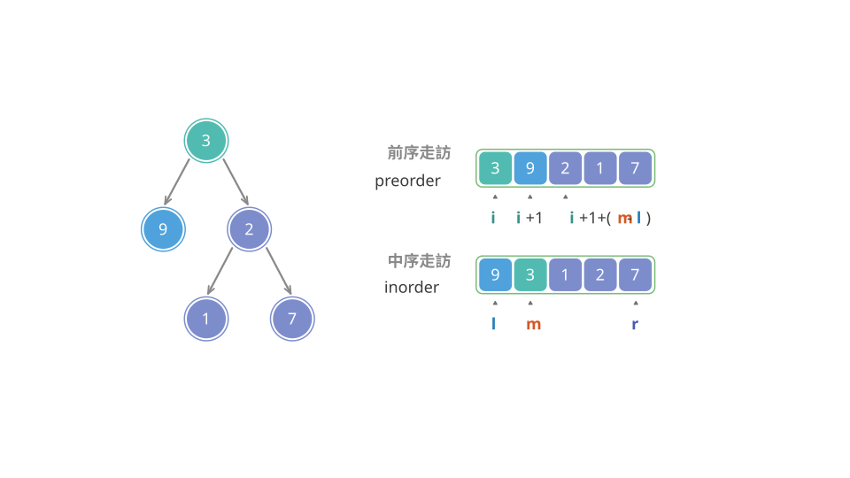
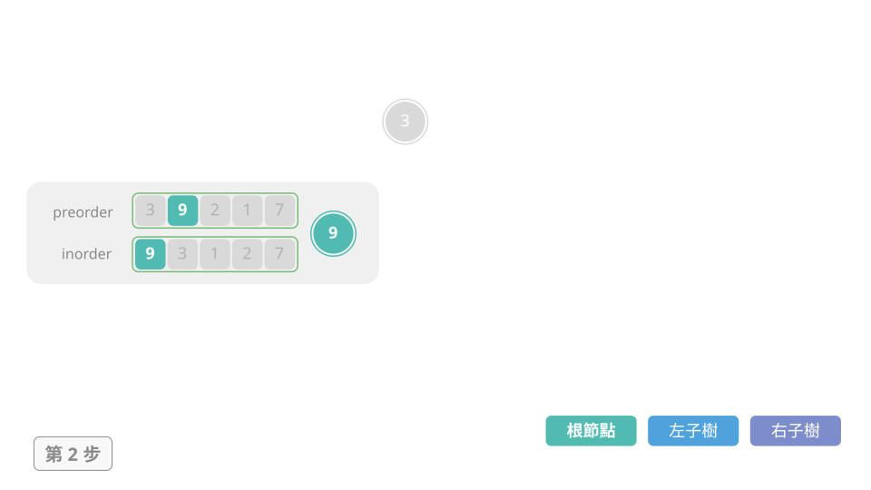
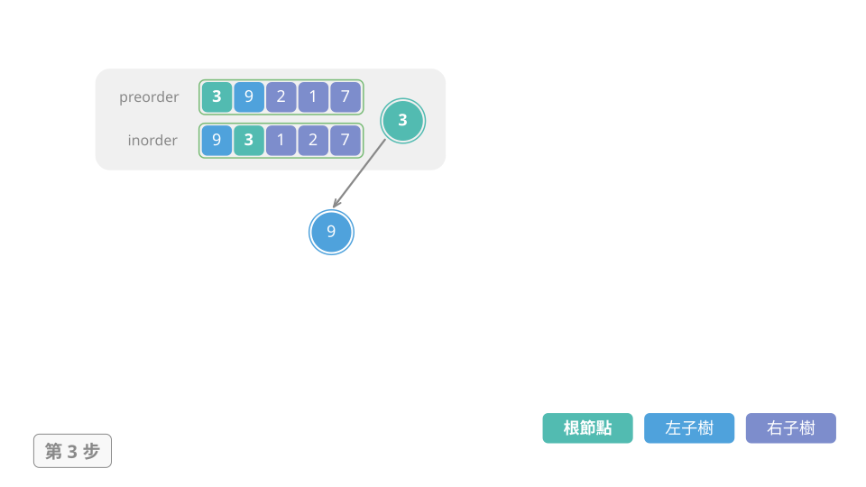
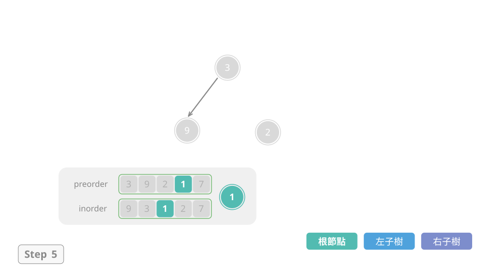
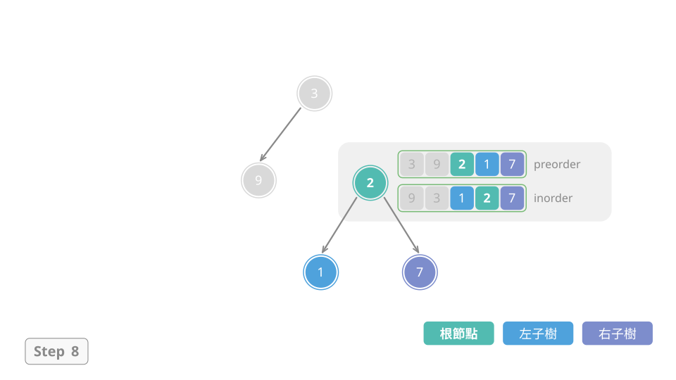

# 建構二元樹問題

!!! question

    給定一棵二元樹的前序走訪序列 `preorder` 與中序走訪序列 `inorder`，請據此建構二元樹並回傳根節點。假設樹中所有節點值皆相異（如下圖所示）。


### 判斷問題是否適用分治法

原問題是從 `preorder` 和 `inorder` 建構二元樹，這是典型的分治問題。

- **問題可以分解**：從分治法的角度來看，除了初始化根節點，只須解決「建構左子樹」和「建構右子樹」兩個子問題。對每棵子樹（子問題），都可以用相同的方法再分成更小的子樹（子問題），直到遇到最小的子問題（空子樹）為止。
- **子問題彼此獨立**：左子樹與右子樹沒有交集，可以各自處理。建構左子樹時，只須考慮中序與前序序列中對應左子樹的部分。右子樹也是如此。
- **子問題的解可以合併**：得到左子樹和右子樹（子問題的解）後，將兩者接到根節點上，就得到原問題的解。

### 如何劃分子樹

根據上述分析，這道題可以用分治法求解，**但如何利用前序序列 `preorder` 和中序序列 `inorder` 分出左子樹與右子樹呢**？

依照走訪定義，`preorder` 與 `inorder` 都可以分成三個部分。

- 前序走訪：`[ 根節點 | 左子樹 | 右子樹 ]`，以上圖為例，得到 `[ 3 | 9 | 2 1 7 ]`。
- 中序走訪：`[ 左子樹 | 根節點 | 右子樹 ]`，以上圖為例，得到 `[ 9 | 3 | 1 2 7 ]`。

以上圖的資料為例，可以依照下圖的步驟劃分子樹。

1. 前序序列的第一個元素 3 就是根節點的值。
2. 找出根節點 3 在 `inorder` 中的索引，便可據此將 `inorder` 分成 `[ 9 | 3 | 1 2 7 ]`。
3. 根據 `inorder` 的劃分結果，可知左右子樹的節點數分別為 1 和 3，因此可將 `preorder` 分成 `[ 3 | 9 | 2 1 7 ]`。


### 用變數表示子樹區間

根據上述劃分方式，**我們已得到根節點、左子樹與右子樹在 `preorder` 和 `inorder` 中的索引區間**。接下來可以用幾個指標變數來表示這些區間。

- 將目前子樹的根節點在 `preorder` 中的索引記為 $i$。
- 將目前子樹的根節點在 `inorder` 中的索引記為 $m$。
- 將目前子樹在 `inorder` 中的索引區間記為 $[l, r]$。

如下表所示，利用這些變數，就能表示根節點在 `preorder` 中的索引，以及子樹在 `inorder` 中的索引區間。

<p align="center"> 表 <id> &nbsp; 根節點與子樹在前序、中序序列中的索引 </p>

|        | 根節點在 `preorder` 中的索引 | 子樹在 `inorder` 中的索引區間 |
| ------ | ---------------------------- | ----------------------------- |
| 目前的樹 | $i$                          | $[l, r]$                      |
| 左子樹 | $i + 1$                      | $[l, m-1]$                    |
| 右子樹 | $i + 1 + (m - l)$            | $[m+1, r]$                    |

計算右子樹根節點的索引時，式中的 $(m-l)$ 代表左子樹的節點數。可對照下圖來理解。



### 程式實作

為了更快查出 $m$，我們用雜湊表 `hmap` 記錄陣列 `inorder` 中各元素對應的索引：

```src
[file]{build_tree}-[class]{}-[func]{build_tree}
```

下圖呈現遞迴建構二元樹的過程。節點是在遞迴向下時建立的，邊（參照）則是在逐層返回時接上的。

=== "<1>"
    

=== "<2>"
    

=== "<3>"
    

=== "<4>"
    

=== "<5>"
    

=== "<6>"
    

=== "<7>"
    

=== "<8>"
    

=== "<9>"
    

下圖呈現每次遞迴呼叫時，前序序列 `preorder` 與中序序列 `inorder` 的劃分結果。


設樹中有 $n$ 個節點。初始化一個節點（執行一次遞迴函式 `dfs()`）需時 $O(1)$，**因此整體時間複雜度為 $O(n)$**。

雜湊表記錄 `inorder` 中各元素對應的索引，空間複雜度為 $O(n)$。最差情況下，二元樹退化為鏈結串列，遞迴深度達 $n$，呼叫堆疊使用 $O(n)$ 空間。**因此，整體空間複雜度為 $O(n)$**。
