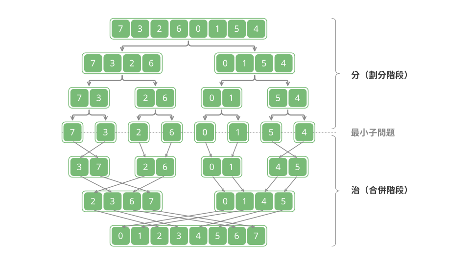
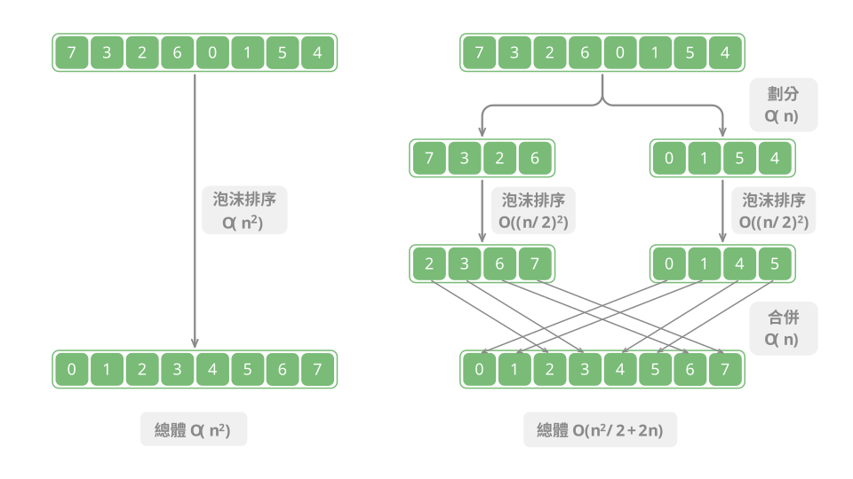
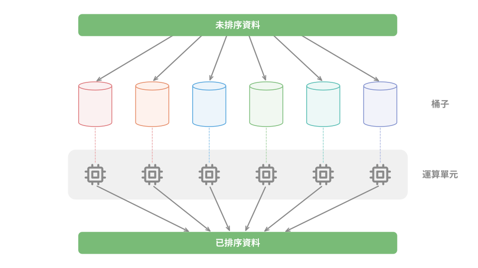

# 分治演算法

<u>分治法（divide and conquer）</u>，全名「分而治之」，是一種重要且常見的演算法策略。分治法通常以遞迴實作，包含「分」與「治」兩個步驟。

1. **分（劃分階段）**：遞迴將原問題分解成兩個或多個子問題，直到遇到最小子問題為止。
2. **治（合併階段）**：從解已知的最小子問題出發，由下往上合併子問題的解，直到得到原問題的解。

如下圖所示，「合併排序」是分治策略的典型應用之一。

1. **分**：遞迴將原陣列（原問題）劃分成兩個子陣列（子問題），直到每個子陣列只剩一個元素（最小子問題）為止。
2. **治**：由下往上合併已排序的子陣列（子問題的解），得到排序後的原陣列（原問題的解）。

## 如何判斷問題是否適合分治

判斷問題是否適合用分治法求解，通常可參考以下幾項依據。

1. **問題可以分解**：原問題可以分解成規模較小的相似子問題，並能以相同方式遞迴劃分。
2. **子問題彼此獨立**：子問題沒有重疊，也不互相依賴，可以分別求解。
3. **子問題的解可以合併**：合併子問題的解就能得到原問題的解。

合併排序符合以上三項條件。

1. **問題可以分解**：遞迴將陣列（原問題）劃分成兩個子陣列（子問題）。
2. **子問題彼此獨立**：每個子陣列都能獨立排序（各子問題可以獨立求解）。
3. **子問題的解可以合併**：兩個已排序的子陣列（子問題的解），能合併成一個已排序的陣列（原問題的解）。

## 透過分治提升效率

**分治法可以有效解決演算法問題，而且往往還能提高效率**。在排序演算法中，快速排序、合併排序、堆積排序之所以比選擇排序、氣泡排序、插入排序快，就是因為運用了分治策略。

**分治為什麼能提高演算法效率？背後的原因是什麼**？換句話說，先將大問題拆成多個子問題，各自求解，再合併成原問題的解，為什麼會比直接求解原問題更有效率？我們可以從操作次數與平行運算兩方面來看。

### 減少操作次數

以「氣泡排序」為例，對長度為 $n$ 的陣列排序需要 $O(n^2)$ 時間。假設依下圖將陣列從中點分成兩個子陣列，劃分需要 $O(n)$ 時間，各子陣列的排序需要 $O((n / 2)^2)$ 時間，合併兩個子陣列需要 $O(n)$ 時間，整體時間複雜度為：

$$
O(n + (\frac{n}{2})^2 \times 2 + n) = O(\frac{n^2}{2} + 2n)
$$

接著考慮以下不等式，左側與右側分別代表劃分前與劃分後的操作總數：

$$
\begin{aligned}
n^2 & > \frac{n^2}{2} + 2n \newline
n^2 - \frac{n^2}{2} - 2n & > 0 \newline
n(n - 4) & > 0
\end{aligned}
$$

**這表示當 $n > 4$ 時，劃分後的操作次數較少，排序效率應該會更高**。請注意，劃分後的時間複雜度仍是平方級 $O(n^2)$，只是其中的常數係數變小了。

再想想，**如果反覆從中點將每個子陣列再分成兩個子陣列**，直到只剩一個元素才停止，又會如何？這其實就是「合併排序」，時間複雜度為 $O(n \log n)$。

再進一步，**如果多設幾個分割點**，將原陣列平均分成 $k$ 個子陣列呢？這種做法與「桶排序」很相似，特別適合為大量資料排序，理論上的時間複雜度可達 $O(n + k)$。

### 利用平行運算提高效率

分治所產生的子問題彼此獨立，**因此通常可以平行求解**。換句話說，分治除了能降低演算法的時間複雜度，**也有助於作業系統利用平行運算來提高效率**。

在多核心或多處理器環境中，平行運算尤其有效。系統能同時處理多個子問題，更充分地利用運算資源，因而大幅縮短整體執行時間。

以下圖的「桶排序」為例，將大量資料平均分到各桶後，就能將各桶的排序任務分派給不同的運算單元，完成後再合併結果。

## 分治法的常見應用

一方面，分治法可以用來解決許多經典演算法問題。

- **尋找最近點對**：先將點集合分成兩部分，分別找出兩部分內距離最近的點對，最後找出跨越兩部分的最近點對。
- **大整數乘法**：例如 Karatsuba 演算法，將大整數乘法分解成幾個較小整數的乘法與加法。
- **矩陣乘法**：例如 Strassen 演算法，將大矩陣乘法分解成多個小矩陣的乘法與加法。
- **河內塔問題**：河內塔問題可以用遞迴求解，是分治策略的典型應用。
- **求逆序對**：在一個序列中，若前面的數大於後面的數，這兩個數就構成一個逆序對。我們可以運用分治的概念，藉助合併排序求解。

另一方面，分治在演算法與資料結構的設計中也十分常見。

- **二分搜尋**：從中點索引將已排序陣列分成兩部分，比較目標值與中點元素，據此決定排除哪一半，再對剩餘的區間執行相同的二分操作。
- **合併排序**：本節開頭已經介紹過。
- **快速排序**：選取一個基準值，將陣列分成兩個子陣列，其中一個包含比基準值小的元素，另一個包含比基準值大的元素。對兩部分重複相同的劃分操作，直到子陣列只剩一個元素。
- **桶排序**：將資料分散到多個桶子，各自將桶內元素排好順序，最後依照桶的順序取出各桶元素，就得到已排序的陣列。
- **樹**：例如二元搜尋樹、AVL 樹、紅黑樹、B 樹、B+ 樹等，其搜尋、插入與刪除等操作都可視為分治策略的應用。
- **堆積**：堆積是一種特殊的完全二元樹，其插入、刪除與堆積化等操作，都蘊含分治的概念。
- **雜湊表**：雜湊表本身沒有直接使用分治法，但有些解決雜湊碰撞的方法會間接運用分治策略。例如，採用鏈結法時，過長的鏈結串列會轉成紅黑樹，以提高查詢效率。

可見，**分治是一種潛移默化的演算法思想**，在各種演算法與資料結構中都能見到。
