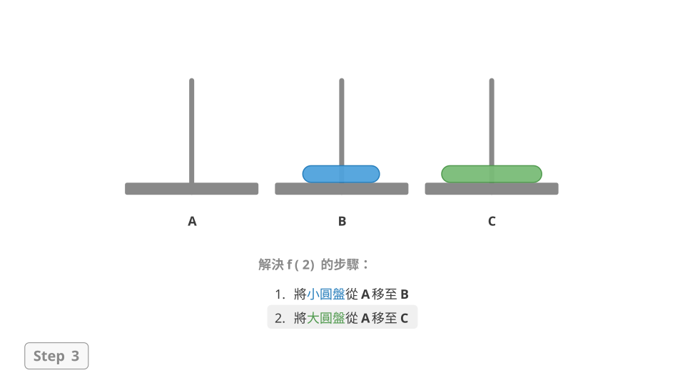

# 12.4 &nbsp; 河內塔問題

在合併排序與建構二元樹時，我們都將原問題拆成兩個規模為原來一半的子問題。河內塔問題則採用不同的分解策略。

!!! question

    給定三根柱子，分別記為 `A`、`B`、`C`。一開始，柱子 `A` 上套著 $n$ 個圓盤，由上往下依序由小到大排列。任務是將這 $n$ 個圓盤移到柱子 `C` 上，並維持原有順序（如圖 12-10 所示）。移動時必須遵守以下規則。
    
    1. 只能從一根柱子的頂端取出圓盤，放到另一根柱子的頂端。
    2. 每次只能移動一個圓盤。
    3. 疊放時，小圓盤必須始終位於大圓盤上方。

{ class="animation-figure" }

<p align="center"> 圖 12-10 &nbsp; 河內塔問題範例 </p>

**我們將規模為 $i$ 的河內塔問題記為 $f(i)$**。例如，$f(3)$ 表示將 $3$ 個圓盤從 `A` 移到 `C` 的河內塔問題。

### 1. &nbsp; 考慮基本情況

如圖 12-11 所示，對於問題 $f(1)$，也就是只有一個圓盤時，直接將它從 `A` 移到 `C` 即可。

=== "<1>"
    { class="animation-figure" }

=== "<2>"
    { class="animation-figure" }

<p align="center"> 圖 12-11 &nbsp; 規模為 1 時的解 </p>

如圖 12-12 所示，對於問題 $f(2)$，也就是有兩個圓盤時，**由於小盤必須始終疊在大盤上方，因此需要藉助 `B` 完成移動**。

1. 先將上方的小圓盤從 `A` 移到 `B`。
2. 再將大圓盤從 `A` 移到 `C`。
3. 最後將小圓盤從 `B` 移到 `C`。

=== "<1>"
    { class="animation-figure" }

=== "<2>"
    { class="animation-figure" }

=== "<3>"
    { class="animation-figure" }

=== "<4>"
    { class="animation-figure" }

<p align="center"> 圖 12-12 &nbsp; 規模為 2 時的解 </p>

問題 $f(2)$ 的解法可歸納為：**藉助 `B`，將兩個圓盤從 `A` 移到 `C`**。其中，`C` 稱為目標柱，`B` 稱為輔助柱。

### 2. &nbsp; 分解子問題

對於問題 $f(3)$，也就是有三個圓盤時，情況稍微複雜一些。

我們已經知道 $f(1)$ 和 $f(2)$ 的解法，因此可以從分治法的角度，**將 `A` 頂端的兩個圓盤視為一個整體**，再依圖 12-13 所示的步驟操作，就能將三個圓盤從 `A` 移到 `C`。

1. 以 `B` 為目標柱、`C` 為輔助柱，將兩個圓盤從 `A` 移到 `B`。
2. 將 `A` 上剩下的那個圓盤從 `A` 直接移到 `C`。
3. 以 `C` 為目標柱、`A` 為輔助柱，將兩個圓盤從 `B` 移到 `C`。

=== "<1>"
    { class="animation-figure" }

=== "<2>"
    { class="animation-figure" }

=== "<3>"
    { class="animation-figure" }

=== "<4>"
    { class="animation-figure" }

<p align="center"> 圖 12-13 &nbsp; 規模為 3 時的解 </p>

實際上，**我們將問題 $f(3)$ 分解成兩個子問題 $f(2)$ 和一個子問題 $f(1)$**。依序解決這三個子問題，原問題也就解決了。這說明子問題可以各自求解，再將解合併起來。

由此可歸納出圖 12-14 的河內塔分治策略：將原問題 $f(n)$ 拆成兩個子問題 $f(n-1)$ 和一個子問題 $f(1)$，再依下列順序解決這三個子問題。

1. 藉助 `C`，將 $n-1$ 個圓盤從 `A` 移到 `B`。
2. 將剩下的 $1$ 個圓盤從 `A` 直接移到 `C`。
3. 藉助 `A`，將 $n-1$ 個圓盤從 `B` 移到 `C`。

這兩個子問題 $f(n-1)$ **都可以用同樣的方法遞迴分解**，直到遇到最小子問題 $f(1)$。我們已經知道 $f(1)$ 的解法，只需移動一次。

{ class="animation-figure" }

<p align="center"> 圖 12-14 &nbsp; 求解河內塔問題的分治策略 </p>

### 3. &nbsp; 程式實作

在程式碼中，我們宣告遞迴函式 `dfs(i, src, buf, tar)`，用來將柱子 `src` 頂端的 $i$ 個圓盤，經由輔助柱 `buf` 移到目標柱 `tar`：

=== "Python"

    ```python title="hanota.py"
    def move(src: list[int], tar: list[int]):
        """移動一個圓盤"""
        # 從 src 頂端取出一個圓盤
        pan = src.pop()
        # 將圓盤放到 tar 頂端
        tar.append(pan)

    def dfs(i: int, src: list[int], buf: list[int], tar: list[int]):
        """求解河內塔問題 f(i)"""
        # 若 src 只剩一個圓盤，直接將它移到 tar
        if i == 1:
            move(src, tar)
            return
        # 子問題 f(i-1)：藉助 tar，將 src 頂端的 i-1 個圓盤移到 buf
        dfs(i - 1, src, tar, buf)
        # 子問題 f(1)：將 src 剩下的一個圓盤移到 tar
        move(src, tar)
        # 子問題 f(i-1)：藉助 src，將 buf 頂端的 i-1 個圓盤移到 tar
        dfs(i - 1, buf, src, tar)

    def solve_hanota(A: list[int], B: list[int], C: list[int]):
        """求解河內塔問題"""
        n = len(A)
        # 藉助 B，將 A 頂端的 n 個圓盤移到 C
        dfs(n, A, B, C)
    ```

=== "C++"

    ```cpp title="hanota.cpp"
    /* 移動一個圓盤 */
    void move(vector<int> &src, vector<int> &tar) {
        // 從 src 頂端取出一個圓盤
        int pan = src.back();
        src.pop_back();
        // 將圓盤放到 tar 頂端
        tar.push_back(pan);
    }

    /* 求解河內塔問題 f(i) */
    void dfs(int i, vector<int> &src, vector<int> &buf, vector<int> &tar) {
        // 若 src 只剩一個圓盤，直接將它移到 tar
        if (i == 1) {
            move(src, tar);
            return;
        }
        // 子問題 f(i-1)：藉助 tar，將 src 頂端的 i-1 個圓盤移到 buf
        dfs(i - 1, src, tar, buf);
        // 子問題 f(1)：將 src 剩下的一個圓盤移到 tar
        move(src, tar);
        // 子問題 f(i-1)：藉助 src，將 buf 頂端的 i-1 個圓盤移到 tar
        dfs(i - 1, buf, src, tar);
    }

    /* 求解河內塔問題 */
    void solveHanota(vector<int> &A, vector<int> &B, vector<int> &C) {
        int n = A.size();
        // 藉助 B，將 A 頂端的 n 個圓盤移到 C
        dfs(n, A, B, C);
    }
    ```

=== "Java"

    ```java title="hanota.java"
    /* 移動一個圓盤 */
    void move(List<Integer> src, List<Integer> tar) {
        // 從 src 頂端取出一個圓盤
        Integer pan = src.remove(src.size() - 1);
        // 將圓盤放到 tar 頂端
        tar.add(pan);
    }

    /* 求解河內塔問題 f(i) */
    void dfs(int i, List<Integer> src, List<Integer> buf, List<Integer> tar) {
        // 若 src 只剩一個圓盤，直接將它移到 tar
        if (i == 1) {
            move(src, tar);
            return;
        }
        // 子問題 f(i-1)：藉助 tar，將 src 頂端的 i-1 個圓盤移到 buf
        dfs(i - 1, src, tar, buf);
        // 子問題 f(1)：將 src 剩下的一個圓盤移到 tar
        move(src, tar);
        // 子問題 f(i-1)：藉助 src，將 buf 頂端的 i-1 個圓盤移到 tar
        dfs(i - 1, buf, src, tar);
    }

    /* 求解河內塔問題 */
    void solveHanota(List<Integer> A, List<Integer> B, List<Integer> C) {
        int n = A.size();
        // 藉助 B，將 A 頂端的 n 個圓盤移到 C
        dfs(n, A, B, C);
    }
    ```

=== "C#"

    ```csharp title="hanota.cs"
    /* 移動一個圓盤 */
    void Move(List<int> src, List<int> tar) {
        // 從 src 頂端取出一個圓盤
        int pan = src[^1];
        src.RemoveAt(src.Count - 1);
        // 將圓盤放到 tar 頂端
        tar.Add(pan);
    }

    /* 求解河內塔問題 f(i) */
    void DFS(int i, List<int> src, List<int> buf, List<int> tar) {
        // 若 src 只剩一個圓盤，直接將它移到 tar
        if (i == 1) {
            Move(src, tar);
            return;
        }
        // 子問題 f(i-1)：藉助 tar，將 src 頂端的 i-1 個圓盤移到 buf
        DFS(i - 1, src, tar, buf);
        // 子問題 f(1)：將 src 剩下的一個圓盤移到 tar
        Move(src, tar);
        // 子問題 f(i-1)：藉助 src，將 buf 頂端的 i-1 個圓盤移到 tar
        DFS(i - 1, buf, src, tar);
    }

    /* 求解河內塔問題 */
    void SolveHanota(List<int> A, List<int> B, List<int> C) {
        int n = A.Count;
        // 藉助 B，將 A 頂端的 n 個圓盤移到 C
        DFS(n, A, B, C);
    }
    ```

=== "Go"

    ```go title="hanota.go"
    /* 移動一個圓盤 */
    func move(src, tar *list.List) {
        // 從 src 頂端取出一個圓盤
        pan := src.Back()
        // 將圓盤放到 tar 頂端
        tar.PushBack(pan.Value)
        // 取下 src 頂端的圓盤
        src.Remove(pan)
    }

    /* 求解河內塔問題 f(i) */
    func dfsHanota(i int, src, buf, tar *list.List) {
        // 若 src 只剩一個圓盤，直接將它移到 tar
        if i == 1 {
            move(src, tar)
            return
        }
        // 子問題 f(i-1)：藉助 tar，將 src 頂端的 i-1 個圓盤移到 buf
        dfsHanota(i-1, src, tar, buf)
        // 子問題 f(1)：將 src 剩下的一個圓盤移到 tar
        move(src, tar)
        // 子問題 f(i-1)：藉助 src，將 buf 頂端的 i-1 個圓盤移到 tar
        dfsHanota(i-1, buf, src, tar)
    }

    /* 求解河內塔問題 */
    func solveHanota(A, B, C *list.List) {
        n := A.Len()
        // 藉助 B，將 A 頂端的 n 個圓盤移到 C
        dfsHanota(n, A, B, C)
    }
    ```

=== "Swift"

    ```swift title="hanota.swift"
    /* 移動一個圓盤 */
    func move(src: inout [Int], tar: inout [Int]) {
        // 從 src 頂端取出一個圓盤
        let pan = src.popLast()!
        // 將圓盤放到 tar 頂端
        tar.append(pan)
    }

    /* 求解河內塔問題 f(i) */
    func dfs(i: Int, src: inout [Int], buf: inout [Int], tar: inout [Int]) {
        // 若 src 只剩一個圓盤，直接將它移到 tar
        if i == 1 {
            move(src: &src, tar: &tar)
            return
        }
        // 子問題 f(i-1)：藉助 tar，將 src 頂端的 i-1 個圓盤移到 buf
        dfs(i: i - 1, src: &src, buf: &tar, tar: &buf)
        // 子問題 f(1)：將 src 剩下的一個圓盤移到 tar
        move(src: &src, tar: &tar)
        // 子問題 f(i-1)：藉助 src，將 buf 頂端的 i-1 個圓盤移到 tar
        dfs(i: i - 1, src: &buf, buf: &src, tar: &tar)
    }

    /* 求解河內塔問題 */
    func solveHanota(A: inout [Int], B: inout [Int], C: inout [Int]) {
        let n = A.count
        // 串列尾端對應柱子頂端
        // 藉助 B，將 src 頂端的 n 個圓盤移到 C
        dfs(i: n, src: &A, buf: &B, tar: &C)
    }
    ```

=== "JS"

    ```javascript title="hanota.js"
    /* 移動一個圓盤 */
    function move(src, tar) {
        // 從 src 頂端取出一個圓盤
        const pan = src.pop();
        // 將圓盤放到 tar 頂端
        tar.push(pan);
    }

    /* 求解河內塔問題 f(i) */
    function dfs(i, src, buf, tar) {
        // 若 src 只剩一個圓盤，直接將它移到 tar
        if (i === 1) {
            move(src, tar);
            return;
        }
        // 子問題 f(i-1)：藉助 tar，將 src 頂端的 i-1 個圓盤移到 buf
        dfs(i - 1, src, tar, buf);
        // 子問題 f(1)：將 src 剩下的一個圓盤移到 tar
        move(src, tar);
        // 子問題 f(i-1)：藉助 src，將 buf 頂端的 i-1 個圓盤移到 tar
        dfs(i - 1, buf, src, tar);
    }

    /* 求解河內塔問題 */
    function solveHanota(A, B, C) {
        const n = A.length;
        // 藉助 B，將 A 頂端的 n 個圓盤移到 C
        dfs(n, A, B, C);
    }
    ```

=== "TS"

    ```typescript title="hanota.ts"
    /* 移動一個圓盤 */
    function move(src: number[], tar: number[]): void {
        // 從 src 頂端取出一個圓盤
        const pan = src.pop();
        // 將圓盤放到 tar 頂端
        tar.push(pan);
    }

    /* 求解河內塔問題 f(i) */
    function dfs(i: number, src: number[], buf: number[], tar: number[]): void {
        // 若 src 只剩一個圓盤，直接將它移到 tar
        if (i === 1) {
            move(src, tar);
            return;
        }
        // 子問題 f(i-1)：藉助 tar，將 src 頂端的 i-1 個圓盤移到 buf
        dfs(i - 1, src, tar, buf);
        // 子問題 f(1)：將 src 剩下的一個圓盤移到 tar
        move(src, tar);
        // 子問題 f(i-1)：藉助 src，將 buf 頂端的 i-1 個圓盤移到 tar
        dfs(i - 1, buf, src, tar);
    }

    /* 求解河內塔問題 */
    function solveHanota(A: number[], B: number[], C: number[]): void {
        const n = A.length;
        // 藉助 B，將 A 頂端的 n 個圓盤移到 C
        dfs(n, A, B, C);
    }
    ```

=== "Dart"

    ```dart title="hanota.dart"
    /* 移動一個圓盤 */
    void move(List<int> src, List<int> tar) {
      // 從 src 頂端取出一個圓盤
      int pan = src.removeLast();
      // 將圓盤放到 tar 頂端
      tar.add(pan);
    }

    /* 求解河內塔問題 f(i) */
    void dfs(int i, List<int> src, List<int> buf, List<int> tar) {
      // 若 src 只剩一個圓盤，直接將它移到 tar
      if (i == 1) {
        move(src, tar);
        return;
      }
      // 子問題 f(i-1)：藉助 tar，將 src 頂端的 i-1 個圓盤移到 buf
      dfs(i - 1, src, tar, buf);
      // 子問題 f(1)：將 src 剩下的一個圓盤移到 tar
      move(src, tar);
      // 子問題 f(i-1)：藉助 src，將 buf 頂端的 i-1 個圓盤移到 tar
      dfs(i - 1, buf, src, tar);
    }

    /* 求解河內塔問題 */
    void solveHanota(List<int> A, List<int> B, List<int> C) {
      int n = A.length;
      // 藉助 B，將 A 頂端的 n 個圓盤移到 C
      dfs(n, A, B, C);
    }
    ```

=== "Rust"

    ```rust title="hanota.rs"
    /* 移動一個圓盤 */
    fn move_pan(src: &mut Vec<i32>, tar: &mut Vec<i32>) {
        // 從 src 頂端取出一個圓盤
        let pan = src.pop().unwrap();
        // 將圓盤放到 tar 頂端
        tar.push(pan);
    }

    /* 求解河內塔問題 f(i) */
    fn dfs(i: i32, src: &mut Vec<i32>, buf: &mut Vec<i32>, tar: &mut Vec<i32>) {
        // 若 src 只剩一個圓盤，直接將它移到 tar
        if i == 1 {
            move_pan(src, tar);
            return;
        }
        // 子問題 f(i-1)：藉助 tar，將 src 頂端的 i-1 個圓盤移到 buf
        dfs(i - 1, src, tar, buf);
        // 子問題 f(1)：將 src 剩下的一個圓盤移到 tar
        move_pan(src, tar);
        // 子問題 f(i-1)：藉助 src，將 buf 頂端的 i-1 個圓盤移到 tar
        dfs(i - 1, buf, src, tar);
    }

    /* 求解河內塔問題 */
    fn solve_hanota(A: &mut Vec<i32>, B: &mut Vec<i32>, C: &mut Vec<i32>) {
        let n = A.len() as i32;
        // 藉助 B，將 A 頂端的 n 個圓盤移到 C
        dfs(n, A, B, C);
    }
    ```

=== "C"

    ```c title="hanota.c"
    /* 移動一個圓盤 */
    void move(int *src, int *srcSize, int *tar, int *tarSize) {
        // 從 src 頂端取出一個圓盤
        int pan = src[*srcSize - 1];
        src[*srcSize - 1] = 0;
        (*srcSize)--;
        // 將圓盤放到 tar 頂端
        tar[*tarSize] = pan;
        (*tarSize)++;
    }

    /* 求解河內塔問題 f(i) */
    void dfs(int i, int *src, int *srcSize, int *buf, int *bufSize, int *tar, int *tarSize) {
        // 若 src 只剩一個圓盤，直接將它移到 tar
        if (i == 1) {
            move(src, srcSize, tar, tarSize);
            return;
        }
        // 子問題 f(i-1)：藉助 tar，將 src 頂端的 i-1 個圓盤移到 buf
        dfs(i - 1, src, srcSize, tar, tarSize, buf, bufSize);
        // 子問題 f(1)：將 src 剩下的一個圓盤移到 tar
        move(src, srcSize, tar, tarSize);
        // 子問題 f(i-1)：藉助 src，將 buf 頂端的 i-1 個圓盤移到 tar
        dfs(i - 1, buf, bufSize, src, srcSize, tar, tarSize);
    }

    /* 求解河內塔問題 */
    void solveHanota(int *A, int *ASize, int *B, int *BSize, int *C, int *CSize) {
        // 藉助 B，將 A 頂端的 n 個圓盤移到 C
        dfs(*ASize, A, ASize, B, BSize, C, CSize);
    }
    ```

=== "Kotlin"

    ```kotlin title="hanota.kt"
    /* 移動一個圓盤 */
    fun move(src: MutableList<Int>, tar: MutableList<Int>) {
        // 從 src 頂端取出一個圓盤
        val pan = src.removeAt(src.size - 1)
        // 將圓盤放到 tar 頂端
        tar.add(pan)
    }

    /* 求解河內塔問題 f(i) */
    fun dfs(i: Int, src: MutableList<Int>, buf: MutableList<Int>, tar: MutableList<Int>) {
        // 若 src 只剩一個圓盤，直接將它移到 tar
        if (i == 1) {
            move(src, tar)
            return
        }
        // 子問題 f(i-1)：藉助 tar，將 src 頂端的 i-1 個圓盤移到 buf
        dfs(i - 1, src, tar, buf)
        // 子問題 f(1)：將 src 剩下的一個圓盤移到 tar
        move(src, tar)
        // 子問題 f(i-1)：藉助 src，將 buf 頂端的 i-1 個圓盤移到 tar
        dfs(i - 1, buf, src, tar)
    }

    /* 求解河內塔問題 */
    fun solveHanota(A: MutableList<Int>, B: MutableList<Int>, C: MutableList<Int>) {
        val n = A.size
        // 藉助 B，將 A 頂端的 n 個圓盤移到 C
        dfs(n, A, B, C)
    }
    ```

=== "Ruby"

    ```ruby title="hanota.rb"
    ### 移動一個圓盤 ###
    def move(src, tar)
      # 從 src 頂端取出一個圓盤
      pan = src.pop
      # 將圓盤放到 tar 頂端
      tar << pan
    end

    ### 求解河內塔問題 f(i) ###
    def dfs(i, src, buf, tar)
      # 若 src 只剩一個圓盤，直接將它移到 tar
      if i == 1
        move(src, tar)
        return
      end

      # 子問題 f(i-1)：藉助 tar，將 src 頂端的 i-1 個圓盤移到 buf
      dfs(i - 1, src, tar, buf)
      # 子問題 f(1)：將 src 剩下的一個圓盤移到 tar
      move(src, tar)
      # 子問題 f(i-1)：藉助 src，將 buf 頂端的 i-1 個圓盤移到 tar
      dfs(i - 1, buf, src, tar)
    end

    ### 求解河內塔問題 ###
    def solve_hanota(_A, _B, _C)
      n = _A.length
      # 藉助 B，將 A 頂端的 n 個圓盤移到 C
      dfs(n, _A, _B, _C)
    end
    ```

??? pythontutor "執行視覺化示範"

    <div style="height: 549px; width: 100%;"><iframe class="pythontutor-iframe" title="執行視覺化示範" src="https://pythontutor.com/iframe-embed.html#code=def%20move%28src%3A%20list%5Bint%5D,%20tar%3A%20list%5Bint%5D%29%3A%0A%20%20%20%20%22%22%22%E7%A7%BB%E5%8B%95%E4%B8%80%E5%80%8B%E5%9C%93%E7%9B%A4%22%22%22%0A%20%20%20%20%23%20%E5%BE%9E%20src%20%E9%A0%82%E7%AB%AF%E5%8F%96%E5%87%BA%E4%B8%80%E5%80%8B%E5%9C%93%E7%9B%A4%0A%20%20%20%20pan%20%3D%20src.pop%28%29%0A%20%20%20%20%23%20%E5%B0%87%E5%9C%93%E7%9B%A4%E6%94%BE%E5%88%B0%20tar%20%E9%A0%82%E7%AB%AF%0A%20%20%20%20tar.append%28pan%29%0A%0A%0Adef%20dfs%28i%3A%20int,%20src%3A%20list%5Bint%5D,%20buf%3A%20list%5Bint%5D,%20tar%3A%20list%5Bint%5D%29%3A%0A%20%20%20%20%22%22%22%E6%B1%82%E8%A7%A3%E6%B2%B3%E5%85%A7%E5%A1%94%E5%95%8F%E9%A1%8C%20f%28i%29%22%22%22%0A%20%20%20%20%23%20%E8%8B%A5%20src%20%E5%8F%AA%E5%89%A9%E4%B8%80%E5%80%8B%E5%9C%93%E7%9B%A4%EF%BC%8C%E7%9B%B4%E6%8E%A5%E5%B0%87%E5%AE%83%E7%A7%BB%E5%88%B0%20tar%0A%20%20%20%20if%20i%20%3D%3D%201%3A%0A%20%20%20%20%20%20%20%20move%28src,%20tar%29%0A%20%20%20%20%20%20%20%20return%0A%20%20%20%20%23%20%E5%AD%90%E5%95%8F%E9%A1%8C%20f%28i-1%29%EF%BC%9A%E8%97%89%E5%8A%A9%20tar%EF%BC%8C%E5%B0%87%20src%20%E9%A0%82%E7%AB%AF%E7%9A%84%20i-1%20%E5%80%8B%E5%9C%93%E7%9B%A4%E7%A7%BB%E5%88%B0%20buf%0A%20%20%20%20dfs%28i%20-%201,%20src,%20tar,%20buf%29%0A%20%20%20%20%23%20%E5%AD%90%E5%95%8F%E9%A1%8C%20f%281%29%EF%BC%9A%E5%B0%87%20src%20%E5%89%A9%E4%B8%8B%E7%9A%84%E4%B8%80%E5%80%8B%E5%9C%93%E7%9B%A4%E7%A7%BB%E5%88%B0%20tar%0A%20%20%20%20move%28src,%20tar%29%0A%20%20%20%20%23%20%E5%AD%90%E5%95%8F%E9%A1%8C%20f%28i-1%29%EF%BC%9A%E8%97%89%E5%8A%A9%20src%EF%BC%8C%E5%B0%87%20buf%20%E9%A0%82%E7%AB%AF%E7%9A%84%20i-1%20%E5%80%8B%E5%9C%93%E7%9B%A4%E7%A7%BB%E5%88%B0%20tar%0A%20%20%20%20dfs%28i%20-%201,%20buf,%20src,%20tar%29%0A%0A%0Adef%20solve_hanota%28A%3A%20list%5Bint%5D,%20B%3A%20list%5Bint%5D,%20C%3A%20list%5Bint%5D%29%3A%0A%20%20%20%20%22%22%22%E6%B1%82%E8%A7%A3%E6%B2%B3%E5%85%A7%E5%A1%94%E5%95%8F%E9%A1%8C%22%22%22%0A%20%20%20%20n%20%3D%20len%28A%29%0A%20%20%20%20%23%20%E8%97%89%E5%8A%A9%20B%EF%BC%8C%E5%B0%87%20A%20%E9%A0%82%E7%AB%AF%E7%9A%84%20n%20%E5%80%8B%E5%9C%93%E7%9B%A4%E7%A7%BB%E5%88%B0%20C%0A%20%20%20%20dfs%28n,%20A,%20B,%20C%29%0A%0A%0A%22%22%22Driver%20Code%22%22%22%0Aif%20__name__%20%3D%3D%20%22__main__%22%3A%0A%20%20%20%20%23%20%E4%B8%B2%E5%88%97%E5%B0%BE%E7%AB%AF%E5%B0%8D%E6%87%89%E6%9F%B1%E5%AD%90%E9%A0%82%E7%AB%AF%0A%20%20%20%20A%20%3D%20%5B5,%204,%203,%202,%201%5D%0A%20%20%20%20B%20%3D%20%5B%5D%0A%20%20%20%20C%20%3D%20%5B%5D%0A%20%20%20%20print%28%22%E5%88%9D%E5%A7%8B%E7%8B%80%E6%85%8B%EF%BC%9A%22%29%0A%20%20%20%20print%28f%22A%20%3D%20%7BA%7D%22%29%0A%20%20%20%20print%28f%22B%20%3D%20%7BB%7D%22%29%0A%20%20%20%20print%28f%22C%20%3D%20%7BC%7D%22%29%0A%0A%20%20%20%20solve_hanota%28A,%20B,%20C%29%0A%0A%20%20%20%20print%28%22%E5%9C%93%E7%9B%A4%E7%A7%BB%E5%8B%95%E5%AE%8C%E6%88%90%E5%BE%8C%EF%BC%9A%22%29%0A%20%20%20%20print%28f%22A%20%3D%20%7BA%7D%22%29%0A%20%20%20%20print%28f%22B%20%3D%20%7BB%7D%22%29%0A%20%20%20%20print%28f%22C%20%3D%20%7BC%7D%22%29&codeDivHeight=472&codeDivWidth=350&cumulative=false&curInstr=12&heapPrimitives=nevernest&origin=opt-frontend.js&py=311&rawInputLstJSON=%5B%5D&textReferences=false"> </iframe></div>
    <div style="margin-top: 5px;"><a href="https://pythontutor.com/iframe-embed.html#code=def%20move%28src%3A%20list%5Bint%5D,%20tar%3A%20list%5Bint%5D%29%3A%0A%20%20%20%20%22%22%22%E7%A7%BB%E5%8B%95%E4%B8%80%E5%80%8B%E5%9C%93%E7%9B%A4%22%22%22%0A%20%20%20%20%23%20%E5%BE%9E%20src%20%E9%A0%82%E7%AB%AF%E5%8F%96%E5%87%BA%E4%B8%80%E5%80%8B%E5%9C%93%E7%9B%A4%0A%20%20%20%20pan%20%3D%20src.pop%28%29%0A%20%20%20%20%23%20%E5%B0%87%E5%9C%93%E7%9B%A4%E6%94%BE%E5%88%B0%20tar%20%E9%A0%82%E7%AB%AF%0A%20%20%20%20tar.append%28pan%29%0A%0A%0Adef%20dfs%28i%3A%20int,%20src%3A%20list%5Bint%5D,%20buf%3A%20list%5Bint%5D,%20tar%3A%20list%5Bint%5D%29%3A%0A%20%20%20%20%22%22%22%E6%B1%82%E8%A7%A3%E6%B2%B3%E5%85%A7%E5%A1%94%E5%95%8F%E9%A1%8C%20f%28i%29%22%22%22%0A%20%20%20%20%23%20%E8%8B%A5%20src%20%E5%8F%AA%E5%89%A9%E4%B8%80%E5%80%8B%E5%9C%93%E7%9B%A4%EF%BC%8C%E7%9B%B4%E6%8E%A5%E5%B0%87%E5%AE%83%E7%A7%BB%E5%88%B0%20tar%0A%20%20%20%20if%20i%20%3D%3D%201%3A%0A%20%20%20%20%20%20%20%20move%28src,%20tar%29%0A%20%20%20%20%20%20%20%20return%0A%20%20%20%20%23%20%E5%AD%90%E5%95%8F%E9%A1%8C%20f%28i-1%29%EF%BC%9A%E8%97%89%E5%8A%A9%20tar%EF%BC%8C%E5%B0%87%20src%20%E9%A0%82%E7%AB%AF%E7%9A%84%20i-1%20%E5%80%8B%E5%9C%93%E7%9B%A4%E7%A7%BB%E5%88%B0%20buf%0A%20%20%20%20dfs%28i%20-%201,%20src,%20tar,%20buf%29%0A%20%20%20%20%23%20%E5%AD%90%E5%95%8F%E9%A1%8C%20f%281%29%EF%BC%9A%E5%B0%87%20src%20%E5%89%A9%E4%B8%8B%E7%9A%84%E4%B8%80%E5%80%8B%E5%9C%93%E7%9B%A4%E7%A7%BB%E5%88%B0%20tar%0A%20%20%20%20move%28src,%20tar%29%0A%20%20%20%20%23%20%E5%AD%90%E5%95%8F%E9%A1%8C%20f%28i-1%29%EF%BC%9A%E8%97%89%E5%8A%A9%20src%EF%BC%8C%E5%B0%87%20buf%20%E9%A0%82%E7%AB%AF%E7%9A%84%20i-1%20%E5%80%8B%E5%9C%93%E7%9B%A4%E7%A7%BB%E5%88%B0%20tar%0A%20%20%20%20dfs%28i%20-%201,%20buf,%20src,%20tar%29%0A%0A%0Adef%20solve_hanota%28A%3A%20list%5Bint%5D,%20B%3A%20list%5Bint%5D,%20C%3A%20list%5Bint%5D%29%3A%0A%20%20%20%20%22%22%22%E6%B1%82%E8%A7%A3%E6%B2%B3%E5%85%A7%E5%A1%94%E5%95%8F%E9%A1%8C%22%22%22%0A%20%20%20%20n%20%3D%20len%28A%29%0A%20%20%20%20%23%20%E8%97%89%E5%8A%A9%20B%EF%BC%8C%E5%B0%87%20A%20%E9%A0%82%E7%AB%AF%E7%9A%84%20n%20%E5%80%8B%E5%9C%93%E7%9B%A4%E7%A7%BB%E5%88%B0%20C%0A%20%20%20%20dfs%28n,%20A,%20B,%20C%29%0A%0A%0A%22%22%22Driver%20Code%22%22%22%0Aif%20__name__%20%3D%3D%20%22__main__%22%3A%0A%20%20%20%20%23%20%E4%B8%B2%E5%88%97%E5%B0%BE%E7%AB%AF%E5%B0%8D%E6%87%89%E6%9F%B1%E5%AD%90%E9%A0%82%E7%AB%AF%0A%20%20%20%20A%20%3D%20%5B5,%204,%203,%202,%201%5D%0A%20%20%20%20B%20%3D%20%5B%5D%0A%20%20%20%20C%20%3D%20%5B%5D%0A%20%20%20%20print%28%22%E5%88%9D%E5%A7%8B%E7%8B%80%E6%85%8B%EF%BC%9A%22%29%0A%20%20%20%20print%28f%22A%20%3D%20%7BA%7D%22%29%0A%20%20%20%20print%28f%22B%20%3D%20%7BB%7D%22%29%0A%20%20%20%20print%28f%22C%20%3D%20%7BC%7D%22%29%0A%0A%20%20%20%20solve_hanota%28A,%20B,%20C%29%0A%0A%20%20%20%20print%28%22%E5%9C%93%E7%9B%A4%E7%A7%BB%E5%8B%95%E5%AE%8C%E6%88%90%E5%BE%8C%EF%BC%9A%22%29%0A%20%20%20%20print%28f%22A%20%3D%20%7BA%7D%22%29%0A%20%20%20%20print%28f%22B%20%3D%20%7BB%7D%22%29%0A%20%20%20%20print%28f%22C%20%3D%20%7BC%7D%22%29&codeDivHeight=800&codeDivWidth=600&cumulative=false&curInstr=12&heapPrimitives=nevernest&origin=opt-frontend.js&py=311&rawInputLstJSON=%5B%5D&textReferences=false" target="_blank" rel="noopener noreferrer">全螢幕觀看 ></a></div>

如圖 12-15 所示，河內塔問題形成一棵高度為 $n$ 的遞迴樹，每個節點代表一個子問題，對應一次 `dfs()` 函式呼叫。**因此，時間複雜度為 $O(2^n)$，空間複雜度為 $O(n)$**。

{ class="animation-figure" }

<p align="center"> 圖 12-15 &nbsp; 河內塔問題的遞迴樹 </p>

!!! quote

    河內塔問題源於一則古老的傳說。在古印度的一座寺廟裡，僧侶擁有三根高大的鑽石柱，以及 $64$ 個大小不一的金圓盤。他們持續移動這些圓盤，相信最後一個圓盤正確就位的那一刻，就是世界的盡頭。

    不過，即使僧侶每秒移動一次，全部移完仍需約 $2^{64} \approx 1.84×10^{19}$ 秒，相當於約 $5850$ 億年，遠遠超過目前估計的宇宙年齡。因此，就算傳說是真的，我們應該也無須擔心世界末日的到來。
