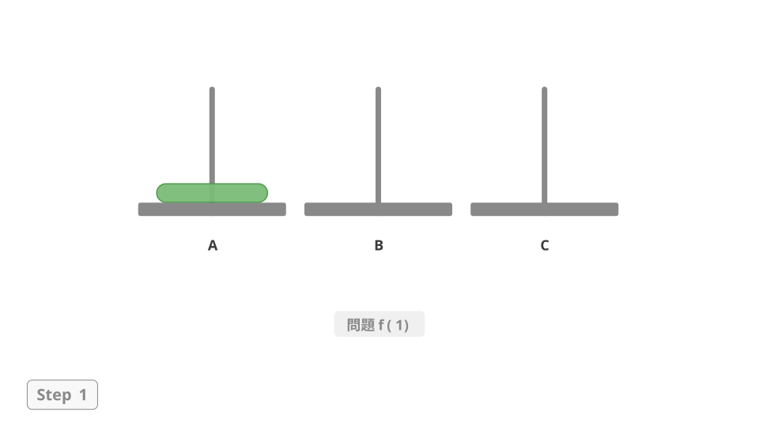
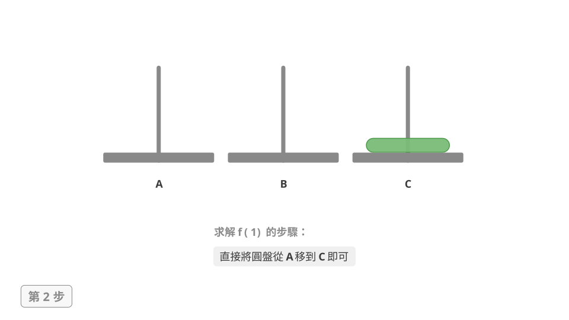
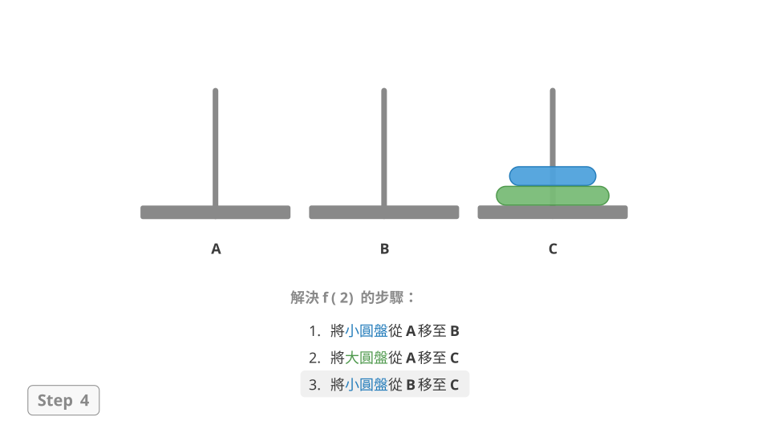
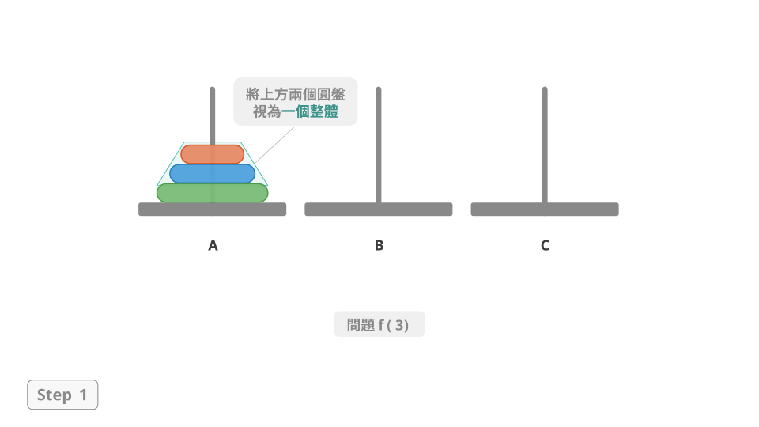
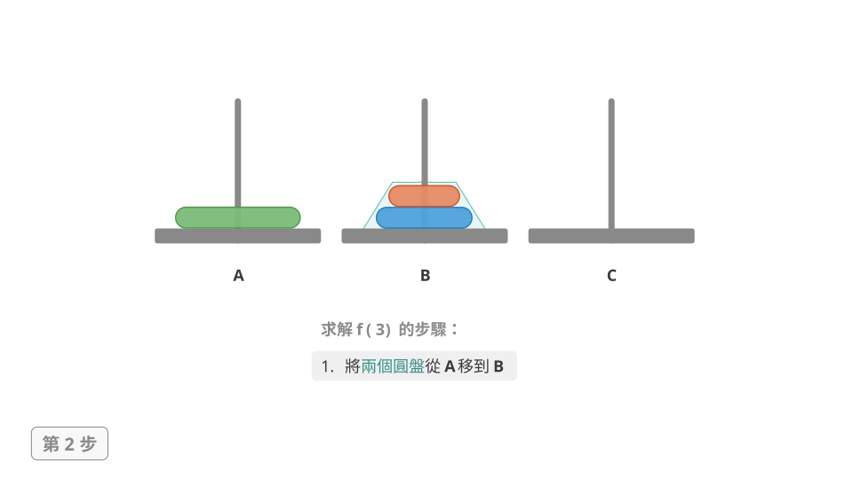
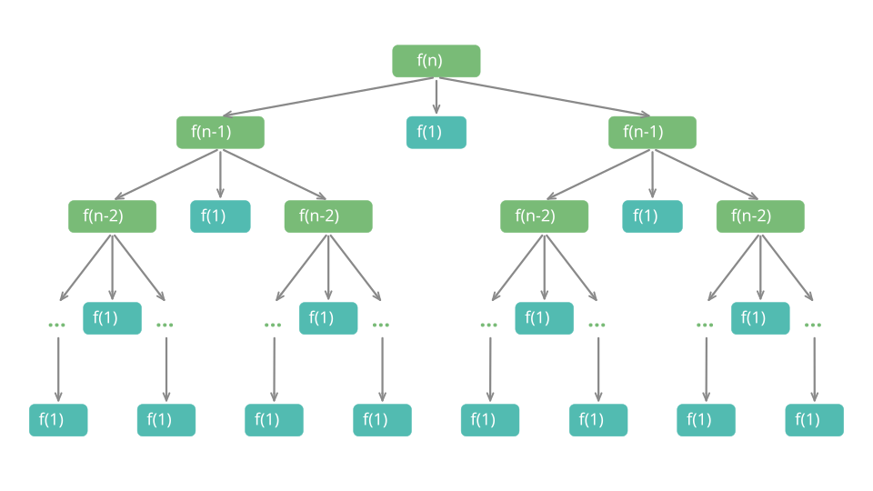

# 河內塔問題

在合併排序與建構二元樹時，我們都將原問題拆成兩個規模為原來一半的子問題。河內塔問題則採用不同的分解策略。

!!! question

    給定三根柱子，分別記為 `A`、`B`、`C`。一開始，柱子 `A` 上套著 $n$ 個圓盤，由上往下依序由小到大排列。任務是將這 $n$ 個圓盤移到柱子 `C` 上，並維持原有順序（如下圖所示）。移動時必須遵守以下規則。
    
    1. 只能從一根柱子的頂端取出圓盤，放到另一根柱子的頂端。
    2. 每次只能移動一個圓盤。
    3. 疊放時，小圓盤必須始終位於大圓盤上方。


**我們將規模為 $i$ 的河內塔問題記為 $f(i)$**。例如，$f(3)$ 表示將 $3$ 個圓盤從 `A` 移到 `C` 的河內塔問題。

### 考慮基本情況

如下圖所示，對於問題 $f(1)$，也就是只有一個圓盤時，直接將它從 `A` 移到 `C` 即可。

=== "<1>"
    

=== "<2>"
    

如下圖所示，對於問題 $f(2)$，也就是有兩個圓盤時，**由於小盤必須始終疊在大盤上方，因此需要藉助 `B` 完成移動**。

1. 先將上方的小圓盤從 `A` 移到 `B`。
2. 再將大圓盤從 `A` 移到 `C`。
3. 最後將小圓盤從 `B` 移到 `C`。

=== "<1>"
    

=== "<2>"
    

=== "<3>"
    

=== "<4>"
    

問題 $f(2)$ 的解法可歸納為：**藉助 `B`，將兩個圓盤從 `A` 移到 `C`**。其中，`C` 稱為目標柱，`B` 稱為輔助柱。

### 分解子問題

對於問題 $f(3)$，也就是有三個圓盤時，情況稍微複雜一些。

我們已經知道 $f(1)$ 和 $f(2)$ 的解法，因此可以從分治法的角度，**將 `A` 頂端的兩個圓盤視為一個整體**，再依下圖所示的步驟操作，就能將三個圓盤從 `A` 移到 `C`。

1. 以 `B` 為目標柱、`C` 為輔助柱，將兩個圓盤從 `A` 移到 `B`。
2. 將 `A` 上剩下的那個圓盤從 `A` 直接移到 `C`。
3. 以 `C` 為目標柱、`A` 為輔助柱，將兩個圓盤從 `B` 移到 `C`。

=== "<1>"
    

=== "<2>"
    

=== "<3>"
    

=== "<4>"
    

實際上，**我們將問題 $f(3)$ 分解成兩個子問題 $f(2)$ 和一個子問題 $f(1)$**。依序解決這三個子問題，原問題也就解決了。這說明子問題可以各自求解，再將解合併起來。

由此可歸納出下圖的河內塔分治策略：將原問題 $f(n)$ 拆成兩個子問題 $f(n-1)$ 和一個子問題 $f(1)$，再依下列順序解決這三個子問題。

1. 藉助 `C`，將 $n-1$ 個圓盤從 `A` 移到 `B`。
2. 將剩下的 $1$ 個圓盤從 `A` 直接移到 `C`。
3. 藉助 `A`，將 $n-1$ 個圓盤從 `B` 移到 `C`。

這兩個子問題 $f(n-1)$ **都可以用同樣的方法遞迴分解**，直到遇到最小子問題 $f(1)$。我們已經知道 $f(1)$ 的解法，只需移動一次。


### 程式實作

在程式碼中，我們宣告遞迴函式 `dfs(i, src, buf, tar)`，用來將柱子 `src` 頂端的 $i$ 個圓盤，經由輔助柱 `buf` 移到目標柱 `tar`：

```src
[file]{hanota}-[class]{}-[func]{solve_hanota}
```

如下圖所示，河內塔問題形成一棵高度為 $n$ 的遞迴樹，每個節點代表一個子問題，對應一次 `dfs()` 函式呼叫。**因此，時間複雜度為 $O(2^n)$，空間複雜度為 $O(n)$**。



!!! quote

    河內塔問題源於一則古老的傳說。在古印度的一座寺廟裡，僧侶擁有三根高大的鑽石柱，以及 $64$ 個大小不一的金圓盤。他們持續移動這些圓盤，相信最後一個圓盤正確就位的那一刻，就是世界的盡頭。

    不過，即使僧侶每秒移動一次，全部移完仍需約 $2^{64} \approx 1.84×10^{19}$ 秒，相當於約 $5850$ 億年，遠遠超過目前估計的宇宙年齡。因此，就算傳說是真的，我們應該也無須擔心世界末日的到來。
