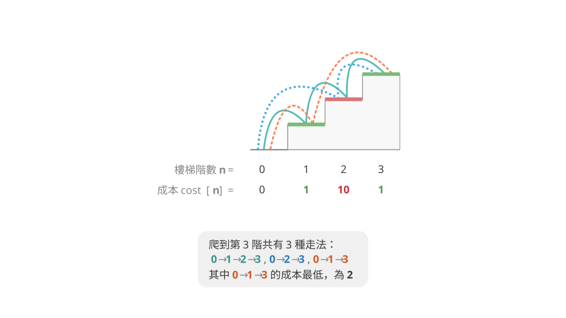
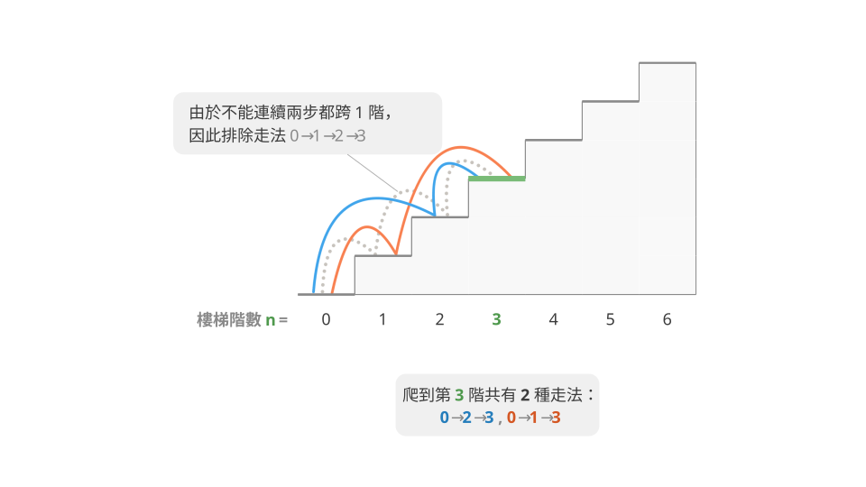
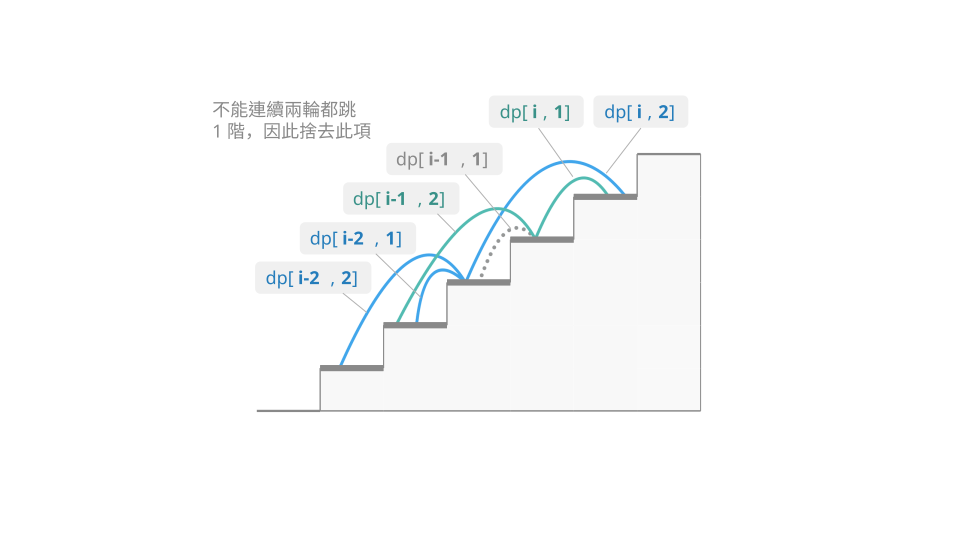

# 14.2 &nbsp; 動態規劃問題的特性

上一節介紹了動態規劃如何將問題分解成子問題來求解。分解子問題也是其他演算法常用的思路，分治法、動態規劃與回溯法各有不同的著重點。

- 分治法以遞迴方式將原問題拆成多個彼此獨立的子問題，直到得到最小的子問題。遞迴返回時，再合併子問題的解，最後得到原問題的解。
- 動態規劃也以遞迴方式分解問題。它與分治法的主要差異在於，動態規劃的子問題彼此相依，分解過程中有許多子問題會重複出現。
- 回溯法透過嘗試與撤銷選擇，窮舉所有可能的解，並利用剪枝避開不必搜尋的分支。原問題的解由一連串決策構成，每次決策之前的那段子序列，都可以看成一個子問題。

動態規劃常用來求解最佳化問題。這些問題除了有重疊子問題，還有兩項重要特性：最佳子結構與無後效性。

## 14.2.1 &nbsp; 最佳子結構

我們稍微修改爬樓梯問題，用它來說明最佳子結構。

!!! question "爬樓梯的最低成本"

    給定一段樓梯，每一步可以往上跨 $1$ 階或 $2$ 階。每一階上都貼著一個非負整數，表示踏上這一階的成本。給定非負整數陣列 $cost$，其中 $cost[i]$ 表示踏上第 $i$ 階的成本，$cost[0]$ 為地面（起點）。爬到頂端的最低成本是多少？

如圖 14-6 所示，若踏上第 $1$、$2$、$3$ 階的成本分別為 $1$、$10$、$1$，則從地面爬到第 $3$ 階的最低成本為 $2$。

{ class="animation-figure" }

<p align="center"> 圖 14-6 &nbsp; 爬到第 3 階的最低成本 </p>

設 $dp[i]$ 為爬到第 $i$ 階的累計成本。由於只能從第 $i - 1$ 階或第 $i - 2$ 階跨到第 $i$ 階，因此 $dp[i]$ 只可能是 $dp[i - 1] + cost[i]$ 或 $dp[i - 2] + cost[i]$。若要讓成本儘可能低，就應取兩者中的較小值：

$$
dp[i] = \min(dp[i-1], dp[i-2]) + cost[i]
$$

這就說明了最佳子結構的意義：**原問題的最佳解可以由子問題的最佳解構成**。

這道題具有最佳子結構：我們從兩個子問題的最佳解 $dp[i-1]$ 和 $dp[i-2]$ 中選出較佳者，再用它構成原問題 $dp[i]$ 的最佳解。

那麼，上一節的爬樓梯問題也有最佳子結構嗎？題目要算出走法數，看起來只是計數問題。試著改問「最多有幾種走法」，就會發現，**兩種問法雖然等價，改問後卻能看出最佳子結構**：到第 $n$ 階的最大走法數，等於到第 $n-1$ 階和第 $n-2$ 階的最大走法數之和。因此，最佳子結構的解讀很有彈性，會隨問題而有不同的意義。

根據狀態轉移方程式，以及初始狀態 $dp[1] = cost[1]$ 和 $dp[2] = cost[2]$，就能寫出動態規劃的程式：

=== "Python"

    ```python title="min_cost_climbing_stairs_dp.py"
    def min_cost_climbing_stairs_dp(cost: list[int]) -> int:
        """爬樓梯的最低成本：動態規劃"""
        n = len(cost) - 1
        if n == 1 or n == 2:
            return cost[n]
        # 初始化 dp 表，用來儲存子問題的解
        dp = [0] * (n + 1)
        # 初始狀態：設定最小子問題的解
        dp[1], dp[2] = cost[1], cost[2]
        # 狀態轉移：從較小的子問題逐步求出較大子問題的解
        for i in range(3, n + 1):
            dp[i] = min(dp[i - 1], dp[i - 2]) + cost[i]
        return dp[n]
    ```

=== "C++"

    ```cpp title="min_cost_climbing_stairs_dp.cpp"
    /* 爬樓梯的最低成本：動態規劃 */
    int minCostClimbingStairsDP(vector<int> &cost) {
        int n = cost.size() - 1;
        if (n == 1 || n == 2)
            return cost[n];
        // 初始化 dp 表，用來儲存子問題的解
        vector<int> dp(n + 1);
        // 初始狀態：設定最小子問題的解
        dp[1] = cost[1];
        dp[2] = cost[2];
        // 狀態轉移：從較小的子問題逐步求出較大子問題的解
        for (int i = 3; i <= n; i++) {
            dp[i] = min(dp[i - 1], dp[i - 2]) + cost[i];
        }
        return dp[n];
    }
    ```

=== "Java"

    ```java title="min_cost_climbing_stairs_dp.java"
    /* 爬樓梯的最低成本：動態規劃 */
    int minCostClimbingStairsDP(int[] cost) {
        int n = cost.length - 1;
        if (n == 1 || n == 2)
            return cost[n];
        // 初始化 dp 表，用來儲存子問題的解
        int[] dp = new int[n + 1];
        // 初始狀態：設定最小子問題的解
        dp[1] = cost[1];
        dp[2] = cost[2];
        // 狀態轉移：從較小的子問題逐步求出較大子問題的解
        for (int i = 3; i <= n; i++) {
            dp[i] = Math.min(dp[i - 1], dp[i - 2]) + cost[i];
        }
        return dp[n];
    }
    ```

=== "C#"

    ```csharp title="min_cost_climbing_stairs_dp.cs"
    /* 爬樓梯的最低成本：動態規劃 */
    int MinCostClimbingStairsDP(int[] cost) {
        int n = cost.Length - 1;
        if (n == 1 || n == 2)
            return cost[n];
        // 初始化 dp 表，用來儲存子問題的解
        int[] dp = new int[n + 1];
        // 初始狀態：設定最小子問題的解
        dp[1] = cost[1];
        dp[2] = cost[2];
        // 狀態轉移：從較小的子問題逐步求出較大子問題的解
        for (int i = 3; i <= n; i++) {
            dp[i] = Math.Min(dp[i - 1], dp[i - 2]) + cost[i];
        }
        return dp[n];
    }
    ```

=== "Go"

    ```go title="min_cost_climbing_stairs_dp.go"
    /* 爬樓梯的最低成本：動態規劃 */
    func minCostClimbingStairsDP(cost []int) int {
        n := len(cost) - 1
        if n == 1 || n == 2 {
            return cost[n]
        }
        min := func(a, b int) int {
            if a < b {
                return a
            }
            return b
        }
        // 初始化 dp 表，用來儲存子問題的解
        dp := make([]int, n+1)
        // 初始狀態：設定最小子問題的解
        dp[1] = cost[1]
        dp[2] = cost[2]
        // 狀態轉移：從較小的子問題逐步求出較大子問題的解
        for i := 3; i <= n; i++ {
            dp[i] = min(dp[i-1], dp[i-2]) + cost[i]
        }
        return dp[n]
    }
    ```

=== "Swift"

    ```swift title="min_cost_climbing_stairs_dp.swift"
    /* 爬樓梯的最低成本：動態規劃 */
    func minCostClimbingStairsDP(cost: [Int]) -> Int {
        let n = cost.count - 1
        if n == 1 || n == 2 {
            return cost[n]
        }
        // 初始化 dp 表，用來儲存子問題的解
        var dp = Array(repeating: 0, count: n + 1)
        // 初始狀態：設定最小子問題的解
        dp[1] = cost[1]
        dp[2] = cost[2]
        // 狀態轉移：從較小的子問題逐步求出較大子問題的解
        for i in 3 ... n {
            dp[i] = min(dp[i - 1], dp[i - 2]) + cost[i]
        }
        return dp[n]
    }
    ```

=== "JS"

    ```javascript title="min_cost_climbing_stairs_dp.js"
    /* 爬樓梯的最低成本：動態規劃 */
    function minCostClimbingStairsDP(cost) {
        const n = cost.length - 1;
        if (n === 1 || n === 2) {
            return cost[n];
        }
        // 初始化 dp 表，用來儲存子問題的解
        const dp = new Array(n + 1);
        // 初始狀態：設定最小子問題的解
        dp[1] = cost[1];
        dp[2] = cost[2];
        // 狀態轉移：從較小的子問題逐步求出較大子問題的解
        for (let i = 3; i <= n; i++) {
            dp[i] = Math.min(dp[i - 1], dp[i - 2]) + cost[i];
        }
        return dp[n];
    }
    ```

=== "TS"

    ```typescript title="min_cost_climbing_stairs_dp.ts"
    /* 爬樓梯的最低成本：動態規劃 */
    function minCostClimbingStairsDP(cost: Array<number>): number {
        const n = cost.length - 1;
        if (n === 1 || n === 2) {
            return cost[n];
        }
        // 初始化 dp 表，用來儲存子問題的解
        const dp = new Array(n + 1);
        // 初始狀態：設定最小子問題的解
        dp[1] = cost[1];
        dp[2] = cost[2];
        // 狀態轉移：從較小的子問題逐步求出較大子問題的解
        for (let i = 3; i <= n; i++) {
            dp[i] = Math.min(dp[i - 1], dp[i - 2]) + cost[i];
        }
        return dp[n];
    }
    ```

=== "Dart"

    ```dart title="min_cost_climbing_stairs_dp.dart"
    /* 爬樓梯的最低成本：動態規劃 */
    int minCostClimbingStairsDP(List<int> cost) {
      int n = cost.length - 1;
      if (n == 1 || n == 2) return cost[n];
      // 初始化 dp 表，用來儲存子問題的解
      List<int> dp = List.filled(n + 1, 0);
      // 初始狀態：設定最小子問題的解
      dp[1] = cost[1];
      dp[2] = cost[2];
      // 狀態轉移：從較小的子問題逐步求出較大子問題的解
      for (int i = 3; i <= n; i++) {
        dp[i] = min(dp[i - 1], dp[i - 2]) + cost[i];
      }
      return dp[n];
    }
    ```

=== "Rust"

    ```rust title="min_cost_climbing_stairs_dp.rs"
    /* 爬樓梯的最低成本：動態規劃 */
    fn min_cost_climbing_stairs_dp(cost: &[i32]) -> i32 {
        let n = cost.len() - 1;
        if n == 1 || n == 2 {
            return cost[n];
        }
        // 初始化 dp 表，用來儲存子問題的解
        let mut dp = vec![-1; n + 1];
        // 初始狀態：設定最小子問題的解
        dp[1] = cost[1];
        dp[2] = cost[2];
        // 狀態轉移：從較小的子問題逐步求出較大子問題的解
        for i in 3..=n {
            dp[i] = cmp::min(dp[i - 1], dp[i - 2]) + cost[i];
        }
        dp[n]
    }
    ```

=== "C"

    ```c title="min_cost_climbing_stairs_dp.c"
    /* 爬樓梯的最低成本：動態規劃 */
    int minCostClimbingStairsDP(int cost[], int costSize) {
        int n = costSize - 1;
        if (n == 1 || n == 2)
            return cost[n];
        // 初始化 dp 表，用來儲存子問題的解
        int *dp = calloc(n + 1, sizeof(int));
        // 初始狀態：設定最小子問題的解
        dp[1] = cost[1];
        dp[2] = cost[2];
        // 狀態轉移：從較小的子問題逐步求出較大子問題的解
        for (int i = 3; i <= n; i++) {
            dp[i] = myMin(dp[i - 1], dp[i - 2]) + cost[i];
        }
        int res = dp[n];
        // 釋放記憶體
        free(dp);
        return res;
    }
    ```

=== "Kotlin"

    ```kotlin title="min_cost_climbing_stairs_dp.kt"
    /* 爬樓梯的最低成本：動態規劃 */
    fun minCostClimbingStairsDP(cost: IntArray): Int {
        val n = cost.size - 1
        if (n == 1 || n == 2) return cost[n]
        // 初始化 dp 表，用來儲存子問題的解
        val dp = IntArray(n + 1)
        // 初始狀態：設定最小子問題的解
        dp[1] = cost[1]
        dp[2] = cost[2]
        // 狀態轉移：從較小的子問題逐步求出較大子問題的解
        for (i in 3..n) {
            dp[i] = min(dp[i - 1], dp[i - 2]) + cost[i]
        }
        return dp[n]
    }
    ```

=== "Ruby"

    ```ruby title="min_cost_climbing_stairs_dp.rb"
    ### 爬樓梯的最低成本：動態規劃 ###
    def min_cost_climbing_stairs_dp(cost)
      n = cost.length - 1
      return cost[n] if n == 1 || n == 2
      # 初始化 dp 表，用來儲存子問題的解
      dp = Array.new(n + 1, 0)
      # 初始狀態：設定最小子問題的解
      dp[1], dp[2] = cost[1], cost[2]
      # 狀態轉移：從較小的子問題逐步求出較大子問題的解
      (3...(n + 1)).each { |i| dp[i] = [dp[i - 1], dp[i - 2]].min + cost[i] }
      dp[n]
    end
    ```

??? pythontutor "執行視覺化示範"

    <div style="height: 549px; width: 100%;"><iframe class="pythontutor-iframe" title="執行視覺化示範" src="https://pythontutor.com/iframe-embed.html#code=def%20min_cost_climbing_stairs_dp%28cost%3A%20list%5Bint%5D%29%20-%3E%20int%3A%0A%20%20%20%20%22%22%22%E7%88%AC%E6%A8%93%E6%A2%AF%E7%9A%84%E6%9C%80%E4%BD%8E%E6%88%90%E6%9C%AC%EF%BC%9A%E5%8B%95%E6%85%8B%E8%A6%8F%E5%8A%83%22%22%22%0A%20%20%20%20n%20%3D%20len%28cost%29%20-%201%0A%20%20%20%20if%20n%20%3D%3D%201%20or%20n%20%3D%3D%202%3A%0A%20%20%20%20%20%20%20%20return%20cost%5Bn%5D%0A%20%20%20%20%23%20%E5%88%9D%E5%A7%8B%E5%8C%96%20dp%20%E8%A1%A8%EF%BC%8C%E7%94%A8%E4%BE%86%E5%84%B2%E5%AD%98%E5%AD%90%E5%95%8F%E9%A1%8C%E7%9A%84%E8%A7%A3%0A%20%20%20%20dp%20%3D%20%5B0%5D%20%2A%20%28n%20%2B%201%29%0A%20%20%20%20%23%20%E5%88%9D%E5%A7%8B%E7%8B%80%E6%85%8B%EF%BC%9A%E8%A8%AD%E5%AE%9A%E6%9C%80%E5%B0%8F%E5%AD%90%E5%95%8F%E9%A1%8C%E7%9A%84%E8%A7%A3%0A%20%20%20%20dp%5B1%5D,%20dp%5B2%5D%20%3D%20cost%5B1%5D,%20cost%5B2%5D%0A%20%20%20%20%23%20%E7%8B%80%E6%85%8B%E8%BD%89%E7%A7%BB%EF%BC%9A%E5%BE%9E%E8%BC%83%E5%B0%8F%E7%9A%84%E5%AD%90%E5%95%8F%E9%A1%8C%E9%80%90%E6%AD%A5%E6%B1%82%E5%87%BA%E8%BC%83%E5%A4%A7%E5%AD%90%E5%95%8F%E9%A1%8C%E7%9A%84%E8%A7%A3%0A%20%20%20%20for%20i%20in%20range%283,%20n%20%2B%201%29%3A%0A%20%20%20%20%20%20%20%20dp%5Bi%5D%20%3D%20min%28dp%5Bi%20-%201%5D,%20dp%5Bi%20-%202%5D%29%20%2B%20cost%5Bi%5D%0A%20%20%20%20return%20dp%5Bn%5D%0A%0A%0A%22%22%22Driver%20Code%22%22%22%0Aif%20__name__%20%3D%3D%20%22__main__%22%3A%0A%20%20%20%20cost%20%3D%20%5B0,%201,%2010,%201,%201,%201,%2010,%201,%201,%2010,%201%5D%0A%20%20%20%20print%28f%22%E8%BC%B8%E5%85%A5%E7%9A%84%E5%90%84%E9%9A%8E%E6%A8%93%E6%A2%AF%E6%88%90%E6%9C%AC%E7%82%BA%20%7Bcost%7D%22%29%0A%0A%20%20%20%20res%20%3D%20min_cost_climbing_stairs_dp%28cost%29%0A%20%20%20%20print%28f%22%E7%88%AC%E5%AE%8C%E6%A8%93%E6%A2%AF%E7%9A%84%E6%9C%80%E4%BD%8E%E6%88%90%E6%9C%AC%E7%82%BA%20%7Bres%7D%22%29&codeDivHeight=472&codeDivWidth=350&cumulative=false&curInstr=4&heapPrimitives=nevernest&origin=opt-frontend.js&py=311&rawInputLstJSON=%5B%5D&textReferences=false"> </iframe></div>
    <div style="margin-top: 5px;"><a href="https://pythontutor.com/iframe-embed.html#code=def%20min_cost_climbing_stairs_dp%28cost%3A%20list%5Bint%5D%29%20-%3E%20int%3A%0A%20%20%20%20%22%22%22%E7%88%AC%E6%A8%93%E6%A2%AF%E7%9A%84%E6%9C%80%E4%BD%8E%E6%88%90%E6%9C%AC%EF%BC%9A%E5%8B%95%E6%85%8B%E8%A6%8F%E5%8A%83%22%22%22%0A%20%20%20%20n%20%3D%20len%28cost%29%20-%201%0A%20%20%20%20if%20n%20%3D%3D%201%20or%20n%20%3D%3D%202%3A%0A%20%20%20%20%20%20%20%20return%20cost%5Bn%5D%0A%20%20%20%20%23%20%E5%88%9D%E5%A7%8B%E5%8C%96%20dp%20%E8%A1%A8%EF%BC%8C%E7%94%A8%E4%BE%86%E5%84%B2%E5%AD%98%E5%AD%90%E5%95%8F%E9%A1%8C%E7%9A%84%E8%A7%A3%0A%20%20%20%20dp%20%3D%20%5B0%5D%20%2A%20%28n%20%2B%201%29%0A%20%20%20%20%23%20%E5%88%9D%E5%A7%8B%E7%8B%80%E6%85%8B%EF%BC%9A%E8%A8%AD%E5%AE%9A%E6%9C%80%E5%B0%8F%E5%AD%90%E5%95%8F%E9%A1%8C%E7%9A%84%E8%A7%A3%0A%20%20%20%20dp%5B1%5D,%20dp%5B2%5D%20%3D%20cost%5B1%5D,%20cost%5B2%5D%0A%20%20%20%20%23%20%E7%8B%80%E6%85%8B%E8%BD%89%E7%A7%BB%EF%BC%9A%E5%BE%9E%E8%BC%83%E5%B0%8F%E7%9A%84%E5%AD%90%E5%95%8F%E9%A1%8C%E9%80%90%E6%AD%A5%E6%B1%82%E5%87%BA%E8%BC%83%E5%A4%A7%E5%AD%90%E5%95%8F%E9%A1%8C%E7%9A%84%E8%A7%A3%0A%20%20%20%20for%20i%20in%20range%283,%20n%20%2B%201%29%3A%0A%20%20%20%20%20%20%20%20dp%5Bi%5D%20%3D%20min%28dp%5Bi%20-%201%5D,%20dp%5Bi%20-%202%5D%29%20%2B%20cost%5Bi%5D%0A%20%20%20%20return%20dp%5Bn%5D%0A%0A%0A%22%22%22Driver%20Code%22%22%22%0Aif%20__name__%20%3D%3D%20%22__main__%22%3A%0A%20%20%20%20cost%20%3D%20%5B0,%201,%2010,%201,%201,%201,%2010,%201,%201,%2010,%201%5D%0A%20%20%20%20print%28f%22%E8%BC%B8%E5%85%A5%E7%9A%84%E5%90%84%E9%9A%8E%E6%A8%93%E6%A2%AF%E6%88%90%E6%9C%AC%E7%82%BA%20%7Bcost%7D%22%29%0A%0A%20%20%20%20res%20%3D%20min_cost_climbing_stairs_dp%28cost%29%0A%20%20%20%20print%28f%22%E7%88%AC%E5%AE%8C%E6%A8%93%E6%A2%AF%E7%9A%84%E6%9C%80%E4%BD%8E%E6%88%90%E6%9C%AC%E7%82%BA%20%7Bres%7D%22%29&codeDivHeight=800&codeDivWidth=600&cumulative=false&curInstr=4&heapPrimitives=nevernest&origin=opt-frontend.js&py=311&rawInputLstJSON=%5B%5D&textReferences=false" target="_blank" rel="noopener noreferrer">全螢幕觀看 ></a></div>

圖 14-7 呈現上述程式執行動態規劃的過程。

{ class="animation-figure" }

<p align="center"> 圖 14-7 &nbsp; 用動態規劃求出爬樓梯的最低成本 </p>

這道題也可以做空間最佳化，將一維壓縮成零維，讓空間複雜度從 $O(n)$ 降為 $O(1)$：

=== "Python"

    ```python title="min_cost_climbing_stairs_dp.py"
    def min_cost_climbing_stairs_dp_comp(cost: list[int]) -> int:
        """爬樓梯的最低成本：空間最佳化後的動態規劃"""
        n = len(cost) - 1
        if n == 1 or n == 2:
            return cost[n]
        a, b = cost[1], cost[2]
        for i in range(3, n + 1):
            a, b = b, min(a, b) + cost[i]
        return b
    ```

=== "C++"

    ```cpp title="min_cost_climbing_stairs_dp.cpp"
    /* 爬樓梯的最低成本：空間最佳化後的動態規劃 */
    int minCostClimbingStairsDPComp(vector<int> &cost) {
        int n = cost.size() - 1;
        if (n == 1 || n == 2)
            return cost[n];
        int a = cost[1], b = cost[2];
        for (int i = 3; i <= n; i++) {
            int tmp = b;
            b = min(a, tmp) + cost[i];
            a = tmp;
        }
        return b;
    }
    ```

=== "Java"

    ```java title="min_cost_climbing_stairs_dp.java"
    /* 爬樓梯的最低成本：空間最佳化後的動態規劃 */
    int minCostClimbingStairsDPComp(int[] cost) {
        int n = cost.length - 1;
        if (n == 1 || n == 2)
            return cost[n];
        int a = cost[1], b = cost[2];
        for (int i = 3; i <= n; i++) {
            int tmp = b;
            b = Math.min(a, tmp) + cost[i];
            a = tmp;
        }
        return b;
    }
    ```

=== "C#"

    ```csharp title="min_cost_climbing_stairs_dp.cs"
    /* 爬樓梯的最低成本：空間最佳化後的動態規劃 */
    int MinCostClimbingStairsDPComp(int[] cost) {
        int n = cost.Length - 1;
        if (n == 1 || n == 2)
            return cost[n];
        int a = cost[1], b = cost[2];
        for (int i = 3; i <= n; i++) {
            int tmp = b;
            b = Math.Min(a, tmp) + cost[i];
            a = tmp;
        }
        return b;
    }
    ```

=== "Go"

    ```go title="min_cost_climbing_stairs_dp.go"
    /* 爬樓梯的最低成本：空間最佳化後的動態規劃 */
    func minCostClimbingStairsDPComp(cost []int) int {
        n := len(cost) - 1
        if n == 1 || n == 2 {
            return cost[n]
        }
        min := func(a, b int) int {
            if a < b {
                return a
            }
            return b
        }
        // 初始狀態：設定最小子問題的解
        a, b := cost[1], cost[2]
        // 狀態轉移：從較小的子問題逐步求出較大子問題的解
        for i := 3; i <= n; i++ {
            tmp := b
            b = min(a, tmp) + cost[i]
            a = tmp
        }
        return b
    }
    ```

=== "Swift"

    ```swift title="min_cost_climbing_stairs_dp.swift"
    /* 爬樓梯的最低成本：空間最佳化後的動態規劃 */
    func minCostClimbingStairsDPComp(cost: [Int]) -> Int {
        let n = cost.count - 1
        if n == 1 || n == 2 {
            return cost[n]
        }
        var (a, b) = (cost[1], cost[2])
        for i in 3 ... n {
            (a, b) = (b, min(a, b) + cost[i])
        }
        return b
    }
    ```

=== "JS"

    ```javascript title="min_cost_climbing_stairs_dp.js"
    /* 爬樓梯的最低成本：空間最佳化後的動態規劃 */
    function minCostClimbingStairsDPComp(cost) {
        const n = cost.length - 1;
        if (n === 1 || n === 2) {
            return cost[n];
        }
        let a = cost[1],
            b = cost[2];
        for (let i = 3; i <= n; i++) {
            const tmp = b;
            b = Math.min(a, tmp) + cost[i];
            a = tmp;
        }
        return b;
    }
    ```

=== "TS"

    ```typescript title="min_cost_climbing_stairs_dp.ts"
    /* 爬樓梯的最低成本：空間最佳化後的動態規劃 */
    function minCostClimbingStairsDPComp(cost: Array<number>): number {
        const n = cost.length - 1;
        if (n === 1 || n === 2) {
            return cost[n];
        }
        let a = cost[1],
            b = cost[2];
        for (let i = 3; i <= n; i++) {
            const tmp = b;
            b = Math.min(a, tmp) + cost[i];
            a = tmp;
        }
        return b;
    }
    ```

=== "Dart"

    ```dart title="min_cost_climbing_stairs_dp.dart"
    /* 爬樓梯的最低成本：空間最佳化後的動態規劃 */
    int minCostClimbingStairsDPComp(List<int> cost) {
      int n = cost.length - 1;
      if (n == 1 || n == 2) return cost[n];
      int a = cost[1], b = cost[2];
      for (int i = 3; i <= n; i++) {
        int tmp = b;
        b = min(a, tmp) + cost[i];
        a = tmp;
      }
      return b;
    }
    ```

=== "Rust"

    ```rust title="min_cost_climbing_stairs_dp.rs"
    /* 爬樓梯的最低成本：空間最佳化後的動態規劃 */
    fn min_cost_climbing_stairs_dp_comp(cost: &[i32]) -> i32 {
        let n = cost.len() - 1;
        if n == 1 || n == 2 {
            return cost[n];
        };
        let (mut a, mut b) = (cost[1], cost[2]);
        for i in 3..=n {
            let tmp = b;
            b = cmp::min(a, tmp) + cost[i];
            a = tmp;
        }
        b
    }
    ```

=== "C"

    ```c title="min_cost_climbing_stairs_dp.c"
    /* 爬樓梯的最低成本：空間最佳化後的動態規劃 */
    int minCostClimbingStairsDPComp(int cost[], int costSize) {
        int n = costSize - 1;
        if (n == 1 || n == 2)
            return cost[n];
        int a = cost[1], b = cost[2];
        for (int i = 3; i <= n; i++) {
            int tmp = b;
            b = myMin(a, tmp) + cost[i];
            a = tmp;
        }
        return b;
    }
    ```

=== "Kotlin"

    ```kotlin title="min_cost_climbing_stairs_dp.kt"
    /* 爬樓梯的最低成本：空間最佳化後的動態規劃 */
    fun minCostClimbingStairsDPComp(cost: IntArray): Int {
        val n = cost.size - 1
        if (n == 1 || n == 2) return cost[n]
        var a = cost[1]
        var b = cost[2]
        for (i in 3..n) {
            val tmp = b
            b = min(a, tmp) + cost[i]
            a = tmp
        }
        return b
    }
    ```

=== "Ruby"

    ```ruby title="min_cost_climbing_stairs_dp.rb"
    ### 爬樓梯的最低成本：空間最佳化後的動態規劃 ###
    def min_cost_climbing_stairs_dp_comp(cost)
      n = cost.length - 1
      return cost[n] if n == 1 || n == 2
      a, b = cost[1], cost[2]
      (3...(n + 1)).each { |i| a, b = b, [a, b].min + cost[i] }
      b
    end
    ```

??? pythontutor "執行視覺化示範"

    <div style="height: 513px; width: 100%;"><iframe class="pythontutor-iframe" title="執行視覺化示範" src="https://pythontutor.com/iframe-embed.html#code=def%20min_cost_climbing_stairs_dp_comp%28cost%3A%20list%5Bint%5D%29%20-%3E%20int%3A%0A%20%20%20%20%22%22%22%E7%88%AC%E6%A8%93%E6%A2%AF%E7%9A%84%E6%9C%80%E4%BD%8E%E6%88%90%E6%9C%AC%EF%BC%9A%E7%A9%BA%E9%96%93%E6%9C%80%E4%BD%B3%E5%8C%96%E5%BE%8C%E7%9A%84%E5%8B%95%E6%85%8B%E8%A6%8F%E5%8A%83%22%22%22%0A%20%20%20%20n%20%3D%20len%28cost%29%20-%201%0A%20%20%20%20if%20n%20%3D%3D%201%20or%20n%20%3D%3D%202%3A%0A%20%20%20%20%20%20%20%20return%20cost%5Bn%5D%0A%20%20%20%20a,%20b%20%3D%20cost%5B1%5D,%20cost%5B2%5D%0A%20%20%20%20for%20i%20in%20range%283,%20n%20%2B%201%29%3A%0A%20%20%20%20%20%20%20%20a,%20b%20%3D%20b,%20min%28a,%20b%29%20%2B%20cost%5Bi%5D%0A%20%20%20%20return%20b%0A%0A%0A%22%22%22Driver%20Code%22%22%22%0Aif%20__name__%20%3D%3D%20%22__main__%22%3A%0A%20%20%20%20cost%20%3D%20%5B0,%201,%2010,%201,%201,%201,%2010,%201,%201,%2010,%201%5D%0A%20%20%20%20print%28f%22%E8%BC%B8%E5%85%A5%E7%9A%84%E5%90%84%E9%9A%8E%E6%A8%93%E6%A2%AF%E6%88%90%E6%9C%AC%E7%82%BA%20%7Bcost%7D%22%29%0A%0A%20%20%20%20res%20%3D%20min_cost_climbing_stairs_dp_comp%28cost%29%0A%20%20%20%20print%28f%22%E7%88%AC%E5%AE%8C%E6%A8%93%E6%A2%AF%E7%9A%84%E6%9C%80%E4%BD%8E%E6%88%90%E6%9C%AC%E7%82%BA%20%7Bres%7D%22%29&codeDivHeight=472&codeDivWidth=350&cumulative=false&curInstr=5&heapPrimitives=nevernest&origin=opt-frontend.js&py=311&rawInputLstJSON=%5B%5D&textReferences=false"> </iframe></div>
    <div style="margin-top: 5px;"><a href="https://pythontutor.com/iframe-embed.html#code=def%20min_cost_climbing_stairs_dp_comp%28cost%3A%20list%5Bint%5D%29%20-%3E%20int%3A%0A%20%20%20%20%22%22%22%E7%88%AC%E6%A8%93%E6%A2%AF%E7%9A%84%E6%9C%80%E4%BD%8E%E6%88%90%E6%9C%AC%EF%BC%9A%E7%A9%BA%E9%96%93%E6%9C%80%E4%BD%B3%E5%8C%96%E5%BE%8C%E7%9A%84%E5%8B%95%E6%85%8B%E8%A6%8F%E5%8A%83%22%22%22%0A%20%20%20%20n%20%3D%20len%28cost%29%20-%201%0A%20%20%20%20if%20n%20%3D%3D%201%20or%20n%20%3D%3D%202%3A%0A%20%20%20%20%20%20%20%20return%20cost%5Bn%5D%0A%20%20%20%20a,%20b%20%3D%20cost%5B1%5D,%20cost%5B2%5D%0A%20%20%20%20for%20i%20in%20range%283,%20n%20%2B%201%29%3A%0A%20%20%20%20%20%20%20%20a,%20b%20%3D%20b,%20min%28a,%20b%29%20%2B%20cost%5Bi%5D%0A%20%20%20%20return%20b%0A%0A%0A%22%22%22Driver%20Code%22%22%22%0Aif%20__name__%20%3D%3D%20%22__main__%22%3A%0A%20%20%20%20cost%20%3D%20%5B0,%201,%2010,%201,%201,%201,%2010,%201,%201,%2010,%201%5D%0A%20%20%20%20print%28f%22%E8%BC%B8%E5%85%A5%E7%9A%84%E5%90%84%E9%9A%8E%E6%A8%93%E6%A2%AF%E6%88%90%E6%9C%AC%E7%82%BA%20%7Bcost%7D%22%29%0A%0A%20%20%20%20res%20%3D%20min_cost_climbing_stairs_dp_comp%28cost%29%0A%20%20%20%20print%28f%22%E7%88%AC%E5%AE%8C%E6%A8%93%E6%A2%AF%E7%9A%84%E6%9C%80%E4%BD%8E%E6%88%90%E6%9C%AC%E7%82%BA%20%7Bres%7D%22%29&codeDivHeight=800&codeDivWidth=600&cumulative=false&curInstr=5&heapPrimitives=nevernest&origin=opt-frontend.js&py=311&rawInputLstJSON=%5B%5D&textReferences=false" target="_blank" rel="noopener noreferrer">全螢幕觀看 ></a></div>

## 14.2.2 &nbsp; 無後效性

無後效性是動態規劃能有效解題的重要特性之一。它的定義是：**一旦狀態確定，接下來的發展就只取決於目前狀態，與先前經歷過的所有狀態無關**。

以爬樓梯為例，從狀態 $i$ 可以轉移到狀態 $i+1$ 或 $i+2$，分別對應向上跨 $1$ 階或 $2$ 階。做這兩種選擇時，無須考慮 $i$ 之前的狀態，因為它們不會影響 $i$ 之後的發展。

不過，如果在爬樓梯問題中加入一項限制，情況就不同了。

!!! question "有限制的爬樓梯問題"

    一段樓梯共有 $n$ 階，每一步可以往上跨 $1$ 階或 $2$ 階，**但不能連續兩步都跨 $1$ 階**。共有幾種走法可以爬到頂端？

如圖 14-8 所示，到第 $3$ 階只剩 $2$ 種可行的走法。連續三步各跨 $1$ 階違反限制，因此必須排除。

{ class="animation-figure" }

<p align="center"> 圖 14-8 &nbsp; 有限制時爬到第 3 階的走法數 </p>

在這道題中，如果上一步跨了 $1$ 階，下一步就必須跨 $2$ 階。也就是說，**目前狀態（所在階數）無法單獨決定下一步的選擇，還得考慮前一個狀態（上一步之前所在的階數）**。

這時問題已經不符合無後效性，狀態轉移方程式 $dp[i] = dp[i-1] + dp[i-2]$ 也不再適用。因為 $dp[i-1]$ 對應這一步跨 $1$ 階的走法，其中有許多走法在上一步也跨了 $1$ 階。為了符合限制，不能將 $dp[i-1]$ 直接計入 $dp[i]$。

為此，我們擴充狀態的定義：**狀態 $[i, j]$ 表示目前在第 $i$ 階，而且上一步跨了 $j$ 階**，其中 $j \in \{1, 2\}$。這個定義能區分上一步跨了 $1$ 階還是 $2$ 階，讓我們據此判斷目前狀態可能來自哪些狀態。

- 若上一步跨了 $1$ 階，再前一步就只能跨 $2$ 階，也就是 $dp[i, 1]$ 只能從 $dp[i-1, 2]$ 轉移而來。
- 若上一步跨了 $2$ 階，再前一步可以跨 $1$ 階或 $2$ 階，也就是 $dp[i, 2]$ 可以從 $dp[i-2, 1]$ 或 $dp[i-2, 2]$ 轉移而來。

如圖 14-9 所示，依照這個定義，$dp[i, j]$ 表示狀態 $[i, j]$ 的走法數。狀態轉移方程式為：

$$
\begin{cases}
dp[i, 1] = dp[i-1, 2] \\
dp[i, 2] = dp[i-2, 1] + dp[i-2, 2]
\end{cases}
$$

{ class="animation-figure" }

<p align="center"> 圖 14-9 &nbsp; 加入限制後的遞迴關係 </p>

最後只要回傳 $dp[n, 1] + dp[n, 2]$ 即可，兩者之和就是爬到第 $n$ 階的走法總數：

=== "Python"

    ```python title="climbing_stairs_constraint_dp.py"
    def climbing_stairs_constraint_dp(n: int) -> int:
        """有限制的爬樓梯問題：動態規劃"""
        if n == 1 or n == 2:
            return 1
        # 初始化 dp 表，用來儲存子問題的解
        dp = [[0] * 3 for _ in range(n + 1)]
        # 初始狀態：設定最小子問題的解
        dp[1][1], dp[1][2] = 1, 0
        dp[2][1], dp[2][2] = 0, 1
        # 狀態轉移：從較小的子問題逐步求出較大子問題的解
        for i in range(3, n + 1):
            dp[i][1] = dp[i - 1][2]
            dp[i][2] = dp[i - 2][1] + dp[i - 2][2]
        return dp[n][1] + dp[n][2]
    ```

=== "C++"

    ```cpp title="climbing_stairs_constraint_dp.cpp"
    /* 有限制的爬樓梯問題：動態規劃 */
    int climbingStairsConstraintDP(int n) {
        if (n == 1 || n == 2) {
            return 1;
        }
        // 初始化 dp 表，用來儲存子問題的解
        vector<vector<int>> dp(n + 1, vector<int>(3, 0));
        // 初始狀態：設定最小子問題的解
        dp[1][1] = 1;
        dp[1][2] = 0;
        dp[2][1] = 0;
        dp[2][2] = 1;
        // 狀態轉移：從較小的子問題逐步求出較大子問題的解
        for (int i = 3; i <= n; i++) {
            dp[i][1] = dp[i - 1][2];
            dp[i][2] = dp[i - 2][1] + dp[i - 2][2];
        }
        return dp[n][1] + dp[n][2];
    }
    ```

=== "Java"

    ```java title="climbing_stairs_constraint_dp.java"
    /* 有限制的爬樓梯問題：動態規劃 */
    int climbingStairsConstraintDP(int n) {
        if (n == 1 || n == 2) {
            return 1;
        }
        // 初始化 dp 表，用來儲存子問題的解
        int[][] dp = new int[n + 1][3];
        // 初始狀態：設定最小子問題的解
        dp[1][1] = 1;
        dp[1][2] = 0;
        dp[2][1] = 0;
        dp[2][2] = 1;
        // 狀態轉移：從較小的子問題逐步求出較大子問題的解
        for (int i = 3; i <= n; i++) {
            dp[i][1] = dp[i - 1][2];
            dp[i][2] = dp[i - 2][1] + dp[i - 2][2];
        }
        return dp[n][1] + dp[n][2];
    }
    ```

=== "C#"

    ```csharp title="climbing_stairs_constraint_dp.cs"
    /* 有限制的爬樓梯問題：動態規劃 */
    int ClimbingStairsConstraintDP(int n) {
        if (n == 1 || n == 2) {
            return 1;
        }
        // 初始化 dp 表，用來儲存子問題的解
        int[,] dp = new int[n + 1, 3];
        // 初始狀態：設定最小子問題的解
        dp[1, 1] = 1;
        dp[1, 2] = 0;
        dp[2, 1] = 0;
        dp[2, 2] = 1;
        // 狀態轉移：從較小的子問題逐步求出較大子問題的解
        for (int i = 3; i <= n; i++) {
            dp[i, 1] = dp[i - 1, 2];
            dp[i, 2] = dp[i - 2, 1] + dp[i - 2, 2];
        }
        return dp[n, 1] + dp[n, 2];
    }
    ```

=== "Go"

    ```go title="climbing_stairs_constraint_dp.go"
    /* 有限制的爬樓梯問題：動態規劃 */
    func climbingStairsConstraintDP(n int) int {
        if n == 1 || n == 2 {
            return 1
        }
        // 初始化 dp 表，用來儲存子問題的解
        dp := make([][3]int, n+1)
        // 初始狀態：設定最小子問題的解
        dp[1][1] = 1
        dp[1][2] = 0
        dp[2][1] = 0
        dp[2][2] = 1
        // 狀態轉移：從較小的子問題逐步求出較大子問題的解
        for i := 3; i <= n; i++ {
            dp[i][1] = dp[i-1][2]
            dp[i][2] = dp[i-2][1] + dp[i-2][2]
        }
        return dp[n][1] + dp[n][2]
    }
    ```

=== "Swift"

    ```swift title="climbing_stairs_constraint_dp.swift"
    /* 有限制的爬樓梯問題：動態規劃 */
    func climbingStairsConstraintDP(n: Int) -> Int {
        if n == 1 || n == 2 {
            return 1
        }
        // 初始化 dp 表，用來儲存子問題的解
        var dp = Array(repeating: Array(repeating: 0, count: 3), count: n + 1)
        // 初始狀態：設定最小子問題的解
        dp[1][1] = 1
        dp[1][2] = 0
        dp[2][1] = 0
        dp[2][2] = 1
        // 狀態轉移：從較小的子問題逐步求出較大子問題的解
        for i in 3 ... n {
            dp[i][1] = dp[i - 1][2]
            dp[i][2] = dp[i - 2][1] + dp[i - 2][2]
        }
        return dp[n][1] + dp[n][2]
    }
    ```

=== "JS"

    ```javascript title="climbing_stairs_constraint_dp.js"
    /* 有限制的爬樓梯問題：動態規劃 */
    function climbingStairsConstraintDP(n) {
        if (n === 1 || n === 2) {
            return 1;
        }
        // 初始化 dp 表，用來儲存子問題的解
        const dp = Array.from(new Array(n + 1), () => new Array(3));
        // 初始狀態：設定最小子問題的解
        dp[1][1] = 1;
        dp[1][2] = 0;
        dp[2][1] = 0;
        dp[2][2] = 1;
        // 狀態轉移：從較小的子問題逐步求出較大子問題的解
        for (let i = 3; i <= n; i++) {
            dp[i][1] = dp[i - 1][2];
            dp[i][2] = dp[i - 2][1] + dp[i - 2][2];
        }
        return dp[n][1] + dp[n][2];
    }
    ```

=== "TS"

    ```typescript title="climbing_stairs_constraint_dp.ts"
    /* 有限制的爬樓梯問題：動態規劃 */
    function climbingStairsConstraintDP(n: number): number {
        if (n === 1 || n === 2) {
            return 1;
        }
        // 初始化 dp 表，用來儲存子問題的解
        const dp = Array.from({ length: n + 1 }, () => new Array(3));
        // 初始狀態：設定最小子問題的解
        dp[1][1] = 1;
        dp[1][2] = 0;
        dp[2][1] = 0;
        dp[2][2] = 1;
        // 狀態轉移：從較小的子問題逐步求出較大子問題的解
        for (let i = 3; i <= n; i++) {
            dp[i][1] = dp[i - 1][2];
            dp[i][2] = dp[i - 2][1] + dp[i - 2][2];
        }
        return dp[n][1] + dp[n][2];
    }
    ```

=== "Dart"

    ```dart title="climbing_stairs_constraint_dp.dart"
    /* 有限制的爬樓梯問題：動態規劃 */
    int climbingStairsConstraintDP(int n) {
      if (n == 1 || n == 2) {
        return 1;
      }
      // 初始化 dp 表，用來儲存子問題的解
      List<List<int>> dp = List.generate(n + 1, (index) => List.filled(3, 0));
      // 初始狀態：設定最小子問題的解
      dp[1][1] = 1;
      dp[1][2] = 0;
      dp[2][1] = 0;
      dp[2][2] = 1;
      // 狀態轉移：從較小的子問題逐步求出較大子問題的解
      for (int i = 3; i <= n; i++) {
        dp[i][1] = dp[i - 1][2];
        dp[i][2] = dp[i - 2][1] + dp[i - 2][2];
      }
      return dp[n][1] + dp[n][2];
    }
    ```

=== "Rust"

    ```rust title="climbing_stairs_constraint_dp.rs"
    /* 有限制的爬樓梯問題：動態規劃 */
    fn climbing_stairs_constraint_dp(n: usize) -> i32 {
        if n == 1 || n == 2 {
            return 1;
        };
        // 初始化 dp 表，用來儲存子問題的解
        let mut dp = vec![vec![-1; 3]; n + 1];
        // 初始狀態：設定最小子問題的解
        dp[1][1] = 1;
        dp[1][2] = 0;
        dp[2][1] = 0;
        dp[2][2] = 1;
        // 狀態轉移：從較小的子問題逐步求出較大子問題的解
        for i in 3..=n {
            dp[i][1] = dp[i - 1][2];
            dp[i][2] = dp[i - 2][1] + dp[i - 2][2];
        }
        dp[n][1] + dp[n][2]
    }
    ```

=== "C"

    ```c title="climbing_stairs_constraint_dp.c"
    /* 有限制的爬樓梯問題：動態規劃 */
    int climbingStairsConstraintDP(int n) {
        if (n == 1 || n == 2) {
            return 1;
        }
        // 初始化 dp 表，用來儲存子問題的解
        int **dp = malloc((n + 1) * sizeof(int *));
        for (int i = 0; i <= n; i++) {
            dp[i] = calloc(3, sizeof(int));
        }
        // 初始狀態：設定最小子問題的解
        dp[1][1] = 1;
        dp[1][2] = 0;
        dp[2][1] = 0;
        dp[2][2] = 1;
        // 狀態轉移：從較小的子問題逐步求出較大子問題的解
        for (int i = 3; i <= n; i++) {
            dp[i][1] = dp[i - 1][2];
            dp[i][2] = dp[i - 2][1] + dp[i - 2][2];
        }
        int res = dp[n][1] + dp[n][2];
        // 釋放記憶體
        for (int i = 0; i <= n; i++) {
            free(dp[i]);
        }
        free(dp);
        return res;
    }
    ```

=== "Kotlin"

    ```kotlin title="climbing_stairs_constraint_dp.kt"
    /* 有限制的爬樓梯問題：動態規劃 */
    fun climbingStairsConstraintDP(n: Int): Int {
        if (n == 1 || n == 2) {
            return 1
        }
        // 初始化 dp 表，用來儲存子問題的解
        val dp = Array(n + 1) { IntArray(3) }
        // 初始狀態：設定最小子問題的解
        dp[1][1] = 1
        dp[1][2] = 0
        dp[2][1] = 0
        dp[2][2] = 1
        // 狀態轉移：從較小的子問題逐步求出較大子問題的解
        for (i in 3..n) {
            dp[i][1] = dp[i - 1][2]
            dp[i][2] = dp[i - 2][1] + dp[i - 2][2]
        }
        return dp[n][1] + dp[n][2]
    }
    ```

=== "Ruby"

    ```ruby title="climbing_stairs_constraint_dp.rb"
    ### 有限制的爬樓梯問題：動態規劃 ###
    def climbing_stairs_constraint_dp(n)
      return 1 if n == 1 || n == 2

      # 初始化 dp 表，用來儲存子問題的解
      dp = Array.new(n + 1) { Array.new(3, 0) }
      # 初始狀態：設定最小子問題的解
      dp[1][1], dp[1][2] = 1, 0
      dp[2][1], dp[2][2] = 0, 1
      # 狀態轉移：從較小的子問題逐步求出較大子問題的解
      for i in 3...(n + 1)
        dp[i][1] = dp[i - 1][2]
        dp[i][2] = dp[i - 2][1] + dp[i - 2][2]
      end

      dp[n][1] + dp[n][2]
    end
    ```

??? pythontutor "執行視覺化示範"

    <div style="height: 549px; width: 100%;"><iframe class="pythontutor-iframe" title="執行視覺化示範" src="https://pythontutor.com/iframe-embed.html#code=def%20climbing_stairs_constraint_dp%28n%3A%20int%29%20-%3E%20int%3A%0A%20%20%20%20%22%22%22%E6%9C%89%E9%99%90%E5%88%B6%E7%9A%84%E7%88%AC%E6%A8%93%E6%A2%AF%E5%95%8F%E9%A1%8C%EF%BC%9A%E5%8B%95%E6%85%8B%E8%A6%8F%E5%8A%83%22%22%22%0A%20%20%20%20if%20n%20%3D%3D%201%20or%20n%20%3D%3D%202%3A%0A%20%20%20%20%20%20%20%20return%201%0A%20%20%20%20%23%20%E5%88%9D%E5%A7%8B%E5%8C%96%20dp%20%E8%A1%A8%EF%BC%8C%E7%94%A8%E4%BE%86%E5%84%B2%E5%AD%98%E5%AD%90%E5%95%8F%E9%A1%8C%E7%9A%84%E8%A7%A3%0A%20%20%20%20dp%20%3D%20%5B%5B0%5D%20%2A%203%20for%20_%20in%20range%28n%20%2B%201%29%5D%0A%20%20%20%20%23%20%E5%88%9D%E5%A7%8B%E7%8B%80%E6%85%8B%EF%BC%9A%E8%A8%AD%E5%AE%9A%E6%9C%80%E5%B0%8F%E5%AD%90%E5%95%8F%E9%A1%8C%E7%9A%84%E8%A7%A3%0A%20%20%20%20dp%5B1%5D%5B1%5D,%20dp%5B1%5D%5B2%5D%20%3D%201,%200%0A%20%20%20%20dp%5B2%5D%5B1%5D,%20dp%5B2%5D%5B2%5D%20%3D%200,%201%0A%20%20%20%20%23%20%E7%8B%80%E6%85%8B%E8%BD%89%E7%A7%BB%EF%BC%9A%E5%BE%9E%E8%BC%83%E5%B0%8F%E7%9A%84%E5%AD%90%E5%95%8F%E9%A1%8C%E9%80%90%E6%AD%A5%E6%B1%82%E5%87%BA%E8%BC%83%E5%A4%A7%E5%AD%90%E5%95%8F%E9%A1%8C%E7%9A%84%E8%A7%A3%0A%20%20%20%20for%20i%20in%20range%283,%20n%20%2B%201%29%3A%0A%20%20%20%20%20%20%20%20dp%5Bi%5D%5B1%5D%20%3D%20dp%5Bi%20-%201%5D%5B2%5D%0A%20%20%20%20%20%20%20%20dp%5Bi%5D%5B2%5D%20%3D%20dp%5Bi%20-%202%5D%5B1%5D%20%2B%20dp%5Bi%20-%202%5D%5B2%5D%0A%20%20%20%20return%20dp%5Bn%5D%5B1%5D%20%2B%20dp%5Bn%5D%5B2%5D%0A%0A%0A%22%22%22Driver%20Code%22%22%22%0Aif%20__name__%20%3D%3D%20%22__main__%22%3A%0A%20%20%20%20n%20%3D%209%0A%0A%20%20%20%20res%20%3D%20climbing_stairs_constraint_dp%28n%29%0A%20%20%20%20print%28f%22%E7%88%AC%20%7Bn%7D%20%E9%9A%8E%E6%A8%93%E6%A2%AF%E5%85%B1%E6%9C%89%20%7Bres%7D%20%E7%A8%AE%E8%B5%B0%E6%B3%95%22%29&codeDivHeight=472&codeDivWidth=350&cumulative=false&curInstr=4&heapPrimitives=nevernest&origin=opt-frontend.js&py=311&rawInputLstJSON=%5B%5D&textReferences=false"> </iframe></div>
    <div style="margin-top: 5px;"><a href="https://pythontutor.com/iframe-embed.html#code=def%20climbing_stairs_constraint_dp%28n%3A%20int%29%20-%3E%20int%3A%0A%20%20%20%20%22%22%22%E6%9C%89%E9%99%90%E5%88%B6%E7%9A%84%E7%88%AC%E6%A8%93%E6%A2%AF%E5%95%8F%E9%A1%8C%EF%BC%9A%E5%8B%95%E6%85%8B%E8%A6%8F%E5%8A%83%22%22%22%0A%20%20%20%20if%20n%20%3D%3D%201%20or%20n%20%3D%3D%202%3A%0A%20%20%20%20%20%20%20%20return%201%0A%20%20%20%20%23%20%E5%88%9D%E5%A7%8B%E5%8C%96%20dp%20%E8%A1%A8%EF%BC%8C%E7%94%A8%E4%BE%86%E5%84%B2%E5%AD%98%E5%AD%90%E5%95%8F%E9%A1%8C%E7%9A%84%E8%A7%A3%0A%20%20%20%20dp%20%3D%20%5B%5B0%5D%20%2A%203%20for%20_%20in%20range%28n%20%2B%201%29%5D%0A%20%20%20%20%23%20%E5%88%9D%E5%A7%8B%E7%8B%80%E6%85%8B%EF%BC%9A%E8%A8%AD%E5%AE%9A%E6%9C%80%E5%B0%8F%E5%AD%90%E5%95%8F%E9%A1%8C%E7%9A%84%E8%A7%A3%0A%20%20%20%20dp%5B1%5D%5B1%5D,%20dp%5B1%5D%5B2%5D%20%3D%201,%200%0A%20%20%20%20dp%5B2%5D%5B1%5D,%20dp%5B2%5D%5B2%5D%20%3D%200,%201%0A%20%20%20%20%23%20%E7%8B%80%E6%85%8B%E8%BD%89%E7%A7%BB%EF%BC%9A%E5%BE%9E%E8%BC%83%E5%B0%8F%E7%9A%84%E5%AD%90%E5%95%8F%E9%A1%8C%E9%80%90%E6%AD%A5%E6%B1%82%E5%87%BA%E8%BC%83%E5%A4%A7%E5%AD%90%E5%95%8F%E9%A1%8C%E7%9A%84%E8%A7%A3%0A%20%20%20%20for%20i%20in%20range%283,%20n%20%2B%201%29%3A%0A%20%20%20%20%20%20%20%20dp%5Bi%5D%5B1%5D%20%3D%20dp%5Bi%20-%201%5D%5B2%5D%0A%20%20%20%20%20%20%20%20dp%5Bi%5D%5B2%5D%20%3D%20dp%5Bi%20-%202%5D%5B1%5D%20%2B%20dp%5Bi%20-%202%5D%5B2%5D%0A%20%20%20%20return%20dp%5Bn%5D%5B1%5D%20%2B%20dp%5Bn%5D%5B2%5D%0A%0A%0A%22%22%22Driver%20Code%22%22%22%0Aif%20__name__%20%3D%3D%20%22__main__%22%3A%0A%20%20%20%20n%20%3D%209%0A%0A%20%20%20%20res%20%3D%20climbing_stairs_constraint_dp%28n%29%0A%20%20%20%20print%28f%22%E7%88%AC%20%7Bn%7D%20%E9%9A%8E%E6%A8%93%E6%A2%AF%E5%85%B1%E6%9C%89%20%7Bres%7D%20%E7%A8%AE%E8%B5%B0%E6%B3%95%22%29&codeDivHeight=800&codeDivWidth=600&cumulative=false&curInstr=4&heapPrimitives=nevernest&origin=opt-frontend.js&py=311&rawInputLstJSON=%5B%5D&textReferences=false" target="_blank" rel="noopener noreferrer">全螢幕觀看 ></a></div>

在上例中，只需多考慮前一個狀態，因此仍能擴充狀態的定義，讓問題重新符合無後效性。然而，有些問題受先前狀態的影響很深。

!!! question "爬樓梯與障礙物的產生"

    一段樓梯共有 $n$ 階，每一步可以往上跨 $1$ 階或 $2$ 階。**每當爬到第 $i$ 階，系統就會自動在第 $2i$ 階放置障礙物，之後每一步都不能跳到第 $2i$ 階**。舉例來說，若前兩步分別跳到第 $2$、$3$ 階，接下來就不能跳到第 $4$、$6$ 階。共有幾種走法可以爬到頂端？

在這個問題中，下一步的選擇取決於過去的所有狀態，因為每一次跳躍都會在更高的階梯上留下障礙物，影響接下來的選擇。這類問題通常很難用動態規劃求解。

許多複雜的組合最佳化問題（例如旅行推銷員問題）都不符合無後效性。對於這類問題，我們通常會採用啟發式搜尋、基因演算法或強化學習等方法，在有限時間內取得可用的局部最佳解。
