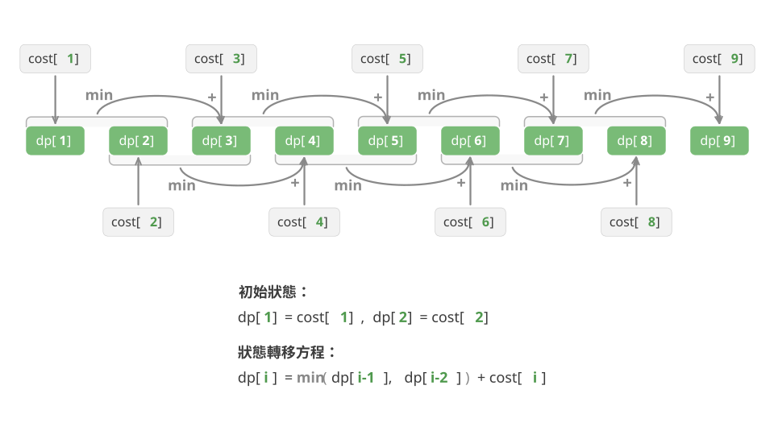

# 動態規劃問題的特性

上一節介紹了動態規劃如何將問題分解成子問題來求解。分解子問題也是其他演算法常用的思路，分治法、動態規劃與回溯法各有不同的著重點。

- 分治法以遞迴方式將原問題拆成多個彼此獨立的子問題，直到得到最小的子問題。遞迴返回時，再合併子問題的解，最後得到原問題的解。
- 動態規劃也以遞迴方式分解問題。它與分治法的主要差異在於，動態規劃的子問題彼此相依，分解過程中有許多子問題會重複出現。
- 回溯法透過嘗試與撤銷選擇，窮舉所有可能的解，並利用剪枝避開不必搜尋的分支。原問題的解由一連串決策構成，每次決策之前的那段子序列，都可以看成一個子問題。

動態規劃常用來求解最佳化問題。這些問題除了有重疊子問題，還有兩項重要特性：最佳子結構與無後效性。

## 最佳子結構

我們稍微修改爬樓梯問題，用它來說明最佳子結構。

!!! question "爬樓梯的最低成本"

    給定一段樓梯，每一步可以往上跨 $1$ 階或 $2$ 階。每一階上都貼著一個非負整數，表示踏上這一階的成本。給定非負整數陣列 $cost$，其中 $cost[i]$ 表示踏上第 $i$ 階的成本，$cost[0]$ 為地面（起點）。爬到頂端的最低成本是多少？

如下圖所示，若踏上第 $1$、$2$、$3$ 階的成本分別為 $1$、$10$、$1$，則從地面爬到第 $3$ 階的最低成本為 $2$。


設 $dp[i]$ 為爬到第 $i$ 階的累計成本。由於只能從第 $i - 1$ 階或第 $i - 2$ 階跨到第 $i$ 階，因此 $dp[i]$ 只可能是 $dp[i - 1] + cost[i]$ 或 $dp[i - 2] + cost[i]$。若要讓成本儘可能低，就應取兩者中的較小值：

$$
dp[i] = \min(dp[i-1], dp[i-2]) + cost[i]
$$

這就說明了最佳子結構的意義：**原問題的最佳解可以由子問題的最佳解構成**。

這道題具有最佳子結構：我們從兩個子問題的最佳解 $dp[i-1]$ 和 $dp[i-2]$ 中選出較佳者，再用它構成原問題 $dp[i]$ 的最佳解。

那麼，上一節的爬樓梯問題也有最佳子結構嗎？題目要算出走法數，看起來只是計數問題。試著改問「最多有幾種走法」，就會發現，**兩種問法雖然等價，改問後卻能看出最佳子結構**：到第 $n$ 階的最大走法數，等於到第 $n-1$ 階和第 $n-2$ 階的最大走法數之和。因此，最佳子結構的解讀很有彈性，會隨問題而有不同的意義。

根據狀態轉移方程式，以及初始狀態 $dp[1] = cost[1]$ 和 $dp[2] = cost[2]$，就能寫出動態規劃的程式：

```src
[file]{min_cost_climbing_stairs_dp}-[class]{}-[func]{min_cost_climbing_stairs_dp}
```

下圖呈現上述程式執行動態規劃的過程。



這道題也可以做空間最佳化，將一維壓縮成零維，讓空間複雜度從 $O(n)$ 降為 $O(1)$：

```src
[file]{min_cost_climbing_stairs_dp}-[class]{}-[func]{min_cost_climbing_stairs_dp_comp}
```

## 無後效性

無後效性是動態規劃能有效解題的重要特性之一。它的定義是：**一旦狀態確定，接下來的發展就只取決於目前狀態，與先前經歷過的所有狀態無關**。

以爬樓梯為例，從狀態 $i$ 可以轉移到狀態 $i+1$ 或 $i+2$，分別對應向上跨 $1$ 階或 $2$ 階。做這兩種選擇時，無須考慮 $i$ 之前的狀態，因為它們不會影響 $i$ 之後的發展。

不過，如果在爬樓梯問題中加入一項限制，情況就不同了。

!!! question "有限制的爬樓梯問題"

    一段樓梯共有 $n$ 階，每一步可以往上跨 $1$ 階或 $2$ 階，**但不能連續兩步都跨 $1$ 階**。共有幾種走法可以爬到頂端？

如下圖所示，到第 $3$ 階只剩 $2$ 種可行的走法。連續三步各跨 $1$ 階違反限制，因此必須排除。


在這道題中，如果上一步跨了 $1$ 階，下一步就必須跨 $2$ 階。也就是說，**目前狀態（所在階數）無法單獨決定下一步的選擇，還得考慮前一個狀態（上一步之前所在的階數）**。

這時問題已經不符合無後效性，狀態轉移方程式 $dp[i] = dp[i-1] + dp[i-2]$ 也不再適用。因為 $dp[i-1]$ 對應這一步跨 $1$ 階的走法，其中有許多走法在上一步也跨了 $1$ 階。為了符合限制，不能將 $dp[i-1]$ 直接計入 $dp[i]$。

為此，我們擴充狀態的定義：**狀態 $[i, j]$ 表示目前在第 $i$ 階，而且上一步跨了 $j$ 階**，其中 $j \in \{1, 2\}$。這個定義能區分上一步跨了 $1$ 階還是 $2$ 階，讓我們據此判斷目前狀態可能來自哪些狀態。

- 若上一步跨了 $1$ 階，再前一步就只能跨 $2$ 階，也就是 $dp[i, 1]$ 只能從 $dp[i-1, 2]$ 轉移而來。
- 若上一步跨了 $2$ 階，再前一步可以跨 $1$ 階或 $2$ 階，也就是 $dp[i, 2]$ 可以從 $dp[i-2, 1]$ 或 $dp[i-2, 2]$ 轉移而來。

如下圖所示，依照這個定義，$dp[i, j]$ 表示狀態 $[i, j]$ 的走法數。狀態轉移方程式為：

$$
\begin{cases}
dp[i, 1] = dp[i-1, 2] \\
dp[i, 2] = dp[i-2, 1] + dp[i-2, 2]
\end{cases}
$$


最後只要回傳 $dp[n, 1] + dp[n, 2]$ 即可，兩者之和就是爬到第 $n$ 階的走法總數：

```src
[file]{climbing_stairs_constraint_dp}-[class]{}-[func]{climbing_stairs_constraint_dp}
```

在上例中，只需多考慮前一個狀態，因此仍能擴充狀態的定義，讓問題重新符合無後效性。然而，有些問題受先前狀態的影響很深。

!!! question "爬樓梯與障礙物的產生"

    一段樓梯共有 $n$ 階，每一步可以往上跨 $1$ 階或 $2$ 階。**每當爬到第 $i$ 階，系統就會自動在第 $2i$ 階放置障礙物，之後每一步都不能跳到第 $2i$ 階**。舉例來說，若前兩步分別跳到第 $2$、$3$ 階，接下來就不能跳到第 $4$、$6$ 階。共有幾種走法可以爬到頂端？

在這個問題中，下一步的選擇取決於過去的所有狀態，因為每一次跳躍都會在更高的階梯上留下障礙物，影響接下來的選擇。這類問題通常很難用動態規劃求解。

許多複雜的組合最佳化問題（例如旅行推銷員問題）都不符合無後效性。對於這類問題，我們通常會採用啟發式搜尋、基因演算法或強化學習等方法，在有限時間內取得可用的局部最佳解。
