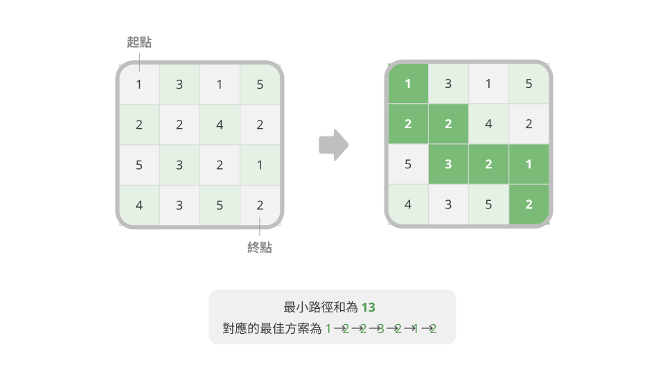
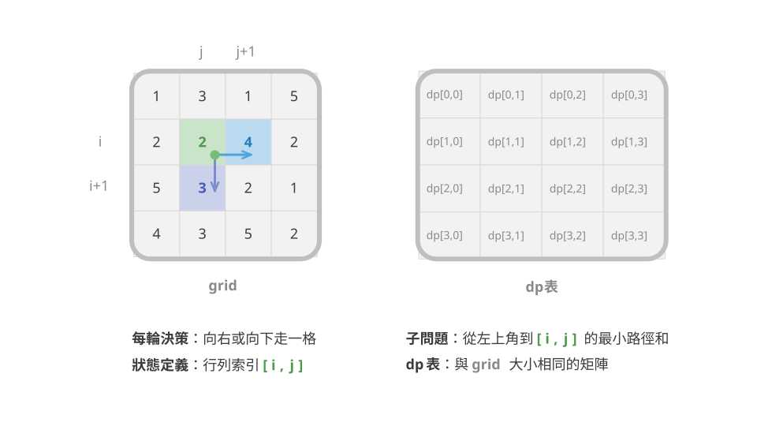
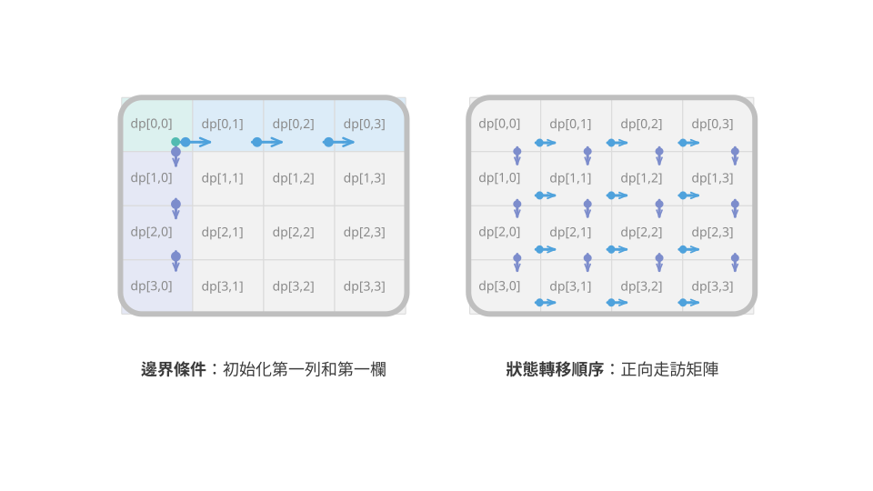
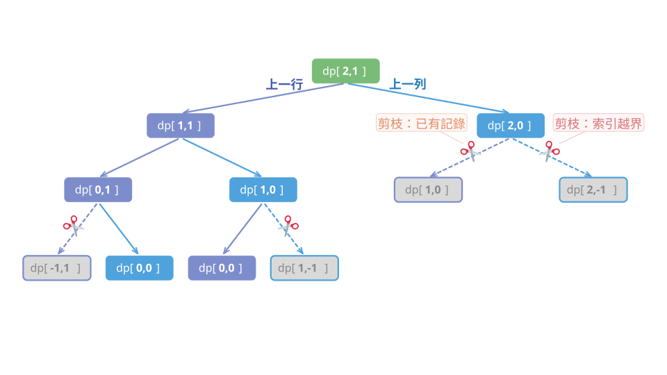
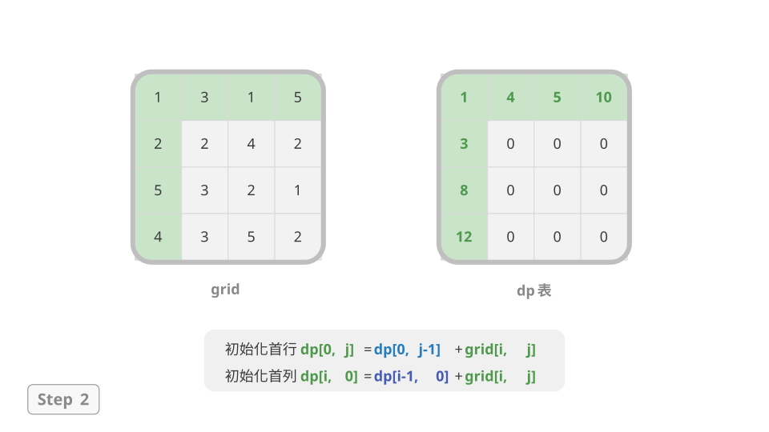
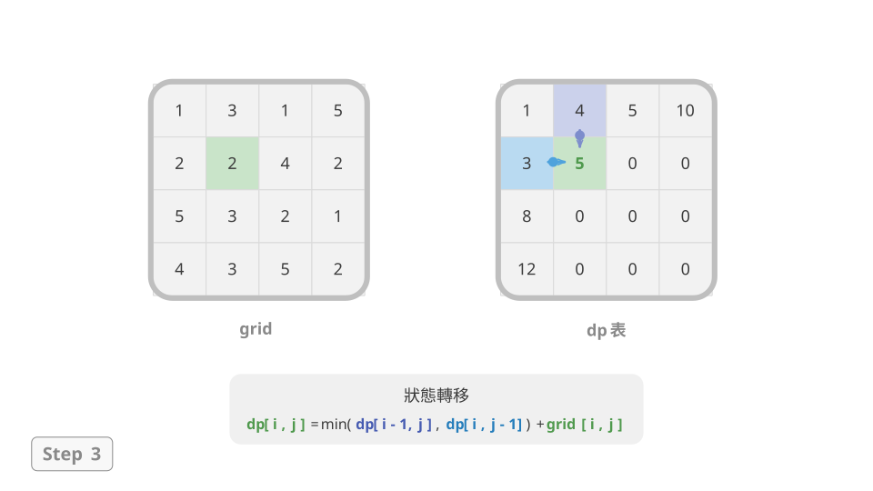
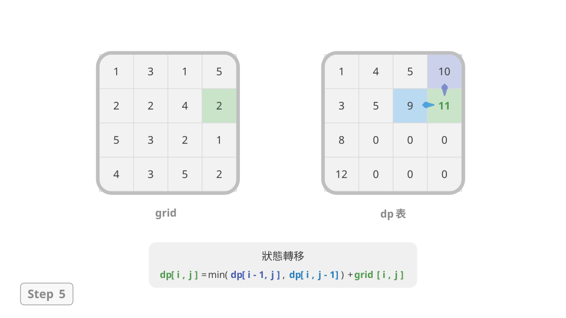
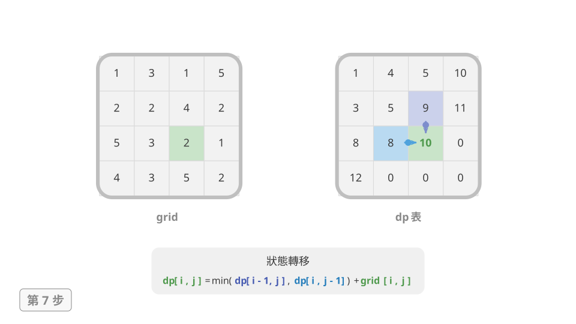
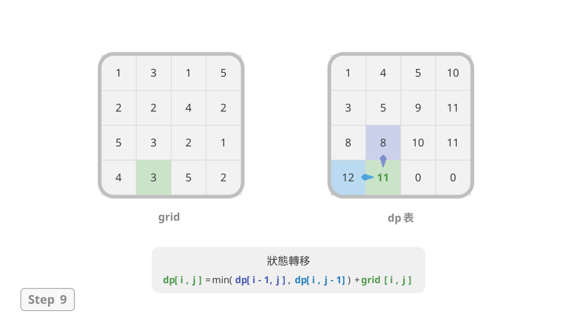
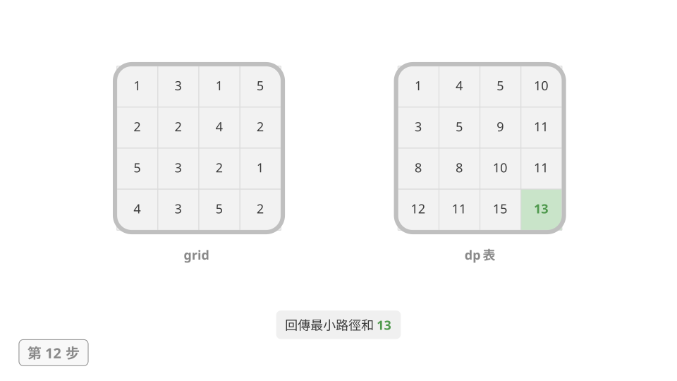

# 14.3 &nbsp; 動態規劃的解題思路

前兩節介紹了動態規劃問題的主要特性。接下來我們探討兩個實際解題時會遇到的問題。

1. 如何判斷一道題是否適合用動態規劃求解？
2. 用動態規劃解題時，該從哪裡下手？完整步驟有哪些？

## 14.3.1 &nbsp; 判斷問題類型

一般來說，如果問題具有重疊子問題、最佳子結構，且符合無後效性，通常就適合用動態規劃求解。不過，直接從題目敘述辨認這些特性並不容易。因此，我們通常先放寬條件，**觀察問題是否適合用回溯法（窮舉）求解**。

**適合用回溯法解決的問題，通常可以用「決策樹模型」描述**。在這棵樹中，每個節點代表一個決策，每條路徑代表一連串決策。

換句話說，如果問題中有明確的決策，而且解是透過一連串決策產生的，就符合決策樹模型，通常可以用回溯法求解。

在此基礎上，還有幾項線索有助於判斷是否適合使用動態規劃。

- 題目要求最大值、最小值、最多或最少等最佳化目標。
- 問題的狀態可以用串列、多維矩陣或樹來表示，而且一個狀態與相鄰狀態之間有遞推關係。

相對地，以下線索會降低採用動態規劃的可能性。

- 題目要求找出所有可行的解，而非最佳解。
- 題目有明顯的排列組合特徵，並要求回傳多個具體方案。

如果問題符合決策樹模型，也有明顯支持動態規劃的線索，就可以先假設它適合用動態規劃，在解題過程中再加以驗證。

## 14.3.2 &nbsp; 解題步驟

動態規劃的解題流程會隨問題的性質與難度而異，但通常包含以下步驟：描述決策、定義狀態、建立 $dp$ 表、推導狀態轉移方程式，以及確定邊界條件等。

我們用經典的「最小路徑和」問題說明解題步驟。

!!! question

    給定一個 $n \times m$ 的二維網格 `grid`，每格有一個非負整數，代表經過該格的成本。機器人從左上角出發，每一步只能向下或向右走一格，直到右下角。請回傳從左上角到右下角的最小路徑和。

圖 14-10 是一個例子，這個網格的最小路徑和為 $13$。

{ class="animation-figure" }

<p align="center"> 圖 14-10 &nbsp; 最小路徑和的範例資料 </p>

**第一步：思考每一步的決策，定義狀態，據此建立 $dp$ 表**

本題每一步的決策，就是從目前格子向下或向右走一格。設目前的列、欄索引為 $[i, j]$，向下或向右一步後，索引分別變成 $[i+1, j]$ 或 $[i, j+1]$。因此，狀態應包含列索引與欄索引兩個變數，記為 $[i, j]$。

狀態 $[i, j]$ 對應的子問題是從起點 $[0, 0]$ 到 $[i, j]$ 的最小路徑和，其解記為 $dp[i, j]$。

如此就得到圖 14-11 的二維 $dp$ 矩陣，大小與輸入網格 $grid$ 相同。

{ class="animation-figure" }

<p align="center"> 圖 14-11 &nbsp; 狀態定義與 dp 表 </p>

!!! note

    動態規劃與回溯的過程都可以描述為一連串決策。狀態由所有決策變數構成，應包含描述解題進度所需的所有變數，讓我們有足夠的資訊推導下一個狀態。
    
    每個狀態對應一個子問題。我們用 $dp$ 表儲存所有子問題的解，狀態中的每個獨立變數各是 $dp$ 表的一個維度。換句話說，$dp$ 表記錄了狀態與子問題解的對應關係。

**第二步：找出最佳子結構，推導狀態轉移方程式**

狀態 $[i, j]$ 只能從上方格子 $[i-1, j]$ 或左方格子 $[i, j-1]$ 轉移而來。因此，最佳子結構為：到達 $[i, j]$ 的最小路徑和取決於到達 $[i, j-1]$ 與 $[i-1, j]$ 的最小路徑和中較小者。

根據上述分析，可推導出圖 14-12 的狀態轉移方程式：

$$
dp[i, j] = \min(dp[i-1, j], dp[i, j-1]) + grid[i, j]
$$

{ class="animation-figure" }

<p align="center"> 圖 14-12 &nbsp; 最佳子結構與狀態轉移方程式 </p>

!!! note

    根據已定義的 $dp$ 表，思考原問題與子問題的關係，找出如何用子問題的最佳解構成原問題的最佳解，也就是找出最佳子結構。

    找到最佳子結構後，就能據此建立狀態轉移方程式。

**第三步：確定邊界條件與狀態轉移順序**

在本題中，第一列的狀態只能來自左方，第一欄的狀態只能來自上方，因此第一列 $i = 0$ 與第一欄 $j = 0$ 是邊界條件。

如圖 14-13 所示，每個格子的狀態都來自左方和上方的格子。因此可以用迴圈走訪矩陣，外層迴圈逐列走訪，內層迴圈逐欄走訪。

{ class="animation-figure" }

<p align="center"> 圖 14-13 &nbsp; 邊界條件與狀態轉移順序 </p>

!!! note

    在動態規劃中，邊界條件用來初始化 $dp$ 表；在搜尋中，則用來剪枝。
    
    安排狀態轉移順序時，必須確保在求解目前問題前，它所依賴的所有較小子問題都已正確求解。

根據上述分析，已經可以直接寫出動態規劃的程式。不過，分解子問題是由上而下的思路，按照「暴力搜尋 $\rightarrow$ 記憶化搜尋 $\rightarrow$ 動態規劃」的順序實作，更符合推理過程。

### 1. &nbsp; 方法一：暴力搜尋

從狀態 $[i, j]$ 開始搜尋，反覆拆成較小的狀態 $[i-1, j]$ 和 $[i, j-1]$。遞迴函式包含以下要素。

- **遞迴參數**：狀態 $[i, j]$。
- **回傳值**：從 $[0, 0]$ 到 $[i, j]$ 的最小路徑和 $dp[i, j]$。
- **終止條件**：若 $i = 0$ 且 $j = 0$，就回傳成本 $grid[0, 0]$。
- **剪枝**：若 $i < 0$ 或 $j < 0$，索引就超出範圍，此時回傳成本 $+\infty$，代表這條路不可行。

程式實作如下：

=== "Python"

    ```python title="min_path_sum.py"
    def min_path_sum_dfs(grid: list[list[int]], i: int, j: int) -> int:
        """最小路徑和：暴力搜尋"""
        # 若已到達左上角的格子，就結束搜尋
        if i == 0 and j == 0:
            return grid[0][0]
        # 若列或欄的索引超出範圍，就回傳成本 +∞
        if i < 0 or j < 0:
            return inf
        # 計算從左上角到 (i-1, j) 和 (i, j-1) 的最小路徑成本
        up = min_path_sum_dfs(grid, i - 1, j)
        left = min_path_sum_dfs(grid, i, j - 1)
        # 回傳從左上角到 (i, j) 的最小路徑成本
        return min(left, up) + grid[i][j]
    ```

=== "C++"

    ```cpp title="min_path_sum.cpp"
    /* 最小路徑和：暴力搜尋 */
    int minPathSumDFS(vector<vector<int>> &grid, int i, int j) {
        // 若已到達左上角的格子，就結束搜尋
        if (i == 0 && j == 0) {
            return grid[0][0];
        }
        // 若列或欄的索引超出範圍，就回傳成本 +∞
        if (i < 0 || j < 0) {
            return INT_MAX;
        }
        // 計算從左上角到 (i-1, j) 和 (i, j-1) 的最小路徑成本
        int up = minPathSumDFS(grid, i - 1, j);
        int left = minPathSumDFS(grid, i, j - 1);
        // 回傳從左上角到 (i, j) 的最小路徑成本
        return min(left, up) != INT_MAX ? min(left, up) + grid[i][j] : INT_MAX;
    }
    ```

=== "Java"

    ```java title="min_path_sum.java"
    /* 最小路徑和：暴力搜尋 */
    int minPathSumDFS(int[][] grid, int i, int j) {
        // 若已到達左上角的格子，就結束搜尋
        if (i == 0 && j == 0) {
            return grid[0][0];
        }
        // 若列或欄的索引超出範圍，就回傳成本 +∞
        if (i < 0 || j < 0) {
            return Integer.MAX_VALUE;
        }
        // 計算從左上角到 (i-1, j) 和 (i, j-1) 的最小路徑成本
        int up = minPathSumDFS(grid, i - 1, j);
        int left = minPathSumDFS(grid, i, j - 1);
        // 回傳從左上角到 (i, j) 的最小路徑成本
        return Math.min(left, up) + grid[i][j];
    }
    ```

=== "C#"

    ```csharp title="min_path_sum.cs"
    /* 最小路徑和：暴力搜尋 */
    int MinPathSumDFS(int[][] grid, int i, int j) {
        // 若已到達左上角的格子，就結束搜尋
        if (i == 0 && j == 0) {
            return grid[0][0];
        }
        // 若列或欄的索引超出範圍，就回傳成本 +∞
        if (i < 0 || j < 0) {
            return int.MaxValue;
        }
        // 計算從左上角到 (i-1, j) 和 (i, j-1) 的最小路徑成本
        int up = MinPathSumDFS(grid, i - 1, j);
        int left = MinPathSumDFS(grid, i, j - 1);
        // 回傳從左上角到 (i, j) 的最小路徑成本
        return Math.Min(left, up) + grid[i][j];
    }
    ```

=== "Go"

    ```go title="min_path_sum.go"
    /* 最小路徑和：暴力搜尋 */
    func minPathSumDFS(grid [][]int, i, j int) int {
        // 若已到達左上角的格子，就結束搜尋
        if i == 0 && j == 0 {
            return grid[0][0]
        }
        // 若列或欄的索引超出範圍，就回傳成本 +∞
        if i < 0 || j < 0 {
            return math.MaxInt
        }
        // 計算從左上角到 (i-1, j) 和 (i, j-1) 的最小路徑成本
        up := minPathSumDFS(grid, i-1, j)
        left := minPathSumDFS(grid, i, j-1)
        // 回傳從左上角到 (i, j) 的最小路徑成本
        return int(math.Min(float64(left), float64(up))) + grid[i][j]
    }
    ```

=== "Swift"

    ```swift title="min_path_sum.swift"
    /* 最小路徑和：暴力搜尋 */
    func minPathSumDFS(grid: [[Int]], i: Int, j: Int) -> Int {
        // 若已到達左上角的格子，就結束搜尋
        if i == 0, j == 0 {
            return grid[0][0]
        }
        // 若列或欄的索引超出範圍，就回傳成本 +∞
        if i < 0 || j < 0 {
            return .max
        }
        // 計算從左上角到 (i-1, j) 和 (i, j-1) 的最小路徑成本
        let up = minPathSumDFS(grid: grid, i: i - 1, j: j)
        let left = minPathSumDFS(grid: grid, i: i, j: j - 1)
        // 回傳從左上角到 (i, j) 的最小路徑成本
        return min(left, up) + grid[i][j]
    }
    ```

=== "JS"

    ```javascript title="min_path_sum.js"
    /* 最小路徑和：暴力搜尋 */
    function minPathSumDFS(grid, i, j) {
        // 若已到達左上角的格子，就結束搜尋
        if (i === 0 && j === 0) {
            return grid[0][0];
        }
        // 若列或欄的索引超出範圍，就回傳成本 +∞
        if (i < 0 || j < 0) {
            return Infinity;
        }
        // 計算從左上角到 (i-1, j) 和 (i, j-1) 的最小路徑成本
        const up = minPathSumDFS(grid, i - 1, j);
        const left = minPathSumDFS(grid, i, j - 1);
        // 回傳從左上角到 (i, j) 的最小路徑成本
        return Math.min(left, up) + grid[i][j];
    }
    ```

=== "TS"

    ```typescript title="min_path_sum.ts"
    /* 最小路徑和：暴力搜尋 */
    function minPathSumDFS(
        grid: Array<Array<number>>,
        i: number,
        j: number
    ): number {
        // 若已到達左上角的格子，就結束搜尋
        if (i === 0 && j == 0) {
            return grid[0][0];
        }
        // 若列或欄的索引超出範圍，就回傳成本 +∞
        if (i < 0 || j < 0) {
            return Infinity;
        }
        // 計算從左上角到 (i-1, j) 和 (i, j-1) 的最小路徑成本
        const up = minPathSumDFS(grid, i - 1, j);
        const left = minPathSumDFS(grid, i, j - 1);
        // 回傳從左上角到 (i, j) 的最小路徑成本
        return Math.min(left, up) + grid[i][j];
    }
    ```

=== "Dart"

    ```dart title="min_path_sum.dart"
    /* 最小路徑和：暴力搜尋 */
    int minPathSumDFS(List<List<int>> grid, int i, int j) {
      // 若已到達左上角的格子，就結束搜尋
      if (i == 0 && j == 0) {
        return grid[0][0];
      }
      // 若列或欄的索引超出範圍，就回傳成本 +∞
      if (i < 0 || j < 0) {
        // 在 Dart 中，int 型別的整數範圍固定，沒有代表「無窮大」的值
        return BigInt.from(2).pow(31).toInt();
      }
      // 計算從左上角到 (i-1, j) 和 (i, j-1) 的最小路徑成本
      int up = minPathSumDFS(grid, i - 1, j);
      int left = minPathSumDFS(grid, i, j - 1);
      // 回傳從左上角到 (i, j) 的最小路徑成本
      return min(left, up) + grid[i][j];
    }
    ```

=== "Rust"

    ```rust title="min_path_sum.rs"
    /* 最小路徑和：暴力搜尋 */
    fn min_path_sum_dfs(grid: &Vec<Vec<i32>>, i: i32, j: i32) -> i32 {
        // 若已到達左上角的格子，就結束搜尋
        if i == 0 && j == 0 {
            return grid[0][0];
        }
        // 若列或欄的索引超出範圍，就回傳成本 +∞
        if i < 0 || j < 0 {
            return i32::MAX;
        }
        // 計算從左上角到 (i-1, j) 和 (i, j-1) 的最小路徑成本
        let up = min_path_sum_dfs(grid, i - 1, j);
        let left = min_path_sum_dfs(grid, i, j - 1);
        // 回傳從左上角到 (i, j) 的最小路徑成本
        std::cmp::min(left, up) + grid[i as usize][j as usize]
    }
    ```

=== "C"

    ```c title="min_path_sum.c"
    /* 最小路徑和：暴力搜尋 */
    int minPathSumDFS(int grid[MAX_SIZE][MAX_SIZE], int i, int j) {
        // 若已到達左上角的格子，就結束搜尋
        if (i == 0 && j == 0) {
            return grid[0][0];
        }
        // 若列或欄的索引超出範圍，就回傳成本 +∞
        if (i < 0 || j < 0) {
            return INT_MAX;
        }
        // 計算從左上角到 (i-1, j) 和 (i, j-1) 的最小路徑成本
        int up = minPathSumDFS(grid, i - 1, j);
        int left = minPathSumDFS(grid, i, j - 1);
        // 回傳從左上角到 (i, j) 的最小路徑成本
        return myMin(left, up) != INT_MAX ? myMin(left, up) + grid[i][j] : INT_MAX;
    }
    ```

=== "Kotlin"

    ```kotlin title="min_path_sum.kt"
    /* 最小路徑和：暴力搜尋 */
    fun minPathSumDFS(grid: Array<IntArray>, i: Int, j: Int): Int {
        // 若已到達左上角的格子，就結束搜尋
        if (i == 0 && j == 0) {
            return grid[0][0]
        }
        // 若列或欄的索引超出範圍，就回傳成本 +∞
        if (i < 0 || j < 0) {
            return Int.MAX_VALUE
        }
        // 計算從左上角到 (i-1, j) 和 (i, j-1) 的最小路徑成本
        val up = minPathSumDFS(grid, i - 1, j)
        val left = minPathSumDFS(grid, i, j - 1)
        // 回傳從左上角到 (i, j) 的最小路徑成本
        return min(left, up) + grid[i][j]
    }
    ```

=== "Ruby"

    ```ruby title="min_path_sum.rb"
    ### 最小路徑和：暴力搜尋 ###
    def min_path_sum_dfs(grid, i, j)
      # 若已到達左上角的格子，就結束搜尋
      return grid[i][j] if i == 0 && j == 0
      # 若列或欄的索引超出範圍，就回傳成本 +∞
      return Float::INFINITY if i < 0 || j < 0
      # 計算從左上角到 (i-1, j) 和 (i, j-1) 的最小路徑成本
      up = min_path_sum_dfs(grid, i - 1, j)
      left = min_path_sum_dfs(grid, i, j - 1)
      # 回傳從左上角到 (i, j) 的最小路徑成本
      [left, up].min + grid[i][j]
    end
    ```

??? pythontutor "執行視覺化示範"

    <div style="height: 549px; width: 100%;"><iframe class="pythontutor-iframe" title="執行視覺化示範" src="https://pythontutor.com/iframe-embed.html#code=from%20math%20import%20inf%0A%0Adef%20min_path_sum_dfs%28grid%3A%20list%5Blist%5Bint%5D%5D,%20i%3A%20int,%20j%3A%20int%29%20-%3E%20int%3A%0A%20%20%20%20%22%22%22%E6%9C%80%E5%B0%8F%E8%B7%AF%E5%BE%91%E5%92%8C%EF%BC%9A%E6%9A%B4%E5%8A%9B%E6%90%9C%E5%B0%8B%22%22%22%0A%20%20%20%20%23%20%E8%8B%A5%E5%B7%B2%E5%88%B0%E9%81%94%E5%B7%A6%E4%B8%8A%E8%A7%92%E7%9A%84%E6%A0%BC%E5%AD%90%EF%BC%8C%E5%B0%B1%E7%B5%90%E6%9D%9F%E6%90%9C%E5%B0%8B%0A%20%20%20%20if%20i%20%3D%3D%200%20and%20j%20%3D%3D%200%3A%0A%20%20%20%20%20%20%20%20return%20grid%5B0%5D%5B0%5D%0A%20%20%20%20%23%20%E8%8B%A5%E5%88%97%E6%88%96%E6%AC%84%E7%9A%84%E7%B4%A2%E5%BC%95%E8%B6%85%E5%87%BA%E7%AF%84%E5%9C%8D%EF%BC%8C%E5%B0%B1%E5%9B%9E%E5%82%B3%E6%88%90%E6%9C%AC%20%2B%E2%88%9E%0A%20%20%20%20if%20i%20%3C%200%20or%20j%20%3C%200%3A%0A%20%20%20%20%20%20%20%20return%20inf%0A%20%20%20%20%23%20%E8%A8%88%E7%AE%97%E5%BE%9E%E5%B7%A6%E4%B8%8A%E8%A7%92%E5%88%B0%20%28i-1,%20j%29%20%E5%92%8C%20%28i,%20j-1%29%20%E7%9A%84%E6%9C%80%E5%B0%8F%E8%B7%AF%E5%BE%91%E6%88%90%E6%9C%AC%0A%20%20%20%20up%20%3D%20min_path_sum_dfs%28grid,%20i%20-%201,%20j%29%0A%20%20%20%20left%20%3D%20min_path_sum_dfs%28grid,%20i,%20j%20-%201%29%0A%20%20%20%20%23%20%E5%9B%9E%E5%82%B3%E5%BE%9E%E5%B7%A6%E4%B8%8A%E8%A7%92%E5%88%B0%20%28i,%20j%29%20%E7%9A%84%E6%9C%80%E5%B0%8F%E8%B7%AF%E5%BE%91%E6%88%90%E6%9C%AC%0A%20%20%20%20return%20min%28left,%20up%29%20%2B%20grid%5Bi%5D%5Bj%5D%0A%0A%0A%22%22%22Driver%20Code%22%22%22%0Aif%20__name__%20%3D%3D%20%22__main__%22%3A%0A%20%20%20%20grid%20%3D%20%5B%5B1,%203,%201,%205%5D,%20%5B2,%202,%204,%202%5D,%20%5B5,%203,%202,%201%5D,%20%5B4,%203,%205,%202%5D%5D%0A%20%20%20%20n,%20m%20%3D%20len%28grid%29,%20len%28grid%5B0%5D%29%0A%0A%20%20%20%20%23%20%E6%9A%B4%E5%8A%9B%E6%90%9C%E5%B0%8B%0A%20%20%20%20res%20%3D%20min_path_sum_dfs%28grid,%20n%20-%201,%20m%20-%201%29%0A%20%20%20%20print%28f%22%E5%BE%9E%E5%B7%A6%E4%B8%8A%E8%A7%92%E5%88%B0%E5%8F%B3%E4%B8%8B%E8%A7%92%E7%9A%84%E6%9C%80%E5%B0%8F%E8%B7%AF%E5%BE%91%E5%92%8C%E7%82%BA%20%7Bres%7D%22%29&codeDivHeight=472&codeDivWidth=350&cumulative=false&curInstr=6&heapPrimitives=nevernest&origin=opt-frontend.js&py=311&rawInputLstJSON=%5B%5D&textReferences=false"> </iframe></div>
    <div style="margin-top: 5px;"><a href="https://pythontutor.com/iframe-embed.html#code=from%20math%20import%20inf%0A%0Adef%20min_path_sum_dfs%28grid%3A%20list%5Blist%5Bint%5D%5D,%20i%3A%20int,%20j%3A%20int%29%20-%3E%20int%3A%0A%20%20%20%20%22%22%22%E6%9C%80%E5%B0%8F%E8%B7%AF%E5%BE%91%E5%92%8C%EF%BC%9A%E6%9A%B4%E5%8A%9B%E6%90%9C%E5%B0%8B%22%22%22%0A%20%20%20%20%23%20%E8%8B%A5%E5%B7%B2%E5%88%B0%E9%81%94%E5%B7%A6%E4%B8%8A%E8%A7%92%E7%9A%84%E6%A0%BC%E5%AD%90%EF%BC%8C%E5%B0%B1%E7%B5%90%E6%9D%9F%E6%90%9C%E5%B0%8B%0A%20%20%20%20if%20i%20%3D%3D%200%20and%20j%20%3D%3D%200%3A%0A%20%20%20%20%20%20%20%20return%20grid%5B0%5D%5B0%5D%0A%20%20%20%20%23%20%E8%8B%A5%E5%88%97%E6%88%96%E6%AC%84%E7%9A%84%E7%B4%A2%E5%BC%95%E8%B6%85%E5%87%BA%E7%AF%84%E5%9C%8D%EF%BC%8C%E5%B0%B1%E5%9B%9E%E5%82%B3%E6%88%90%E6%9C%AC%20%2B%E2%88%9E%0A%20%20%20%20if%20i%20%3C%200%20or%20j%20%3C%200%3A%0A%20%20%20%20%20%20%20%20return%20inf%0A%20%20%20%20%23%20%E8%A8%88%E7%AE%97%E5%BE%9E%E5%B7%A6%E4%B8%8A%E8%A7%92%E5%88%B0%20%28i-1,%20j%29%20%E5%92%8C%20%28i,%20j-1%29%20%E7%9A%84%E6%9C%80%E5%B0%8F%E8%B7%AF%E5%BE%91%E6%88%90%E6%9C%AC%0A%20%20%20%20up%20%3D%20min_path_sum_dfs%28grid,%20i%20-%201,%20j%29%0A%20%20%20%20left%20%3D%20min_path_sum_dfs%28grid,%20i,%20j%20-%201%29%0A%20%20%20%20%23%20%E5%9B%9E%E5%82%B3%E5%BE%9E%E5%B7%A6%E4%B8%8A%E8%A7%92%E5%88%B0%20%28i,%20j%29%20%E7%9A%84%E6%9C%80%E5%B0%8F%E8%B7%AF%E5%BE%91%E6%88%90%E6%9C%AC%0A%20%20%20%20return%20min%28left,%20up%29%20%2B%20grid%5Bi%5D%5Bj%5D%0A%0A%0A%22%22%22Driver%20Code%22%22%22%0Aif%20__name__%20%3D%3D%20%22__main__%22%3A%0A%20%20%20%20grid%20%3D%20%5B%5B1,%203,%201,%205%5D,%20%5B2,%202,%204,%202%5D,%20%5B5,%203,%202,%201%5D,%20%5B4,%203,%205,%202%5D%5D%0A%20%20%20%20n,%20m%20%3D%20len%28grid%29,%20len%28grid%5B0%5D%29%0A%0A%20%20%20%20%23%20%E6%9A%B4%E5%8A%9B%E6%90%9C%E5%B0%8B%0A%20%20%20%20res%20%3D%20min_path_sum_dfs%28grid,%20n%20-%201,%20m%20-%201%29%0A%20%20%20%20print%28f%22%E5%BE%9E%E5%B7%A6%E4%B8%8A%E8%A7%92%E5%88%B0%E5%8F%B3%E4%B8%8B%E8%A7%92%E7%9A%84%E6%9C%80%E5%B0%8F%E8%B7%AF%E5%BE%91%E5%92%8C%E7%82%BA%20%7Bres%7D%22%29&codeDivHeight=800&codeDivWidth=600&cumulative=false&curInstr=6&heapPrimitives=nevernest&origin=opt-frontend.js&py=311&rawInputLstJSON=%5B%5D&textReferences=false" target="_blank" rel="noopener noreferrer">全螢幕觀看 ></a></div>

圖 14-14 是以 $dp[2, 1]$ 為根節點的遞迴樹，其中有一些重疊子問題。隨著網格 `grid` 變大，重疊子問題的數量會急遽增加。

子問題之所以會重疊，是因為**從左上角出發，可以沿著不同路徑抵達同一格**。

{ class="animation-figure" }

<p align="center"> 圖 14-14 &nbsp; 暴力搜尋的遞迴樹 </p>

每個狀態有向下和向右兩種選擇，從左上角走到右下角共需 $m + n - 2$ 步，所以最壞情況的時間複雜度為 $O(2^{m + n})$，其中 $n$ 與 $m$ 分別是網格的列數與欄數。這個估算沒有考慮網格邊界，一旦到達邊界，就只剩一種選擇，因此實際的路徑數會少一些。

### 2. &nbsp; 方法二：記憶化搜尋

建立與網格 `grid` 同樣大小的記憶表 `mem`，記錄各子問題的解，便能在遇到重疊子問題時剪枝：

=== "Python"

    ```python title="min_path_sum.py"
    def min_path_sum_dfs_mem(
        grid: list[list[int]], mem: list[list[int]], i: int, j: int
    ) -> int:
        """最小路徑和：記憶化搜尋"""
        # 若已到達左上角的格子，就結束搜尋
        if i == 0 and j == 0:
            return grid[0][0]
        # 若列或欄的索引超出範圍，就回傳成本 +∞
        if i < 0 or j < 0:
            return inf
        # 若已有紀錄，直接回傳該值
        if mem[i][j] != -1:
            return mem[i][j]
        # 左方與上方格子的最小路徑成本
        up = min_path_sum_dfs_mem(grid, mem, i - 1, j)
        left = min_path_sum_dfs_mem(grid, mem, i, j - 1)
        # 記錄並回傳從左上角到 (i, j) 的最小路徑成本
        mem[i][j] = min(left, up) + grid[i][j]
        return mem[i][j]
    ```

=== "C++"

    ```cpp title="min_path_sum.cpp"
    /* 最小路徑和：記憶化搜尋 */
    int minPathSumDFSMem(vector<vector<int>> &grid, vector<vector<int>> &mem, int i, int j) {
        // 若已到達左上角的格子，就結束搜尋
        if (i == 0 && j == 0) {
            return grid[0][0];
        }
        // 若列或欄的索引超出範圍，就回傳成本 +∞
        if (i < 0 || j < 0) {
            return INT_MAX;
        }
        // 若已有紀錄，直接回傳該值
        if (mem[i][j] != -1) {
            return mem[i][j];
        }
        // 左方與上方格子的最小路徑成本
        int up = minPathSumDFSMem(grid, mem, i - 1, j);
        int left = minPathSumDFSMem(grid, mem, i, j - 1);
        // 記錄並回傳從左上角到 (i, j) 的最小路徑成本
        mem[i][j] = min(left, up) != INT_MAX ? min(left, up) + grid[i][j] : INT_MAX;
        return mem[i][j];
    }
    ```

=== "Java"

    ```java title="min_path_sum.java"
    /* 最小路徑和：記憶化搜尋 */
    int minPathSumDFSMem(int[][] grid, int[][] mem, int i, int j) {
        // 若已到達左上角的格子，就結束搜尋
        if (i == 0 && j == 0) {
            return grid[0][0];
        }
        // 若列或欄的索引超出範圍，就回傳成本 +∞
        if (i < 0 || j < 0) {
            return Integer.MAX_VALUE;
        }
        // 若已有紀錄，直接回傳該值
        if (mem[i][j] != -1) {
            return mem[i][j];
        }
        // 左方與上方格子的最小路徑成本
        int up = minPathSumDFSMem(grid, mem, i - 1, j);
        int left = minPathSumDFSMem(grid, mem, i, j - 1);
        // 記錄並回傳從左上角到 (i, j) 的最小路徑成本
        mem[i][j] = Math.min(left, up) + grid[i][j];
        return mem[i][j];
    }
    ```

=== "C#"

    ```csharp title="min_path_sum.cs"
    /* 最小路徑和：記憶化搜尋 */
    int MinPathSumDFSMem(int[][] grid, int[][] mem, int i, int j) {
        // 若已到達左上角的格子，就結束搜尋
        if (i == 0 && j == 0) {
            return grid[0][0];
        }
        // 若列或欄的索引超出範圍，就回傳成本 +∞
        if (i < 0 || j < 0) {
            return int.MaxValue;
        }
        // 若已有紀錄，直接回傳該值
        if (mem[i][j] != -1) {
            return mem[i][j];
        }
        // 左方與上方格子的最小路徑成本
        int up = MinPathSumDFSMem(grid, mem, i - 1, j);
        int left = MinPathSumDFSMem(grid, mem, i, j - 1);
        // 記錄並回傳從左上角到 (i, j) 的最小路徑成本
        mem[i][j] = Math.Min(left, up) + grid[i][j];
        return mem[i][j];
    }
    ```

=== "Go"

    ```go title="min_path_sum.go"
    /* 最小路徑和：記憶化搜尋 */
    func minPathSumDFSMem(grid, mem [][]int, i, j int) int {
        // 若已到達左上角的格子，就結束搜尋
        if i == 0 && j == 0 {
            return grid[0][0]
        }
        // 若列或欄的索引超出範圍，就回傳成本 +∞
        if i < 0 || j < 0 {
            return math.MaxInt
        }
        // 若已有紀錄，直接回傳該值
        if mem[i][j] != -1 {
            return mem[i][j]
        }
        // 左方與上方格子的最小路徑成本
        up := minPathSumDFSMem(grid, mem, i-1, j)
        left := minPathSumDFSMem(grid, mem, i, j-1)
        // 記錄並回傳從左上角到 (i, j) 的最小路徑成本
        mem[i][j] = int(math.Min(float64(left), float64(up))) + grid[i][j]
        return mem[i][j]
    }
    ```

=== "Swift"

    ```swift title="min_path_sum.swift"
    /* 最小路徑和：記憶化搜尋 */
    func minPathSumDFSMem(grid: [[Int]], mem: inout [[Int]], i: Int, j: Int) -> Int {
        // 若已到達左上角的格子，就結束搜尋
        if i == 0, j == 0 {
            return grid[0][0]
        }
        // 若列或欄的索引超出範圍，就回傳成本 +∞
        if i < 0 || j < 0 {
            return .max
        }
        // 若已有紀錄，直接回傳該值
        if mem[i][j] != -1 {
            return mem[i][j]
        }
        // 左方與上方格子的最小路徑成本
        let up = minPathSumDFSMem(grid: grid, mem: &mem, i: i - 1, j: j)
        let left = minPathSumDFSMem(grid: grid, mem: &mem, i: i, j: j - 1)
        // 記錄並回傳從左上角到 (i, j) 的最小路徑成本
        mem[i][j] = min(left, up) + grid[i][j]
        return mem[i][j]
    }
    ```

=== "JS"

    ```javascript title="min_path_sum.js"
    /* 最小路徑和：記憶化搜尋 */
    function minPathSumDFSMem(grid, mem, i, j) {
        // 若已到達左上角的格子，就結束搜尋
        if (i === 0 && j === 0) {
            return grid[0][0];
        }
        // 若列或欄的索引超出範圍，就回傳成本 +∞
        if (i < 0 || j < 0) {
            return Infinity;
        }
        // 若已有紀錄，直接回傳該值
        if (mem[i][j] !== -1) {
            return mem[i][j];
        }
        // 左方與上方格子的最小路徑成本
        const up = minPathSumDFSMem(grid, mem, i - 1, j);
        const left = minPathSumDFSMem(grid, mem, i, j - 1);
        // 記錄並回傳從左上角到 (i, j) 的最小路徑成本
        mem[i][j] = Math.min(left, up) + grid[i][j];
        return mem[i][j];
    }
    ```

=== "TS"

    ```typescript title="min_path_sum.ts"
    /* 最小路徑和：記憶化搜尋 */
    function minPathSumDFSMem(
        grid: Array<Array<number>>,
        mem: Array<Array<number>>,
        i: number,
        j: number
    ): number {
        // 若已到達左上角的格子，就結束搜尋
        if (i === 0 && j === 0) {
            return grid[0][0];
        }
        // 若列或欄的索引超出範圍，就回傳成本 +∞
        if (i < 0 || j < 0) {
            return Infinity;
        }
        // 若已有紀錄，直接回傳該值
        if (mem[i][j] != -1) {
            return mem[i][j];
        }
        // 左方與上方格子的最小路徑成本
        const up = minPathSumDFSMem(grid, mem, i - 1, j);
        const left = minPathSumDFSMem(grid, mem, i, j - 1);
        // 記錄並回傳從左上角到 (i, j) 的最小路徑成本
        mem[i][j] = Math.min(left, up) + grid[i][j];
        return mem[i][j];
    }
    ```

=== "Dart"

    ```dart title="min_path_sum.dart"
    /* 最小路徑和：記憶化搜尋 */
    int minPathSumDFSMem(List<List<int>> grid, List<List<int>> mem, int i, int j) {
      // 若已到達左上角的格子，就結束搜尋
      if (i == 0 && j == 0) {
        return grid[0][0];
      }
      // 若列或欄的索引超出範圍，就回傳成本 +∞
      if (i < 0 || j < 0) {
        // 在 Dart 中，int 型別的整數範圍固定，沒有代表「無窮大」的值
        return BigInt.from(2).pow(31).toInt();
      }
      // 若已有紀錄，直接回傳該值
      if (mem[i][j] != -1) {
        return mem[i][j];
      }
      // 左方與上方格子的最小路徑成本
      int up = minPathSumDFSMem(grid, mem, i - 1, j);
      int left = minPathSumDFSMem(grid, mem, i, j - 1);
      // 記錄並回傳從左上角到 (i, j) 的最小路徑成本
      mem[i][j] = min(left, up) + grid[i][j];
      return mem[i][j];
    }
    ```

=== "Rust"

    ```rust title="min_path_sum.rs"
    /* 最小路徑和：記憶化搜尋 */
    fn min_path_sum_dfs_mem(grid: &Vec<Vec<i32>>, mem: &mut Vec<Vec<i32>>, i: i32, j: i32) -> i32 {
        // 若已到達左上角的格子，就結束搜尋
        if i == 0 && j == 0 {
            return grid[0][0];
        }
        // 若列或欄的索引超出範圍，就回傳成本 +∞
        if i < 0 || j < 0 {
            return i32::MAX;
        }
        // 若已有紀錄，直接回傳該值
        if mem[i as usize][j as usize] != -1 {
            return mem[i as usize][j as usize];
        }
        // 左方與上方格子的最小路徑成本
        let up = min_path_sum_dfs_mem(grid, mem, i - 1, j);
        let left = min_path_sum_dfs_mem(grid, mem, i, j - 1);
        // 記錄並回傳從左上角到 (i, j) 的最小路徑成本
        mem[i as usize][j as usize] = std::cmp::min(left, up) + grid[i as usize][j as usize];
        mem[i as usize][j as usize]
    }
    ```

=== "C"

    ```c title="min_path_sum.c"
    /* 最小路徑和：記憶化搜尋 */
    int minPathSumDFSMem(int grid[MAX_SIZE][MAX_SIZE], int mem[MAX_SIZE][MAX_SIZE], int i, int j) {
        // 若已到達左上角的格子，就結束搜尋
        if (i == 0 && j == 0) {
            return grid[0][0];
        }
        // 若列或欄的索引超出範圍，就回傳成本 +∞
        if (i < 0 || j < 0) {
            return INT_MAX;
        }
        // 若已有紀錄，直接回傳該值
        if (mem[i][j] != -1) {
            return mem[i][j];
        }
        // 左方與上方格子的最小路徑成本
        int up = minPathSumDFSMem(grid, mem, i - 1, j);
        int left = minPathSumDFSMem(grid, mem, i, j - 1);
        // 記錄並回傳從左上角到 (i, j) 的最小路徑成本
        mem[i][j] = myMin(left, up) != INT_MAX ? myMin(left, up) + grid[i][j] : INT_MAX;
        return mem[i][j];
    }
    ```

=== "Kotlin"

    ```kotlin title="min_path_sum.kt"
    /* 最小路徑和：記憶化搜尋 */
    fun minPathSumDFSMem(
        grid: Array<IntArray>,
        mem: Array<IntArray>,
        i: Int,
        j: Int
    ): Int {
        // 若已到達左上角的格子，就結束搜尋
        if (i == 0 && j == 0) {
            return grid[0][0]
        }
        // 若列或欄的索引超出範圍，就回傳成本 +∞
        if (i < 0 || j < 0) {
            return Int.MAX_VALUE
        }
        // 若已有紀錄，直接回傳該值
        if (mem[i][j] != -1) {
            return mem[i][j]
        }
        // 左方與上方格子的最小路徑成本
        val up = minPathSumDFSMem(grid, mem, i - 1, j)
        val left = minPathSumDFSMem(grid, mem, i, j - 1)
        // 記錄並回傳從左上角到 (i, j) 的最小路徑成本
        mem[i][j] = min(left, up) + grid[i][j]
        return mem[i][j]
    }
    ```

=== "Ruby"

    ```ruby title="min_path_sum.rb"
    ### 最小路徑和：記憶化搜尋 ###
    def min_path_sum_dfs_mem(grid, mem, i, j)
      # 若已到達左上角的格子，就結束搜尋
      return grid[0][0] if i == 0 && j == 0
      # 若列或欄的索引超出範圍，就回傳成本 +∞
      return Float::INFINITY if i < 0 || j < 0
      # 若已有紀錄，直接回傳該值
      return mem[i][j] if mem[i][j] != -1
      # 左方與上方格子的最小路徑成本
      up = min_path_sum_dfs_mem(grid, mem, i - 1, j)
      left = min_path_sum_dfs_mem(grid, mem, i, j - 1)
      # 記錄並回傳從左上角到 (i, j) 的最小路徑成本
      mem[i][j] = [left, up].min + grid[i][j]
    end
    ```

??? pythontutor "執行視覺化示範"

    <div style="height: 549px; width: 100%;"><iframe class="pythontutor-iframe" title="執行視覺化示範" src="https://pythontutor.com/iframe-embed.html#code=from%20math%20import%20inf%0A%0Adef%20min_path_sum_dfs_mem%28%0A%20%20%20%20grid%3A%20list%5Blist%5Bint%5D%5D,%20mem%3A%20list%5Blist%5Bint%5D%5D,%20i%3A%20int,%20j%3A%20int%0A%29%20-%3E%20int%3A%0A%20%20%20%20%22%22%22%E6%9C%80%E5%B0%8F%E8%B7%AF%E5%BE%91%E5%92%8C%EF%BC%9A%E8%A8%98%E6%86%B6%E5%8C%96%E6%90%9C%E5%B0%8B%22%22%22%0A%20%20%20%20%23%20%E8%8B%A5%E5%B7%B2%E5%88%B0%E9%81%94%E5%B7%A6%E4%B8%8A%E8%A7%92%E7%9A%84%E6%A0%BC%E5%AD%90%EF%BC%8C%E5%B0%B1%E7%B5%90%E6%9D%9F%E6%90%9C%E5%B0%8B%0A%20%20%20%20if%20i%20%3D%3D%200%20and%20j%20%3D%3D%200%3A%0A%20%20%20%20%20%20%20%20return%20grid%5B0%5D%5B0%5D%0A%20%20%20%20%23%20%E8%8B%A5%E5%88%97%E6%88%96%E6%AC%84%E7%9A%84%E7%B4%A2%E5%BC%95%E8%B6%85%E5%87%BA%E7%AF%84%E5%9C%8D%EF%BC%8C%E5%B0%B1%E5%9B%9E%E5%82%B3%E6%88%90%E6%9C%AC%20%2B%E2%88%9E%0A%20%20%20%20if%20i%20%3C%200%20or%20j%20%3C%200%3A%0A%20%20%20%20%20%20%20%20return%20inf%0A%20%20%20%20%23%20%E8%8B%A5%E5%B7%B2%E6%9C%89%E7%B4%80%E9%8C%84%EF%BC%8C%E7%9B%B4%E6%8E%A5%E5%9B%9E%E5%82%B3%E8%A9%B2%E5%80%BC%0A%20%20%20%20if%20mem%5Bi%5D%5Bj%5D%20%21%3D%20-1%3A%0A%20%20%20%20%20%20%20%20return%20mem%5Bi%5D%5Bj%5D%0A%20%20%20%20%23%20%E5%B7%A6%E6%96%B9%E8%88%87%E4%B8%8A%E6%96%B9%E6%A0%BC%E5%AD%90%E7%9A%84%E6%9C%80%E5%B0%8F%E8%B7%AF%E5%BE%91%E6%88%90%E6%9C%AC%0A%20%20%20%20up%20%3D%20min_path_sum_dfs_mem%28grid,%20mem,%20i%20-%201,%20j%29%0A%20%20%20%20left%20%3D%20min_path_sum_dfs_mem%28grid,%20mem,%20i,%20j%20-%201%29%0A%20%20%20%20%23%20%E8%A8%98%E9%8C%84%E4%B8%A6%E5%9B%9E%E5%82%B3%E5%BE%9E%E5%B7%A6%E4%B8%8A%E8%A7%92%E5%88%B0%20%28i,%20j%29%20%E7%9A%84%E6%9C%80%E5%B0%8F%E8%B7%AF%E5%BE%91%E6%88%90%E6%9C%AC%0A%20%20%20%20mem%5Bi%5D%5Bj%5D%20%3D%20min%28left,%20up%29%20%2B%20grid%5Bi%5D%5Bj%5D%0A%20%20%20%20return%20mem%5Bi%5D%5Bj%5D%0A%0A%0A%22%22%22Driver%20Code%22%22%22%0Aif%20__name__%20%3D%3D%20%22__main__%22%3A%0A%20%20%20%20grid%20%3D%20%5B%5B1,%203,%201,%205%5D,%20%5B2,%202,%204,%202%5D,%20%5B5,%203,%202,%201%5D,%20%5B4,%203,%205,%202%5D%5D%0A%20%20%20%20n,%20m%20%3D%20len%28grid%29,%20len%28grid%5B0%5D%29%0A%0A%20%20%20%23%20%E8%A8%98%E6%86%B6%E5%8C%96%E6%90%9C%E5%B0%8B%0A%20%20%20%20mem%20%3D%20%5B%5B-1%5D%20%2A%20m%20for%20_%20in%20range%28n%29%5D%0A%20%20%20%20res%20%3D%20min_path_sum_dfs_mem%28grid,%20mem,%20n%20-%201,%20m%20-%201%29%0A%20%20%20%20print%28f%22%E5%BE%9E%E5%B7%A6%E4%B8%8A%E8%A7%92%E5%88%B0%E5%8F%B3%E4%B8%8B%E8%A7%92%E7%9A%84%E6%9C%80%E5%B0%8F%E8%B7%AF%E5%BE%91%E5%92%8C%E7%82%BA%20%7Bres%7D%22%29&codeDivHeight=472&codeDivWidth=350&cumulative=false&curInstr=16&heapPrimitives=nevernest&origin=opt-frontend.js&py=311&rawInputLstJSON=%5B%5D&textReferences=false"> </iframe></div>
    <div style="margin-top: 5px;"><a href="https://pythontutor.com/iframe-embed.html#code=from%20math%20import%20inf%0A%0Adef%20min_path_sum_dfs_mem%28%0A%20%20%20%20grid%3A%20list%5Blist%5Bint%5D%5D,%20mem%3A%20list%5Blist%5Bint%5D%5D,%20i%3A%20int,%20j%3A%20int%0A%29%20-%3E%20int%3A%0A%20%20%20%20%22%22%22%E6%9C%80%E5%B0%8F%E8%B7%AF%E5%BE%91%E5%92%8C%EF%BC%9A%E8%A8%98%E6%86%B6%E5%8C%96%E6%90%9C%E5%B0%8B%22%22%22%0A%20%20%20%20%23%20%E8%8B%A5%E5%B7%B2%E5%88%B0%E9%81%94%E5%B7%A6%E4%B8%8A%E8%A7%92%E7%9A%84%E6%A0%BC%E5%AD%90%EF%BC%8C%E5%B0%B1%E7%B5%90%E6%9D%9F%E6%90%9C%E5%B0%8B%0A%20%20%20%20if%20i%20%3D%3D%200%20and%20j%20%3D%3D%200%3A%0A%20%20%20%20%20%20%20%20return%20grid%5B0%5D%5B0%5D%0A%20%20%20%20%23%20%E8%8B%A5%E5%88%97%E6%88%96%E6%AC%84%E7%9A%84%E7%B4%A2%E5%BC%95%E8%B6%85%E5%87%BA%E7%AF%84%E5%9C%8D%EF%BC%8C%E5%B0%B1%E5%9B%9E%E5%82%B3%E6%88%90%E6%9C%AC%20%2B%E2%88%9E%0A%20%20%20%20if%20i%20%3C%200%20or%20j%20%3C%200%3A%0A%20%20%20%20%20%20%20%20return%20inf%0A%20%20%20%20%23%20%E8%8B%A5%E5%B7%B2%E6%9C%89%E7%B4%80%E9%8C%84%EF%BC%8C%E7%9B%B4%E6%8E%A5%E5%9B%9E%E5%82%B3%E8%A9%B2%E5%80%BC%0A%20%20%20%20if%20mem%5Bi%5D%5Bj%5D%20%21%3D%20-1%3A%0A%20%20%20%20%20%20%20%20return%20mem%5Bi%5D%5Bj%5D%0A%20%20%20%20%23%20%E5%B7%A6%E6%96%B9%E8%88%87%E4%B8%8A%E6%96%B9%E6%A0%BC%E5%AD%90%E7%9A%84%E6%9C%80%E5%B0%8F%E8%B7%AF%E5%BE%91%E6%88%90%E6%9C%AC%0A%20%20%20%20up%20%3D%20min_path_sum_dfs_mem%28grid,%20mem,%20i%20-%201,%20j%29%0A%20%20%20%20left%20%3D%20min_path_sum_dfs_mem%28grid,%20mem,%20i,%20j%20-%201%29%0A%20%20%20%20%23%20%E8%A8%98%E9%8C%84%E4%B8%A6%E5%9B%9E%E5%82%B3%E5%BE%9E%E5%B7%A6%E4%B8%8A%E8%A7%92%E5%88%B0%20%28i,%20j%29%20%E7%9A%84%E6%9C%80%E5%B0%8F%E8%B7%AF%E5%BE%91%E6%88%90%E6%9C%AC%0A%20%20%20%20mem%5Bi%5D%5Bj%5D%20%3D%20min%28left,%20up%29%20%2B%20grid%5Bi%5D%5Bj%5D%0A%20%20%20%20return%20mem%5Bi%5D%5Bj%5D%0A%0A%0A%22%22%22Driver%20Code%22%22%22%0Aif%20__name__%20%3D%3D%20%22__main__%22%3A%0A%20%20%20%20grid%20%3D%20%5B%5B1,%203,%201,%205%5D,%20%5B2,%202,%204,%202%5D,%20%5B5,%203,%202,%201%5D,%20%5B4,%203,%205,%202%5D%5D%0A%20%20%20%20n,%20m%20%3D%20len%28grid%29,%20len%28grid%5B0%5D%29%0A%0A%20%20%20%23%20%E8%A8%98%E6%86%B6%E5%8C%96%E6%90%9C%E5%B0%8B%0A%20%20%20%20mem%20%3D%20%5B%5B-1%5D%20%2A%20m%20for%20_%20in%20range%28n%29%5D%0A%20%20%20%20res%20%3D%20min_path_sum_dfs_mem%28grid,%20mem,%20n%20-%201,%20m%20-%201%29%0A%20%20%20%20print%28f%22%E5%BE%9E%E5%B7%A6%E4%B8%8A%E8%A7%92%E5%88%B0%E5%8F%B3%E4%B8%8B%E8%A7%92%E7%9A%84%E6%9C%80%E5%B0%8F%E8%B7%AF%E5%BE%91%E5%92%8C%E7%82%BA%20%7Bres%7D%22%29&codeDivHeight=800&codeDivWidth=600&cumulative=false&curInstr=16&heapPrimitives=nevernest&origin=opt-frontend.js&py=311&rawInputLstJSON=%5B%5D&textReferences=false" target="_blank" rel="noopener noreferrer">全螢幕觀看 ></a></div>

如圖 14-15 所示，加入記憶化後，每個子問題的解都只需計算一次。因此，時間複雜度取決於狀態總數，也就是網格的大小 $O(nm)$。

{ class="animation-figure" }

<p align="center"> 圖 14-15 &nbsp; 記憶化搜尋的遞迴樹 </p>

### 3. &nbsp; 方法三：動態規劃

以迭代方式實作動態規劃，程式如下：

=== "Python"

    ```python title="min_path_sum.py"
    def min_path_sum_dp(grid: list[list[int]]) -> int:
        """最小路徑和：動態規劃"""
        n, m = len(grid), len(grid[0])
        # 初始化 dp 表
        dp = [[0] * m for _ in range(n)]
        dp[0][0] = grid[0][0]
        # 狀態轉移：第一列
        for j in range(1, m):
            dp[0][j] = dp[0][j - 1] + grid[0][j]
        # 狀態轉移：第一欄
        for i in range(1, n):
            dp[i][0] = dp[i - 1][0] + grid[i][0]
        # 狀態轉移：其餘各列與各欄
        for i in range(1, n):
            for j in range(1, m):
                dp[i][j] = min(dp[i][j - 1], dp[i - 1][j]) + grid[i][j]
        return dp[n - 1][m - 1]
    ```

=== "C++"

    ```cpp title="min_path_sum.cpp"
    /* 最小路徑和：動態規劃 */
    int minPathSumDP(vector<vector<int>> &grid) {
        int n = grid.size(), m = grid[0].size();
        // 初始化 dp 表
        vector<vector<int>> dp(n, vector<int>(m));
        dp[0][0] = grid[0][0];
        // 狀態轉移：第一列
        for (int j = 1; j < m; j++) {
            dp[0][j] = dp[0][j - 1] + grid[0][j];
        }
        // 狀態轉移：第一欄
        for (int i = 1; i < n; i++) {
            dp[i][0] = dp[i - 1][0] + grid[i][0];
        }
        // 狀態轉移：其餘各列與各欄
        for (int i = 1; i < n; i++) {
            for (int j = 1; j < m; j++) {
                dp[i][j] = min(dp[i][j - 1], dp[i - 1][j]) + grid[i][j];
            }
        }
        return dp[n - 1][m - 1];
    }
    ```

=== "Java"

    ```java title="min_path_sum.java"
    /* 最小路徑和：動態規劃 */
    int minPathSumDP(int[][] grid) {
        int n = grid.length, m = grid[0].length;
        // 初始化 dp 表
        int[][] dp = new int[n][m];
        dp[0][0] = grid[0][0];
        // 狀態轉移：第一列
        for (int j = 1; j < m; j++) {
            dp[0][j] = dp[0][j - 1] + grid[0][j];
        }
        // 狀態轉移：第一欄
        for (int i = 1; i < n; i++) {
            dp[i][0] = dp[i - 1][0] + grid[i][0];
        }
        // 狀態轉移：其餘各列與各欄
        for (int i = 1; i < n; i++) {
            for (int j = 1; j < m; j++) {
                dp[i][j] = Math.min(dp[i][j - 1], dp[i - 1][j]) + grid[i][j];
            }
        }
        return dp[n - 1][m - 1];
    }
    ```

=== "C#"

    ```csharp title="min_path_sum.cs"
    /* 最小路徑和：動態規劃 */
    int MinPathSumDP(int[][] grid) {
        int n = grid.Length, m = grid[0].Length;
        // 初始化 dp 表
        int[,] dp = new int[n, m];
        dp[0, 0] = grid[0][0];
        // 狀態轉移：第一列
        for (int j = 1; j < m; j++) {
            dp[0, j] = dp[0, j - 1] + grid[0][j];
        }
        // 狀態轉移：第一欄
        for (int i = 1; i < n; i++) {
            dp[i, 0] = dp[i - 1, 0] + grid[i][0];
        }
        // 狀態轉移：其餘各列與各欄
        for (int i = 1; i < n; i++) {
            for (int j = 1; j < m; j++) {
                dp[i, j] = Math.Min(dp[i, j - 1], dp[i - 1, j]) + grid[i][j];
            }
        }
        return dp[n - 1, m - 1];
    }
    ```

=== "Go"

    ```go title="min_path_sum.go"
    /* 最小路徑和：動態規劃 */
    func minPathSumDP(grid [][]int) int {
        n, m := len(grid), len(grid[0])
        // 初始化 dp 表
        dp := make([][]int, n)
        for i := 0; i < n; i++ {
            dp[i] = make([]int, m)
        }
        dp[0][0] = grid[0][0]
        // 狀態轉移：第一列
        for j := 1; j < m; j++ {
            dp[0][j] = dp[0][j-1] + grid[0][j]
        }
        // 狀態轉移：第一欄
        for i := 1; i < n; i++ {
            dp[i][0] = dp[i-1][0] + grid[i][0]
        }
        // 狀態轉移：其餘各列與各欄
        for i := 1; i < n; i++ {
            for j := 1; j < m; j++ {
                dp[i][j] = int(math.Min(float64(dp[i][j-1]), float64(dp[i-1][j]))) + grid[i][j]
            }
        }
        return dp[n-1][m-1]
    }
    ```

=== "Swift"

    ```swift title="min_path_sum.swift"
    /* 最小路徑和：動態規劃 */
    func minPathSumDP(grid: [[Int]]) -> Int {
        let n = grid.count
        let m = grid[0].count
        // 初始化 dp 表
        var dp = Array(repeating: Array(repeating: 0, count: m), count: n)
        dp[0][0] = grid[0][0]
        // 狀態轉移：第一列
        for j in 1 ..< m {
            dp[0][j] = dp[0][j - 1] + grid[0][j]
        }
        // 狀態轉移：第一欄
        for i in 1 ..< n {
            dp[i][0] = dp[i - 1][0] + grid[i][0]
        }
        // 狀態轉移：其餘各列與各欄
        for i in 1 ..< n {
            for j in 1 ..< m {
                dp[i][j] = min(dp[i][j - 1], dp[i - 1][j]) + grid[i][j]
            }
        }
        return dp[n - 1][m - 1]
    }
    ```

=== "JS"

    ```javascript title="min_path_sum.js"
    /* 最小路徑和：動態規劃 */
    function minPathSumDP(grid) {
        const n = grid.length,
            m = grid[0].length;
        // 初始化 dp 表
        const dp = Array.from({ length: n }, () =>
            Array.from({ length: m }, () => 0)
        );
        dp[0][0] = grid[0][0];
        // 狀態轉移：第一列
        for (let j = 1; j < m; j++) {
            dp[0][j] = dp[0][j - 1] + grid[0][j];
        }
        // 狀態轉移：第一欄
        for (let i = 1; i < n; i++) {
            dp[i][0] = dp[i - 1][0] + grid[i][0];
        }
        // 狀態轉移：其餘各列與各欄
        for (let i = 1; i < n; i++) {
            for (let j = 1; j < m; j++) {
                dp[i][j] = Math.min(dp[i][j - 1], dp[i - 1][j]) + grid[i][j];
            }
        }
        return dp[n - 1][m - 1];
    }
    ```

=== "TS"

    ```typescript title="min_path_sum.ts"
    /* 最小路徑和：動態規劃 */
    function minPathSumDP(grid: Array<Array<number>>): number {
        const n = grid.length,
            m = grid[0].length;
        // 初始化 dp 表
        const dp = Array.from({ length: n }, () =>
            Array.from({ length: m }, () => 0)
        );
        dp[0][0] = grid[0][0];
        // 狀態轉移：第一列
        for (let j = 1; j < m; j++) {
            dp[0][j] = dp[0][j - 1] + grid[0][j];
        }
        // 狀態轉移：第一欄
        for (let i = 1; i < n; i++) {
            dp[i][0] = dp[i - 1][0] + grid[i][0];
        }
        // 狀態轉移：其餘各列與各欄
        for (let i = 1; i < n; i++) {
            for (let j: number = 1; j < m; j++) {
                dp[i][j] = Math.min(dp[i][j - 1], dp[i - 1][j]) + grid[i][j];
            }
        }
        return dp[n - 1][m - 1];
    }
    ```

=== "Dart"

    ```dart title="min_path_sum.dart"
    /* 最小路徑和：動態規劃 */
    int minPathSumDP(List<List<int>> grid) {
      int n = grid.length, m = grid[0].length;
      // 初始化 dp 表
      List<List<int>> dp = List.generate(n, (i) => List.filled(m, 0));
      dp[0][0] = grid[0][0];
      // 狀態轉移：第一列
      for (int j = 1; j < m; j++) {
        dp[0][j] = dp[0][j - 1] + grid[0][j];
      }
      // 狀態轉移：第一欄
      for (int i = 1; i < n; i++) {
        dp[i][0] = dp[i - 1][0] + grid[i][0];
      }
      // 狀態轉移：其餘各列與各欄
      for (int i = 1; i < n; i++) {
        for (int j = 1; j < m; j++) {
          dp[i][j] = min(dp[i][j - 1], dp[i - 1][j]) + grid[i][j];
        }
      }
      return dp[n - 1][m - 1];
    }
    ```

=== "Rust"

    ```rust title="min_path_sum.rs"
    /* 最小路徑和：動態規劃 */
    fn min_path_sum_dp(grid: &Vec<Vec<i32>>) -> i32 {
        let (n, m) = (grid.len(), grid[0].len());
        // 初始化 dp 表
        let mut dp = vec![vec![0; m]; n];
        dp[0][0] = grid[0][0];
        // 狀態轉移：第一列
        for j in 1..m {
            dp[0][j] = dp[0][j - 1] + grid[0][j];
        }
        // 狀態轉移：第一欄
        for i in 1..n {
            dp[i][0] = dp[i - 1][0] + grid[i][0];
        }
        // 狀態轉移：其餘各列與各欄
        for i in 1..n {
            for j in 1..m {
                dp[i][j] = std::cmp::min(dp[i][j - 1], dp[i - 1][j]) + grid[i][j];
            }
        }
        dp[n - 1][m - 1]
    }
    ```

=== "C"

    ```c title="min_path_sum.c"
    /* 最小路徑和：動態規劃 */
    int minPathSumDP(int grid[MAX_SIZE][MAX_SIZE], int n, int m) {
        // 初始化 dp 表
        int **dp = malloc(n * sizeof(int *));
        for (int i = 0; i < n; i++) {
            dp[i] = calloc(m, sizeof(int));
        }
        dp[0][0] = grid[0][0];
        // 狀態轉移：第一列
        for (int j = 1; j < m; j++) {
            dp[0][j] = dp[0][j - 1] + grid[0][j];
        }
        // 狀態轉移：第一欄
        for (int i = 1; i < n; i++) {
            dp[i][0] = dp[i - 1][0] + grid[i][0];
        }
        // 狀態轉移：其餘各列與各欄
        for (int i = 1; i < n; i++) {
            for (int j = 1; j < m; j++) {
                dp[i][j] = myMin(dp[i][j - 1], dp[i - 1][j]) + grid[i][j];
            }
        }
        int res = dp[n - 1][m - 1];
        // 釋放記憶體
        for (int i = 0; i < n; i++) {
            free(dp[i]);
        }
        return res;
    }
    ```

=== "Kotlin"

    ```kotlin title="min_path_sum.kt"
    /* 最小路徑和：動態規劃 */
    fun minPathSumDP(grid: Array<IntArray>): Int {
        val n = grid.size
        val m = grid[0].size
        // 初始化 dp 表
        val dp = Array(n) { IntArray(m) }
        dp[0][0] = grid[0][0]
        // 狀態轉移：第一列
        for (j in 1..<m) {
            dp[0][j] = dp[0][j - 1] + grid[0][j]
        }
        // 狀態轉移：第一欄
        for (i in 1..<n) {
            dp[i][0] = dp[i - 1][0] + grid[i][0]
        }
        // 狀態轉移：其餘各列與各欄
        for (i in 1..<n) {
            for (j in 1..<m) {
                dp[i][j] = min(dp[i][j - 1], dp[i - 1][j]) + grid[i][j]
            }
        }
        return dp[n - 1][m - 1]
    }
    ```

=== "Ruby"

    ```ruby title="min_path_sum.rb"
    ### 最小路徑和：動態規劃 ###
    def min_path_sum_dp(grid)
      n, m = grid.length, grid.first.length
      # 初始化 dp 表
      dp = Array.new(n) { Array.new(m, 0) }
      dp[0][0] = grid[0][0]
      # 狀態轉移：第一列
      (1...m).each { |j| dp[0][j] = dp[0][j - 1] + grid[0][j] }
      # 狀態轉移：第一欄
      (1...n).each { |i| dp[i][0] = dp[i - 1][0] + grid[i][0] }
      # 狀態轉移：其餘各列與各欄
      for i in 1...n
        for j in 1...m
          dp[i][j] = [dp[i][j - 1], dp[i - 1][j]].min + grid[i][j]
        end
      end
      dp[n -1][m -1]
    end
    ```

??? pythontutor "執行視覺化示範"

    <div style="height: 549px; width: 100%;"><iframe class="pythontutor-iframe" title="執行視覺化示範" src="https://pythontutor.com/iframe-embed.html#code=from%20math%20import%20inf%0A%0Adef%20min_path_sum_dp%28grid%3A%20list%5Blist%5Bint%5D%5D%29%20-%3E%20int%3A%0A%20%20%20%20%22%22%22%E6%9C%80%E5%B0%8F%E8%B7%AF%E5%BE%91%E5%92%8C%EF%BC%9A%E5%8B%95%E6%85%8B%E8%A6%8F%E5%8A%83%22%22%22%0A%20%20%20%20n,%20m%20%3D%20len%28grid%29,%20len%28grid%5B0%5D%29%0A%20%20%20%20%23%20%E5%88%9D%E5%A7%8B%E5%8C%96%20dp%20%E8%A1%A8%0A%20%20%20%20dp%20%3D%20%5B%5B0%5D%20%2A%20m%20for%20_%20in%20range%28n%29%5D%0A%20%20%20%20dp%5B0%5D%5B0%5D%20%3D%20grid%5B0%5D%5B0%5D%0A%20%20%20%20%23%20%E7%8B%80%E6%85%8B%E8%BD%89%E7%A7%BB%EF%BC%9A%E7%AC%AC%E4%B8%80%E5%88%97%0A%20%20%20%20for%20j%20in%20range%281,%20m%29%3A%0A%20%20%20%20%20%20%20%20dp%5B0%5D%5Bj%5D%20%3D%20dp%5B0%5D%5Bj%20-%201%5D%20%2B%20grid%5B0%5D%5Bj%5D%0A%20%20%20%20%23%20%E7%8B%80%E6%85%8B%E8%BD%89%E7%A7%BB%EF%BC%9A%E7%AC%AC%E4%B8%80%E6%AC%84%0A%20%20%20%20for%20i%20in%20range%281,%20n%29%3A%0A%20%20%20%20%20%20%20%20dp%5Bi%5D%5B0%5D%20%3D%20dp%5Bi%20-%201%5D%5B0%5D%20%2B%20grid%5Bi%5D%5B0%5D%0A%20%20%20%20%23%20%E7%8B%80%E6%85%8B%E8%BD%89%E7%A7%BB%EF%BC%9A%E5%85%B6%E9%A4%98%E5%90%84%E5%88%97%E8%88%87%E5%90%84%E6%AC%84%0A%20%20%20%20for%20i%20in%20range%281,%20n%29%3A%0A%20%20%20%20%20%20%20%20for%20j%20in%20range%281,%20m%29%3A%0A%20%20%20%20%20%20%20%20%20%20%20%20dp%5Bi%5D%5Bj%5D%20%3D%20min%28dp%5Bi%5D%5Bj%20-%201%5D,%20dp%5Bi%20-%201%5D%5Bj%5D%29%20%2B%20grid%5Bi%5D%5Bj%5D%0A%20%20%20%20return%20dp%5Bn%20-%201%5D%5Bm%20-%201%5D%0A%0A%0A%22%22%22Driver%20Code%22%22%22%0Aif%20__name__%20%3D%3D%20%22__main__%22%3A%0A%20%20%20%20grid%20%3D%20%5B%5B1,%203,%201,%205%5D,%20%5B2,%202,%204,%202%5D,%20%5B5,%203,%202,%201%5D,%20%5B4,%203,%205,%202%5D%5D%0A%20%20%20%20n,%20m%20%3D%20len%28grid%29,%20len%28grid%5B0%5D%29%0A%0A%20%20%20%20%23%20%E5%8B%95%E6%85%8B%E8%A6%8F%E5%8A%83%0A%20%20%20%20res%20%3D%20min_path_sum_dp%28grid%29%0A%20%20%20%20print%28f%22%E5%BE%9E%E5%B7%A6%E4%B8%8A%E8%A7%92%E5%88%B0%E5%8F%B3%E4%B8%8B%E8%A7%92%E7%9A%84%E6%9C%80%E5%B0%8F%E8%B7%AF%E5%BE%91%E5%92%8C%E7%82%BA%20%7Bres%7D%22%29&codeDivHeight=472&codeDivWidth=350&cumulative=false&curInstr=6&heapPrimitives=nevernest&origin=opt-frontend.js&py=311&rawInputLstJSON=%5B%5D&textReferences=false"> </iframe></div>
    <div style="margin-top: 5px;"><a href="https://pythontutor.com/iframe-embed.html#code=from%20math%20import%20inf%0A%0Adef%20min_path_sum_dp%28grid%3A%20list%5Blist%5Bint%5D%5D%29%20-%3E%20int%3A%0A%20%20%20%20%22%22%22%E6%9C%80%E5%B0%8F%E8%B7%AF%E5%BE%91%E5%92%8C%EF%BC%9A%E5%8B%95%E6%85%8B%E8%A6%8F%E5%8A%83%22%22%22%0A%20%20%20%20n,%20m%20%3D%20len%28grid%29,%20len%28grid%5B0%5D%29%0A%20%20%20%20%23%20%E5%88%9D%E5%A7%8B%E5%8C%96%20dp%20%E8%A1%A8%0A%20%20%20%20dp%20%3D%20%5B%5B0%5D%20%2A%20m%20for%20_%20in%20range%28n%29%5D%0A%20%20%20%20dp%5B0%5D%5B0%5D%20%3D%20grid%5B0%5D%5B0%5D%0A%20%20%20%20%23%20%E7%8B%80%E6%85%8B%E8%BD%89%E7%A7%BB%EF%BC%9A%E7%AC%AC%E4%B8%80%E5%88%97%0A%20%20%20%20for%20j%20in%20range%281,%20m%29%3A%0A%20%20%20%20%20%20%20%20dp%5B0%5D%5Bj%5D%20%3D%20dp%5B0%5D%5Bj%20-%201%5D%20%2B%20grid%5B0%5D%5Bj%5D%0A%20%20%20%20%23%20%E7%8B%80%E6%85%8B%E8%BD%89%E7%A7%BB%EF%BC%9A%E7%AC%AC%E4%B8%80%E6%AC%84%0A%20%20%20%20for%20i%20in%20range%281,%20n%29%3A%0A%20%20%20%20%20%20%20%20dp%5Bi%5D%5B0%5D%20%3D%20dp%5Bi%20-%201%5D%5B0%5D%20%2B%20grid%5Bi%5D%5B0%5D%0A%20%20%20%20%23%20%E7%8B%80%E6%85%8B%E8%BD%89%E7%A7%BB%EF%BC%9A%E5%85%B6%E9%A4%98%E5%90%84%E5%88%97%E8%88%87%E5%90%84%E6%AC%84%0A%20%20%20%20for%20i%20in%20range%281,%20n%29%3A%0A%20%20%20%20%20%20%20%20for%20j%20in%20range%281,%20m%29%3A%0A%20%20%20%20%20%20%20%20%20%20%20%20dp%5Bi%5D%5Bj%5D%20%3D%20min%28dp%5Bi%5D%5Bj%20-%201%5D,%20dp%5Bi%20-%201%5D%5Bj%5D%29%20%2B%20grid%5Bi%5D%5Bj%5D%0A%20%20%20%20return%20dp%5Bn%20-%201%5D%5Bm%20-%201%5D%0A%0A%0A%22%22%22Driver%20Code%22%22%22%0Aif%20__name__%20%3D%3D%20%22__main__%22%3A%0A%20%20%20%20grid%20%3D%20%5B%5B1,%203,%201,%205%5D,%20%5B2,%202,%204,%202%5D,%20%5B5,%203,%202,%201%5D,%20%5B4,%203,%205,%202%5D%5D%0A%20%20%20%20n,%20m%20%3D%20len%28grid%29,%20len%28grid%5B0%5D%29%0A%0A%20%20%20%20%23%20%E5%8B%95%E6%85%8B%E8%A6%8F%E5%8A%83%0A%20%20%20%20res%20%3D%20min_path_sum_dp%28grid%29%0A%20%20%20%20print%28f%22%E5%BE%9E%E5%B7%A6%E4%B8%8A%E8%A7%92%E5%88%B0%E5%8F%B3%E4%B8%8B%E8%A7%92%E7%9A%84%E6%9C%80%E5%B0%8F%E8%B7%AF%E5%BE%91%E5%92%8C%E7%82%BA%20%7Bres%7D%22%29&codeDivHeight=800&codeDivWidth=600&cumulative=false&curInstr=6&heapPrimitives=nevernest&origin=opt-frontend.js&py=311&rawInputLstJSON=%5B%5D&textReferences=false" target="_blank" rel="noopener noreferrer">全螢幕觀看 ></a></div>

圖 14-16 呈現最小路徑和的狀態轉移過程。演算法會走訪整個網格，**因此時間複雜度為 $O(nm)$**。

陣列 `dp` 的大小為 $n \times m$，**因此空間複雜度為 $O(nm)$**。

=== "<1>"
    { class="animation-figure" }

=== "<2>"
    { class="animation-figure" }

=== "<3>"
    { class="animation-figure" }

=== "<4>"
    { class="animation-figure" }

=== "<5>"
    { class="animation-figure" }

=== "<6>"
    { class="animation-figure" }

=== "<7>"
    { class="animation-figure" }

=== "<8>"
    { class="animation-figure" }

=== "<9>"
    { class="animation-figure" }

=== "<10>"
    { class="animation-figure" }

=== "<11>"
    { class="animation-figure" }

=== "<12>"
    { class="animation-figure" }

<p align="center"> 圖 14-16 &nbsp; 用動態規劃求最小路徑和 </p>

### 4. &nbsp; 空間最佳化

由於每個格子只與左方和上方的格子有關，因此只需用一個存放單列的一維陣列就能實作 $dp$ 表。

請注意，陣列 `dp` 只能儲存一列的狀態，所以無法預先初始化第一欄的所有狀態，必須在走訪每一列時更新該列的第一格：

=== "Python"

    ```python title="min_path_sum.py"
    def min_path_sum_dp_comp(grid: list[list[int]]) -> int:
        """最小路徑和：空間最佳化後的動態規劃"""
        n, m = len(grid), len(grid[0])
        # 初始化 dp 表
        dp = [0] * m
        # 狀態轉移：第一列
        dp[0] = grid[0][0]
        for j in range(1, m):
            dp[j] = dp[j - 1] + grid[0][j]
        # 狀態轉移：其餘各列
        for i in range(1, n):
            # 狀態轉移：第一欄
            dp[0] = dp[0] + grid[i][0]
            # 狀態轉移：其餘各欄
            for j in range(1, m):
                dp[j] = min(dp[j - 1], dp[j]) + grid[i][j]
        return dp[m - 1]
    ```

=== "C++"

    ```cpp title="min_path_sum.cpp"
    /* 最小路徑和：空間最佳化後的動態規劃 */
    int minPathSumDPComp(vector<vector<int>> &grid) {
        int n = grid.size(), m = grid[0].size();
        // 初始化 dp 表
        vector<int> dp(m);
        // 狀態轉移：第一列
        dp[0] = grid[0][0];
        for (int j = 1; j < m; j++) {
            dp[j] = dp[j - 1] + grid[0][j];
        }
        // 狀態轉移：其餘各列
        for (int i = 1; i < n; i++) {
            // 狀態轉移：第一欄
            dp[0] = dp[0] + grid[i][0];
            // 狀態轉移：其餘各欄
            for (int j = 1; j < m; j++) {
                dp[j] = min(dp[j - 1], dp[j]) + grid[i][j];
            }
        }
        return dp[m - 1];
    }
    ```

=== "Java"

    ```java title="min_path_sum.java"
    /* 最小路徑和：空間最佳化後的動態規劃 */
    int minPathSumDPComp(int[][] grid) {
        int n = grid.length, m = grid[0].length;
        // 初始化 dp 表
        int[] dp = new int[m];
        // 狀態轉移：第一列
        dp[0] = grid[0][0];
        for (int j = 1; j < m; j++) {
            dp[j] = dp[j - 1] + grid[0][j];
        }
        // 狀態轉移：其餘各列
        for (int i = 1; i < n; i++) {
            // 狀態轉移：第一欄
            dp[0] = dp[0] + grid[i][0];
            // 狀態轉移：其餘各欄
            for (int j = 1; j < m; j++) {
                dp[j] = Math.min(dp[j - 1], dp[j]) + grid[i][j];
            }
        }
        return dp[m - 1];
    }
    ```

=== "C#"

    ```csharp title="min_path_sum.cs"
    /* 最小路徑和：空間最佳化後的動態規劃 */
    int MinPathSumDPComp(int[][] grid) {
        int n = grid.Length, m = grid[0].Length;
        // 初始化 dp 表
        int[] dp = new int[m];
        dp[0] = grid[0][0];
        // 狀態轉移：第一列
        for (int j = 1; j < m; j++) {
            dp[j] = dp[j - 1] + grid[0][j];
        }
        // 狀態轉移：其餘各列
        for (int i = 1; i < n; i++) {
            // 狀態轉移：第一欄
            dp[0] = dp[0] + grid[i][0];
            // 狀態轉移：其餘各欄
            for (int j = 1; j < m; j++) {
                dp[j] = Math.Min(dp[j - 1], dp[j]) + grid[i][j];
            }
        }
        return dp[m - 1];
    }
    ```

=== "Go"

    ```go title="min_path_sum.go"
    /* 最小路徑和：空間最佳化後的動態規劃 */
    func minPathSumDPComp(grid [][]int) int {
        n, m := len(grid), len(grid[0])
        // 初始化 dp 表
        dp := make([]int, m)
        // 狀態轉移：第一列
        dp[0] = grid[0][0]
        for j := 1; j < m; j++ {
            dp[j] = dp[j-1] + grid[0][j]
        }
        // 狀態轉移：其餘各列與各欄
        for i := 1; i < n; i++ {
            // 狀態轉移：第一欄
            dp[0] = dp[0] + grid[i][0]
            // 狀態轉移：其餘各欄
            for j := 1; j < m; j++ {
                dp[j] = int(math.Min(float64(dp[j-1]), float64(dp[j]))) + grid[i][j]
            }
        }
        return dp[m-1]
    }
    ```

=== "Swift"

    ```swift title="min_path_sum.swift"
    /* 最小路徑和：空間最佳化後的動態規劃 */
    func minPathSumDPComp(grid: [[Int]]) -> Int {
        let n = grid.count
        let m = grid[0].count
        // 初始化 dp 表
        var dp = Array(repeating: 0, count: m)
        // 狀態轉移：第一列
        dp[0] = grid[0][0]
        for j in 1 ..< m {
            dp[j] = dp[j - 1] + grid[0][j]
        }
        // 狀態轉移：其餘各列
        for i in 1 ..< n {
            // 狀態轉移：第一欄
            dp[0] = dp[0] + grid[i][0]
            // 狀態轉移：其餘各欄
            for j in 1 ..< m {
                dp[j] = min(dp[j - 1], dp[j]) + grid[i][j]
            }
        }
        return dp[m - 1]
    }
    ```

=== "JS"

    ```javascript title="min_path_sum.js"
    /* 最小路徑和：空間最佳化後的動態規劃 */
    function minPathSumDPComp(grid) {
        const n = grid.length,
            m = grid[0].length;
        // 初始化 dp 表
        const dp = new Array(m);
        // 狀態轉移：第一列
        dp[0] = grid[0][0];
        for (let j = 1; j < m; j++) {
            dp[j] = dp[j - 1] + grid[0][j];
        }
        // 狀態轉移：其餘各列
        for (let i = 1; i < n; i++) {
            // 狀態轉移：第一欄
            dp[0] = dp[0] + grid[i][0];
            // 狀態轉移：其餘各欄
            for (let j = 1; j < m; j++) {
                dp[j] = Math.min(dp[j - 1], dp[j]) + grid[i][j];
            }
        }
        return dp[m - 1];
    }
    ```

=== "TS"

    ```typescript title="min_path_sum.ts"
    /* 最小路徑和：空間最佳化後的動態規劃 */
    function minPathSumDPComp(grid: Array<Array<number>>): number {
        const n = grid.length,
            m = grid[0].length;
        // 初始化 dp 表
        const dp = new Array(m);
        // 狀態轉移：第一列
        dp[0] = grid[0][0];
        for (let j = 1; j < m; j++) {
            dp[j] = dp[j - 1] + grid[0][j];
        }
        // 狀態轉移：其餘各列
        for (let i = 1; i < n; i++) {
            // 狀態轉移：第一欄
            dp[0] = dp[0] + grid[i][0];
            // 狀態轉移：其餘各欄
            for (let j = 1; j < m; j++) {
                dp[j] = Math.min(dp[j - 1], dp[j]) + grid[i][j];
            }
        }
        return dp[m - 1];
    }
    ```

=== "Dart"

    ```dart title="min_path_sum.dart"
    /* 最小路徑和：空間最佳化後的動態規劃 */
    int minPathSumDPComp(List<List<int>> grid) {
      int n = grid.length, m = grid[0].length;
      // 初始化 dp 表
      List<int> dp = List.filled(m, 0);
      dp[0] = grid[0][0];
      for (int j = 1; j < m; j++) {
        dp[j] = dp[j - 1] + grid[0][j];
      }
      // 狀態轉移：其餘各列
      for (int i = 1; i < n; i++) {
        // 狀態轉移：第一欄
        dp[0] = dp[0] + grid[i][0];
        // 狀態轉移：其餘各欄
        for (int j = 1; j < m; j++) {
          dp[j] = min(dp[j - 1], dp[j]) + grid[i][j];
        }
      }
      return dp[m - 1];
    }
    ```

=== "Rust"

    ```rust title="min_path_sum.rs"
    /* 最小路徑和：空間最佳化後的動態規劃 */
    fn min_path_sum_dp_comp(grid: &Vec<Vec<i32>>) -> i32 {
        let (n, m) = (grid.len(), grid[0].len());
        // 初始化 dp 表
        let mut dp = vec![0; m];
        // 狀態轉移：第一列
        dp[0] = grid[0][0];
        for j in 1..m {
            dp[j] = dp[j - 1] + grid[0][j];
        }
        // 狀態轉移：其餘各列
        for i in 1..n {
            // 狀態轉移：第一欄
            dp[0] = dp[0] + grid[i][0];
            // 狀態轉移：其餘各欄
            for j in 1..m {
                dp[j] = std::cmp::min(dp[j - 1], dp[j]) + grid[i][j];
            }
        }
        dp[m - 1]
    }
    ```

=== "C"

    ```c title="min_path_sum.c"
    /* 最小路徑和：空間最佳化後的動態規劃 */
    int minPathSumDPComp(int grid[MAX_SIZE][MAX_SIZE], int n, int m) {
        // 初始化 dp 表
        int *dp = calloc(m, sizeof(int));
        // 狀態轉移：第一列
        dp[0] = grid[0][0];
        for (int j = 1; j < m; j++) {
            dp[j] = dp[j - 1] + grid[0][j];
        }
        // 狀態轉移：其餘各列
        for (int i = 1; i < n; i++) {
            // 狀態轉移：第一欄
            dp[0] = dp[0] + grid[i][0];
            // 狀態轉移：其餘各欄
            for (int j = 1; j < m; j++) {
                dp[j] = myMin(dp[j - 1], dp[j]) + grid[i][j];
            }
        }
        int res = dp[m - 1];
        // 釋放記憶體
        free(dp);
        return res;
    }
    ```

=== "Kotlin"

    ```kotlin title="min_path_sum.kt"
    /* 最小路徑和：空間最佳化後的動態規劃 */
    fun minPathSumDPComp(grid: Array<IntArray>): Int {
        val n = grid.size
        val m = grid[0].size
        // 初始化 dp 表
        val dp = IntArray(m)
        // 狀態轉移：第一列
        dp[0] = grid[0][0]
        for (j in 1..<m) {
            dp[j] = dp[j - 1] + grid[0][j]
        }
        // 狀態轉移：其餘各列
        for (i in 1..<n) {
            // 狀態轉移：第一欄
            dp[0] = dp[0] + grid[i][0]
            // 狀態轉移：其餘各欄
            for (j in 1..<m) {
                dp[j] = min(dp[j - 1], dp[j]) + grid[i][j]
            }
        }
        return dp[m - 1]
    }
    ```

=== "Ruby"

    ```ruby title="min_path_sum.rb"
    ### 最小路徑和：空間最佳化後的動態規劃 ###
    def min_path_sum_dp_comp(grid)
      n, m = grid.length, grid.first.length
      # 初始化 dp 表
      dp = Array.new(m, 0)
      # 狀態轉移：第一列
      dp[0] = grid[0][0]
      (1...m).each { |j| dp[j] = dp[j - 1] + grid[0][j] }
      # 狀態轉移：其餘各列
      for i in 1...n
        # 狀態轉移：第一欄
        dp[0] = dp[0] + grid[i][0]
        # 狀態轉移：其餘各欄
        (1...m).each { |j| dp[j] = [dp[j - 1], dp[j]].min + grid[i][j] }
      end
      dp[m - 1]
    end
    ```

??? pythontutor "執行視覺化示範"

    <div style="height: 549px; width: 100%;"><iframe class="pythontutor-iframe" title="執行視覺化示範" src="https://pythontutor.com/iframe-embed.html#code=from%20math%20import%20inf%0A%0Adef%20min_path_sum_dp_comp%28grid%3A%20list%5Blist%5Bint%5D%5D%29%20-%3E%20int%3A%0A%20%20%20%20%22%22%22%E6%9C%80%E5%B0%8F%E8%B7%AF%E5%BE%91%E5%92%8C%EF%BC%9A%E7%A9%BA%E9%96%93%E6%9C%80%E4%BD%B3%E5%8C%96%E5%BE%8C%E7%9A%84%E5%8B%95%E6%85%8B%E8%A6%8F%E5%8A%83%22%22%22%0A%20%20%20%20n,%20m%20%3D%20len%28grid%29,%20len%28grid%5B0%5D%29%0A%20%20%20%20%23%20%E5%88%9D%E5%A7%8B%E5%8C%96%20dp%20%E8%A1%A8%0A%20%20%20%20dp%20%3D%20%5B0%5D%20%2A%20m%0A%20%20%20%20%23%20%E7%8B%80%E6%85%8B%E8%BD%89%E7%A7%BB%EF%BC%9A%E7%AC%AC%E4%B8%80%E5%88%97%0A%20%20%20%20dp%5B0%5D%20%3D%20grid%5B0%5D%5B0%5D%0A%20%20%20%20for%20j%20in%20range%281,%20m%29%3A%0A%20%20%20%20%20%20%20%20dp%5Bj%5D%20%3D%20dp%5Bj%20-%201%5D%20%2B%20grid%5B0%5D%5Bj%5D%0A%20%20%20%20%23%20%E7%8B%80%E6%85%8B%E8%BD%89%E7%A7%BB%EF%BC%9A%E5%85%B6%E9%A4%98%E5%90%84%E5%88%97%0A%20%20%20%20for%20i%20in%20range%281,%20n%29%3A%0A%20%20%20%20%20%20%20%20%23%20%E7%8B%80%E6%85%8B%E8%BD%89%E7%A7%BB%EF%BC%9A%E7%AC%AC%E4%B8%80%E6%AC%84%0A%20%20%20%20%20%20%20%20dp%5B0%5D%20%3D%20dp%5B0%5D%20%2B%20grid%5Bi%5D%5B0%5D%0A%20%20%20%20%20%20%20%20%23%20%E7%8B%80%E6%85%8B%E8%BD%89%E7%A7%BB%EF%BC%9A%E5%85%B6%E9%A4%98%E5%90%84%E6%AC%84%0A%20%20%20%20%20%20%20%20for%20j%20in%20range%281,%20m%29%3A%0A%20%20%20%20%20%20%20%20%20%20%20%20dp%5Bj%5D%20%3D%20min%28dp%5Bj%20-%201%5D,%20dp%5Bj%5D%29%20%2B%20grid%5Bi%5D%5Bj%5D%0A%20%20%20%20return%20dp%5Bm%20-%201%5D%0A%0A%0A%22%22%22Driver%20Code%22%22%22%0Aif%20__name__%20%3D%3D%20%22__main__%22%3A%0A%20%20%20%20grid%20%3D%20%5B%5B1,%203,%201,%205%5D,%20%5B2,%202,%204,%202%5D,%20%5B5,%203,%202,%201%5D,%20%5B4,%203,%205,%202%5D%5D%0A%20%20%20%20n,%20m%20%3D%20len%28grid%29,%20len%28grid%5B0%5D%29%0A%0A%20%20%20%20%23%20%E7%A9%BA%E9%96%93%E6%9C%80%E4%BD%B3%E5%8C%96%E5%BE%8C%E7%9A%84%E5%8B%95%E6%85%8B%E8%A6%8F%E5%8A%83%0A%20%20%20%20res%20%3D%20min_path_sum_dp_comp%28grid%29%0A%20%20%20%20print%28f%22%E5%BE%9E%E5%B7%A6%E4%B8%8A%E8%A7%92%E5%88%B0%E5%8F%B3%E4%B8%8B%E8%A7%92%E7%9A%84%E6%9C%80%E5%B0%8F%E8%B7%AF%E5%BE%91%E5%92%8C%E7%82%BA%20%7Bres%7D%22%29&codeDivHeight=472&codeDivWidth=350&cumulative=false&curInstr=6&heapPrimitives=nevernest&origin=opt-frontend.js&py=311&rawInputLstJSON=%5B%5D&textReferences=false"> </iframe></div>
    <div style="margin-top: 5px;"><a href="https://pythontutor.com/iframe-embed.html#code=from%20math%20import%20inf%0A%0Adef%20min_path_sum_dp_comp%28grid%3A%20list%5Blist%5Bint%5D%5D%29%20-%3E%20int%3A%0A%20%20%20%20%22%22%22%E6%9C%80%E5%B0%8F%E8%B7%AF%E5%BE%91%E5%92%8C%EF%BC%9A%E7%A9%BA%E9%96%93%E6%9C%80%E4%BD%B3%E5%8C%96%E5%BE%8C%E7%9A%84%E5%8B%95%E6%85%8B%E8%A6%8F%E5%8A%83%22%22%22%0A%20%20%20%20n,%20m%20%3D%20len%28grid%29,%20len%28grid%5B0%5D%29%0A%20%20%20%20%23%20%E5%88%9D%E5%A7%8B%E5%8C%96%20dp%20%E8%A1%A8%0A%20%20%20%20dp%20%3D%20%5B0%5D%20%2A%20m%0A%20%20%20%20%23%20%E7%8B%80%E6%85%8B%E8%BD%89%E7%A7%BB%EF%BC%9A%E7%AC%AC%E4%B8%80%E5%88%97%0A%20%20%20%20dp%5B0%5D%20%3D%20grid%5B0%5D%5B0%5D%0A%20%20%20%20for%20j%20in%20range%281,%20m%29%3A%0A%20%20%20%20%20%20%20%20dp%5Bj%5D%20%3D%20dp%5Bj%20-%201%5D%20%2B%20grid%5B0%5D%5Bj%5D%0A%20%20%20%20%23%20%E7%8B%80%E6%85%8B%E8%BD%89%E7%A7%BB%EF%BC%9A%E5%85%B6%E9%A4%98%E5%90%84%E5%88%97%0A%20%20%20%20for%20i%20in%20range%281,%20n%29%3A%0A%20%20%20%20%20%20%20%20%23%20%E7%8B%80%E6%85%8B%E8%BD%89%E7%A7%BB%EF%BC%9A%E7%AC%AC%E4%B8%80%E6%AC%84%0A%20%20%20%20%20%20%20%20dp%5B0%5D%20%3D%20dp%5B0%5D%20%2B%20grid%5Bi%5D%5B0%5D%0A%20%20%20%20%20%20%20%20%23%20%E7%8B%80%E6%85%8B%E8%BD%89%E7%A7%BB%EF%BC%9A%E5%85%B6%E9%A4%98%E5%90%84%E6%AC%84%0A%20%20%20%20%20%20%20%20for%20j%20in%20range%281,%20m%29%3A%0A%20%20%20%20%20%20%20%20%20%20%20%20dp%5Bj%5D%20%3D%20min%28dp%5Bj%20-%201%5D,%20dp%5Bj%5D%29%20%2B%20grid%5Bi%5D%5Bj%5D%0A%20%20%20%20return%20dp%5Bm%20-%201%5D%0A%0A%0A%22%22%22Driver%20Code%22%22%22%0Aif%20__name__%20%3D%3D%20%22__main__%22%3A%0A%20%20%20%20grid%20%3D%20%5B%5B1,%203,%201,%205%5D,%20%5B2,%202,%204,%202%5D,%20%5B5,%203,%202,%201%5D,%20%5B4,%203,%205,%202%5D%5D%0A%20%20%20%20n,%20m%20%3D%20len%28grid%29,%20len%28grid%5B0%5D%29%0A%0A%20%20%20%20%23%20%E7%A9%BA%E9%96%93%E6%9C%80%E4%BD%B3%E5%8C%96%E5%BE%8C%E7%9A%84%E5%8B%95%E6%85%8B%E8%A6%8F%E5%8A%83%0A%20%20%20%20res%20%3D%20min_path_sum_dp_comp%28grid%29%0A%20%20%20%20print%28f%22%E5%BE%9E%E5%B7%A6%E4%B8%8A%E8%A7%92%E5%88%B0%E5%8F%B3%E4%B8%8B%E8%A7%92%E7%9A%84%E6%9C%80%E5%B0%8F%E8%B7%AF%E5%BE%91%E5%92%8C%E7%82%BA%20%7Bres%7D%22%29&codeDivHeight=800&codeDivWidth=600&cumulative=false&curInstr=6&heapPrimitives=nevernest&origin=opt-frontend.js&py=311&rawInputLstJSON=%5B%5D&textReferences=false" target="_blank" rel="noopener noreferrer">全螢幕觀看 ></a></div>
