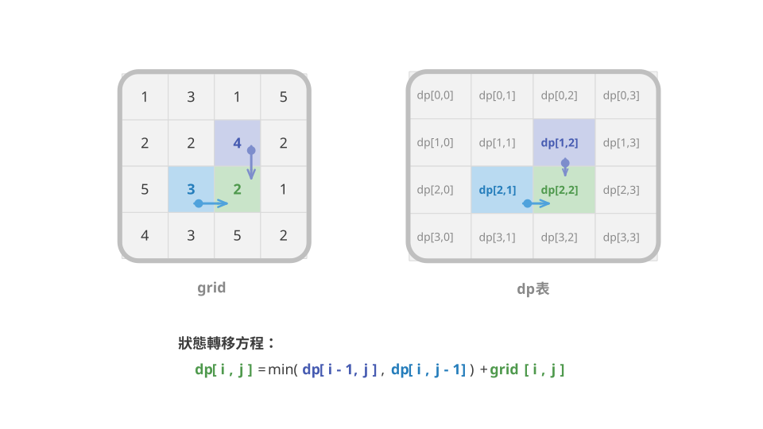
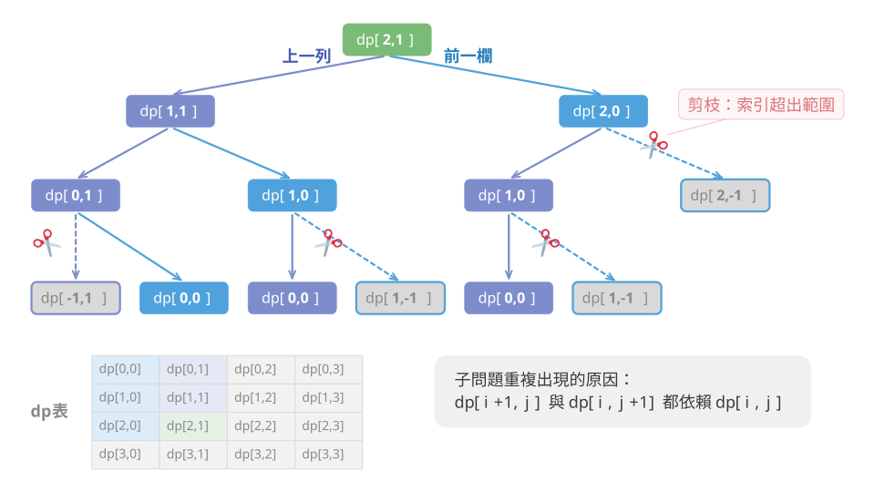
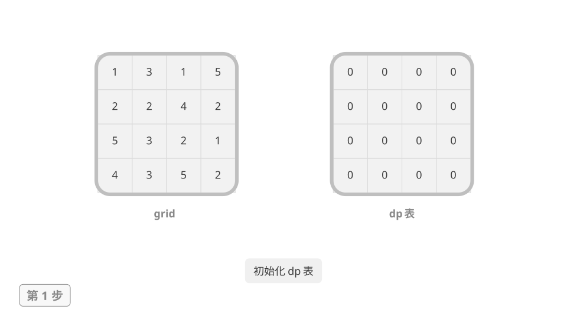
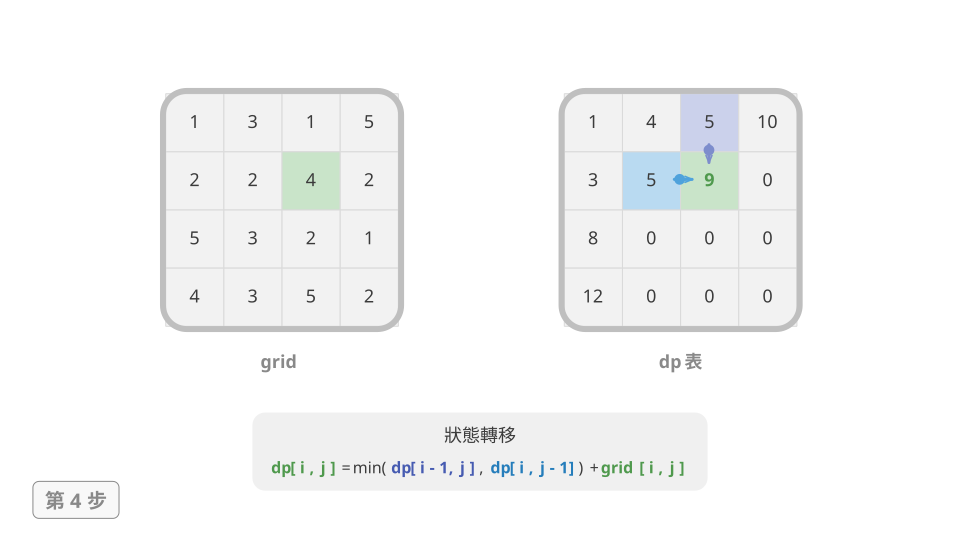
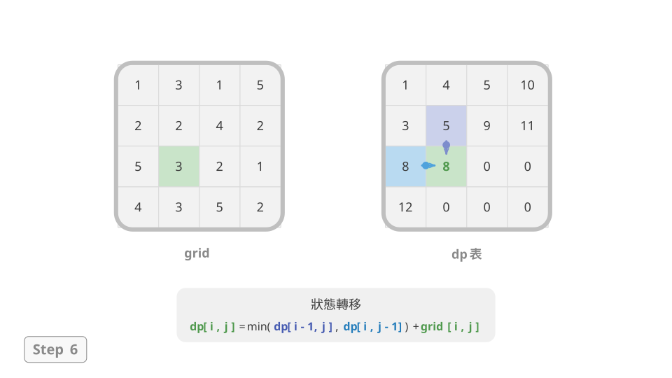
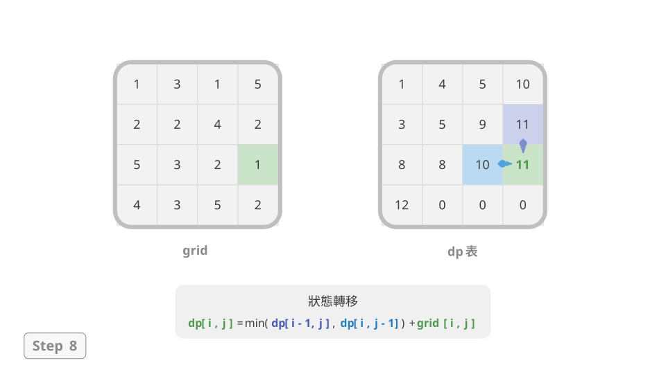
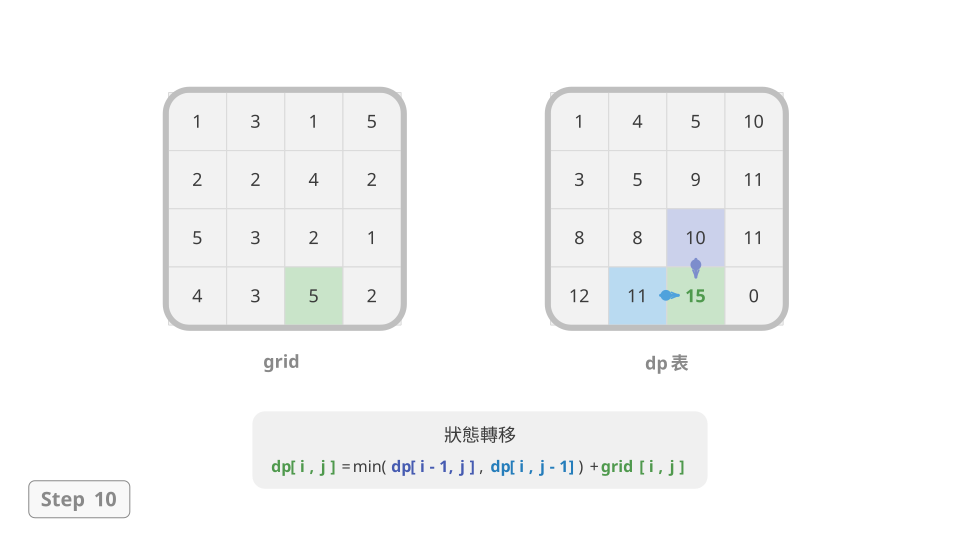
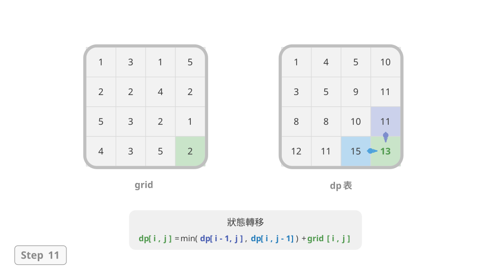

# 動態規劃的解題思路

前兩節介紹了動態規劃問題的主要特性。接下來我們探討兩個實際解題時會遇到的問題。

1. 如何判斷一道題是否適合用動態規劃求解？
2. 用動態規劃解題時，該從哪裡下手？完整步驟有哪些？

## 判斷問題類型

一般來說，如果問題具有重疊子問題、最佳子結構，且符合無後效性，通常就適合用動態規劃求解。不過，直接從題目敘述辨認這些特性並不容易。因此，我們通常先放寬條件，**觀察問題是否適合用回溯法（窮舉）求解**。

**適合用回溯法解決的問題，通常可以用「決策樹模型」描述**。在這棵樹中，每個節點代表一個決策，每條路徑代表一連串決策。

換句話說，如果問題中有明確的決策，而且解是透過一連串決策產生的，就符合決策樹模型，通常可以用回溯法求解。

在此基礎上，還有幾項線索有助於判斷是否適合使用動態規劃。

- 題目要求最大值、最小值、最多或最少等最佳化目標。
- 問題的狀態可以用串列、多維矩陣或樹來表示，而且一個狀態與相鄰狀態之間有遞推關係。

相對地，以下線索會降低採用動態規劃的可能性。

- 題目要求找出所有可行的解，而非最佳解。
- 題目有明顯的排列組合特徵，並要求回傳多個具體方案。

如果問題符合決策樹模型，也有明顯支持動態規劃的線索，就可以先假設它適合用動態規劃，在解題過程中再加以驗證。

## 解題步驟

動態規劃的解題流程會隨問題的性質與難度而異，但通常包含以下步驟：描述決策、定義狀態、建立 $dp$ 表、推導狀態轉移方程式，以及確定邊界條件等。

我們用經典的「最小路徑和」問題說明解題步驟。

!!! question

    給定一個 $n \times m$ 的二維網格 `grid`，每格有一個非負整數，代表經過該格的成本。機器人從左上角出發，每一步只能向下或向右走一格，直到右下角。請回傳從左上角到右下角的最小路徑和。

下圖是一個例子，這個網格的最小路徑和為 $13$。


**第一步：思考每一步的決策，定義狀態，據此建立 $dp$ 表**

本題每一步的決策，就是從目前格子向下或向右走一格。設目前的列、欄索引為 $[i, j]$，向下或向右一步後，索引分別變成 $[i+1, j]$ 或 $[i, j+1]$。因此，狀態應包含列索引與欄索引兩個變數，記為 $[i, j]$。

狀態 $[i, j]$ 對應的子問題是從起點 $[0, 0]$ 到 $[i, j]$ 的最小路徑和，其解記為 $dp[i, j]$。

如此就得到下圖的二維 $dp$ 矩陣，大小與輸入網格 $grid$ 相同。


!!! note

    動態規劃與回溯的過程都可以描述為一連串決策。狀態由所有決策變數構成，應包含描述解題進度所需的所有變數，讓我們有足夠的資訊推導下一個狀態。
    
    每個狀態對應一個子問題。我們用 $dp$ 表儲存所有子問題的解，狀態中的每個獨立變數各是 $dp$ 表的一個維度。換句話說，$dp$ 表記錄了狀態與子問題解的對應關係。

**第二步：找出最佳子結構，推導狀態轉移方程式**

狀態 $[i, j]$ 只能從上方格子 $[i-1, j]$ 或左方格子 $[i, j-1]$ 轉移而來。因此，最佳子結構為：到達 $[i, j]$ 的最小路徑和取決於到達 $[i, j-1]$ 與 $[i-1, j]$ 的最小路徑和中較小者。

根據上述分析，可推導出下圖的狀態轉移方程式：

$$
dp[i, j] = \min(dp[i-1, j], dp[i, j-1]) + grid[i, j]
$$



!!! note

    根據已定義的 $dp$ 表，思考原問題與子問題的關係，找出如何用子問題的最佳解構成原問題的最佳解，也就是找出最佳子結構。

    找到最佳子結構後，就能據此建立狀態轉移方程式。

**第三步：確定邊界條件與狀態轉移順序**

在本題中，第一列的狀態只能來自左方，第一欄的狀態只能來自上方，因此第一列 $i = 0$ 與第一欄 $j = 0$ 是邊界條件。

如下圖所示，每個格子的狀態都來自左方和上方的格子。因此可以用迴圈走訪矩陣，外層迴圈逐列走訪，內層迴圈逐欄走訪。


!!! note

    在動態規劃中，邊界條件用來初始化 $dp$ 表；在搜尋中，則用來剪枝。
    
    安排狀態轉移順序時，必須確保在求解目前問題前，它所依賴的所有較小子問題都已正確求解。

根據上述分析，已經可以直接寫出動態規劃的程式。不過，分解子問題是由上而下的思路，按照「暴力搜尋 $\rightarrow$ 記憶化搜尋 $\rightarrow$ 動態規劃」的順序實作，更符合推理過程。

### 方法一：暴力搜尋

從狀態 $[i, j]$ 開始搜尋，反覆拆成較小的狀態 $[i-1, j]$ 和 $[i, j-1]$。遞迴函式包含以下要素。

- **遞迴參數**：狀態 $[i, j]$。
- **回傳值**：從 $[0, 0]$ 到 $[i, j]$ 的最小路徑和 $dp[i, j]$。
- **終止條件**：若 $i = 0$ 且 $j = 0$，就回傳成本 $grid[0, 0]$。
- **剪枝**：若 $i < 0$ 或 $j < 0$，索引就超出範圍，此時回傳成本 $+\infty$，代表這條路不可行。

程式實作如下：

```src
[file]{min_path_sum}-[class]{}-[func]{min_path_sum_dfs}
```

下圖是以 $dp[2, 1]$ 為根節點的遞迴樹，其中有一些重疊子問題。隨著網格 `grid` 變大，重疊子問題的數量會急遽增加。

子問題之所以會重疊，是因為**從左上角出發，可以沿著不同路徑抵達同一格**。



每個狀態有向下和向右兩種選擇，從左上角走到右下角共需 $m + n - 2$ 步，所以最壞情況的時間複雜度為 $O(2^{m + n})$，其中 $n$ 與 $m$ 分別是網格的列數與欄數。這個估算沒有考慮網格邊界，一旦到達邊界，就只剩一種選擇，因此實際的路徑數會少一些。

### 方法二：記憶化搜尋

建立與網格 `grid` 同樣大小的記憶表 `mem`，記錄各子問題的解，便能在遇到重疊子問題時剪枝：

```src
[file]{min_path_sum}-[class]{}-[func]{min_path_sum_dfs_mem}
```

如下圖所示，加入記憶化後，每個子問題的解都只需計算一次。因此，時間複雜度取決於狀態總數，也就是網格的大小 $O(nm)$。


### 方法三：動態規劃

以迭代方式實作動態規劃，程式如下：

```src
[file]{min_path_sum}-[class]{}-[func]{min_path_sum_dp}
```

下圖呈現最小路徑和的狀態轉移過程。演算法會走訪整個網格，**因此時間複雜度為 $O(nm)$**。

陣列 `dp` 的大小為 $n \times m$，**因此空間複雜度為 $O(nm)$**。

=== "<1>"
    

=== "<2>"
    

=== "<3>"
    

=== "<4>"
    

=== "<5>"
    

=== "<6>"
    

=== "<7>"
    

=== "<8>"
    

=== "<9>"
    

=== "<10>"
    

=== "<11>"
    

=== "<12>"
    

### 空間最佳化

由於每個格子只與左方和上方的格子有關，因此只需用一個存放單列的一維陣列就能實作 $dp$ 表。

請注意，陣列 `dp` 只能儲存一列的狀態，所以無法預先初始化第一欄的所有狀態，必須在走訪每一列時更新該列的第一格：

```src
[file]{min_path_sum}-[class]{}-[func]{min_path_sum_dp_comp}
```
