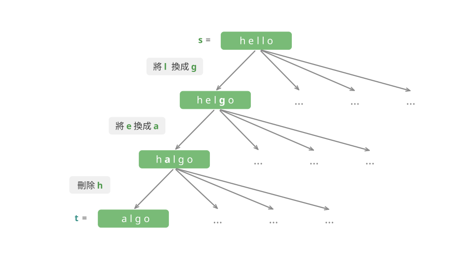
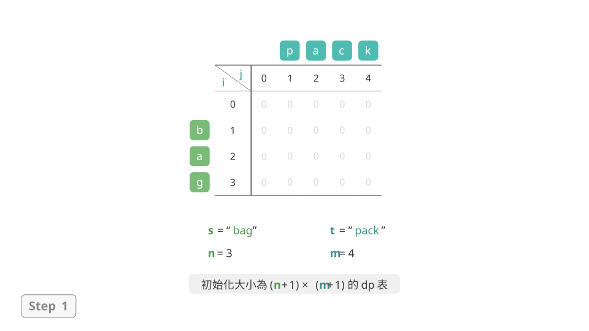
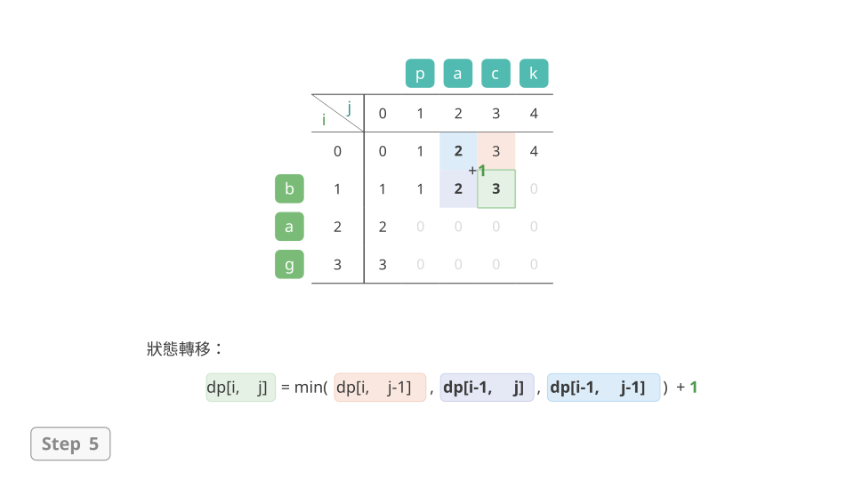
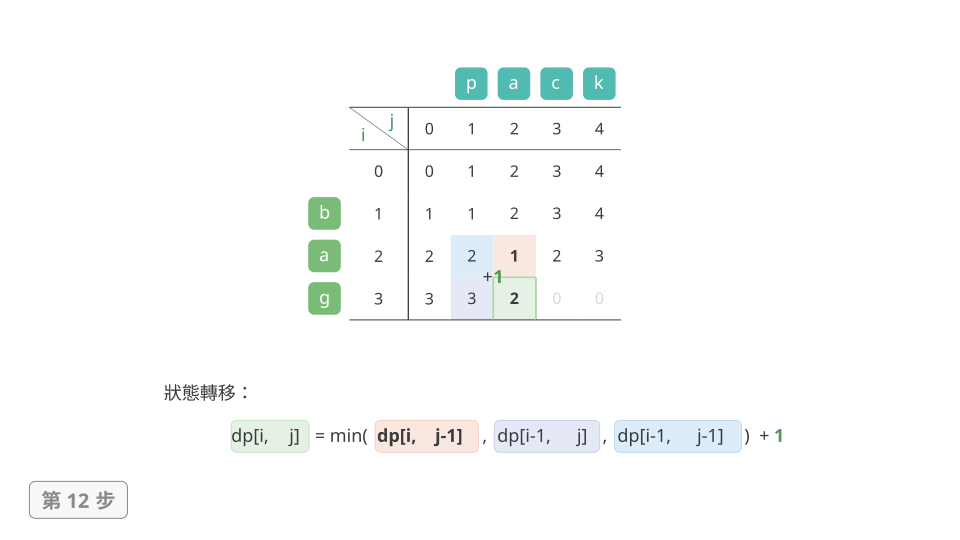
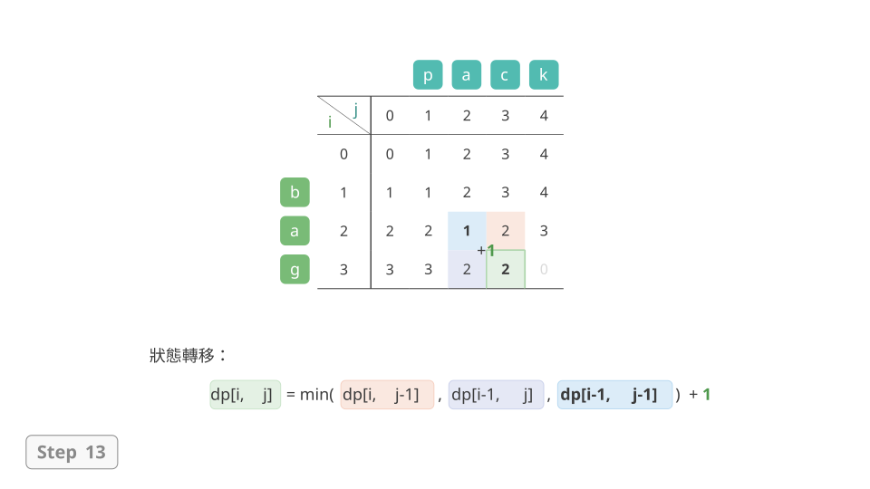
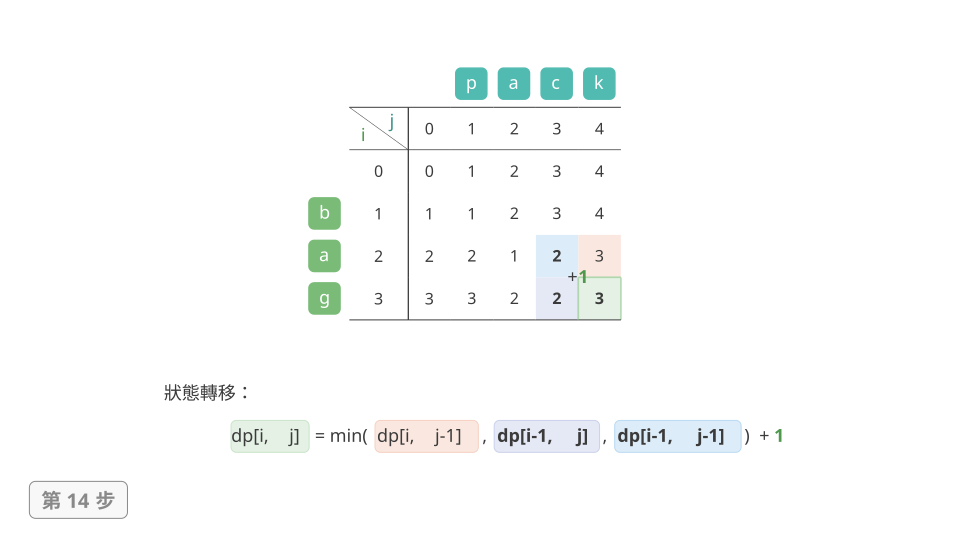
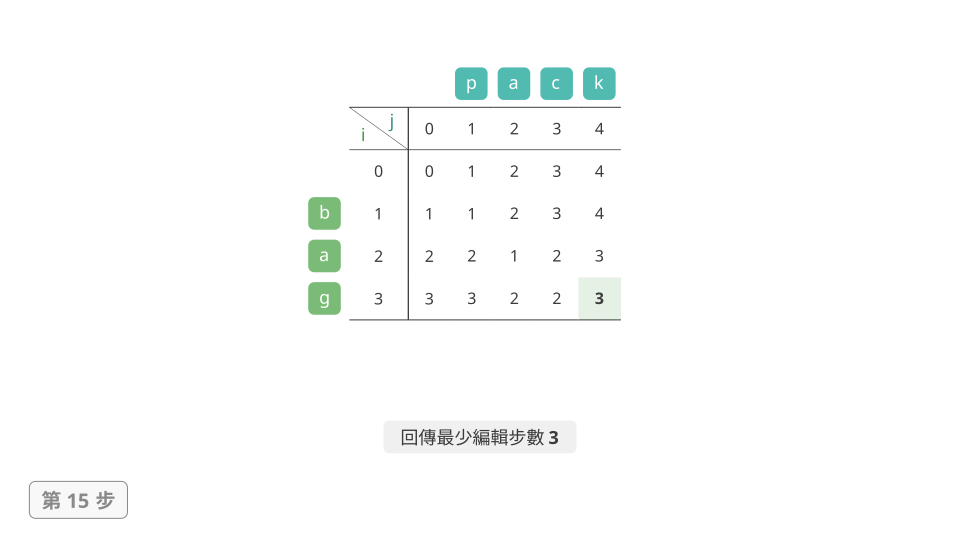

# 編輯距離問題

編輯距離又稱 Levenshtein 距離，是將一個字串轉成另一個字串所需的最少修改次數，常用於資訊檢索與自然語言處理，衡量兩個序列的相似程度。

!!! question

    輸入兩個字串 $s$ 和 $t$，回傳將 $s$ 轉成 $t$ 所需的最少編輯步數。
    
    對字串可以進行三種編輯操作：插入一個字元、刪除一個字元，或將一個字元換成任意字元。

如下圖所示，將 `kitten` 轉成 `sitting` 需要 3 步：取代 2 次、插入 1 次。將 `hello` 轉成 `algo` 也需要 3 步：取代 2 次、刪除 1 次。


**我們可以用決策樹模型來理解編輯距離問題**。每個字串對應樹上的一個節點，每次決策（一次編輯操作）對應一條邊。

如下圖所示，若不限制操作，每個節點都可能分出許多條邊，每條邊各對應一種操作。換句話說，從 `hello` 轉成 `algo` 有許多可能的路徑。

從決策樹的角度來看，本題的目標是求出節點 `hello` 與節點 `algo` 之間的最短路徑。



### 動態規劃的思路

**第一步：思考每一步的決策，定義狀態，據此建立 $dp$ 表**

每一步的決策，就是對字串 $s$ 做一次編輯操作。

為了建立子問題，我們希望問題規模隨每次編輯逐漸縮小。設字串 $s$ 與 $t$ 的長度分別為 $n$ 和 $m$，先考慮兩個字串的最後一個字元 $s[n-1]$ 和 $t[m-1]$。

- 若 $s[n-1]$ 和 $t[m-1]$ 相同，就可以跳過這兩個字元，直接考慮 $s[n-2]$ 和 $t[m-2]$。
- 若 $s[n-1]$ 和 $t[m-1]$ 不同，就需要對 $s$ 做一次編輯（插入、刪除或取代），使兩個字串的尾端字元相同，接著就能跳過它們，考慮規模更小的問題。

也就是說，每次對字串 $s$ 做出決策（編輯操作），都會改變 $s$ 與 $t$ 中剩下要配對的字元。因此，我們用目前考慮到 $s$ 的第 $i$ 個字元和 $t$ 的第 $j$ 個字元來定義狀態，記為 $[i, j]$。

狀態 $[i, j]$ 對應的子問題是：**將 $s$ 的前 $i$ 個字元轉成 $t$ 的前 $j$ 個字元，最少需要幾步編輯**？

這樣就得到大小為 $(n+1) \times (m+1)$ 的二維 $dp$ 表。

**第二步：找出最佳子結構，推導狀態轉移方程式**

考慮子問題 $dp[i, j]$，兩個字串的尾端字元分別為 $s[i-1]$ 和 $t[j-1]$。依照所選的編輯操作，可分成下圖的三種情況。

1. 在 $s[i-1]$ 後插入 $t[j-1]$，剩下的子問題為 $dp[i, j-1]$。
2. 刪除 $s[i-1]$，剩下的子問題為 $dp[i-1, j]$。
3. 將 $s[i-1]$ 換成 $t[j-1]$，剩下的子問題為 $dp[i-1, j-1]$。


根據以上分析，可得最佳子結構：$dp[i, j]$ 的最少編輯步數，等於 $dp[i, j-1]$、$dp[i-1, j]$、$dp[i-1, j-1]$ 三者中最少的編輯步數，再加上這次編輯的步數 $1$。對應的狀態轉移方程式為：

$$
dp[i, j] = \min(dp[i, j-1], dp[i-1, j], dp[i-1, j-1]) + 1
$$

請注意，**當 $s[i-1]$ 與 $t[j-1]$ 相同時，無須編輯目前的字元**。此時的狀態轉移方程式為：

$$
dp[i, j] = dp[i-1, j-1]
$$

**第三步：確定邊界條件與狀態轉移順序**

兩個字串都為空時，編輯步數為 $0$，也就是 $dp[0, 0] = 0$。若 $s$ 為空而 $t$ 非空，最少編輯步數等於 $t$ 的長度，也就是第一列 $dp[0, j] = j$。若 $s$ 非空而 $t$ 為空，最少編輯步數等於 $s$ 的長度，也就是第一欄 $dp[i, 0] = i$。

從狀態轉移方程式可看出，解 $dp[i, j]$ 依賴左方、上方與左上方的解，因此用兩層迴圈正向走訪整張 $dp$ 表即可。

### 程式實作

```src
[file]{edit_distance}-[class]{}-[func]{edit_distance_dp}
```

如下圖所示，編輯距離問題的狀態轉移過程與背包問題很相似，都可以看成逐格填寫一張二維表。

=== "<1>"
    

=== "<2>"
    

=== "<3>"
    

=== "<4>"
    

=== "<5>"
    

=== "<6>"
    

=== "<7>"
    

=== "<8>"
    

=== "<9>"
    

=== "<10>"
    

=== "<11>"
    

=== "<12>"
    

=== "<13>"
    

=== "<14>"
    

=== "<15>"
    

### 空間最佳化

$dp[i,j]$ 來自上方的 $dp[i-1, j]$、左方的 $dp[i, j-1]$ 和左上方的 $dp[i-1, j-1]$。若正向走訪，會失去左上方的 $dp[i-1, j-1]$；若反向走訪，又無法先算出 $dp[i, j-1]$，因此兩種順序都不能直接套用。

我們可以用變數 `leftup` 暫存左上方的解 $dp[i-1, j-1]$，接下來就只需考慮左方與上方的解。此時情況與完全背包問題相同，可以正向走訪。程式如下：

```src
[file]{edit_distance}-[class]{}-[func]{edit_distance_dp_comp}
```
