# 14.6 &nbsp; 編輯距離問題

編輯距離又稱 Levenshtein 距離，是將一個字串轉成另一個字串所需的最少修改次數，常用於資訊檢索與自然語言處理，衡量兩個序列的相似程度。

!!! question

    輸入兩個字串 $s$ 和 $t$，回傳將 $s$ 轉成 $t$ 所需的最少編輯步數。
    
    對字串可以進行三種編輯操作：插入一個字元、刪除一個字元，或將一個字元換成任意字元。

如圖 14-27 所示，將 `kitten` 轉成 `sitting` 需要 3 步：取代 2 次、插入 1 次。將 `hello` 轉成 `algo` 也需要 3 步：取代 2 次、刪除 1 次。

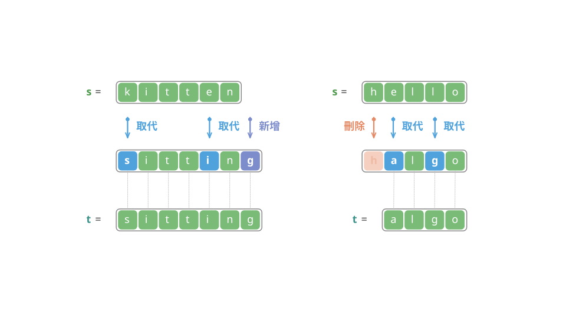{ class="animation-figure" }

<p align="center"> 圖 14-27 &nbsp; 編輯距離的範例資料 </p>

**我們可以用決策樹模型來理解編輯距離問題**。每個字串對應樹上的一個節點，每次決策（一次編輯操作）對應一條邊。

如圖 14-28 所示，若不限制操作，每個節點都可能分出許多條邊，每條邊各對應一種操作。換句話說，從 `hello` 轉成 `algo` 有許多可能的路徑。

從決策樹的角度來看，本題的目標是求出節點 `hello` 與節點 `algo` 之間的最短路徑。

{ class="animation-figure" }

<p align="center"> 圖 14-28 &nbsp; 用決策樹表示編輯距離問題 </p>

### 1. &nbsp; 動態規劃的思路

**第一步：思考每一步的決策，定義狀態，據此建立 $dp$ 表**

每一步的決策，就是對字串 $s$ 做一次編輯操作。

為了建立子問題，我們希望問題規模隨每次編輯逐漸縮小。設字串 $s$ 與 $t$ 的長度分別為 $n$ 和 $m$，先考慮兩個字串的最後一個字元 $s[n-1]$ 和 $t[m-1]$。

- 若 $s[n-1]$ 和 $t[m-1]$ 相同，就可以跳過這兩個字元，直接考慮 $s[n-2]$ 和 $t[m-2]$。
- 若 $s[n-1]$ 和 $t[m-1]$ 不同，就需要對 $s$ 做一次編輯（插入、刪除或取代），使兩個字串的尾端字元相同，接著就能跳過它們，考慮規模更小的問題。

也就是說，每次對字串 $s$ 做出決策（編輯操作），都會改變 $s$ 與 $t$ 中剩下要配對的字元。因此，我們用目前考慮到 $s$ 的第 $i$ 個字元和 $t$ 的第 $j$ 個字元來定義狀態，記為 $[i, j]$。

狀態 $[i, j]$ 對應的子問題是：**將 $s$ 的前 $i$ 個字元轉成 $t$ 的前 $j$ 個字元，最少需要幾步編輯**？

這樣就得到大小為 $(n+1) \times (m+1)$ 的二維 $dp$ 表。

**第二步：找出最佳子結構，推導狀態轉移方程式**

考慮子問題 $dp[i, j]$，兩個字串的尾端字元分別為 $s[i-1]$ 和 $t[j-1]$。依照所選的編輯操作，可分成圖 14-29 的三種情況。

1. 在 $s[i-1]$ 後插入 $t[j-1]$，剩下的子問題為 $dp[i, j-1]$。
2. 刪除 $s[i-1]$，剩下的子問題為 $dp[i-1, j]$。
3. 將 $s[i-1]$ 換成 $t[j-1]$，剩下的子問題為 $dp[i-1, j-1]$。

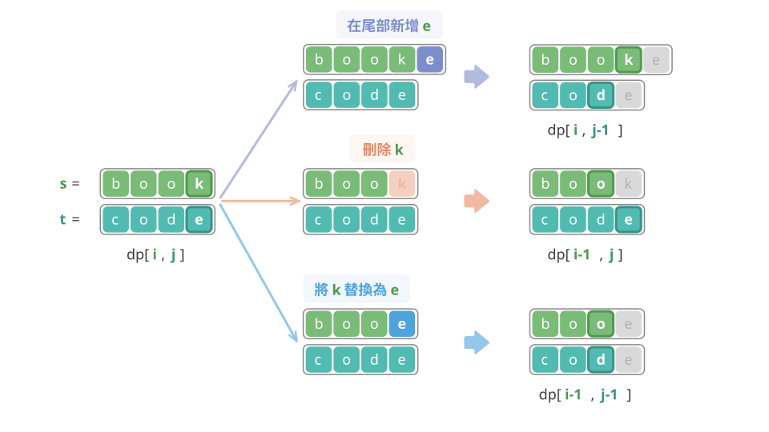{ class="animation-figure" }

<p align="center"> 圖 14-29 &nbsp; 編輯距離的狀態轉移 </p>

根據以上分析，可得最佳子結構：$dp[i, j]$ 的最少編輯步數，等於 $dp[i, j-1]$、$dp[i-1, j]$、$dp[i-1, j-1]$ 三者中最少的編輯步數，再加上這次編輯的步數 $1$。對應的狀態轉移方程式為：

$$
dp[i, j] = \min(dp[i, j-1], dp[i-1, j], dp[i-1, j-1]) + 1
$$

請注意，**當 $s[i-1]$ 與 $t[j-1]$ 相同時，無須編輯目前的字元**。此時的狀態轉移方程式為：

$$
dp[i, j] = dp[i-1, j-1]
$$

**第三步：確定邊界條件與狀態轉移順序**

兩個字串都為空時，編輯步數為 $0$，也就是 $dp[0, 0] = 0$。若 $s$ 為空而 $t$ 非空，最少編輯步數等於 $t$ 的長度，也就是第一列 $dp[0, j] = j$。若 $s$ 非空而 $t$ 為空，最少編輯步數等於 $s$ 的長度，也就是第一欄 $dp[i, 0] = i$。

從狀態轉移方程式可看出，解 $dp[i, j]$ 依賴左方、上方與左上方的解，因此用兩層迴圈正向走訪整張 $dp$ 表即可。

### 2. &nbsp; 程式實作

=== "Python"

    ```python title="edit_distance.py"
    def edit_distance_dp(s: str, t: str) -> int:
        """編輯距離：動態規劃"""
        n, m = len(s), len(t)
        dp = [[0] * (m + 1) for _ in range(n + 1)]
        # 狀態轉移：第一列和第一欄
        for i in range(1, n + 1):
            dp[i][0] = i
        for j in range(1, m + 1):
            dp[0][j] = j
        # 狀態轉移：其餘各列與各欄
        for i in range(1, n + 1):
            for j in range(1, m + 1):
                if s[i - 1] == t[j - 1]:
                    # 若兩個字元相同，直接跳過這兩個字元
                    dp[i][j] = dp[i - 1][j - 1]
                else:
                    # 最少編輯步數 = 插入、刪除、取代三種操作對應的最少步數中的最小值 + 1
                    dp[i][j] = min(dp[i][j - 1], dp[i - 1][j], dp[i - 1][j - 1]) + 1
        return dp[n][m]
    ```

=== "C++"

    ```cpp title="edit_distance.cpp"
    /* 編輯距離：動態規劃 */
    int editDistanceDP(string s, string t) {
        int n = s.length(), m = t.length();
        vector<vector<int>> dp(n + 1, vector<int>(m + 1, 0));
        // 狀態轉移：第一列和第一欄
        for (int i = 1; i <= n; i++) {
            dp[i][0] = i;
        }
        for (int j = 1; j <= m; j++) {
            dp[0][j] = j;
        }
        // 狀態轉移：其餘各列與各欄
        for (int i = 1; i <= n; i++) {
            for (int j = 1; j <= m; j++) {
                if (s[i - 1] == t[j - 1]) {
                    // 若兩個字元相同，直接跳過這兩個字元
                    dp[i][j] = dp[i - 1][j - 1];
                } else {
                    // 最少編輯步數 = 插入、刪除、取代三種操作對應的最少步數中的最小值 + 1
                    dp[i][j] = min(min(dp[i][j - 1], dp[i - 1][j]), dp[i - 1][j - 1]) + 1;
                }
            }
        }
        return dp[n][m];
    }
    ```

=== "Java"

    ```java title="edit_distance.java"
    /* 編輯距離：動態規劃 */
    int editDistanceDP(String s, String t) {
        int n = s.length(), m = t.length();
        int[][] dp = new int[n + 1][m + 1];
        // 狀態轉移：第一列和第一欄
        for (int i = 1; i <= n; i++) {
            dp[i][0] = i;
        }
        for (int j = 1; j <= m; j++) {
            dp[0][j] = j;
        }
        // 狀態轉移：其餘各列與各欄
        for (int i = 1; i <= n; i++) {
            for (int j = 1; j <= m; j++) {
                if (s.charAt(i - 1) == t.charAt(j - 1)) {
                    // 若兩個字元相同，直接跳過這兩個字元
                    dp[i][j] = dp[i - 1][j - 1];
                } else {
                    // 最少編輯步數 = 插入、刪除、取代三種操作對應的最少步數中的最小值 + 1
                    dp[i][j] = Math.min(Math.min(dp[i][j - 1], dp[i - 1][j]), dp[i - 1][j - 1]) + 1;
                }
            }
        }
        return dp[n][m];
    }
    ```

=== "C#"

    ```csharp title="edit_distance.cs"
    /* 編輯距離：動態規劃 */
    int EditDistanceDP(string s, string t) {
        int n = s.Length, m = t.Length;
        int[,] dp = new int[n + 1, m + 1];
        // 狀態轉移：第一列和第一欄
        for (int i = 1; i <= n; i++) {
            dp[i, 0] = i;
        }
        for (int j = 1; j <= m; j++) {
            dp[0, j] = j;
        }
        // 狀態轉移：其餘各列與各欄
        for (int i = 1; i <= n; i++) {
            for (int j = 1; j <= m; j++) {
                if (s[i - 1] == t[j - 1]) {
                    // 若兩個字元相同，直接跳過這兩個字元
                    dp[i, j] = dp[i - 1, j - 1];
                } else {
                    // 最少編輯步數 = 插入、刪除、取代三種操作對應的最少步數中的最小值 + 1
                    dp[i, j] = Math.Min(Math.Min(dp[i, j - 1], dp[i - 1, j]), dp[i - 1, j - 1]) + 1;
                }
            }
        }
        return dp[n, m];
    }
    ```

=== "Go"

    ```go title="edit_distance.go"
    /* 編輯距離：動態規劃 */
    func editDistanceDP(s string, t string) int {
        n := len(s)
        m := len(t)
        dp := make([][]int, n+1)
        for i := 0; i <= n; i++ {
            dp[i] = make([]int, m+1)
        }
        // 狀態轉移：第一列和第一欄
        for i := 1; i <= n; i++ {
            dp[i][0] = i
        }
        for j := 1; j <= m; j++ {
            dp[0][j] = j
        }
        // 狀態轉移：其餘各列與各欄
        for i := 1; i <= n; i++ {
            for j := 1; j <= m; j++ {
                if s[i-1] == t[j-1] {
                    // 若兩個字元相同，直接跳過這兩個字元
                    dp[i][j] = dp[i-1][j-1]
                } else {
                    // 最少編輯步數 = 插入、刪除、取代三種操作對應的最少步數中的最小值 + 1
                    dp[i][j] = MinInt(MinInt(dp[i][j-1], dp[i-1][j]), dp[i-1][j-1]) + 1
                }
            }
        }
        return dp[n][m]
    }
    ```

=== "Swift"

    ```swift title="edit_distance.swift"
    /* 編輯距離：動態規劃 */
    func editDistanceDP(s: String, t: String) -> Int {
        let n = s.utf8CString.count
        let m = t.utf8CString.count
        var dp = Array(repeating: Array(repeating: 0, count: m + 1), count: n + 1)
        // 狀態轉移：第一列和第一欄
        for i in 1 ... n {
            dp[i][0] = i
        }
        for j in 1 ... m {
            dp[0][j] = j
        }
        // 狀態轉移：其餘各列與各欄
        for i in 1 ... n {
            for j in 1 ... m {
                if s.utf8CString[i - 1] == t.utf8CString[j - 1] {
                    // 若兩個字元相同，直接跳過這兩個字元
                    dp[i][j] = dp[i - 1][j - 1]
                } else {
                    // 最少編輯步數 = 插入、刪除、取代三種操作對應的最少步數中的最小值 + 1
                    dp[i][j] = min(min(dp[i][j - 1], dp[i - 1][j]), dp[i - 1][j - 1]) + 1
                }
            }
        }
        return dp[n][m]
    }
    ```

=== "JS"

    ```javascript title="edit_distance.js"
    /* 編輯距離：動態規劃 */
    function editDistanceDP(s, t) {
        const n = s.length,
            m = t.length;
        const dp = Array.from({ length: n + 1 }, () => new Array(m + 1).fill(0));
        // 狀態轉移：第一列和第一欄
        for (let i = 1; i <= n; i++) {
            dp[i][0] = i;
        }
        for (let j = 1; j <= m; j++) {
            dp[0][j] = j;
        }
        // 狀態轉移：其餘各列與各欄
        for (let i = 1; i <= n; i++) {
            for (let j = 1; j <= m; j++) {
                if (s.charAt(i - 1) === t.charAt(j - 1)) {
                    // 若兩個字元相同，直接跳過這兩個字元
                    dp[i][j] = dp[i - 1][j - 1];
                } else {
                    // 最少編輯步數 = 插入、刪除、取代三種操作對應的最少步數中的最小值 + 1
                    dp[i][j] =
                        Math.min(dp[i][j - 1], dp[i - 1][j], dp[i - 1][j - 1]) + 1;
                }
            }
        }
        return dp[n][m];
    }
    ```

=== "TS"

    ```typescript title="edit_distance.ts"
    /* 編輯距離：動態規劃 */
    function editDistanceDP(s: string, t: string): number {
        const n = s.length,
            m = t.length;
        const dp = Array.from({ length: n + 1 }, () =>
            Array.from({ length: m + 1 }, () => 0)
        );
        // 狀態轉移：第一列和第一欄
        for (let i = 1; i <= n; i++) {
            dp[i][0] = i;
        }
        for (let j = 1; j <= m; j++) {
            dp[0][j] = j;
        }
        // 狀態轉移：其餘各列與各欄
        for (let i = 1; i <= n; i++) {
            for (let j = 1; j <= m; j++) {
                if (s.charAt(i - 1) === t.charAt(j - 1)) {
                    // 若兩個字元相同，直接跳過這兩個字元
                    dp[i][j] = dp[i - 1][j - 1];
                } else {
                    // 最少編輯步數 = 插入、刪除、取代三種操作對應的最少步數中的最小值 + 1
                    dp[i][j] =
                        Math.min(dp[i][j - 1], dp[i - 1][j], dp[i - 1][j - 1]) + 1;
                }
            }
        }
        return dp[n][m];
    }
    ```

=== "Dart"

    ```dart title="edit_distance.dart"
    /* 編輯距離：動態規劃 */
    int editDistanceDP(String s, String t) {
      int n = s.length, m = t.length;
      List<List<int>> dp = List.generate(n + 1, (_) => List.filled(m + 1, 0));
      // 狀態轉移：第一列和第一欄
      for (int i = 1; i <= n; i++) {
        dp[i][0] = i;
      }
      for (int j = 1; j <= m; j++) {
        dp[0][j] = j;
      }
      // 狀態轉移：其餘各列與各欄
      for (int i = 1; i <= n; i++) {
        for (int j = 1; j <= m; j++) {
          if (s[i - 1] == t[j - 1]) {
            // 若兩個字元相同，直接跳過這兩個字元
            dp[i][j] = dp[i - 1][j - 1];
          } else {
            // 最少編輯步數 = 插入、刪除、取代三種操作對應的最少步數中的最小值 + 1
            dp[i][j] = min(min(dp[i][j - 1], dp[i - 1][j]), dp[i - 1][j - 1]) + 1;
          }
        }
      }
      return dp[n][m];
    }
    ```

=== "Rust"

    ```rust title="edit_distance.rs"
    /* 編輯距離：動態規劃 */
    fn edit_distance_dp(s: &str, t: &str) -> i32 {
        let (n, m) = (s.len(), t.len());
        let mut dp = vec![vec![0; m + 1]; n + 1];
        // 狀態轉移：第一列和第一欄
        for i in 1..=n {
            dp[i][0] = i as i32;
        }
        for j in 1..m {
            dp[0][j] = j as i32;
        }
        // 狀態轉移：其餘各列與各欄
        for i in 1..=n {
            for j in 1..=m {
                if s.chars().nth(i - 1) == t.chars().nth(j - 1) {
                    // 若兩個字元相同，直接跳過這兩個字元
                    dp[i][j] = dp[i - 1][j - 1];
                } else {
                    // 最少編輯步數 = 插入、刪除、取代三種操作對應的最少步數中的最小值 + 1
                    dp[i][j] =
                        std::cmp::min(std::cmp::min(dp[i][j - 1], dp[i - 1][j]), dp[i - 1][j - 1]) + 1;
                }
            }
        }
        dp[n][m]
    }
    ```

=== "C"

    ```c title="edit_distance.c"
    /* 編輯距離：動態規劃 */
    int editDistanceDP(char *s, char *t, int n, int m) {
        int **dp = malloc((n + 1) * sizeof(int *));
        for (int i = 0; i <= n; i++) {
            dp[i] = calloc(m + 1, sizeof(int));
        }
        // 狀態轉移：第一列和第一欄
        for (int i = 1; i <= n; i++) {
            dp[i][0] = i;
        }
        for (int j = 1; j <= m; j++) {
            dp[0][j] = j;
        }
        // 狀態轉移：其餘各列與各欄
        for (int i = 1; i <= n; i++) {
            for (int j = 1; j <= m; j++) {
                if (s[i - 1] == t[j - 1]) {
                    // 若兩個字元相同，直接跳過這兩個字元
                    dp[i][j] = dp[i - 1][j - 1];
                } else {
                    // 最少編輯步數 = 插入、刪除、取代三種操作對應的最少步數中的最小值 + 1
                    dp[i][j] = myMin(myMin(dp[i][j - 1], dp[i - 1][j]), dp[i - 1][j - 1]) + 1;
                }
            }
        }
        int res = dp[n][m];
        // 釋放記憶體
        for (int i = 0; i <= n; i++) {
            free(dp[i]);
        }
        return res;
    }
    ```

=== "Kotlin"

    ```kotlin title="edit_distance.kt"
    /* 編輯距離：動態規劃 */
    fun editDistanceDP(s: String, t: String): Int {
        val n = s.length
        val m = t.length
        val dp = Array(n + 1) { IntArray(m + 1) }
        // 狀態轉移：第一列和第一欄
        for (i in 1..n) {
            dp[i][0] = i
        }
        for (j in 1..m) {
            dp[0][j] = j
        }
        // 狀態轉移：其餘各列與各欄
        for (i in 1..n) {
            for (j in 1..m) {
                if (s[i - 1] == t[j - 1]) {
                    // 若兩個字元相同，直接跳過這兩個字元
                    dp[i][j] = dp[i - 1][j - 1]
                } else {
                    // 最少編輯步數 = 插入、刪除、取代三種操作對應的最少步數中的最小值 + 1
                    dp[i][j] = min(min(dp[i][j - 1], dp[i - 1][j]), dp[i - 1][j - 1]) + 1
                }
            }
        }
        return dp[n][m]
    }
    ```

=== "Ruby"

    ```ruby title="edit_distance.rb"
    ### 編輯距離：動態規劃 ###
    def edit_distance_dp(s, t)
      n, m = s.length, t.length
      dp = Array.new(n + 1) { Array.new(m + 1, 0) }
      # 狀態轉移：第一列和第一欄
      (1...(n + 1)).each { |i| dp[i][0] = i }
      (1...(m + 1)).each { |j| dp[0][j] = j }
      # 狀態轉移：其餘各列與各欄
      for i in 1...(n + 1)
        for j in 1...(m +1)
          if s[i - 1] == t[j - 1]
            # 若兩個字元相同，直接跳過這兩個字元
            dp[i][j] = dp[i - 1][j - 1]
          else
            # 最少編輯步數 = 插入、刪除、取代三種操作對應的最少步數中的最小值 + 1
            dp[i][j] = [dp[i][j - 1], dp[i - 1][j], dp[i - 1][j - 1]].min + 1
          end
        end
      end
      dp[n][m]
    end
    ```

??? pythontutor "執行視覺化示範"

    <div style="height: 549px; width: 100%;"><iframe class="pythontutor-iframe" title="執行視覺化示範" src="https://pythontutor.com/iframe-embed.html#code=def%20edit_distance_dp%28s%3A%20str,%20t%3A%20str%29%20-%3E%20int%3A%0A%20%20%20%20%22%22%22%E7%B7%A8%E8%BC%AF%E8%B7%9D%E9%9B%A2%EF%BC%9A%E5%8B%95%E6%85%8B%E8%A6%8F%E5%8A%83%22%22%22%0A%20%20%20%20n,%20m%20%3D%20len%28s%29,%20len%28t%29%0A%20%20%20%20dp%20%3D%20%5B%5B0%5D%20%2A%20%28m%20%2B%201%29%20for%20_%20in%20range%28n%20%2B%201%29%5D%0A%20%20%20%20%23%20%E7%8B%80%E6%85%8B%E8%BD%89%E7%A7%BB%EF%BC%9A%E7%AC%AC%E4%B8%80%E5%88%97%E5%92%8C%E7%AC%AC%E4%B8%80%E6%AC%84%0A%20%20%20%20for%20i%20in%20range%281,%20n%20%2B%201%29%3A%0A%20%20%20%20%20%20%20%20dp%5Bi%5D%5B0%5D%20%3D%20i%0A%20%20%20%20for%20j%20in%20range%281,%20m%20%2B%201%29%3A%0A%20%20%20%20%20%20%20%20dp%5B0%5D%5Bj%5D%20%3D%20j%0A%20%20%20%20%23%20%E7%8B%80%E6%85%8B%E8%BD%89%E7%A7%BB%EF%BC%9A%E5%85%B6%E9%A4%98%E5%90%84%E5%88%97%E8%88%87%E5%90%84%E6%AC%84%0A%20%20%20%20for%20i%20in%20range%281,%20n%20%2B%201%29%3A%0A%20%20%20%20%20%20%20%20for%20j%20in%20range%281,%20m%20%2B%201%29%3A%0A%20%20%20%20%20%20%20%20%20%20%20%20if%20s%5Bi%20-%201%5D%20%3D%3D%20t%5Bj%20-%201%5D%3A%0A%20%20%20%20%20%20%20%20%20%20%20%20%20%20%20%20%23%20%E8%8B%A5%E5%85%A9%E5%80%8B%E5%AD%97%E5%85%83%E7%9B%B8%E5%90%8C%EF%BC%8C%E7%9B%B4%E6%8E%A5%E8%B7%B3%E9%81%8E%E9%80%99%E5%85%A9%E5%80%8B%E5%AD%97%E5%85%83%0A%20%20%20%20%20%20%20%20%20%20%20%20%20%20%20%20dp%5Bi%5D%5Bj%5D%20%3D%20dp%5Bi%20-%201%5D%5Bj%20-%201%5D%0A%20%20%20%20%20%20%20%20%20%20%20%20else%3A%0A%20%20%20%20%20%20%20%20%20%20%20%20%20%20%20%20%23%20%E6%9C%80%E5%B0%91%E7%B7%A8%E8%BC%AF%E6%AD%A5%E6%95%B8%20%3D%20%E6%8F%92%E5%85%A5%E3%80%81%E5%88%AA%E9%99%A4%E3%80%81%E5%8F%96%E4%BB%A3%E4%B8%89%E7%A8%AE%E6%93%8D%E4%BD%9C%E5%B0%8D%E6%87%89%E7%9A%84%E6%9C%80%E5%B0%91%E6%AD%A5%E6%95%B8%E4%B8%AD%E7%9A%84%E6%9C%80%E5%B0%8F%E5%80%BC%20%2B%201%0A%20%20%20%20%20%20%20%20%20%20%20%20%20%20%20%20dp%5Bi%5D%5Bj%5D%20%3D%20min%28dp%5Bi%5D%5Bj%20-%201%5D,%20dp%5Bi%20-%201%5D%5Bj%5D,%20dp%5Bi%20-%201%5D%5Bj%20-%201%5D%29%20%2B%201%0A%20%20%20%20return%20dp%5Bn%5D%5Bm%5D%0A%0A%0A%22%22%22Driver%20Code%22%22%22%0Aif%20__name__%20%3D%3D%20%22__main__%22%3A%0A%20%20%20%20s%20%3D%20%22bag%22%0A%20%20%20%20t%20%3D%20%22pack%22%0A%20%20%20%20n,%20m%20%3D%20len%28s%29,%20len%28t%29%0A%0A%20%20%20%20%23%20%E5%8B%95%E6%85%8B%E8%A6%8F%E5%8A%83%0A%20%20%20%20res%20%3D%20edit_distance_dp%28s,%20t%29%0A%20%20%20%20print%28f%22%E5%B0%87%20%7Bs%7D%20%E6%94%B9%E6%88%90%20%7Bt%7D%20%E8%87%B3%E5%B0%91%E9%9C%80%E8%A6%81%E7%B7%A8%E8%BC%AF%20%7Bres%7D%20%E6%AD%A5%22%29&codeDivHeight=472&codeDivWidth=350&cumulative=false&curInstr=6&heapPrimitives=nevernest&origin=opt-frontend.js&py=311&rawInputLstJSON=%5B%5D&textReferences=false"> </iframe></div>
    <div style="margin-top: 5px;"><a href="https://pythontutor.com/iframe-embed.html#code=def%20edit_distance_dp%28s%3A%20str,%20t%3A%20str%29%20-%3E%20int%3A%0A%20%20%20%20%22%22%22%E7%B7%A8%E8%BC%AF%E8%B7%9D%E9%9B%A2%EF%BC%9A%E5%8B%95%E6%85%8B%E8%A6%8F%E5%8A%83%22%22%22%0A%20%20%20%20n,%20m%20%3D%20len%28s%29,%20len%28t%29%0A%20%20%20%20dp%20%3D%20%5B%5B0%5D%20%2A%20%28m%20%2B%201%29%20for%20_%20in%20range%28n%20%2B%201%29%5D%0A%20%20%20%20%23%20%E7%8B%80%E6%85%8B%E8%BD%89%E7%A7%BB%EF%BC%9A%E7%AC%AC%E4%B8%80%E5%88%97%E5%92%8C%E7%AC%AC%E4%B8%80%E6%AC%84%0A%20%20%20%20for%20i%20in%20range%281,%20n%20%2B%201%29%3A%0A%20%20%20%20%20%20%20%20dp%5Bi%5D%5B0%5D%20%3D%20i%0A%20%20%20%20for%20j%20in%20range%281,%20m%20%2B%201%29%3A%0A%20%20%20%20%20%20%20%20dp%5B0%5D%5Bj%5D%20%3D%20j%0A%20%20%20%20%23%20%E7%8B%80%E6%85%8B%E8%BD%89%E7%A7%BB%EF%BC%9A%E5%85%B6%E9%A4%98%E5%90%84%E5%88%97%E8%88%87%E5%90%84%E6%AC%84%0A%20%20%20%20for%20i%20in%20range%281,%20n%20%2B%201%29%3A%0A%20%20%20%20%20%20%20%20for%20j%20in%20range%281,%20m%20%2B%201%29%3A%0A%20%20%20%20%20%20%20%20%20%20%20%20if%20s%5Bi%20-%201%5D%20%3D%3D%20t%5Bj%20-%201%5D%3A%0A%20%20%20%20%20%20%20%20%20%20%20%20%20%20%20%20%23%20%E8%8B%A5%E5%85%A9%E5%80%8B%E5%AD%97%E5%85%83%E7%9B%B8%E5%90%8C%EF%BC%8C%E7%9B%B4%E6%8E%A5%E8%B7%B3%E9%81%8E%E9%80%99%E5%85%A9%E5%80%8B%E5%AD%97%E5%85%83%0A%20%20%20%20%20%20%20%20%20%20%20%20%20%20%20%20dp%5Bi%5D%5Bj%5D%20%3D%20dp%5Bi%20-%201%5D%5Bj%20-%201%5D%0A%20%20%20%20%20%20%20%20%20%20%20%20else%3A%0A%20%20%20%20%20%20%20%20%20%20%20%20%20%20%20%20%23%20%E6%9C%80%E5%B0%91%E7%B7%A8%E8%BC%AF%E6%AD%A5%E6%95%B8%20%3D%20%E6%8F%92%E5%85%A5%E3%80%81%E5%88%AA%E9%99%A4%E3%80%81%E5%8F%96%E4%BB%A3%E4%B8%89%E7%A8%AE%E6%93%8D%E4%BD%9C%E5%B0%8D%E6%87%89%E7%9A%84%E6%9C%80%E5%B0%91%E6%AD%A5%E6%95%B8%E4%B8%AD%E7%9A%84%E6%9C%80%E5%B0%8F%E5%80%BC%20%2B%201%0A%20%20%20%20%20%20%20%20%20%20%20%20%20%20%20%20dp%5Bi%5D%5Bj%5D%20%3D%20min%28dp%5Bi%5D%5Bj%20-%201%5D,%20dp%5Bi%20-%201%5D%5Bj%5D,%20dp%5Bi%20-%201%5D%5Bj%20-%201%5D%29%20%2B%201%0A%20%20%20%20return%20dp%5Bn%5D%5Bm%5D%0A%0A%0A%22%22%22Driver%20Code%22%22%22%0Aif%20__name__%20%3D%3D%20%22__main__%22%3A%0A%20%20%20%20s%20%3D%20%22bag%22%0A%20%20%20%20t%20%3D%20%22pack%22%0A%20%20%20%20n,%20m%20%3D%20len%28s%29,%20len%28t%29%0A%0A%20%20%20%20%23%20%E5%8B%95%E6%85%8B%E8%A6%8F%E5%8A%83%0A%20%20%20%20res%20%3D%20edit_distance_dp%28s,%20t%29%0A%20%20%20%20print%28f%22%E5%B0%87%20%7Bs%7D%20%E6%94%B9%E6%88%90%20%7Bt%7D%20%E8%87%B3%E5%B0%91%E9%9C%80%E8%A6%81%E7%B7%A8%E8%BC%AF%20%7Bres%7D%20%E6%AD%A5%22%29&codeDivHeight=800&codeDivWidth=600&cumulative=false&curInstr=6&heapPrimitives=nevernest&origin=opt-frontend.js&py=311&rawInputLstJSON=%5B%5D&textReferences=false" target="_blank" rel="noopener noreferrer">全螢幕觀看 ></a></div>

如圖 14-30 所示，編輯距離問題的狀態轉移過程與背包問題很相似，都可以看成逐格填寫一張二維表。

=== "<1>"
    { class="animation-figure" }

=== "<2>"
    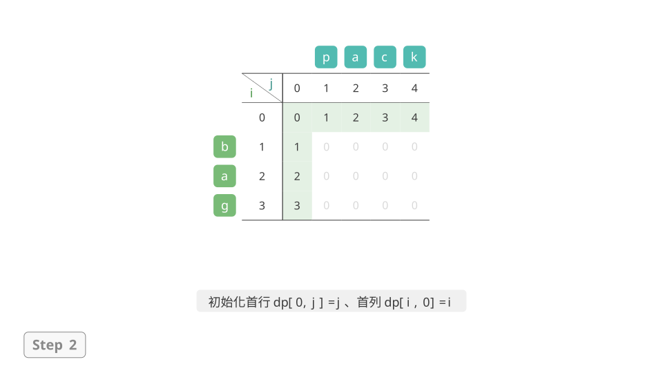{ class="animation-figure" }

=== "<3>"
    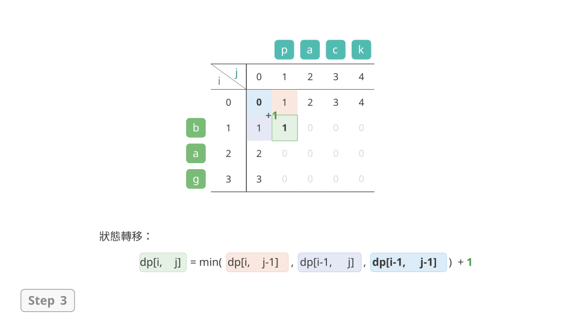{ class="animation-figure" }

=== "<4>"
    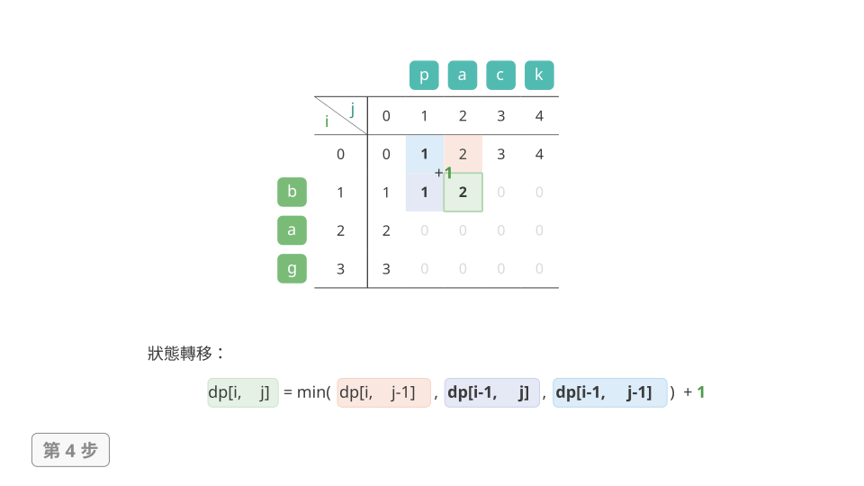{ class="animation-figure" }

=== "<5>"
    { class="animation-figure" }

=== "<6>"
    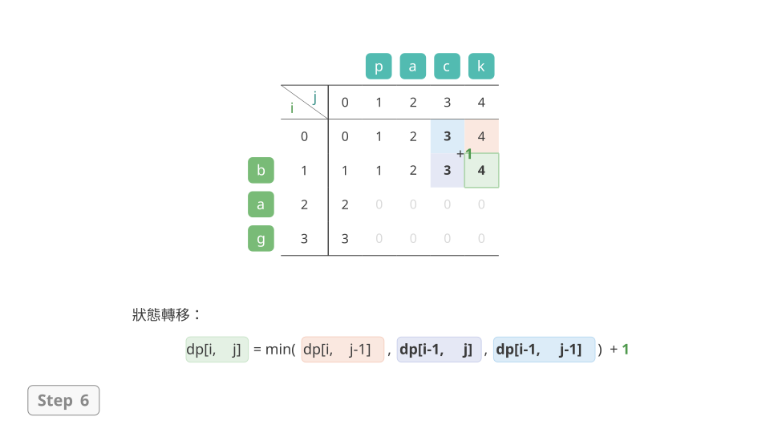{ class="animation-figure" }

=== "<7>"
    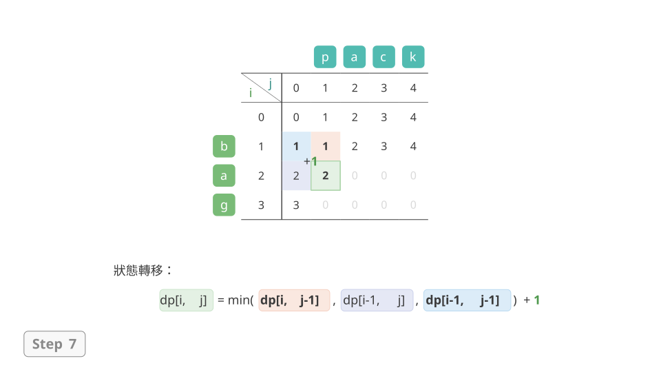{ class="animation-figure" }

=== "<8>"
    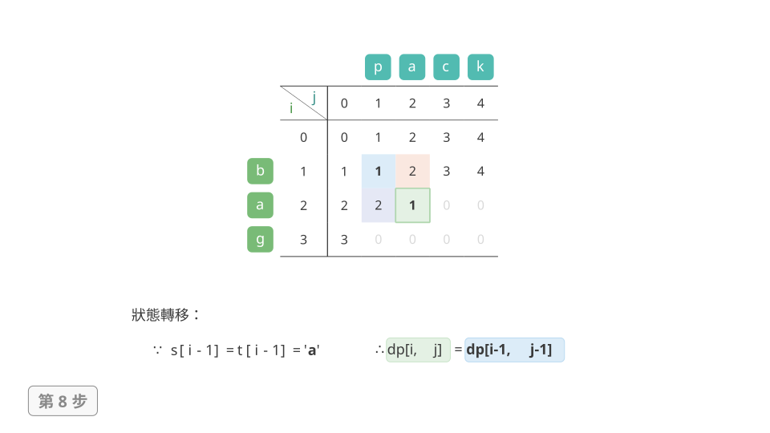{ class="animation-figure" }

=== "<9>"
    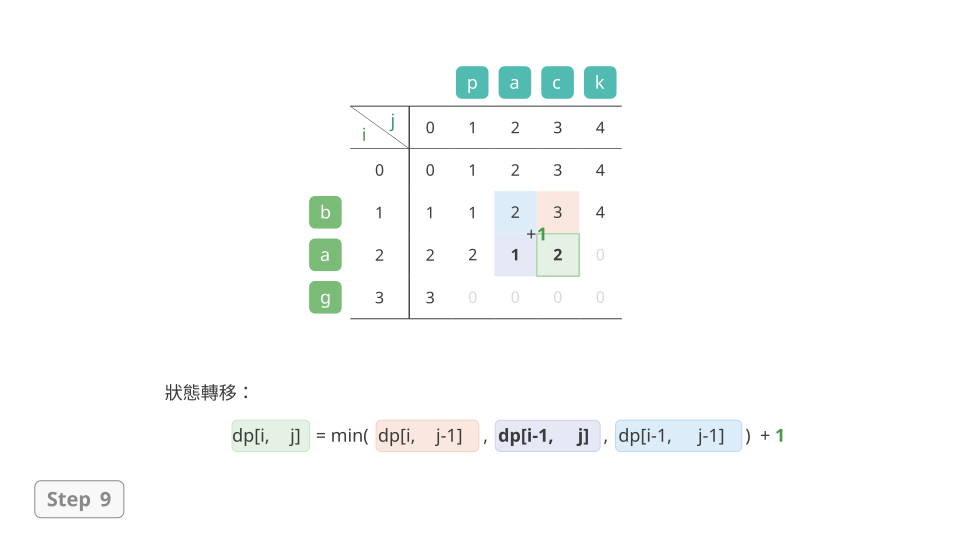{ class="animation-figure" }

=== "<10>"
    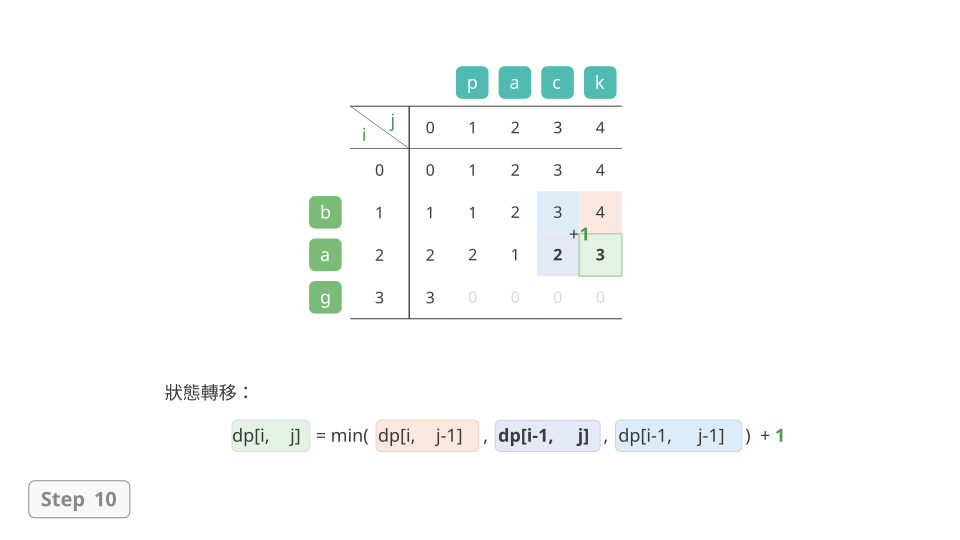{ class="animation-figure" }

=== "<11>"
    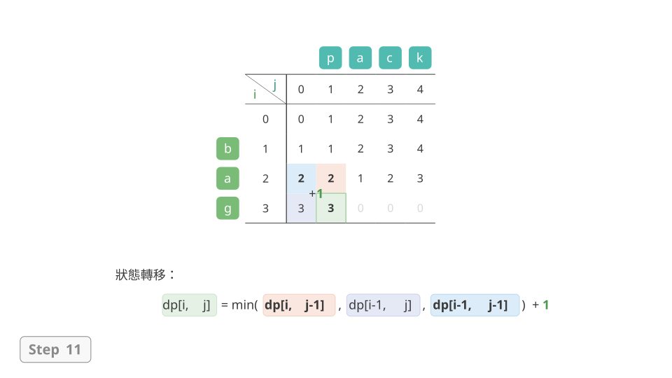{ class="animation-figure" }

=== "<12>"
    { class="animation-figure" }

=== "<13>"
    { class="animation-figure" }

=== "<14>"
    { class="animation-figure" }

=== "<15>"
    { class="animation-figure" }

<p align="center"> 圖 14-30 &nbsp; 用動態規劃求編輯距離 </p>

### 3. &nbsp; 空間最佳化

$dp[i,j]$ 來自上方的 $dp[i-1, j]$、左方的 $dp[i, j-1]$ 和左上方的 $dp[i-1, j-1]$。若正向走訪，會失去左上方的 $dp[i-1, j-1]$；若反向走訪，又無法先算出 $dp[i, j-1]$，因此兩種順序都不能直接套用。

我們可以用變數 `leftup` 暫存左上方的解 $dp[i-1, j-1]$，接下來就只需考慮左方與上方的解。此時情況與完全背包問題相同，可以正向走訪。程式如下：

=== "Python"

    ```python title="edit_distance.py"
    def edit_distance_dp_comp(s: str, t: str) -> int:
        """編輯距離：空間最佳化後的動態規劃"""
        n, m = len(s), len(t)
        dp = [0] * (m + 1)
        # 狀態轉移：第一列
        for j in range(1, m + 1):
            dp[j] = j
        # 狀態轉移：其餘各列
        for i in range(1, n + 1):
            # 狀態轉移：第一欄
            leftup = dp[0]  # 暫存 dp[i-1, j-1]
            dp[0] += 1
            # 狀態轉移：其餘各欄
            for j in range(1, m + 1):
                temp = dp[j]
                if s[i - 1] == t[j - 1]:
                    # 若兩個字元相同，直接跳過這兩個字元
                    dp[j] = leftup
                else:
                    # 最少編輯步數 = 插入、刪除、取代三種操作對應的最少步數中的最小值 + 1
                    dp[j] = min(dp[j - 1], dp[j], leftup) + 1
                leftup = temp  # 更新為下一輪的 dp[i-1, j-1]
        return dp[m]
    ```

=== "C++"

    ```cpp title="edit_distance.cpp"
    /* 編輯距離：空間最佳化後的動態規劃 */
    int editDistanceDPComp(string s, string t) {
        int n = s.length(), m = t.length();
        vector<int> dp(m + 1, 0);
        // 狀態轉移：第一列
        for (int j = 1; j <= m; j++) {
            dp[j] = j;
        }
        // 狀態轉移：其餘各列
        for (int i = 1; i <= n; i++) {
            // 狀態轉移：第一欄
            int leftup = dp[0]; // 暫存 dp[i-1, j-1]
            dp[0] = i;
            // 狀態轉移：其餘各欄
            for (int j = 1; j <= m; j++) {
                int temp = dp[j];
                if (s[i - 1] == t[j - 1]) {
                    // 若兩個字元相同，直接跳過這兩個字元
                    dp[j] = leftup;
                } else {
                    // 最少編輯步數 = 插入、刪除、取代三種操作對應的最少步數中的最小值 + 1
                    dp[j] = min(min(dp[j - 1], dp[j]), leftup) + 1;
                }
                leftup = temp; // 更新為下一輪的 dp[i-1, j-1]
            }
        }
        return dp[m];
    }
    ```

=== "Java"

    ```java title="edit_distance.java"
    /* 編輯距離：空間最佳化後的動態規劃 */
    int editDistanceDPComp(String s, String t) {
        int n = s.length(), m = t.length();
        int[] dp = new int[m + 1];
        // 狀態轉移：第一列
        for (int j = 1; j <= m; j++) {
            dp[j] = j;
        }
        // 狀態轉移：其餘各列
        for (int i = 1; i <= n; i++) {
            // 狀態轉移：第一欄
            int leftup = dp[0]; // 暫存 dp[i-1, j-1]
            dp[0] = i;
            // 狀態轉移：其餘各欄
            for (int j = 1; j <= m; j++) {
                int temp = dp[j];
                if (s.charAt(i - 1) == t.charAt(j - 1)) {
                    // 若兩個字元相同，直接跳過這兩個字元
                    dp[j] = leftup;
                } else {
                    // 最少編輯步數 = 插入、刪除、取代三種操作對應的最少步數中的最小值 + 1
                    dp[j] = Math.min(Math.min(dp[j - 1], dp[j]), leftup) + 1;
                }
                leftup = temp; // 更新為下一輪的 dp[i-1, j-1]
            }
        }
        return dp[m];
    }
    ```

=== "C#"

    ```csharp title="edit_distance.cs"
    /* 編輯距離：空間最佳化後的動態規劃 */
    int EditDistanceDPComp(string s, string t) {
        int n = s.Length, m = t.Length;
        int[] dp = new int[m + 1];
        // 狀態轉移：第一列
        for (int j = 1; j <= m; j++) {
            dp[j] = j;
        }
        // 狀態轉移：其餘各列
        for (int i = 1; i <= n; i++) {
            // 狀態轉移：第一欄
            int leftup = dp[0]; // 暫存 dp[i-1, j-1]
            dp[0] = i;
            // 狀態轉移：其餘各欄
            for (int j = 1; j <= m; j++) {
                int temp = dp[j];
                if (s[i - 1] == t[j - 1]) {
                    // 若兩個字元相同，直接跳過這兩個字元
                    dp[j] = leftup;
                } else {
                    // 最少編輯步數 = 插入、刪除、取代三種操作對應的最少步數中的最小值 + 1
                    dp[j] = Math.Min(Math.Min(dp[j - 1], dp[j]), leftup) + 1;
                }
                leftup = temp; // 更新為下一輪的 dp[i-1, j-1]
            }
        }
        return dp[m];
    }
    ```

=== "Go"

    ```go title="edit_distance.go"
    /* 編輯距離：空間最佳化後的動態規劃 */
    func editDistanceDPComp(s string, t string) int {
        n := len(s)
        m := len(t)
        dp := make([]int, m+1)
        // 狀態轉移：第一列
        for j := 1; j <= m; j++ {
            dp[j] = j
        }
        // 狀態轉移：其餘各列
        for i := 1; i <= n; i++ {
            // 狀態轉移：第一欄
            leftUp := dp[0] // 暫存 dp[i-1, j-1]
            dp[0] = i
            // 狀態轉移：其餘各欄
            for j := 1; j <= m; j++ {
                temp := dp[j]
                if s[i-1] == t[j-1] {
                    // 若兩個字元相同，直接跳過這兩個字元
                    dp[j] = leftUp
                } else {
                    // 最少編輯步數 = 插入、刪除、取代三種操作對應的最少步數中的最小值 + 1
                    dp[j] = MinInt(MinInt(dp[j-1], dp[j]), leftUp) + 1
                }
                leftUp = temp // 更新為下一輪的 dp[i-1, j-1]
            }
        }
        return dp[m]
    }
    ```

=== "Swift"

    ```swift title="edit_distance.swift"
    /* 編輯距離：空間最佳化後的動態規劃 */
    func editDistanceDPComp(s: String, t: String) -> Int {
        let n = s.utf8CString.count
        let m = t.utf8CString.count
        var dp = Array(repeating: 0, count: m + 1)
        // 狀態轉移：第一列
        for j in 1 ... m {
            dp[j] = j
        }
        // 狀態轉移：其餘各列
        for i in 1 ... n {
            // 狀態轉移：第一欄
            var leftup = dp[0] // 暫存 dp[i-1, j-1]
            dp[0] = i
            // 狀態轉移：其餘各欄
            for j in 1 ... m {
                let temp = dp[j]
                if s.utf8CString[i - 1] == t.utf8CString[j - 1] {
                    // 若兩個字元相同，直接跳過這兩個字元
                    dp[j] = leftup
                } else {
                    // 最少編輯步數 = 插入、刪除、取代三種操作對應的最少步數中的最小值 + 1
                    dp[j] = min(min(dp[j - 1], dp[j]), leftup) + 1
                }
                leftup = temp // 更新為下一輪的 dp[i-1, j-1]
            }
        }
        return dp[m]
    }
    ```

=== "JS"

    ```javascript title="edit_distance.js"
    /* 編輯距離：空間最佳化後的動態規劃 */
    function editDistanceDPComp(s, t) {
        const n = s.length,
            m = t.length;
        const dp = new Array(m + 1).fill(0);
        // 狀態轉移：第一列
        for (let j = 1; j <= m; j++) {
            dp[j] = j;
        }
        // 狀態轉移：其餘各列
        for (let i = 1; i <= n; i++) {
            // 狀態轉移：第一欄
            let leftup = dp[0]; // 暫存 dp[i-1, j-1]
            dp[0] = i;
            // 狀態轉移：其餘各欄
            for (let j = 1; j <= m; j++) {
                const temp = dp[j];
                if (s.charAt(i - 1) === t.charAt(j - 1)) {
                    // 若兩個字元相同，直接跳過這兩個字元
                    dp[j] = leftup;
                } else {
                    // 最少編輯步數 = 插入、刪除、取代三種操作對應的最少步數中的最小值 + 1
                    dp[j] = Math.min(dp[j - 1], dp[j], leftup) + 1;
                }
                leftup = temp; // 更新為下一輪的 dp[i-1, j-1]
            }
        }
        return dp[m];
    }
    ```

=== "TS"

    ```typescript title="edit_distance.ts"
    /* 編輯距離：空間最佳化後的動態規劃 */
    function editDistanceDPComp(s: string, t: string): number {
        const n = s.length,
            m = t.length;
        const dp = new Array(m + 1).fill(0);
        // 狀態轉移：第一列
        for (let j = 1; j <= m; j++) {
            dp[j] = j;
        }
        // 狀態轉移：其餘各列
        for (let i = 1; i <= n; i++) {
            // 狀態轉移：第一欄
            let leftup = dp[0]; // 暫存 dp[i-1, j-1]
            dp[0] = i;
            // 狀態轉移：其餘各欄
            for (let j = 1; j <= m; j++) {
                const temp = dp[j];
                if (s.charAt(i - 1) === t.charAt(j - 1)) {
                    // 若兩個字元相同，直接跳過這兩個字元
                    dp[j] = leftup;
                } else {
                    // 最少編輯步數 = 插入、刪除、取代三種操作對應的最少步數中的最小值 + 1
                    dp[j] = Math.min(dp[j - 1], dp[j], leftup) + 1;
                }
                leftup = temp; // 更新為下一輪的 dp[i-1, j-1]
            }
        }
        return dp[m];
    }
    ```

=== "Dart"

    ```dart title="edit_distance.dart"
    /* 編輯距離：空間最佳化後的動態規劃 */
    int editDistanceDPComp(String s, String t) {
      int n = s.length, m = t.length;
      List<int> dp = List.filled(m + 1, 0);
      // 狀態轉移：第一列
      for (int j = 1; j <= m; j++) {
        dp[j] = j;
      }
      // 狀態轉移：其餘各列
      for (int i = 1; i <= n; i++) {
        // 狀態轉移：第一欄
        int leftup = dp[0]; // 暫存 dp[i-1, j-1]
        dp[0] = i;
        // 狀態轉移：其餘各欄
        for (int j = 1; j <= m; j++) {
          int temp = dp[j];
          if (s[i - 1] == t[j - 1]) {
            // 若兩個字元相同，直接跳過這兩個字元
            dp[j] = leftup;
          } else {
            // 最少編輯步數 = 插入、刪除、取代三種操作對應的最少步數中的最小值 + 1
            dp[j] = min(min(dp[j - 1], dp[j]), leftup) + 1;
          }
          leftup = temp; // 更新為下一輪的 dp[i-1, j-1]
        }
      }
      return dp[m];
    }
    ```

=== "Rust"

    ```rust title="edit_distance.rs"
    /* 編輯距離：空間最佳化後的動態規劃 */
    fn edit_distance_dp_comp(s: &str, t: &str) -> i32 {
        let (n, m) = (s.len(), t.len());
        let mut dp = vec![0; m + 1];
        // 狀態轉移：第一列
        for j in 1..m {
            dp[j] = j as i32;
        }
        // 狀態轉移：其餘各列
        for i in 1..=n {
            // 狀態轉移：第一欄
            let mut leftup = dp[0]; // 暫存 dp[i-1, j-1]
            dp[0] = i as i32;
            // 狀態轉移：其餘各欄
            for j in 1..=m {
                let temp = dp[j];
                if s.chars().nth(i - 1) == t.chars().nth(j - 1) {
                    // 若兩個字元相同，直接跳過這兩個字元
                    dp[j] = leftup;
                } else {
                    // 最少編輯步數 = 插入、刪除、取代三種操作對應的最少步數中的最小值 + 1
                    dp[j] = std::cmp::min(std::cmp::min(dp[j - 1], dp[j]), leftup) + 1;
                }
                leftup = temp; // 更新為下一輪的 dp[i-1, j-1]
            }
        }
        dp[m]
    }
    ```

=== "C"

    ```c title="edit_distance.c"
    /* 編輯距離：空間最佳化後的動態規劃 */
    int editDistanceDPComp(char *s, char *t, int n, int m) {
        int *dp = calloc(m + 1, sizeof(int));
        // 狀態轉移：第一列
        for (int j = 1; j <= m; j++) {
            dp[j] = j;
        }
        // 狀態轉移：其餘各列
        for (int i = 1; i <= n; i++) {
            // 狀態轉移：第一欄
            int leftup = dp[0]; // 暫存 dp[i-1, j-1]
            dp[0] = i;
            // 狀態轉移：其餘各欄
            for (int j = 1; j <= m; j++) {
                int temp = dp[j];
                if (s[i - 1] == t[j - 1]) {
                    // 若兩個字元相同，直接跳過這兩個字元
                    dp[j] = leftup;
                } else {
                    // 最少編輯步數 = 插入、刪除、取代三種操作對應的最少步數中的最小值 + 1
                    dp[j] = myMin(myMin(dp[j - 1], dp[j]), leftup) + 1;
                }
                leftup = temp; // 更新為下一輪的 dp[i-1, j-1]
            }
        }
        int res = dp[m];
        // 釋放記憶體
        free(dp);
        return res;
    }
    ```

=== "Kotlin"

    ```kotlin title="edit_distance.kt"
    /* 編輯距離：空間最佳化後的動態規劃 */
    fun editDistanceDPComp(s: String, t: String): Int {
        val n = s.length
        val m = t.length
        val dp = IntArray(m + 1)
        // 狀態轉移：第一列
        for (j in 1..m) {
            dp[j] = j
        }
        // 狀態轉移：其餘各列
        for (i in 1..n) {
            // 狀態轉移：第一欄
            var leftup = dp[0] // 暫存 dp[i-1, j-1]
            dp[0] = i
            // 狀態轉移：其餘各欄
            for (j in 1..m) {
                val temp = dp[j]
                if (s[i - 1] == t[j - 1]) {
                    // 若兩個字元相同，直接跳過這兩個字元
                    dp[j] = leftup
                } else {
                    // 最少編輯步數 = 插入、刪除、取代三種操作對應的最少步數中的最小值 + 1
                    dp[j] = min(min(dp[j - 1], dp[j]), leftup) + 1
                }
                leftup = temp // 更新為下一輪的 dp[i-1, j-1]
            }
        }
        return dp[m]
    }
    ```

=== "Ruby"

    ```ruby title="edit_distance.rb"
    ### 編輯距離：空間最佳化後的動態規劃 ###
    def edit_distance_dp_comp(s, t)
      n, m = s.length, t.length
      dp = Array.new(m + 1, 0)
      # 狀態轉移：第一列
      (1...(m + 1)).each { |j| dp[j] = j }
      # 狀態轉移：其餘各列
      for i in 1...(n + 1)
        # 狀態轉移：第一欄
        leftup = dp.first # 暫存 dp[i-1, j-1]
        dp[0] += 1
        # 狀態轉移：其餘各欄
        for j in 1...(m + 1)
          temp = dp[j]
          if s[i - 1] == t[j - 1]
            # 若兩個字元相同，直接跳過這兩個字元
            dp[j] = leftup
          else
            # 最少編輯步數 = 插入、刪除、取代三種操作對應的最少步數中的最小值 + 1
            dp[j] = [dp[j - 1], dp[j], leftup].min + 1
          end
          leftup = temp # 更新為下一輪的 dp[i-1, j-1]
        end
      end
      dp[m]
    end
    ```

??? pythontutor "執行視覺化示範"

    <div style="height: 549px; width: 100%;"><iframe class="pythontutor-iframe" title="執行視覺化示範" src="https://pythontutor.com/iframe-embed.html#code=def%20edit_distance_dp_comp%28s%3A%20str,%20t%3A%20str%29%20-%3E%20int%3A%0A%20%20%20%20%22%22%22%E7%B7%A8%E8%BC%AF%E8%B7%9D%E9%9B%A2%EF%BC%9A%E7%A9%BA%E9%96%93%E6%9C%80%E4%BD%B3%E5%8C%96%E5%BE%8C%E7%9A%84%E5%8B%95%E6%85%8B%E8%A6%8F%E5%8A%83%22%22%22%0A%20%20%20%20n,%20m%20%3D%20len%28s%29,%20len%28t%29%0A%20%20%20%20dp%20%3D%20%5B0%5D%20%2A%20%28m%20%2B%201%29%0A%20%20%20%20%23%20%E7%8B%80%E6%85%8B%E8%BD%89%E7%A7%BB%EF%BC%9A%E7%AC%AC%E4%B8%80%E5%88%97%0A%20%20%20%20for%20j%20in%20range%281,%20m%20%2B%201%29%3A%0A%20%20%20%20%20%20%20%20dp%5Bj%5D%20%3D%20j%0A%20%20%20%20%23%20%E7%8B%80%E6%85%8B%E8%BD%89%E7%A7%BB%EF%BC%9A%E5%85%B6%E9%A4%98%E5%90%84%E5%88%97%0A%20%20%20%20for%20i%20in%20range%281,%20n%20%2B%201%29%3A%0A%20%20%20%20%20%20%20%20%23%20%E7%8B%80%E6%85%8B%E8%BD%89%E7%A7%BB%EF%BC%9A%E7%AC%AC%E4%B8%80%E6%AC%84%0A%20%20%20%20%20%20%20%20leftup%20%3D%20dp%5B0%5D%20%20%23%20%E6%9A%AB%E5%AD%98%20dp%5Bi-1,%20j-1%5D%0A%20%20%20%20%20%20%20%20dp%5B0%5D%20%2B%3D%201%0A%20%20%20%20%20%20%20%20%23%20%E7%8B%80%E6%85%8B%E8%BD%89%E7%A7%BB%EF%BC%9A%E5%85%B6%E9%A4%98%E5%90%84%E6%AC%84%0A%20%20%20%20%20%20%20%20for%20j%20in%20range%281,%20m%20%2B%201%29%3A%0A%20%20%20%20%20%20%20%20%20%20%20%20temp%20%3D%20dp%5Bj%5D%0A%20%20%20%20%20%20%20%20%20%20%20%20if%20s%5Bi%20-%201%5D%20%3D%3D%20t%5Bj%20-%201%5D%3A%0A%20%20%20%20%20%20%20%20%20%20%20%20%20%20%20%20%23%20%E8%8B%A5%E5%85%A9%E5%80%8B%E5%AD%97%E5%85%83%E7%9B%B8%E5%90%8C%EF%BC%8C%E7%9B%B4%E6%8E%A5%E8%B7%B3%E9%81%8E%E9%80%99%E5%85%A9%E5%80%8B%E5%AD%97%E5%85%83%0A%20%20%20%20%20%20%20%20%20%20%20%20%20%20%20%20dp%5Bj%5D%20%3D%20leftup%0A%20%20%20%20%20%20%20%20%20%20%20%20else%3A%0A%20%20%20%20%20%20%20%20%20%20%20%20%20%20%20%20%23%20%E6%9C%80%E5%B0%91%E7%B7%A8%E8%BC%AF%E6%AD%A5%E6%95%B8%20%3D%20%E6%8F%92%E5%85%A5%E3%80%81%E5%88%AA%E9%99%A4%E3%80%81%E5%8F%96%E4%BB%A3%E4%B8%89%E7%A8%AE%E6%93%8D%E4%BD%9C%E5%B0%8D%E6%87%89%E7%9A%84%E6%9C%80%E5%B0%91%E6%AD%A5%E6%95%B8%E4%B8%AD%E7%9A%84%E6%9C%80%E5%B0%8F%E5%80%BC%20%2B%201%0A%20%20%20%20%20%20%20%20%20%20%20%20%20%20%20%20dp%5Bj%5D%20%3D%20min%28dp%5Bj%20-%201%5D,%20dp%5Bj%5D,%20leftup%29%20%2B%201%0A%20%20%20%20%20%20%20%20%20%20%20%20leftup%20%3D%20temp%20%20%23%20%E6%9B%B4%E6%96%B0%E7%82%BA%E4%B8%8B%E4%B8%80%E8%BC%AA%E7%9A%84%20dp%5Bi-1,%20j-1%5D%0A%20%20%20%20return%20dp%5Bm%5D%0A%0A%0A%22%22%22Driver%20Code%22%22%22%0Aif%20__name__%20%3D%3D%20%22__main__%22%3A%0A%20%20%20%20s%20%3D%20%22bag%22%0A%20%20%20%20t%20%3D%20%22pack%22%0A%20%20%20%20n,%20m%20%3D%20len%28s%29,%20len%28t%29%0A%0A%20%20%20%20%23%20%E7%A9%BA%E9%96%93%E6%9C%80%E4%BD%B3%E5%8C%96%E5%BE%8C%E7%9A%84%E5%8B%95%E6%85%8B%E8%A6%8F%E5%8A%83%0A%20%20%20%20res%20%3D%20edit_distance_dp_comp%28s,%20t%29%0A%20%20%20%20print%28f%22%E5%B0%87%20%7Bs%7D%20%E6%94%B9%E6%88%90%20%7Bt%7D%20%E8%87%B3%E5%B0%91%E9%9C%80%E8%A6%81%E7%B7%A8%E8%BC%AF%20%7Bres%7D%20%E6%AD%A5%22%29&codeDivHeight=472&codeDivWidth=350&cumulative=false&curInstr=6&heapPrimitives=nevernest&origin=opt-frontend.js&py=311&rawInputLstJSON=%5B%5D&textReferences=false"> </iframe></div>
    <div style="margin-top: 5px;"><a href="https://pythontutor.com/iframe-embed.html#code=def%20edit_distance_dp_comp%28s%3A%20str,%20t%3A%20str%29%20-%3E%20int%3A%0A%20%20%20%20%22%22%22%E7%B7%A8%E8%BC%AF%E8%B7%9D%E9%9B%A2%EF%BC%9A%E7%A9%BA%E9%96%93%E6%9C%80%E4%BD%B3%E5%8C%96%E5%BE%8C%E7%9A%84%E5%8B%95%E6%85%8B%E8%A6%8F%E5%8A%83%22%22%22%0A%20%20%20%20n,%20m%20%3D%20len%28s%29,%20len%28t%29%0A%20%20%20%20dp%20%3D%20%5B0%5D%20%2A%20%28m%20%2B%201%29%0A%20%20%20%20%23%20%E7%8B%80%E6%85%8B%E8%BD%89%E7%A7%BB%EF%BC%9A%E7%AC%AC%E4%B8%80%E5%88%97%0A%20%20%20%20for%20j%20in%20range%281,%20m%20%2B%201%29%3A%0A%20%20%20%20%20%20%20%20dp%5Bj%5D%20%3D%20j%0A%20%20%20%20%23%20%E7%8B%80%E6%85%8B%E8%BD%89%E7%A7%BB%EF%BC%9A%E5%85%B6%E9%A4%98%E5%90%84%E5%88%97%0A%20%20%20%20for%20i%20in%20range%281,%20n%20%2B%201%29%3A%0A%20%20%20%20%20%20%20%20%23%20%E7%8B%80%E6%85%8B%E8%BD%89%E7%A7%BB%EF%BC%9A%E7%AC%AC%E4%B8%80%E6%AC%84%0A%20%20%20%20%20%20%20%20leftup%20%3D%20dp%5B0%5D%20%20%23%20%E6%9A%AB%E5%AD%98%20dp%5Bi-1,%20j-1%5D%0A%20%20%20%20%20%20%20%20dp%5B0%5D%20%2B%3D%201%0A%20%20%20%20%20%20%20%20%23%20%E7%8B%80%E6%85%8B%E8%BD%89%E7%A7%BB%EF%BC%9A%E5%85%B6%E9%A4%98%E5%90%84%E6%AC%84%0A%20%20%20%20%20%20%20%20for%20j%20in%20range%281,%20m%20%2B%201%29%3A%0A%20%20%20%20%20%20%20%20%20%20%20%20temp%20%3D%20dp%5Bj%5D%0A%20%20%20%20%20%20%20%20%20%20%20%20if%20s%5Bi%20-%201%5D%20%3D%3D%20t%5Bj%20-%201%5D%3A%0A%20%20%20%20%20%20%20%20%20%20%20%20%20%20%20%20%23%20%E8%8B%A5%E5%85%A9%E5%80%8B%E5%AD%97%E5%85%83%E7%9B%B8%E5%90%8C%EF%BC%8C%E7%9B%B4%E6%8E%A5%E8%B7%B3%E9%81%8E%E9%80%99%E5%85%A9%E5%80%8B%E5%AD%97%E5%85%83%0A%20%20%20%20%20%20%20%20%20%20%20%20%20%20%20%20dp%5Bj%5D%20%3D%20leftup%0A%20%20%20%20%20%20%20%20%20%20%20%20else%3A%0A%20%20%20%20%20%20%20%20%20%20%20%20%20%20%20%20%23%20%E6%9C%80%E5%B0%91%E7%B7%A8%E8%BC%AF%E6%AD%A5%E6%95%B8%20%3D%20%E6%8F%92%E5%85%A5%E3%80%81%E5%88%AA%E9%99%A4%E3%80%81%E5%8F%96%E4%BB%A3%E4%B8%89%E7%A8%AE%E6%93%8D%E4%BD%9C%E5%B0%8D%E6%87%89%E7%9A%84%E6%9C%80%E5%B0%91%E6%AD%A5%E6%95%B8%E4%B8%AD%E7%9A%84%E6%9C%80%E5%B0%8F%E5%80%BC%20%2B%201%0A%20%20%20%20%20%20%20%20%20%20%20%20%20%20%20%20dp%5Bj%5D%20%3D%20min%28dp%5Bj%20-%201%5D,%20dp%5Bj%5D,%20leftup%29%20%2B%201%0A%20%20%20%20%20%20%20%20%20%20%20%20leftup%20%3D%20temp%20%20%23%20%E6%9B%B4%E6%96%B0%E7%82%BA%E4%B8%8B%E4%B8%80%E8%BC%AA%E7%9A%84%20dp%5Bi-1,%20j-1%5D%0A%20%20%20%20return%20dp%5Bm%5D%0A%0A%0A%22%22%22Driver%20Code%22%22%22%0Aif%20__name__%20%3D%3D%20%22__main__%22%3A%0A%20%20%20%20s%20%3D%20%22bag%22%0A%20%20%20%20t%20%3D%20%22pack%22%0A%20%20%20%20n,%20m%20%3D%20len%28s%29,%20len%28t%29%0A%0A%20%20%20%20%23%20%E7%A9%BA%E9%96%93%E6%9C%80%E4%BD%B3%E5%8C%96%E5%BE%8C%E7%9A%84%E5%8B%95%E6%85%8B%E8%A6%8F%E5%8A%83%0A%20%20%20%20res%20%3D%20edit_distance_dp_comp%28s,%20t%29%0A%20%20%20%20print%28f%22%E5%B0%87%20%7Bs%7D%20%E6%94%B9%E6%88%90%20%7Bt%7D%20%E8%87%B3%E5%B0%91%E9%9C%80%E8%A6%81%E7%B7%A8%E8%BC%AF%20%7Bres%7D%20%E6%AD%A5%22%29&codeDivHeight=800&codeDivWidth=600&cumulative=false&curInstr=6&heapPrimitives=nevernest&origin=opt-frontend.js&py=311&rawInputLstJSON=%5B%5D&textReferences=false" target="_blank" rel="noopener noreferrer">全螢幕觀看 ></a></div>
