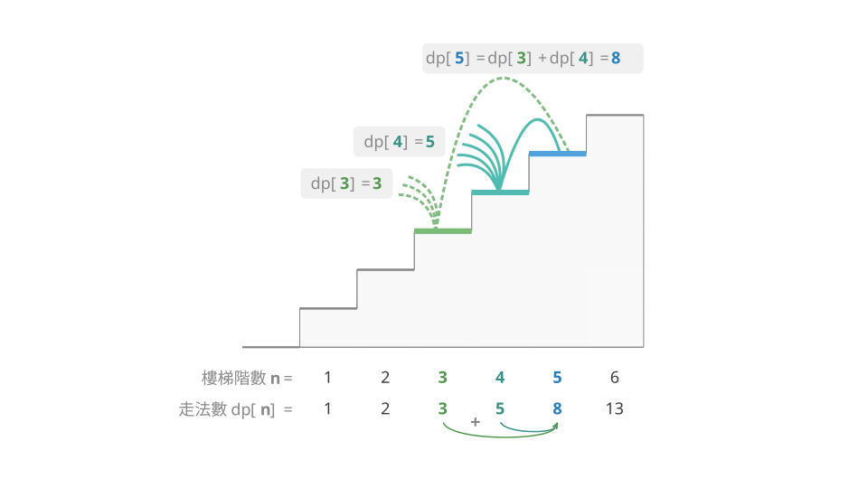
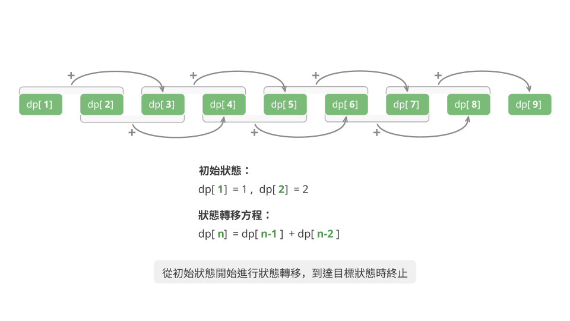

# 初探動態規劃

<u>動態規劃（dynamic programming）</u>是一種重要的演算法設計方法。它將問題拆成一系列較小的子問題，儲存子問題的解來避免重複計算，從而大幅提升時間效率。

本節從一個經典範例出發，先用回溯法暴力求解，觀察過程中出現的重疊子問題，再逐步推導出更有效率的動態規劃解法。

!!! question "爬樓梯"

    一段樓梯共有 $n$ 階，每一步可以往上跨 $1$ 階或 $2$ 階。共有幾種走法可以爬到頂端？

如下圖所示，要爬到一段 $3$ 階樓梯的頂端，共有 $3$ 種走法。


本題要求走法數，**可以考慮用回溯法窮舉所有走法**。將爬樓梯想成一連串選擇：從地面出發，每次選擇往上跨 $1$ 階或 $2$ 階。每到達頂端一次，走法數就加 $1$；若越過頂端，就對該分支剪枝。程式如下：

```src
[file]{climbing_stairs_backtrack}-[class]{}-[func]{climbing_stairs_backtrack}
```

## 方法一：暴力搜尋

回溯法通常不會明確地拆解問題，而是把解題看成一連串決策，透過嘗試與剪枝搜尋所有可能的解。

現在試著從分解問題的角度來看這道題。設爬到第 $i$ 階共有 $dp[i]$ 種走法，那麼 $dp[i]$ 就是原問題，它的子問題包括：

$$
dp[i-1], dp[i-2], \dots, dp[2], dp[1]
$$

每一步只能跨 $1$ 階或 $2$ 階，因此當我們站在第 $i$ 階時，上一步只可能站在第 $i - 1$ 階或第 $i - 2$ 階。換句話說，要走到第 $i$ 階，只能從第 $i -1$ 階或第 $i - 2$ 階跨上去。

由此可得一個重要推論：**到第 $i - 1$ 階的走法數，加上到第 $i - 2$ 階的走法數，就等於到第 $i$ 階的走法數**。公式如下：

$$
dp[i] = dp[i-1] + dp[i-2]
$$

這表示爬樓梯問題的各個子問題之間有遞推關係，**原問題的解可由子問題的解構成**。下圖呈現這項關係。



根據遞迴關係式，就能寫出暴力搜尋的解法。從 $dp[n]$ 出發，**以遞迴方式將較大問題的解拆成兩個較小問題的解之和**，直到遇到最小子問題 $dp[1]$ 或 $dp[2]$ 才回傳。最小子問題的解已知，分別為 $dp[1] = 1$、$dp[2] = 2$，表示爬到第 $1$、$2$ 階分別有 $1$、$2$ 種走法。

觀察下列程式。它和標準的回溯程式都採用深度優先搜尋，但寫法更簡潔：

```src
[file]{climbing_stairs_dfs}-[class]{}-[func]{climbing_stairs_dfs}
```

下圖是暴力搜尋形成的遞迴樹。對問題 $dp[n]$ 而言，樹的深度為 $n$，時間複雜度為 $O(2^n)$。指數階的成長非常快，只要輸入稍大的 $n$，就得等上很久。


觀察上圖，**時間複雜度之所以達到指數階，是因為出現了「重疊子問題」**。例如，$dp[9]$ 拆成 $dp[8]$ 與 $dp[7]$，$dp[8]$ 拆成 $dp[7]$ 與 $dp[6]$，兩者都包含子問題 $dp[7]$。

同理，子問題中還包含更小的重疊子問題，層層往下展開。絕大部分的運算資源都花在這些重複計算上。

## 方法二：記憶化搜尋

為了提高演算法效率，**我們希望每個重疊子問題都只計算一次**。為此，宣告陣列 `mem` 來記錄各子問題的解，並在搜尋時對重疊子問題剪枝。

1. 第一次算出 $dp[i]$ 時，將結果存入 `mem[i]`，供之後使用。
2. 再次需要 $dp[i]$ 時，直接從 `mem[i]` 讀取結果，就能避免重複計算這個子問題。

程式如下：

```src
[file]{climbing_stairs_dfs_mem}-[class]{}-[func]{climbing_stairs_dfs_mem}
```

觀察下圖，**加入記憶化後，每個重疊子問題都只需算一次，時間複雜度降為 $O(n)$**，效率大幅提升。


## 方法三：動態規劃

**記憶化搜尋是「由上而下」的方法**：從原問題（根節點）出發，遞迴地將較大的子問題拆成較小的子問題，直到遇到解已知的最小子問題（葉節點）。接著在遞迴返回時逐層彙集子問題的解，構成原問題的解。

相對地，**動態規劃是「由下而上」的方法**：從最小子問題的解出發，以迭代方式逐步構成較大子問題的解，直到得到原問題的解。

動態規劃不需要回溯，因此只需用迴圈迭代，無須使用遞迴。在下列程式中，我們初始化陣列 `dp` 來儲存子問題的解，其記錄作用與記憶化搜尋中的陣列 `mem` 相同：

```src
[file]{climbing_stairs_dp}-[class]{}-[func]{climbing_stairs_dp}
```

下圖模擬上述程式的執行過程。



和回溯法一樣，動態規劃也用「狀態」表示解題過程中的某個階段。每個狀態都對應一個子問題及其局部最佳解。例如，爬樓梯問題將目前所在的階數 $i$ 定義為狀態。

根據以上內容，可以整理出動態規劃的常用術語。

- 將陣列 `dp` 稱為 <u>dp 表</u>，$dp[i]$ 表示狀態 $i$ 所對應的子問題的解。
- 將最小子問題所對應的狀態（樓梯的第 $1$ 階和第 $2$ 階）稱為<u>初始狀態</u>。
- 將遞迴關係式 $dp[i] = dp[i-1] + dp[i-2]$ 稱為<u>狀態轉移方程式</u>。

## 空間最佳化

你可能已經發現，**由於 $dp[i]$ 只與 $dp[i-1]$ 和 $dp[i-2]$ 有關，所以無須用陣列 `dp` 儲存所有子問題的解**，只需輪流更新兩個變數即可。程式如下：

```src
[file]{climbing_stairs_dp}-[class]{}-[func]{climbing_stairs_dp_comp}
```

觀察上述程式，省下陣列 `dp` 占用的空間後，空間複雜度從 $O(n)$ 降為 $O(1)$。

在動態規劃問題中，目前狀態往往只與前面有限個狀態有關。此時只需保留必要的狀態，就能藉由「降低維度」節省記憶體。**這種空間最佳化技巧稱為「滾動變數」或「滾動陣列」**。
