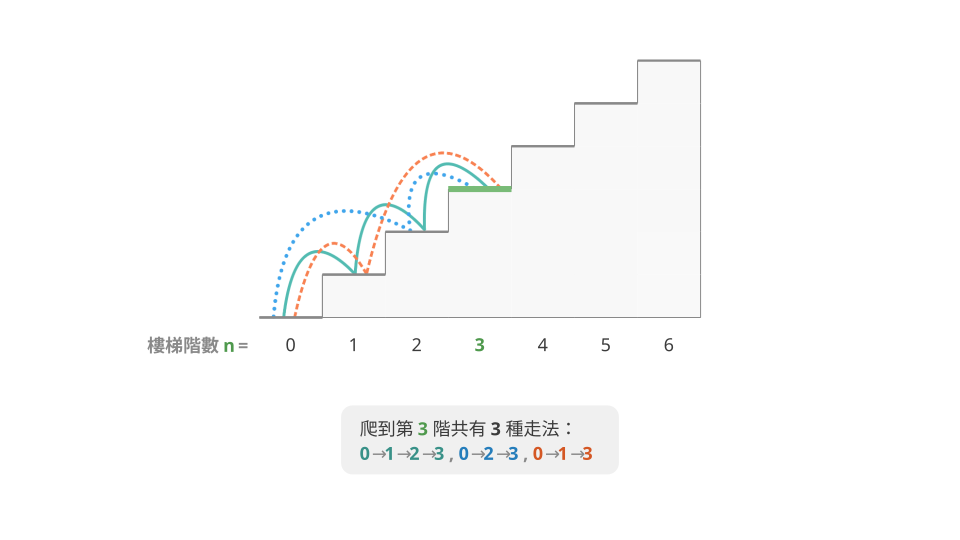
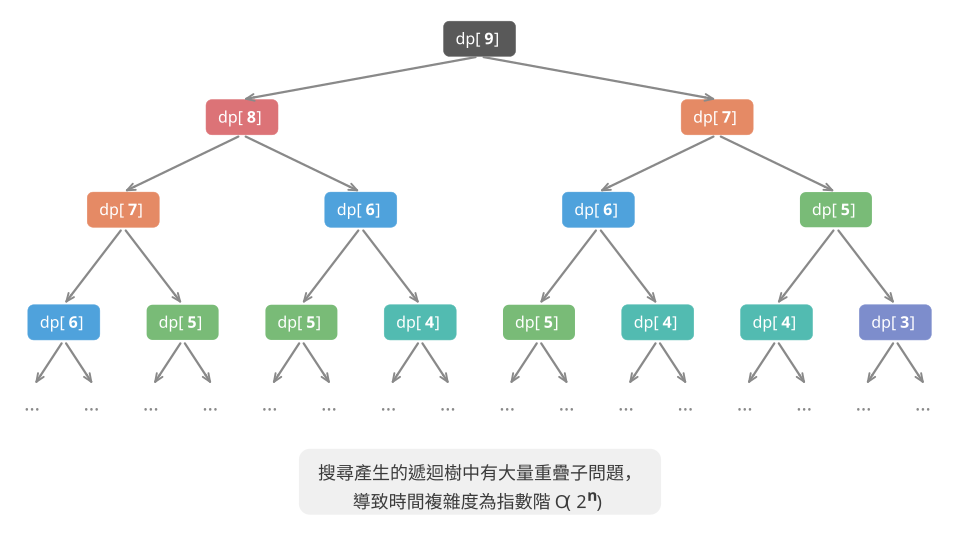
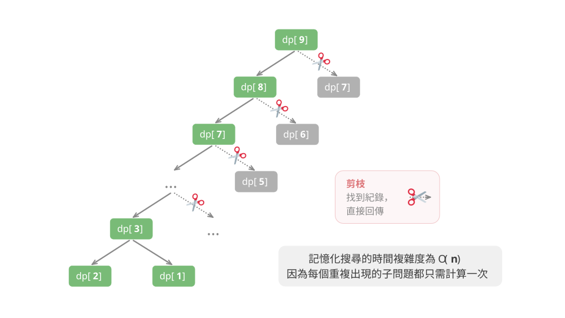

# 14.1 &nbsp; 初探動態規劃

<u>動態規劃（dynamic programming）</u>是一種重要的演算法設計方法。它將問題拆成一系列較小的子問題，儲存子問題的解來避免重複計算，從而大幅提升時間效率。

本節從一個經典範例出發，先用回溯法暴力求解，觀察過程中出現的重疊子問題，再逐步推導出更有效率的動態規劃解法。

!!! question "爬樓梯"

    一段樓梯共有 $n$ 階，每一步可以往上跨 $1$ 階或 $2$ 階。共有幾種走法可以爬到頂端？

如圖 14-1 所示，要爬到一段 $3$ 階樓梯的頂端，共有 $3$ 種走法。

{ class="animation-figure" }

<p align="center"> 圖 14-1 &nbsp; 爬到第 3 階的走法數 </p>

本題要求走法數，**可以考慮用回溯法窮舉所有走法**。將爬樓梯想成一連串選擇：從地面出發，每次選擇往上跨 $1$ 階或 $2$ 階。每到達頂端一次，走法數就加 $1$；若越過頂端，就對該分支剪枝。程式如下：

=== "Python"

    ```python title="climbing_stairs_backtrack.py"
    def backtrack(choices: list[int], state: int, n: int, res: list[int]) -> int:
        """回溯"""
        # 爬到第 n 階時，將走法數加 1
        if state == n:
            res[0] += 1
        # 走訪所有選項
        for choice in choices:
            # 剪枝：不能越過第 n 階
            if state + choice > n:
                continue
            # 嘗試：做出選擇，更新狀態
            backtrack(choices, state + choice, n, res)
            # 撤銷選擇

    def climbing_stairs_backtrack(n: int) -> int:
        """爬樓梯：回溯法"""
        choices = [1, 2]  # 每次可以往上爬 1 階或 2 階
        state = 0  # 從第 0 階開始爬
        res = [0]  # 用 res[0] 記錄走法數
        backtrack(choices, state, n, res)
        return res[0]
    ```

=== "C++"

    ```cpp title="climbing_stairs_backtrack.cpp"
    /* 回溯 */
    void backtrack(vector<int> &choices, int state, int n, vector<int> &res) {
        // 爬到第 n 階時，將走法數加 1
        if (state == n)
            res[0]++;
        // 走訪所有選項
        for (auto &choice : choices) {
            // 剪枝：不能越過第 n 階
            if (state + choice > n)
                continue;
            // 嘗試：做出選擇，更新狀態
            backtrack(choices, state + choice, n, res);
            // 撤銷選擇
        }
    }

    /* 爬樓梯：回溯法 */
    int climbingStairsBacktrack(int n) {
        vector<int> choices = {1, 2}; // 每次可以往上爬 1 階或 2 階
        int state = 0;                // 從第 0 階開始爬
        vector<int> res = {0};        // 用 res[0] 記錄走法數
        backtrack(choices, state, n, res);
        return res[0];
    }
    ```

=== "Java"

    ```java title="climbing_stairs_backtrack.java"
    /* 回溯 */
    void backtrack(List<Integer> choices, int state, int n, List<Integer> res) {
        // 爬到第 n 階時，將走法數加 1
        if (state == n)
            res.set(0, res.get(0) + 1);
        // 走訪所有選項
        for (Integer choice : choices) {
            // 剪枝：不能越過第 n 階
            if (state + choice > n)
                continue;
            // 嘗試：做出選擇，更新狀態
            backtrack(choices, state + choice, n, res);
            // 撤銷選擇
        }
    }

    /* 爬樓梯：回溯法 */
    int climbingStairsBacktrack(int n) {
        List<Integer> choices = Arrays.asList(1, 2); // 每次可以往上爬 1 階或 2 階
        int state = 0; // 從第 0 階開始爬
        List<Integer> res = new ArrayList<>();
        res.add(0); // 用 res[0] 記錄走法數
        backtrack(choices, state, n, res);
        return res.get(0);
    }
    ```

=== "C#"

    ```csharp title="climbing_stairs_backtrack.cs"
    /* 回溯 */
    void Backtrack(List<int> choices, int state, int n, List<int> res) {
        // 爬到第 n 階時，將走法數加 1
        if (state == n)
            res[0]++;
        // 走訪所有選項
        foreach (int choice in choices) {
            // 剪枝：不能越過第 n 階
            if (state + choice > n)
                continue;
            // 嘗試：做出選擇，更新狀態
            Backtrack(choices, state + choice, n, res);
            // 撤銷選擇
        }
    }

    /* 爬樓梯：回溯法 */
    int ClimbingStairsBacktrack(int n) {
        List<int> choices = [1, 2]; // 每次可以往上爬 1 階或 2 階
        int state = 0; // 從第 0 階開始爬
        List<int> res = [0]; // 用 res[0] 記錄走法數
        Backtrack(choices, state, n, res);
        return res[0];
    }
    ```

=== "Go"

    ```go title="climbing_stairs_backtrack.go"
    /* 回溯 */
    func backtrack(choices []int, state, n int, res []int) {
        // 爬到第 n 階時，將走法數加 1
        if state == n {
            res[0] = res[0] + 1
        }
        // 走訪所有選項
        for _, choice := range choices {
            // 剪枝：不能越過第 n 階
            if state+choice > n {
                continue
            }
            // 嘗試：做出選擇，更新狀態
            backtrack(choices, state+choice, n, res)
            // 撤銷選擇
        }
    }

    /* 爬樓梯：回溯法 */
    func climbingStairsBacktrack(n int) int {
        // 每次可以往上爬 1 階或 2 階
        choices := []int{1, 2}
        // 從第 0 階開始爬
        state := 0
        res := make([]int, 1)
        // 用 res[0] 記錄走法數
        res[0] = 0
        backtrack(choices, state, n, res)
        return res[0]
    }
    ```

=== "Swift"

    ```swift title="climbing_stairs_backtrack.swift"
    /* 回溯 */
    func backtrack(choices: [Int], state: Int, n: Int, res: inout [Int]) {
        // 爬到第 n 階時，將走法數加 1
        if state == n {
            res[0] += 1
        }
        // 走訪所有選項
        for choice in choices {
            // 剪枝：不能越過第 n 階
            if state + choice > n {
                continue
            }
            // 嘗試：做出選擇，更新狀態
            backtrack(choices: choices, state: state + choice, n: n, res: &res)
            // 撤銷選擇
        }
    }

    /* 爬樓梯：回溯法 */
    func climbingStairsBacktrack(n: Int) -> Int {
        let choices = [1, 2] // 每次可以往上爬 1 階或 2 階
        let state = 0 // 從第 0 階開始爬
        var res: [Int] = []
        res.append(0) // 用 res[0] 記錄走法數
        backtrack(choices: choices, state: state, n: n, res: &res)
        return res[0]
    }
    ```

=== "JS"

    ```javascript title="climbing_stairs_backtrack.js"
    /* 回溯 */
    function backtrack(choices, state, n, res) {
        // 爬到第 n 階時，將走法數加 1
        if (state === n) res.set(0, res.get(0) + 1);
        // 走訪所有選項
        for (const choice of choices) {
            // 剪枝：不能越過第 n 階
            if (state + choice > n) continue;
            // 嘗試：做出選擇，更新狀態
            backtrack(choices, state + choice, n, res);
            // 撤銷選擇
        }
    }

    /* 爬樓梯：回溯法 */
    function climbingStairsBacktrack(n) {
        const choices = [1, 2]; // 每次可以往上爬 1 階或 2 階
        const state = 0; // 從第 0 階開始爬
        const res = new Map();
        res.set(0, 0); // 用 res[0] 記錄走法數
        backtrack(choices, state, n, res);
        return res.get(0);
    }
    ```

=== "TS"

    ```typescript title="climbing_stairs_backtrack.ts"
    /* 回溯 */
    function backtrack(
        choices: number[],
        state: number,
        n: number,
        res: Map<0, any>
    ): void {
        // 爬到第 n 階時，將走法數加 1
        if (state === n) res.set(0, res.get(0) + 1);
        // 走訪所有選項
        for (const choice of choices) {
            // 剪枝：不能越過第 n 階
            if (state + choice > n) continue;
            // 嘗試：做出選擇，更新狀態
            backtrack(choices, state + choice, n, res);
            // 撤銷選擇
        }
    }

    /* 爬樓梯：回溯法 */
    function climbingStairsBacktrack(n: number): number {
        const choices = [1, 2]; // 每次可以往上爬 1 階或 2 階
        const state = 0; // 從第 0 階開始爬
        const res = new Map();
        res.set(0, 0); // 用 res[0] 記錄走法數
        backtrack(choices, state, n, res);
        return res.get(0);
    }
    ```

=== "Dart"

    ```dart title="climbing_stairs_backtrack.dart"
    /* 回溯 */
    void backtrack(List<int> choices, int state, int n, List<int> res) {
      // 爬到第 n 階時，將走法數加 1
      if (state == n) {
        res[0]++;
      }
      // 走訪所有選項
      for (int choice in choices) {
        // 剪枝：不能越過第 n 階
        if (state + choice > n) continue;
        // 嘗試：做出選擇，更新狀態
        backtrack(choices, state + choice, n, res);
        // 撤銷選擇
      }
    }

    /* 爬樓梯：回溯法 */
    int climbingStairsBacktrack(int n) {
      List<int> choices = [1, 2]; // 每次可以往上爬 1 階或 2 階
      int state = 0; // 從第 0 階開始爬
      List<int> res = [];
      res.add(0); // 用 res[0] 記錄走法數
      backtrack(choices, state, n, res);
      return res[0];
    }
    ```

=== "Rust"

    ```rust title="climbing_stairs_backtrack.rs"
    /* 回溯 */
    fn backtrack(choices: &[i32], state: i32, n: i32, res: &mut [i32]) {
        // 爬到第 n 階時，將走法數加 1
        if state == n {
            res[0] = res[0] + 1;
        }
        // 走訪所有選項
        for &choice in choices {
            // 剪枝：不能越過第 n 階
            if state + choice > n {
                continue;
            }
            // 嘗試：做出選擇，更新狀態
            backtrack(choices, state + choice, n, res);
            // 撤銷選擇
        }
    }

    /* 爬樓梯：回溯法 */
    fn climbing_stairs_backtrack(n: usize) -> i32 {
        let choices = vec![1, 2]; // 每次可以往上爬 1 階或 2 階
        let state = 0; // 從第 0 階開始爬
        let mut res = Vec::new();
        res.push(0); // 用 res[0] 記錄走法數
        backtrack(&choices, state, n as i32, &mut res);
        res[0]
    }
    ```

=== "C"

    ```c title="climbing_stairs_backtrack.c"
    /* 回溯 */
    void backtrack(int *choices, int state, int n, int *res, int len) {
        // 爬到第 n 階時，將走法數加 1
        if (state == n)
            res[0]++;
        // 走訪所有選項
        for (int i = 0; i < len; i++) {
            int choice = choices[i];
            // 剪枝：不能越過第 n 階
            if (state + choice > n)
                continue;
            // 嘗試：做出選擇，更新狀態
            backtrack(choices, state + choice, n, res, len);
            // 撤銷選擇
        }
    }

    /* 爬樓梯：回溯法 */
    int climbingStairsBacktrack(int n) {
        int choices[2] = {1, 2}; // 每次可以往上爬 1 階或 2 階
        int state = 0;           // 從第 0 階開始爬
        int *res = (int *)malloc(sizeof(int));
        *res = 0; // 用 res[0] 記錄走法數
        int len = sizeof(choices) / sizeof(int);
        backtrack(choices, state, n, res, len);
        int result = *res;
        free(res);
        return result;
    }
    ```

=== "Kotlin"

    ```kotlin title="climbing_stairs_backtrack.kt"
    /* 回溯 */
    fun backtrack(
        choices: MutableList<Int>,
        state: Int,
        n: Int,
        res: MutableList<Int>
    ) {
        // 爬到第 n 階時，將走法數加 1
        if (state == n)
            res[0] = res[0] + 1
        // 走訪所有選項
        for (choice in choices) {
            // 剪枝：不能越過第 n 階
            if (state + choice > n) continue
            // 嘗試：做出選擇，更新狀態
            backtrack(choices, state + choice, n, res)
            // 撤銷選擇
        }
    }

    /* 爬樓梯：回溯法 */
    fun climbingStairsBacktrack(n: Int): Int {
        val choices = mutableListOf(1, 2) // 每次可以往上爬 1 階或 2 階
        val state = 0 // 從第 0 階開始爬
        val res = mutableListOf<Int>()
        res.add(0) // 用 res[0] 記錄走法數
        backtrack(choices, state, n, res)
        return res[0]
    }
    ```

=== "Ruby"

    ```ruby title="climbing_stairs_backtrack.rb"
    ### 回溯 ###
    def backtrack(choices, state, n, res)
      # 爬到第 n 階時，將走法數加 1
      res[0] += 1 if state == n
      # 走訪所有選項
      for choice in choices
        # 剪枝：不能越過第 n 階
        next if state + choice > n

        # 嘗試：做出選擇，更新狀態
        backtrack(choices, state + choice, n, res)
      end
      # 撤銷選擇
    end

    ### 爬樓梯：回溯法 ###
    def climbing_stairs_backtrack(n)
      choices = [1, 2] # 每次可以往上爬 1 階或 2 階
      state = 0 # 從第 0 階開始爬
      res = [0] # 用 res[0] 記錄走法數
      backtrack(choices, state, n, res)
      res.first
    end
    ```

??? pythontutor "執行視覺化示範"

    <div style="height: 549px; width: 100%;"><iframe class="pythontutor-iframe" title="執行視覺化示範" src="https://pythontutor.com/iframe-embed.html#code=def%20backtrack%28choices%3A%20list%5Bint%5D,%20state%3A%20int,%20n%3A%20int,%20res%3A%20list%5Bint%5D%29%20-%3E%20int%3A%0A%20%20%20%20%22%22%22%E5%9B%9E%E6%BA%AF%22%22%22%0A%20%20%20%20%23%20%E7%88%AC%E5%88%B0%E7%AC%AC%20n%20%E9%9A%8E%E6%99%82%EF%BC%8C%E5%B0%87%E8%B5%B0%E6%B3%95%E6%95%B8%E5%8A%A0%201%0A%20%20%20%20if%20state%20%3D%3D%20n%3A%0A%20%20%20%20%20%20%20%20res%5B0%5D%20%2B%3D%201%0A%20%20%20%20%23%20%E8%B5%B0%E8%A8%AA%E6%89%80%E6%9C%89%E9%81%B8%E9%A0%85%0A%20%20%20%20for%20choice%20in%20choices%3A%0A%20%20%20%20%20%20%20%20%23%20%E5%89%AA%E6%9E%9D%EF%BC%9A%E4%B8%8D%E8%83%BD%E8%B6%8A%E9%81%8E%E7%AC%AC%20n%20%E9%9A%8E%0A%20%20%20%20%20%20%20%20if%20state%20%2B%20choice%20%3E%20n%3A%0A%20%20%20%20%20%20%20%20%20%20%20%20continue%0A%20%20%20%20%20%20%20%20%23%20%E5%98%97%E8%A9%A6%EF%BC%9A%E5%81%9A%E5%87%BA%E9%81%B8%E6%93%87%EF%BC%8C%E6%9B%B4%E6%96%B0%E7%8B%80%E6%85%8B%0A%20%20%20%20%20%20%20%20backtrack%28choices,%20state%20%2B%20choice,%20n,%20res%29%0A%20%20%20%20%20%20%20%20%23%20%E6%92%A4%E9%8A%B7%E9%81%B8%E6%93%87%0A%0A%0Adef%20climbing_stairs_backtrack%28n%3A%20int%29%20-%3E%20int%3A%0A%20%20%20%20%22%22%22%E7%88%AC%E6%A8%93%E6%A2%AF%EF%BC%9A%E5%9B%9E%E6%BA%AF%E6%B3%95%22%22%22%0A%20%20%20%20choices%20%3D%20%5B1,%202%5D%20%20%23%20%E6%AF%8F%E6%AC%A1%E5%8F%AF%E4%BB%A5%E5%BE%80%E4%B8%8A%E7%88%AC%201%20%E9%9A%8E%E6%88%96%202%20%E9%9A%8E%0A%20%20%20%20state%20%3D%200%20%20%23%20%E5%BE%9E%E7%AC%AC%200%20%E9%9A%8E%E9%96%8B%E5%A7%8B%E7%88%AC%0A%20%20%20%20res%20%3D%20%5B0%5D%20%20%23%20%E7%94%A8%20res%5B0%5D%20%E8%A8%98%E9%8C%84%E8%B5%B0%E6%B3%95%E6%95%B8%0A%20%20%20%20backtrack%28choices,%20state,%20n,%20res%29%0A%20%20%20%20return%20res%5B0%5D%0A%0A%0A%22%22%22Driver%20Code%22%22%22%0Aif%20__name__%20%3D%3D%20%22__main__%22%3A%0A%20%20%20%20n%20%3D%204%0A%0A%20%20%20%20res%20%3D%20climbing_stairs_backtrack%28n%29%0A%20%20%20%20print%28f%22%E7%88%AC%20%7Bn%7D%20%E9%9A%8E%E6%A8%93%E6%A2%AF%E5%85%B1%E6%9C%89%20%7Bres%7D%20%E7%A8%AE%E8%B5%B0%E6%B3%95%22%29&codeDivHeight=472&codeDivWidth=350&cumulative=false&curInstr=5&heapPrimitives=nevernest&origin=opt-frontend.js&py=311&rawInputLstJSON=%5B%5D&textReferences=false"> </iframe></div>
    <div style="margin-top: 5px;"><a href="https://pythontutor.com/iframe-embed.html#code=def%20backtrack%28choices%3A%20list%5Bint%5D,%20state%3A%20int,%20n%3A%20int,%20res%3A%20list%5Bint%5D%29%20-%3E%20int%3A%0A%20%20%20%20%22%22%22%E5%9B%9E%E6%BA%AF%22%22%22%0A%20%20%20%20%23%20%E7%88%AC%E5%88%B0%E7%AC%AC%20n%20%E9%9A%8E%E6%99%82%EF%BC%8C%E5%B0%87%E8%B5%B0%E6%B3%95%E6%95%B8%E5%8A%A0%201%0A%20%20%20%20if%20state%20%3D%3D%20n%3A%0A%20%20%20%20%20%20%20%20res%5B0%5D%20%2B%3D%201%0A%20%20%20%20%23%20%E8%B5%B0%E8%A8%AA%E6%89%80%E6%9C%89%E9%81%B8%E9%A0%85%0A%20%20%20%20for%20choice%20in%20choices%3A%0A%20%20%20%20%20%20%20%20%23%20%E5%89%AA%E6%9E%9D%EF%BC%9A%E4%B8%8D%E8%83%BD%E8%B6%8A%E9%81%8E%E7%AC%AC%20n%20%E9%9A%8E%0A%20%20%20%20%20%20%20%20if%20state%20%2B%20choice%20%3E%20n%3A%0A%20%20%20%20%20%20%20%20%20%20%20%20continue%0A%20%20%20%20%20%20%20%20%23%20%E5%98%97%E8%A9%A6%EF%BC%9A%E5%81%9A%E5%87%BA%E9%81%B8%E6%93%87%EF%BC%8C%E6%9B%B4%E6%96%B0%E7%8B%80%E6%85%8B%0A%20%20%20%20%20%20%20%20backtrack%28choices,%20state%20%2B%20choice,%20n,%20res%29%0A%20%20%20%20%20%20%20%20%23%20%E6%92%A4%E9%8A%B7%E9%81%B8%E6%93%87%0A%0A%0Adef%20climbing_stairs_backtrack%28n%3A%20int%29%20-%3E%20int%3A%0A%20%20%20%20%22%22%22%E7%88%AC%E6%A8%93%E6%A2%AF%EF%BC%9A%E5%9B%9E%E6%BA%AF%E6%B3%95%22%22%22%0A%20%20%20%20choices%20%3D%20%5B1,%202%5D%20%20%23%20%E6%AF%8F%E6%AC%A1%E5%8F%AF%E4%BB%A5%E5%BE%80%E4%B8%8A%E7%88%AC%201%20%E9%9A%8E%E6%88%96%202%20%E9%9A%8E%0A%20%20%20%20state%20%3D%200%20%20%23%20%E5%BE%9E%E7%AC%AC%200%20%E9%9A%8E%E9%96%8B%E5%A7%8B%E7%88%AC%0A%20%20%20%20res%20%3D%20%5B0%5D%20%20%23%20%E7%94%A8%20res%5B0%5D%20%E8%A8%98%E9%8C%84%E8%B5%B0%E6%B3%95%E6%95%B8%0A%20%20%20%20backtrack%28choices,%20state,%20n,%20res%29%0A%20%20%20%20return%20res%5B0%5D%0A%0A%0A%22%22%22Driver%20Code%22%22%22%0Aif%20__name__%20%3D%3D%20%22__main__%22%3A%0A%20%20%20%20n%20%3D%204%0A%0A%20%20%20%20res%20%3D%20climbing_stairs_backtrack%28n%29%0A%20%20%20%20print%28f%22%E7%88%AC%20%7Bn%7D%20%E9%9A%8E%E6%A8%93%E6%A2%AF%E5%85%B1%E6%9C%89%20%7Bres%7D%20%E7%A8%AE%E8%B5%B0%E6%B3%95%22%29&codeDivHeight=800&codeDivWidth=600&cumulative=false&curInstr=5&heapPrimitives=nevernest&origin=opt-frontend.js&py=311&rawInputLstJSON=%5B%5D&textReferences=false" target="_blank" rel="noopener noreferrer">全螢幕觀看 ></a></div>

## 14.1.1 &nbsp; 方法一：暴力搜尋

回溯法通常不會明確地拆解問題，而是把解題看成一連串決策，透過嘗試與剪枝搜尋所有可能的解。

現在試著從分解問題的角度來看這道題。設爬到第 $i$ 階共有 $dp[i]$ 種走法，那麼 $dp[i]$ 就是原問題，它的子問題包括：

$$
dp[i-1], dp[i-2], \dots, dp[2], dp[1]
$$

每一步只能跨 $1$ 階或 $2$ 階，因此當我們站在第 $i$ 階時，上一步只可能站在第 $i - 1$ 階或第 $i - 2$ 階。換句話說，要走到第 $i$ 階，只能從第 $i -1$ 階或第 $i - 2$ 階跨上去。

由此可得一個重要推論：**到第 $i - 1$ 階的走法數，加上到第 $i - 2$ 階的走法數，就等於到第 $i$ 階的走法數**。公式如下：

$$
dp[i] = dp[i-1] + dp[i-2]
$$

這表示爬樓梯問題的各個子問題之間有遞推關係，**原問題的解可由子問題的解構成**。圖 14-2 呈現這項關係。

{ class="animation-figure" }

<p align="center"> 圖 14-2 &nbsp; 走法數的遞迴關係 </p>

根據遞迴關係式，就能寫出暴力搜尋的解法。從 $dp[n]$ 出發，**以遞迴方式將較大問題的解拆成兩個較小問題的解之和**，直到遇到最小子問題 $dp[1]$ 或 $dp[2]$ 才回傳。最小子問題的解已知，分別為 $dp[1] = 1$、$dp[2] = 2$，表示爬到第 $1$、$2$ 階分別有 $1$、$2$ 種走法。

觀察下列程式。它和標準的回溯程式都採用深度優先搜尋，但寫法更簡潔：

=== "Python"

    ```python title="climbing_stairs_dfs.py"
    def dfs(i: int) -> int:
        """搜尋"""
        # 已知 dp[1] 和 dp[2]，直接回傳對應的值
        if i == 1 or i == 2:
            return i
        # dp[i] = dp[i-1] + dp[i-2]
        count = dfs(i - 1) + dfs(i - 2)
        return count

    def climbing_stairs_dfs(n: int) -> int:
        """爬樓梯：搜尋"""
        return dfs(n)
    ```

=== "C++"

    ```cpp title="climbing_stairs_dfs.cpp"
    /* 搜尋 */
    int dfs(int i) {
        // 已知 dp[1] 和 dp[2]，直接回傳對應的值
        if (i == 1 || i == 2)
            return i;
        // dp[i] = dp[i-1] + dp[i-2]
        int count = dfs(i - 1) + dfs(i - 2);
        return count;
    }

    /* 爬樓梯：搜尋 */
    int climbingStairsDFS(int n) {
        return dfs(n);
    }
    ```

=== "Java"

    ```java title="climbing_stairs_dfs.java"
    /* 搜尋 */
    int dfs(int i) {
        // 已知 dp[1] 和 dp[2]，直接回傳對應的值
        if (i == 1 || i == 2)
            return i;
        // dp[i] = dp[i-1] + dp[i-2]
        int count = dfs(i - 1) + dfs(i - 2);
        return count;
    }

    /* 爬樓梯：搜尋 */
    int climbingStairsDFS(int n) {
        return dfs(n);
    }
    ```

=== "C#"

    ```csharp title="climbing_stairs_dfs.cs"
    /* 搜尋 */
    int DFS(int i) {
        // 已知 dp[1] 和 dp[2]，直接回傳對應的值
        if (i == 1 || i == 2)
            return i;
        // dp[i] = dp[i-1] + dp[i-2]
        int count = DFS(i - 1) + DFS(i - 2);
        return count;
    }

    /* 爬樓梯：搜尋 */
    int ClimbingStairsDFS(int n) {
        return DFS(n);
    }
    ```

=== "Go"

    ```go title="climbing_stairs_dfs.go"
    /* 搜尋 */
    func dfs(i int) int {
        // 已知 dp[1] 和 dp[2]，直接回傳對應的值
        if i == 1 || i == 2 {
            return i
        }
        // dp[i] = dp[i-1] + dp[i-2]
        count := dfs(i-1) + dfs(i-2)
        return count
    }

    /* 爬樓梯：搜尋 */
    func climbingStairsDFS(n int) int {
        return dfs(n)
    }
    ```

=== "Swift"

    ```swift title="climbing_stairs_dfs.swift"
    /* 搜尋 */
    func dfs(i: Int) -> Int {
        // 已知 dp[1] 和 dp[2]，直接回傳對應的值
        if i == 1 || i == 2 {
            return i
        }
        // dp[i] = dp[i-1] + dp[i-2]
        let count = dfs(i: i - 1) + dfs(i: i - 2)
        return count
    }

    /* 爬樓梯：搜尋 */
    func climbingStairsDFS(n: Int) -> Int {
        dfs(i: n)
    }
    ```

=== "JS"

    ```javascript title="climbing_stairs_dfs.js"
    /* 搜尋 */
    function dfs(i) {
        // 已知 dp[1] 和 dp[2]，直接回傳對應的值
        if (i === 1 || i === 2) return i;
        // dp[i] = dp[i-1] + dp[i-2]
        const count = dfs(i - 1) + dfs(i - 2);
        return count;
    }

    /* 爬樓梯：搜尋 */
    function climbingStairsDFS(n) {
        return dfs(n);
    }
    ```

=== "TS"

    ```typescript title="climbing_stairs_dfs.ts"
    /* 搜尋 */
    function dfs(i: number): number {
        // 已知 dp[1] 和 dp[2]，直接回傳對應的值
        if (i === 1 || i === 2) return i;
        // dp[i] = dp[i-1] + dp[i-2]
        const count = dfs(i - 1) + dfs(i - 2);
        return count;
    }

    /* 爬樓梯：搜尋 */
    function climbingStairsDFS(n: number): number {
        return dfs(n);
    }
    ```

=== "Dart"

    ```dart title="climbing_stairs_dfs.dart"
    /* 搜尋 */
    int dfs(int i) {
      // 已知 dp[1] 和 dp[2]，直接回傳對應的值
      if (i == 1 || i == 2) return i;
      // dp[i] = dp[i-1] + dp[i-2]
      int count = dfs(i - 1) + dfs(i - 2);
      return count;
    }

    /* 爬樓梯：搜尋 */
    int climbingStairsDFS(int n) {
      return dfs(n);
    }
    ```

=== "Rust"

    ```rust title="climbing_stairs_dfs.rs"
    /* 搜尋 */
    fn dfs(i: usize) -> i32 {
        // 已知 dp[1] 和 dp[2]，直接回傳對應的值
        if i == 1 || i == 2 {
            return i as i32;
        }
        // dp[i] = dp[i-1] + dp[i-2]
        let count = dfs(i - 1) + dfs(i - 2);
        count
    }

    /* 爬樓梯：搜尋 */
    fn climbing_stairs_dfs(n: usize) -> i32 {
        dfs(n)
    }
    ```

=== "C"

    ```c title="climbing_stairs_dfs.c"
    /* 搜尋 */
    int dfs(int i) {
        // 已知 dp[1] 和 dp[2]，直接回傳對應的值
        if (i == 1 || i == 2)
            return i;
        // dp[i] = dp[i-1] + dp[i-2]
        int count = dfs(i - 1) + dfs(i - 2);
        return count;
    }

    /* 爬樓梯：搜尋 */
    int climbingStairsDFS(int n) {
        return dfs(n);
    }
    ```

=== "Kotlin"

    ```kotlin title="climbing_stairs_dfs.kt"
    /* 搜尋 */
    fun dfs(i: Int): Int {
        // 已知 dp[1] 和 dp[2]，直接回傳對應的值
        if (i == 1 || i == 2) return i
        // dp[i] = dp[i-1] + dp[i-2]
        val count = dfs(i - 1) + dfs(i - 2)
        return count
    }

    /* 爬樓梯：搜尋 */
    fun climbingStairsDFS(n: Int): Int {
        return dfs(n)
    }
    ```

=== "Ruby"

    ```ruby title="climbing_stairs_dfs.rb"
    ### 搜尋 ###
    def dfs(i)
      # 已知 dp[1] 和 dp[2]，直接回傳對應的值
      return i if i == 1 || i == 2
      # dp[i] = dp[i-1] + dp[i-2]
      dfs(i - 1) + dfs(i - 2)
    end

    ### 爬樓梯：搜尋 ###
    def climbing_stairs_dfs(n)
      dfs(n)
    end
    ```

??? pythontutor "執行視覺化示範"

    <div style="height: 549px; width: 100%;"><iframe class="pythontutor-iframe" title="執行視覺化示範" src="https://pythontutor.com/iframe-embed.html#code=def%20dfs%28i%3A%20int%29%20-%3E%20int%3A%0A%20%20%20%20%22%22%22%E6%90%9C%E5%B0%8B%22%22%22%0A%20%20%20%20%23%20%E5%B7%B2%E7%9F%A5%20dp%5B1%5D%20%E5%92%8C%20dp%5B2%5D%EF%BC%8C%E7%9B%B4%E6%8E%A5%E5%9B%9E%E5%82%B3%E5%B0%8D%E6%87%89%E7%9A%84%E5%80%BC%0A%20%20%20%20if%20i%20%3D%3D%201%20or%20i%20%3D%3D%202%3A%0A%20%20%20%20%20%20%20%20return%20i%0A%20%20%20%20%23%20dp%5Bi%5D%20%3D%20dp%5Bi-1%5D%20%2B%20dp%5Bi-2%5D%0A%20%20%20%20count%20%3D%20dfs%28i%20-%201%29%20%2B%20dfs%28i%20-%202%29%0A%20%20%20%20return%20count%0A%0A%0Adef%20climbing_stairs_dfs%28n%3A%20int%29%20-%3E%20int%3A%0A%20%20%20%20%22%22%22%E7%88%AC%E6%A8%93%E6%A2%AF%EF%BC%9A%E6%90%9C%E5%B0%8B%22%22%22%0A%20%20%20%20return%20dfs%28n%29%0A%0A%0A%22%22%22Driver%20Code%22%22%22%0Aif%20__name__%20%3D%3D%20%22__main__%22%3A%0A%20%20%20%20n%20%3D%209%0A%0A%20%20%20%20res%20%3D%20climbing_stairs_dfs%28n%29%0A%20%20%20%20print%28f%22%E7%88%AC%20%7Bn%7D%20%E9%9A%8E%E6%A8%93%E6%A2%AF%E5%85%B1%E6%9C%89%20%7Bres%7D%20%E7%A8%AE%E8%B5%B0%E6%B3%95%22%29&codeDivHeight=472&codeDivWidth=350&cumulative=false&curInstr=5&heapPrimitives=nevernest&origin=opt-frontend.js&py=311&rawInputLstJSON=%5B%5D&textReferences=false"> </iframe></div>
    <div style="margin-top: 5px;"><a href="https://pythontutor.com/iframe-embed.html#code=def%20dfs%28i%3A%20int%29%20-%3E%20int%3A%0A%20%20%20%20%22%22%22%E6%90%9C%E5%B0%8B%22%22%22%0A%20%20%20%20%23%20%E5%B7%B2%E7%9F%A5%20dp%5B1%5D%20%E5%92%8C%20dp%5B2%5D%EF%BC%8C%E7%9B%B4%E6%8E%A5%E5%9B%9E%E5%82%B3%E5%B0%8D%E6%87%89%E7%9A%84%E5%80%BC%0A%20%20%20%20if%20i%20%3D%3D%201%20or%20i%20%3D%3D%202%3A%0A%20%20%20%20%20%20%20%20return%20i%0A%20%20%20%20%23%20dp%5Bi%5D%20%3D%20dp%5Bi-1%5D%20%2B%20dp%5Bi-2%5D%0A%20%20%20%20count%20%3D%20dfs%28i%20-%201%29%20%2B%20dfs%28i%20-%202%29%0A%20%20%20%20return%20count%0A%0A%0Adef%20climbing_stairs_dfs%28n%3A%20int%29%20-%3E%20int%3A%0A%20%20%20%20%22%22%22%E7%88%AC%E6%A8%93%E6%A2%AF%EF%BC%9A%E6%90%9C%E5%B0%8B%22%22%22%0A%20%20%20%20return%20dfs%28n%29%0A%0A%0A%22%22%22Driver%20Code%22%22%22%0Aif%20__name__%20%3D%3D%20%22__main__%22%3A%0A%20%20%20%20n%20%3D%209%0A%0A%20%20%20%20res%20%3D%20climbing_stairs_dfs%28n%29%0A%20%20%20%20print%28f%22%E7%88%AC%20%7Bn%7D%20%E9%9A%8E%E6%A8%93%E6%A2%AF%E5%85%B1%E6%9C%89%20%7Bres%7D%20%E7%A8%AE%E8%B5%B0%E6%B3%95%22%29&codeDivHeight=800&codeDivWidth=600&cumulative=false&curInstr=5&heapPrimitives=nevernest&origin=opt-frontend.js&py=311&rawInputLstJSON=%5B%5D&textReferences=false" target="_blank" rel="noopener noreferrer">全螢幕觀看 ></a></div>

圖 14-3 是暴力搜尋形成的遞迴樹。對問題 $dp[n]$ 而言，樹的深度為 $n$，時間複雜度為 $O(2^n)$。指數階的成長非常快，只要輸入稍大的 $n$，就得等上很久。

{ class="animation-figure" }

<p align="center"> 圖 14-3 &nbsp; 爬樓梯問題的遞迴樹 </p>

觀察圖 14-3 ，**時間複雜度之所以達到指數階，是因為出現了「重疊子問題」**。例如，$dp[9]$ 拆成 $dp[8]$ 與 $dp[7]$，$dp[8]$ 拆成 $dp[7]$ 與 $dp[6]$，兩者都包含子問題 $dp[7]$。

同理，子問題中還包含更小的重疊子問題，層層往下展開。絕大部分的運算資源都花在這些重複計算上。

## 14.1.2 &nbsp; 方法二：記憶化搜尋

為了提高演算法效率，**我們希望每個重疊子問題都只計算一次**。為此，宣告陣列 `mem` 來記錄各子問題的解，並在搜尋時對重疊子問題剪枝。

1. 第一次算出 $dp[i]$ 時，將結果存入 `mem[i]`，供之後使用。
2. 再次需要 $dp[i]$ 時，直接從 `mem[i]` 讀取結果，就能避免重複計算這個子問題。

程式如下：

=== "Python"

    ```python title="climbing_stairs_dfs_mem.py"
    def dfs(i: int, mem: list[int]) -> int:
        """記憶化搜尋"""
        # 已知 dp[1] 和 dp[2]，直接回傳對應的值
        if i == 1 or i == 2:
            return i
        # 若已有 dp[i] 的紀錄，就直接回傳該值
        if mem[i] != -1:
            return mem[i]
        # dp[i] = dp[i-1] + dp[i-2]
        count = dfs(i - 1, mem) + dfs(i - 2, mem)
        # 記錄 dp[i]
        mem[i] = count
        return count

    def climbing_stairs_dfs_mem(n: int) -> int:
        """爬樓梯：記憶化搜尋"""
        # mem[i] 記錄爬到第 i 階的走法總數，-1 表示尚無紀錄
        mem = [-1] * (n + 1)
        return dfs(n, mem)
    ```

=== "C++"

    ```cpp title="climbing_stairs_dfs_mem.cpp"
    /* 記憶化搜尋 */
    int dfs(int i, vector<int> &mem) {
        // 已知 dp[1] 和 dp[2]，直接回傳對應的值
        if (i == 1 || i == 2)
            return i;
        // 若已有 dp[i] 的紀錄，就直接回傳該值
        if (mem[i] != -1)
            return mem[i];
        // dp[i] = dp[i-1] + dp[i-2]
        int count = dfs(i - 1, mem) + dfs(i - 2, mem);
        // 記錄 dp[i]
        mem[i] = count;
        return count;
    }

    /* 爬樓梯：記憶化搜尋 */
    int climbingStairsDFSMem(int n) {
        // mem[i] 記錄爬到第 i 階的走法總數，-1 表示尚無紀錄
        vector<int> mem(n + 1, -1);
        return dfs(n, mem);
    }
    ```

=== "Java"

    ```java title="climbing_stairs_dfs_mem.java"
    /* 記憶化搜尋 */
    int dfs(int i, int[] mem) {
        // 已知 dp[1] 和 dp[2]，直接回傳對應的值
        if (i == 1 || i == 2)
            return i;
        // 若已有 dp[i] 的紀錄，就直接回傳該值
        if (mem[i] != -1)
            return mem[i];
        // dp[i] = dp[i-1] + dp[i-2]
        int count = dfs(i - 1, mem) + dfs(i - 2, mem);
        // 記錄 dp[i]
        mem[i] = count;
        return count;
    }

    /* 爬樓梯：記憶化搜尋 */
    int climbingStairsDFSMem(int n) {
        // mem[i] 記錄爬到第 i 階的走法總數，-1 表示尚無紀錄
        int[] mem = new int[n + 1];
        Arrays.fill(mem, -1);
        return dfs(n, mem);
    }
    ```

=== "C#"

    ```csharp title="climbing_stairs_dfs_mem.cs"
    /* 記憶化搜尋 */
    int DFS(int i, int[] mem) {
        // 已知 dp[1] 和 dp[2]，直接回傳對應的值
        if (i == 1 || i == 2)
            return i;
        // 若已有 dp[i] 的紀錄，就直接回傳該值
        if (mem[i] != -1)
            return mem[i];
        // dp[i] = dp[i-1] + dp[i-2]
        int count = DFS(i - 1, mem) + DFS(i - 2, mem);
        // 記錄 dp[i]
        mem[i] = count;
        return count;
    }

    /* 爬樓梯：記憶化搜尋 */
    int ClimbingStairsDFSMem(int n) {
        // mem[i] 記錄爬到第 i 階的走法總數，-1 表示尚無紀錄
        int[] mem = new int[n + 1];
        Array.Fill(mem, -1);
        return DFS(n, mem);
    }
    ```

=== "Go"

    ```go title="climbing_stairs_dfs_mem.go"
    /* 記憶化搜尋 */
    func dfsMem(i int, mem []int) int {
        // 已知 dp[1] 和 dp[2]，直接回傳對應的值
        if i == 1 || i == 2 {
            return i
        }
        // 若已有 dp[i] 的紀錄，就直接回傳該值
        if mem[i] != -1 {
            return mem[i]
        }
        // dp[i] = dp[i-1] + dp[i-2]
        count := dfsMem(i-1, mem) + dfsMem(i-2, mem)
        // 記錄 dp[i]
        mem[i] = count
        return count
    }

    /* 爬樓梯：記憶化搜尋 */
    func climbingStairsDFSMem(n int) int {
        // mem[i] 記錄爬到第 i 階的走法總數，-1 表示尚無紀錄
        mem := make([]int, n+1)
        for i := range mem {
            mem[i] = -1
        }
        return dfsMem(n, mem)
    }
    ```

=== "Swift"

    ```swift title="climbing_stairs_dfs_mem.swift"
    /* 記憶化搜尋 */
    func dfs(i: Int, mem: inout [Int]) -> Int {
        // 已知 dp[1] 和 dp[2]，直接回傳對應的值
        if i == 1 || i == 2 {
            return i
        }
        // 若已有 dp[i] 的紀錄，就直接回傳該值
        if mem[i] != -1 {
            return mem[i]
        }
        // dp[i] = dp[i-1] + dp[i-2]
        let count = dfs(i: i - 1, mem: &mem) + dfs(i: i - 2, mem: &mem)
        // 記錄 dp[i]
        mem[i] = count
        return count
    }

    /* 爬樓梯：記憶化搜尋 */
    func climbingStairsDFSMem(n: Int) -> Int {
        // mem[i] 記錄爬到第 i 階的走法總數，-1 表示尚無紀錄
        var mem = Array(repeating: -1, count: n + 1)
        return dfs(i: n, mem: &mem)
    }
    ```

=== "JS"

    ```javascript title="climbing_stairs_dfs_mem.js"
    /* 記憶化搜尋 */
    function dfs(i, mem) {
        // 已知 dp[1] 和 dp[2]，直接回傳對應的值
        if (i === 1 || i === 2) return i;
        // 若已有 dp[i] 的紀錄，就直接回傳該值
        if (mem[i] != -1) return mem[i];
        // dp[i] = dp[i-1] + dp[i-2]
        const count = dfs(i - 1, mem) + dfs(i - 2, mem);
        // 記錄 dp[i]
        mem[i] = count;
        return count;
    }

    /* 爬樓梯：記憶化搜尋 */
    function climbingStairsDFSMem(n) {
        // mem[i] 記錄爬到第 i 階的走法總數，-1 表示尚無紀錄
        const mem = new Array(n + 1).fill(-1);
        return dfs(n, mem);
    }
    ```

=== "TS"

    ```typescript title="climbing_stairs_dfs_mem.ts"
    /* 記憶化搜尋 */
    function dfs(i: number, mem: number[]): number {
        // 已知 dp[1] 和 dp[2]，直接回傳對應的值
        if (i === 1 || i === 2) return i;
        // 若已有 dp[i] 的紀錄，就直接回傳該值
        if (mem[i] != -1) return mem[i];
        // dp[i] = dp[i-1] + dp[i-2]
        const count = dfs(i - 1, mem) + dfs(i - 2, mem);
        // 記錄 dp[i]
        mem[i] = count;
        return count;
    }

    /* 爬樓梯：記憶化搜尋 */
    function climbingStairsDFSMem(n: number): number {
        // mem[i] 記錄爬到第 i 階的走法總數，-1 表示尚無紀錄
        const mem = new Array(n + 1).fill(-1);
        return dfs(n, mem);
    }
    ```

=== "Dart"

    ```dart title="climbing_stairs_dfs_mem.dart"
    /* 記憶化搜尋 */
    int dfs(int i, List<int> mem) {
      // 已知 dp[1] 和 dp[2]，直接回傳對應的值
      if (i == 1 || i == 2) return i;
      // 若已有 dp[i] 的紀錄，就直接回傳該值
      if (mem[i] != -1) return mem[i];
      // dp[i] = dp[i-1] + dp[i-2]
      int count = dfs(i - 1, mem) + dfs(i - 2, mem);
      // 記錄 dp[i]
      mem[i] = count;
      return count;
    }

    /* 爬樓梯：記憶化搜尋 */
    int climbingStairsDFSMem(int n) {
      // mem[i] 記錄爬到第 i 階的走法總數，-1 表示尚無紀錄
      List<int> mem = List.filled(n + 1, -1);
      return dfs(n, mem);
    }
    ```

=== "Rust"

    ```rust title="climbing_stairs_dfs_mem.rs"
    /* 記憶化搜尋 */
    fn dfs(i: usize, mem: &mut [i32]) -> i32 {
        // 已知 dp[1] 和 dp[2]，直接回傳對應的值
        if i == 1 || i == 2 {
            return i as i32;
        }
        // 若已有 dp[i] 的紀錄，就直接回傳該值
        if mem[i] != -1 {
            return mem[i];
        }
        // dp[i] = dp[i-1] + dp[i-2]
        let count = dfs(i - 1, mem) + dfs(i - 2, mem);
        // 記錄 dp[i]
        mem[i] = count;
        count
    }

    /* 爬樓梯：記憶化搜尋 */
    fn climbing_stairs_dfs_mem(n: usize) -> i32 {
        // mem[i] 記錄爬到第 i 階的走法總數，-1 表示尚無紀錄
        let mut mem = vec![-1; n + 1];
        dfs(n, &mut mem)
    }
    ```

=== "C"

    ```c title="climbing_stairs_dfs_mem.c"
    /* 記憶化搜尋 */
    int dfs(int i, int *mem) {
        // 已知 dp[1] 和 dp[2]，直接回傳對應的值
        if (i == 1 || i == 2)
            return i;
        // 若已有 dp[i] 的紀錄，就直接回傳該值
        if (mem[i] != -1)
            return mem[i];
        // dp[i] = dp[i-1] + dp[i-2]
        int count = dfs(i - 1, mem) + dfs(i - 2, mem);
        // 記錄 dp[i]
        mem[i] = count;
        return count;
    }

    /* 爬樓梯：記憶化搜尋 */
    int climbingStairsDFSMem(int n) {
        // mem[i] 記錄爬到第 i 階的走法總數，-1 表示尚無紀錄
        int *mem = (int *)malloc((n + 1) * sizeof(int));
        for (int i = 0; i <= n; i++) {
            mem[i] = -1;
        }
        int result = dfs(n, mem);
        free(mem);
        return result;
    }
    ```

=== "Kotlin"

    ```kotlin title="climbing_stairs_dfs_mem.kt"
    /* 記憶化搜尋 */
    fun dfs(i: Int, mem: IntArray): Int {
        // 已知 dp[1] 和 dp[2]，直接回傳對應的值
        if (i == 1 || i == 2) return i
        // 若已有 dp[i] 的紀錄，就直接回傳該值
        if (mem[i] != -1) return mem[i]
        // dp[i] = dp[i-1] + dp[i-2]
        val count = dfs(i - 1, mem) + dfs(i - 2, mem)
        // 記錄 dp[i]
        mem[i] = count
        return count
    }

    /* 爬樓梯：記憶化搜尋 */
    fun climbingStairsDFSMem(n: Int): Int {
        // mem[i] 記錄爬到第 i 階的走法總數，-1 表示尚無紀錄
        val mem = IntArray(n + 1)
        mem.fill(-1)
        return dfs(n, mem)
    }
    ```

=== "Ruby"

    ```ruby title="climbing_stairs_dfs_mem.rb"
    ### 記憶化搜尋 ###
    def dfs(i, mem)
      # 已知 dp[1] 和 dp[2]，直接回傳對應的值
      return i if i == 1 || i == 2
      # 若已有 dp[i] 的紀錄，就直接回傳該值
      return mem[i] if mem[i] != -1

      # dp[i] = dp[i-1] + dp[i-2]
      count = dfs(i - 1, mem) + dfs(i - 2, mem)
      # 記錄 dp[i]
      mem[i] = count
    end

    ### 爬樓梯：記憶化搜尋 ###
    def climbing_stairs_dfs_mem(n)
      # mem[i] 記錄爬到第 i 階的走法總數，-1 表示尚無紀錄
      mem = Array.new(n + 1, -1)
      dfs(n, mem)
    end
    ```

??? pythontutor "執行視覺化示範"

    <div style="height: 549px; width: 100%;"><iframe class="pythontutor-iframe" title="執行視覺化示範" src="https://pythontutor.com/iframe-embed.html#code=def%20dfs%28i%3A%20int,%20mem%3A%20list%5Bint%5D%29%20-%3E%20int%3A%0A%20%20%20%20%22%22%22%E8%A8%98%E6%86%B6%E5%8C%96%E6%90%9C%E5%B0%8B%22%22%22%0A%20%20%20%20%23%20%E5%B7%B2%E7%9F%A5%20dp%5B1%5D%20%E5%92%8C%20dp%5B2%5D%EF%BC%8C%E7%9B%B4%E6%8E%A5%E5%9B%9E%E5%82%B3%E5%B0%8D%E6%87%89%E7%9A%84%E5%80%BC%0A%20%20%20%20if%20i%20%3D%3D%201%20or%20i%20%3D%3D%202%3A%0A%20%20%20%20%20%20%20%20return%20i%0A%20%20%20%20%23%20%E8%8B%A5%E5%B7%B2%E6%9C%89%20dp%5Bi%5D%20%E7%9A%84%E7%B4%80%E9%8C%84%EF%BC%8C%E5%B0%B1%E7%9B%B4%E6%8E%A5%E5%9B%9E%E5%82%B3%E8%A9%B2%E5%80%BC%0A%20%20%20%20if%20mem%5Bi%5D%20%21%3D%20-1%3A%0A%20%20%20%20%20%20%20%20return%20mem%5Bi%5D%0A%20%20%20%20%23%20dp%5Bi%5D%20%3D%20dp%5Bi-1%5D%20%2B%20dp%5Bi-2%5D%0A%20%20%20%20count%20%3D%20dfs%28i%20-%201,%20mem%29%20%2B%20dfs%28i%20-%202,%20mem%29%0A%20%20%20%20%23%20%E8%A8%98%E9%8C%84%20dp%5Bi%5D%0A%20%20%20%20mem%5Bi%5D%20%3D%20count%0A%20%20%20%20return%20count%0A%0A%0Adef%20climbing_stairs_dfs_mem%28n%3A%20int%29%20-%3E%20int%3A%0A%20%20%20%20%22%22%22%E7%88%AC%E6%A8%93%E6%A2%AF%EF%BC%9A%E8%A8%98%E6%86%B6%E5%8C%96%E6%90%9C%E5%B0%8B%22%22%22%0A%20%20%20%20%23%20mem%5Bi%5D%20%E8%A8%98%E9%8C%84%E7%88%AC%E5%88%B0%E7%AC%AC%20i%20%E9%9A%8E%E7%9A%84%E8%B5%B0%E6%B3%95%E7%B8%BD%E6%95%B8%EF%BC%8C-1%20%E8%A1%A8%E7%A4%BA%E5%B0%9A%E7%84%A1%E7%B4%80%E9%8C%84%0A%20%20%20%20mem%20%3D%20%5B-1%5D%20%2A%20%28n%20%2B%201%29%0A%20%20%20%20return%20dfs%28n,%20mem%29%0A%0A%0A%22%22%22Driver%20Code%22%22%22%0Aif%20__name__%20%3D%3D%20%22__main__%22%3A%0A%20%20%20%20n%20%3D%209%0A%0A%20%20%20%20res%20%3D%20climbing_stairs_dfs_mem%28n%29%0A%20%20%20%20print%28f%22%E7%88%AC%20%7Bn%7D%20%E9%9A%8E%E6%A8%93%E6%A2%AF%E5%85%B1%E6%9C%89%20%7Bres%7D%20%E7%A8%AE%E8%B5%B0%E6%B3%95%22%29&codeDivHeight=472&codeDivWidth=350&cumulative=false&curInstr=5&heapPrimitives=nevernest&origin=opt-frontend.js&py=311&rawInputLstJSON=%5B%5D&textReferences=false"> </iframe></div>
    <div style="margin-top: 5px;"><a href="https://pythontutor.com/iframe-embed.html#code=def%20dfs%28i%3A%20int,%20mem%3A%20list%5Bint%5D%29%20-%3E%20int%3A%0A%20%20%20%20%22%22%22%E8%A8%98%E6%86%B6%E5%8C%96%E6%90%9C%E5%B0%8B%22%22%22%0A%20%20%20%20%23%20%E5%B7%B2%E7%9F%A5%20dp%5B1%5D%20%E5%92%8C%20dp%5B2%5D%EF%BC%8C%E7%9B%B4%E6%8E%A5%E5%9B%9E%E5%82%B3%E5%B0%8D%E6%87%89%E7%9A%84%E5%80%BC%0A%20%20%20%20if%20i%20%3D%3D%201%20or%20i%20%3D%3D%202%3A%0A%20%20%20%20%20%20%20%20return%20i%0A%20%20%20%20%23%20%E8%8B%A5%E5%B7%B2%E6%9C%89%20dp%5Bi%5D%20%E7%9A%84%E7%B4%80%E9%8C%84%EF%BC%8C%E5%B0%B1%E7%9B%B4%E6%8E%A5%E5%9B%9E%E5%82%B3%E8%A9%B2%E5%80%BC%0A%20%20%20%20if%20mem%5Bi%5D%20%21%3D%20-1%3A%0A%20%20%20%20%20%20%20%20return%20mem%5Bi%5D%0A%20%20%20%20%23%20dp%5Bi%5D%20%3D%20dp%5Bi-1%5D%20%2B%20dp%5Bi-2%5D%0A%20%20%20%20count%20%3D%20dfs%28i%20-%201,%20mem%29%20%2B%20dfs%28i%20-%202,%20mem%29%0A%20%20%20%20%23%20%E8%A8%98%E9%8C%84%20dp%5Bi%5D%0A%20%20%20%20mem%5Bi%5D%20%3D%20count%0A%20%20%20%20return%20count%0A%0A%0Adef%20climbing_stairs_dfs_mem%28n%3A%20int%29%20-%3E%20int%3A%0A%20%20%20%20%22%22%22%E7%88%AC%E6%A8%93%E6%A2%AF%EF%BC%9A%E8%A8%98%E6%86%B6%E5%8C%96%E6%90%9C%E5%B0%8B%22%22%22%0A%20%20%20%20%23%20mem%5Bi%5D%20%E8%A8%98%E9%8C%84%E7%88%AC%E5%88%B0%E7%AC%AC%20i%20%E9%9A%8E%E7%9A%84%E8%B5%B0%E6%B3%95%E7%B8%BD%E6%95%B8%EF%BC%8C-1%20%E8%A1%A8%E7%A4%BA%E5%B0%9A%E7%84%A1%E7%B4%80%E9%8C%84%0A%20%20%20%20mem%20%3D%20%5B-1%5D%20%2A%20%28n%20%2B%201%29%0A%20%20%20%20return%20dfs%28n,%20mem%29%0A%0A%0A%22%22%22Driver%20Code%22%22%22%0Aif%20__name__%20%3D%3D%20%22__main__%22%3A%0A%20%20%20%20n%20%3D%209%0A%0A%20%20%20%20res%20%3D%20climbing_stairs_dfs_mem%28n%29%0A%20%20%20%20print%28f%22%E7%88%AC%20%7Bn%7D%20%E9%9A%8E%E6%A8%93%E6%A2%AF%E5%85%B1%E6%9C%89%20%7Bres%7D%20%E7%A8%AE%E8%B5%B0%E6%B3%95%22%29&codeDivHeight=800&codeDivWidth=600&cumulative=false&curInstr=5&heapPrimitives=nevernest&origin=opt-frontend.js&py=311&rawInputLstJSON=%5B%5D&textReferences=false" target="_blank" rel="noopener noreferrer">全螢幕觀看 ></a></div>

觀察圖 14-4 ，**加入記憶化後，每個重疊子問題都只需算一次，時間複雜度降為 $O(n)$**，效率大幅提升。

{ class="animation-figure" }

<p align="center"> 圖 14-4 &nbsp; 記憶化搜尋的遞迴樹 </p>

## 14.1.3 &nbsp; 方法三：動態規劃

**記憶化搜尋是「由上而下」的方法**：從原問題（根節點）出發，遞迴地將較大的子問題拆成較小的子問題，直到遇到解已知的最小子問題（葉節點）。接著在遞迴返回時逐層彙集子問題的解，構成原問題的解。

相對地，**動態規劃是「由下而上」的方法**：從最小子問題的解出發，以迭代方式逐步構成較大子問題的解，直到得到原問題的解。

動態規劃不需要回溯，因此只需用迴圈迭代，無須使用遞迴。在下列程式中，我們初始化陣列 `dp` 來儲存子問題的解，其記錄作用與記憶化搜尋中的陣列 `mem` 相同：

=== "Python"

    ```python title="climbing_stairs_dp.py"
    def climbing_stairs_dp(n: int) -> int:
        """爬樓梯：動態規劃"""
        if n == 1 or n == 2:
            return n
        # 初始化 dp 表，用來儲存子問題的解
        dp = [0] * (n + 1)
        # 初始狀態：設定最小子問題的解
        dp[1], dp[2] = 1, 2
        # 狀態轉移：從較小的子問題逐步求出較大子問題的解
        for i in range(3, n + 1):
            dp[i] = dp[i - 1] + dp[i - 2]
        return dp[n]
    ```

=== "C++"

    ```cpp title="climbing_stairs_dp.cpp"
    /* 爬樓梯：動態規劃 */
    int climbingStairsDP(int n) {
        if (n == 1 || n == 2)
            return n;
        // 初始化 dp 表，用來儲存子問題的解
        vector<int> dp(n + 1);
        // 初始狀態：設定最小子問題的解
        dp[1] = 1;
        dp[2] = 2;
        // 狀態轉移：從較小的子問題逐步求出較大子問題的解
        for (int i = 3; i <= n; i++) {
            dp[i] = dp[i - 1] + dp[i - 2];
        }
        return dp[n];
    }
    ```

=== "Java"

    ```java title="climbing_stairs_dp.java"
    /* 爬樓梯：動態規劃 */
    int climbingStairsDP(int n) {
        if (n == 1 || n == 2)
            return n;
        // 初始化 dp 表，用來儲存子問題的解
        int[] dp = new int[n + 1];
        // 初始狀態：設定最小子問題的解
        dp[1] = 1;
        dp[2] = 2;
        // 狀態轉移：從較小的子問題逐步求出較大子問題的解
        for (int i = 3; i <= n; i++) {
            dp[i] = dp[i - 1] + dp[i - 2];
        }
        return dp[n];
    }
    ```

=== "C#"

    ```csharp title="climbing_stairs_dp.cs"
    /* 爬樓梯：動態規劃 */
    int ClimbingStairsDP(int n) {
        if (n == 1 || n == 2)
            return n;
        // 初始化 dp 表，用來儲存子問題的解
        int[] dp = new int[n + 1];
        // 初始狀態：設定最小子問題的解
        dp[1] = 1;
        dp[2] = 2;
        // 狀態轉移：從較小的子問題逐步求出較大子問題的解
        for (int i = 3; i <= n; i++) {
            dp[i] = dp[i - 1] + dp[i - 2];
        }
        return dp[n];
    }
    ```

=== "Go"

    ```go title="climbing_stairs_dp.go"
    /* 爬樓梯：動態規劃 */
    func climbingStairsDP(n int) int {
        if n == 1 || n == 2 {
            return n
        }
        // 初始化 dp 表，用來儲存子問題的解
        dp := make([]int, n+1)
        // 初始狀態：設定最小子問題的解
        dp[1] = 1
        dp[2] = 2
        // 狀態轉移：從較小的子問題逐步求出較大子問題的解
        for i := 3; i <= n; i++ {
            dp[i] = dp[i-1] + dp[i-2]
        }
        return dp[n]
    }
    ```

=== "Swift"

    ```swift title="climbing_stairs_dp.swift"
    /* 爬樓梯：動態規劃 */
    func climbingStairsDP(n: Int) -> Int {
        if n == 1 || n == 2 {
            return n
        }
        // 初始化 dp 表，用來儲存子問題的解
        var dp = Array(repeating: 0, count: n + 1)
        // 初始狀態：設定最小子問題的解
        dp[1] = 1
        dp[2] = 2
        // 狀態轉移：從較小的子問題逐步求出較大子問題的解
        for i in 3 ... n {
            dp[i] = dp[i - 1] + dp[i - 2]
        }
        return dp[n]
    }
    ```

=== "JS"

    ```javascript title="climbing_stairs_dp.js"
    /* 爬樓梯：動態規劃 */
    function climbingStairsDP(n) {
        if (n === 1 || n === 2) return n;
        // 初始化 dp 表，用來儲存子問題的解
        const dp = new Array(n + 1).fill(-1);
        // 初始狀態：設定最小子問題的解
        dp[1] = 1;
        dp[2] = 2;
        // 狀態轉移：從較小的子問題逐步求出較大子問題的解
        for (let i = 3; i <= n; i++) {
            dp[i] = dp[i - 1] + dp[i - 2];
        }
        return dp[n];
    }
    ```

=== "TS"

    ```typescript title="climbing_stairs_dp.ts"
    /* 爬樓梯：動態規劃 */
    function climbingStairsDP(n: number): number {
        if (n === 1 || n === 2) return n;
        // 初始化 dp 表，用來儲存子問題的解
        const dp = new Array(n + 1).fill(-1);
        // 初始狀態：設定最小子問題的解
        dp[1] = 1;
        dp[2] = 2;
        // 狀態轉移：從較小的子問題逐步求出較大子問題的解
        for (let i = 3; i <= n; i++) {
            dp[i] = dp[i - 1] + dp[i - 2];
        }
        return dp[n];
    }
    ```

=== "Dart"

    ```dart title="climbing_stairs_dp.dart"
    /* 爬樓梯：動態規劃 */
    int climbingStairsDP(int n) {
      if (n == 1 || n == 2) return n;
      // 初始化 dp 表，用來儲存子問題的解
      List<int> dp = List.filled(n + 1, 0);
      // 初始狀態：設定最小子問題的解
      dp[1] = 1;
      dp[2] = 2;
      // 狀態轉移：從較小的子問題逐步求出較大子問題的解
      for (int i = 3; i <= n; i++) {
        dp[i] = dp[i - 1] + dp[i - 2];
      }
      return dp[n];
    }
    ```

=== "Rust"

    ```rust title="climbing_stairs_dp.rs"
    /* 爬樓梯：動態規劃 */
    fn climbing_stairs_dp(n: usize) -> i32 {
        // 已知 dp[1] 和 dp[2]，直接回傳對應的值
        if n == 1 || n == 2 {
            return n as i32;
        }
        // 初始化 dp 表，用來儲存子問題的解
        let mut dp = vec![-1; n + 1];
        // 初始狀態：設定最小子問題的解
        dp[1] = 1;
        dp[2] = 2;
        // 狀態轉移：從較小的子問題逐步求出較大子問題的解
        for i in 3..=n {
            dp[i] = dp[i - 1] + dp[i - 2];
        }
        dp[n]
    }
    ```

=== "C"

    ```c title="climbing_stairs_dp.c"
    /* 爬樓梯：動態規劃 */
    int climbingStairsDP(int n) {
        if (n == 1 || n == 2)
            return n;
        // 初始化 dp 表，用來儲存子問題的解
        int *dp = (int *)malloc((n + 1) * sizeof(int));
        // 初始狀態：設定最小子問題的解
        dp[1] = 1;
        dp[2] = 2;
        // 狀態轉移：從較小的子問題逐步求出較大子問題的解
        for (int i = 3; i <= n; i++) {
            dp[i] = dp[i - 1] + dp[i - 2];
        }
        int result = dp[n];
        free(dp);
        return result;
    }
    ```

=== "Kotlin"

    ```kotlin title="climbing_stairs_dp.kt"
    /* 爬樓梯：動態規劃 */
    fun climbingStairsDP(n: Int): Int {
        if (n == 1 || n == 2) return n
        // 初始化 dp 表，用來儲存子問題的解
        val dp = IntArray(n + 1)
        // 初始狀態：設定最小子問題的解
        dp[1] = 1
        dp[2] = 2
        // 狀態轉移：從較小的子問題逐步求出較大子問題的解
        for (i in 3..n) {
            dp[i] = dp[i - 1] + dp[i - 2]
        }
        return dp[n]
    }
    ```

=== "Ruby"

    ```ruby title="climbing_stairs_dp.rb"
    ### 爬樓梯：動態規劃 ###
    def climbing_stairs_dp(n)
      return n  if n == 1 || n == 2

      # 初始化 dp 表，用來儲存子問題的解
      dp = Array.new(n + 1, 0)
      # 初始狀態：設定最小子問題的解
      dp[1], dp[2] = 1, 2
      # 狀態轉移：從較小的子問題逐步求出較大子問題的解
      (3...(n + 1)).each { |i| dp[i] = dp[i - 1] + dp[i - 2] }

      dp[n]
    end
    ```

??? pythontutor "執行視覺化示範"

    <div style="height: 549px; width: 100%;"><iframe class="pythontutor-iframe" title="執行視覺化示範" src="https://pythontutor.com/iframe-embed.html#code=def%20climbing_stairs_dp%28n%3A%20int%29%20-%3E%20int%3A%0A%20%20%20%20%22%22%22%E7%88%AC%E6%A8%93%E6%A2%AF%EF%BC%9A%E5%8B%95%E6%85%8B%E8%A6%8F%E5%8A%83%22%22%22%0A%20%20%20%20if%20n%20%3D%3D%201%20or%20n%20%3D%3D%202%3A%0A%20%20%20%20%20%20%20%20return%20n%0A%20%20%20%20%23%20%E5%88%9D%E5%A7%8B%E5%8C%96%20dp%20%E8%A1%A8%EF%BC%8C%E7%94%A8%E4%BE%86%E5%84%B2%E5%AD%98%E5%AD%90%E5%95%8F%E9%A1%8C%E7%9A%84%E8%A7%A3%0A%20%20%20%20dp%20%3D%20%5B0%5D%20%2A%20%28n%20%2B%201%29%0A%20%20%20%20%23%20%E5%88%9D%E5%A7%8B%E7%8B%80%E6%85%8B%EF%BC%9A%E8%A8%AD%E5%AE%9A%E6%9C%80%E5%B0%8F%E5%AD%90%E5%95%8F%E9%A1%8C%E7%9A%84%E8%A7%A3%0A%20%20%20%20dp%5B1%5D,%20dp%5B2%5D%20%3D%201,%202%0A%20%20%20%20%23%20%E7%8B%80%E6%85%8B%E8%BD%89%E7%A7%BB%EF%BC%9A%E5%BE%9E%E8%BC%83%E5%B0%8F%E7%9A%84%E5%AD%90%E5%95%8F%E9%A1%8C%E9%80%90%E6%AD%A5%E6%B1%82%E5%87%BA%E8%BC%83%E5%A4%A7%E5%AD%90%E5%95%8F%E9%A1%8C%E7%9A%84%E8%A7%A3%0A%20%20%20%20for%20i%20in%20range%283,%20n%20%2B%201%29%3A%0A%20%20%20%20%20%20%20%20dp%5Bi%5D%20%3D%20dp%5Bi%20-%201%5D%20%2B%20dp%5Bi%20-%202%5D%0A%20%20%20%20return%20dp%5Bn%5D%0A%0A%0A%22%22%22Driver%20Code%22%22%22%0Aif%20__name__%20%3D%3D%20%22__main__%22%3A%0A%20%20%20%20n%20%3D%209%0A%0A%20%20%20%20res%20%3D%20climbing_stairs_dp%28n%29%0A%20%20%20%20print%28f%22%E7%88%AC%20%7Bn%7D%20%E9%9A%8E%E6%A8%93%E6%A2%AF%E5%85%B1%E6%9C%89%20%7Bres%7D%20%E7%A8%AE%E8%B5%B0%E6%B3%95%22%29&codeDivHeight=472&codeDivWidth=350&cumulative=false&curInstr=4&heapPrimitives=nevernest&origin=opt-frontend.js&py=311&rawInputLstJSON=%5B%5D&textReferences=false"> </iframe></div>
    <div style="margin-top: 5px;"><a href="https://pythontutor.com/iframe-embed.html#code=def%20climbing_stairs_dp%28n%3A%20int%29%20-%3E%20int%3A%0A%20%20%20%20%22%22%22%E7%88%AC%E6%A8%93%E6%A2%AF%EF%BC%9A%E5%8B%95%E6%85%8B%E8%A6%8F%E5%8A%83%22%22%22%0A%20%20%20%20if%20n%20%3D%3D%201%20or%20n%20%3D%3D%202%3A%0A%20%20%20%20%20%20%20%20return%20n%0A%20%20%20%20%23%20%E5%88%9D%E5%A7%8B%E5%8C%96%20dp%20%E8%A1%A8%EF%BC%8C%E7%94%A8%E4%BE%86%E5%84%B2%E5%AD%98%E5%AD%90%E5%95%8F%E9%A1%8C%E7%9A%84%E8%A7%A3%0A%20%20%20%20dp%20%3D%20%5B0%5D%20%2A%20%28n%20%2B%201%29%0A%20%20%20%20%23%20%E5%88%9D%E5%A7%8B%E7%8B%80%E6%85%8B%EF%BC%9A%E8%A8%AD%E5%AE%9A%E6%9C%80%E5%B0%8F%E5%AD%90%E5%95%8F%E9%A1%8C%E7%9A%84%E8%A7%A3%0A%20%20%20%20dp%5B1%5D,%20dp%5B2%5D%20%3D%201,%202%0A%20%20%20%20%23%20%E7%8B%80%E6%85%8B%E8%BD%89%E7%A7%BB%EF%BC%9A%E5%BE%9E%E8%BC%83%E5%B0%8F%E7%9A%84%E5%AD%90%E5%95%8F%E9%A1%8C%E9%80%90%E6%AD%A5%E6%B1%82%E5%87%BA%E8%BC%83%E5%A4%A7%E5%AD%90%E5%95%8F%E9%A1%8C%E7%9A%84%E8%A7%A3%0A%20%20%20%20for%20i%20in%20range%283,%20n%20%2B%201%29%3A%0A%20%20%20%20%20%20%20%20dp%5Bi%5D%20%3D%20dp%5Bi%20-%201%5D%20%2B%20dp%5Bi%20-%202%5D%0A%20%20%20%20return%20dp%5Bn%5D%0A%0A%0A%22%22%22Driver%20Code%22%22%22%0Aif%20__name__%20%3D%3D%20%22__main__%22%3A%0A%20%20%20%20n%20%3D%209%0A%0A%20%20%20%20res%20%3D%20climbing_stairs_dp%28n%29%0A%20%20%20%20print%28f%22%E7%88%AC%20%7Bn%7D%20%E9%9A%8E%E6%A8%93%E6%A2%AF%E5%85%B1%E6%9C%89%20%7Bres%7D%20%E7%A8%AE%E8%B5%B0%E6%B3%95%22%29&codeDivHeight=800&codeDivWidth=600&cumulative=false&curInstr=4&heapPrimitives=nevernest&origin=opt-frontend.js&py=311&rawInputLstJSON=%5B%5D&textReferences=false" target="_blank" rel="noopener noreferrer">全螢幕觀看 ></a></div>

圖 14-5 模擬上述程式的執行過程。

{ class="animation-figure" }

<p align="center"> 圖 14-5 &nbsp; 用動態規劃求解爬樓梯問題 </p>

和回溯法一樣，動態規劃也用「狀態」表示解題過程中的某個階段。每個狀態都對應一個子問題及其局部最佳解。例如，爬樓梯問題將目前所在的階數 $i$ 定義為狀態。

根據以上內容，可以整理出動態規劃的常用術語。

- 將陣列 `dp` 稱為 <u>dp 表</u>，$dp[i]$ 表示狀態 $i$ 所對應的子問題的解。
- 將最小子問題所對應的狀態（樓梯的第 $1$ 階和第 $2$ 階）稱為<u>初始狀態</u>。
- 將遞迴關係式 $dp[i] = dp[i-1] + dp[i-2]$ 稱為<u>狀態轉移方程式</u>。

## 14.1.4 &nbsp; 空間最佳化

你可能已經發現，**由於 $dp[i]$ 只與 $dp[i-1]$ 和 $dp[i-2]$ 有關，所以無須用陣列 `dp` 儲存所有子問題的解**，只需輪流更新兩個變數即可。程式如下：

=== "Python"

    ```python title="climbing_stairs_dp.py"
    def climbing_stairs_dp_comp(n: int) -> int:
        """爬樓梯：空間最佳化後的動態規劃"""
        if n == 1 or n == 2:
            return n
        a, b = 1, 2
        for _ in range(3, n + 1):
            a, b = b, a + b
        return b
    ```

=== "C++"

    ```cpp title="climbing_stairs_dp.cpp"
    /* 爬樓梯：空間最佳化後的動態規劃 */
    int climbingStairsDPComp(int n) {
        if (n == 1 || n == 2)
            return n;
        int a = 1, b = 2;
        for (int i = 3; i <= n; i++) {
            int tmp = b;
            b = a + b;
            a = tmp;
        }
        return b;
    }
    ```

=== "Java"

    ```java title="climbing_stairs_dp.java"
    /* 爬樓梯：空間最佳化後的動態規劃 */
    int climbingStairsDPComp(int n) {
        if (n == 1 || n == 2)
            return n;
        int a = 1, b = 2;
        for (int i = 3; i <= n; i++) {
            int tmp = b;
            b = a + b;
            a = tmp;
        }
        return b;
    }
    ```

=== "C#"

    ```csharp title="climbing_stairs_dp.cs"
    /* 爬樓梯：空間最佳化後的動態規劃 */
    int ClimbingStairsDPComp(int n) {
        if (n == 1 || n == 2)
            return n;
        int a = 1, b = 2;
        for (int i = 3; i <= n; i++) {
            int tmp = b;
            b = a + b;
            a = tmp;
        }
        return b;
    }
    ```

=== "Go"

    ```go title="climbing_stairs_dp.go"
    /* 爬樓梯：空間最佳化後的動態規劃 */
    func climbingStairsDPComp(n int) int {
        if n == 1 || n == 2 {
            return n
        }
        a, b := 1, 2
        // 狀態轉移：從較小的子問題逐步求出較大子問題的解
        for i := 3; i <= n; i++ {
            a, b = b, a+b
        }
        return b
    }
    ```

=== "Swift"

    ```swift title="climbing_stairs_dp.swift"
    /* 爬樓梯：空間最佳化後的動態規劃 */
    func climbingStairsDPComp(n: Int) -> Int {
        if n == 1 || n == 2 {
            return n
        }
        var a = 1
        var b = 2
        for _ in 3 ... n {
            (a, b) = (b, a + b)
        }
        return b
    }
    ```

=== "JS"

    ```javascript title="climbing_stairs_dp.js"
    /* 爬樓梯：空間最佳化後的動態規劃 */
    function climbingStairsDPComp(n) {
        if (n === 1 || n === 2) return n;
        let a = 1,
            b = 2;
        for (let i = 3; i <= n; i++) {
            const tmp = b;
            b = a + b;
            a = tmp;
        }
        return b;
    }
    ```

=== "TS"

    ```typescript title="climbing_stairs_dp.ts"
    /* 爬樓梯：空間最佳化後的動態規劃 */
    function climbingStairsDPComp(n: number): number {
        if (n === 1 || n === 2) return n;
        let a = 1,
            b = 2;
        for (let i = 3; i <= n; i++) {
            const tmp = b;
            b = a + b;
            a = tmp;
        }
        return b;
    }
    ```

=== "Dart"

    ```dart title="climbing_stairs_dp.dart"
    /* 爬樓梯：空間最佳化後的動態規劃 */
    int climbingStairsDPComp(int n) {
      if (n == 1 || n == 2) return n;
      int a = 1, b = 2;
      for (int i = 3; i <= n; i++) {
        int tmp = b;
        b = a + b;
        a = tmp;
      }
      return b;
    }
    ```

=== "Rust"

    ```rust title="climbing_stairs_dp.rs"
    /* 爬樓梯：空間最佳化後的動態規劃 */
    fn climbing_stairs_dp_comp(n: usize) -> i32 {
        if n == 1 || n == 2 {
            return n as i32;
        }
        let (mut a, mut b) = (1, 2);
        for _ in 3..=n {
            let tmp = b;
            b = a + b;
            a = tmp;
        }
        b
    }
    ```

=== "C"

    ```c title="climbing_stairs_dp.c"
    /* 爬樓梯：空間最佳化後的動態規劃 */
    int climbingStairsDPComp(int n) {
        if (n == 1 || n == 2)
            return n;
        int a = 1, b = 2;
        for (int i = 3; i <= n; i++) {
            int tmp = b;
            b = a + b;
            a = tmp;
        }
        return b;
    }
    ```

=== "Kotlin"

    ```kotlin title="climbing_stairs_dp.kt"
    /* 爬樓梯：空間最佳化後的動態規劃 */
    fun climbingStairsDPComp(n: Int): Int {
        if (n == 1 || n == 2) return n
        var a = 1
        var b = 2
        for (i in 3..n) {
            val temp = b
            b += a
            a = temp
        }
        return b
    }
    ```

=== "Ruby"

    ```ruby title="climbing_stairs_dp.rb"
    ### 爬樓梯：空間最佳化後的動態規劃 ###
    def climbing_stairs_dp_comp(n)
      return n if n == 1 || n == 2

      a, b = 1, 2
      (3...(n + 1)).each { a, b = b, a + b }

      b
    end
    ```

??? pythontutor "執行視覺化示範"

    <div style="height: 477px; width: 100%;"><iframe class="pythontutor-iframe" title="執行視覺化示範" src="https://pythontutor.com/iframe-embed.html#code=def%20climbing_stairs_dp_comp%28n%3A%20int%29%20-%3E%20int%3A%0A%20%20%20%20%22%22%22%E7%88%AC%E6%A8%93%E6%A2%AF%EF%BC%9A%E7%A9%BA%E9%96%93%E6%9C%80%E4%BD%B3%E5%8C%96%E5%BE%8C%E7%9A%84%E5%8B%95%E6%85%8B%E8%A6%8F%E5%8A%83%22%22%22%0A%20%20%20%20if%20n%20%3D%3D%201%20or%20n%20%3D%3D%202%3A%0A%20%20%20%20%20%20%20%20return%20n%0A%20%20%20%20a,%20b%20%3D%201,%202%0A%20%20%20%20for%20_%20in%20range%283,%20n%20%2B%201%29%3A%0A%20%20%20%20%20%20%20%20a,%20b%20%3D%20b,%20a%20%2B%20b%0A%20%20%20%20return%20b%0A%0A%0A%22%22%22Driver%20Code%22%22%22%0Aif%20__name__%20%3D%3D%20%22__main__%22%3A%0A%20%20%20%20n%20%3D%209%0A%0A%20%20%20%20res%20%3D%20climbing_stairs_dp_comp%28n%29%0A%20%20%20%20print%28f%22%E7%88%AC%20%7Bn%7D%20%E9%9A%8E%E6%A8%93%E6%A2%AF%E5%85%B1%E6%9C%89%20%7Bres%7D%20%E7%A8%AE%E8%B5%B0%E6%B3%95%22%29&codeDivHeight=472&codeDivWidth=350&cumulative=false&curInstr=4&heapPrimitives=nevernest&origin=opt-frontend.js&py=311&rawInputLstJSON=%5B%5D&textReferences=false"> </iframe></div>
    <div style="margin-top: 5px;"><a href="https://pythontutor.com/iframe-embed.html#code=def%20climbing_stairs_dp_comp%28n%3A%20int%29%20-%3E%20int%3A%0A%20%20%20%20%22%22%22%E7%88%AC%E6%A8%93%E6%A2%AF%EF%BC%9A%E7%A9%BA%E9%96%93%E6%9C%80%E4%BD%B3%E5%8C%96%E5%BE%8C%E7%9A%84%E5%8B%95%E6%85%8B%E8%A6%8F%E5%8A%83%22%22%22%0A%20%20%20%20if%20n%20%3D%3D%201%20or%20n%20%3D%3D%202%3A%0A%20%20%20%20%20%20%20%20return%20n%0A%20%20%20%20a,%20b%20%3D%201,%202%0A%20%20%20%20for%20_%20in%20range%283,%20n%20%2B%201%29%3A%0A%20%20%20%20%20%20%20%20a,%20b%20%3D%20b,%20a%20%2B%20b%0A%20%20%20%20return%20b%0A%0A%0A%22%22%22Driver%20Code%22%22%22%0Aif%20__name__%20%3D%3D%20%22__main__%22%3A%0A%20%20%20%20n%20%3D%209%0A%0A%20%20%20%20res%20%3D%20climbing_stairs_dp_comp%28n%29%0A%20%20%20%20print%28f%22%E7%88%AC%20%7Bn%7D%20%E9%9A%8E%E6%A8%93%E6%A2%AF%E5%85%B1%E6%9C%89%20%7Bres%7D%20%E7%A8%AE%E8%B5%B0%E6%B3%95%22%29&codeDivHeight=800&codeDivWidth=600&cumulative=false&curInstr=4&heapPrimitives=nevernest&origin=opt-frontend.js&py=311&rawInputLstJSON=%5B%5D&textReferences=false" target="_blank" rel="noopener noreferrer">全螢幕觀看 ></a></div>

觀察上述程式，省下陣列 `dp` 占用的空間後，空間複雜度從 $O(n)$ 降為 $O(1)$。

在動態規劃問題中，目前狀態往往只與前面有限個狀態有關。此時只需保留必要的狀態，就能藉由「降低維度」節省記憶體。**這種空間最佳化技巧稱為「滾動變數」或「滾動陣列」**。
