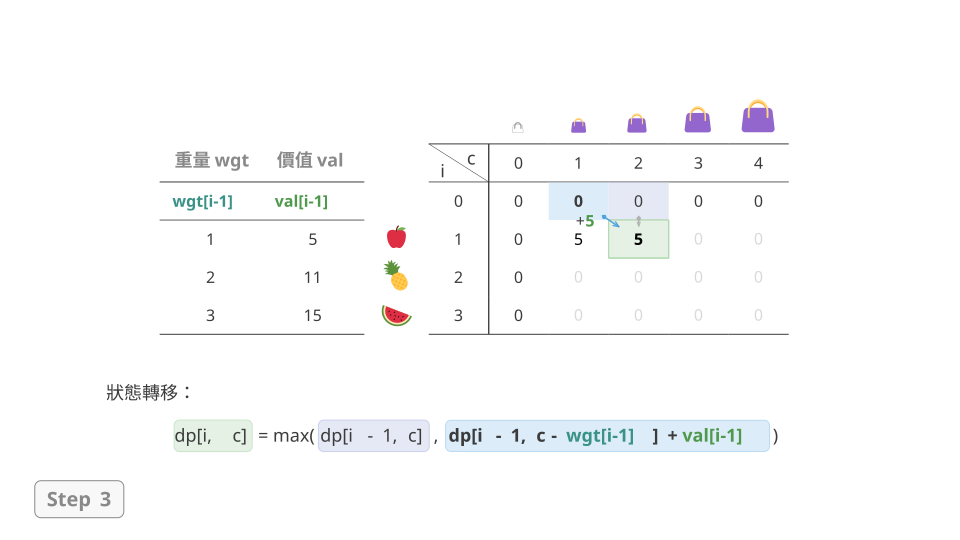
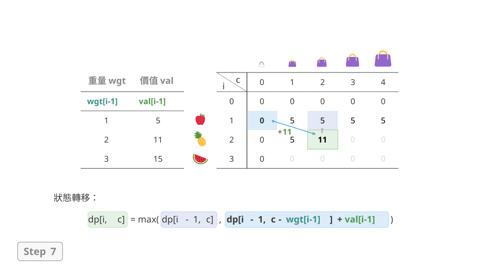
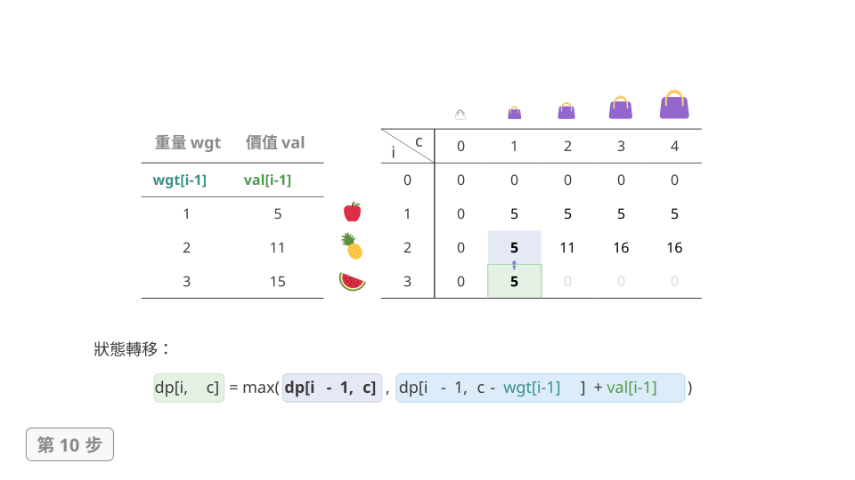
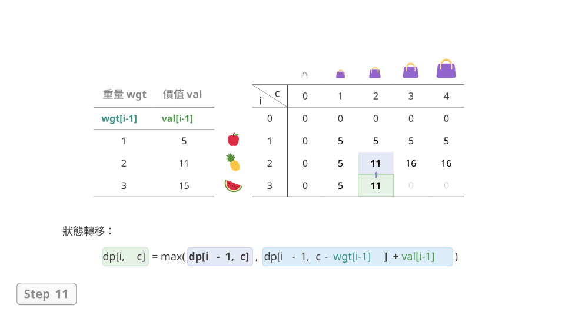
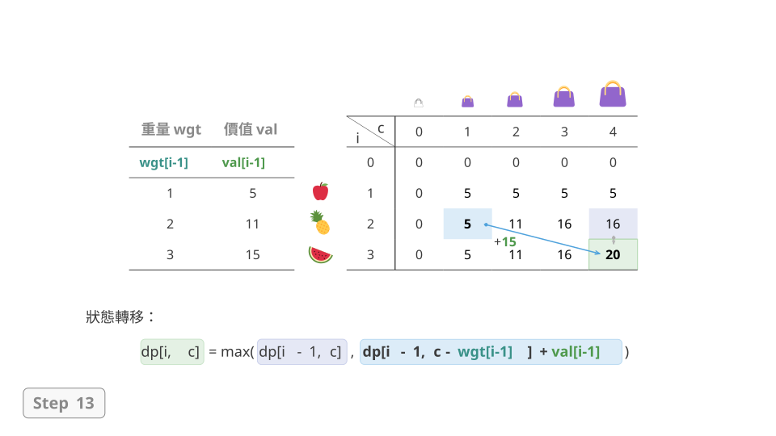
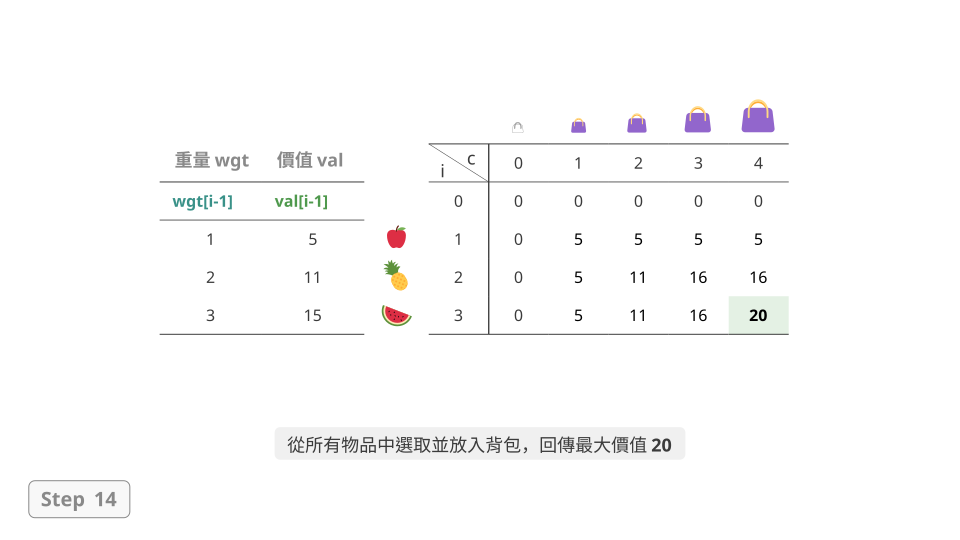
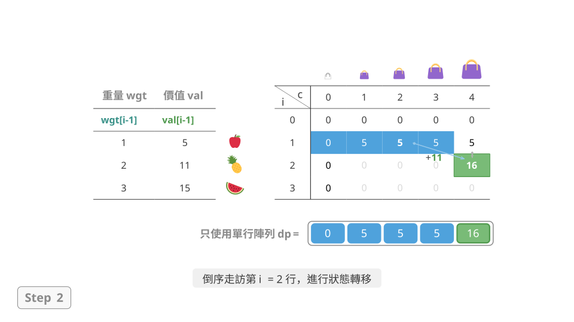

# 0-1 背包問題

背包問題很適合用來入門動態規劃，也是最常見的動態規劃題型。它有許多變形，例如 0-1 背包問題、完全背包問題與多重背包問題。

本節先來求解最常見的 0-1 背包問題。

!!! question

    給定 $n$ 件物品與一個容量為 $cap$ 的背包，第 $i$ 件物品的重量為 $wgt[i-1]$、價值為 $val[i-1]$。每件物品最多選一次，請問在背包容量限制下，能裝入的物品最大總價值是多少？

觀察下圖，物品編號 $i$ 從 $1$ 開始，陣列索引則從 $0$ 開始，因此物品 $i$ 對應的重量是 $wgt[i-1]$，價值是 $val[i-1]$。


0-1 背包問題可以看成由 $n$ 次決策組成的過程。對每件物品各有不放入與放入兩種選擇，因此符合決策樹模型。

這道題的目標是求出「在背包容量限制內能裝入的物品最大總價值」，因此很可能適合用動態規劃求解。

**第一步：思考每一步的決策，定義狀態，據此建立 $dp$ 表**

對每件物品而言，若不放入背包，可用容量不變；若放入，可用容量就會減少。因此，可用目前物品的編號 $i$ 與背包容量 $c$ 定義狀態，記為 $[i, c]$。

狀態 $[i, c]$ 對應的子問題是：**從前 $i$ 件物品中選擇，在背包容量為 $c$ 時能取得的最大價值**，記為 $dp[i, c]$。

我們要求的是 $dp[n, cap]$，因此需要一張大小為 $(n+1) \times (cap+1)$ 的二維 $dp$ 表。

**第二步：找出最佳子結構，推導狀態轉移方程式**

決定是否放入物品 $i$ 後，剩下的子問題就是如何從前 $i-1$ 件物品中選擇，可分成以下兩種情況。

- **不放入物品 $i$**：背包容量不變，狀態變成 $[i-1, c]$。
- **放入物品 $i$**：背包容量減少 $wgt[i-1]$，價值增加 $val[i-1]$，狀態變成 $[i-1, c-wgt[i-1]]$。

從以上分析可看出本題的最佳子結構：**最大價值 $dp[i, c]$ 等於不放入物品 $i$ 和放入物品 $i$ 這兩種選法中的較大價值**。因此可推導出狀態轉移方程式：

$$
dp[i, c] = \max(dp[i-1, c], dp[i-1, c - wgt[i-1]] + val[i-1])
$$

請注意，若目前物品的重量 $wgt[i - 1]$ 超過背包剩餘容量 $c$，就只能選擇不放入。

**第三步：確定邊界條件與狀態轉移順序**

沒有物品或背包容量為 $0$ 時，最大價值為 $0$。也就是說，第一欄 $dp[i, 0]$ 和第一列 $dp[0, c]$ 都等於 $0$。

目前狀態 $[i, c]$ 來自正上方的 $[i-1, c]$ 與左上方的 $[i-1, c-wgt[i-1]]$，因此只需用兩層迴圈正向走訪整張 $dp$ 表。

根據以上分析，接下來依序實作暴力搜尋、記憶化搜尋與動態規劃三種解法。

### 方法一：暴力搜尋

搜尋程式包含以下要素。

- **遞迴參數**：狀態 $[i, c]$。
- **回傳值**：子問題的解 $dp[i, c]$。
- **終止條件**：當物品編號超出範圍 $i = 0$，或背包剩餘容量為 $0$ 時，結束遞迴並回傳價值 $0$。
- **剪枝**：若目前物品的重量超過背包剩餘容量，就只能選擇不放入。

```src
[file]{knapsack}-[class]{}-[func]{knapsack_dfs}
```

如下圖所示，每件物品都會產生不選與選取兩條搜尋分支，因此時間複雜度為 $O(2^n)$。

從遞迴樹中可以看出重疊子問題，例如 $dp[1, 10]$。當物品較多、背包容量較大，尤其是有許多物品的重量相同時，重疊子問題的數量會大幅增加。


### 方法二：記憶化搜尋

為了讓每個重疊子問題只計算一次，我們用記憶表 `mem` 記錄子問題的解，其中 `mem[i][c]` 對應 $dp[i, c]$。

加入記憶化後，**時間複雜度取決於子問題數量**，也就是 $O(n \times cap)$。程式如下：

```src
[file]{knapsack}-[class]{}-[func]{knapsack_dfs_mem}
```

下圖標出記憶化搜尋中遭剪去的分支。


### 方法三：動態規劃

動態規劃其實就是在狀態轉移過程中逐格填寫 $dp$ 表，程式如下：

```src
[file]{knapsack}-[class]{}-[func]{knapsack_dp}
```

如下圖所示，時間複雜度與空間複雜度都取決於陣列 `dp` 的大小，即 $O(n \times cap)$。

=== "<1>"
    

=== "<2>"
    

=== "<3>"
    

=== "<4>"
    

=== "<5>"
    

=== "<6>"
    

=== "<7>"
    

=== "<8>"
    

=== "<9>"
    

=== "<10>"
    

=== "<11>"
    

=== "<12>"
    

=== "<13>"
    

=== "<14>"
    

### 空間最佳化

由於每個狀態都只依賴上一列的狀態，因此可以輪流使用兩個陣列，將空間複雜度從 $O(n \times cap)$ 降為 $O(cap)$。

再想一步，能否只用一個陣列就做到空間最佳化？觀察可知，每個狀態都來自正上方或左上方的格子。如果只用一個陣列，開始走訪第 $i$ 列時，陣列裡存的仍是第 $i-1$ 列的狀態。

- 依容量由小到大更新時，計算 $dp[i, c]$ 所需的上一列狀態 $dp[i-1, c-wgt[i-1]]$ 可能已被目前這一列的值覆寫，使同一個物品被重複計入。
- 若反向走訪，就能避免需要的值遭到覆寫，讓狀態轉移正確進行。

下圖顯示如何用同一個陣列，從第 $i = 1$ 列更新成第 $i = 2$ 列。請思考正向走訪與反向走訪有何差異。

=== "<1>"
    

=== "<2>"
    

=== "<3>"
    

=== "<4>"
    

=== "<5>"
    

=== "<6>"
    

實作時，只需移除陣列 `dp` 的第一個維度 $i$，並將內層迴圈改為反向走訪：

```src
[file]{knapsack}-[class]{}-[func]{knapsack_dp_comp}
```
