# 14.4 &nbsp; 0-1 背包問題

背包問題很適合用來入門動態規劃，也是最常見的動態規劃題型。它有許多變形，例如 0-1 背包問題、完全背包問題與多重背包問題。

本節先來求解最常見的 0-1 背包問題。

!!! question

    給定 $n$ 件物品與一個容量為 $cap$ 的背包，第 $i$ 件物品的重量為 $wgt[i-1]$、價值為 $val[i-1]$。每件物品最多選一次，請問在背包容量限制下，能裝入的物品最大總價值是多少？

觀察圖 14-17 ，物品編號 $i$ 從 $1$ 開始，陣列索引則從 $0$ 開始，因此物品 $i$ 對應的重量是 $wgt[i-1]$，價值是 $val[i-1]$。

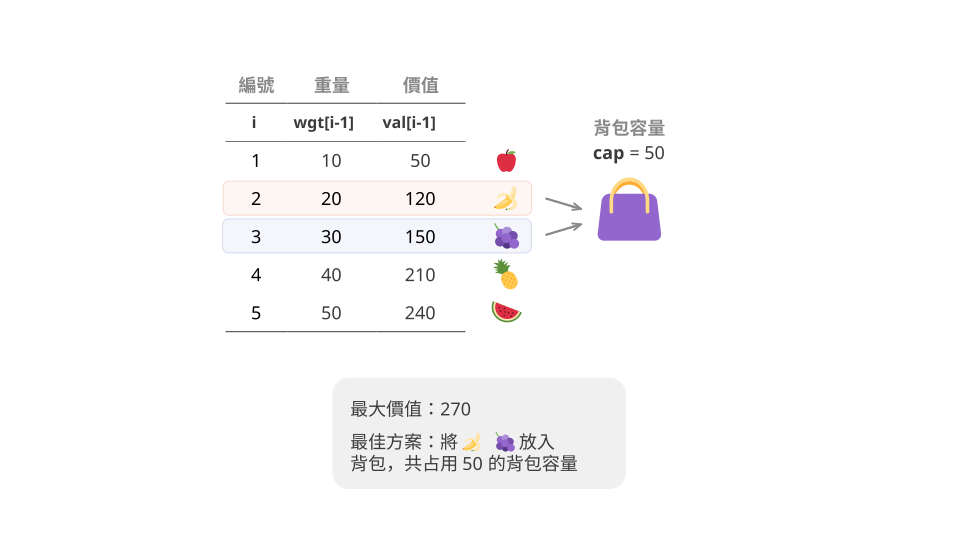{ class="animation-figure" }

<p align="center"> 圖 14-17 &nbsp; 0-1 背包的範例資料 </p>

0-1 背包問題可以看成由 $n$ 次決策組成的過程。對每件物品各有不放入與放入兩種選擇，因此符合決策樹模型。

這道題的目標是求出「在背包容量限制內能裝入的物品最大總價值」，因此很可能適合用動態規劃求解。

**第一步：思考每一步的決策，定義狀態，據此建立 $dp$ 表**

對每件物品而言，若不放入背包，可用容量不變；若放入，可用容量就會減少。因此，可用目前物品的編號 $i$ 與背包容量 $c$ 定義狀態，記為 $[i, c]$。

狀態 $[i, c]$ 對應的子問題是：**從前 $i$ 件物品中選擇，在背包容量為 $c$ 時能取得的最大價值**，記為 $dp[i, c]$。

我們要求的是 $dp[n, cap]$，因此需要一張大小為 $(n+1) \times (cap+1)$ 的二維 $dp$ 表。

**第二步：找出最佳子結構，推導狀態轉移方程式**

決定是否放入物品 $i$ 後，剩下的子問題就是如何從前 $i-1$ 件物品中選擇，可分成以下兩種情況。

- **不放入物品 $i$**：背包容量不變，狀態變成 $[i-1, c]$。
- **放入物品 $i$**：背包容量減少 $wgt[i-1]$，價值增加 $val[i-1]$，狀態變成 $[i-1, c-wgt[i-1]]$。

從以上分析可看出本題的最佳子結構：**最大價值 $dp[i, c]$ 等於不放入物品 $i$ 和放入物品 $i$ 這兩種選法中的較大價值**。因此可推導出狀態轉移方程式：

$$
dp[i, c] = \max(dp[i-1, c], dp[i-1, c - wgt[i-1]] + val[i-1])
$$

請注意，若目前物品的重量 $wgt[i - 1]$ 超過背包剩餘容量 $c$，就只能選擇不放入。

**第三步：確定邊界條件與狀態轉移順序**

沒有物品或背包容量為 $0$ 時，最大價值為 $0$。也就是說，第一欄 $dp[i, 0]$ 和第一列 $dp[0, c]$ 都等於 $0$。

目前狀態 $[i, c]$ 來自正上方的 $[i-1, c]$ 與左上方的 $[i-1, c-wgt[i-1]]$，因此只需用兩層迴圈正向走訪整張 $dp$ 表。

根據以上分析，接下來依序實作暴力搜尋、記憶化搜尋與動態規劃三種解法。

### 1. &nbsp; 方法一：暴力搜尋

搜尋程式包含以下要素。

- **遞迴參數**：狀態 $[i, c]$。
- **回傳值**：子問題的解 $dp[i, c]$。
- **終止條件**：當物品編號超出範圍 $i = 0$，或背包剩餘容量為 $0$ 時，結束遞迴並回傳價值 $0$。
- **剪枝**：若目前物品的重量超過背包剩餘容量，就只能選擇不放入。

=== "Python"

    ```python title="knapsack.py"
    def knapsack_dfs(wgt: list[int], val: list[int], i: int, c: int) -> int:
        """0-1 背包：暴力搜尋"""
        # 若已考慮所有物品，或背包沒有剩餘容量，就回傳價值 0
        if i == 0 or c == 0:
            return 0
        # 若重量超過背包容量，就只能選擇不放入
        if wgt[i - 1] > c:
            return knapsack_dfs(wgt, val, i - 1, c)
        # 分別計算不放入與放入物品 i 可取得的最大價值
        no = knapsack_dfs(wgt, val, i - 1, c)
        yes = knapsack_dfs(wgt, val, i - 1, c - wgt[i - 1]) + val[i - 1]
        # 回傳兩種選法中較大的價值
        return max(no, yes)
    ```

=== "C++"

    ```cpp title="knapsack.cpp"
    /* 0-1 背包：暴力搜尋 */
    int knapsackDFS(vector<int> &wgt, vector<int> &val, int i, int c) {
        // 若已考慮所有物品，或背包沒有剩餘容量，就回傳價值 0
        if (i == 0 || c == 0) {
            return 0;
        }
        // 若重量超過背包容量，就只能選擇不放入
        if (wgt[i - 1] > c) {
            return knapsackDFS(wgt, val, i - 1, c);
        }
        // 分別計算不放入與放入物品 i 可取得的最大價值
        int no = knapsackDFS(wgt, val, i - 1, c);
        int yes = knapsackDFS(wgt, val, i - 1, c - wgt[i - 1]) + val[i - 1];
        // 回傳兩種選法中較大的價值
        return max(no, yes);
    }
    ```

=== "Java"

    ```java title="knapsack.java"
    /* 0-1 背包：暴力搜尋 */
    int knapsackDFS(int[] wgt, int[] val, int i, int c) {
        // 若已考慮所有物品，或背包沒有剩餘容量，就回傳價值 0
        if (i == 0 || c == 0) {
            return 0;
        }
        // 若重量超過背包容量，就只能選擇不放入
        if (wgt[i - 1] > c) {
            return knapsackDFS(wgt, val, i - 1, c);
        }
        // 分別計算不放入與放入物品 i 可取得的最大價值
        int no = knapsackDFS(wgt, val, i - 1, c);
        int yes = knapsackDFS(wgt, val, i - 1, c - wgt[i - 1]) + val[i - 1];
        // 回傳兩種選法中較大的價值
        return Math.max(no, yes);
    }
    ```

=== "C#"

    ```csharp title="knapsack.cs"
    /* 0-1 背包：暴力搜尋 */
    int KnapsackDFS(int[] weight, int[] val, int i, int c) {
        // 若已考慮所有物品，或背包沒有剩餘容量，就回傳價值 0
        if (i == 0 || c == 0) {
            return 0;
        }
        // 若重量超過背包容量，就只能選擇不放入
        if (weight[i - 1] > c) {
            return KnapsackDFS(weight, val, i - 1, c);
        }
        // 分別計算不放入與放入物品 i 可取得的最大價值
        int no = KnapsackDFS(weight, val, i - 1, c);
        int yes = KnapsackDFS(weight, val, i - 1, c - weight[i - 1]) + val[i - 1];
        // 回傳兩種選法中較大的價值
        return Math.Max(no, yes);
    }
    ```

=== "Go"

    ```go title="knapsack.go"
    /* 0-1 背包：暴力搜尋 */
    func knapsackDFS(wgt, val []int, i, c int) int {
        // 若已考慮所有物品，或背包沒有剩餘容量，就回傳價值 0
        if i == 0 || c == 0 {
            return 0
        }
        // 若重量超過背包容量，就只能選擇不放入
        if wgt[i-1] > c {
            return knapsackDFS(wgt, val, i-1, c)
        }
        // 分別計算不放入與放入物品 i 可取得的最大價值
        no := knapsackDFS(wgt, val, i-1, c)
        yes := knapsackDFS(wgt, val, i-1, c-wgt[i-1]) + val[i-1]
        // 回傳兩種選法中較大的價值
        return int(math.Max(float64(no), float64(yes)))
    }
    ```

=== "Swift"

    ```swift title="knapsack.swift"
    /* 0-1 背包：暴力搜尋 */
    func knapsackDFS(wgt: [Int], val: [Int], i: Int, c: Int) -> Int {
        // 若已考慮所有物品，或背包沒有剩餘容量，就回傳價值 0
        if i == 0 || c == 0 {
            return 0
        }
        // 若重量超過背包容量，就只能選擇不放入
        if wgt[i - 1] > c {
            return knapsackDFS(wgt: wgt, val: val, i: i - 1, c: c)
        }
        // 分別計算不放入與放入物品 i 可取得的最大價值
        let no = knapsackDFS(wgt: wgt, val: val, i: i - 1, c: c)
        let yes = knapsackDFS(wgt: wgt, val: val, i: i - 1, c: c - wgt[i - 1]) + val[i - 1]
        // 回傳兩種選法中較大的價值
        return max(no, yes)
    }
    ```

=== "JS"

    ```javascript title="knapsack.js"
    /* 0-1 背包：暴力搜尋 */
    function knapsackDFS(wgt, val, i, c) {
        // 若已考慮所有物品，或背包沒有剩餘容量，就回傳價值 0
        if (i === 0 || c === 0) {
            return 0;
        }
        // 若重量超過背包容量，就只能選擇不放入
        if (wgt[i - 1] > c) {
            return knapsackDFS(wgt, val, i - 1, c);
        }
        // 分別計算不放入與放入物品 i 可取得的最大價值
        const no = knapsackDFS(wgt, val, i - 1, c);
        const yes = knapsackDFS(wgt, val, i - 1, c - wgt[i - 1]) + val[i - 1];
        // 回傳兩種選法中較大的價值
        return Math.max(no, yes);
    }
    ```

=== "TS"

    ```typescript title="knapsack.ts"
    /* 0-1 背包：暴力搜尋 */
    function knapsackDFS(
        wgt: Array<number>,
        val: Array<number>,
        i: number,
        c: number
    ): number {
        // 若已考慮所有物品，或背包沒有剩餘容量，就回傳價值 0
        if (i === 0 || c === 0) {
            return 0;
        }
        // 若重量超過背包容量，就只能選擇不放入
        if (wgt[i - 1] > c) {
            return knapsackDFS(wgt, val, i - 1, c);
        }
        // 分別計算不放入與放入物品 i 可取得的最大價值
        const no = knapsackDFS(wgt, val, i - 1, c);
        const yes = knapsackDFS(wgt, val, i - 1, c - wgt[i - 1]) + val[i - 1];
        // 回傳兩種選法中較大的價值
        return Math.max(no, yes);
    }
    ```

=== "Dart"

    ```dart title="knapsack.dart"
    /* 0-1 背包：暴力搜尋 */
    int knapsackDFS(List<int> wgt, List<int> val, int i, int c) {
      // 若已考慮所有物品，或背包沒有剩餘容量，就回傳價值 0
      if (i == 0 || c == 0) {
        return 0;
      }
      // 若重量超過背包容量，就只能選擇不放入
      if (wgt[i - 1] > c) {
        return knapsackDFS(wgt, val, i - 1, c);
      }
      // 分別計算不放入與放入物品 i 可取得的最大價值
      int no = knapsackDFS(wgt, val, i - 1, c);
      int yes = knapsackDFS(wgt, val, i - 1, c - wgt[i - 1]) + val[i - 1];
      // 回傳兩種選法中較大的價值
      return max(no, yes);
    }
    ```

=== "Rust"

    ```rust title="knapsack.rs"
    /* 0-1 背包：暴力搜尋 */
    fn knapsack_dfs(wgt: &[i32], val: &[i32], i: usize, c: usize) -> i32 {
        // 若已考慮所有物品，或背包沒有剩餘容量，就回傳價值 0
        if i == 0 || c == 0 {
            return 0;
        }
        // 若重量超過背包容量，就只能選擇不放入
        if wgt[i - 1] > c as i32 {
            return knapsack_dfs(wgt, val, i - 1, c);
        }
        // 分別計算不放入與放入物品 i 可取得的最大價值
        let no = knapsack_dfs(wgt, val, i - 1, c);
        let yes = knapsack_dfs(wgt, val, i - 1, c - wgt[i - 1] as usize) + val[i - 1];
        // 回傳兩種選法中較大的價值
        std::cmp::max(no, yes)
    }
    ```

=== "C"

    ```c title="knapsack.c"
    /* 0-1 背包：暴力搜尋 */
    int knapsackDFS(int wgt[], int val[], int i, int c) {
        // 若已考慮所有物品，或背包沒有剩餘容量，就回傳價值 0
        if (i == 0 || c == 0) {
            return 0;
        }
        // 若重量超過背包容量，就只能選擇不放入
        if (wgt[i - 1] > c) {
            return knapsackDFS(wgt, val, i - 1, c);
        }
        // 分別計算不放入與放入物品 i 可取得的最大價值
        int no = knapsackDFS(wgt, val, i - 1, c);
        int yes = knapsackDFS(wgt, val, i - 1, c - wgt[i - 1]) + val[i - 1];
        // 回傳兩種選法中較大的價值
        return myMax(no, yes);
    }
    ```

=== "Kotlin"

    ```kotlin title="knapsack.kt"
    /* 0-1 背包：暴力搜尋 */
    fun knapsackDFS(
        wgt: IntArray,
        _val: IntArray,
        i: Int,
        c: Int
    ): Int {
        // 若已考慮所有物品，或背包沒有剩餘容量，就回傳價值 0
        if (i == 0 || c == 0) {
            return 0
        }
        // 若重量超過背包容量，就只能選擇不放入
        if (wgt[i - 1] > c) {
            return knapsackDFS(wgt, _val, i - 1, c)
        }
        // 分別計算不放入與放入物品 i 可取得的最大價值
        val no = knapsackDFS(wgt, _val, i - 1, c)
        val yes = knapsackDFS(wgt, _val, i - 1, c - wgt[i - 1]) + _val[i - 1]
        // 回傳兩種選法中較大的價值
        return max(no, yes)
    }
    ```

=== "Ruby"

    ```ruby title="knapsack.rb"
    ### 0-1 背包：暴力搜尋 ###
    def knapsack_dfs(wgt, val, i, c)
      # 若已考慮所有物品，或背包沒有剩餘容量，就回傳價值 0
      return 0 if i == 0 || c == 0
      # 若重量超過背包容量，就只能選擇不放入
      return knapsack_dfs(wgt, val, i - 1, c) if wgt[i - 1] > c
      # 分別計算不放入與放入物品 i 可取得的最大價值
      no = knapsack_dfs(wgt, val, i - 1, c)
      yes = knapsack_dfs(wgt, val, i - 1, c - wgt[i - 1]) + val[i - 1]
      # 回傳兩種選法中較大的價值
      [no, yes].max
    end
    ```

??? pythontutor "執行視覺化示範"

    <div style="height: 549px; width: 100%;"><iframe class="pythontutor-iframe" title="執行視覺化示範" src="https://pythontutor.com/iframe-embed.html#code=def%20knapsack_dfs%28wgt%3A%20list%5Bint%5D,%20val%3A%20list%5Bint%5D,%20i%3A%20int,%20c%3A%20int%29%20-%3E%20int%3A%0A%20%20%20%20%22%22%220-1%20%E8%83%8C%E5%8C%85%EF%BC%9A%E6%9A%B4%E5%8A%9B%E6%90%9C%E5%B0%8B%22%22%22%0A%20%20%20%20%23%20%E8%8B%A5%E5%B7%B2%E8%80%83%E6%85%AE%E6%89%80%E6%9C%89%E7%89%A9%E5%93%81%EF%BC%8C%E6%88%96%E8%83%8C%E5%8C%85%E6%B2%92%E6%9C%89%E5%89%A9%E9%A4%98%E5%AE%B9%E9%87%8F%EF%BC%8C%E5%B0%B1%E5%9B%9E%E5%82%B3%E5%83%B9%E5%80%BC%200%0A%20%20%20%20if%20i%20%3D%3D%200%20or%20c%20%3D%3D%200%3A%0A%20%20%20%20%20%20%20%20return%200%0A%20%20%20%20%23%20%E8%8B%A5%E9%87%8D%E9%87%8F%E8%B6%85%E9%81%8E%E8%83%8C%E5%8C%85%E5%AE%B9%E9%87%8F%EF%BC%8C%E5%B0%B1%E5%8F%AA%E8%83%BD%E9%81%B8%E6%93%87%E4%B8%8D%E6%94%BE%E5%85%A5%0A%20%20%20%20if%20wgt%5Bi%20-%201%5D%20%3E%20c%3A%0A%20%20%20%20%20%20%20%20return%20knapsack_dfs%28wgt,%20val,%20i%20-%201,%20c%29%0A%20%20%20%20%23%20%E5%88%86%E5%88%A5%E8%A8%88%E7%AE%97%E4%B8%8D%E6%94%BE%E5%85%A5%E8%88%87%E6%94%BE%E5%85%A5%E7%89%A9%E5%93%81%20i%20%E5%8F%AF%E5%8F%96%E5%BE%97%E7%9A%84%E6%9C%80%E5%A4%A7%E5%83%B9%E5%80%BC%0A%20%20%20%20no%20%3D%20knapsack_dfs%28wgt,%20val,%20i%20-%201,%20c%29%0A%20%20%20%20yes%20%3D%20knapsack_dfs%28wgt,%20val,%20i%20-%201,%20c%20-%20wgt%5Bi%20-%201%5D%29%20%2B%20val%5Bi%20-%201%5D%0A%20%20%20%20%23%20%E5%9B%9E%E5%82%B3%E5%85%A9%E7%A8%AE%E9%81%B8%E6%B3%95%E4%B8%AD%E8%BC%83%E5%A4%A7%E7%9A%84%E5%83%B9%E5%80%BC%0A%20%20%20%20return%20max%28no,%20yes%29%0A%0A%0A%22%22%22Driver%20Code%22%22%22%0Aif%20__name__%20%3D%3D%20%22__main__%22%3A%0A%20%20%20%20wgt%20%3D%20%5B10,%2020,%2030,%2040,%2050%5D%0A%20%20%20%20val%20%3D%20%5B50,%20120,%20150,%20210,%20240%5D%0A%20%20%20%20cap%20%3D%2050%0A%20%20%20%20n%20%3D%20len%28wgt%29%0A%0A%20%20%20%20%23%20%E6%9A%B4%E5%8A%9B%E6%90%9C%E5%B0%8B%0A%20%20%20%20res%20%3D%20knapsack_dfs%28wgt,%20val,%20n,%20cap%29%0A%20%20%20%20print%28f%22%E5%9C%A8%E8%83%8C%E5%8C%85%E5%AE%B9%E9%87%8F%E9%99%90%E5%88%B6%E5%85%A7%EF%BC%8C%E7%89%A9%E5%93%81%E7%9A%84%E6%9C%80%E5%A4%A7%E7%B8%BD%E5%83%B9%E5%80%BC%E7%82%BA%20%7Bres%7D%22%29&codeDivHeight=472&codeDivWidth=350&cumulative=false&curInstr=7&heapPrimitives=nevernest&origin=opt-frontend.js&py=311&rawInputLstJSON=%5B%5D&textReferences=false"> </iframe></div>
    <div style="margin-top: 5px;"><a href="https://pythontutor.com/iframe-embed.html#code=def%20knapsack_dfs%28wgt%3A%20list%5Bint%5D,%20val%3A%20list%5Bint%5D,%20i%3A%20int,%20c%3A%20int%29%20-%3E%20int%3A%0A%20%20%20%20%22%22%220-1%20%E8%83%8C%E5%8C%85%EF%BC%9A%E6%9A%B4%E5%8A%9B%E6%90%9C%E5%B0%8B%22%22%22%0A%20%20%20%20%23%20%E8%8B%A5%E5%B7%B2%E8%80%83%E6%85%AE%E6%89%80%E6%9C%89%E7%89%A9%E5%93%81%EF%BC%8C%E6%88%96%E8%83%8C%E5%8C%85%E6%B2%92%E6%9C%89%E5%89%A9%E9%A4%98%E5%AE%B9%E9%87%8F%EF%BC%8C%E5%B0%B1%E5%9B%9E%E5%82%B3%E5%83%B9%E5%80%BC%200%0A%20%20%20%20if%20i%20%3D%3D%200%20or%20c%20%3D%3D%200%3A%0A%20%20%20%20%20%20%20%20return%200%0A%20%20%20%20%23%20%E8%8B%A5%E9%87%8D%E9%87%8F%E8%B6%85%E9%81%8E%E8%83%8C%E5%8C%85%E5%AE%B9%E9%87%8F%EF%BC%8C%E5%B0%B1%E5%8F%AA%E8%83%BD%E9%81%B8%E6%93%87%E4%B8%8D%E6%94%BE%E5%85%A5%0A%20%20%20%20if%20wgt%5Bi%20-%201%5D%20%3E%20c%3A%0A%20%20%20%20%20%20%20%20return%20knapsack_dfs%28wgt,%20val,%20i%20-%201,%20c%29%0A%20%20%20%20%23%20%E5%88%86%E5%88%A5%E8%A8%88%E7%AE%97%E4%B8%8D%E6%94%BE%E5%85%A5%E8%88%87%E6%94%BE%E5%85%A5%E7%89%A9%E5%93%81%20i%20%E5%8F%AF%E5%8F%96%E5%BE%97%E7%9A%84%E6%9C%80%E5%A4%A7%E5%83%B9%E5%80%BC%0A%20%20%20%20no%20%3D%20knapsack_dfs%28wgt,%20val,%20i%20-%201,%20c%29%0A%20%20%20%20yes%20%3D%20knapsack_dfs%28wgt,%20val,%20i%20-%201,%20c%20-%20wgt%5Bi%20-%201%5D%29%20%2B%20val%5Bi%20-%201%5D%0A%20%20%20%20%23%20%E5%9B%9E%E5%82%B3%E5%85%A9%E7%A8%AE%E9%81%B8%E6%B3%95%E4%B8%AD%E8%BC%83%E5%A4%A7%E7%9A%84%E5%83%B9%E5%80%BC%0A%20%20%20%20return%20max%28no,%20yes%29%0A%0A%0A%22%22%22Driver%20Code%22%22%22%0Aif%20__name__%20%3D%3D%20%22__main__%22%3A%0A%20%20%20%20wgt%20%3D%20%5B10,%2020,%2030,%2040,%2050%5D%0A%20%20%20%20val%20%3D%20%5B50,%20120,%20150,%20210,%20240%5D%0A%20%20%20%20cap%20%3D%2050%0A%20%20%20%20n%20%3D%20len%28wgt%29%0A%0A%20%20%20%20%23%20%E6%9A%B4%E5%8A%9B%E6%90%9C%E5%B0%8B%0A%20%20%20%20res%20%3D%20knapsack_dfs%28wgt,%20val,%20n,%20cap%29%0A%20%20%20%20print%28f%22%E5%9C%A8%E8%83%8C%E5%8C%85%E5%AE%B9%E9%87%8F%E9%99%90%E5%88%B6%E5%85%A7%EF%BC%8C%E7%89%A9%E5%93%81%E7%9A%84%E6%9C%80%E5%A4%A7%E7%B8%BD%E5%83%B9%E5%80%BC%E7%82%BA%20%7Bres%7D%22%29&codeDivHeight=800&codeDivWidth=600&cumulative=false&curInstr=7&heapPrimitives=nevernest&origin=opt-frontend.js&py=311&rawInputLstJSON=%5B%5D&textReferences=false" target="_blank" rel="noopener noreferrer">全螢幕觀看 ></a></div>

如圖 14-18 所示，每件物品都會產生不選與選取兩條搜尋分支，因此時間複雜度為 $O(2^n)$。

從遞迴樹中可以看出重疊子問題，例如 $dp[1, 10]$。當物品較多、背包容量較大，尤其是有許多物品的重量相同時，重疊子問題的數量會大幅增加。

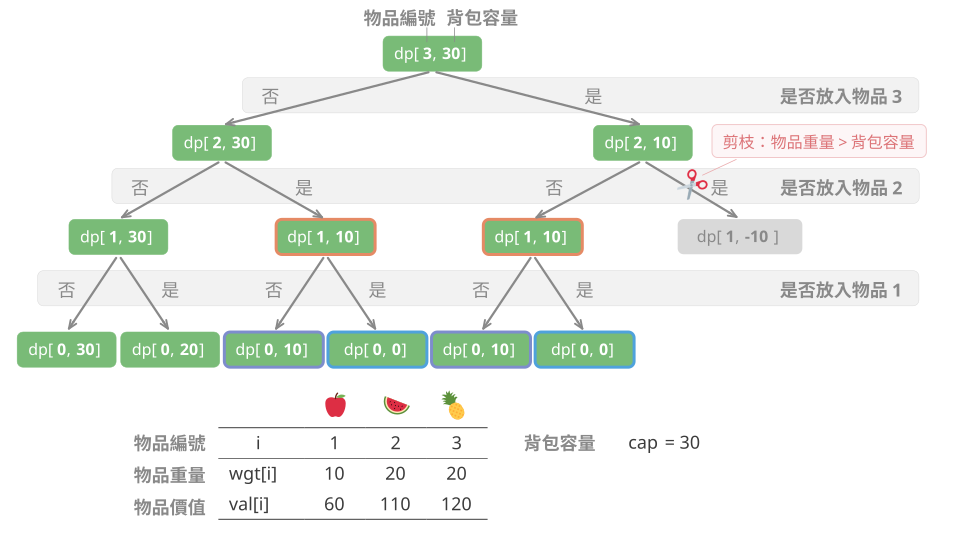{ class="animation-figure" }

<p align="center"> 圖 14-18 &nbsp; 0-1 背包問題的暴力搜尋遞迴樹 </p>

### 2. &nbsp; 方法二：記憶化搜尋

為了讓每個重疊子問題只計算一次，我們用記憶表 `mem` 記錄子問題的解，其中 `mem[i][c]` 對應 $dp[i, c]$。

加入記憶化後，**時間複雜度取決於子問題數量**，也就是 $O(n \times cap)$。程式如下：

=== "Python"

    ```python title="knapsack.py"
    def knapsack_dfs_mem(
        wgt: list[int], val: list[int], mem: list[list[int]], i: int, c: int
    ) -> int:
        """0-1 背包：記憶化搜尋"""
        # 若已考慮所有物品，或背包沒有剩餘容量，就回傳價值 0
        if i == 0 or c == 0:
            return 0
        # 若已有紀錄，直接回傳該值
        if mem[i][c] != -1:
            return mem[i][c]
        # 若重量超過背包容量，就只能選擇不放入
        if wgt[i - 1] > c:
            return knapsack_dfs_mem(wgt, val, mem, i - 1, c)
        # 分別計算不放入與放入物品 i 可取得的最大價值
        no = knapsack_dfs_mem(wgt, val, mem, i - 1, c)
        yes = knapsack_dfs_mem(wgt, val, mem, i - 1, c - wgt[i - 1]) + val[i - 1]
        # 記錄並回傳兩種選法中較大的價值
        mem[i][c] = max(no, yes)
        return mem[i][c]
    ```

=== "C++"

    ```cpp title="knapsack.cpp"
    /* 0-1 背包：記憶化搜尋 */
    int knapsackDFSMem(vector<int> &wgt, vector<int> &val, vector<vector<int>> &mem, int i, int c) {
        // 若已考慮所有物品，或背包沒有剩餘容量，就回傳價值 0
        if (i == 0 || c == 0) {
            return 0;
        }
        // 若已有紀錄，直接回傳該值
        if (mem[i][c] != -1) {
            return mem[i][c];
        }
        // 若重量超過背包容量，就只能選擇不放入
        if (wgt[i - 1] > c) {
            return knapsackDFSMem(wgt, val, mem, i - 1, c);
        }
        // 分別計算不放入與放入物品 i 可取得的最大價值
        int no = knapsackDFSMem(wgt, val, mem, i - 1, c);
        int yes = knapsackDFSMem(wgt, val, mem, i - 1, c - wgt[i - 1]) + val[i - 1];
        // 記錄並回傳兩種選法中較大的價值
        mem[i][c] = max(no, yes);
        return mem[i][c];
    }
    ```

=== "Java"

    ```java title="knapsack.java"
    /* 0-1 背包：記憶化搜尋 */
    int knapsackDFSMem(int[] wgt, int[] val, int[][] mem, int i, int c) {
        // 若已考慮所有物品，或背包沒有剩餘容量，就回傳價值 0
        if (i == 0 || c == 0) {
            return 0;
        }
        // 若已有紀錄，直接回傳該值
        if (mem[i][c] != -1) {
            return mem[i][c];
        }
        // 若重量超過背包容量，就只能選擇不放入
        if (wgt[i - 1] > c) {
            return knapsackDFSMem(wgt, val, mem, i - 1, c);
        }
        // 分別計算不放入與放入物品 i 可取得的最大價值
        int no = knapsackDFSMem(wgt, val, mem, i - 1, c);
        int yes = knapsackDFSMem(wgt, val, mem, i - 1, c - wgt[i - 1]) + val[i - 1];
        // 記錄並回傳兩種選法中較大的價值
        mem[i][c] = Math.max(no, yes);
        return mem[i][c];
    }
    ```

=== "C#"

    ```csharp title="knapsack.cs"
    /* 0-1 背包：記憶化搜尋 */
    int KnapsackDFSMem(int[] weight, int[] val, int[][] mem, int i, int c) {
        // 若已考慮所有物品，或背包沒有剩餘容量，就回傳價值 0
        if (i == 0 || c == 0) {
            return 0;
        }
        // 若已有紀錄，直接回傳該值
        if (mem[i][c] != -1) {
            return mem[i][c];
        }
        // 若重量超過背包容量，就只能選擇不放入
        if (weight[i - 1] > c) {
            return KnapsackDFSMem(weight, val, mem, i - 1, c);
        }
        // 分別計算不放入與放入物品 i 可取得的最大價值
        int no = KnapsackDFSMem(weight, val, mem, i - 1, c);
        int yes = KnapsackDFSMem(weight, val, mem, i - 1, c - weight[i - 1]) + val[i - 1];
        // 記錄並回傳兩種選法中較大的價值
        mem[i][c] = Math.Max(no, yes);
        return mem[i][c];
    }
    ```

=== "Go"

    ```go title="knapsack.go"
    /* 0-1 背包：記憶化搜尋 */
    func knapsackDFSMem(wgt, val []int, mem [][]int, i, c int) int {
        // 若已考慮所有物品，或背包沒有剩餘容量，就回傳價值 0
        if i == 0 || c == 0 {
            return 0
        }
        // 若已有紀錄，直接回傳該值
        if mem[i][c] != -1 {
            return mem[i][c]
        }
        // 若重量超過背包容量，就只能選擇不放入
        if wgt[i-1] > c {
            return knapsackDFSMem(wgt, val, mem, i-1, c)
        }
        // 分別計算不放入與放入物品 i 可取得的最大價值
        no := knapsackDFSMem(wgt, val, mem, i-1, c)
        yes := knapsackDFSMem(wgt, val, mem, i-1, c-wgt[i-1]) + val[i-1]
        // 回傳兩種選法中較大的價值
        mem[i][c] = int(math.Max(float64(no), float64(yes)))
        return mem[i][c]
    }
    ```

=== "Swift"

    ```swift title="knapsack.swift"
    /* 0-1 背包：記憶化搜尋 */
    func knapsackDFSMem(wgt: [Int], val: [Int], mem: inout [[Int]], i: Int, c: Int) -> Int {
        // 若已考慮所有物品，或背包沒有剩餘容量，就回傳價值 0
        if i == 0 || c == 0 {
            return 0
        }
        // 若已有紀錄，直接回傳該值
        if mem[i][c] != -1 {
            return mem[i][c]
        }
        // 若重量超過背包容量，就只能選擇不放入
        if wgt[i - 1] > c {
            return knapsackDFSMem(wgt: wgt, val: val, mem: &mem, i: i - 1, c: c)
        }
        // 分別計算不放入與放入物品 i 可取得的最大價值
        let no = knapsackDFSMem(wgt: wgt, val: val, mem: &mem, i: i - 1, c: c)
        let yes = knapsackDFSMem(wgt: wgt, val: val, mem: &mem, i: i - 1, c: c - wgt[i - 1]) + val[i - 1]
        // 記錄並回傳兩種選法中較大的價值
        mem[i][c] = max(no, yes)
        return mem[i][c]
    }
    ```

=== "JS"

    ```javascript title="knapsack.js"
    /* 0-1 背包：記憶化搜尋 */
    function knapsackDFSMem(wgt, val, mem, i, c) {
        // 若已考慮所有物品，或背包沒有剩餘容量，就回傳價值 0
        if (i === 0 || c === 0) {
            return 0;
        }
        // 若已有紀錄，直接回傳該值
        if (mem[i][c] !== -1) {
            return mem[i][c];
        }
        // 若重量超過背包容量，就只能選擇不放入
        if (wgt[i - 1] > c) {
            return knapsackDFSMem(wgt, val, mem, i - 1, c);
        }
        // 分別計算不放入與放入物品 i 可取得的最大價值
        const no = knapsackDFSMem(wgt, val, mem, i - 1, c);
        const yes =
            knapsackDFSMem(wgt, val, mem, i - 1, c - wgt[i - 1]) + val[i - 1];
        // 記錄並回傳兩種選法中較大的價值
        mem[i][c] = Math.max(no, yes);
        return mem[i][c];
    }
    ```

=== "TS"

    ```typescript title="knapsack.ts"
    /* 0-1 背包：記憶化搜尋 */
    function knapsackDFSMem(
        wgt: Array<number>,
        val: Array<number>,
        mem: Array<Array<number>>,
        i: number,
        c: number
    ): number {
        // 若已考慮所有物品，或背包沒有剩餘容量，就回傳價值 0
        if (i === 0 || c === 0) {
            return 0;
        }
        // 若已有紀錄，直接回傳該值
        if (mem[i][c] !== -1) {
            return mem[i][c];
        }
        // 若重量超過背包容量，就只能選擇不放入
        if (wgt[i - 1] > c) {
            return knapsackDFSMem(wgt, val, mem, i - 1, c);
        }
        // 分別計算不放入與放入物品 i 可取得的最大價值
        const no = knapsackDFSMem(wgt, val, mem, i - 1, c);
        const yes =
            knapsackDFSMem(wgt, val, mem, i - 1, c - wgt[i - 1]) + val[i - 1];
        // 記錄並回傳兩種選法中較大的價值
        mem[i][c] = Math.max(no, yes);
        return mem[i][c];
    }
    ```

=== "Dart"

    ```dart title="knapsack.dart"
    /* 0-1 背包：記憶化搜尋 */
    int knapsackDFSMem(
      List<int> wgt,
      List<int> val,
      List<List<int>> mem,
      int i,
      int c,
    ) {
      // 若已考慮所有物品，或背包沒有剩餘容量，就回傳價值 0
      if (i == 0 || c == 0) {
        return 0;
      }
      // 若已有紀錄，直接回傳該值
      if (mem[i][c] != -1) {
        return mem[i][c];
      }
      // 若重量超過背包容量，就只能選擇不放入
      if (wgt[i - 1] > c) {
        return knapsackDFSMem(wgt, val, mem, i - 1, c);
      }
      // 分別計算不放入與放入物品 i 可取得的最大價值
      int no = knapsackDFSMem(wgt, val, mem, i - 1, c);
      int yes = knapsackDFSMem(wgt, val, mem, i - 1, c - wgt[i - 1]) + val[i - 1];
      // 記錄並回傳兩種選法中較大的價值
      mem[i][c] = max(no, yes);
      return mem[i][c];
    }
    ```

=== "Rust"

    ```rust title="knapsack.rs"
    /* 0-1 背包：記憶化搜尋 */
    fn knapsack_dfs_mem(wgt: &[i32], val: &[i32], mem: &mut Vec<Vec<i32>>, i: usize, c: usize) -> i32 {
        // 若已考慮所有物品，或背包沒有剩餘容量，就回傳價值 0
        if i == 0 || c == 0 {
            return 0;
        }
        // 若已有紀錄，直接回傳該值
        if mem[i][c] != -1 {
            return mem[i][c];
        }
        // 若重量超過背包容量，就只能選擇不放入
        if wgt[i - 1] > c as i32 {
            return knapsack_dfs_mem(wgt, val, mem, i - 1, c);
        }
        // 分別計算不放入與放入物品 i 可取得的最大價值
        let no = knapsack_dfs_mem(wgt, val, mem, i - 1, c);
        let yes = knapsack_dfs_mem(wgt, val, mem, i - 1, c - wgt[i - 1] as usize) + val[i - 1];
        // 記錄並回傳兩種選法中較大的價值
        mem[i][c] = std::cmp::max(no, yes);
        mem[i][c]
    }
    ```

=== "C"

    ```c title="knapsack.c"
    /* 0-1 背包：記憶化搜尋 */
    int knapsackDFSMem(int wgt[], int val[], int memCols, int **mem, int i, int c) {
        // 若已考慮所有物品，或背包沒有剩餘容量，就回傳價值 0
        if (i == 0 || c == 0) {
            return 0;
        }
        // 若已有紀錄，直接回傳該值
        if (mem[i][c] != -1) {
            return mem[i][c];
        }
        // 若重量超過背包容量，就只能選擇不放入
        if (wgt[i - 1] > c) {
            return knapsackDFSMem(wgt, val, memCols, mem, i - 1, c);
        }
        // 分別計算不放入與放入物品 i 可取得的最大價值
        int no = knapsackDFSMem(wgt, val, memCols, mem, i - 1, c);
        int yes = knapsackDFSMem(wgt, val, memCols, mem, i - 1, c - wgt[i - 1]) + val[i - 1];
        // 記錄並回傳兩種選法中較大的價值
        mem[i][c] = myMax(no, yes);
        return mem[i][c];
    }
    ```

=== "Kotlin"

    ```kotlin title="knapsack.kt"
    /* 0-1 背包：記憶化搜尋 */
    fun knapsackDFSMem(
        wgt: IntArray,
        _val: IntArray,
        mem: Array<IntArray>,
        i: Int,
        c: Int
    ): Int {
        // 若已考慮所有物品，或背包沒有剩餘容量，就回傳價值 0
        if (i == 0 || c == 0) {
            return 0
        }
        // 若已有紀錄，直接回傳該值
        if (mem[i][c] != -1) {
            return mem[i][c]
        }
        // 若重量超過背包容量，就只能選擇不放入
        if (wgt[i - 1] > c) {
            return knapsackDFSMem(wgt, _val, mem, i - 1, c)
        }
        // 分別計算不放入與放入物品 i 可取得的最大價值
        val no = knapsackDFSMem(wgt, _val, mem, i - 1, c)
        val yes = knapsackDFSMem(wgt, _val, mem, i - 1, c - wgt[i - 1]) + _val[i - 1]
        // 記錄並回傳兩種選法中較大的價值
        mem[i][c] = max(no, yes)
        return mem[i][c]
    }
    ```

=== "Ruby"

    ```ruby title="knapsack.rb"
    ### 0-1 背包：記憶化搜尋 ###
    def knapsack_dfs_mem(wgt, val, mem, i, c)
      # 若已考慮所有物品，或背包沒有剩餘容量，就回傳價值 0
      return 0 if i == 0 || c == 0
      # 若已有紀錄，直接回傳該值
      return mem[i][c] if mem[i][c] != -1
      # 若重量超過背包容量，就只能選擇不放入
      return knapsack_dfs_mem(wgt, val, mem, i - 1, c) if wgt[i - 1] > c
      # 分別計算不放入與放入物品 i 可取得的最大價值
      no = knapsack_dfs_mem(wgt, val, mem, i - 1, c)
      yes = knapsack_dfs_mem(wgt, val, mem, i - 1, c - wgt[i - 1]) + val[i - 1]
      # 記錄並回傳兩種選法中較大的價值
      mem[i][c] = [no, yes].max
    end
    ```

??? pythontutor "執行視覺化示範"

    <div style="height: 549px; width: 100%;"><iframe class="pythontutor-iframe" title="執行視覺化示範" src="https://pythontutor.com/iframe-embed.html#code=def%20knapsack_dfs_mem%28%0A%20%20%20%20wgt%3A%20list%5Bint%5D,%20val%3A%20list%5Bint%5D,%20mem%3A%20list%5Blist%5Bint%5D%5D,%20i%3A%20int,%20c%3A%20int%0A%29%20-%3E%20int%3A%0A%20%20%20%20%22%22%220-1%20%E8%83%8C%E5%8C%85%EF%BC%9A%E8%A8%98%E6%86%B6%E5%8C%96%E6%90%9C%E5%B0%8B%22%22%22%0A%20%20%20%20%23%20%E8%8B%A5%E5%B7%B2%E8%80%83%E6%85%AE%E6%89%80%E6%9C%89%E7%89%A9%E5%93%81%EF%BC%8C%E6%88%96%E8%83%8C%E5%8C%85%E6%B2%92%E6%9C%89%E5%89%A9%E9%A4%98%E5%AE%B9%E9%87%8F%EF%BC%8C%E5%B0%B1%E5%9B%9E%E5%82%B3%E5%83%B9%E5%80%BC%200%0A%20%20%20%20if%20i%20%3D%3D%200%20or%20c%20%3D%3D%200%3A%0A%20%20%20%20%20%20%20%20return%200%0A%20%20%20%20%23%20%E8%8B%A5%E5%B7%B2%E6%9C%89%E7%B4%80%E9%8C%84%EF%BC%8C%E7%9B%B4%E6%8E%A5%E5%9B%9E%E5%82%B3%E8%A9%B2%E5%80%BC%0A%20%20%20%20if%20mem%5Bi%5D%5Bc%5D%20%21%3D%20-1%3A%0A%20%20%20%20%20%20%20%20return%20mem%5Bi%5D%5Bc%5D%0A%20%20%20%20%23%20%E8%8B%A5%E9%87%8D%E9%87%8F%E8%B6%85%E9%81%8E%E8%83%8C%E5%8C%85%E5%AE%B9%E9%87%8F%EF%BC%8C%E5%B0%B1%E5%8F%AA%E8%83%BD%E9%81%B8%E6%93%87%E4%B8%8D%E6%94%BE%E5%85%A5%0A%20%20%20%20if%20wgt%5Bi%20-%201%5D%20%3E%20c%3A%0A%20%20%20%20%20%20%20%20return%20knapsack_dfs_mem%28wgt,%20val,%20mem,%20i%20-%201,%20c%29%0A%20%20%20%20%23%20%E5%88%86%E5%88%A5%E8%A8%88%E7%AE%97%E4%B8%8D%E6%94%BE%E5%85%A5%E8%88%87%E6%94%BE%E5%85%A5%E7%89%A9%E5%93%81%20i%20%E5%8F%AF%E5%8F%96%E5%BE%97%E7%9A%84%E6%9C%80%E5%A4%A7%E5%83%B9%E5%80%BC%0A%20%20%20%20no%20%3D%20knapsack_dfs_mem%28wgt,%20val,%20mem,%20i%20-%201,%20c%29%0A%20%20%20%20yes%20%3D%20knapsack_dfs_mem%28wgt,%20val,%20mem,%20i%20-%201,%20c%20-%20wgt%5Bi%20-%201%5D%29%20%2B%20val%5Bi%20-%201%5D%0A%20%20%20%20%23%20%E8%A8%98%E9%8C%84%E4%B8%A6%E5%9B%9E%E5%82%B3%E5%85%A9%E7%A8%AE%E9%81%B8%E6%B3%95%E4%B8%AD%E8%BC%83%E5%A4%A7%E7%9A%84%E5%83%B9%E5%80%BC%0A%20%20%20%20mem%5Bi%5D%5Bc%5D%20%3D%20max%28no,%20yes%29%0A%20%20%20%20return%20mem%5Bi%5D%5Bc%5D%0A%0A%0A%22%22%22Driver%20Code%22%22%22%0Aif%20__name__%20%3D%3D%20%22__main__%22%3A%0A%20%20%20%20wgt%20%3D%20%5B10,%2020,%2030,%2040,%2050%5D%0A%20%20%20%20val%20%3D%20%5B50,%20120,%20150,%20210,%20240%5D%0A%20%20%20%20cap%20%3D%2050%0A%20%20%20%20n%20%3D%20len%28wgt%29%0A%0A%20%20%20%20%23%20%E8%A8%98%E6%86%B6%E5%8C%96%E6%90%9C%E5%B0%8B%0A%20%20%20%20mem%20%3D%20%5B%5B-1%5D%20%2A%20%28cap%20%2B%201%29%20for%20_%20in%20range%28n%20%2B%201%29%5D%0A%20%20%20%20res%20%3D%20knapsack_dfs_mem%28wgt,%20val,%20mem,%20n,%20cap%29%0A%20%20%20%20print%28f%22%E5%9C%A8%E8%83%8C%E5%8C%85%E5%AE%B9%E9%87%8F%E9%99%90%E5%88%B6%E5%85%A7%EF%BC%8C%E7%89%A9%E5%93%81%E7%9A%84%E6%9C%80%E5%A4%A7%E7%B8%BD%E5%83%B9%E5%80%BC%E7%82%BA%20%7Bres%7D%22%29&codeDivHeight=472&codeDivWidth=350&cumulative=false&curInstr=20&heapPrimitives=nevernest&origin=opt-frontend.js&py=311&rawInputLstJSON=%5B%5D&textReferences=false"> </iframe></div>
    <div style="margin-top: 5px;"><a href="https://pythontutor.com/iframe-embed.html#code=def%20knapsack_dfs_mem%28%0A%20%20%20%20wgt%3A%20list%5Bint%5D,%20val%3A%20list%5Bint%5D,%20mem%3A%20list%5Blist%5Bint%5D%5D,%20i%3A%20int,%20c%3A%20int%0A%29%20-%3E%20int%3A%0A%20%20%20%20%22%22%220-1%20%E8%83%8C%E5%8C%85%EF%BC%9A%E8%A8%98%E6%86%B6%E5%8C%96%E6%90%9C%E5%B0%8B%22%22%22%0A%20%20%20%20%23%20%E8%8B%A5%E5%B7%B2%E8%80%83%E6%85%AE%E6%89%80%E6%9C%89%E7%89%A9%E5%93%81%EF%BC%8C%E6%88%96%E8%83%8C%E5%8C%85%E6%B2%92%E6%9C%89%E5%89%A9%E9%A4%98%E5%AE%B9%E9%87%8F%EF%BC%8C%E5%B0%B1%E5%9B%9E%E5%82%B3%E5%83%B9%E5%80%BC%200%0A%20%20%20%20if%20i%20%3D%3D%200%20or%20c%20%3D%3D%200%3A%0A%20%20%20%20%20%20%20%20return%200%0A%20%20%20%20%23%20%E8%8B%A5%E5%B7%B2%E6%9C%89%E7%B4%80%E9%8C%84%EF%BC%8C%E7%9B%B4%E6%8E%A5%E5%9B%9E%E5%82%B3%E8%A9%B2%E5%80%BC%0A%20%20%20%20if%20mem%5Bi%5D%5Bc%5D%20%21%3D%20-1%3A%0A%20%20%20%20%20%20%20%20return%20mem%5Bi%5D%5Bc%5D%0A%20%20%20%20%23%20%E8%8B%A5%E9%87%8D%E9%87%8F%E8%B6%85%E9%81%8E%E8%83%8C%E5%8C%85%E5%AE%B9%E9%87%8F%EF%BC%8C%E5%B0%B1%E5%8F%AA%E8%83%BD%E9%81%B8%E6%93%87%E4%B8%8D%E6%94%BE%E5%85%A5%0A%20%20%20%20if%20wgt%5Bi%20-%201%5D%20%3E%20c%3A%0A%20%20%20%20%20%20%20%20return%20knapsack_dfs_mem%28wgt,%20val,%20mem,%20i%20-%201,%20c%29%0A%20%20%20%20%23%20%E5%88%86%E5%88%A5%E8%A8%88%E7%AE%97%E4%B8%8D%E6%94%BE%E5%85%A5%E8%88%87%E6%94%BE%E5%85%A5%E7%89%A9%E5%93%81%20i%20%E5%8F%AF%E5%8F%96%E5%BE%97%E7%9A%84%E6%9C%80%E5%A4%A7%E5%83%B9%E5%80%BC%0A%20%20%20%20no%20%3D%20knapsack_dfs_mem%28wgt,%20val,%20mem,%20i%20-%201,%20c%29%0A%20%20%20%20yes%20%3D%20knapsack_dfs_mem%28wgt,%20val,%20mem,%20i%20-%201,%20c%20-%20wgt%5Bi%20-%201%5D%29%20%2B%20val%5Bi%20-%201%5D%0A%20%20%20%20%23%20%E8%A8%98%E9%8C%84%E4%B8%A6%E5%9B%9E%E5%82%B3%E5%85%A9%E7%A8%AE%E9%81%B8%E6%B3%95%E4%B8%AD%E8%BC%83%E5%A4%A7%E7%9A%84%E5%83%B9%E5%80%BC%0A%20%20%20%20mem%5Bi%5D%5Bc%5D%20%3D%20max%28no,%20yes%29%0A%20%20%20%20return%20mem%5Bi%5D%5Bc%5D%0A%0A%0A%22%22%22Driver%20Code%22%22%22%0Aif%20__name__%20%3D%3D%20%22__main__%22%3A%0A%20%20%20%20wgt%20%3D%20%5B10,%2020,%2030,%2040,%2050%5D%0A%20%20%20%20val%20%3D%20%5B50,%20120,%20150,%20210,%20240%5D%0A%20%20%20%20cap%20%3D%2050%0A%20%20%20%20n%20%3D%20len%28wgt%29%0A%0A%20%20%20%20%23%20%E8%A8%98%E6%86%B6%E5%8C%96%E6%90%9C%E5%B0%8B%0A%20%20%20%20mem%20%3D%20%5B%5B-1%5D%20%2A%20%28cap%20%2B%201%29%20for%20_%20in%20range%28n%20%2B%201%29%5D%0A%20%20%20%20res%20%3D%20knapsack_dfs_mem%28wgt,%20val,%20mem,%20n,%20cap%29%0A%20%20%20%20print%28f%22%E5%9C%A8%E8%83%8C%E5%8C%85%E5%AE%B9%E9%87%8F%E9%99%90%E5%88%B6%E5%85%A7%EF%BC%8C%E7%89%A9%E5%93%81%E7%9A%84%E6%9C%80%E5%A4%A7%E7%B8%BD%E5%83%B9%E5%80%BC%E7%82%BA%20%7Bres%7D%22%29&codeDivHeight=800&codeDivWidth=600&cumulative=false&curInstr=20&heapPrimitives=nevernest&origin=opt-frontend.js&py=311&rawInputLstJSON=%5B%5D&textReferences=false" target="_blank" rel="noopener noreferrer">全螢幕觀看 ></a></div>

圖 14-19 標出記憶化搜尋中遭剪去的分支。

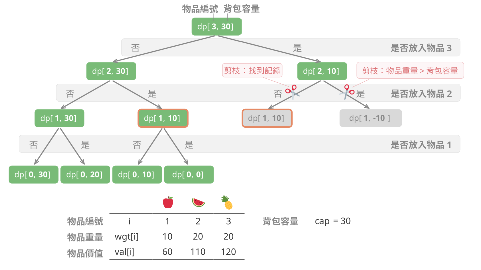{ class="animation-figure" }

<p align="center"> 圖 14-19 &nbsp; 0-1 背包問題的記憶化搜尋遞迴樹 </p>

### 3. &nbsp; 方法三：動態規劃

動態規劃其實就是在狀態轉移過程中逐格填寫 $dp$ 表，程式如下：

=== "Python"

    ```python title="knapsack.py"
    def knapsack_dp(wgt: list[int], val: list[int], cap: int) -> int:
        """0-1 背包：動態規劃"""
        n = len(wgt)
        # 初始化 dp 表
        dp = [[0] * (cap + 1) for _ in range(n + 1)]
        # 狀態轉移
        for i in range(1, n + 1):
            for c in range(1, cap + 1):
                if wgt[i - 1] > c:
                    # 若重量超過背包容量，就不選物品 i
                    dp[i][c] = dp[i - 1][c]
                else:
                    # 取不選與選取物品 i 兩種情況中的較大值
                    dp[i][c] = max(dp[i - 1][c], dp[i - 1][c - wgt[i - 1]] + val[i - 1])
        return dp[n][cap]
    ```

=== "C++"

    ```cpp title="knapsack.cpp"
    /* 0-1 背包：動態規劃 */
    int knapsackDP(vector<int> &wgt, vector<int> &val, int cap) {
        int n = wgt.size();
        // 初始化 dp 表
        vector<vector<int>> dp(n + 1, vector<int>(cap + 1, 0));
        // 狀態轉移
        for (int i = 1; i <= n; i++) {
            for (int c = 1; c <= cap; c++) {
                if (wgt[i - 1] > c) {
                    // 若重量超過背包容量，就不選物品 i
                    dp[i][c] = dp[i - 1][c];
                } else {
                    // 取不選與選取物品 i 兩種情況中的較大值
                    dp[i][c] = max(dp[i - 1][c], dp[i - 1][c - wgt[i - 1]] + val[i - 1]);
                }
            }
        }
        return dp[n][cap];
    }
    ```

=== "Java"

    ```java title="knapsack.java"
    /* 0-1 背包：動態規劃 */
    int knapsackDP(int[] wgt, int[] val, int cap) {
        int n = wgt.length;
        // 初始化 dp 表
        int[][] dp = new int[n + 1][cap + 1];
        // 狀態轉移
        for (int i = 1; i <= n; i++) {
            for (int c = 1; c <= cap; c++) {
                if (wgt[i - 1] > c) {
                    // 若重量超過背包容量，就不選物品 i
                    dp[i][c] = dp[i - 1][c];
                } else {
                    // 取不選與選取物品 i 兩種情況中的較大值
                    dp[i][c] = Math.max(dp[i - 1][c], dp[i - 1][c - wgt[i - 1]] + val[i - 1]);
                }
            }
        }
        return dp[n][cap];
    }
    ```

=== "C#"

    ```csharp title="knapsack.cs"
    /* 0-1 背包：動態規劃 */
    int KnapsackDP(int[] weight, int[] val, int cap) {
        int n = weight.Length;
        // 初始化 dp 表
        int[,] dp = new int[n + 1, cap + 1];
        // 狀態轉移
        for (int i = 1; i <= n; i++) {
            for (int c = 1; c <= cap; c++) {
                if (weight[i - 1] > c) {
                    // 若重量超過背包容量，就不選物品 i
                    dp[i, c] = dp[i - 1, c];
                } else {
                    // 取不選與選取物品 i 兩種情況中的較大值
                    dp[i, c] = Math.Max(dp[i - 1, c - weight[i - 1]] + val[i - 1], dp[i - 1, c]);
                }
            }
        }
        return dp[n, cap];
    }
    ```

=== "Go"

    ```go title="knapsack.go"
    /* 0-1 背包：動態規劃 */
    func knapsackDP(wgt, val []int, cap int) int {
        n := len(wgt)
        // 初始化 dp 表
        dp := make([][]int, n+1)
        for i := 0; i <= n; i++ {
            dp[i] = make([]int, cap+1)
        }
        // 狀態轉移
        for i := 1; i <= n; i++ {
            for c := 1; c <= cap; c++ {
                if wgt[i-1] > c {
                    // 若重量超過背包容量，就不選物品 i
                    dp[i][c] = dp[i-1][c]
                } else {
                    // 取不選與選取物品 i 兩種情況中的較大值
                    dp[i][c] = int(math.Max(float64(dp[i-1][c]), float64(dp[i-1][c-wgt[i-1]]+val[i-1])))
                }
            }
        }
        return dp[n][cap]
    }
    ```

=== "Swift"

    ```swift title="knapsack.swift"
    /* 0-1 背包：動態規劃 */
    func knapsackDP(wgt: [Int], val: [Int], cap: Int) -> Int {
        let n = wgt.count
        // 初始化 dp 表
        var dp = Array(repeating: Array(repeating: 0, count: cap + 1), count: n + 1)
        // 狀態轉移
        for i in 1 ... n {
            for c in 1 ... cap {
                if wgt[i - 1] > c {
                    // 若重量超過背包容量，就不選物品 i
                    dp[i][c] = dp[i - 1][c]
                } else {
                    // 取不選與選取物品 i 兩種情況中的較大值
                    dp[i][c] = max(dp[i - 1][c], dp[i - 1][c - wgt[i - 1]] + val[i - 1])
                }
            }
        }
        return dp[n][cap]
    }
    ```

=== "JS"

    ```javascript title="knapsack.js"
    /* 0-1 背包：動態規劃 */
    function knapsackDP(wgt, val, cap) {
        const n = wgt.length;
        // 初始化 dp 表
        const dp = Array(n + 1)
            .fill(0)
            .map(() => Array(cap + 1).fill(0));
        // 狀態轉移
        for (let i = 1; i <= n; i++) {
            for (let c = 1; c <= cap; c++) {
                if (wgt[i - 1] > c) {
                    // 若重量超過背包容量，就不選物品 i
                    dp[i][c] = dp[i - 1][c];
                } else {
                    // 取不選與選取物品 i 兩種情況中的較大值
                    dp[i][c] = Math.max(
                        dp[i - 1][c],
                        dp[i - 1][c - wgt[i - 1]] + val[i - 1]
                    );
                }
            }
        }
        return dp[n][cap];
    }
    ```

=== "TS"

    ```typescript title="knapsack.ts"
    /* 0-1 背包：動態規劃 */
    function knapsackDP(
        wgt: Array<number>,
        val: Array<number>,
        cap: number
    ): number {
        const n = wgt.length;
        // 初始化 dp 表
        const dp = Array.from({ length: n + 1 }, () =>
            Array.from({ length: cap + 1 }, () => 0)
        );
        // 狀態轉移
        for (let i = 1; i <= n; i++) {
            for (let c = 1; c <= cap; c++) {
                if (wgt[i - 1] > c) {
                    // 若重量超過背包容量，就不選物品 i
                    dp[i][c] = dp[i - 1][c];
                } else {
                    // 取不選與選取物品 i 兩種情況中的較大值
                    dp[i][c] = Math.max(
                        dp[i - 1][c],
                        dp[i - 1][c - wgt[i - 1]] + val[i - 1]
                    );
                }
            }
        }
        return dp[n][cap];
    }
    ```

=== "Dart"

    ```dart title="knapsack.dart"
    /* 0-1 背包：動態規劃 */
    int knapsackDP(List<int> wgt, List<int> val, int cap) {
      int n = wgt.length;
      // 初始化 dp 表
      List<List<int>> dp = List.generate(n + 1, (index) => List.filled(cap + 1, 0));
      // 狀態轉移
      for (int i = 1; i <= n; i++) {
        for (int c = 1; c <= cap; c++) {
          if (wgt[i - 1] > c) {
            // 若重量超過背包容量，就不選物品 i
            dp[i][c] = dp[i - 1][c];
          } else {
            // 取不選與選取物品 i 兩種情況中的較大值
            dp[i][c] = max(dp[i - 1][c], dp[i - 1][c - wgt[i - 1]] + val[i - 1]);
          }
        }
      }
      return dp[n][cap];
    }
    ```

=== "Rust"

    ```rust title="knapsack.rs"
    /* 0-1 背包：動態規劃 */
    fn knapsack_dp(wgt: &[i32], val: &[i32], cap: usize) -> i32 {
        let n = wgt.len();
        // 初始化 dp 表
        let mut dp = vec![vec![0; cap + 1]; n + 1];
        // 狀態轉移
        for i in 1..=n {
            for c in 1..=cap {
                if wgt[i - 1] > c as i32 {
                    // 若重量超過背包容量，就不選物品 i
                    dp[i][c] = dp[i - 1][c];
                } else {
                    // 取不選與選取物品 i 兩種情況中的較大值
                    dp[i][c] = std::cmp::max(
                        dp[i - 1][c],
                        dp[i - 1][c - wgt[i - 1] as usize] + val[i - 1],
                    );
                }
            }
        }
        dp[n][cap]
    }
    ```

=== "C"

    ```c title="knapsack.c"
    /* 0-1 背包：動態規劃 */
    int knapsackDP(int wgt[], int val[], int cap, int wgtSize) {
        int n = wgtSize;
        // 初始化 dp 表
        int **dp = malloc((n + 1) * sizeof(int *));
        for (int i = 0; i <= n; i++) {
            dp[i] = calloc(cap + 1, sizeof(int));
        }
        // 狀態轉移
        for (int i = 1; i <= n; i++) {
            for (int c = 1; c <= cap; c++) {
                if (wgt[i - 1] > c) {
                    // 若重量超過背包容量，就不選物品 i
                    dp[i][c] = dp[i - 1][c];
                } else {
                    // 取不選與選取物品 i 兩種情況中的較大值
                    dp[i][c] = myMax(dp[i - 1][c], dp[i - 1][c - wgt[i - 1]] + val[i - 1]);
                }
            }
        }
        int res = dp[n][cap];
        // 釋放記憶體
        for (int i = 0; i <= n; i++) {
            free(dp[i]);
        }
        return res;
    }
    ```

=== "Kotlin"

    ```kotlin title="knapsack.kt"
    /* 0-1 背包：動態規劃 */
    fun knapsackDP(wgt: IntArray, _val: IntArray, cap: Int): Int {
        val n = wgt.size
        // 初始化 dp 表
        val dp = Array(n + 1) { IntArray(cap + 1) }
        // 狀態轉移
        for (i in 1..n) {
            for (c in 1..cap) {
                if (wgt[i - 1] > c) {
                    // 若重量超過背包容量，就不選物品 i
                    dp[i][c] = dp[i - 1][c]
                } else {
                    // 取不選與選取物品 i 兩種情況中的較大值
                    dp[i][c] = max(dp[i - 1][c], dp[i - 1][c - wgt[i - 1]] + _val[i - 1])
                }
            }
        }
        return dp[n][cap]
    }
    ```

=== "Ruby"

    ```ruby title="knapsack.rb"
    ### 0-1 背包：動態規劃 ###
    def knapsack_dp(wgt, val, cap)
      n = wgt.length
      # 初始化 dp 表
      dp = Array.new(n + 1) { Array.new(cap + 1, 0) }
      # 狀態轉移
      for i in 1...(n + 1)
        for c in 1...(cap + 1)
          if wgt[i - 1] > c
            # 若重量超過背包容量，就不選物品 i
            dp[i][c] = dp[i - 1][c]
          else
            # 取不選與選取物品 i 兩種情況中的較大值
            dp[i][c] = [dp[i - 1][c], dp[i - 1][c - wgt[i - 1]] + val[i - 1]].max
          end
        end
      end
      dp[n][cap]
    end
    ```

??? pythontutor "執行視覺化示範"

    <div style="height: 549px; width: 100%;"><iframe class="pythontutor-iframe" title="執行視覺化示範" src="https://pythontutor.com/iframe-embed.html#code=def%20knapsack_dp%28wgt%3A%20list%5Bint%5D,%20val%3A%20list%5Bint%5D,%20cap%3A%20int%29%20-%3E%20int%3A%0A%20%20%20%20%22%22%220-1%20%E8%83%8C%E5%8C%85%EF%BC%9A%E5%8B%95%E6%85%8B%E8%A6%8F%E5%8A%83%22%22%22%0A%20%20%20%20n%20%3D%20len%28wgt%29%0A%20%20%20%20%23%20%E5%88%9D%E5%A7%8B%E5%8C%96%20dp%20%E8%A1%A8%0A%20%20%20%20dp%20%3D%20%5B%5B0%5D%20%2A%20%28cap%20%2B%201%29%20for%20_%20in%20range%28n%20%2B%201%29%5D%0A%20%20%20%20%23%20%E7%8B%80%E6%85%8B%E8%BD%89%E7%A7%BB%0A%20%20%20%20for%20i%20in%20range%281,%20n%20%2B%201%29%3A%0A%20%20%20%20%20%20%20%20for%20c%20in%20range%281,%20cap%20%2B%201%29%3A%0A%20%20%20%20%20%20%20%20%20%20%20%20if%20wgt%5Bi%20-%201%5D%20%3E%20c%3A%0A%20%20%20%20%20%20%20%20%20%20%20%20%20%20%20%20%23%20%E8%8B%A5%E9%87%8D%E9%87%8F%E8%B6%85%E9%81%8E%E8%83%8C%E5%8C%85%E5%AE%B9%E9%87%8F%EF%BC%8C%E5%B0%B1%E4%B8%8D%E9%81%B8%E7%89%A9%E5%93%81%20i%0A%20%20%20%20%20%20%20%20%20%20%20%20%20%20%20%20dp%5Bi%5D%5Bc%5D%20%3D%20dp%5Bi%20-%201%5D%5Bc%5D%0A%20%20%20%20%20%20%20%20%20%20%20%20else%3A%0A%20%20%20%20%20%20%20%20%20%20%20%20%20%20%20%20%23%20%E5%8F%96%E4%B8%8D%E9%81%B8%E8%88%87%E9%81%B8%E5%8F%96%E7%89%A9%E5%93%81%20i%20%E5%85%A9%E7%A8%AE%E6%83%85%E6%B3%81%E4%B8%AD%E7%9A%84%E8%BC%83%E5%A4%A7%E5%80%BC%0A%20%20%20%20%20%20%20%20%20%20%20%20%20%20%20%20dp%5Bi%5D%5Bc%5D%20%3D%20max%28dp%5Bi%20-%201%5D%5Bc%5D,%20dp%5Bi%20-%201%5D%5Bc%20-%20wgt%5Bi%20-%201%5D%5D%20%2B%20val%5Bi%20-%201%5D%29%0A%20%20%20%20return%20dp%5Bn%5D%5Bcap%5D%0A%0A%0A%22%22%22Driver%20Code%22%22%22%0Aif%20__name__%20%3D%3D%20%22__main__%22%3A%0A%20%20%20%20wgt%20%3D%20%5B10,%2020,%2030,%2040,%2050%5D%0A%20%20%20%20val%20%3D%20%5B50,%20120,%20150,%20210,%20240%5D%0A%20%20%20%20cap%20%3D%2050%0A%20%20%20%20n%20%3D%20len%28wgt%29%0A%0A%20%20%20%20%23%20%E5%8B%95%E6%85%8B%E8%A6%8F%E5%8A%83%0A%20%20%20%20res%20%3D%20knapsack_dp%28wgt,%20val,%20cap%29%0A%20%20%20%20print%28f%22%E5%9C%A8%E8%83%8C%E5%8C%85%E5%AE%B9%E9%87%8F%E9%99%90%E5%88%B6%E5%85%A7%EF%BC%8C%E7%89%A9%E5%93%81%E7%9A%84%E6%9C%80%E5%A4%A7%E7%B8%BD%E5%83%B9%E5%80%BC%E7%82%BA%20%7Bres%7D%22%29&codeDivHeight=472&codeDivWidth=350&cumulative=false&curInstr=7&heapPrimitives=nevernest&origin=opt-frontend.js&py=311&rawInputLstJSON=%5B%5D&textReferences=false"> </iframe></div>
    <div style="margin-top: 5px;"><a href="https://pythontutor.com/iframe-embed.html#code=def%20knapsack_dp%28wgt%3A%20list%5Bint%5D,%20val%3A%20list%5Bint%5D,%20cap%3A%20int%29%20-%3E%20int%3A%0A%20%20%20%20%22%22%220-1%20%E8%83%8C%E5%8C%85%EF%BC%9A%E5%8B%95%E6%85%8B%E8%A6%8F%E5%8A%83%22%22%22%0A%20%20%20%20n%20%3D%20len%28wgt%29%0A%20%20%20%20%23%20%E5%88%9D%E5%A7%8B%E5%8C%96%20dp%20%E8%A1%A8%0A%20%20%20%20dp%20%3D%20%5B%5B0%5D%20%2A%20%28cap%20%2B%201%29%20for%20_%20in%20range%28n%20%2B%201%29%5D%0A%20%20%20%20%23%20%E7%8B%80%E6%85%8B%E8%BD%89%E7%A7%BB%0A%20%20%20%20for%20i%20in%20range%281,%20n%20%2B%201%29%3A%0A%20%20%20%20%20%20%20%20for%20c%20in%20range%281,%20cap%20%2B%201%29%3A%0A%20%20%20%20%20%20%20%20%20%20%20%20if%20wgt%5Bi%20-%201%5D%20%3E%20c%3A%0A%20%20%20%20%20%20%20%20%20%20%20%20%20%20%20%20%23%20%E8%8B%A5%E9%87%8D%E9%87%8F%E8%B6%85%E9%81%8E%E8%83%8C%E5%8C%85%E5%AE%B9%E9%87%8F%EF%BC%8C%E5%B0%B1%E4%B8%8D%E9%81%B8%E7%89%A9%E5%93%81%20i%0A%20%20%20%20%20%20%20%20%20%20%20%20%20%20%20%20dp%5Bi%5D%5Bc%5D%20%3D%20dp%5Bi%20-%201%5D%5Bc%5D%0A%20%20%20%20%20%20%20%20%20%20%20%20else%3A%0A%20%20%20%20%20%20%20%20%20%20%20%20%20%20%20%20%23%20%E5%8F%96%E4%B8%8D%E9%81%B8%E8%88%87%E9%81%B8%E5%8F%96%E7%89%A9%E5%93%81%20i%20%E5%85%A9%E7%A8%AE%E6%83%85%E6%B3%81%E4%B8%AD%E7%9A%84%E8%BC%83%E5%A4%A7%E5%80%BC%0A%20%20%20%20%20%20%20%20%20%20%20%20%20%20%20%20dp%5Bi%5D%5Bc%5D%20%3D%20max%28dp%5Bi%20-%201%5D%5Bc%5D,%20dp%5Bi%20-%201%5D%5Bc%20-%20wgt%5Bi%20-%201%5D%5D%20%2B%20val%5Bi%20-%201%5D%29%0A%20%20%20%20return%20dp%5Bn%5D%5Bcap%5D%0A%0A%0A%22%22%22Driver%20Code%22%22%22%0Aif%20__name__%20%3D%3D%20%22__main__%22%3A%0A%20%20%20%20wgt%20%3D%20%5B10,%2020,%2030,%2040,%2050%5D%0A%20%20%20%20val%20%3D%20%5B50,%20120,%20150,%20210,%20240%5D%0A%20%20%20%20cap%20%3D%2050%0A%20%20%20%20n%20%3D%20len%28wgt%29%0A%0A%20%20%20%20%23%20%E5%8B%95%E6%85%8B%E8%A6%8F%E5%8A%83%0A%20%20%20%20res%20%3D%20knapsack_dp%28wgt,%20val,%20cap%29%0A%20%20%20%20print%28f%22%E5%9C%A8%E8%83%8C%E5%8C%85%E5%AE%B9%E9%87%8F%E9%99%90%E5%88%B6%E5%85%A7%EF%BC%8C%E7%89%A9%E5%93%81%E7%9A%84%E6%9C%80%E5%A4%A7%E7%B8%BD%E5%83%B9%E5%80%BC%E7%82%BA%20%7Bres%7D%22%29&codeDivHeight=800&codeDivWidth=600&cumulative=false&curInstr=7&heapPrimitives=nevernest&origin=opt-frontend.js&py=311&rawInputLstJSON=%5B%5D&textReferences=false" target="_blank" rel="noopener noreferrer">全螢幕觀看 ></a></div>

如圖 14-20 所示，時間複雜度與空間複雜度都取決於陣列 `dp` 的大小，即 $O(n \times cap)$。

=== "<1>"
    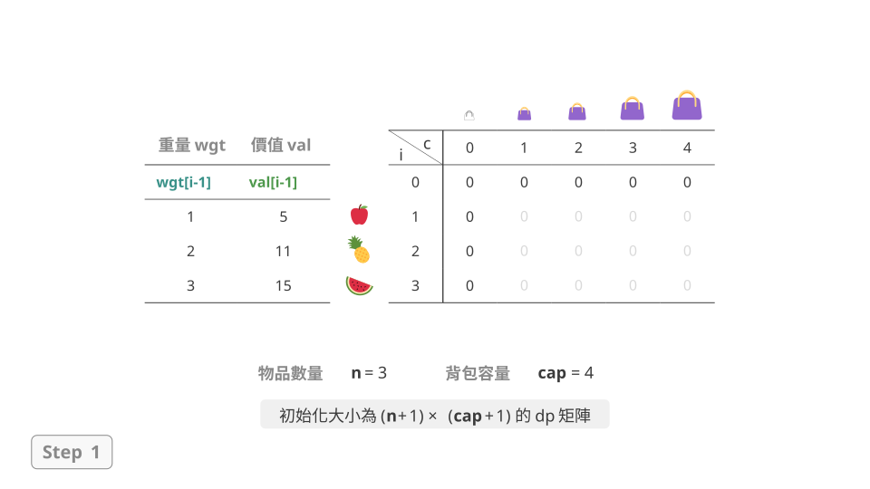{ class="animation-figure" }

=== "<2>"
    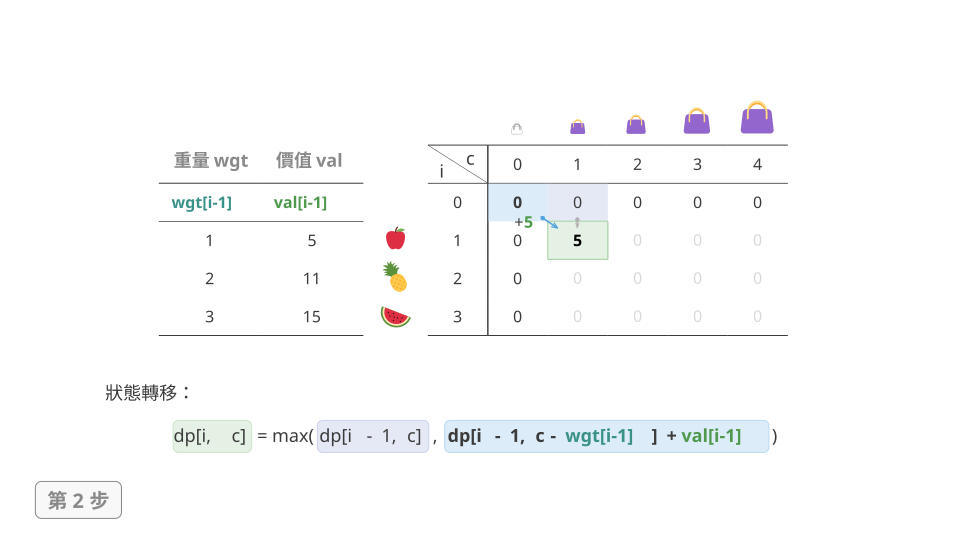{ class="animation-figure" }

=== "<3>"
    { class="animation-figure" }

=== "<4>"
    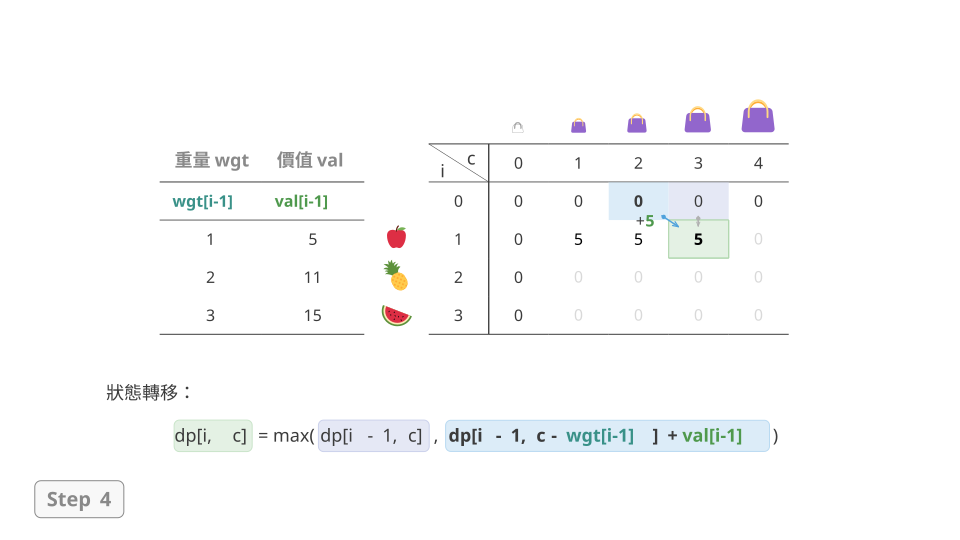{ class="animation-figure" }

=== "<5>"
    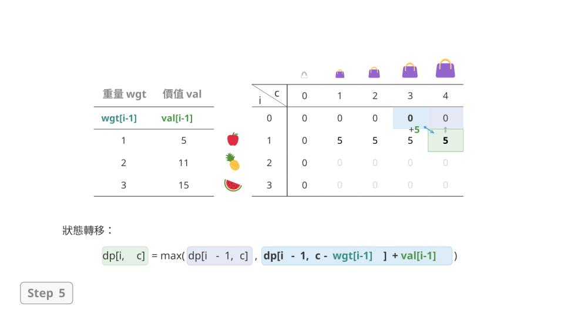{ class="animation-figure" }

=== "<6>"
    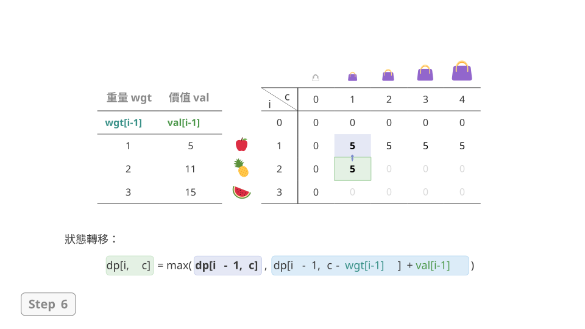{ class="animation-figure" }

=== "<7>"
    { class="animation-figure" }

=== "<8>"
    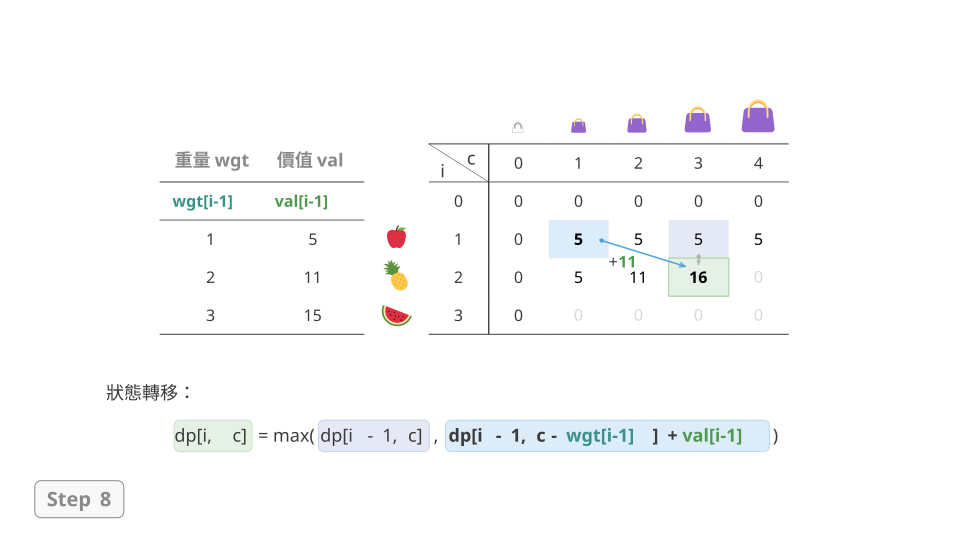{ class="animation-figure" }

=== "<9>"
    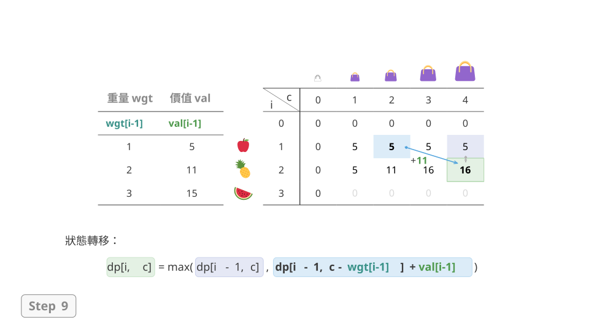{ class="animation-figure" }

=== "<10>"
    { class="animation-figure" }

=== "<11>"
    { class="animation-figure" }

=== "<12>"
    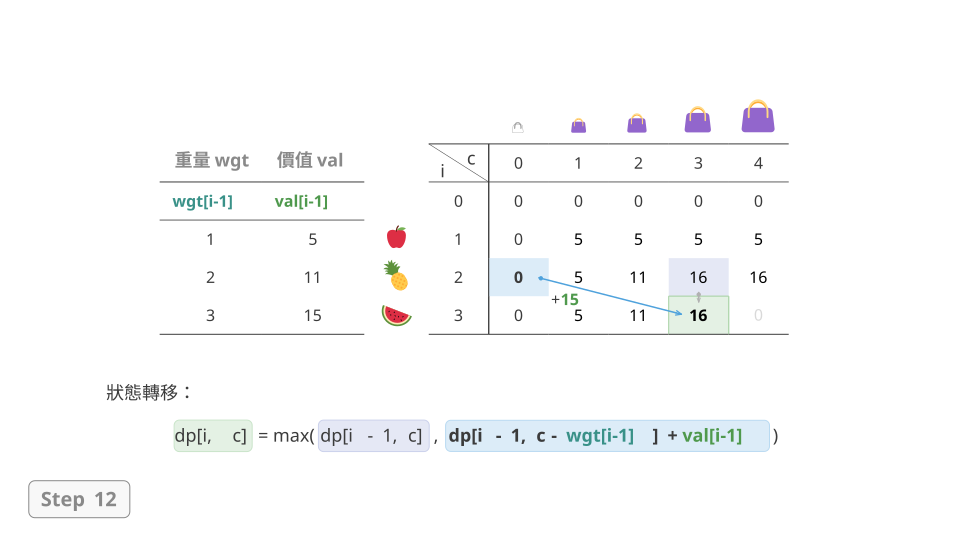{ class="animation-figure" }

=== "<13>"
    { class="animation-figure" }

=== "<14>"
    { class="animation-figure" }

<p align="center"> 圖 14-20 &nbsp; 0-1 背包問題的動態規劃過程 </p>

### 4. &nbsp; 空間最佳化

由於每個狀態都只依賴上一列的狀態，因此可以輪流使用兩個陣列，將空間複雜度從 $O(n \times cap)$ 降為 $O(cap)$。

再想一步，能否只用一個陣列就做到空間最佳化？觀察可知，每個狀態都來自正上方或左上方的格子。如果只用一個陣列，開始走訪第 $i$ 列時，陣列裡存的仍是第 $i-1$ 列的狀態。

- 依容量由小到大更新時，計算 $dp[i, c]$ 所需的上一列狀態 $dp[i-1, c-wgt[i-1]]$ 可能已被目前這一列的值覆寫，使同一個物品被重複計入。
- 若反向走訪，就能避免需要的值遭到覆寫，讓狀態轉移正確進行。

圖 14-21 顯示如何用同一個陣列，從第 $i = 1$ 列更新成第 $i = 2$ 列。請思考正向走訪與反向走訪有何差異。

=== "<1>"
    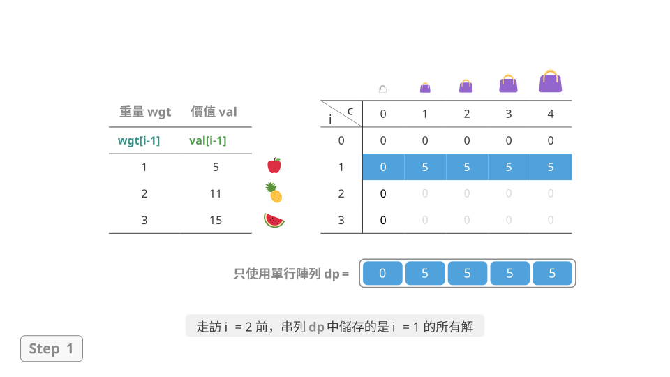{ class="animation-figure" }

=== "<2>"
    { class="animation-figure" }

=== "<3>"
    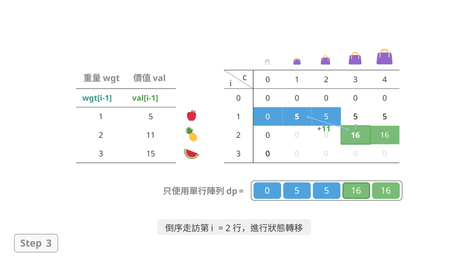{ class="animation-figure" }

=== "<4>"
    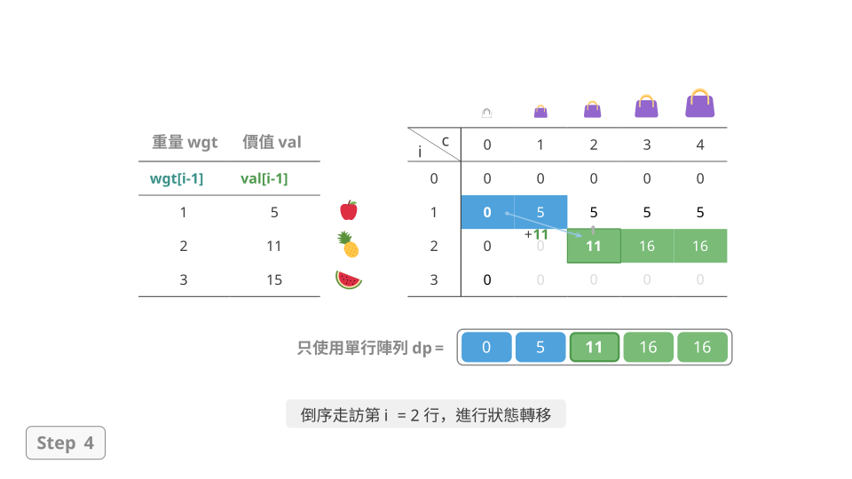{ class="animation-figure" }

=== "<5>"
    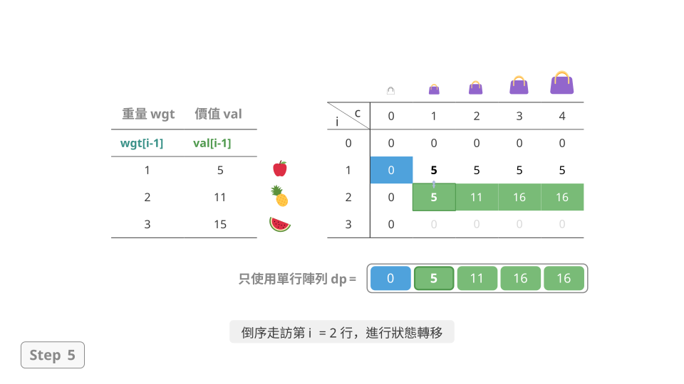{ class="animation-figure" }

=== "<6>"
    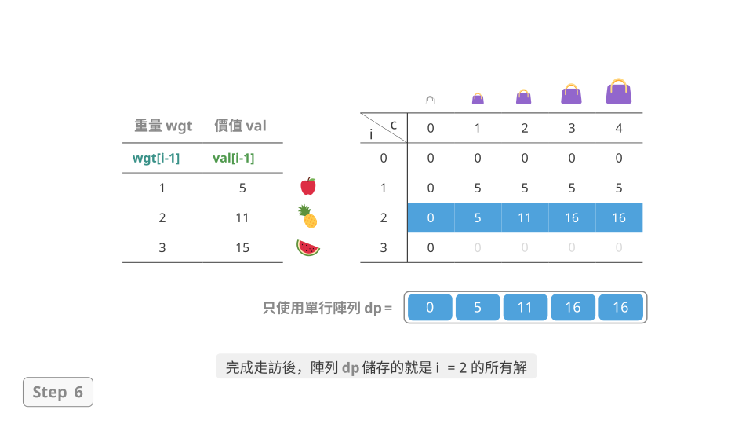{ class="animation-figure" }

<p align="center"> 圖 14-21 &nbsp; 0-1 背包空間最佳化後的動態規劃過程 </p>

實作時，只需移除陣列 `dp` 的第一個維度 $i$，並將內層迴圈改為反向走訪：

=== "Python"

    ```python title="knapsack.py"
    def knapsack_dp_comp(wgt: list[int], val: list[int], cap: int) -> int:
        """0-1 背包：空間最佳化後的動態規劃"""
        n = len(wgt)
        # 初始化 dp 表
        dp = [0] * (cap + 1)
        # 狀態轉移
        for i in range(1, n + 1):
            # 反向走訪
            for c in range(cap, 0, -1):
                if wgt[i - 1] > c:
                    # 若重量超過背包容量，就不選物品 i
                    dp[c] = dp[c]
                else:
                    # 取不選與選取物品 i 兩種情況中的較大值
                    dp[c] = max(dp[c], dp[c - wgt[i - 1]] + val[i - 1])
        return dp[cap]
    ```

=== "C++"

    ```cpp title="knapsack.cpp"
    /* 0-1 背包：空間最佳化後的動態規劃 */
    int knapsackDPComp(vector<int> &wgt, vector<int> &val, int cap) {
        int n = wgt.size();
        // 初始化 dp 表
        vector<int> dp(cap + 1, 0);
        // 狀態轉移
        for (int i = 1; i <= n; i++) {
            // 反向走訪
            for (int c = cap; c >= 1; c--) {
                if (wgt[i - 1] <= c) {
                    // 取不選與選取物品 i 兩種情況中的較大值
                    dp[c] = max(dp[c], dp[c - wgt[i - 1]] + val[i - 1]);
                }
            }
        }
        return dp[cap];
    }
    ```

=== "Java"

    ```java title="knapsack.java"
    /* 0-1 背包：空間最佳化後的動態規劃 */
    int knapsackDPComp(int[] wgt, int[] val, int cap) {
        int n = wgt.length;
        // 初始化 dp 表
        int[] dp = new int[cap + 1];
        // 狀態轉移
        for (int i = 1; i <= n; i++) {
            // 反向走訪
            for (int c = cap; c >= 1; c--) {
                if (wgt[i - 1] <= c) {
                    // 取不選與選取物品 i 兩種情況中的較大值
                    dp[c] = Math.max(dp[c], dp[c - wgt[i - 1]] + val[i - 1]);
                }
            }
        }
        return dp[cap];
    }
    ```

=== "C#"

    ```csharp title="knapsack.cs"
    /* 0-1 背包：空間最佳化後的動態規劃 */
    int KnapsackDPComp(int[] weight, int[] val, int cap) {
        int n = weight.Length;
        // 初始化 dp 表
        int[] dp = new int[cap + 1];
        // 狀態轉移
        for (int i = 1; i <= n; i++) {
            // 反向走訪
            for (int c = cap; c > 0; c--) {
                if (weight[i - 1] > c) {
                    // 若重量超過背包容量，就不選物品 i
                    dp[c] = dp[c];
                } else {
                    // 取不選與選取物品 i 兩種情況中的較大值
                    dp[c] = Math.Max(dp[c], dp[c - weight[i - 1]] + val[i - 1]);
                }
            }
        }
        return dp[cap];
    }
    ```

=== "Go"

    ```go title="knapsack.go"
    /* 0-1 背包：空間最佳化後的動態規劃 */
    func knapsackDPComp(wgt, val []int, cap int) int {
        n := len(wgt)
        // 初始化 dp 表
        dp := make([]int, cap+1)
        // 狀態轉移
        for i := 1; i <= n; i++ {
            // 反向走訪
            for c := cap; c >= 1; c-- {
                if wgt[i-1] <= c {
                    // 取不選與選取物品 i 兩種情況中的較大值
                    dp[c] = int(math.Max(float64(dp[c]), float64(dp[c-wgt[i-1]]+val[i-1])))
                }
            }
        }
        return dp[cap]
    }
    ```

=== "Swift"

    ```swift title="knapsack.swift"
    /* 0-1 背包：空間最佳化後的動態規劃 */
    func knapsackDPComp(wgt: [Int], val: [Int], cap: Int) -> Int {
        let n = wgt.count
        // 初始化 dp 表
        var dp = Array(repeating: 0, count: cap + 1)
        // 狀態轉移
        for i in 1 ... n {
            // 反向走訪
            for c in (1 ... cap).reversed() {
                if wgt[i - 1] <= c {
                    // 取不選與選取物品 i 兩種情況中的較大值
                    dp[c] = max(dp[c], dp[c - wgt[i - 1]] + val[i - 1])
                }
            }
        }
        return dp[cap]
    }
    ```

=== "JS"

    ```javascript title="knapsack.js"
    /* 0-1 背包：空間最佳化後的動態規劃 */
    function knapsackDPComp(wgt, val, cap) {
        const n = wgt.length;
        // 初始化 dp 表
        const dp = Array(cap + 1).fill(0);
        // 狀態轉移
        for (let i = 1; i <= n; i++) {
            // 反向走訪
            for (let c = cap; c >= 1; c--) {
                if (wgt[i - 1] <= c) {
                    // 取不選與選取物品 i 兩種情況中的較大值
                    dp[c] = Math.max(dp[c], dp[c - wgt[i - 1]] + val[i - 1]);
                }
            }
        }
        return dp[cap];
    }
    ```

=== "TS"

    ```typescript title="knapsack.ts"
    /* 0-1 背包：空間最佳化後的動態規劃 */
    function knapsackDPComp(
        wgt: Array<number>,
        val: Array<number>,
        cap: number
    ): number {
        const n = wgt.length;
        // 初始化 dp 表
        const dp = Array(cap + 1).fill(0);
        // 狀態轉移
        for (let i = 1; i <= n; i++) {
            // 反向走訪
            for (let c = cap; c >= 1; c--) {
                if (wgt[i - 1] <= c) {
                    // 取不選與選取物品 i 兩種情況中的較大值
                    dp[c] = Math.max(dp[c], dp[c - wgt[i - 1]] + val[i - 1]);
                }
            }
        }
        return dp[cap];
    }
    ```

=== "Dart"

    ```dart title="knapsack.dart"
    /* 0-1 背包：空間最佳化後的動態規劃 */
    int knapsackDPComp(List<int> wgt, List<int> val, int cap) {
      int n = wgt.length;
      // 初始化 dp 表
      List<int> dp = List.filled(cap + 1, 0);
      // 狀態轉移
      for (int i = 1; i <= n; i++) {
        // 反向走訪
        for (int c = cap; c >= 1; c--) {
          if (wgt[i - 1] <= c) {
            // 取不選與選取物品 i 兩種情況中的較大值
            dp[c] = max(dp[c], dp[c - wgt[i - 1]] + val[i - 1]);
          }
        }
      }
      return dp[cap];
    }
    ```

=== "Rust"

    ```rust title="knapsack.rs"
    /* 0-1 背包：空間最佳化後的動態規劃 */
    fn knapsack_dp_comp(wgt: &[i32], val: &[i32], cap: usize) -> i32 {
        let n = wgt.len();
        // 初始化 dp 表
        let mut dp = vec![0; cap + 1];
        // 狀態轉移
        for i in 1..=n {
            // 反向走訪
            for c in (1..=cap).rev() {
                if wgt[i - 1] <= c as i32 {
                    // 取不選與選取物品 i 兩種情況中的較大值
                    dp[c] = std::cmp::max(dp[c], dp[c - wgt[i - 1] as usize] + val[i - 1]);
                }
            }
        }
        dp[cap]
    }
    ```

=== "C"

    ```c title="knapsack.c"
    /* 0-1 背包：空間最佳化後的動態規劃 */
    int knapsackDPComp(int wgt[], int val[], int cap, int wgtSize) {
        int n = wgtSize;
        // 初始化 dp 表
        int *dp = calloc(cap + 1, sizeof(int));
        // 狀態轉移
        for (int i = 1; i <= n; i++) {
            // 反向走訪
            for (int c = cap; c >= 1; c--) {
                if (wgt[i - 1] <= c) {
                    // 取不選與選取物品 i 兩種情況中的較大值
                    dp[c] = myMax(dp[c], dp[c - wgt[i - 1]] + val[i - 1]);
                }
            }
        }
        int res = dp[cap];
        // 釋放記憶體
        free(dp);
        return res;
    }
    ```

=== "Kotlin"

    ```kotlin title="knapsack.kt"
    /* 0-1 背包：空間最佳化後的動態規劃 */
    fun knapsackDPComp(wgt: IntArray, _val: IntArray, cap: Int): Int {
        val n = wgt.size
        // 初始化 dp 表
        val dp = IntArray(cap + 1)
        // 狀態轉移
        for (i in 1..n) {
            // 反向走訪
            for (c in cap downTo 1) {
                if (wgt[i - 1] <= c) {
                    // 取不選與選取物品 i 兩種情況中的較大值
                    dp[c] = max(dp[c], dp[c - wgt[i - 1]] + _val[i - 1])
                }
            }
        }
        return dp[cap]
    }
    ```

=== "Ruby"

    ```ruby title="knapsack.rb"
    ### 0-1 背包：空間最佳化後的動態規劃 ###
    def knapsack_dp_comp(wgt, val, cap)
      n = wgt.length
      # 初始化 dp 表
      dp = Array.new(cap + 1, 0)
      # 狀態轉移
      for i in 1...(n + 1)
        # 反向走訪
        for c in cap.downto(1)
          if wgt[i - 1] > c
            # 若重量超過背包容量，就不選物品 i
            dp[c] = dp[c]
          else
            # 取不選與選取物品 i 兩種情況中的較大值
            dp[c] = [dp[c], dp[c - wgt[i - 1]] + val[i - 1]].max
          end
        end
      end
      dp[cap]
    end
    ```

??? pythontutor "執行視覺化示範"

    <div style="height: 549px; width: 100%;"><iframe class="pythontutor-iframe" title="執行視覺化示範" src="https://pythontutor.com/iframe-embed.html#code=def%20knapsack_dp_comp%28wgt%3A%20list%5Bint%5D,%20val%3A%20list%5Bint%5D,%20cap%3A%20int%29%20-%3E%20int%3A%0A%20%20%20%20%22%22%220-1%20%E8%83%8C%E5%8C%85%EF%BC%9A%E7%A9%BA%E9%96%93%E6%9C%80%E4%BD%B3%E5%8C%96%E5%BE%8C%E7%9A%84%E5%8B%95%E6%85%8B%E8%A6%8F%E5%8A%83%22%22%22%0A%20%20%20%20n%20%3D%20len%28wgt%29%0A%20%20%20%20%23%20%E5%88%9D%E5%A7%8B%E5%8C%96%20dp%20%E8%A1%A8%0A%20%20%20%20dp%20%3D%20%5B0%5D%20%2A%20%28cap%20%2B%201%29%0A%20%20%20%20%23%20%E7%8B%80%E6%85%8B%E8%BD%89%E7%A7%BB%0A%20%20%20%20for%20i%20in%20range%281,%20n%20%2B%201%29%3A%0A%20%20%20%20%20%20%20%20%23%20%E5%8F%8D%E5%90%91%E8%B5%B0%E8%A8%AA%0A%20%20%20%20%20%20%20%20for%20c%20in%20range%28cap,%200,%20-1%29%3A%0A%20%20%20%20%20%20%20%20%20%20%20%20if%20wgt%5Bi%20-%201%5D%20%3E%20c%3A%0A%20%20%20%20%20%20%20%20%20%20%20%20%20%20%20%20%23%20%E8%8B%A5%E9%87%8D%E9%87%8F%E8%B6%85%E9%81%8E%E8%83%8C%E5%8C%85%E5%AE%B9%E9%87%8F%EF%BC%8C%E5%B0%B1%E4%B8%8D%E9%81%B8%E7%89%A9%E5%93%81%20i%0A%20%20%20%20%20%20%20%20%20%20%20%20%20%20%20%20dp%5Bc%5D%20%3D%20dp%5Bc%5D%0A%20%20%20%20%20%20%20%20%20%20%20%20else%3A%0A%20%20%20%20%20%20%20%20%20%20%20%20%20%20%20%20%23%20%E5%8F%96%E4%B8%8D%E9%81%B8%E8%88%87%E9%81%B8%E5%8F%96%E7%89%A9%E5%93%81%20i%20%E5%85%A9%E7%A8%AE%E6%83%85%E6%B3%81%E4%B8%AD%E7%9A%84%E8%BC%83%E5%A4%A7%E5%80%BC%0A%20%20%20%20%20%20%20%20%20%20%20%20%20%20%20%20dp%5Bc%5D%20%3D%20max%28dp%5Bc%5D,%20dp%5Bc%20-%20wgt%5Bi%20-%201%5D%5D%20%2B%20val%5Bi%20-%201%5D%29%0A%20%20%20%20return%20dp%5Bcap%5D%0A%0A%0A%22%22%22Driver%20Code%22%22%22%0Aif%20__name__%20%3D%3D%20%22__main__%22%3A%0A%20%20%20%20wgt%20%3D%20%5B10,%2020,%2030,%2040,%2050%5D%0A%20%20%20%20val%20%3D%20%5B50,%20120,%20150,%20210,%20240%5D%0A%20%20%20%20cap%20%3D%2050%0A%20%20%20%20n%20%3D%20len%28wgt%29%0A%0A%20%20%20%20%23%20%E7%A9%BA%E9%96%93%E6%9C%80%E4%BD%B3%E5%8C%96%E5%BE%8C%E7%9A%84%E5%8B%95%E6%85%8B%E8%A6%8F%E5%8A%83%0A%20%20%20%20res%20%3D%20knapsack_dp_comp%28wgt,%20val,%20cap%29%0A%20%20%20%20print%28f%22%E5%9C%A8%E8%83%8C%E5%8C%85%E5%AE%B9%E9%87%8F%E9%99%90%E5%88%B6%E5%85%A7%EF%BC%8C%E7%89%A9%E5%93%81%E7%9A%84%E6%9C%80%E5%A4%A7%E7%B8%BD%E5%83%B9%E5%80%BC%E7%82%BA%20%7Bres%7D%22%29&codeDivHeight=472&codeDivWidth=350&cumulative=false&curInstr=7&heapPrimitives=nevernest&origin=opt-frontend.js&py=311&rawInputLstJSON=%5B%5D&textReferences=false"> </iframe></div>
    <div style="margin-top: 5px;"><a href="https://pythontutor.com/iframe-embed.html#code=def%20knapsack_dp_comp%28wgt%3A%20list%5Bint%5D,%20val%3A%20list%5Bint%5D,%20cap%3A%20int%29%20-%3E%20int%3A%0A%20%20%20%20%22%22%220-1%20%E8%83%8C%E5%8C%85%EF%BC%9A%E7%A9%BA%E9%96%93%E6%9C%80%E4%BD%B3%E5%8C%96%E5%BE%8C%E7%9A%84%E5%8B%95%E6%85%8B%E8%A6%8F%E5%8A%83%22%22%22%0A%20%20%20%20n%20%3D%20len%28wgt%29%0A%20%20%20%20%23%20%E5%88%9D%E5%A7%8B%E5%8C%96%20dp%20%E8%A1%A8%0A%20%20%20%20dp%20%3D%20%5B0%5D%20%2A%20%28cap%20%2B%201%29%0A%20%20%20%20%23%20%E7%8B%80%E6%85%8B%E8%BD%89%E7%A7%BB%0A%20%20%20%20for%20i%20in%20range%281,%20n%20%2B%201%29%3A%0A%20%20%20%20%20%20%20%20%23%20%E5%8F%8D%E5%90%91%E8%B5%B0%E8%A8%AA%0A%20%20%20%20%20%20%20%20for%20c%20in%20range%28cap,%200,%20-1%29%3A%0A%20%20%20%20%20%20%20%20%20%20%20%20if%20wgt%5Bi%20-%201%5D%20%3E%20c%3A%0A%20%20%20%20%20%20%20%20%20%20%20%20%20%20%20%20%23%20%E8%8B%A5%E9%87%8D%E9%87%8F%E8%B6%85%E9%81%8E%E8%83%8C%E5%8C%85%E5%AE%B9%E9%87%8F%EF%BC%8C%E5%B0%B1%E4%B8%8D%E9%81%B8%E7%89%A9%E5%93%81%20i%0A%20%20%20%20%20%20%20%20%20%20%20%20%20%20%20%20dp%5Bc%5D%20%3D%20dp%5Bc%5D%0A%20%20%20%20%20%20%20%20%20%20%20%20else%3A%0A%20%20%20%20%20%20%20%20%20%20%20%20%20%20%20%20%23%20%E5%8F%96%E4%B8%8D%E9%81%B8%E8%88%87%E9%81%B8%E5%8F%96%E7%89%A9%E5%93%81%20i%20%E5%85%A9%E7%A8%AE%E6%83%85%E6%B3%81%E4%B8%AD%E7%9A%84%E8%BC%83%E5%A4%A7%E5%80%BC%0A%20%20%20%20%20%20%20%20%20%20%20%20%20%20%20%20dp%5Bc%5D%20%3D%20max%28dp%5Bc%5D,%20dp%5Bc%20-%20wgt%5Bi%20-%201%5D%5D%20%2B%20val%5Bi%20-%201%5D%29%0A%20%20%20%20return%20dp%5Bcap%5D%0A%0A%0A%22%22%22Driver%20Code%22%22%22%0Aif%20__name__%20%3D%3D%20%22__main__%22%3A%0A%20%20%20%20wgt%20%3D%20%5B10,%2020,%2030,%2040,%2050%5D%0A%20%20%20%20val%20%3D%20%5B50,%20120,%20150,%20210,%20240%5D%0A%20%20%20%20cap%20%3D%2050%0A%20%20%20%20n%20%3D%20len%28wgt%29%0A%0A%20%20%20%20%23%20%E7%A9%BA%E9%96%93%E6%9C%80%E4%BD%B3%E5%8C%96%E5%BE%8C%E7%9A%84%E5%8B%95%E6%85%8B%E8%A6%8F%E5%8A%83%0A%20%20%20%20res%20%3D%20knapsack_dp_comp%28wgt,%20val,%20cap%29%0A%20%20%20%20print%28f%22%E5%9C%A8%E8%83%8C%E5%8C%85%E5%AE%B9%E9%87%8F%E9%99%90%E5%88%B6%E5%85%A7%EF%BC%8C%E7%89%A9%E5%93%81%E7%9A%84%E6%9C%80%E5%A4%A7%E7%B8%BD%E5%83%B9%E5%80%BC%E7%82%BA%20%7Bres%7D%22%29&codeDivHeight=800&codeDivWidth=600&cumulative=false&curInstr=7&heapPrimitives=nevernest&origin=opt-frontend.js&py=311&rawInputLstJSON=%5B%5D&textReferences=false" target="_blank" rel="noopener noreferrer">全螢幕觀看 ></a></div>
