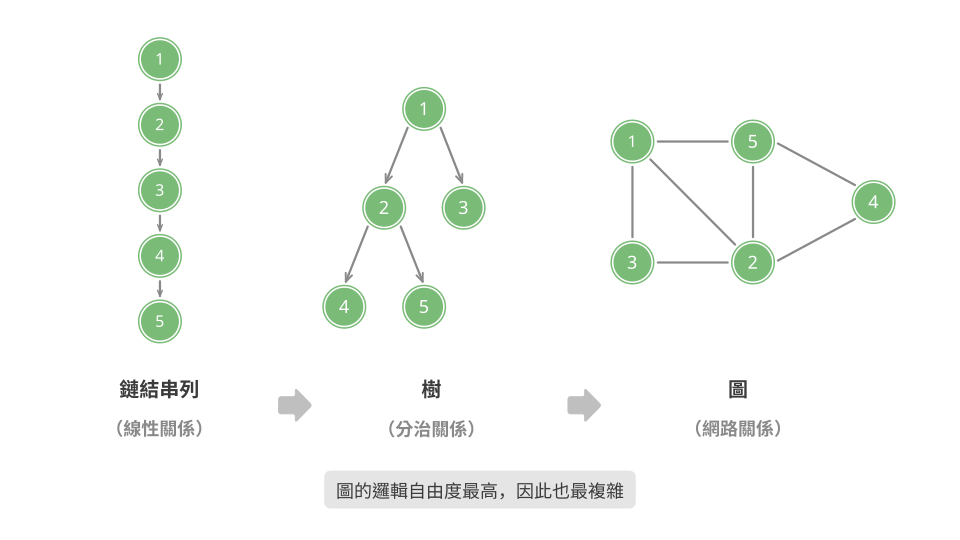
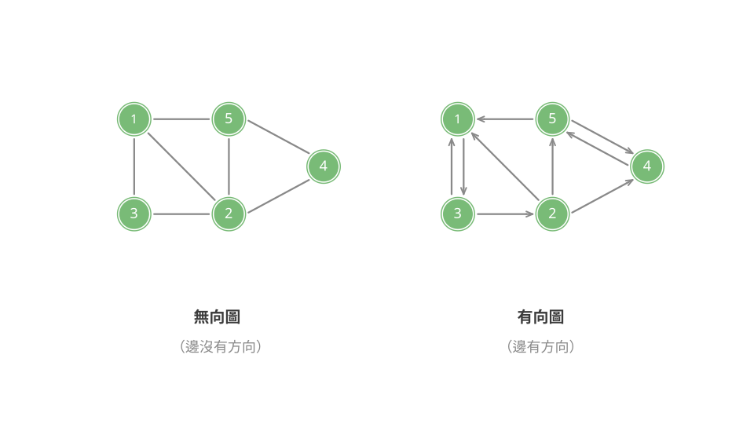
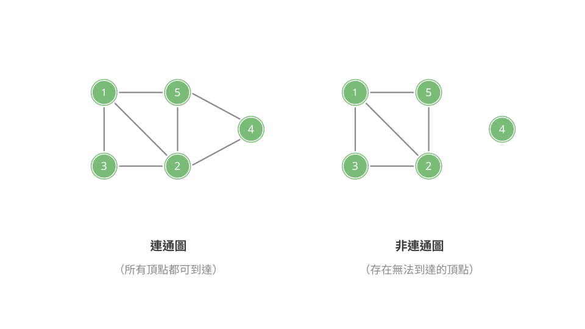
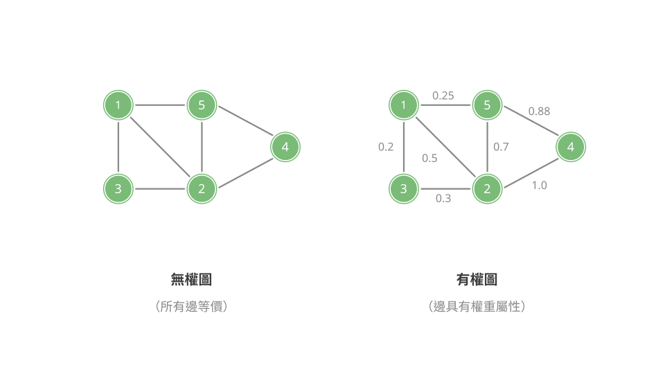
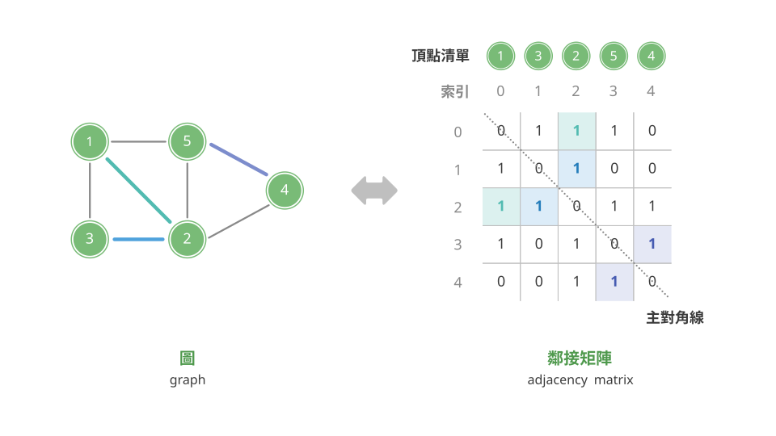
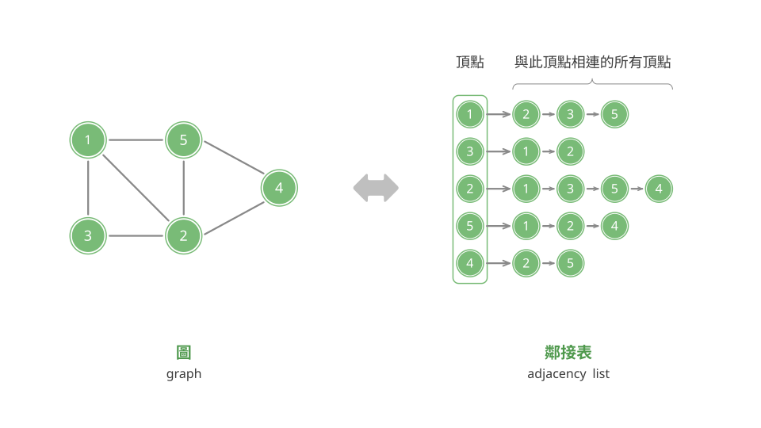

# 圖

<u>圖（graph）</u>是一種非線性資料結構，由<u>頂點（vertex）</u>與<u>邊（edge）</u>組成。我們可以用一組頂點 $V$ 和一組邊 $E$ 的集合來表示圖 $G$。以下範例是一張有 5 個頂點、7 條邊的圖。

$$
\begin{aligned}
V & = \{ 1, 2, 3, 4, 5 \} \newline
E & = \{ (1,2), (1,3), (1,5), (2,3), (2,4), (2,5), (4,5) \} \newline
G & = \{ V, E \} \newline
\end{aligned}
$$

若把頂點看成節點，把邊看成連接節點的參照（指標），就能把圖視為從鏈結串列延伸而來的資料結構。如下圖所示，**相較於線性關係（鏈結串列）和分治關係（樹），網路關係（圖）的連接方式更自由**，因此也更複雜。

## 圖的常見種類與術語

依邊是否有方向，圖可分為<u>無向圖（undirected graph）</u>與<u>有向圖（directed graph）</u>，如下圖所示。

- 在無向圖中，邊代表兩個頂點之間的「雙向」連接，例如微信或 QQ 中的「好友」關係。
- 在有向圖中，邊有方向，$A \rightarrow B$ 和 $A \leftarrow B$ 這兩個方向的邊彼此獨立，例如微博或抖音上「追蹤」與「被追蹤」的關係。

依所有頂點是否彼此連通，圖可分為<u>連通圖（connected graph）</u>與<u>非連通圖（disconnected graph）</u>，如下圖所示。

- 在連通圖中，從任一頂點出發，都能抵達其餘任一頂點。
- 在非連通圖中，從某個頂點出發，至少有一個頂點無法抵達。

我們也可以為邊加上「權重」變數，得到如下圖所示的<u>加權圖（weighted graph）</u>。例如在《王者榮耀》等手機遊戲中，系統會根據玩家一起遊玩的時間計算彼此的「親密度」。這種親密度網路就可以用加權圖來表示。

圖這種資料結構常用到以下術語。

- <u>相鄰（adjacency）</u>：若兩個頂點之間有邊直接相連，就稱這兩個頂點「相鄰」。在上圖中，與頂點 1 相鄰的是頂點 2、3、5。
- <u>路徑（path）</u>：從頂點 A 到頂點 B 依序經過的邊，構成一條由 A 到 B 的「路徑」。在上圖中，沿著 1-5-2-4 依序經過的邊，就構成頂點 1 到頂點 4 的一條路徑。
- <u>度數（degree）</u>：與一個頂點相連的邊數。在有向圖中，<u>入度（in-degree）</u>是指向該頂點的邊數，<u>出度（out-degree）</u>是從該頂點指向其他頂點的邊數。

## 圖的表示法

圖常用「鄰接矩陣」或「鄰接串列」表示。以下以無向圖為例。

### 鄰接矩陣

假設圖中有 $n$ 個頂點，<u>鄰接矩陣（adjacency matrix）</u>使用大小為 $n \times n$ 的矩陣來表示圖。每個橫列和每個直行各代表一個頂點，矩陣元素則代表邊，以 $1$ 或 $0$ 表示兩個頂點間是否有邊。

如下圖所示，若鄰接矩陣為 $M$，頂點清單為 $V$，矩陣元素 $M[i, j] = 1$ 表示頂點 $V[i]$ 到頂點 $V[j]$ 之間有邊，反之，$M[i, j] = 0$ 表示兩個頂點之間沒有邊。

鄰接矩陣有以下特性。

- 簡單圖中的頂點不能與自己相連，因此鄰接矩陣主對角線上的元素沒有實質意義。
- 在無向圖中，邊的兩個方向等價，因此鄰接矩陣對主對角線對稱。
- 將鄰接矩陣元素的 $1$ 和 $0$ 改為權重，就能用來表示加權圖。

使用鄰接矩陣時，可直接存取矩陣元素來取得邊的資訊，因此新增、刪除、查詢和修改邊的效率都很高，時間複雜度均為 $O(1)$。不過，矩陣的空間複雜度為 $O(n^2)$，佔用的記憶體較多。

### 鄰接串列

<u>鄰接串列（adjacency list）</u>用 $n$ 條鏈結串列表示圖，串列中的節點代表頂點。第 $i$ 條串列對應頂點 $i$，其中存放該頂點的所有相鄰頂點（與它有邊直接相連的頂點）。下圖是以鄰接串列儲存圖的例子。

鄰接串列只儲存實際存在的邊，而邊的總數通常遠小於 $n^2$，因此較省空間。不過，在鄰接串列中查詢一條邊時必須走訪鏈結串列，所以查詢效率比鄰接矩陣低。

觀察上圖，**鄰接串列的結構和雜湊表的「鏈結法」十分相似，因此可以用類似的方法提升效率**。例如當串列較長時，可以改用 AVL 樹或紅黑樹，將查詢的時間複雜度從 $O(n)$ 降至 $O(\log n)$；也可以改用雜湊表，將時間複雜度降至 $O(1)$。

## 圖的常見應用

如下表所示，許多真實系統都可以用圖來描述，相應的問題也可以轉化為圖上的計算問題。

 表 <id> &nbsp; 日常生活中常見的圖 

|          | 頂點 | 邊                   | 圖上的計算問題   |
| -------- | ---- | -------------------- | ------------ |
| 社群網路 | 使用者 | 好友關係             | 推薦可能認識的好友 |
| 捷運路線 | 車站 | 車站之間的連通關係       | 推薦最短路線 |
| 太陽系   | 天體 | 天體之間的萬有引力 | 計算行星軌道 |
