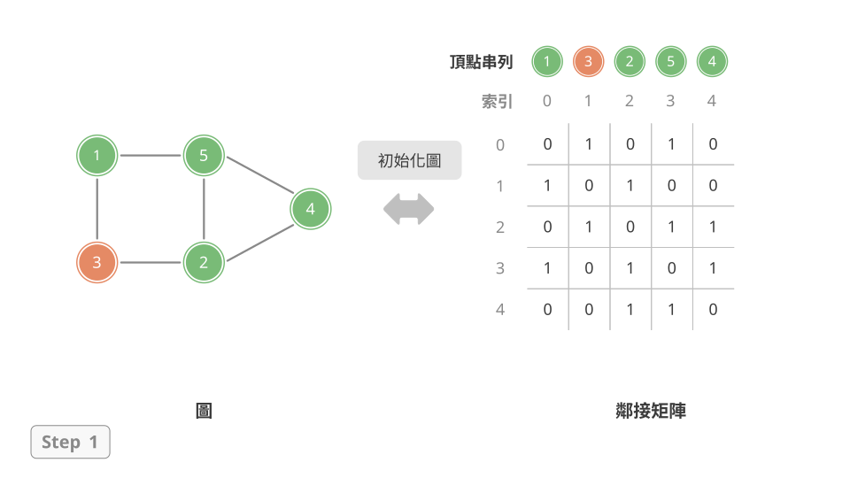
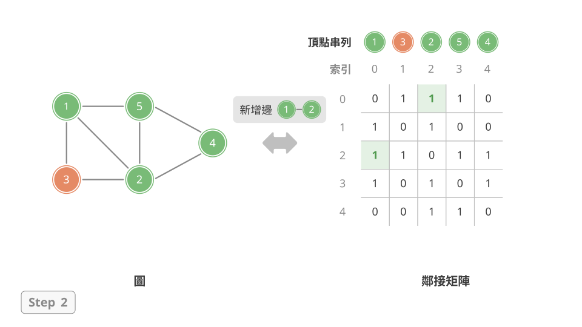
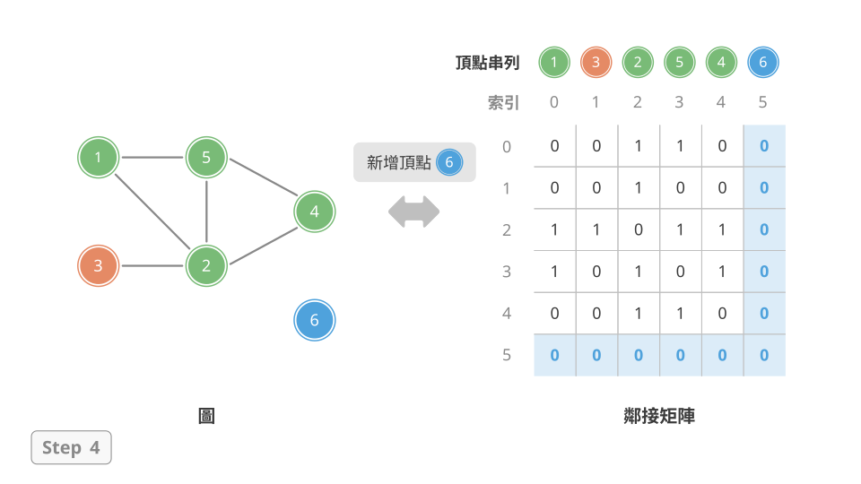
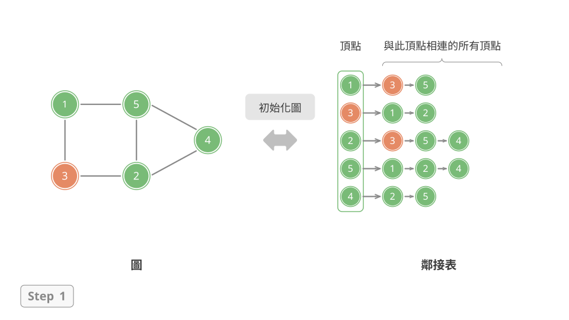
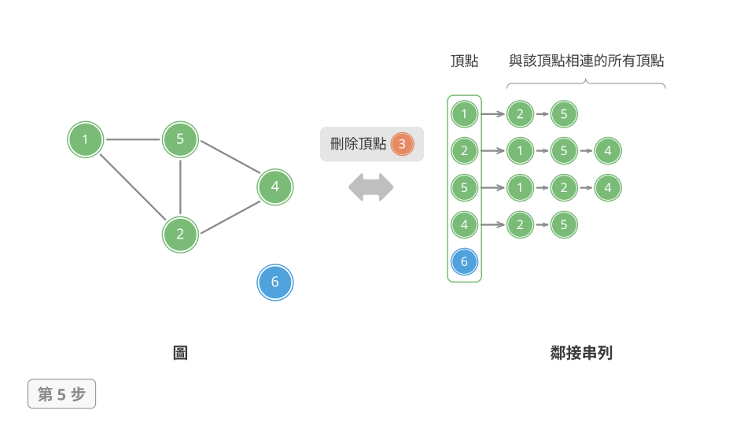

# 圖的基本操作

圖的基本操作分別針對「邊」和「頂點」。採用「鄰接矩陣」或「鄰接串列」來表示圖時，這些操作的實作方式有所不同。

## 以鄰接矩陣實作

給定一張有 $n$ 個頂點的無向圖，各項操作的實作方式如下圖所示。

- **新增或刪除邊**：直接修改鄰接矩陣中指定邊對應的元素即可，耗時 $O(1)$。由於是無向圖，必須同步更新兩個方向對應的元素。
- **新增頂點**：在鄰接矩陣的尾端各新增一個橫列和直行，全部填入 $0$ 即可，耗時 $O(n)$。
- **刪除頂點**：從鄰接矩陣中各刪除一個橫列和直行。最差情況是刪除第一個橫列與第一個直行，必須將 $(n-1)^2$ 個元素「往左上方移動」，耗時 $O(n^2)$。
- **初始化**：傳入 $n$ 個頂點，初始化長度為 $n$ 的頂點清單 `vertices`，耗時 $O(n)$。初始化大小為 $n \times n$ 的鄰接矩陣 `adjMat`，耗時 $O(n^2)$。

=== "<1>"
    

=== "<2>"
    

=== "<3>"
    

=== "<4>"
    

=== "<5>"
    

以下程式碼以鄰接矩陣實作圖：

```src
[file]{graph_adjacency_matrix}-[class]{graph_adj_mat}-[func]{}
```

## 以鄰接串列實作

設無向圖共有 $n$ 個頂點、$m$ 條邊，各項操作可依下圖所示的方法實作。

- **新增邊**：在頂點對應的鏈結串列尾端加入邊即可，耗時 $O(1)$。由於是無向圖，兩個方向都要加入。
- **刪除邊**：在頂點對應的鏈結串列中找出並刪除指定的邊，耗時 $O(m)$。在無向圖中，兩個方向都要刪除。
- **新增頂點**：在鄰接串列中新增一條鏈結串列，以新頂點作為首節點，耗時 $O(1)$。
- **刪除頂點**：走訪整份鄰接串列，刪除所有以指定頂點為端點的邊，耗時 $O(n + m)$。
- **初始化**：在鄰接串列中建立 $n$ 個頂點和 $2m$ 條邊，耗時 $O(n + m)$。

=== "<1>"
    

=== "<2>"
    

=== "<3>"
    

=== "<4>"
    

=== "<5>"
    

以下程式碼實作鄰接串列，和上圖相比有幾處差異。

- 為了方便新增與刪除頂點，也為了簡化程式碼，我們用串列（動態陣列）代替鏈結串列。
- 使用雜湊表儲存鄰接串列，`key` 是頂點物件，`value` 是該頂點的相鄰頂點清單（鏈結串列）。

另外，我們在鄰接串列中用 `Vertex` 類別表示頂點。假如和鄰接矩陣一樣，用清單索引區分頂點，則刪除索引為 $i$ 的頂點時，得走訪整份鄰接串列，將所有大於 $i$ 的索引減 $1$，效率很低。若每個頂點都是獨一無二的 `Vertex` 物件，刪除一個頂點後就無須更改其他頂點。

```src
[file]{graph_adjacency_list}-[class]{graph_adj_list}-[func]{}
```

## 效率比較

設圖中共有 $n$ 個頂點和 $m$ 條邊，下表比較鄰接矩陣和鄰接串列的時間與空間效率。請注意，「鄰接串列（鏈結串列）」對應本文的實作，「鄰接串列（雜湊表）」則專指把所有鏈結串列改為雜湊表的實作。

<p align="center"> 表 <id> &nbsp; 鄰接矩陣與鄰接串列的比較 </p>

|              | 鄰接矩陣 | 鄰接串列（鏈結串列） | 鄰接串列（雜湊表） |
| ------------ | -------- | -------------- | ---------------- |
| 判斷兩點是否相鄰 | $O(1)$   | $O(n)$         | $O(1)$           |
| 新增邊       | $O(1)$   | $O(1)$         | $O(1)$           |
| 刪除邊       | $O(1)$   | $O(n)$         | $O(1)$           |
| 新增頂點     | $O(n)$   | $O(1)$         | $O(1)$           |
| 刪除頂點     | $O(n^2)$ | $O(n + m)$     | $O(n)$           |
| 記憶體用量 | $O(n^2)$ | $O(n + m)$     | $O(n + m)$       |

從上表來看，鄰接串列（雜湊表）的時間與空間效率似乎最好。然而實際操作邊時，鄰接矩陣只要讀取一個陣列元素或為它賦值，效率更高。整體而言，鄰接矩陣體現了「以空間換取時間」的原則，鄰接串列則體現了「以時間換取空間」的原則。
