# 圖的走訪

樹代表「一對多」的關係，圖的連接方式更自由，可以表示任意的「多對多」關係。因此，樹可以視為圖的一種特例。由此可知，**樹的走訪也是圖的走訪的一種特例**。

圖和樹都可以透過搜尋演算法來走訪。圖的走訪方式也分為兩種：<u>廣度優先走訪</u>與<u>深度優先走訪</u>。

## 廣度優先走訪

**廣度優先走訪從某個節點出發，總是優先走訪距離起點最近的頂點，由近而遠逐層向外擴展**。如下圖所示，從左上角的頂點出發，先走訪該頂點的所有相鄰頂點，再走訪下一個頂點的所有相鄰頂點，依此類推，直到走訪完所有頂點。

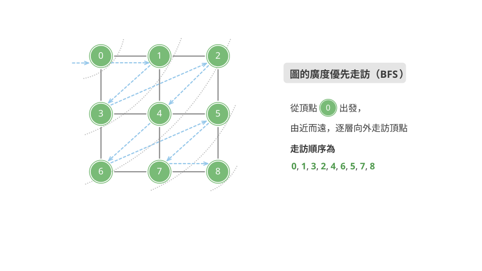

### 演算法實作

BFS 通常以佇列實作，程式碼如下。佇列「先進先出」的特性，正好配合 BFS「由近而遠」的走訪順序。

1. 將起始頂點 `startVet` 加入佇列，開始執行迴圈。
2. 每一輪都從佇列前端取出頂點，記錄走訪結果，再將該頂點的所有相鄰頂點加入佇列尾端。
3. 重複步驟 `2.`，直到所有頂點都已走訪為止。

為了避免重複走訪頂點，我們使用雜湊集合 `visited` 記錄已走訪的節點。

!!! tip

    雜湊集合可以視為只儲存 `key`、不儲存 `value` 的雜湊表，能以 $O(1)$ 的時間複雜度對 `key` 執行新增、刪除、查詢與修改。由於 `key` 不會重複，雜湊集合常用來移除重複資料。

```src
[file]{graph_bfs}-[class]{}-[func]{graph_bfs}
```

光看程式碼可能比較抽象，可以對照下圖來理解。

=== "<1>"
    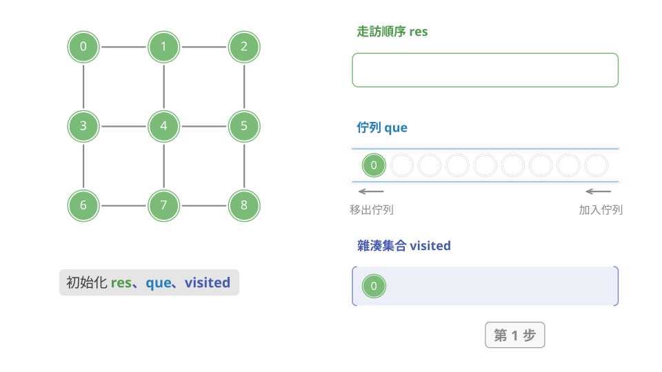

=== "<2>"
    

=== "<3>"
    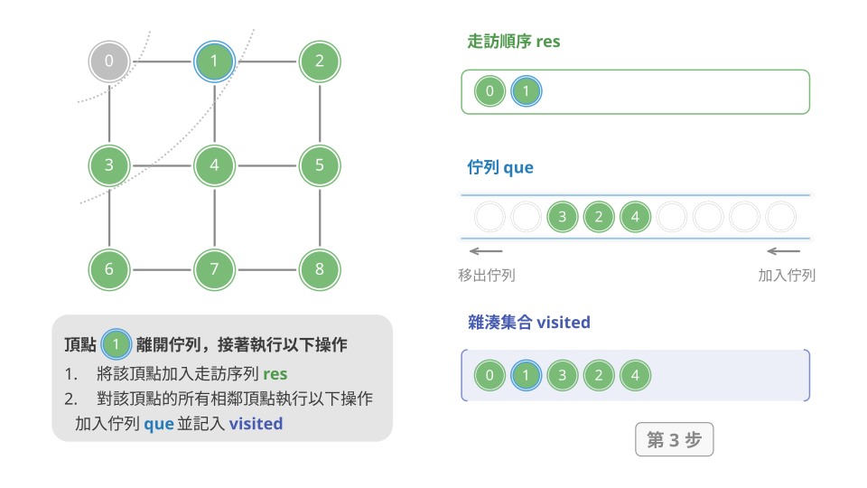

=== "<4>"
    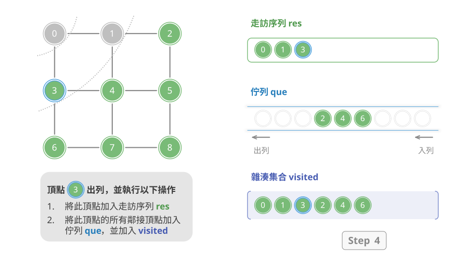

=== "<5>"
    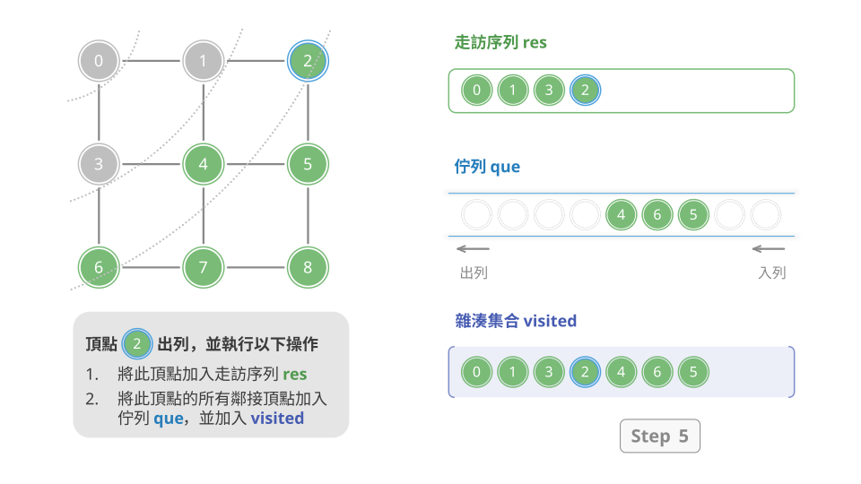

=== "<6>"
    

=== "<7>"
    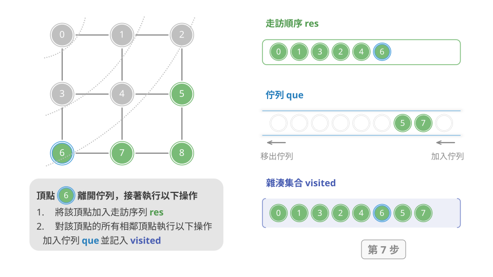

=== "<8>"
    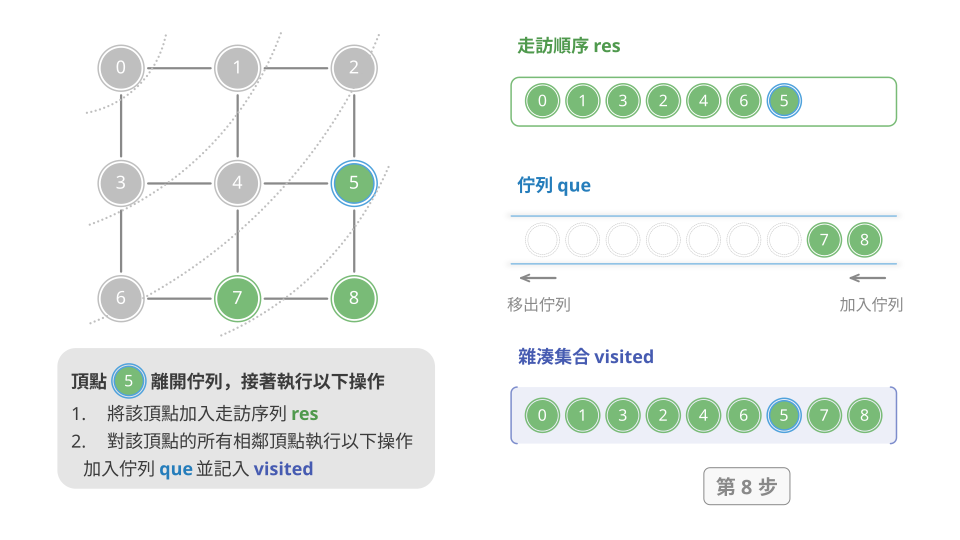

=== "<9>"
    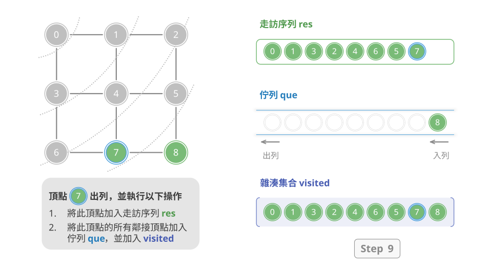

=== "<10>"
    

=== "<11>"
    

!!! question "廣度優先走訪的順序只有一種嗎？"

    不只一種。廣度優先走訪只要求「由近而遠」，**距離相同的頂點可以任意調整走訪順序**。以上圖為例，頂點 $1$、$3$ 的走訪順序可以互換，頂點 $2$、$4$、$6$ 的走訪順序也可以任意調整。

### 複雜度分析

**時間複雜度**：每個頂點都會進出佇列各一次，耗時 $O(|V|)$。走訪相鄰頂點時，由於是無向圖，每條邊都會走訪 $2$ 次，耗時 $O(2|E|)$。總共耗時 $O(|V| + |E|)$。

**空間複雜度**：串列 `res`、雜湊集合 `visited` 與佇列 `que` 各自最多存放 $|V|$ 個頂點，所需空間為 $O(|V|)$。

## 深度優先走訪

**深度優先走訪會沿著一條路一直走到底，無路可走時才回頭**。如下圖所示，從左上角的頂點出發，每次走訪目前頂點的一個相鄰頂點，走到盡頭就返回，再沿另一條路走到底並返回。如此反覆，直到走訪完所有頂點。

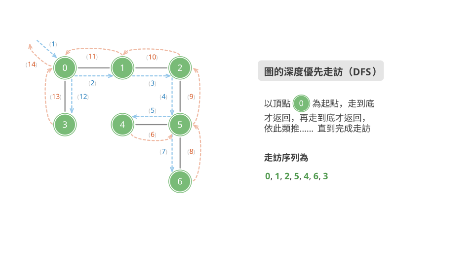

### 演算法實作

這種「走到盡頭再返回」的演算法通常以遞迴實作。和廣度優先走訪一樣，深度優先走訪也需要用雜湊集合 `visited` 記錄已走訪的頂點，以免重複走訪。

```src
[file]{graph_dfs}-[class]{}-[func]{graph_dfs}
```

深度優先走訪的演算法流程如下圖所示。

- **直虛線代表向下遞迴**，表示展開一次新的遞迴呼叫，走訪新頂點。
- **曲虛線代表向上回溯**，表示這次遞迴呼叫已返回，回到發出呼叫的位置。

可以對照下圖與程式碼，在腦中模擬（或動筆畫出）整個 DFS 過程，留意每次遞迴呼叫何時開始、何時返回。

=== "<1>"
    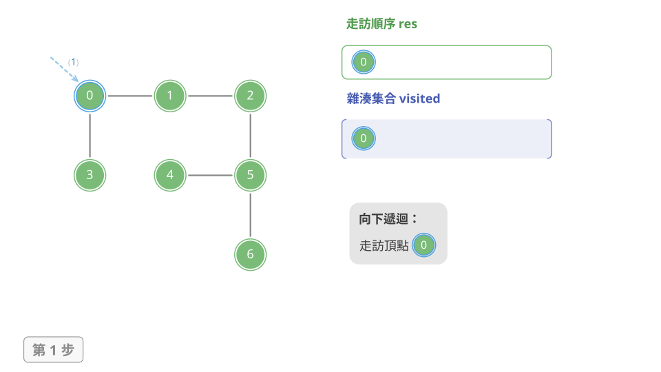

=== "<2>"
    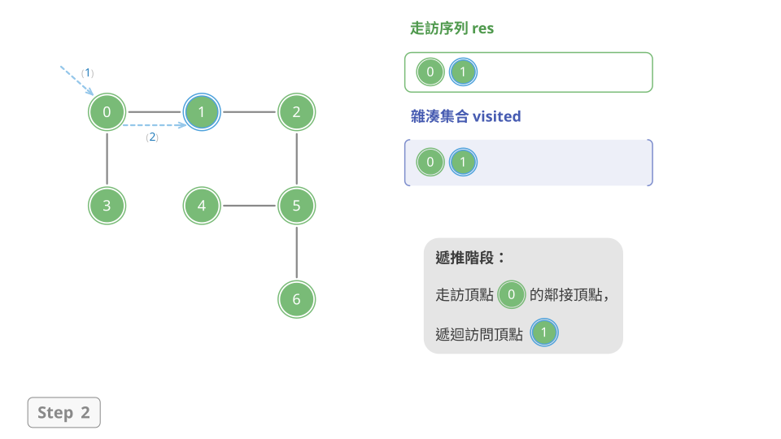

=== "<3>"
    

=== "<4>"
    

=== "<5>"
    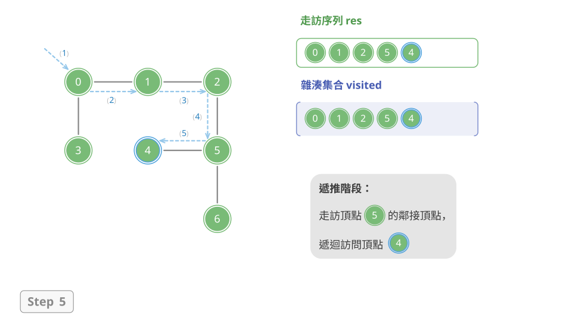

=== "<6>"
    

=== "<7>"
    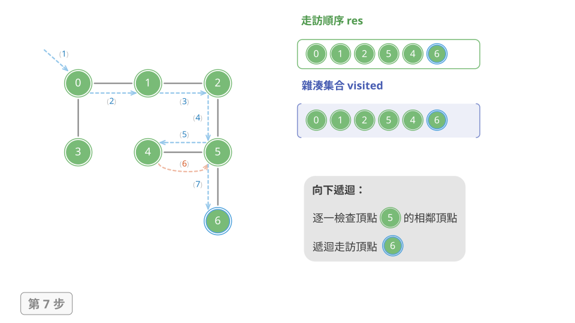

=== "<8>"
    

=== "<9>"
    

=== "<10>"
    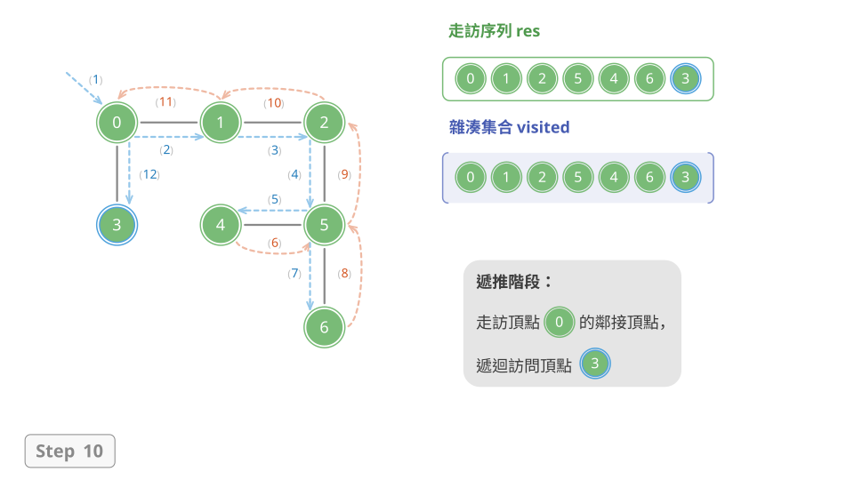

=== "<11>"
    

!!! question "深度優先走訪的順序只有一種嗎？"

    和廣度優先走訪一樣，深度優先走訪的順序也不只一種。從某個頂點出發時，可以先往任一方向探索。無論如何調整相鄰頂點的順序，都仍是深度優先走訪。
    
    以樹的走訪為例，「根 $\rightarrow$ 左 $\rightarrow$ 右」、「左 $\rightarrow$ 根 $\rightarrow$ 右」、「左 $\rightarrow$ 右 $\rightarrow$ 根」分別對應前序、中序、後序走訪。雖然三者的走訪優先順序不同，但都屬於深度優先走訪。

### 複雜度分析

**時間複雜度**：每個頂點都會走訪 $1$ 次，耗時 $O(|V|)$。每條邊都會走訪 $2$ 次，耗時 $O(2|E|)$。總共耗時 $O(|V| + |E|)$。

**空間複雜度**：串列 `res` 與雜湊集合 `visited` 各自最多存放 $|V|$ 個頂點，遞迴深度最多為 $|V|$，因此所需空間為 $O(|V|)$。
