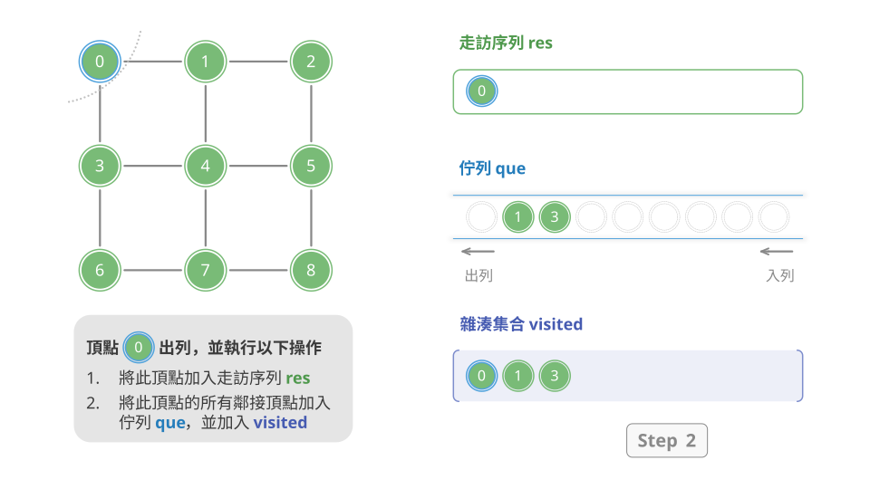
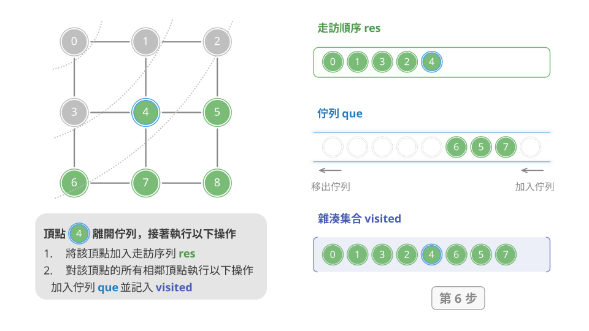
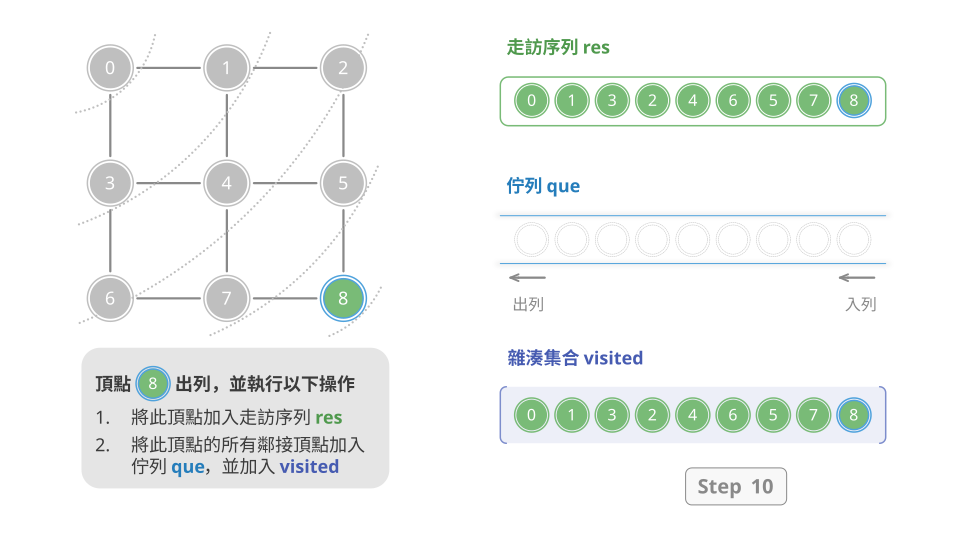
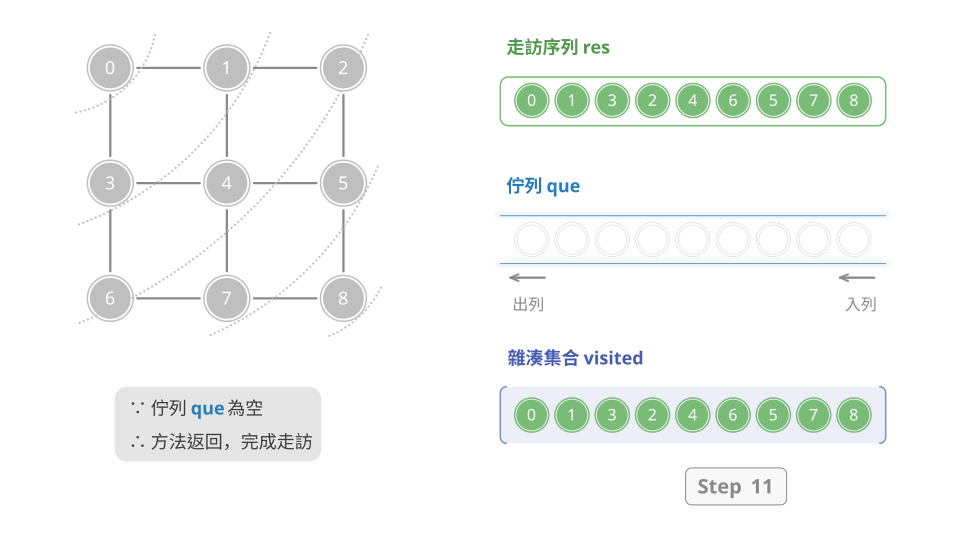
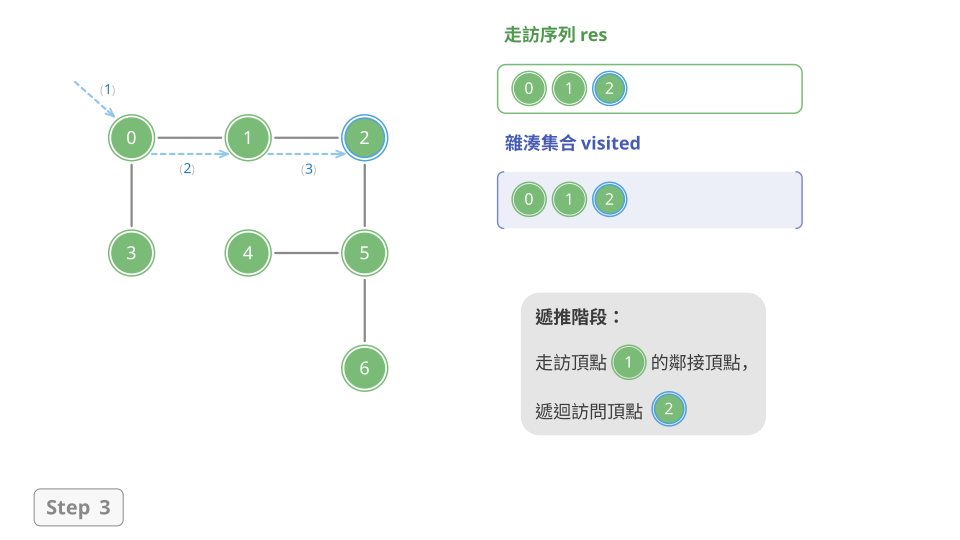
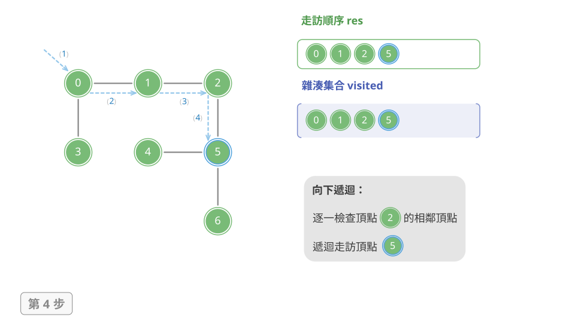
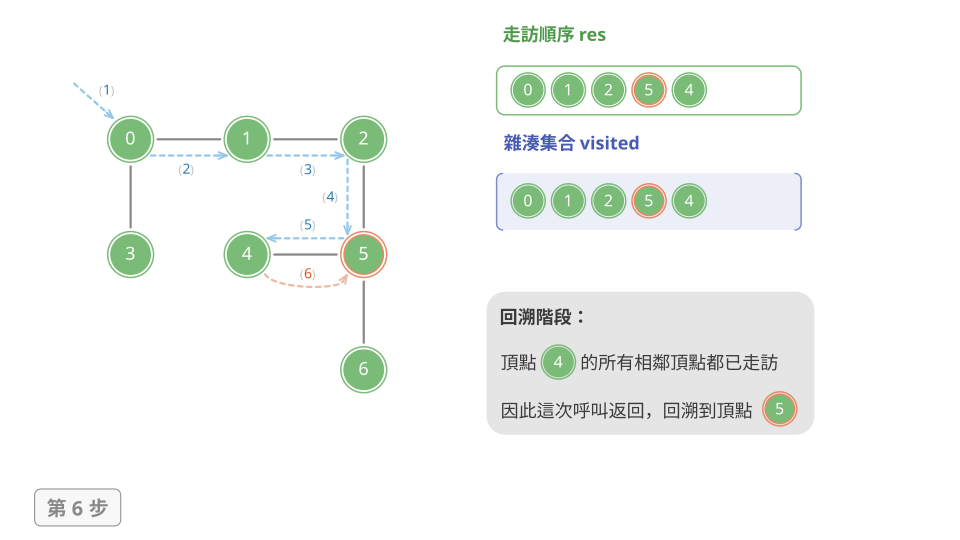
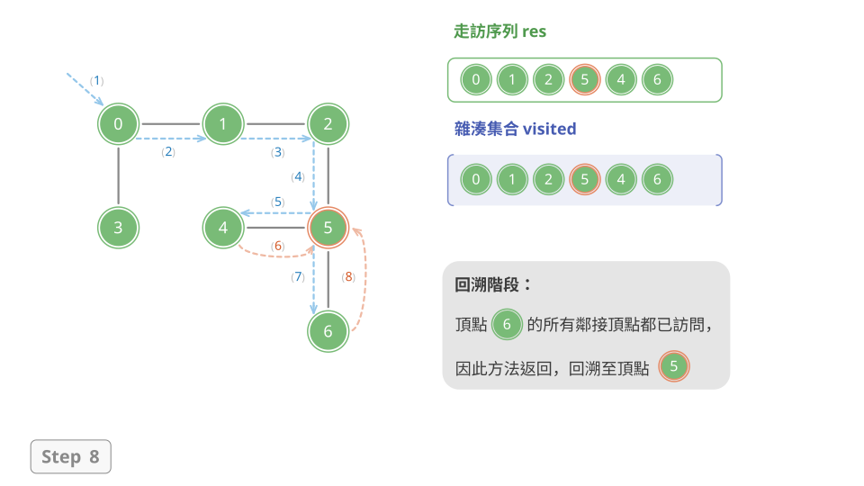
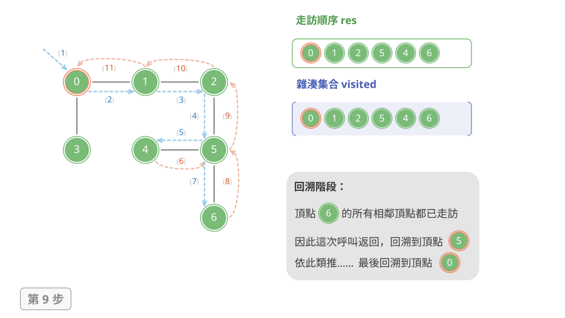
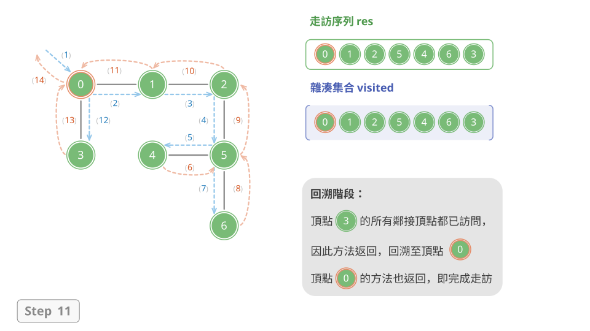

# 9.3 &nbsp; 圖的走訪

樹代表「一對多」的關係，圖的連接方式更自由，可以表示任意的「多對多」關係。因此，樹可以視為圖的一種特例。由此可知，**樹的走訪也是圖的走訪的一種特例**。

圖和樹都可以透過搜尋演算法來走訪。圖的走訪方式也分為兩種：<u>廣度優先走訪</u>與<u>深度優先走訪</u>。

## 9.3.1 &nbsp; 廣度優先走訪

**廣度優先走訪從某個節點出發，總是優先走訪距離起點最近的頂點，由近而遠逐層向外擴展**。如圖 9-9 所示，從左上角的頂點出發，先走訪該頂點的所有相鄰頂點，再走訪下一個頂點的所有相鄰頂點，依此類推，直到走訪完所有頂點。

{ class="animation-figure" }

<p align="center"> 圖 9-9 &nbsp; 圖的廣度優先走訪 </p>

### 1. &nbsp; 演算法實作

BFS 通常以佇列實作，程式碼如下。佇列「先進先出」的特性，正好配合 BFS「由近而遠」的走訪順序。

1. 將起始頂點 `startVet` 加入佇列，開始執行迴圈。
2. 每一輪都從佇列前端取出頂點，記錄走訪結果，再將該頂點的所有相鄰頂點加入佇列尾端。
3. 重複步驟 `2.`，直到所有頂點都已走訪為止。

為了避免重複走訪頂點，我們使用雜湊集合 `visited` 記錄已走訪的節點。

!!! tip

    雜湊集合可以視為只儲存 `key`、不儲存 `value` 的雜湊表，能以 $O(1)$ 的時間複雜度對 `key` 執行新增、刪除、查詢與修改。由於 `key` 不會重複，雜湊集合常用來移除重複資料。

=== "Python"

    ```python title="graph_bfs.py"
    def graph_bfs(graph: GraphAdjList, start_vet: Vertex) -> list[Vertex]:
        """廣度優先走訪"""
        # 以鄰接串列表示圖，以便取得指定頂點的所有相鄰頂點
        # 頂點走訪順序
        res = []
        # 用雜湊集合記錄已走訪的頂點
        visited = set[Vertex]([start_vet])
        # 使用佇列實作 BFS
        que = deque[Vertex]([start_vet])
        # 從頂點 vet 出發，反覆執行，直到走訪完所有頂點
        while len(que) > 0:
            vet = que.popleft()  # 取出佇列前端的頂點
            res.append(vet)  # 記錄走訪的頂點
            # 走訪此頂點的所有相鄰頂點
            for adj_vet in graph.adj_list[vet]:
                if adj_vet in visited:
                    continue  # 略過已走訪的頂點
                que.append(adj_vet)  # 只將尚未走訪的頂點加入佇列
                visited.add(adj_vet)  # 將此頂點標記為已走訪
        # 回傳頂點的走訪順序
        return res
    ```

=== "C++"

    ```cpp title="graph_bfs.cpp"
    /* 廣度優先走訪 */
    // 以鄰接串列表示圖，以便取得指定頂點的所有相鄰頂點
    vector<Vertex *> graphBFS(GraphAdjList &graph, Vertex *startVet) {
        // 頂點走訪順序
        vector<Vertex *> res;
        // 用雜湊集合記錄已走訪的頂點
        unordered_set<Vertex *> visited = {startVet};
        // 使用佇列實作 BFS
        queue<Vertex *> que;
        que.push(startVet);
        // 從頂點 vet 出發，反覆執行，直到走訪完所有頂點
        while (!que.empty()) {
            Vertex *vet = que.front();
            que.pop();          // 取出佇列前端的頂點
            res.push_back(vet); // 記錄走訪的頂點
            // 走訪此頂點的所有相鄰頂點
            for (auto adjVet : graph.adjList[vet]) {
                if (visited.count(adjVet))
                    continue;            // 略過已走訪的頂點
                que.push(adjVet);        // 只將尚未走訪的頂點加入佇列
                visited.emplace(adjVet); // 將此頂點標記為已走訪
            }
        }
        // 回傳頂點的走訪順序
        return res;
    }
    ```

=== "Java"

    ```java title="graph_bfs.java"
    /* 廣度優先走訪 */
    // 以鄰接串列表示圖，以便取得指定頂點的所有相鄰頂點
    List<Vertex> graphBFS(GraphAdjList graph, Vertex startVet) {
        // 頂點走訪順序
        List<Vertex> res = new ArrayList<>();
        // 用雜湊集合記錄已走訪的頂點
        Set<Vertex> visited = new HashSet<>();
        visited.add(startVet);
        // 使用佇列實作 BFS
        Queue<Vertex> que = new LinkedList<>();
        que.offer(startVet);
        // 從頂點 vet 出發，反覆執行，直到走訪完所有頂點
        while (!que.isEmpty()) {
            Vertex vet = que.poll(); // 取出佇列前端的頂點
            res.add(vet);            // 記錄走訪的頂點
            // 走訪此頂點的所有相鄰頂點
            for (Vertex adjVet : graph.adjList.get(vet)) {
                if (visited.contains(adjVet))
                    continue;        // 略過已走訪的頂點
                que.offer(adjVet);   // 只將尚未走訪的頂點加入佇列
                visited.add(adjVet); // 將此頂點標記為已走訪
            }
        }
        // 回傳頂點的走訪順序
        return res;
    }
    ```

=== "C#"

    ```csharp title="graph_bfs.cs"
    /* 廣度優先走訪 */
    // 以鄰接串列表示圖，以便取得指定頂點的所有相鄰頂點
    List<Vertex> GraphBFS(GraphAdjList graph, Vertex startVet) {
        // 頂點走訪順序
        List<Vertex> res = [];
        // 用雜湊集合記錄已走訪的頂點
        HashSet<Vertex> visited = [startVet];
        // 使用佇列實作 BFS
        Queue<Vertex> que = new();
        que.Enqueue(startVet);
        // 從頂點 vet 出發，反覆執行，直到走訪完所有頂點
        while (que.Count > 0) {
            Vertex vet = que.Dequeue(); // 取出佇列前端的頂點
            res.Add(vet);               // 記錄走訪的頂點
            foreach (Vertex adjVet in graph.adjList[vet]) {
                if (visited.Contains(adjVet)) {
                    continue;          // 略過已走訪的頂點
                }
                que.Enqueue(adjVet);   // 只將尚未走訪的頂點加入佇列
                visited.Add(adjVet);   // 將此頂點標記為已走訪
            }
        }

        // 回傳頂點的走訪順序
        return res;
    }
    ```

=== "Go"

    ```go title="graph_bfs.go"
    /* 廣度優先走訪 */
    // 以鄰接串列表示圖，以便取得指定頂點的所有相鄰頂點
    func graphBFS(g *graphAdjList, startVet Vertex) []Vertex {
        // 頂點走訪順序
        res := make([]Vertex, 0)
        // 用雜湊集合記錄已走訪的頂點
        visited := make(map[Vertex]struct{})
        visited[startVet] = struct{}{}
        // 以切片模擬佇列，用來實作 BFS
        queue := make([]Vertex, 0)
        queue = append(queue, startVet)
        // 從頂點 vet 出發，反覆執行，直到走訪完所有頂點
        for len(queue) > 0 {
            // 取出佇列前端的頂點
            vet := queue[0]
            queue = queue[1:]
            // 記錄走訪的頂點
            res = append(res, vet)
            // 走訪此頂點的所有相鄰頂點
            for _, adjVet := range g.adjList[vet] {
                _, isExist := visited[adjVet]
                // 只將尚未走訪的頂點加入佇列
                if !isExist {
                    queue = append(queue, adjVet)
                    visited[adjVet] = struct{}{}
                }
            }
        }
        // 回傳頂點的走訪順序
        return res
    }
    ```

=== "Swift"

    ```swift title="graph_bfs.swift"
    /* 廣度優先走訪 */
    // 以鄰接串列表示圖，以便取得指定頂點的所有相鄰頂點
    func graphBFS(graph: GraphAdjList, startVet: Vertex) -> [Vertex] {
        // 頂點走訪順序
        var res: [Vertex] = []
        // 用雜湊集合記錄已走訪的頂點
        var visited: Set<Vertex> = [startVet]
        // 使用佇列實作 BFS
        var que: [Vertex] = [startVet]
        // 從頂點 vet 出發，反覆執行，直到走訪完所有頂點
        while !que.isEmpty {
            let vet = que.removeFirst() // 取出佇列前端的頂點
            res.append(vet) // 記錄走訪的頂點
            // 走訪此頂點的所有相鄰頂點
            for adjVet in graph.adjList[vet] ?? [] {
                if visited.contains(adjVet) {
                    continue // 略過已走訪的頂點
                }
                que.append(adjVet) // 只將尚未走訪的頂點加入佇列
                visited.insert(adjVet) // 將此頂點標記為已走訪
            }
        }
        // 回傳頂點的走訪順序
        return res
    }
    ```

=== "JS"

    ```javascript title="graph_bfs.js"
    /* 廣度優先走訪 */
    // 以鄰接串列表示圖，以便取得指定頂點的所有相鄰頂點
    function graphBFS(graph, startVet) {
        // 頂點走訪順序
        const res = [];
        // 用雜湊集合記錄已走訪的頂點
        const visited = new Set();
        visited.add(startVet);
        // 使用佇列實作 BFS
        const que = [startVet];
        // 從頂點 vet 出發，反覆執行，直到走訪完所有頂點
        while (que.length) {
            const vet = que.shift(); // 取出佇列前端的頂點
            res.push(vet); // 記錄走訪的頂點
            // 走訪此頂點的所有相鄰頂點
            for (const adjVet of graph.adjList.get(vet) ?? []) {
                if (visited.has(adjVet)) {
                    continue; // 略過已走訪的頂點
                }
                que.push(adjVet); // 只將尚未走訪的頂點加入佇列
                visited.add(adjVet); // 將此頂點標記為已走訪
            }
        }
        // 回傳頂點的走訪順序
        return res;
    }
    ```

=== "TS"

    ```typescript title="graph_bfs.ts"
    /* 廣度優先走訪 */
    // 以鄰接串列表示圖，以便取得指定頂點的所有相鄰頂點
    function graphBFS(graph: GraphAdjList, startVet: Vertex): Vertex[] {
        // 頂點走訪順序
        const res: Vertex[] = [];
        // 用雜湊集合記錄已走訪的頂點
        const visited: Set<Vertex> = new Set();
        visited.add(startVet);
        // 使用佇列實作 BFS
        const que = [startVet];
        // 從頂點 vet 出發，反覆執行，直到走訪完所有頂點
        while (que.length) {
            const vet = que.shift(); // 取出佇列前端的頂點
            res.push(vet); // 記錄走訪的頂點
            // 走訪此頂點的所有相鄰頂點
            for (const adjVet of graph.adjList.get(vet) ?? []) {
                if (visited.has(adjVet)) {
                    continue; // 略過已走訪的頂點
                }
                que.push(adjVet); // 只將尚未走訪的頂點加入佇列
                visited.add(adjVet); // 將此頂點標記為已走訪
            }
        }
        // 回傳頂點的走訪順序
        return res;
    }
    ```

=== "Dart"

    ```dart title="graph_bfs.dart"
    /* 廣度優先走訪 */
    List<Vertex> graphBFS(GraphAdjList graph, Vertex startVet) {
      // 以鄰接串列表示圖，以便取得指定頂點的所有相鄰頂點
      // 頂點走訪順序
      List<Vertex> res = [];
      // 用雜湊集合記錄已走訪的頂點
      Set<Vertex> visited = {};
      visited.add(startVet);
      // 使用佇列實作 BFS
      Queue<Vertex> que = Queue();
      que.add(startVet);
      // 從頂點 vet 出發，反覆執行，直到走訪完所有頂點
      while (que.isNotEmpty) {
        Vertex vet = que.removeFirst(); // 取出佇列前端的頂點
        res.add(vet); // 記錄走訪的頂點
        // 走訪此頂點的所有相鄰頂點
        for (Vertex adjVet in graph.adjList[vet]!) {
          if (visited.contains(adjVet)) {
            continue; // 略過已走訪的頂點
          }
          que.add(adjVet); // 只將尚未走訪的頂點加入佇列
          visited.add(adjVet); // 將此頂點標記為已走訪
        }
      }
      // 回傳頂點的走訪順序
      return res;
    }
    ```

=== "Rust"

    ```rust title="graph_bfs.rs"
    /* 廣度優先走訪 */
    // 以鄰接串列表示圖，以便取得指定頂點的所有相鄰頂點
    fn graph_bfs(graph: GraphAdjList, start_vet: Vertex) -> Vec<Vertex> {
        // 頂點走訪順序
        let mut res = vec![];
        // 用雜湊集合記錄已走訪的頂點
        let mut visited = HashSet::new();
        visited.insert(start_vet);
        // 使用佇列實作 BFS
        let mut que = VecDeque::new();
        que.push_back(start_vet);
        // 從頂點 vet 出發，反覆執行，直到走訪完所有頂點
        while let Some(vet) = que.pop_front() {
            res.push(vet); // 記錄走訪的頂點

            // 走訪此頂點的所有相鄰頂點
            if let Some(adj_vets) = graph.adj_list.get(&vet) {
                for &adj_vet in adj_vets {
                    if visited.contains(&adj_vet) {
                        continue; // 略過已走訪的頂點
                    }
                    que.push_back(adj_vet); // 只將尚未走訪的頂點加入佇列
                    visited.insert(adj_vet); // 將此頂點標記為已走訪
                }
            }
        }
        // 回傳頂點的走訪順序
        res
    }
    ```

=== "C"

    ```c title="graph_bfs.c"
    /* 節點佇列結構 */
    typedef struct {
        Vertex *vertices[MAX_SIZE];
        int front, rear, size;
    } Queue;

    /* 建構函式 */
    Queue *newQueue() {
        Queue *q = (Queue *)malloc(sizeof(Queue));
        q->front = q->rear = q->size = 0;
        return q;
    }

    /* 判斷佇列是否為空 */
    int isEmpty(Queue *q) {
        return q->size == 0;
    }

    /* 加入佇列 */
    void enqueue(Queue *q, Vertex *vet) {
        q->vertices[q->rear] = vet;
        q->rear = (q->rear + 1) % MAX_SIZE;
        q->size++;
    }

    /* 移出佇列 */
    Vertex *dequeue(Queue *q) {
        Vertex *vet = q->vertices[q->front];
        q->front = (q->front + 1) % MAX_SIZE;
        q->size--;
        return vet;
    }

    /* 檢查頂點是否已走訪 */
    int isVisited(Vertex **visited, int size, Vertex *vet) {
        // 走訪並尋找節點，耗時 O(n)
        for (int i = 0; i < size; i++) {
            if (visited[i] == vet)
                return 1;
        }
        return 0;
    }

    /* 廣度優先走訪 */
    // 以鄰接串列表示圖，以便取得指定頂點的所有相鄰頂點
    void graphBFS(GraphAdjList *graph, Vertex *startVet, Vertex **res, int *resSize, Vertex **visited, int *visitedSize) {
        // 使用佇列實作 BFS
        Queue *queue = newQueue();
        enqueue(queue, startVet);
        visited[(*visitedSize)++] = startVet;
        // 從頂點 vet 出發，反覆執行，直到走訪完所有頂點
        while (!isEmpty(queue)) {
            Vertex *vet = dequeue(queue); // 取出佇列前端的頂點
            res[(*resSize)++] = vet;      // 記錄走訪的頂點
            // 走訪此頂點的所有相鄰頂點
            AdjListNode *node = findNode(graph, vet);
            while (node != NULL) {
                // 略過已走訪的頂點
                if (!isVisited(visited, *visitedSize, node->vertex)) {
                    enqueue(queue, node->vertex);             // 只將尚未走訪的頂點加入佇列
                    visited[(*visitedSize)++] = node->vertex; // 將此頂點標記為已走訪
                }
                node = node->next;
            }
        }
        // 釋放記憶體
        free(queue);
    }
    ```

=== "Kotlin"

    ```kotlin title="graph_bfs.kt"
    /* 廣度優先走訪 */
    // 以鄰接串列表示圖，以便取得指定頂點的所有相鄰頂點
    fun graphBFS(graph: GraphAdjList, startVet: Vertex): MutableList<Vertex?> {
        // 頂點走訪順序
        val res = mutableListOf<Vertex?>()
        // 用雜湊集合記錄已走訪的頂點
        val visited = HashSet<Vertex>()
        visited.add(startVet)
        // 使用佇列實作 BFS
        val que = LinkedList<Vertex>()
        que.offer(startVet)
        // 從頂點 vet 出發，反覆執行，直到走訪完所有頂點
        while (!que.isEmpty()) {
            val vet = que.poll() // 取出佇列前端的頂點
            res.add(vet)         // 記錄走訪的頂點
            // 走訪此頂點的所有相鄰頂點
            for (adjVet in graph.adjList[vet]!!) {
                if (visited.contains(adjVet))
                    continue        // 略過已走訪的頂點
                que.offer(adjVet)   // 只將尚未走訪的頂點加入佇列
                visited.add(adjVet) // 將此頂點標記為已走訪
            }
        }
        // 回傳頂點的走訪順序
        return res
    }
    ```

=== "Ruby"

    ```ruby title="graph_bfs.rb"
    ### 廣度優先走訪 ###
    def graph_bfs(graph, start_vet)
      # 以鄰接串列表示圖，以便取得指定頂點的所有相鄰頂點
      # 頂點走訪順序
      res = []
      # 用雜湊集合記錄已走訪的頂點
      visited = Set.new([start_vet])
      # 使用佇列實作 BFS
      que = [start_vet]
      # 從頂點 vet 出發，反覆執行，直到走訪完所有頂點
      while que.length > 0
        vet = que.shift # 取出佇列前端的頂點
        res << vet # 記錄走訪的頂點
        # 走訪此頂點的所有相鄰頂點
        for adj_vet in graph.adj_list[vet]
          next if visited.include?(adj_vet) # 略過已走訪的頂點
          que << adj_vet # 只將尚未走訪的頂點加入佇列
          visited.add(adj_vet) # 將此頂點標記為已走訪
        end
      end
      # 回傳頂點的走訪順序
      res
    end
    ```

??? pythontutor "執行視覺化示範"

    <div style="height: 549px; width: 100%;"><iframe class="pythontutor-iframe" title="執行視覺化示範" src="https://pythontutor.com/iframe-embed.html#code=from%20collections%20import%20deque%0A%0Aclass%20Vertex%3A%0A%20%20%20%20%22%22%22%E9%A0%82%E9%BB%9E%E9%A1%9E%E5%88%A5%22%22%22%0A%20%20%20%20def%20__init__%28self,%20val%3A%20int%29%3A%0A%20%20%20%20%20%20%20%20self.val%20%3D%20val%0A%0Adef%20vals_to_vets%28vals%3A%20list%5Bint%5D%29%20-%3E%20list%5B%22Vertex%22%5D%3A%0A%20%20%20%20%22%22%22%E5%82%B3%E5%85%A5%E5%80%BC%E4%B8%B2%E5%88%97%20vals%EF%BC%8C%E5%9B%9E%E5%82%B3%E9%A0%82%E9%BB%9E%E4%B8%B2%E5%88%97%20vets%22%22%22%0A%20%20%20%20return%20%5BVertex%28val%29%20for%20val%20in%20vals%5D%0A%0Aclass%20GraphAdjList%3A%0A%20%20%20%20%22%22%22%E4%BB%A5%E9%84%B0%E6%8E%A5%E4%B8%B2%E5%88%97%E5%AF%A6%E4%BD%9C%E7%9A%84%E7%84%A1%E5%90%91%E5%9C%96%E9%A1%9E%E5%88%A5%22%22%22%0A%0A%20%20%20%20def%20__init__%28self,%20edges%3A%20list%5Blist%5BVertex%5D%5D%29%3A%0A%20%20%20%20%20%20%20%20%22%22%22%E5%BB%BA%E6%A7%8B%E5%BC%8F%22%22%22%0A%20%20%20%20%20%20%20%20self.adj_list%20%3D%20dict%5BVertex,%20list%5BVertex%5D%5D%28%29%0A%20%20%20%20%20%20%20%20for%20edge%20in%20edges%3A%0A%20%20%20%20%20%20%20%20%20%20%20%20self.add_vertex%28edge%5B0%5D%29%0A%20%20%20%20%20%20%20%20%20%20%20%20self.add_vertex%28edge%5B1%5D%29%0A%20%20%20%20%20%20%20%20%20%20%20%20self.add_edge%28edge%5B0%5D,%20edge%5B1%5D%29%0A%0A%20%20%20%20def%20add_edge%28self,%20vet1%3A%20Vertex,%20vet2%3A%20Vertex%29%3A%0A%20%20%20%20%20%20%20%20%22%22%22%E6%96%B0%E5%A2%9E%E9%82%8A%22%22%22%0A%20%20%20%20%20%20%20%20if%20vet1%20not%20in%20self.adj_list%20or%20vet2%20not%20in%20self.adj_list%20or%20vet1%20%3D%3D%20vet2%3A%0A%20%20%20%20%20%20%20%20%20%20%20%20raise%20ValueError%28%29%0A%20%20%20%20%20%20%20%20self.adj_list%5Bvet1%5D.append%28vet2%29%0A%20%20%20%20%20%20%20%20self.adj_list%5Bvet2%5D.append%28vet1%29%0A%0A%20%20%20%20def%20add_vertex%28self,%20vet%3A%20Vertex%29%3A%0A%20%20%20%20%20%20%20%20%22%22%22%E6%96%B0%E5%A2%9E%E9%A0%82%E9%BB%9E%22%22%22%0A%20%20%20%20%20%20%20%20if%20vet%20in%20self.adj_list%3A%0A%20%20%20%20%20%20%20%20%20%20%20%20return%0A%20%20%20%20%20%20%20%20self.adj_list%5Bvet%5D%20%3D%20%5B%5D%0A%0A%0Adef%20graph_bfs%28graph%3A%20GraphAdjList,%20start_vet%3A%20Vertex%29%20-%3E%20list%5BVertex%5D%3A%0A%20%20%20%20%22%22%22%E5%BB%A3%E5%BA%A6%E5%84%AA%E5%85%88%E8%B5%B0%E8%A8%AA%22%22%22%0A%20%20%20%20%23%20%E9%A0%82%E9%BB%9E%E8%B5%B0%E8%A8%AA%E9%A0%86%E5%BA%8F%0A%20%20%20%20res%20%3D%20%5B%5D%0A%20%20%20%20%23%20%E7%94%A8%E9%9B%9C%E6%B9%8A%E8%A1%A8%E8%A8%98%E9%8C%84%E5%B7%B2%E8%B5%B0%E8%A8%AA%E7%9A%84%E9%A0%82%E9%BB%9E%0A%20%20%20%20visited%20%3D%20set%5BVertex%5D%28%5Bstart_vet%5D%29%0A%20%20%20%20%23%20%E4%BD%BF%E7%94%A8%E4%BD%87%E5%88%97%E5%AF%A6%E4%BD%9C%20BFS%0A%20%20%20%20que%20%3D%20deque%5BVertex%5D%28%5Bstart_vet%5D%29%0A%20%20%20%20%23%20%E5%BE%9E%E9%A0%82%E9%BB%9E%20vet%20%E5%87%BA%E7%99%BC%EF%BC%8C%E5%8F%8D%E8%A6%86%E5%9F%B7%E8%A1%8C%EF%BC%8C%E7%9B%B4%E5%88%B0%E8%B5%B0%E8%A8%AA%E5%AE%8C%E6%89%80%E6%9C%89%E9%A0%82%E9%BB%9E%0A%20%20%20%20while%20len%28que%29%20%3E%200%3A%0A%20%20%20%20%20%20%20%20vet%20%3D%20que.popleft%28%29%20%20%23%20%E5%8F%96%E5%87%BA%E4%BD%87%E5%88%97%E5%89%8D%E7%AB%AF%E7%9A%84%E9%A0%82%E9%BB%9E%0A%20%20%20%20%20%20%20%20res.append%28vet%29%20%20%23%20%E8%A8%98%E9%8C%84%E8%B5%B0%E8%A8%AA%E7%9A%84%E9%A0%82%E9%BB%9E%0A%20%20%20%20%20%20%20%20%23%20%E8%B5%B0%E8%A8%AA%E6%AD%A4%E9%A0%82%E9%BB%9E%E7%9A%84%E6%89%80%E6%9C%89%E7%9B%B8%E9%84%B0%E9%A0%82%E9%BB%9E%0A%20%20%20%20%20%20%20%20for%20adj_vet%20in%20graph.adj_list%5Bvet%5D%3A%0A%20%20%20%20%20%20%20%20%20%20%20%20if%20adj_vet%20in%20visited%3A%0A%20%20%20%20%20%20%20%20%20%20%20%20%20%20%20%20continue%20%20%23%20%E7%95%A5%E9%81%8E%E5%B7%B2%E8%B5%B0%E8%A8%AA%E7%9A%84%E9%A0%82%E9%BB%9E%0A%20%20%20%20%20%20%20%20%20%20%20%20que.append%28adj_vet%29%20%20%23%20%E5%8F%AA%E5%B0%87%E5%B0%9A%E6%9C%AA%E8%B5%B0%E8%A8%AA%E7%9A%84%E9%A0%82%E9%BB%9E%E5%8A%A0%E5%85%A5%E4%BD%87%E5%88%97%0A%20%20%20%20%20%20%20%20%20%20%20%20visited.add%28adj_vet%29%20%20%23%20%E5%B0%87%E6%AD%A4%E9%A0%82%E9%BB%9E%E6%A8%99%E8%A8%98%E7%82%BA%E5%B7%B2%E8%B5%B0%E8%A8%AA%0A%20%20%20%20%23%20%E5%9B%9E%E5%82%B3%E9%A0%82%E9%BB%9E%E7%9A%84%E8%B5%B0%E8%A8%AA%E9%A0%86%E5%BA%8F%0A%20%20%20%20return%20res%0A%0A%22%22%22Driver%20Code%22%22%22%0Aif%20__name__%20%3D%3D%20%22__main__%22%3A%0A%20%20%20%20%23%20%E5%88%9D%E5%A7%8B%E5%8C%96%E7%84%A1%E5%90%91%E5%9C%96%0A%20%20%20%20v%20%3D%20vals_to_vets%28%5B0,%201,%202,%203,%204%5D%29%0A%20%20%20%20edges%20%3D%20%5B%0A%20%20%20%20%20%20%20%20%5Bv%5B0%5D,%20v%5B1%5D%5D,%0A%20%20%20%20%20%20%20%20%5Bv%5B0%5D,%20v%5B3%5D%5D,%0A%20%20%20%20%20%20%20%20%5Bv%5B1%5D,%20v%5B2%5D%5D,%0A%20%20%20%20%20%20%20%20%5Bv%5B1%5D,%20v%5B4%5D%5D,%0A%20%20%20%20%20%20%20%20%5Bv%5B3%5D,%20v%5B4%5D%5D,%0A%20%20%20%20%5D%0A%20%20%20%20graph%20%3D%20GraphAdjList%28edges%29%0A%20%20%20%20del%20edges%0A%0A%20%20%20%20%23%20%E5%BB%A3%E5%BA%A6%E5%84%AA%E5%85%88%E8%B5%B0%E8%A8%AA%0A%20%20%20%20res%20%3D%20graph_bfs%28graph,%20v%5B0%5D%29&codeDivHeight=472&codeDivWidth=350&cumulative=false&curInstr=131&heapPrimitives=nevernest&origin=opt-frontend.js&py=311&rawInputLstJSON=%5B%5D&textReferences=false"> </iframe></div>
    <div style="margin-top: 5px;"><a href="https://pythontutor.com/iframe-embed.html#code=from%20collections%20import%20deque%0A%0Aclass%20Vertex%3A%0A%20%20%20%20%22%22%22%E9%A0%82%E9%BB%9E%E9%A1%9E%E5%88%A5%22%22%22%0A%20%20%20%20def%20__init__%28self,%20val%3A%20int%29%3A%0A%20%20%20%20%20%20%20%20self.val%20%3D%20val%0A%0Adef%20vals_to_vets%28vals%3A%20list%5Bint%5D%29%20-%3E%20list%5B%22Vertex%22%5D%3A%0A%20%20%20%20%22%22%22%E5%82%B3%E5%85%A5%E5%80%BC%E4%B8%B2%E5%88%97%20vals%EF%BC%8C%E5%9B%9E%E5%82%B3%E9%A0%82%E9%BB%9E%E4%B8%B2%E5%88%97%20vets%22%22%22%0A%20%20%20%20return%20%5BVertex%28val%29%20for%20val%20in%20vals%5D%0A%0Aclass%20GraphAdjList%3A%0A%20%20%20%20%22%22%22%E4%BB%A5%E9%84%B0%E6%8E%A5%E4%B8%B2%E5%88%97%E5%AF%A6%E4%BD%9C%E7%9A%84%E7%84%A1%E5%90%91%E5%9C%96%E9%A1%9E%E5%88%A5%22%22%22%0A%0A%20%20%20%20def%20__init__%28self,%20edges%3A%20list%5Blist%5BVertex%5D%5D%29%3A%0A%20%20%20%20%20%20%20%20%22%22%22%E5%BB%BA%E6%A7%8B%E5%BC%8F%22%22%22%0A%20%20%20%20%20%20%20%20self.adj_list%20%3D%20dict%5BVertex,%20list%5BVertex%5D%5D%28%29%0A%20%20%20%20%20%20%20%20for%20edge%20in%20edges%3A%0A%20%20%20%20%20%20%20%20%20%20%20%20self.add_vertex%28edge%5B0%5D%29%0A%20%20%20%20%20%20%20%20%20%20%20%20self.add_vertex%28edge%5B1%5D%29%0A%20%20%20%20%20%20%20%20%20%20%20%20self.add_edge%28edge%5B0%5D,%20edge%5B1%5D%29%0A%0A%20%20%20%20def%20add_edge%28self,%20vet1%3A%20Vertex,%20vet2%3A%20Vertex%29%3A%0A%20%20%20%20%20%20%20%20%22%22%22%E6%96%B0%E5%A2%9E%E9%82%8A%22%22%22%0A%20%20%20%20%20%20%20%20if%20vet1%20not%20in%20self.adj_list%20or%20vet2%20not%20in%20self.adj_list%20or%20vet1%20%3D%3D%20vet2%3A%0A%20%20%20%20%20%20%20%20%20%20%20%20raise%20ValueError%28%29%0A%20%20%20%20%20%20%20%20self.adj_list%5Bvet1%5D.append%28vet2%29%0A%20%20%20%20%20%20%20%20self.adj_list%5Bvet2%5D.append%28vet1%29%0A%0A%20%20%20%20def%20add_vertex%28self,%20vet%3A%20Vertex%29%3A%0A%20%20%20%20%20%20%20%20%22%22%22%E6%96%B0%E5%A2%9E%E9%A0%82%E9%BB%9E%22%22%22%0A%20%20%20%20%20%20%20%20if%20vet%20in%20self.adj_list%3A%0A%20%20%20%20%20%20%20%20%20%20%20%20return%0A%20%20%20%20%20%20%20%20self.adj_list%5Bvet%5D%20%3D%20%5B%5D%0A%0A%0Adef%20graph_bfs%28graph%3A%20GraphAdjList,%20start_vet%3A%20Vertex%29%20-%3E%20list%5BVertex%5D%3A%0A%20%20%20%20%22%22%22%E5%BB%A3%E5%BA%A6%E5%84%AA%E5%85%88%E8%B5%B0%E8%A8%AA%22%22%22%0A%20%20%20%20%23%20%E9%A0%82%E9%BB%9E%E8%B5%B0%E8%A8%AA%E9%A0%86%E5%BA%8F%0A%20%20%20%20res%20%3D%20%5B%5D%0A%20%20%20%20%23%20%E7%94%A8%E9%9B%9C%E6%B9%8A%E8%A1%A8%E8%A8%98%E9%8C%84%E5%B7%B2%E8%B5%B0%E8%A8%AA%E7%9A%84%E9%A0%82%E9%BB%9E%0A%20%20%20%20visited%20%3D%20set%5BVertex%5D%28%5Bstart_vet%5D%29%0A%20%20%20%20%23%20%E4%BD%BF%E7%94%A8%E4%BD%87%E5%88%97%E5%AF%A6%E4%BD%9C%20BFS%0A%20%20%20%20que%20%3D%20deque%5BVertex%5D%28%5Bstart_vet%5D%29%0A%20%20%20%20%23%20%E5%BE%9E%E9%A0%82%E9%BB%9E%20vet%20%E5%87%BA%E7%99%BC%EF%BC%8C%E5%8F%8D%E8%A6%86%E5%9F%B7%E8%A1%8C%EF%BC%8C%E7%9B%B4%E5%88%B0%E8%B5%B0%E8%A8%AA%E5%AE%8C%E6%89%80%E6%9C%89%E9%A0%82%E9%BB%9E%0A%20%20%20%20while%20len%28que%29%20%3E%200%3A%0A%20%20%20%20%20%20%20%20vet%20%3D%20que.popleft%28%29%20%20%23%20%E5%8F%96%E5%87%BA%E4%BD%87%E5%88%97%E5%89%8D%E7%AB%AF%E7%9A%84%E9%A0%82%E9%BB%9E%0A%20%20%20%20%20%20%20%20res.append%28vet%29%20%20%23%20%E8%A8%98%E9%8C%84%E8%B5%B0%E8%A8%AA%E7%9A%84%E9%A0%82%E9%BB%9E%0A%20%20%20%20%20%20%20%20%23%20%E8%B5%B0%E8%A8%AA%E6%AD%A4%E9%A0%82%E9%BB%9E%E7%9A%84%E6%89%80%E6%9C%89%E7%9B%B8%E9%84%B0%E9%A0%82%E9%BB%9E%0A%20%20%20%20%20%20%20%20for%20adj_vet%20in%20graph.adj_list%5Bvet%5D%3A%0A%20%20%20%20%20%20%20%20%20%20%20%20if%20adj_vet%20in%20visited%3A%0A%20%20%20%20%20%20%20%20%20%20%20%20%20%20%20%20continue%20%20%23%20%E7%95%A5%E9%81%8E%E5%B7%B2%E8%B5%B0%E8%A8%AA%E7%9A%84%E9%A0%82%E9%BB%9E%0A%20%20%20%20%20%20%20%20%20%20%20%20que.append%28adj_vet%29%20%20%23%20%E5%8F%AA%E5%B0%87%E5%B0%9A%E6%9C%AA%E8%B5%B0%E8%A8%AA%E7%9A%84%E9%A0%82%E9%BB%9E%E5%8A%A0%E5%85%A5%E4%BD%87%E5%88%97%0A%20%20%20%20%20%20%20%20%20%20%20%20visited.add%28adj_vet%29%20%20%23%20%E5%B0%87%E6%AD%A4%E9%A0%82%E9%BB%9E%E6%A8%99%E8%A8%98%E7%82%BA%E5%B7%B2%E8%B5%B0%E8%A8%AA%0A%20%20%20%20%23%20%E5%9B%9E%E5%82%B3%E9%A0%82%E9%BB%9E%E7%9A%84%E8%B5%B0%E8%A8%AA%E9%A0%86%E5%BA%8F%0A%20%20%20%20return%20res%0A%0A%22%22%22Driver%20Code%22%22%22%0Aif%20__name__%20%3D%3D%20%22__main__%22%3A%0A%20%20%20%20%23%20%E5%88%9D%E5%A7%8B%E5%8C%96%E7%84%A1%E5%90%91%E5%9C%96%0A%20%20%20%20v%20%3D%20vals_to_vets%28%5B0,%201,%202,%203,%204%5D%29%0A%20%20%20%20edges%20%3D%20%5B%0A%20%20%20%20%20%20%20%20%5Bv%5B0%5D,%20v%5B1%5D%5D,%0A%20%20%20%20%20%20%20%20%5Bv%5B0%5D,%20v%5B3%5D%5D,%0A%20%20%20%20%20%20%20%20%5Bv%5B1%5D,%20v%5B2%5D%5D,%0A%20%20%20%20%20%20%20%20%5Bv%5B1%5D,%20v%5B4%5D%5D,%0A%20%20%20%20%20%20%20%20%5Bv%5B3%5D,%20v%5B4%5D%5D,%0A%20%20%20%20%5D%0A%20%20%20%20graph%20%3D%20GraphAdjList%28edges%29%0A%20%20%20%20del%20edges%0A%0A%20%20%20%20%23%20%E5%BB%A3%E5%BA%A6%E5%84%AA%E5%85%88%E8%B5%B0%E8%A8%AA%0A%20%20%20%20res%20%3D%20graph_bfs%28graph,%20v%5B0%5D%29&codeDivHeight=800&codeDivWidth=600&cumulative=false&curInstr=131&heapPrimitives=nevernest&origin=opt-frontend.js&py=311&rawInputLstJSON=%5B%5D&textReferences=false" target="_blank" rel="noopener noreferrer">全螢幕觀看 ></a></div>

光看程式碼可能比較抽象，可以對照圖 9-10 來理解。

=== "<1>"
    { class="animation-figure" }

=== "<2>"
    { class="animation-figure" }

=== "<3>"
    { class="animation-figure" }

=== "<4>"
    { class="animation-figure" }

=== "<5>"
    { class="animation-figure" }

=== "<6>"
    { class="animation-figure" }

=== "<7>"
    { class="animation-figure" }

=== "<8>"
    { class="animation-figure" }

=== "<9>"
    { class="animation-figure" }

=== "<10>"
    { class="animation-figure" }

=== "<11>"
    { class="animation-figure" }

<p align="center"> 圖 9-10 &nbsp; 圖的廣度優先走訪步驟 </p>

!!! question "廣度優先走訪的順序只有一種嗎？"

    不只一種。廣度優先走訪只要求「由近而遠」，**距離相同的頂點可以任意調整走訪順序**。以圖 9-10 為例，頂點 $1$、$3$ 的走訪順序可以互換，頂點 $2$、$4$、$6$ 的走訪順序也可以任意調整。

### 2. &nbsp; 複雜度分析

**時間複雜度**：每個頂點都會進出佇列各一次，耗時 $O(|V|)$。走訪相鄰頂點時，由於是無向圖，每條邊都會走訪 $2$ 次，耗時 $O(2|E|)$。總共耗時 $O(|V| + |E|)$。

**空間複雜度**：串列 `res`、雜湊集合 `visited` 與佇列 `que` 各自最多存放 $|V|$ 個頂點，所需空間為 $O(|V|)$。

## 9.3.2 &nbsp; 深度優先走訪

**深度優先走訪會沿著一條路一直走到底，無路可走時才回頭**。如圖 9-11 所示，從左上角的頂點出發，每次走訪目前頂點的一個相鄰頂點，走到盡頭就返回，再沿另一條路走到底並返回。如此反覆，直到走訪完所有頂點。

{ class="animation-figure" }

<p align="center"> 圖 9-11 &nbsp; 圖的深度優先走訪 </p>

### 1. &nbsp; 演算法實作

這種「走到盡頭再返回」的演算法通常以遞迴實作。和廣度優先走訪一樣，深度優先走訪也需要用雜湊集合 `visited` 記錄已走訪的頂點，以免重複走訪。

=== "Python"

    ```python title="graph_dfs.py"
    def dfs(graph: GraphAdjList, visited: set[Vertex], res: list[Vertex], vet: Vertex):
        """深度優先走訪的輔助函式"""
        res.append(vet)  # 記錄走訪的頂點
        visited.add(vet)  # 將此頂點標記為已走訪
        # 走訪此頂點的所有相鄰頂點
        for adjVet in graph.adj_list[vet]:
            if adjVet in visited:
                continue  # 略過已走訪的頂點
            # 遞迴走訪相鄰頂點
            dfs(graph, visited, res, adjVet)

    def graph_dfs(graph: GraphAdjList, start_vet: Vertex) -> list[Vertex]:
        """深度優先走訪"""
        # 以鄰接串列表示圖，以便取得指定頂點的所有相鄰頂點
        # 頂點走訪順序
        res = []
        # 用雜湊集合記錄已走訪的頂點
        visited = set[Vertex]()
        dfs(graph, visited, res, start_vet)
        return res
    ```

=== "C++"

    ```cpp title="graph_dfs.cpp"
    /* 深度優先走訪的輔助函式 */
    void dfs(GraphAdjList &graph, unordered_set<Vertex *> &visited, vector<Vertex *> &res, Vertex *vet) {
        res.push_back(vet);   // 記錄走訪的頂點
        visited.emplace(vet); // 將此頂點標記為已走訪
        // 走訪此頂點的所有相鄰頂點
        for (Vertex *adjVet : graph.adjList[vet]) {
            if (visited.count(adjVet))
                continue; // 略過已走訪的頂點
            // 遞迴走訪相鄰頂點
            dfs(graph, visited, res, adjVet);
        }
    }

    /* 深度優先走訪 */
    // 以鄰接串列表示圖，以便取得指定頂點的所有相鄰頂點
    vector<Vertex *> graphDFS(GraphAdjList &graph, Vertex *startVet) {
        // 頂點走訪順序
        vector<Vertex *> res;
        // 用雜湊集合記錄已走訪的頂點
        unordered_set<Vertex *> visited;
        dfs(graph, visited, res, startVet);
        return res;
    }
    ```

=== "Java"

    ```java title="graph_dfs.java"
    /* 深度優先走訪的輔助函式 */
    void dfs(GraphAdjList graph, Set<Vertex> visited, List<Vertex> res, Vertex vet) {
        res.add(vet);     // 記錄走訪的頂點
        visited.add(vet); // 將此頂點標記為已走訪
        // 走訪此頂點的所有相鄰頂點
        for (Vertex adjVet : graph.adjList.get(vet)) {
            if (visited.contains(adjVet))
                continue; // 略過已走訪的頂點
            // 遞迴走訪相鄰頂點
            dfs(graph, visited, res, adjVet);
        }
    }

    /* 深度優先走訪 */
    // 以鄰接串列表示圖，以便取得指定頂點的所有相鄰頂點
    List<Vertex> graphDFS(GraphAdjList graph, Vertex startVet) {
        // 頂點走訪順序
        List<Vertex> res = new ArrayList<>();
        // 用雜湊集合記錄已走訪的頂點
        Set<Vertex> visited = new HashSet<>();
        dfs(graph, visited, res, startVet);
        return res;
    }
    ```

=== "C#"

    ```csharp title="graph_dfs.cs"
    /* 深度優先走訪的輔助函式 */
    void DFS(GraphAdjList graph, HashSet<Vertex> visited, List<Vertex> res, Vertex vet) {
        res.Add(vet);     // 記錄走訪的頂點
        visited.Add(vet); // 將此頂點標記為已走訪
        // 走訪此頂點的所有相鄰頂點
        foreach (Vertex adjVet in graph.adjList[vet]) {
            if (visited.Contains(adjVet)) {
                continue; // 略過已走訪的頂點                             
            }
            // 遞迴走訪相鄰頂點
            DFS(graph, visited, res, adjVet);
        }
    }

    /* 深度優先走訪 */
    // 以鄰接串列表示圖，以便取得指定頂點的所有相鄰頂點
    List<Vertex> GraphDFS(GraphAdjList graph, Vertex startVet) {
        // 頂點走訪順序
        List<Vertex> res = [];
        // 用雜湊集合記錄已走訪的頂點
        HashSet<Vertex> visited = [];
        DFS(graph, visited, res, startVet);
        return res;
    }
    ```

=== "Go"

    ```go title="graph_dfs.go"
    /* 深度優先走訪的輔助函式 */
    func dfs(g *graphAdjList, visited map[Vertex]struct{}, res *[]Vertex, vet Vertex) {
        // append 會回傳新的切片參照，必須將它重新指派給原變數
        *res = append(*res, vet)
        visited[vet] = struct{}{}
        // 走訪此頂點的所有相鄰頂點
        for _, adjVet := range g.adjList[vet] {
            _, isExist := visited[adjVet]
            // 遞迴走訪相鄰頂點
            if !isExist {
                dfs(g, visited, res, adjVet)
            }
        }
    }

    /* 深度優先走訪 */
    // 以鄰接串列表示圖，以便取得指定頂點的所有相鄰頂點
    func graphDFS(g *graphAdjList, startVet Vertex) []Vertex {
        // 頂點走訪順序
        res := make([]Vertex, 0)
        // 用雜湊集合記錄已走訪的頂點
        visited := make(map[Vertex]struct{})
        dfs(g, visited, &res, startVet)
        // 回傳頂點的走訪順序
        return res
    }
    ```

=== "Swift"

    ```swift title="graph_dfs.swift"
    /* 深度優先走訪的輔助函式 */
    func dfs(graph: GraphAdjList, visited: inout Set<Vertex>, res: inout [Vertex], vet: Vertex) {
        res.append(vet) // 記錄走訪的頂點
        visited.insert(vet) // 將此頂點標記為已走訪
        // 走訪此頂點的所有相鄰頂點
        for adjVet in graph.adjList[vet] ?? [] {
            if visited.contains(adjVet) {
                continue // 略過已走訪的頂點
            }
            // 遞迴走訪相鄰頂點
            dfs(graph: graph, visited: &visited, res: &res, vet: adjVet)
        }
    }

    /* 深度優先走訪 */
    // 以鄰接串列表示圖，以便取得指定頂點的所有相鄰頂點
    func graphDFS(graph: GraphAdjList, startVet: Vertex) -> [Vertex] {
        // 頂點走訪順序
        var res: [Vertex] = []
        // 用雜湊集合記錄已走訪的頂點
        var visited: Set<Vertex> = []
        dfs(graph: graph, visited: &visited, res: &res, vet: startVet)
        return res
    }
    ```

=== "JS"

    ```javascript title="graph_dfs.js"
    /* 深度優先走訪 */
    // 以鄰接串列表示圖，以便取得指定頂點的所有相鄰頂點
    function dfs(graph, visited, res, vet) {
        res.push(vet); // 記錄走訪的頂點
        visited.add(vet); // 將此頂點標記為已走訪
        // 走訪此頂點的所有相鄰頂點
        for (const adjVet of graph.adjList.get(vet)) {
            if (visited.has(adjVet)) {
                continue; // 略過已走訪的頂點
            }
            // 遞迴走訪相鄰頂點
            dfs(graph, visited, res, adjVet);
        }
    }

    /* 深度優先走訪 */
    // 以鄰接串列表示圖，以便取得指定頂點的所有相鄰頂點
    function graphDFS(graph, startVet) {
        // 頂點走訪順序
        const res = [];
        // 用雜湊集合記錄已走訪的頂點
        const visited = new Set();
        dfs(graph, visited, res, startVet);
        return res;
    }
    ```

=== "TS"

    ```typescript title="graph_dfs.ts"
    /* 深度優先走訪的輔助函式 */
    function dfs(
        graph: GraphAdjList,
        visited: Set<Vertex>,
        res: Vertex[],
        vet: Vertex
    ): void {
        res.push(vet); // 記錄走訪的頂點
        visited.add(vet); // 將此頂點標記為已走訪
        // 走訪此頂點的所有相鄰頂點
        for (const adjVet of graph.adjList.get(vet)) {
            if (visited.has(adjVet)) {
                continue; // 略過已走訪的頂點
            }
            // 遞迴走訪相鄰頂點
            dfs(graph, visited, res, adjVet);
        }
    }

    /* 深度優先走訪 */
    // 以鄰接串列表示圖，以便取得指定頂點的所有相鄰頂點
    function graphDFS(graph: GraphAdjList, startVet: Vertex): Vertex[] {
        // 頂點走訪順序
        const res: Vertex[] = [];
        // 用雜湊集合記錄已走訪的頂點
        const visited: Set<Vertex> = new Set();
        dfs(graph, visited, res, startVet);
        return res;
    }
    ```

=== "Dart"

    ```dart title="graph_dfs.dart"
    /* 深度優先走訪的輔助函式 */
    void dfs(
      GraphAdjList graph,
      Set<Vertex> visited,
      List<Vertex> res,
      Vertex vet,
    ) {
      res.add(vet); // 記錄走訪的頂點
      visited.add(vet); // 將此頂點標記為已走訪
      // 走訪此頂點的所有相鄰頂點
      for (Vertex adjVet in graph.adjList[vet]!) {
        if (visited.contains(adjVet)) {
          continue; // 略過已走訪的頂點
        }
        // 遞迴走訪相鄰頂點
        dfs(graph, visited, res, adjVet);
      }
    }

    /* 深度優先走訪 */
    List<Vertex> graphDFS(GraphAdjList graph, Vertex startVet) {
      // 頂點走訪順序
      List<Vertex> res = [];
      // 用雜湊集合記錄已走訪的頂點
      Set<Vertex> visited = {};
      dfs(graph, visited, res, startVet);
      return res;
    }
    ```

=== "Rust"

    ```rust title="graph_dfs.rs"
    /* 深度優先走訪的輔助函式 */
    fn dfs(graph: &GraphAdjList, visited: &mut HashSet<Vertex>, res: &mut Vec<Vertex>, vet: Vertex) {
        res.push(vet); // 記錄走訪的頂點
        visited.insert(vet); // 將此頂點標記為已走訪
                             // 走訪此頂點的所有相鄰頂點
        if let Some(adj_vets) = graph.adj_list.get(&vet) {
            for &adj_vet in adj_vets {
                if visited.contains(&adj_vet) {
                    continue; // 略過已走訪的頂點
                }
                // 遞迴走訪相鄰頂點
                dfs(graph, visited, res, adj_vet);
            }
        }
    }

    /* 深度優先走訪 */
    // 以鄰接串列表示圖，以便取得指定頂點的所有相鄰頂點
    fn graph_dfs(graph: GraphAdjList, start_vet: Vertex) -> Vec<Vertex> {
        // 頂點走訪順序
        let mut res = vec![];
        // 用雜湊集合記錄已走訪的頂點
        let mut visited = HashSet::new();
        dfs(&graph, &mut visited, &mut res, start_vet);

        res
    }
    ```

=== "C"

    ```c title="graph_dfs.c"
    /* 檢查頂點是否已走訪 */
    int isVisited(Vertex **res, int size, Vertex *vet) {
        // 走訪並尋找節點，耗時 O(n)
        for (int i = 0; i < size; i++) {
            if (res[i] == vet) {
                return 1;
            }
        }
        return 0;
    }

    /* 深度優先走訪的輔助函式 */
    void dfs(GraphAdjList *graph, Vertex **res, int *resSize, Vertex *vet) {
        // 記錄走訪的頂點
        res[(*resSize)++] = vet;
        // 走訪此頂點的所有相鄰頂點
        AdjListNode *node = findNode(graph, vet);
        while (node != NULL) {
            // 略過已走訪的頂點
            if (!isVisited(res, *resSize, node->vertex)) {
                // 遞迴走訪相鄰頂點
                dfs(graph, res, resSize, node->vertex);
            }
            node = node->next;
        }
    }

    /* 深度優先走訪 */
    // 以鄰接串列表示圖，以便取得指定頂點的所有相鄰頂點
    void graphDFS(GraphAdjList *graph, Vertex *startVet, Vertex **res, int *resSize) {
        dfs(graph, res, resSize, startVet);
    }
    ```

=== "Kotlin"

    ```kotlin title="graph_dfs.kt"
    /* 深度優先走訪的輔助函式 */
    fun dfs(
        graph: GraphAdjList,
        visited: MutableSet<Vertex?>,
        res: MutableList<Vertex?>,
        vet: Vertex?
    ) {
        res.add(vet)     // 記錄走訪的頂點
        visited.add(vet) // 將此頂點標記為已走訪
        // 走訪此頂點的所有相鄰頂點
        for (adjVet in graph.adjList[vet]!!) {
            if (visited.contains(adjVet))
                continue  // 略過已走訪的頂點
            // 遞迴走訪相鄰頂點
            dfs(graph, visited, res, adjVet)
        }
    }

    /* 深度優先走訪 */
    // 以鄰接串列表示圖，以便取得指定頂點的所有相鄰頂點
    fun graphDFS(graph: GraphAdjList, startVet: Vertex?): MutableList<Vertex?> {
        // 頂點走訪順序
        val res = mutableListOf<Vertex?>()
        // 用雜湊集合記錄已走訪的頂點
        val visited = HashSet<Vertex?>()
        dfs(graph, visited, res, startVet)
        return res
    }
    ```

=== "Ruby"

    ```ruby title="graph_dfs.rb"
    ### 深度優先走訪的輔助函式 ###
    def dfs(graph, visited, res, vet)
      res << vet # 記錄走訪的頂點
      visited.add(vet) # 將此頂點標記為已走訪
      # 走訪此頂點的所有相鄰頂點
      for adj_vet in graph.adj_list[vet]
        next if visited.include?(adj_vet) # 略過已走訪的頂點
        # 遞迴走訪相鄰頂點
        dfs(graph, visited, res, adj_vet)
      end
    end

    ### 深度優先走訪 ###
    def graph_dfs(graph, start_vet)
      # 以鄰接串列表示圖，以便取得指定頂點的所有相鄰頂點
      # 頂點走訪順序
      res = []
      # 用雜湊集合記錄已走訪的頂點
      visited = Set.new
      dfs(graph, visited, res, start_vet)
      res
    end
    ```

??? pythontutor "執行視覺化示範"

    <div style="height: 549px; width: 100%;"><iframe class="pythontutor-iframe" title="執行視覺化示範" src="https://pythontutor.com/iframe-embed.html#code=class%20Vertex%3A%0A%20%20%20%20%22%22%22%E9%A0%82%E9%BB%9E%E9%A1%9E%E5%88%A5%22%22%22%0A%20%20%20%20def%20__init__%28self,%20val%3A%20int%29%3A%0A%20%20%20%20%20%20%20%20self.val%20%3D%20val%0A%0Adef%20vals_to_vets%28vals%3A%20list%5Bint%5D%29%20-%3E%20list%5B%22Vertex%22%5D%3A%0A%20%20%20%20%22%22%22%E5%82%B3%E5%85%A5%E5%80%BC%E4%B8%B2%E5%88%97%20vals%EF%BC%8C%E5%9B%9E%E5%82%B3%E9%A0%82%E9%BB%9E%E4%B8%B2%E5%88%97%20vets%22%22%22%0A%20%20%20%20return%20%5BVertex%28val%29%20for%20val%20in%20vals%5D%0A%0Aclass%20GraphAdjList%3A%0A%20%20%20%20%22%22%22%E4%BB%A5%E9%84%B0%E6%8E%A5%E4%B8%B2%E5%88%97%E5%AF%A6%E4%BD%9C%E7%9A%84%E7%84%A1%E5%90%91%E5%9C%96%E9%A1%9E%E5%88%A5%22%22%22%0A%0A%20%20%20%20def%20__init__%28self,%20edges%3A%20list%5Blist%5BVertex%5D%5D%29%3A%0A%20%20%20%20%20%20%20%20%22%22%22%E5%BB%BA%E6%A7%8B%E5%BC%8F%22%22%22%0A%20%20%20%20%20%20%20%20self.adj_list%20%3D%20dict%5BVertex,%20list%5BVertex%5D%5D%28%29%0A%20%20%20%20%20%20%20%20for%20edge%20in%20edges%3A%0A%20%20%20%20%20%20%20%20%20%20%20%20self.add_vertex%28edge%5B0%5D%29%0A%20%20%20%20%20%20%20%20%20%20%20%20self.add_vertex%28edge%5B1%5D%29%0A%20%20%20%20%20%20%20%20%20%20%20%20self.add_edge%28edge%5B0%5D,%20edge%5B1%5D%29%0A%0A%20%20%20%20def%20add_edge%28self,%20vet1%3A%20Vertex,%20vet2%3A%20Vertex%29%3A%0A%20%20%20%20%20%20%20%20%22%22%22%E6%96%B0%E5%A2%9E%E9%82%8A%22%22%22%0A%20%20%20%20%20%20%20%20if%20vet1%20not%20in%20self.adj_list%20or%20vet2%20not%20in%20self.adj_list%20or%20vet1%20%3D%3D%20vet2%3A%0A%20%20%20%20%20%20%20%20%20%20%20%20raise%20ValueError%28%29%0A%20%20%20%20%20%20%20%20self.adj_list%5Bvet1%5D.append%28vet2%29%0A%20%20%20%20%20%20%20%20self.adj_list%5Bvet2%5D.append%28vet1%29%0A%0A%20%20%20%20def%20add_vertex%28self,%20vet%3A%20Vertex%29%3A%0A%20%20%20%20%20%20%20%20%22%22%22%E6%96%B0%E5%A2%9E%E9%A0%82%E9%BB%9E%22%22%22%0A%20%20%20%20%20%20%20%20if%20vet%20in%20self.adj_list%3A%0A%20%20%20%20%20%20%20%20%20%20%20%20return%0A%20%20%20%20%20%20%20%20self.adj_list%5Bvet%5D%20%3D%20%5B%5D%0A%0A%0Adef%20dfs%28graph%3A%20GraphAdjList,%20visited%3A%20set%5BVertex%5D,%20res%3A%20list%5BVertex%5D,%20vet%3A%20Vertex%29%3A%0A%20%20%20%20%22%22%22%E6%B7%B1%E5%BA%A6%E5%84%AA%E5%85%88%E8%B5%B0%E8%A8%AA%E7%9A%84%E8%BC%94%E5%8A%A9%E5%87%BD%E5%BC%8F%22%22%22%0A%20%20%20%20res.append%28vet%29%20%20%23%20%E8%A8%98%E9%8C%84%E8%B5%B0%E8%A8%AA%E7%9A%84%E9%A0%82%E9%BB%9E%0A%20%20%20%20visited.add%28vet%29%20%20%23%20%E5%B0%87%E6%AD%A4%E9%A0%82%E9%BB%9E%E6%A8%99%E8%A8%98%E7%82%BA%E5%B7%B2%E8%B5%B0%E8%A8%AA%0A%20%20%20%20%23%20%E8%B5%B0%E8%A8%AA%E6%AD%A4%E9%A0%82%E9%BB%9E%E7%9A%84%E6%89%80%E6%9C%89%E7%9B%B8%E9%84%B0%E9%A0%82%E9%BB%9E%0A%20%20%20%20for%20adjVet%20in%20graph.adj_list%5Bvet%5D%3A%0A%20%20%20%20%20%20%20%20if%20adjVet%20in%20visited%3A%0A%20%20%20%20%20%20%20%20%20%20%20%20continue%20%20%23%20%E7%95%A5%E9%81%8E%E5%B7%B2%E8%B5%B0%E8%A8%AA%E7%9A%84%E9%A0%82%E9%BB%9E%0A%20%20%20%20%20%20%20%20%23%20%E9%81%9E%E8%BF%B4%E8%B5%B0%E8%A8%AA%E7%9B%B8%E9%84%B0%E9%A0%82%E9%BB%9E%0A%20%20%20%20%20%20%20%20dfs%28graph,%20visited,%20res,%20adjVet%29%0A%0A%0Adef%20graph_dfs%28graph%3A%20GraphAdjList,%20start_vet%3A%20Vertex%29%20-%3E%20list%5BVertex%5D%3A%0A%20%20%20%20%22%22%22%E6%B7%B1%E5%BA%A6%E5%84%AA%E5%85%88%E8%B5%B0%E8%A8%AA%22%22%22%0A%20%20%20%20%23%20%E4%BB%A5%E9%84%B0%E6%8E%A5%E4%B8%B2%E5%88%97%E8%A1%A8%E7%A4%BA%E5%9C%96%EF%BC%8C%E4%BB%A5%E4%BE%BF%E5%8F%96%E5%BE%97%E6%8C%87%E5%AE%9A%E9%A0%82%E9%BB%9E%E7%9A%84%E6%89%80%E6%9C%89%E7%9B%B8%E9%84%B0%E9%A0%82%E9%BB%9E%0A%20%20%20%20%23%20%E9%A0%82%E9%BB%9E%E8%B5%B0%E8%A8%AA%E9%A0%86%E5%BA%8F%0A%20%20%20%20res%20%3D%20%5B%5D%0A%20%20%20%20%23%20%E7%94%A8%E9%9B%9C%E6%B9%8A%E8%A1%A8%E8%A8%98%E9%8C%84%E5%B7%B2%E8%B5%B0%E8%A8%AA%E7%9A%84%E9%A0%82%E9%BB%9E%0A%20%20%20%20visited%20%3D%20set%5BVertex%5D%28%29%0A%20%20%20%20dfs%28graph,%20visited,%20res,%20start_vet%29%0A%20%20%20%20return%20res%0A%0A%0A%22%22%22Driver%20Code%22%22%22%0Aif%20__name__%20%3D%3D%20%22__main__%22%3A%0A%20%20%20%20%23%20%E5%88%9D%E5%A7%8B%E5%8C%96%E7%84%A1%E5%90%91%E5%9C%96%0A%20%20%20%20v%20%3D%20vals_to_vets%28%5B0,%201,%202,%203,%204%5D%29%0A%20%20%20%20edges%20%3D%20%5B%0A%20%20%20%20%20%20%20%20%5Bv%5B0%5D,%20v%5B1%5D%5D,%0A%20%20%20%20%20%20%20%20%5Bv%5B0%5D,%20v%5B3%5D%5D,%0A%20%20%20%20%20%20%20%20%5Bv%5B1%5D,%20v%5B2%5D%5D,%0A%20%20%20%20%20%20%20%20%5Bv%5B1%5D,%20v%5B4%5D%5D,%0A%20%20%20%20%20%20%20%20%5Bv%5B3%5D,%20v%5B4%5D%5D,%0A%20%20%20%20%5D%0A%20%20%20%20graph%20%3D%20GraphAdjList%28edges%29%0A%0A%20%20%20%20%23%20%E6%B7%B1%E5%BA%A6%E5%84%AA%E5%85%88%E8%B5%B0%E8%A8%AA%0A%20%20%20%20res%20%3D%20graph_dfs%28graph,%20v%5B0%5D%29&codeDivHeight=472&codeDivWidth=350&cumulative=false&curInstr=130&heapPrimitives=nevernest&origin=opt-frontend.js&py=311&rawInputLstJSON=%5B%5D&textReferences=false"> </iframe></div>
    <div style="margin-top: 5px;"><a href="https://pythontutor.com/iframe-embed.html#code=class%20Vertex%3A%0A%20%20%20%20%22%22%22%E9%A0%82%E9%BB%9E%E9%A1%9E%E5%88%A5%22%22%22%0A%20%20%20%20def%20__init__%28self,%20val%3A%20int%29%3A%0A%20%20%20%20%20%20%20%20self.val%20%3D%20val%0A%0Adef%20vals_to_vets%28vals%3A%20list%5Bint%5D%29%20-%3E%20list%5B%22Vertex%22%5D%3A%0A%20%20%20%20%22%22%22%E5%82%B3%E5%85%A5%E5%80%BC%E4%B8%B2%E5%88%97%20vals%EF%BC%8C%E5%9B%9E%E5%82%B3%E9%A0%82%E9%BB%9E%E4%B8%B2%E5%88%97%20vets%22%22%22%0A%20%20%20%20return%20%5BVertex%28val%29%20for%20val%20in%20vals%5D%0A%0Aclass%20GraphAdjList%3A%0A%20%20%20%20%22%22%22%E4%BB%A5%E9%84%B0%E6%8E%A5%E4%B8%B2%E5%88%97%E5%AF%A6%E4%BD%9C%E7%9A%84%E7%84%A1%E5%90%91%E5%9C%96%E9%A1%9E%E5%88%A5%22%22%22%0A%0A%20%20%20%20def%20__init__%28self,%20edges%3A%20list%5Blist%5BVertex%5D%5D%29%3A%0A%20%20%20%20%20%20%20%20%22%22%22%E5%BB%BA%E6%A7%8B%E5%BC%8F%22%22%22%0A%20%20%20%20%20%20%20%20self.adj_list%20%3D%20dict%5BVertex,%20list%5BVertex%5D%5D%28%29%0A%20%20%20%20%20%20%20%20for%20edge%20in%20edges%3A%0A%20%20%20%20%20%20%20%20%20%20%20%20self.add_vertex%28edge%5B0%5D%29%0A%20%20%20%20%20%20%20%20%20%20%20%20self.add_vertex%28edge%5B1%5D%29%0A%20%20%20%20%20%20%20%20%20%20%20%20self.add_edge%28edge%5B0%5D,%20edge%5B1%5D%29%0A%0A%20%20%20%20def%20add_edge%28self,%20vet1%3A%20Vertex,%20vet2%3A%20Vertex%29%3A%0A%20%20%20%20%20%20%20%20%22%22%22%E6%96%B0%E5%A2%9E%E9%82%8A%22%22%22%0A%20%20%20%20%20%20%20%20if%20vet1%20not%20in%20self.adj_list%20or%20vet2%20not%20in%20self.adj_list%20or%20vet1%20%3D%3D%20vet2%3A%0A%20%20%20%20%20%20%20%20%20%20%20%20raise%20ValueError%28%29%0A%20%20%20%20%20%20%20%20self.adj_list%5Bvet1%5D.append%28vet2%29%0A%20%20%20%20%20%20%20%20self.adj_list%5Bvet2%5D.append%28vet1%29%0A%0A%20%20%20%20def%20add_vertex%28self,%20vet%3A%20Vertex%29%3A%0A%20%20%20%20%20%20%20%20%22%22%22%E6%96%B0%E5%A2%9E%E9%A0%82%E9%BB%9E%22%22%22%0A%20%20%20%20%20%20%20%20if%20vet%20in%20self.adj_list%3A%0A%20%20%20%20%20%20%20%20%20%20%20%20return%0A%20%20%20%20%20%20%20%20self.adj_list%5Bvet%5D%20%3D%20%5B%5D%0A%0A%0Adef%20dfs%28graph%3A%20GraphAdjList,%20visited%3A%20set%5BVertex%5D,%20res%3A%20list%5BVertex%5D,%20vet%3A%20Vertex%29%3A%0A%20%20%20%20%22%22%22%E6%B7%B1%E5%BA%A6%E5%84%AA%E5%85%88%E8%B5%B0%E8%A8%AA%E7%9A%84%E8%BC%94%E5%8A%A9%E5%87%BD%E5%BC%8F%22%22%22%0A%20%20%20%20res.append%28vet%29%20%20%23%20%E8%A8%98%E9%8C%84%E8%B5%B0%E8%A8%AA%E7%9A%84%E9%A0%82%E9%BB%9E%0A%20%20%20%20visited.add%28vet%29%20%20%23%20%E5%B0%87%E6%AD%A4%E9%A0%82%E9%BB%9E%E6%A8%99%E8%A8%98%E7%82%BA%E5%B7%B2%E8%B5%B0%E8%A8%AA%0A%20%20%20%20%23%20%E8%B5%B0%E8%A8%AA%E6%AD%A4%E9%A0%82%E9%BB%9E%E7%9A%84%E6%89%80%E6%9C%89%E7%9B%B8%E9%84%B0%E9%A0%82%E9%BB%9E%0A%20%20%20%20for%20adjVet%20in%20graph.adj_list%5Bvet%5D%3A%0A%20%20%20%20%20%20%20%20if%20adjVet%20in%20visited%3A%0A%20%20%20%20%20%20%20%20%20%20%20%20continue%20%20%23%20%E7%95%A5%E9%81%8E%E5%B7%B2%E8%B5%B0%E8%A8%AA%E7%9A%84%E9%A0%82%E9%BB%9E%0A%20%20%20%20%20%20%20%20%23%20%E9%81%9E%E8%BF%B4%E8%B5%B0%E8%A8%AA%E7%9B%B8%E9%84%B0%E9%A0%82%E9%BB%9E%0A%20%20%20%20%20%20%20%20dfs%28graph,%20visited,%20res,%20adjVet%29%0A%0A%0Adef%20graph_dfs%28graph%3A%20GraphAdjList,%20start_vet%3A%20Vertex%29%20-%3E%20list%5BVertex%5D%3A%0A%20%20%20%20%22%22%22%E6%B7%B1%E5%BA%A6%E5%84%AA%E5%85%88%E8%B5%B0%E8%A8%AA%22%22%22%0A%20%20%20%20%23%20%E4%BB%A5%E9%84%B0%E6%8E%A5%E4%B8%B2%E5%88%97%E8%A1%A8%E7%A4%BA%E5%9C%96%EF%BC%8C%E4%BB%A5%E4%BE%BF%E5%8F%96%E5%BE%97%E6%8C%87%E5%AE%9A%E9%A0%82%E9%BB%9E%E7%9A%84%E6%89%80%E6%9C%89%E7%9B%B8%E9%84%B0%E9%A0%82%E9%BB%9E%0A%20%20%20%20%23%20%E9%A0%82%E9%BB%9E%E8%B5%B0%E8%A8%AA%E9%A0%86%E5%BA%8F%0A%20%20%20%20res%20%3D%20%5B%5D%0A%20%20%20%20%23%20%E7%94%A8%E9%9B%9C%E6%B9%8A%E8%A1%A8%E8%A8%98%E9%8C%84%E5%B7%B2%E8%B5%B0%E8%A8%AA%E7%9A%84%E9%A0%82%E9%BB%9E%0A%20%20%20%20visited%20%3D%20set%5BVertex%5D%28%29%0A%20%20%20%20dfs%28graph,%20visited,%20res,%20start_vet%29%0A%20%20%20%20return%20res%0A%0A%0A%22%22%22Driver%20Code%22%22%22%0Aif%20__name__%20%3D%3D%20%22__main__%22%3A%0A%20%20%20%20%23%20%E5%88%9D%E5%A7%8B%E5%8C%96%E7%84%A1%E5%90%91%E5%9C%96%0A%20%20%20%20v%20%3D%20vals_to_vets%28%5B0,%201,%202,%203,%204%5D%29%0A%20%20%20%20edges%20%3D%20%5B%0A%20%20%20%20%20%20%20%20%5Bv%5B0%5D,%20v%5B1%5D%5D,%0A%20%20%20%20%20%20%20%20%5Bv%5B0%5D,%20v%5B3%5D%5D,%0A%20%20%20%20%20%20%20%20%5Bv%5B1%5D,%20v%5B2%5D%5D,%0A%20%20%20%20%20%20%20%20%5Bv%5B1%5D,%20v%5B4%5D%5D,%0A%20%20%20%20%20%20%20%20%5Bv%5B3%5D,%20v%5B4%5D%5D,%0A%20%20%20%20%5D%0A%20%20%20%20graph%20%3D%20GraphAdjList%28edges%29%0A%0A%20%20%20%20%23%20%E6%B7%B1%E5%BA%A6%E5%84%AA%E5%85%88%E8%B5%B0%E8%A8%AA%0A%20%20%20%20res%20%3D%20graph_dfs%28graph,%20v%5B0%5D%29&codeDivHeight=800&codeDivWidth=600&cumulative=false&curInstr=130&heapPrimitives=nevernest&origin=opt-frontend.js&py=311&rawInputLstJSON=%5B%5D&textReferences=false" target="_blank" rel="noopener noreferrer">全螢幕觀看 ></a></div>

深度優先走訪的演算法流程如圖 9-12 所示。

- **直虛線代表向下遞迴**，表示展開一次新的遞迴呼叫，走訪新頂點。
- **曲虛線代表向上回溯**，表示這次遞迴呼叫已返回，回到發出呼叫的位置。

可以對照圖 9-12 與程式碼，在腦中模擬（或動筆畫出）整個 DFS 過程，留意每次遞迴呼叫何時開始、何時返回。

=== "<1>"
    { class="animation-figure" }

=== "<2>"
    { class="animation-figure" }

=== "<3>"
    { class="animation-figure" }

=== "<4>"
    { class="animation-figure" }

=== "<5>"
    { class="animation-figure" }

=== "<6>"
    { class="animation-figure" }

=== "<7>"
    { class="animation-figure" }

=== "<8>"
    { class="animation-figure" }

=== "<9>"
    { class="animation-figure" }

=== "<10>"
    { class="animation-figure" }

=== "<11>"
    { class="animation-figure" }

<p align="center"> 圖 9-12 &nbsp; 圖的深度優先走訪步驟 </p>

!!! question "深度優先走訪的順序只有一種嗎？"

    和廣度優先走訪一樣，深度優先走訪的順序也不只一種。從某個頂點出發時，可以先往任一方向探索。無論如何調整相鄰頂點的順序，都仍是深度優先走訪。
    
    以樹的走訪為例，「根 $\rightarrow$ 左 $\rightarrow$ 右」、「左 $\rightarrow$ 根 $\rightarrow$ 右」、「左 $\rightarrow$ 右 $\rightarrow$ 根」分別對應前序、中序、後序走訪。雖然三者的走訪優先順序不同，但都屬於深度優先走訪。

### 2. &nbsp; 複雜度分析

**時間複雜度**：每個頂點都會走訪 $1$ 次，耗時 $O(|V|)$。每條邊都會走訪 $2$ 次，耗時 $O(2|E|)$。總共耗時 $O(|V| + |E|)$。

**空間複雜度**：串列 `res` 與雜湊集合 `visited` 各自最多存放 $|V|$ 個頂點，遞迴深度最多為 $|V|$，因此所需空間為 $O(|V|)$。
