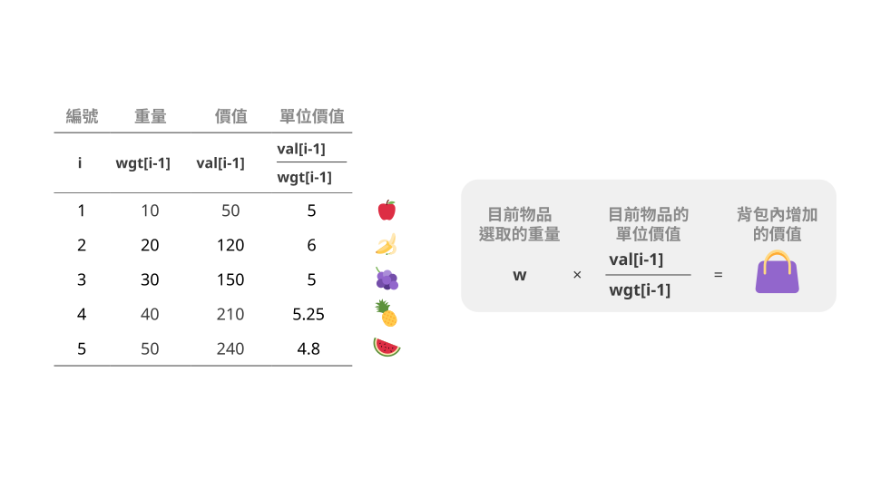
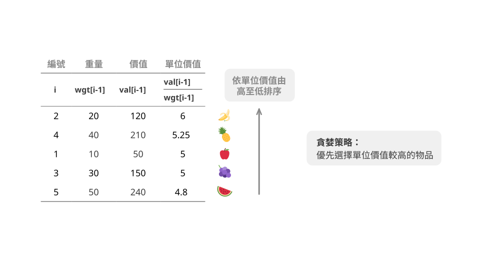
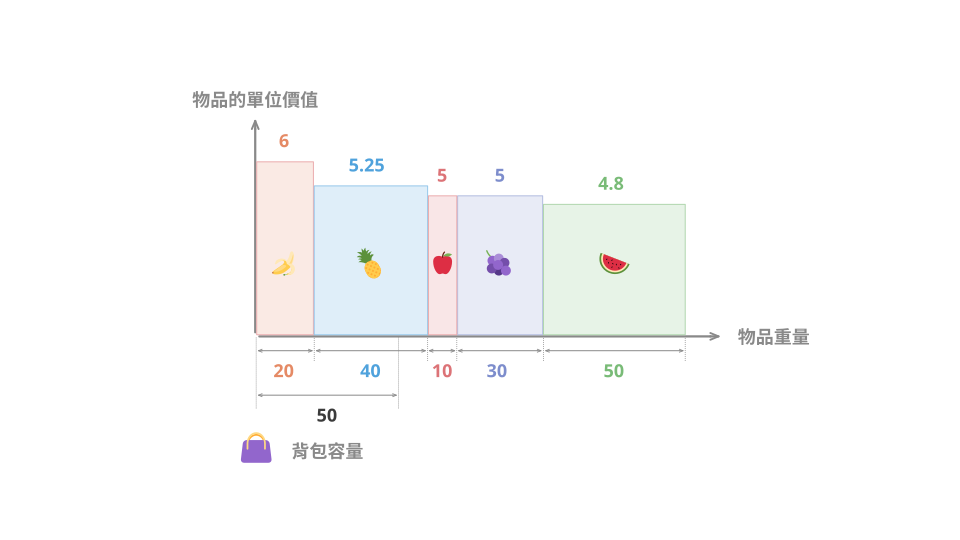

# 15.2 &nbsp; 分數背包問題

!!! question

    給定 $n$ 件物品，第 $i$ 件物品的重量為 $wgt[i-1]$、價值為 $val[i-1]$，另有一個容量為 $cap$ 的背包。每件物品只能選一次，**但可以只取物品的一部分，並依取用的重量比例計算價值**。請問在背包容量的限制內，所裝物品的總價值最大是多少？圖 15-3 是一個例子。

{ class="animation-figure" }

<p align="center"> 圖 15-3 &nbsp; 分數背包問題的範例資料 </p>

分數背包問題和 0-1 背包問題十分相似：狀態包含目前的物品 $i$ 和容量 $c$，目標都是求出背包容量限制內的最大價值。

兩者的差別在於，本題允許只取一件物品的一部分。如圖 15-4 所示，**我們可以任意分割物品，再依取用的重量比例計算價值**。

1. 物品 $i$ 每單位重量的價值為 $val[i-1] / wgt[i-1]$，簡稱單位價值。
2. 如果取物品 $i$ 的一部分放入背包，取用重量為 $w$，那麼背包增加的價值就是 $w \times val[i-1] / wgt[i-1]$。

{ class="animation-figure" }

<p align="center"> 圖 15-4 &nbsp; 物品每單位重量的價值 </p>

### 1. &nbsp; 決定貪婪策略

要讓背包內物品的總價值最大，**本質上就是要讓每單位重量的物品價值最大**。由此可以推導出圖 15-5 的貪婪策略。

1. 將物品依單位價值由高到低排序。
2. 依序走訪所有物品，**每一輪都依貪婪策略選取剩餘物品中單位價值最高的一件**。
3. 如果背包的剩餘容量不足，就取目前物品的一部分填滿背包。

{ class="animation-figure" }

<p align="center"> 圖 15-5 &nbsp; 分數背包問題的貪婪策略 </p>

### 2. &nbsp; 程式實作

我們建立物品類別 `Item`，以便依單位價值排序。接著在迴圈中反覆進行貪婪選擇，背包裝滿後就跳出迴圈並回傳結果：

=== "Python"

    ```python title="fractional_knapsack.py"
    class Item:
        """物品"""

        def __init__(self, w: int, v: int):
            self.w = w  # 物品重量
            self.v = v  # 物品價值

    def fractional_knapsack(wgt: list[int], val: list[int], cap: int) -> int:
        """分數背包：貪婪法"""
        # 建立物品清單，每件物品有重量與價值兩項屬性
        items = [Item(w, v) for w, v in zip(wgt, val)]
        # 依單位價值 item.v / item.w 由高到低排序
        items.sort(key=lambda item: item.v / item.w, reverse=True)
        # 反覆依貪婪策略選取物品
        res = 0
        for item in items:
            if item.w <= cap:
                # 若剩餘容量足夠，就將目前的物品整件裝入背包
                res += item.v
                cap -= item.w
            else:
                # 若剩餘容量不足，就將目前物品的一部分裝入背包
                res += (item.v / item.w) * cap
                # 背包已滿，跳出迴圈
                break
        return res
    ```

=== "C++"

    ```cpp title="fractional_knapsack.cpp"
    /* 物品 */
    class Item {
      public:
        int w; // 物品重量
        int v; // 物品價值

        Item(int w, int v) : w(w), v(v) {
        }
    };

    /* 分數背包：貪婪法 */
    double fractionalKnapsack(vector<int> &wgt, vector<int> &val, int cap) {
        // 建立物品清單，每件物品有重量與價值兩項屬性
        vector<Item> items;
        for (int i = 0; i < wgt.size(); i++) {
            items.push_back(Item(wgt[i], val[i]));
        }
        // 依單位價值 item.v / item.w 由高到低排序
        sort(items.begin(), items.end(), [](Item &a, Item &b) { return (double)a.v / a.w > (double)b.v / b.w; });
        // 反覆依貪婪策略選取物品
        double res = 0;
        for (auto &item : items) {
            if (item.w <= cap) {
                // 若剩餘容量足夠，就將目前的物品整件裝入背包
                res += item.v;
                cap -= item.w;
            } else {
                // 若剩餘容量不足，就將目前物品的一部分裝入背包
                res += (double)item.v / item.w * cap;
                // 背包已滿，跳出迴圈
                break;
            }
        }
        return res;
    }
    ```

=== "Java"

    ```java title="fractional_knapsack.java"
    /* 物品 */
    class Item {
        int w; // 物品重量
        int v; // 物品價值

        public Item(int w, int v) {
            this.w = w;
            this.v = v;
        }
    }

    /* 分數背包：貪婪法 */
    double fractionalKnapsack(int[] wgt, int[] val, int cap) {
        // 建立物品清單，每件物品有重量與價值兩項屬性
        Item[] items = new Item[wgt.length];
        for (int i = 0; i < wgt.length; i++) {
            items[i] = new Item(wgt[i], val[i]);
        }
        // 依單位價值 item.v / item.w 由高到低排序
        Arrays.sort(items, Comparator.comparingDouble(item -> -((double) item.v / item.w)));
        // 反覆依貪婪策略選取物品
        double res = 0;
        for (Item item : items) {
            if (item.w <= cap) {
                // 若剩餘容量足夠，就將目前的物品整件裝入背包
                res += item.v;
                cap -= item.w;
            } else {
                // 若剩餘容量不足，就將目前物品的一部分裝入背包
                res += (double) item.v / item.w * cap;
                // 背包已滿，跳出迴圈
                break;
            }
        }
        return res;
    }
    ```

=== "C#"

    ```csharp title="fractional_knapsack.cs"
    /* 物品 */
    class Item(int w, int v) {
        public int w = w; // 物品重量
        public int v = v; // 物品價值
    }

    /* 分數背包：貪婪法 */
    double FractionalKnapsack(int[] wgt, int[] val, int cap) {
        // 建立物品清單，每件物品有重量與價值兩項屬性
        Item[] items = new Item[wgt.Length];
        for (int i = 0; i < wgt.Length; i++) {
            items[i] = new Item(wgt[i], val[i]);
        }
        // 依單位價值 item.v / item.w 由高到低排序
        Array.Sort(items, (x, y) => ((double)y.v / y.w).CompareTo((double)x.v / x.w));
        // 反覆依貪婪策略選取物品
        double res = 0;
        foreach (Item item in items) {
            if (item.w <= cap) {
                // 若剩餘容量足夠，就將目前的物品整件裝入背包
                res += item.v;
                cap -= item.w;
            } else {
                // 若剩餘容量不足，就將目前物品的一部分裝入背包
                res += (double)item.v / item.w * cap;
                // 背包已滿，跳出迴圈
                break;
            }
        }
        return res;
    }
    ```

=== "Go"

    ```go title="fractional_knapsack.go"
    /* 物品 */
    type Item struct {
        w int // 物品重量
        v int // 物品價值
    }

    /* 分數背包：貪婪法 */
    func fractionalKnapsack(wgt []int, val []int, cap int) float64 {
        // 建立物品清單，每件物品有重量與價值兩項屬性
        items := make([]Item, len(wgt))
        for i := 0; i < len(wgt); i++ {
            items[i] = Item{wgt[i], val[i]}
        }
        // 依單位價值 item.v / item.w 由高到低排序
        sort.Slice(items, func(i, j int) bool {
            return float64(items[i].v)/float64(items[i].w) > float64(items[j].v)/float64(items[j].w)
        })
        // 反覆依貪婪策略選取物品
        res := 0.0
        for _, item := range items {
            if item.w <= cap {
                // 若剩餘容量足夠，就將目前的物品整件裝入背包
                res += float64(item.v)
                cap -= item.w
            } else {
                // 若剩餘容量不足，就將目前物品的一部分裝入背包
                res += float64(item.v) / float64(item.w) * float64(cap)
                // 背包已滿，跳出迴圈
                break
            }
        }
        return res
    }
    ```

=== "Swift"

    ```swift title="fractional_knapsack.swift"
    /* 物品 */
    class Item {
        var w: Int // 物品重量
        var v: Int // 物品價值

        init(w: Int, v: Int) {
            self.w = w
            self.v = v
        }
    }

    /* 分數背包：貪婪法 */
    func fractionalKnapsack(wgt: [Int], val: [Int], cap: Int) -> Double {
        // 建立物品清單，每件物品有重量與價值兩項屬性
        var items = zip(wgt, val).map { Item(w: $0, v: $1) }
        // 依單位價值 item.v / item.w 由高到低排序
        items.sort { -(Double($0.v) / Double($0.w)) < -(Double($1.v) / Double($1.w)) }
        // 反覆依貪婪策略選取物品
        var res = 0.0
        var cap = cap
        for item in items {
            if item.w <= cap {
                // 若剩餘容量足夠，就將目前的物品整件裝入背包
                res += Double(item.v)
                cap -= item.w
            } else {
                // 若剩餘容量不足，就將目前物品的一部分裝入背包
                res += Double(item.v) / Double(item.w) * Double(cap)
                // 背包已滿，跳出迴圈
                break
            }
        }
        return res
    }
    ```

=== "JS"

    ```javascript title="fractional_knapsack.js"
    /* 物品 */
    class Item {
        constructor(w, v) {
            this.w = w; // 物品重量
            this.v = v; // 物品價值
        }
    }

    /* 分數背包：貪婪法 */
    function fractionalKnapsack(wgt, val, cap) {
        // 建立物品清單，每件物品有重量與價值兩項屬性
        const items = wgt.map((w, i) => new Item(w, val[i]));
        // 依單位價值 item.v / item.w 由高到低排序
        items.sort((a, b) => b.v / b.w - a.v / a.w);
        // 反覆依貪婪策略選取物品
        let res = 0;
        for (const item of items) {
            if (item.w <= cap) {
                // 若剩餘容量足夠，就將目前的物品整件裝入背包
                res += item.v;
                cap -= item.w;
            } else {
                // 若剩餘容量不足，就將目前物品的一部分裝入背包
                res += (item.v / item.w) * cap;
                // 背包已滿，跳出迴圈
                break;
            }
        }
        return res;
    }
    ```

=== "TS"

    ```typescript title="fractional_knapsack.ts"
    /* 物品 */
    class Item {
        w: number; // 物品重量
        v: number; // 物品價值

        constructor(w: number, v: number) {
            this.w = w;
            this.v = v;
        }
    }

    /* 分數背包：貪婪法 */
    function fractionalKnapsack(wgt: number[], val: number[], cap: number): number {
        // 建立物品清單，每件物品有重量與價值兩項屬性
        const items: Item[] = wgt.map((w, i) => new Item(w, val[i]));
        // 依單位價值 item.v / item.w 由高到低排序
        items.sort((a, b) => b.v / b.w - a.v / a.w);
        // 反覆依貪婪策略選取物品
        let res = 0;
        for (const item of items) {
            if (item.w <= cap) {
                // 若剩餘容量足夠，就將目前的物品整件裝入背包
                res += item.v;
                cap -= item.w;
            } else {
                // 若剩餘容量不足，就將目前物品的一部分裝入背包
                res += (item.v / item.w) * cap;
                // 背包已滿，跳出迴圈
                break;
            }
        }
        return res;
    }
    ```

=== "Dart"

    ```dart title="fractional_knapsack.dart"
    /* 物品 */
    class Item {
      int w; // 物品重量
      int v; // 物品價值

      Item(this.w, this.v);
    }

    /* 分數背包：貪婪法 */
    double fractionalKnapsack(List<int> wgt, List<int> val, int cap) {
      // 建立物品清單，每件物品有重量與價值兩項屬性
      List<Item> items = List.generate(wgt.length, (i) => Item(wgt[i], val[i]));
      // 依單位價值 item.v / item.w 由高到低排序
      items.sort((a, b) => (b.v / b.w).compareTo(a.v / a.w));
      // 反覆依貪婪策略選取物品
      double res = 0;
      for (Item item in items) {
        if (item.w <= cap) {
          // 若剩餘容量足夠，就將目前的物品整件裝入背包
          res += item.v;
          cap -= item.w;
        } else {
          // 若剩餘容量不足，就將目前物品的一部分裝入背包
          res += item.v / item.w * cap;
          // 背包已滿，跳出迴圈
          break;
        }
      }
      return res;
    }
    ```

=== "Rust"

    ```rust title="fractional_knapsack.rs"
    /* 物品 */
    struct Item {
        w: i32, // 物品重量
        v: i32, // 物品價值
    }

    impl Item {
        fn new(w: i32, v: i32) -> Self {
            Self { w, v }
        }
    }

    /* 分數背包：貪婪法 */
    fn fractional_knapsack(wgt: &[i32], val: &[i32], mut cap: i32) -> f64 {
        // 建立物品清單，每件物品有重量與價值兩項屬性
        let mut items = wgt
            .iter()
            .zip(val.iter())
            .map(|(&w, &v)| Item::new(w, v))
            .collect::<Vec<Item>>();
        // 依單位價值 item.v / item.w 由高到低排序
        items.sort_by(|a, b| {
            (b.v as f64 / b.w as f64)
                .partial_cmp(&(a.v as f64 / a.w as f64))
                .unwrap()
        });
        // 反覆依貪婪策略選取物品
        let mut res = 0.0;
        for item in &items {
            if item.w <= cap {
                // 若剩餘容量足夠，就將目前的物品整件裝入背包
                res += item.v as f64;
                cap -= item.w;
            } else {
                // 若剩餘容量不足，就將目前物品的一部分裝入背包
                res += item.v as f64 / item.w as f64 * cap as f64;
                // 背包已滿，跳出迴圈
                break;
            }
        }
        res
    }
    ```

=== "C"

    ```c title="fractional_knapsack.c"
    /* 物品 */
    typedef struct {
        int w; // 物品重量
        int v; // 物品價值
    } Item;

    /* 分數背包：貪婪法 */
    float fractionalKnapsack(int wgt[], int val[], int itemCount, int cap) {
        // 建立物品清單，每件物品有重量與價值兩項屬性
        Item *items = malloc(sizeof(Item) * itemCount);
        for (int i = 0; i < itemCount; i++) {
            items[i] = (Item){.w = wgt[i], .v = val[i]};
        }
        // 依單位價值 item.v / item.w 由高到低排序
        qsort(items, (size_t)itemCount, sizeof(Item), sortByValueDensity);
        // 反覆依貪婪策略選取物品
        float res = 0.0;
        for (int i = 0; i < itemCount; i++) {
            if (items[i].w <= cap) {
                // 若剩餘容量足夠，就將目前的物品整件裝入背包
                res += items[i].v;
                cap -= items[i].w;
            } else {
                // 若剩餘容量不足，就將目前物品的一部分裝入背包
                res += (float)cap / items[i].w * items[i].v;
                cap = 0;
                break;
            }
        }
        free(items);
        return res;
    }
    ```

=== "Kotlin"

    ```kotlin title="fractional_knapsack.kt"
    /* 物品 */
    class Item(
        val w: Int, // 物品重量
        val v: Int  // 物品價值
    )

    /* 分數背包：貪婪法 */
    fun fractionalKnapsack(wgt: IntArray, _val: IntArray, c: Int): Double {
        // 建立物品清單，每件物品有重量與價值兩項屬性
        var cap = c
        val items = arrayOfNulls<Item>(wgt.size)
        for (i in wgt.indices) {
            items[i] = Item(wgt[i], _val[i])
        }
        // 依單位價值 item.v / item.w 由高到低排序
        items.sortBy { item: Item? -> -(item!!.v.toDouble() / item.w) }
        // 反覆依貪婪策略選取物品
        var res = 0.0
        for (item in items) {
            if (item!!.w <= cap) {
                // 若剩餘容量足夠，就將目前的物品整件裝入背包
                res += item.v
                cap -= item.w
            } else {
                // 若剩餘容量不足，就將目前物品的一部分裝入背包
                res += item.v.toDouble() / item.w * cap
                // 背包已滿，跳出迴圈
                break
            }
        }
        return res
    }
    ```

=== "Ruby"

    ```ruby title="fractional_knapsack.rb"
    ### 物品 ###
    class Item
      attr_accessor :w # 物品重量
      attr_accessor :v # 物品價值

      def initialize(w, v)
        @w = w
        @v = v
      end
    end

    ### 分數背包：貪婪法 ###
    def fractional_knapsack(wgt, val, cap)
      # 建立物品清單，每件物品有重量與價值兩項屬性
      items = wgt.each_with_index.map { |w, i| Item.new(w, val[i]) }
      # 依單位價值 item.v / item.w 由高到低排序
      items.sort! { |a, b| (b.v.to_f / b.w) <=> (a.v.to_f / a.w) }
      # 反覆依貪婪策略選取物品
      res = 0
      for item in items
        if item.w <= cap
          # 若剩餘容量足夠，就將目前的物品整件裝入背包
          res += item.v
          cap -= item.w
        else
          # 若剩餘容量不足，就將目前物品的一部分裝入背包
          res += (item.v.to_f / item.w) * cap
          # 背包已滿，跳出迴圈
          break
        end
      end
      res
    end
    ```

??? pythontutor "執行視覺化示範"

    <div style="height: 549px; width: 100%;"><iframe class="pythontutor-iframe" title="執行視覺化示範" src="https://pythontutor.com/iframe-embed.html#code=class%20Item%3A%0A%20%20%20%20%22%22%22%E7%89%A9%E5%93%81%22%22%22%0A%20%20%20%20def%20__init__%28self,%20w%3A%20int,%20v%3A%20int%29%3A%0A%20%20%20%20%20%20%20%20self.w%20%3D%20w%20%20%23%20%E7%89%A9%E5%93%81%E9%87%8D%E9%87%8F%0A%20%20%20%20%20%20%20%20self.v%20%3D%20v%20%20%23%20%E7%89%A9%E5%93%81%E5%83%B9%E5%80%BC%0A%0Adef%20fractional_knapsack%28wgt%3A%20list%5Bint%5D,%20val%3A%20list%5Bint%5D,%20cap%3A%20int%29%20-%3E%20int%3A%0A%20%20%20%20%22%22%22%E5%88%86%E6%95%B8%E8%83%8C%E5%8C%85%EF%BC%9A%E8%B2%AA%E5%A9%AA%E6%B3%95%22%22%22%0A%20%20%20%20%23%20%E5%BB%BA%E7%AB%8B%E7%89%A9%E5%93%81%E6%B8%85%E5%96%AE%EF%BC%8C%E6%AF%8F%E4%BB%B6%E7%89%A9%E5%93%81%E6%9C%89%E9%87%8D%E9%87%8F%E8%88%87%E5%83%B9%E5%80%BC%E5%85%A9%E9%A0%85%E5%B1%AC%E6%80%A7%0A%20%20%20%20items%20%3D%20%5BItem%28w,%20v%29%20for%20w,%20v%20in%20zip%28wgt,%20val%29%5D%0A%20%20%20%20%23%20%E4%BE%9D%E5%96%AE%E4%BD%8D%E5%83%B9%E5%80%BC%20item.v%20/%20item.w%20%E7%94%B1%E9%AB%98%E5%88%B0%E4%BD%8E%E6%8E%92%E5%BA%8F%0A%20%20%20%20items.sort%28key%3Dlambda%20item%3A%20item.v%20/%20item.w,%20reverse%3DTrue%29%0A%20%20%20%20%23%20%E5%8F%8D%E8%A6%86%E4%BE%9D%E8%B2%AA%E5%A9%AA%E7%AD%96%E7%95%A5%E9%81%B8%E5%8F%96%E7%89%A9%E5%93%81%0A%20%20%20%20res%20%3D%200%0A%20%20%20%20for%20item%20in%20items%3A%0A%20%20%20%20%20%20%20%20if%20item.w%20%3C%3D%20cap%3A%0A%20%20%20%20%20%20%20%20%20%20%20%20%23%20%E8%8B%A5%E5%89%A9%E9%A4%98%E5%AE%B9%E9%87%8F%E8%B6%B3%E5%A4%A0%EF%BC%8C%E5%B0%B1%E5%B0%87%E7%9B%AE%E5%89%8D%E7%9A%84%E7%89%A9%E5%93%81%E6%95%B4%E4%BB%B6%E8%A3%9D%E5%85%A5%E8%83%8C%E5%8C%85%0A%20%20%20%20%20%20%20%20%20%20%20%20res%20%2B%3D%20item.v%0A%20%20%20%20%20%20%20%20%20%20%20%20cap%20-%3D%20item.w%0A%20%20%20%20%20%20%20%20else%3A%0A%20%20%20%20%20%20%20%20%20%20%20%20%23%20%E8%8B%A5%E5%89%A9%E9%A4%98%E5%AE%B9%E9%87%8F%E4%B8%8D%E8%B6%B3%EF%BC%8C%E5%B0%B1%E5%B0%87%E7%9B%AE%E5%89%8D%E7%89%A9%E5%93%81%E7%9A%84%E4%B8%80%E9%83%A8%E5%88%86%E8%A3%9D%E5%85%A5%E8%83%8C%E5%8C%85%0A%20%20%20%20%20%20%20%20%20%20%20%20res%20%2B%3D%20%28item.v%20/%20item.w%29%20%2A%20cap%0A%20%20%20%20%20%20%20%20%20%20%20%20%23%20%E8%83%8C%E5%8C%85%E5%B7%B2%E6%BB%BF%EF%BC%8C%E8%B7%B3%E5%87%BA%E8%BF%B4%E5%9C%88%0A%20%20%20%20%20%20%20%20%20%20%20%20break%0A%20%20%20%20return%20res%0A%0A%22%22%22Driver%20Code%22%22%22%0Aif%20__name__%20%3D%3D%20%22__main__%22%3A%0A%20%20%20%20wgt%20%3D%20%5B10,%2020,%2030,%2040,%2050%5D%0A%20%20%20%20val%20%3D%20%5B50,%20120,%20150,%20210,%20240%5D%0A%20%20%20%20cap%20%3D%2050%0A%20%20%20%20n%20%3D%20len%28wgt%29%0A%0A%20%20%20%20%23%20%E8%B2%AA%E5%A9%AA%E6%BC%94%E7%AE%97%E6%B3%95%0A%20%20%20%20res%20%3D%20fractional_knapsack%28wgt,%20val,%20cap%29%0A%20%20%20%20print%28f%22%E5%9C%A8%E8%83%8C%E5%8C%85%E5%AE%B9%E9%87%8F%E9%99%90%E5%88%B6%E5%85%A7%EF%BC%8C%E7%89%A9%E5%93%81%E7%9A%84%E6%9C%80%E5%A4%A7%E7%B8%BD%E5%83%B9%E5%80%BC%E7%82%BA%20%7Bres%7D%22%29&codeDivHeight=472&codeDivWidth=350&cumulative=false&curInstr=8&heapPrimitives=nevernest&origin=opt-frontend.js&py=311&rawInputLstJSON=%5B%5D&textReferences=false"> </iframe></div>
    <div style="margin-top: 5px;"><a href="https://pythontutor.com/iframe-embed.html#code=class%20Item%3A%0A%20%20%20%20%22%22%22%E7%89%A9%E5%93%81%22%22%22%0A%20%20%20%20def%20__init__%28self,%20w%3A%20int,%20v%3A%20int%29%3A%0A%20%20%20%20%20%20%20%20self.w%20%3D%20w%20%20%23%20%E7%89%A9%E5%93%81%E9%87%8D%E9%87%8F%0A%20%20%20%20%20%20%20%20self.v%20%3D%20v%20%20%23%20%E7%89%A9%E5%93%81%E5%83%B9%E5%80%BC%0A%0Adef%20fractional_knapsack%28wgt%3A%20list%5Bint%5D,%20val%3A%20list%5Bint%5D,%20cap%3A%20int%29%20-%3E%20int%3A%0A%20%20%20%20%22%22%22%E5%88%86%E6%95%B8%E8%83%8C%E5%8C%85%EF%BC%9A%E8%B2%AA%E5%A9%AA%E6%B3%95%22%22%22%0A%20%20%20%20%23%20%E5%BB%BA%E7%AB%8B%E7%89%A9%E5%93%81%E6%B8%85%E5%96%AE%EF%BC%8C%E6%AF%8F%E4%BB%B6%E7%89%A9%E5%93%81%E6%9C%89%E9%87%8D%E9%87%8F%E8%88%87%E5%83%B9%E5%80%BC%E5%85%A9%E9%A0%85%E5%B1%AC%E6%80%A7%0A%20%20%20%20items%20%3D%20%5BItem%28w,%20v%29%20for%20w,%20v%20in%20zip%28wgt,%20val%29%5D%0A%20%20%20%20%23%20%E4%BE%9D%E5%96%AE%E4%BD%8D%E5%83%B9%E5%80%BC%20item.v%20/%20item.w%20%E7%94%B1%E9%AB%98%E5%88%B0%E4%BD%8E%E6%8E%92%E5%BA%8F%0A%20%20%20%20items.sort%28key%3Dlambda%20item%3A%20item.v%20/%20item.w,%20reverse%3DTrue%29%0A%20%20%20%20%23%20%E5%8F%8D%E8%A6%86%E4%BE%9D%E8%B2%AA%E5%A9%AA%E7%AD%96%E7%95%A5%E9%81%B8%E5%8F%96%E7%89%A9%E5%93%81%0A%20%20%20%20res%20%3D%200%0A%20%20%20%20for%20item%20in%20items%3A%0A%20%20%20%20%20%20%20%20if%20item.w%20%3C%3D%20cap%3A%0A%20%20%20%20%20%20%20%20%20%20%20%20%23%20%E8%8B%A5%E5%89%A9%E9%A4%98%E5%AE%B9%E9%87%8F%E8%B6%B3%E5%A4%A0%EF%BC%8C%E5%B0%B1%E5%B0%87%E7%9B%AE%E5%89%8D%E7%9A%84%E7%89%A9%E5%93%81%E6%95%B4%E4%BB%B6%E8%A3%9D%E5%85%A5%E8%83%8C%E5%8C%85%0A%20%20%20%20%20%20%20%20%20%20%20%20res%20%2B%3D%20item.v%0A%20%20%20%20%20%20%20%20%20%20%20%20cap%20-%3D%20item.w%0A%20%20%20%20%20%20%20%20else%3A%0A%20%20%20%20%20%20%20%20%20%20%20%20%23%20%E8%8B%A5%E5%89%A9%E9%A4%98%E5%AE%B9%E9%87%8F%E4%B8%8D%E8%B6%B3%EF%BC%8C%E5%B0%B1%E5%B0%87%E7%9B%AE%E5%89%8D%E7%89%A9%E5%93%81%E7%9A%84%E4%B8%80%E9%83%A8%E5%88%86%E8%A3%9D%E5%85%A5%E8%83%8C%E5%8C%85%0A%20%20%20%20%20%20%20%20%20%20%20%20res%20%2B%3D%20%28item.v%20/%20item.w%29%20%2A%20cap%0A%20%20%20%20%20%20%20%20%20%20%20%20%23%20%E8%83%8C%E5%8C%85%E5%B7%B2%E6%BB%BF%EF%BC%8C%E8%B7%B3%E5%87%BA%E8%BF%B4%E5%9C%88%0A%20%20%20%20%20%20%20%20%20%20%20%20break%0A%20%20%20%20return%20res%0A%0A%22%22%22Driver%20Code%22%22%22%0Aif%20__name__%20%3D%3D%20%22__main__%22%3A%0A%20%20%20%20wgt%20%3D%20%5B10,%2020,%2030,%2040,%2050%5D%0A%20%20%20%20val%20%3D%20%5B50,%20120,%20150,%20210,%20240%5D%0A%20%20%20%20cap%20%3D%2050%0A%20%20%20%20n%20%3D%20len%28wgt%29%0A%0A%20%20%20%20%23%20%E8%B2%AA%E5%A9%AA%E6%BC%94%E7%AE%97%E6%B3%95%0A%20%20%20%20res%20%3D%20fractional_knapsack%28wgt,%20val,%20cap%29%0A%20%20%20%20print%28f%22%E5%9C%A8%E8%83%8C%E5%8C%85%E5%AE%B9%E9%87%8F%E9%99%90%E5%88%B6%E5%85%A7%EF%BC%8C%E7%89%A9%E5%93%81%E7%9A%84%E6%9C%80%E5%A4%A7%E7%B8%BD%E5%83%B9%E5%80%BC%E7%82%BA%20%7Bres%7D%22%29&codeDivHeight=800&codeDivWidth=600&cumulative=false&curInstr=8&heapPrimitives=nevernest&origin=opt-frontend.js&py=311&rawInputLstJSON=%5B%5D&textReferences=false" target="_blank" rel="noopener noreferrer">全螢幕觀看 ></a></div>

內建排序演算法的時間複雜度通常為 $O(n \log n)$，空間複雜度通常為 $O(\log n)$ 或 $O(n)$，取決於各程式語言的實作方式。

除了排序，最壞情況下還要走訪整份物品清單，**因此時間複雜度為 $O(n)$**，其中 $n$ 為物品數量。

由於我們建立了一份由 `Item` 物件組成的清單，**因此空間複雜度為 $O(n)$**。

### 3. &nbsp; 正確性證明

我們使用反證法。假設物品 $x$ 的單位價值最高，某個演算法求得的最大價值為 `res`，但這個解沒有包含物品 $x$。

現在從背包裡任取一單位重量的物品，換成一單位重量的物品 $x$。由於物品 $x$ 的單位價值最高，替換後的總價值一定大於 `res`。**這與 `res` 是最佳解矛盾，因此最佳解必定包含物品 $x$**。

對解中的其他物品，也可以用同樣的方式導出矛盾。總之，**優先選取單位價值較高的物品總是更好**，可見這個貪婪策略是有效的。

如圖 15-6 所示，若在平面圖上以橫軸表示物品重量、縱軸表示單位價值，分數背包問題就能改寫成「在有限的橫軸區間內，求所能圍出的最大面積」。這個類比能幫助我們從幾何角度理解貪婪策略為何有效。

{ class="animation-figure" }

<p align="center"> 圖 15-6 &nbsp; 分數背包問題的幾何表示 </p>
