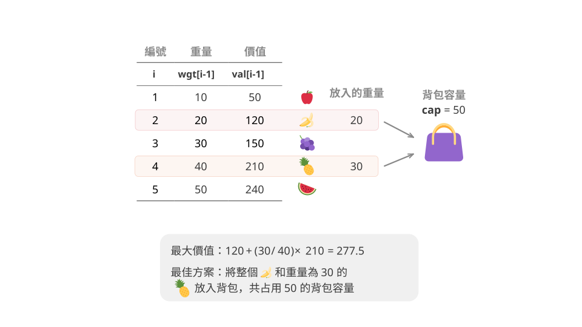

# 分數背包問題

!!! question

    給定 $n$ 件物品，第 $i$ 件物品的重量為 $wgt[i-1]$、價值為 $val[i-1]$，另有一個容量為 $cap$ 的背包。每件物品只能選一次，**但可以只取物品的一部分，並依取用的重量比例計算價值**。請問在背包容量的限制內，所裝物品的總價值最大是多少？下圖是一個例子。



分數背包問題和 0-1 背包問題十分相似：狀態包含目前的物品 $i$ 和容量 $c$，目標都是求出背包容量限制內的最大價值。

兩者的差別在於，本題允許只取一件物品的一部分。如下圖所示，**我們可以任意分割物品，再依取用的重量比例計算價值**。

1. 物品 $i$ 每單位重量的價值為 $val[i-1] / wgt[i-1]$，簡稱單位價值。
2. 如果取物品 $i$ 的一部分放入背包，取用重量為 $w$，那麼背包增加的價值就是 $w \times val[i-1] / wgt[i-1]$。


### 決定貪婪策略

要讓背包內物品的總價值最大，**本質上就是要讓每單位重量的物品價值最大**。由此可以推導出下圖的貪婪策略。

1. 將物品依單位價值由高到低排序。
2. 依序走訪所有物品，**每一輪都依貪婪策略選取剩餘物品中單位價值最高的一件**。
3. 如果背包的剩餘容量不足，就取目前物品的一部分填滿背包。


### 程式實作

我們建立物品類別 `Item`，以便依單位價值排序。接著在迴圈中反覆進行貪婪選擇，背包裝滿後就跳出迴圈並回傳結果：

```src
[file]{fractional_knapsack}-[class]{}-[func]{fractional_knapsack}
```

內建排序演算法的時間複雜度通常為 $O(n \log n)$，空間複雜度通常為 $O(\log n)$ 或 $O(n)$，取決於各程式語言的實作方式。

除了排序，最壞情況下還要走訪整份物品清單，**因此時間複雜度為 $O(n)$**，其中 $n$ 為物品數量。

由於我們建立了一份由 `Item` 物件組成的清單，**因此空間複雜度為 $O(n)$**。

### 正確性證明

我們使用反證法。假設物品 $x$ 的單位價值最高，某個演算法求得的最大價值為 `res`，但這個解沒有包含物品 $x$。

現在從背包裡任取一單位重量的物品，換成一單位重量的物品 $x$。由於物品 $x$ 的單位價值最高，替換後的總價值一定大於 `res`。**這與 `res` 是最佳解矛盾，因此最佳解必定包含物品 $x$**。

對解中的其他物品，也可以用同樣的方式導出矛盾。總之，**優先選取單位價值較高的物品總是更好**，可見這個貪婪策略是有效的。

如下圖所示，若在平面圖上以橫軸表示物品重量、縱軸表示單位價值，分數背包問題就能改寫成「在有限的橫軸區間內，求所能圍出的最大面積」。這個類比能幫助我們從幾何角度理解貪婪策略為何有效。


