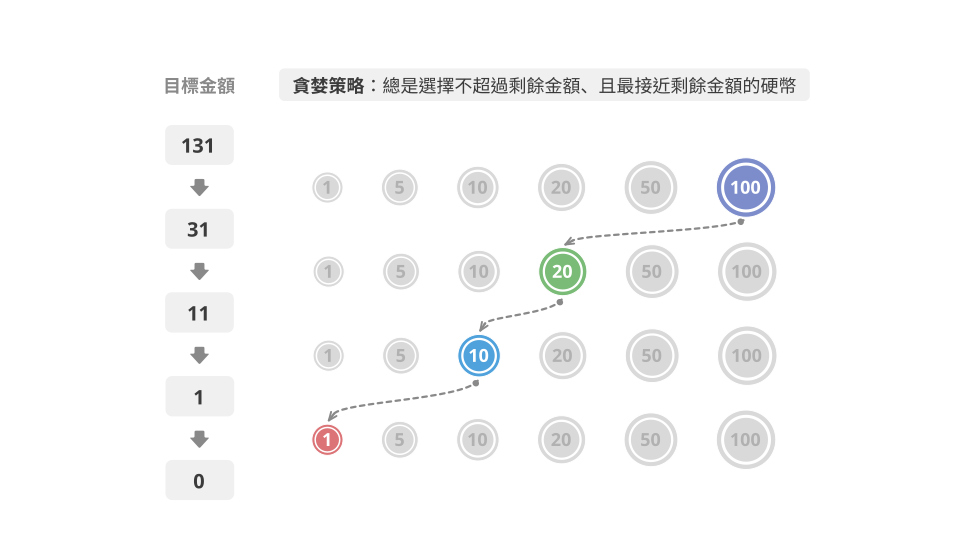
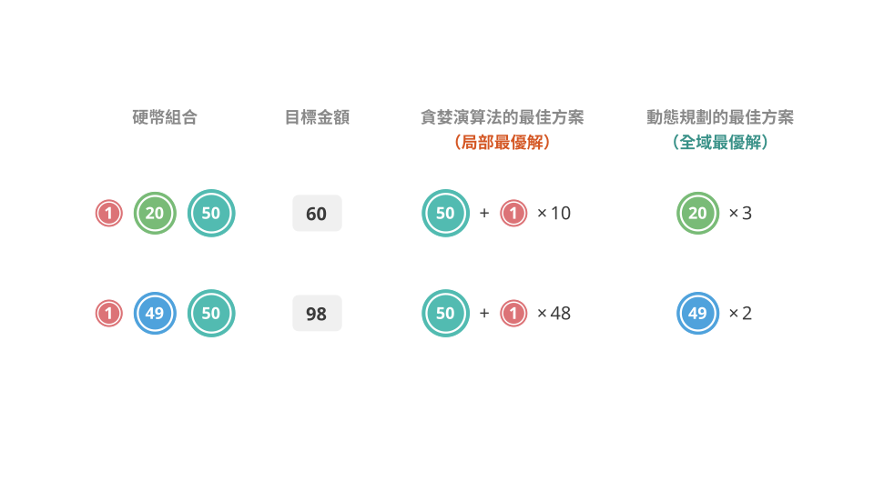

# 15.1 &nbsp; 貪婪演算法

<u>貪婪演算法（greedy algorithm）</u>是解決最佳化問題的常見方法。它的基本想法是，每當需要做決定時，就選擇眼前看來最好的做法，希望透過一次次局部最佳的選擇得到全域最佳解。貪婪演算法簡潔且有效率，廣泛用於許多實際問題。

貪婪演算法和動態規劃都常用來解決最佳化問題。兩者有些共同點，例如都依賴最佳子結構，但運作原理不同。

- 動態規劃會綜合考量先前各階段的所有決策，再決定目前的選擇，並利用先前子問題的解建構目前子問題的解。
- 貪婪演算法不再考慮過去的決策。它持續向前做出貪婪選擇，逐步縮小問題範圍，直到解決整個問題。

我們先透過「零錢兌換」這道例題，看看貪婪演算法如何運作。在「完全背包問題」一節中，你已經見過這道題目。

!!! question

    給定 $n$ 種硬幣，第 $i$ 種硬幣的面額為 $coins[i - 1]$，目標金額為 $amt$，每種硬幣都可以重複選取。請問最少需要幾枚硬幣才能湊出目標金額？如果無法湊出，就回傳 $-1$。

本題採用的貪婪策略如圖 15-1 所示。給定目標金額，**我們每次都選面額不超過剩餘金額、且最接近剩餘金額的硬幣**，重複這一步，直到湊出目標金額。

{ class="animation-figure" }

<p align="center"> 圖 15-1 &nbsp; 零錢兌換的貪婪策略 </p>

程式實作如下：

=== "Python"

    ```python title="coin_change_greedy.py"
    def coin_change_greedy(coins: list[int], amt: int) -> int:
        """零錢兌換：貪婪法"""
        # 假設硬幣清單 coins 已依面額遞增排序
        i = len(coins) - 1
        count = 0
        # 反覆依貪婪策略選取硬幣，直到剩餘金額為零
        while amt > 0:
            # 找出不超過剩餘金額的最大面額
            while i > 0 and coins[i] > amt:
                i -= 1
            # 選取 coins[i]
            amt -= coins[i]
            count += 1
        # 若找不到可行解，則回傳 -1
        return count if amt == 0 else -1
    ```

=== "C++"

    ```cpp title="coin_change_greedy.cpp"
    /* 零錢兌換：貪婪法 */
    int coinChangeGreedy(vector<int> &coins, int amt) {
        // 假設硬幣清單 coins 已依面額遞增排序
        int i = coins.size() - 1;
        int count = 0;
        // 反覆依貪婪策略選取硬幣，直到剩餘金額為零
        while (amt > 0) {
            // 找出不超過剩餘金額的最大面額
            while (i > 0 && coins[i] > amt) {
                i--;
            }
            // 選取 coins[i]
            amt -= coins[i];
            count++;
        }
        // 若找不到可行解，則回傳 -1
        return amt == 0 ? count : -1;
    }
    ```

=== "Java"

    ```java title="coin_change_greedy.java"
    /* 零錢兌換：貪婪法 */
    int coinChangeGreedy(int[] coins, int amt) {
        // 假設硬幣清單 coins 已依面額遞增排序
        int i = coins.length - 1;
        int count = 0;
        // 反覆依貪婪策略選取硬幣，直到剩餘金額為零
        while (amt > 0) {
            // 找出不超過剩餘金額的最大面額
            while (i > 0 && coins[i] > amt) {
                i--;
            }
            // 選取 coins[i]
            amt -= coins[i];
            count++;
        }
        // 若找不到可行解，則回傳 -1
        return amt == 0 ? count : -1;
    }
    ```

=== "C#"

    ```csharp title="coin_change_greedy.cs"
    /* 零錢兌換：貪婪法 */
    int CoinChangeGreedy(int[] coins, int amt) {
        // 假設硬幣清單 coins 已依面額遞增排序
        int i = coins.Length - 1;
        int count = 0;
        // 反覆依貪婪策略選取硬幣，直到剩餘金額為零
        while (amt > 0) {
            // 找出不超過剩餘金額的最大面額
            while (i > 0 && coins[i] > amt) {
                i--;
            }
            // 選取 coins[i]
            amt -= coins[i];
            count++;
        }
        // 若找不到可行解，則回傳 -1
        return amt == 0 ? count : -1;
    }
    ```

=== "Go"

    ```go title="coin_change_greedy.go"
    /* 零錢兌換：貪婪法 */
    func coinChangeGreedy(coins []int, amt int) int {
        // 假設硬幣清單 coins 已依面額遞增排序
        i := len(coins) - 1
        count := 0
        // 反覆依貪婪策略選取硬幣，直到剩餘金額為零
        for amt > 0 {
            // 找出不超過剩餘金額的最大面額
            for i > 0 && coins[i] > amt {
                i--
            }
            // 選取 coins[i]
            amt -= coins[i]
            count++
        }
        // 若找不到可行解，則回傳 -1
        if amt != 0 {
            return -1
        }
        return count
    }
    ```

=== "Swift"

    ```swift title="coin_change_greedy.swift"
    /* 零錢兌換：貪婪法 */
    func coinChangeGreedy(coins: [Int], amt: Int) -> Int {
        // 假設硬幣清單 coins 已依面額遞增排序
        var i = coins.count - 1
        var count = 0
        var amt = amt
        // 反覆依貪婪策略選取硬幣，直到剩餘金額為零
        while amt > 0 {
            // 找出不超過剩餘金額的最大面額
            while i > 0 && coins[i] > amt {
                i -= 1
            }
            // 選取 coins[i]
            amt -= coins[i]
            count += 1
        }
        // 若找不到可行解，則回傳 -1
        return amt == 0 ? count : -1
    }
    ```

=== "JS"

    ```javascript title="coin_change_greedy.js"
    /* 零錢兌換：貪婪法 */
    function coinChangeGreedy(coins, amt) {
        // 假設陣列 coins 已依面額遞增排序
        let i = coins.length - 1;
        let count = 0;
        // 反覆依貪婪策略選取硬幣，直到剩餘金額為零
        while (amt > 0) {
            // 找出不超過剩餘金額的最大面額
            while (i > 0 && coins[i] > amt) {
                i--;
            }
            // 選取 coins[i]
            amt -= coins[i];
            count++;
        }
        // 若找不到可行解，則回傳 -1
        return amt === 0 ? count : -1;
    }
    ```

=== "TS"

    ```typescript title="coin_change_greedy.ts"
    /* 零錢兌換：貪婪法 */
    function coinChangeGreedy(coins: number[], amt: number): number {
        // 假設陣列 coins 已依面額遞增排序
        let i = coins.length - 1;
        let count = 0;
        // 反覆依貪婪策略選取硬幣，直到剩餘金額為零
        while (amt > 0) {
            // 找出不超過剩餘金額的最大面額
            while (i > 0 && coins[i] > amt) {
                i--;
            }
            // 選取 coins[i]
            amt -= coins[i];
            count++;
        }
        // 若找不到可行解，則回傳 -1
        return amt === 0 ? count : -1;
    }
    ```

=== "Dart"

    ```dart title="coin_change_greedy.dart"
    /* 零錢兌換：貪婪法 */
    int coinChangeGreedy(List<int> coins, int amt) {
      // 假設硬幣清單 coins 已依面額遞增排序
      int i = coins.length - 1;
      int count = 0;
      // 反覆依貪婪策略選取硬幣，直到剩餘金額為零
      while (amt > 0) {
        // 找出不超過剩餘金額的最大面額
        while (i > 0 && coins[i] > amt) {
          i--;
        }
        // 選取 coins[i]
        amt -= coins[i];
        count++;
      }
      // 若找不到可行解，則回傳 -1
      return amt == 0 ? count : -1;
    }
    ```

=== "Rust"

    ```rust title="coin_change_greedy.rs"
    /* 零錢兌換：貪婪法 */
    fn coin_change_greedy(coins: &[i32], mut amt: i32) -> i32 {
        // 假設硬幣清單 coins 已依面額遞增排序
        let mut i = coins.len() - 1;
        let mut count = 0;
        // 反覆依貪婪策略選取硬幣，直到剩餘金額為零
        while amt > 0 {
            // 找出不超過剩餘金額的最大面額
            while i > 0 && coins[i] > amt {
                i -= 1;
            }
            // 選取 coins[i]
            amt -= coins[i];
            count += 1;
        }
        // 若找不到可行解，則回傳 -1
        if amt == 0 {
            count
        } else {
            -1
        }
    }
    ```

=== "C"

    ```c title="coin_change_greedy.c"
    /* 零錢兌換：貪婪法 */
    int coinChangeGreedy(int *coins, int size, int amt) {
        // 假設硬幣清單 coins 已依面額遞增排序
        int i = size - 1;
        int count = 0;
        // 反覆依貪婪策略選取硬幣，直到剩餘金額為零
        while (amt > 0) {
            // 找出不超過剩餘金額的最大面額
            while (i > 0 && coins[i] > amt) {
                i--;
            }
            // 選取 coins[i]
            amt -= coins[i];
            count++;
        }
        // 若找不到可行解，則回傳 -1
        return amt == 0 ? count : -1;
    }
    ```

=== "Kotlin"

    ```kotlin title="coin_change_greedy.kt"
    /* 零錢兌換：貪婪法 */
    fun coinChangeGreedy(coins: IntArray, amt: Int): Int {
        // 假設硬幣清單 coins 已依面額遞增排序
        var am = amt
        var i = coins.size - 1
        var count = 0
        // 反覆依貪婪策略選取硬幣，直到剩餘金額為零
        while (am > 0) {
            // 找出不超過剩餘金額的最大面額
            while (i > 0 && coins[i] > am) {
                i--
            }
            // 選取 coins[i]
            am -= coins[i]
            count++
        }
        // 若找不到可行解，則回傳 -1
        return if (am == 0) count else -1
    }
    ```

=== "Ruby"

    ```ruby title="coin_change_greedy.rb"
    ### 零錢兌換：貪婪法 ###
    def coin_change_greedy(coins, amt)
      # 假設硬幣清單 coins 已依面額遞增排序
      i = coins.length - 1
      count = 0
      # 反覆依貪婪策略選取硬幣，直到剩餘金額為零
      while amt > 0
        # 找出不超過剩餘金額的最大面額
        while i > 0 && coins[i] > amt
          i -= 1
        end
        # 選取 coins[i]
        amt -= coins[i]
        count += 1
      end
      # 若找不到可行解，則回傳 -1
      amt == 0 ? count : -1
    end
    ```

??? pythontutor "執行視覺化示範"

    <div style="height: 549px; width: 100%;"><iframe class="pythontutor-iframe" title="執行視覺化示範" src="https://pythontutor.com/iframe-embed.html#code=def%20coin_change_greedy%28coins%3A%20list%5Bint%5D,%20amt%3A%20int%29%20-%3E%20int%3A%0A%20%20%20%20%22%22%22%E9%9B%B6%E9%8C%A2%E5%85%8C%E6%8F%9B%EF%BC%9A%E8%B2%AA%E5%A9%AA%E6%B3%95%22%22%22%0A%20%20%20%20%23%20%E5%81%87%E8%A8%AD%E7%A1%AC%E5%B9%A3%E6%B8%85%E5%96%AE%20coins%20%E5%B7%B2%E4%BE%9D%E9%9D%A2%E9%A1%8D%E9%81%9E%E5%A2%9E%E6%8E%92%E5%BA%8F%0A%20%20%20%20i%20%3D%20len%28coins%29%20-%201%0A%20%20%20%20count%20%3D%200%0A%20%20%20%20%23%20%E5%8F%8D%E8%A6%86%E4%BE%9D%E8%B2%AA%E5%A9%AA%E7%AD%96%E7%95%A5%E9%81%B8%E5%8F%96%E7%A1%AC%E5%B9%A3%EF%BC%8C%E7%9B%B4%E5%88%B0%E5%89%A9%E9%A4%98%E9%87%91%E9%A1%8D%E7%82%BA%E9%9B%B6%0A%20%20%20%20while%20amt%20%3E%200%3A%0A%20%20%20%20%20%20%20%20%23%20%E6%89%BE%E5%87%BA%E4%B8%8D%E8%B6%85%E9%81%8E%E5%89%A9%E9%A4%98%E9%87%91%E9%A1%8D%E7%9A%84%E6%9C%80%E5%A4%A7%E9%9D%A2%E9%A1%8D%0A%20%20%20%20%20%20%20%20while%20i%20%3E%200%20and%20coins%5Bi%5D%20%3E%20amt%3A%0A%20%20%20%20%20%20%20%20%20%20%20%20i%20-%3D%201%0A%20%20%20%20%20%20%20%20%23%20%E9%81%B8%E5%8F%96%20coins%5Bi%5D%0A%20%20%20%20%20%20%20%20amt%20-%3D%20coins%5Bi%5D%0A%20%20%20%20%20%20%20%20count%20%2B%3D%201%0A%20%20%20%20%23%20%E8%8B%A5%E6%89%BE%E4%B8%8D%E5%88%B0%E5%8F%AF%E8%A1%8C%E8%A7%A3%EF%BC%8C%E5%89%87%E5%9B%9E%E5%82%B3%20-1%0A%20%20%20%20return%20count%20if%20amt%20%3D%3D%200%20else%20-1%0A%0A%0A%22%22%22Driver%20Code%22%22%22%0Aif%20__name__%20%3D%3D%20%22__main__%22%3A%0A%20%20%20%20%23%20%E8%B2%AA%E5%A9%AA%E6%B3%95%EF%BC%9A%E4%BF%9D%E8%AD%89%E8%83%BD%E6%89%BE%E5%88%B0%E5%85%A8%E5%9F%9F%E6%9C%80%E4%BD%B3%E8%A7%A3%0A%20%20%20%20coins%20%3D%20%5B1,%205,%2010,%2020,%2050,%20100%5D%0A%20%20%20%20amt%20%3D%20186%0A%20%20%20%20res%20%3D%20coin_change_greedy%28coins,%20amt%29%0A%20%20%20%20print%28f%22%5Cncoins%20%3D%20%7Bcoins%7D,%20amt%20%3D%20%7Bamt%7D%22%29%0A%20%20%20%20print%28f%22%E6%B9%8A%E5%87%BA%20%7Bamt%7D%20%E6%89%80%E9%9C%80%E7%9A%84%E6%9C%80%E5%B0%91%E7%A1%AC%E5%B9%A3%E6%95%B8%E7%82%BA%20%7Bres%7D%22%29%0A%0A%20%20%20%20%23%20%E8%B2%AA%E5%A9%AA%E6%B3%95%EF%BC%9A%E7%84%A1%E6%B3%95%E4%BF%9D%E8%AD%89%E6%89%BE%E5%88%B0%E5%85%A8%E5%9F%9F%E6%9C%80%E4%BD%B3%E8%A7%A3%0A%20%20%20%20coins%20%3D%20%5B1,%2020,%2050%5D%0A%20%20%20%20amt%20%3D%2060%0A%20%20%20%20res%20%3D%20coin_change_greedy%28coins,%20amt%29%0A%20%20%20%20print%28f%22%5Cncoins%20%3D%20%7Bcoins%7D,%20amt%20%3D%20%7Bamt%7D%22%29%0A%20%20%20%20print%28f%22%E6%B9%8A%E5%87%BA%20%7Bamt%7D%20%E6%89%80%E9%9C%80%E7%9A%84%E6%9C%80%E5%B0%91%E7%A1%AC%E5%B9%A3%E6%95%B8%E7%82%BA%20%7Bres%7D%22%29%0A%20%20%20%20print%28f%22%E5%AF%A6%E9%9A%9B%E4%B8%8A%E6%9C%80%E5%B0%91%E5%8F%AA%E9%9C%80%203%20%E6%9E%9A%EF%BC%8C%E5%8D%B3%2020%20%2B%2020%20%2B%2020%22%29&codeDivHeight=472&codeDivWidth=350&cumulative=false&curInstr=5&heapPrimitives=nevernest&origin=opt-frontend.js&py=311&rawInputLstJSON=%5B%5D&textReferences=false"> </iframe></div>
    <div style="margin-top: 5px;"><a href="https://pythontutor.com/iframe-embed.html#code=def%20coin_change_greedy%28coins%3A%20list%5Bint%5D,%20amt%3A%20int%29%20-%3E%20int%3A%0A%20%20%20%20%22%22%22%E9%9B%B6%E9%8C%A2%E5%85%8C%E6%8F%9B%EF%BC%9A%E8%B2%AA%E5%A9%AA%E6%B3%95%22%22%22%0A%20%20%20%20%23%20%E5%81%87%E8%A8%AD%E7%A1%AC%E5%B9%A3%E6%B8%85%E5%96%AE%20coins%20%E5%B7%B2%E4%BE%9D%E9%9D%A2%E9%A1%8D%E9%81%9E%E5%A2%9E%E6%8E%92%E5%BA%8F%0A%20%20%20%20i%20%3D%20len%28coins%29%20-%201%0A%20%20%20%20count%20%3D%200%0A%20%20%20%20%23%20%E5%8F%8D%E8%A6%86%E4%BE%9D%E8%B2%AA%E5%A9%AA%E7%AD%96%E7%95%A5%E9%81%B8%E5%8F%96%E7%A1%AC%E5%B9%A3%EF%BC%8C%E7%9B%B4%E5%88%B0%E5%89%A9%E9%A4%98%E9%87%91%E9%A1%8D%E7%82%BA%E9%9B%B6%0A%20%20%20%20while%20amt%20%3E%200%3A%0A%20%20%20%20%20%20%20%20%23%20%E6%89%BE%E5%87%BA%E4%B8%8D%E8%B6%85%E9%81%8E%E5%89%A9%E9%A4%98%E9%87%91%E9%A1%8D%E7%9A%84%E6%9C%80%E5%A4%A7%E9%9D%A2%E9%A1%8D%0A%20%20%20%20%20%20%20%20while%20i%20%3E%200%20and%20coins%5Bi%5D%20%3E%20amt%3A%0A%20%20%20%20%20%20%20%20%20%20%20%20i%20-%3D%201%0A%20%20%20%20%20%20%20%20%23%20%E9%81%B8%E5%8F%96%20coins%5Bi%5D%0A%20%20%20%20%20%20%20%20amt%20-%3D%20coins%5Bi%5D%0A%20%20%20%20%20%20%20%20count%20%2B%3D%201%0A%20%20%20%20%23%20%E8%8B%A5%E6%89%BE%E4%B8%8D%E5%88%B0%E5%8F%AF%E8%A1%8C%E8%A7%A3%EF%BC%8C%E5%89%87%E5%9B%9E%E5%82%B3%20-1%0A%20%20%20%20return%20count%20if%20amt%20%3D%3D%200%20else%20-1%0A%0A%0A%22%22%22Driver%20Code%22%22%22%0Aif%20__name__%20%3D%3D%20%22__main__%22%3A%0A%20%20%20%20%23%20%E8%B2%AA%E5%A9%AA%E6%B3%95%EF%BC%9A%E4%BF%9D%E8%AD%89%E8%83%BD%E6%89%BE%E5%88%B0%E5%85%A8%E5%9F%9F%E6%9C%80%E4%BD%B3%E8%A7%A3%0A%20%20%20%20coins%20%3D%20%5B1,%205,%2010,%2020,%2050,%20100%5D%0A%20%20%20%20amt%20%3D%20186%0A%20%20%20%20res%20%3D%20coin_change_greedy%28coins,%20amt%29%0A%20%20%20%20print%28f%22%5Cncoins%20%3D%20%7Bcoins%7D,%20amt%20%3D%20%7Bamt%7D%22%29%0A%20%20%20%20print%28f%22%E6%B9%8A%E5%87%BA%20%7Bamt%7D%20%E6%89%80%E9%9C%80%E7%9A%84%E6%9C%80%E5%B0%91%E7%A1%AC%E5%B9%A3%E6%95%B8%E7%82%BA%20%7Bres%7D%22%29%0A%0A%20%20%20%20%23%20%E8%B2%AA%E5%A9%AA%E6%B3%95%EF%BC%9A%E7%84%A1%E6%B3%95%E4%BF%9D%E8%AD%89%E6%89%BE%E5%88%B0%E5%85%A8%E5%9F%9F%E6%9C%80%E4%BD%B3%E8%A7%A3%0A%20%20%20%20coins%20%3D%20%5B1,%2020,%2050%5D%0A%20%20%20%20amt%20%3D%2060%0A%20%20%20%20res%20%3D%20coin_change_greedy%28coins,%20amt%29%0A%20%20%20%20print%28f%22%5Cncoins%20%3D%20%7Bcoins%7D,%20amt%20%3D%20%7Bamt%7D%22%29%0A%20%20%20%20print%28f%22%E6%B9%8A%E5%87%BA%20%7Bamt%7D%20%E6%89%80%E9%9C%80%E7%9A%84%E6%9C%80%E5%B0%91%E7%A1%AC%E5%B9%A3%E6%95%B8%E7%82%BA%20%7Bres%7D%22%29%0A%20%20%20%20print%28f%22%E5%AF%A6%E9%9A%9B%E4%B8%8A%E6%9C%80%E5%B0%91%E5%8F%AA%E9%9C%80%203%20%E6%9E%9A%EF%BC%8C%E5%8D%B3%2020%20%2B%2020%20%2B%2020%22%29&codeDivHeight=800&codeDivWidth=600&cumulative=false&curInstr=5&heapPrimitives=nevernest&origin=opt-frontend.js&py=311&rawInputLstJSON=%5B%5D&textReferences=false" target="_blank" rel="noopener noreferrer">全螢幕觀看 ></a></div>

看完程式，你也許會忍不住說：「So clean！」貪婪演算法只用大約十行程式碼就解決了零錢兌換問題。

## 15.1.1 &nbsp; 貪婪演算法的優點與限制

**貪婪演算法做法直接、容易實作，通常也很有效率**。在上面的程式中，若最小的硬幣面額為 $\min(coins)$，貪婪選擇最多執行 $amt / \min(coins)$ 次，時間複雜度為 $O(amt / \min(coins))$。和動態規劃解法的時間複雜度 $O(n \times amt)$ 相比，小了一個數量級。

不過，**遇到某些硬幣面額組合時，貪婪演算法無法找到最佳解**。圖 15-2 列出兩個例子。

- **正例 $coins = [1, 5, 10, 20, 50, 100]$**：對這組硬幣面額，無論給定哪個 $amt$，貪婪演算法都能找到最佳解。
- **反例 $coins = [1, 20, 50]$**：假設 $amt = 60$，貪婪演算法只能找到 $50 + 1 \times 10$ 這個組合，共用 $11$ 枚硬幣；動態規劃則能找到最佳解 $20 + 20 + 20$，只需 $3$ 枚硬幣。
- **反例 $coins = [1, 49, 50]$**：假設 $amt = 98$，貪婪演算法只能找到 $50 + 1 \times 48$ 這個組合，共用 $49$ 枚硬幣；動態規劃則能找到最佳解 $49 + 49$，只需 $2$ 枚硬幣。

{ class="animation-figure" }

<p align="center"> 圖 15-2 &nbsp; 貪婪演算法找不到最佳解的例子 </p>

也就是說，用貪婪演算法解零錢兌換問題，無法保證找到全域最佳解，有時甚至會得到很差的解。這個問題更適合用動態規劃求解。

一般來說，適合用貪婪演算法的情況有以下兩種。

1. **可以保證找到最佳解**：在這種情況下，貪婪演算法往往是最好的選擇，因為它通常比回溯法和動態規劃更有效率。
2. **可以找到接近最佳的解**：這時也可以採用貪婪演算法。許多複雜問題的全域最佳解很難找到，能有效率地找出次佳解，也是很好的結果。

## 15.1.2 &nbsp; 貪婪演算法的特性

那麼，什麼樣的問題適合用貪婪演算法求解？換句話說，在什麼情況下，貪婪演算法能保證找到最佳解？

貪婪演算法的適用條件比動態規劃更嚴格。我們主要關心問題是否具備兩項性質。

- **貪婪選擇性質**：只有當局部最佳選擇總能導向全域最佳解時，貪婪演算法才保證能得到最佳解。
- **最佳子結構**：原問題的最佳解包含子問題的最佳解。

「動態規劃」一章已經介紹過最佳子結構，這裡不再詳述。有些問題的最佳子結構並不明顯，卻仍然可以用貪婪演算法求解。

我們主要探討如何判斷一個問題是否具備貪婪選擇性質。這個性質的敘述看似簡單，**但對許多問題來說，要證明它成立並不容易**。

以零錢兌換為例，要舉出反例推翻貪婪選擇性質並不難，要證明它成立卻困難得多。如果有人問：**面額組合要符合什麼條件，才能用貪婪演算法求解**？我們往往只能憑直覺或舉幾個例子，給出模稜兩可的答案，很難提出嚴謹的數學證明。

!!! quote

    有一篇論文提出了時間複雜度為 $O(n^3)$ 的演算法，可以判斷給定一組硬幣面額時，貪婪演算法能否對任意金額都找出最佳解。

    Pearson, D. A polynomial-time algorithm for the change-making problem[J]. Operations Research Letters, 2005, 33(3): 231-234.

## 15.1.3 &nbsp; 貪婪演算法的解題步驟

用貪婪法解題的過程大致可以分成三步。

1. **分析問題**：釐清問題的特性，包括狀態的定義、最佳化的目標，以及限制條件等。使用回溯法或動態規劃時也有這一步。
2. **決定貪婪策略**：決定每一步要如何做出貪婪選擇。這個策略必須能在每一步縮小問題規模，最後解決整個問題。
3. **證明正確性**：通常要證明問題具有貪婪選擇性質與最佳子結構。這一步可能要用到數學證明，例如數學歸納法或反證法。

決定貪婪策略是解題的核心步驟，實際做起來卻未必容易，主要有以下原因。

- **不同問題採用的貪婪策略可能相差很大**。許多問題的策略相當直觀，稍加思考、試幾次就能找出來。有些複雜問題的策略卻很難察覺，這時就格外考驗解題經驗與設計演算法的能力。
- **有些貪婪策略很容易讓人誤判**。我們可能滿懷信心地設計好策略，寫完程式並提交執行，才發現有些測試案例無法通過。原因在於這套策略只在部分情況下正確，前面介紹的零錢兌換就是典型的例子。

要確保策略正確，我們應該提出嚴謹的數學證明，**通常會用到反證法或數學歸納法**。

然而，要證明正確性往往並不容易。如果一時沒有頭緒，通常可以先針對測試案例為程式除錯，逐步修改並驗證貪婪策略。

## 15.1.4 &nbsp; 貪婪演算法的典型例題

貪婪演算法常用於具備貪婪選擇性質和最佳子結構的最佳化問題。以下是幾個典型的例子。

- **硬幣找零問題**：給定某些面額組合時，貪婪演算法總能得到最佳解。
- **區間排程問題**：假設有一批任務，每個任務各占一段時間，目標是完成盡可能多的任務。如果每次都選可執行的任務中結束時間最早的那個，貪婪演算法就能得到最佳解。
- **分數背包問題**：給定一組物品和載重上限，要選出總重量不超過上限、總價值又最大的物品組合。如果每次都選單位價值（價值 / 重量）最高的物品，貪婪演算法在某些情況下就能得到最佳解。
- **股票買賣問題**：給定一檔股票的歷史價格，你可以多次買賣，但持有股票時，必須先賣出才能再次買進。目標是獲得最大利潤。
- **霍夫曼編碼**：霍夫曼編碼是一種用於無失真資料壓縮的貪婪演算法。建構霍夫曼樹時，每次選出現頻率最低的兩個節點加以合併，最後得到的樹具有最小的加權路徑長度（編碼長度）。
- **Dijkstra 演算法**：對於所有邊的權重都非負的圖，可以用這個貪婪演算法求出從指定起點到其餘各頂點的最短路徑。
