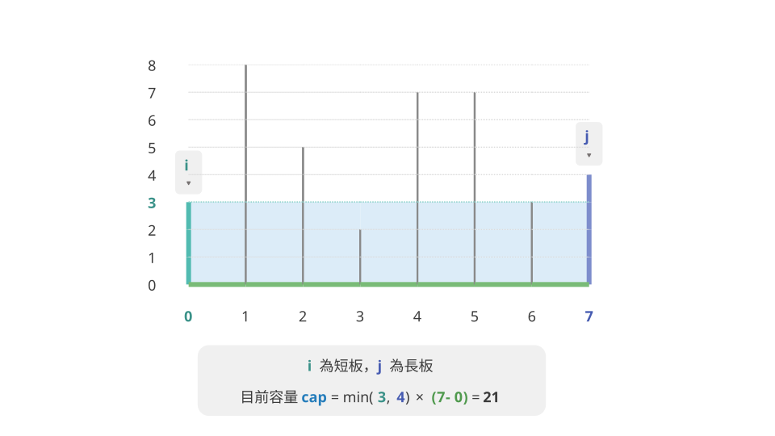
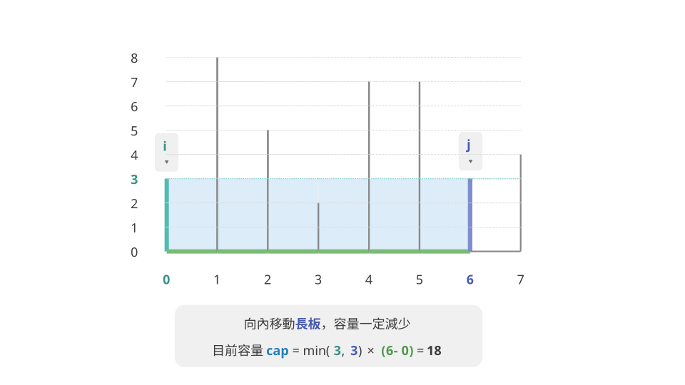
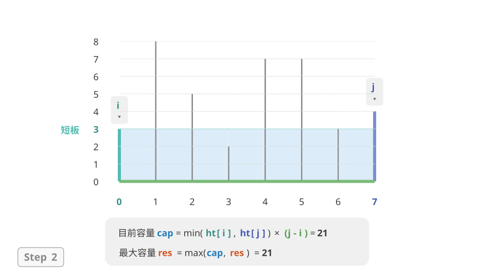
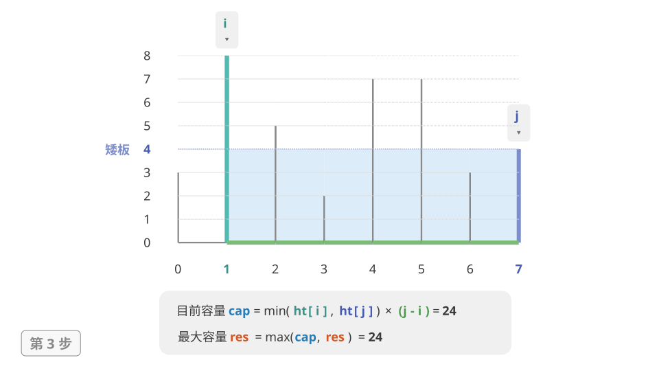
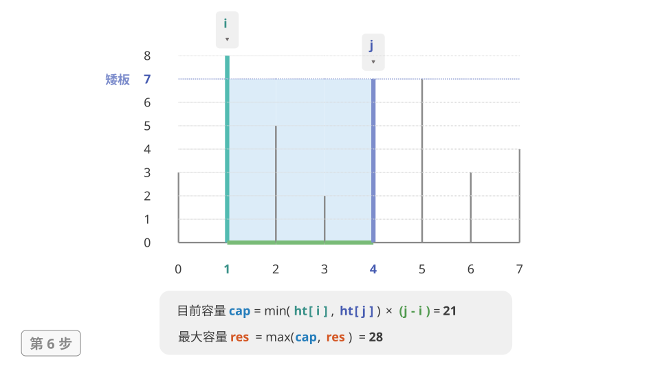
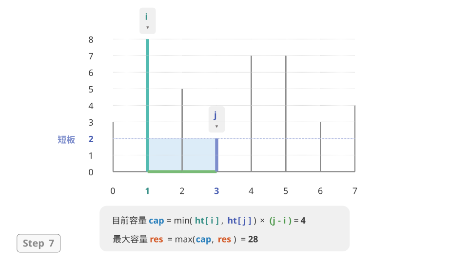
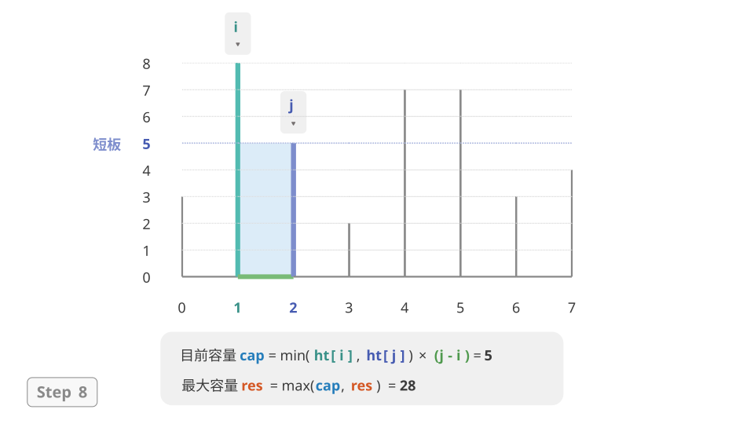
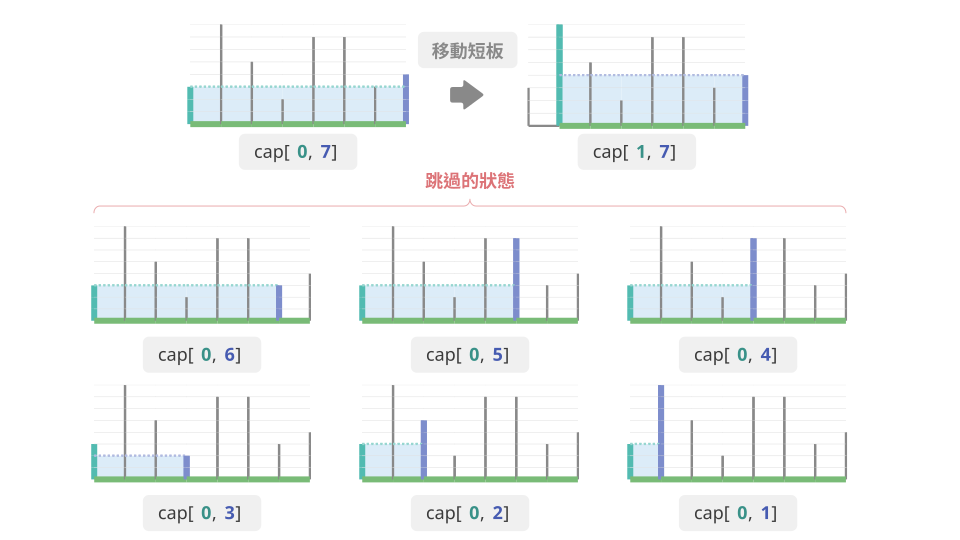

# 最大容量問題

!!! question

    輸入一個陣列 $ht$，每個元素代表一塊直立隔板的高度。任選兩塊隔板，就能用兩板之間的空間圍成一個容器。
    
    容器容量等於高度與寬度的乘積（面積）。高度取決於較矮的隔板，寬度則是兩塊隔板在陣列中的索引差。
    
    請從陣列中選出兩塊隔板，使它們圍成的容器容量最大，並回傳這個最大容量。範例如下圖。


任意兩塊隔板都能圍成容器，**因此可以用兩塊隔板的索引來表示本題的狀態，記為 $[i, j]$**。

依題意，容量等於高度乘以寬度。高度由矮板決定，寬度則是兩塊隔板的陣列索引差。以 $cap[i, j]$ 表示容量，可得下列公式：

$$
cap[i, j] = \min(ht[i], ht[j]) \times (j - i)
$$

設陣列長度為 $n$，兩塊隔板的組合數（狀態總數）就是 $C_n^2 = \frac{n(n - 1)}{2}$。最直接的做法是**列舉所有狀態**，找出最大容量，時間複雜度為 $O(n^2)$。

### 決定貪婪策略

這道題還有更有效率的解法。如下圖所示，選取一個狀態 $[i, j]$，使索引滿足 $i < j$，且高度滿足 $ht[i] < ht[j]$。也就是說，$i$ 是矮板，$j$ 是高板。



如下圖所示，**此時若將高板 $j$ 往矮板 $i$ 的方向移動，容量一定會變小**。

這是因為移動高板 $j$ 後，寬度 $j-i$ 一定變小。高度由矮板決定，因此只可能維持原高度（$i$ 仍是矮板）或降低（移動後的 $j$ 成為矮板）。



反過來想，**只有將矮板 $i$ 往內移，容量才有可能變大**。雖然寬度一定會變小，**高度卻可能增加**（矮板 $i$ 的指標可能移到較高的隔板）。例如下圖中，移動矮板後面積就變大了。


由此可以推導本題的貪婪策略：先將兩個指標分別設在容器兩端，每一輪都將較矮隔板的指標往內移，直到兩個指標相遇。

下圖展示這個貪婪策略的執行過程。

1. 在起始狀態下，指標 $i$ 和 $j$ 分別位於陣列的兩端。
2. 計算目前狀態的容量 $cap[i, j]$，並更新最大容量。
3. 比較隔板 $i$ 和隔板 $j$ 的高度，將矮板的指標往內移一格。
4. 重複執行第 `2.` 步和第 `3.` 步，直到 $i$ 和 $j$ 相遇就結束。

=== "<1>"
    

=== "<2>"
    

=== "<3>"
    

=== "<4>"
    

=== "<5>"
    

=== "<6>"
    

=== "<7>"
    

=== "<8>"
    

=== "<9>"
    

### 程式實作

迴圈最多執行 $n$ 輪，**因此時間複雜度為 $O(n)$**。

變數 $i$、$j$、$res$ 只需常數大小的額外空間，**因此空間複雜度為 $O(1)$**。

```src
[file]{max_capacity}-[class]{}-[func]{max_capacity}
```

### 正確性證明

貪婪法比列舉法快，是因為每一輪的貪婪選擇都會「跳過」一些狀態。

例如，在狀態 $cap[i, j]$ 下，$i$ 是矮板，$j$ 是高板。若依貪婪策略將矮板 $i$ 往內移一格，就會「跳過」下圖中的狀態。**也就是說，之後不會再有機會檢驗這些狀態的容量**。

$$
cap[i, i+1], cap[i, i+2], \dots, cap[i, j-2], cap[i, j-1]
$$



仔細觀察，**跳過的正是固定矮板、將高板 $j$ 往內移所能得到的所有狀態**。前面已證明，將高板往內移一定會讓容量變小。因此，這些狀態都不可能是最佳解，**跳過它們也就不會錯過最佳解**。

以上分析說明，移動矮板是「安全」的做法，這個貪婪策略確實有效。
